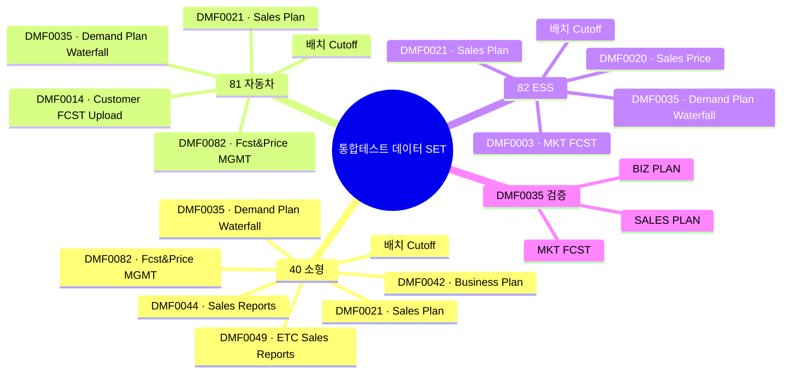
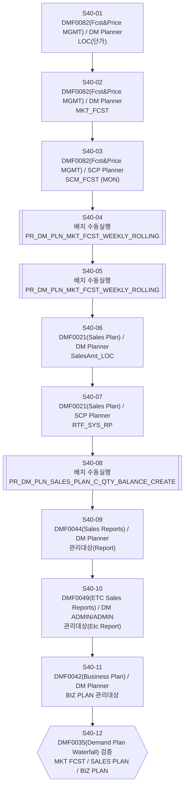
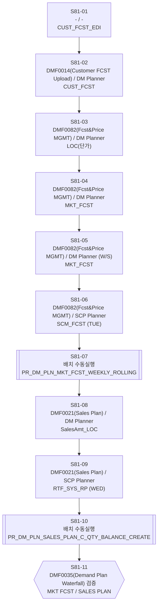
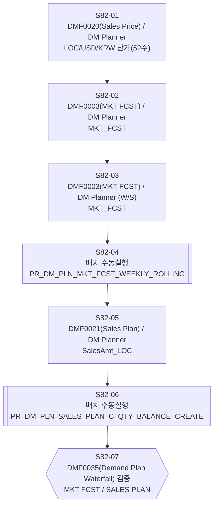

# 통합테스트 PROCESS FLOW (배치 JOB 연결)

> 생성 2026-09-18 09:29 · ZIOUI1 실데이터 기준 · host ol9-db · user SCM_MGR · 조회 2026-09-18 07:56:13
> **배치는 수동 실행 전제** (ZIOUI1 의 관련 JOB 은 전부 `ENABLED=FALSE`)

## 전체 개요 (마인드맵)

## DIVISION 40 (소형)

| 단계ID | DIV | 순서 | 구분 | 화면 | 화면명 | 권한그룹 | 입력MEASURE | 편집요일 | 대상원장 | 배치JOB | 수동실행SP | 검증포인트 | 대응결함No |
|---|---|---|---|---|---|---|---|---|---|---|---|---|---|
| S40-01 | 40 | 1 | 입력 | DMF0082 | Fcst&Price MGMT | DM Planner | LOC(단가) | - | DM_PLN_CFM_SELLING_PRICE |  |  | 단가 입력 후 DMF0082 재조회. ⚠ 첫 진입 직후 즉시 조회 금지 — authGroup CMBO 도착 전이면 userGroup=userId 로 나가 measureAuth 미표시 응답이 남는다(ForecastPrice.tsx:287~295 재조회) | 1ST-45(LOC 미입력 저장차단) |
| S40-02 | 40 | 2 | 입력 | DMF0082 | Fcst&Price MGMT | DM Planner | MKT_FCST | - | DM_PLN_MKT_FCST |  |  | DMF0082 그리드 반영 | 1ST-33~49 |
| S40-03 | 40 | 3 | 입력 | DMF0082 | Fcst&Price MGMT | SCP Planner | SCM_FCST | MON | DM_PLN_MKT_FCST |  |  | SCP Planner 계정으로만 편집 가능 확인 | 1ST-36/41 |
| S40-04 | 40 | 4 | 배치 | - | - | - | - | - | DM_PLN_CFM_MKT_DEMAND_PLAN_C | JOB_PR_DM_PLN_MKT_FCST_WEEKLY_ROLLING_MON_40 | `PR_DM_PLN_MKT_FCST_WEEKLY_ROLLING('40','MKT FCST Weekly Cutoff','MF_W','Weekly Rolling','system')` | MF_W 신규 버전 생성 확인 |  |
| S40-05 | 40 | 5 | 배치 | - | - | - | - | - | DM_PLN_CFM_MKT_DEMAND_PLAN_C | JOB_PR_DM_PLN_MKT_FCST_WEEKLY_ROLLING_TUE_SCM_FCST | `PR_DM_PLN_MKT_FCST_WEEKLY_ROLLING('40','SCM FCST Weekly Cutoff','SF_W','Weekly Rolling','system')` | SF_W 신규 버전 생성 확인 |  |
| S40-06 | 40 | 6 | 입력 | DMF0021 | Sales Plan | DM Planner | SalesAmt_LOC | - | DM_PLN_SALES_PLAN |  |  | SALES PLAN 저장 | 1ST-58~62 |
| S40-07 | 40 | 7 | 입력 | DMF0021 | Sales Plan | SCP Planner | RTF_SYS_RP | - | DM_PLN_SALES_PLAN |  |  | 권한별 편집 메저 분리 확인 | 1ST-58~62 |
| S40-08 | 40 | 8 | 배치 | - | - | - | - | - | DM_PLN_SALES_PLAN_C | JOB_PR_DM_PLN_SALES_PLAN_WEEKLY_ROLLING_40 | `PR_DM_PLN_SALES_PLAN_C_QTY_BALANCE_CREATE(P_DIVISION_ID=>'40',P_CUTOFF_YYYYMMDD=>NULL,P_CREATION_TYPE=>NULL)` | SALES PLAN Cutoff 버전 생성 |  |
| S40-09 | 40 | 9 | 입력 | DMF0044 | Sales Reports | DM Planner | 관리대상(Report) | - | - |  |  | 추가 관리대상 반영 | CHAT-20260820-2~13 |
| S40-10 | 40 | 10 | 입력 | DMF0049 | ETC Sales Reports | DM ADMIN/ADMIN | 관리대상(Etc Report) | - | - |  |  | ⚠ etc-sales-reports.editLock G0: DM Planner 는 82 만 편집 허용 → 40 은 상위권한 필요 | CHAT-20260820-14~19 |
| S40-11 | 40 | 11 | 입력 | DMF0042 | Business Plan | DM Planner | BIZ PLAN 관리대상 | - | DM_PLN_BIZPLAN |  |  | BIZ PLAN 저장 | ⚠ 원장 0건(공백) |
| S40-12 | 40 | 12 | 검증 | DMF0035 | Demand Plan Waterfall | - | MKT FCST / SALES PLAN / BIZ PLAN | - | - |  |  | 3 TYPE 각각에서 S40-02·06·11 입력값 집계 확인 | UM-01~12 |

## DIVISION 81 (자동차)

| 단계ID | DIV | 순서 | 구분 | 화면 | 화면명 | 권한그룹 | 입력MEASURE | 편집요일 | 대상원장 | 배치JOB | 수동실행SP | 검증포인트 | 대응결함No |
|---|---|---|---|---|---|---|---|---|---|---|---|---|---|
| S81-01 | 81 | 1 | 선행/배치 | - | - | - | CUST_FCST_EDI | - | DM_PLN_MKT_FCST | JOB_PR_DM_DNM_EDI_CALLOFF | `PR_DM_PLN_CUST_FCST_RECORD('81','EDI')` | EDI 유입분은 MEASURE=CUST_FCST_EDI 로 적재 (원장 DM_MST_CUSTOMER_FCST 경유) | ⚠ 절차 신규정의 |
| S81-02 | 81 | 2 | 선행/입력 | DMF0014 | Customer FCST Upload | DM Planner | CUST_FCST | - | DM_PLN_MKT_FCST |  |  | 수기/Excel 유입분은 MEASURE=CUST_FCST — EDI분(CUST_FCST_EDI)과 구분 확인 | 2ND-90~92 |
| S81-03 | 81 | 3 | 입력 | DMF0082 | Fcst&Price MGMT | DM Planner | LOC(단가) | - | SCM_MST_FUTURE_PRICE |  |  | ⚠ 81 은 DM_PLN_CFM_SELLING_PRICE 0건 — FUTURE_PRICE 축. ⚠ 첫 진입 직후 즉시 조회 금지(authGroup CMBO race) | 1ST-63~67 |
| S81-04 | 81 | 4 | 입력 | DMF0082 | Fcst&Price MGMT | DM Planner | MKT_FCST | - | DM_PLN_MKT_FCST |  |  | DMF0082 그리드 반영 | 1ST-63~67 |
| S81-05 | 81 | 5 | 입력 | DMF0082 | Fcst&Price MGMT | DM Planner (W/S) | MKT_FCST | - | DM_PLN_MKT_FCST |  |  | W/S 권한 편집 범위 확인. ⚠ 사전확인 필수 — CMBO MktFcstWsPlannerYn 이 0행이면 wsPlannerYn=false 로 조용히 degrade 되어 AS_In_Req·W/S FCST Type·AS FROM SITE 검증이 오류 없이 전부 꺼진다. 계정은 ADMIN 미겸직(jaehyeok/miyeong.lee)만 사용 | 1ST-63(W/S 권한) |
| S81-06 | 81 | 6 | 입력 | DMF0082 | Fcst&Price MGMT | SCP Planner | SCM_FCST | TUE | DM_PLN_MKT_FCST |  |  | ⚠ 81 SCM_FCST 원장 0건 — 신규 입력 시나리오 | 1ST-41 |
| S81-07 | 81 | 7 | 배치 | - | - | - | - | - | DM_PLN_CFM_MKT_DEMAND_PLAN_C | JOB_PR_DM_PLN_MKT_FCST_WEEKLY_ROLLING_TUE_81_2 | `PR_DM_PLN_MKT_FCST_WEEKLY_ROLLING('81','MKT FCST Weekly Cutoff','MF_W','Weekly Rolling','system')` | MF_W 신규 버전 생성 확인 |  |
| S81-08 | 81 | 8 | 입력 | DMF0021 | Sales Plan | DM Planner | SalesAmt_LOC | - | DM_PLN_SALES_PLAN |  |  | SALES PLAN 저장 | 1ST-58~62 |
| S81-09 | 81 | 9 | 입력 | DMF0021 | Sales Plan | SCP Planner | RTF_SYS_RP | WED | DM_PLN_SALES_PLAN |  |  | 수요일만 편집 가능 확인 | 1ST-58~62 |
| S81-10 | 81 | 10 | 배치 | - | - | - | - | - | DM_PLN_SALES_PLAN_C | JOB_PR_DM_PLN_SALES_PLAN_WEEKLY_ROLLING_81 | `PR_DM_PLN_SALES_PLAN_C_QTY_BALANCE_CREATE('81','')` | SALES PLAN Cutoff 버전 생성 |  |
| S81-11 | 81 | 11 | 검증 | DMF0035 | Demand Plan Waterfall | - | MKT FCST / SALES PLAN | - | - |  |  | 2 TYPE 에서 입력값 집계 확인 | UM-01~12 |

## DIVISION 82 (ESS)

| 단계ID | DIV | 순서 | 구분 | 화면 | 화면명 | 권한그룹 | 입력MEASURE | 편집요일 | 대상원장 | 배치JOB | 수동실행SP | 검증포인트 | 대응결함No |
|---|---|---|---|---|---|---|---|---|---|---|---|---|---|
| S82-01 | 82 | 1 | 입력 | DMF0020 | Sales Price | DM Planner | LOC/USD/KRW 단가(52주) | - | SCM_MST_FUTURE_PRICE |  |  | 52주 구간 단가 입력. DMF0020 편집가능 division 은 82 뿐(lookup DM_EDITABLE_DIVISION_ALLOW) | 1ST-23~30 |
| S82-02 | 82 | 2 | 입력 | DMF0003 | MKT FCST | DM Planner | MKT_FCST | - | DM_PLN_MKT_FCST |  |  | ⚠ DMF0082 는 82 조회전용(V82-00) — DMF0003 사용 | 1ST-50~57 |
| S82-03 | 82 | 3 | 입력 | DMF0003 | MKT FCST | DM Planner (W/S) | MKT_FCST | - | DM_PLN_MKT_FCST |  |  | W/S 권한 + AS From Site. ⚠ CMBO MktFcstWsPlannerYn / FcstTypeWs 사전확인 필수 — 미등록 시 무증상 degrade | 1ST-57 |
| S82-04 | 82 | 4 | 배치 | - | - | - | - | - | DM_PLN_CFM_MKT_DEMAND_PLAN_C | JOB_PR_DM_PLN_MKT_FCST_WEEKLY_ROLLING_MON_82 | `PR_DM_PLN_MKT_FCST_WEEKLY_ROLLING('82','MKT FCST Weekly Cutoff','MF_W','Weekly Rolling','system')` | MF_W 신규 버전 생성 확인 |  |
| S82-05 | 82 | 5 | 입력 | DMF0021 | Sales Plan | DM Planner | SalesAmt_LOC | - | DM_PLN_SALES_PLAN |  |  | ⚠ 82 는 SCP Planner 메저 메타 없음 | 1ST-58~62 |
| S82-06 | 82 | 6 | 배치 | - | - | - | - | - | DM_PLN_SALES_PLAN_C | JOB_PR_DM_PLN_SALES_PLAN_WEEKLY_ROLLING_82 | `PR_DM_PLN_SALES_PLAN_C_QTY_BALANCE_CREATE('82','')` | SALES PLAN Cutoff 버전 생성 |  |
| S82-07 | 82 | 7 | 검증 | DMF0035 | Demand Plan Waterfall | - | MKT FCST / SALES PLAN | - | - |  |  | 2 TYPE 에서 입력값 집계 확인 | UM-01~12 |

## DMF0035 Waterfall 3 TYPE ↔ 조회 SP / 원장

| TYPE | PROGRAM_ID | 화면명 | 조회 SP | 집계 원장 |
|---|---|---|---|---|
| MKT FCST | DMF0035 | Demand Plan Waterfall | `PKG_DMF0035.P_DMF0035_GET_MKT_FCST_WATERFALL` | `DM_PLN_CFM_MKT_DEMAND_PLAN_C` |
| SALES PLAN | DMF0022 | Sales Plan Waterfall | `PKG_DMF0022.P_DMF0022_GET_DM_PLN_SALES_PLAN_WATERFALL` | `DM_PLN_SALES_PLAN_C` |
| BIZ PLAN | DMF0051 | Biz Plan Waterfall | `PKG_DMF0051.P_DMF0051_GET_DM_PLN_BIZ_PLAN_WATERFALL` | `DM_PLN_BP_FCST_C` |

## 배치 JOB 원 스케줄 (참고 — 현재 전부 ENABLED=FALSE)

| JOB | 주기 |
|---|---|
| `JOB_LGCE_SCMPROD_PR_DM_PLN_ADJUSTED_MKT_FCST_R_TO_MKT_FCST` | FREQ=HOURLY;INTERVAL=1 |
| `JOB_LGCE_SCMPROD_PR_DM_PLN_MKT_FCST_TO_XIF_PLM_PLAN_S` | FREQ=DAILY;BYHOUR=1;BYMINUTE=0;BYSECOND=0 |
| `JOB_PR_DM_DNM_EDI_CALLOFF` | SCH_JOB_PR_DM_DNM_EDI_CALLOFF_1,SCH_JOB_PR_DM_DNM_EDI_CALLOF |
| `JOB_PR_DM_DNM_EDI_CUTOFF` | FREQ=DAILY;BYHOUR=6;BYMINUTE=15;BYSECOND=0 |
| `JOB_PR_DM_DNM_ERP_EDI_MST_SUMMARY_MAIL_SEND` | FREQ=DAILY;BYHOUR=8;BYMINUTE=0;BYSECOND=0 |
| `JOB_PR_DM_MST_CUST_FCST_WEEKLY_ROLLING_MON_TOTAL` | FREQ=WEEKLY;BYDAY=MON;BYHOUR=0;BYMINUTE=0;BYSECOND=0 |
| `JOB_PR_DM_MST_EDI_CUST_MATERIAL_INFO` | FREQ=HOURLY;INTERVAL=1 |
| `JOB_PR_DM_MST_EDI_UNLOADING_POINT` | FREQ=HOURLY;INTERVAL=1 |
| `JOB_PR_DM_PLN_MKT_FCST_WEEKLY_ROLLING_MON_40` | FREQ=WEEKLY;BYDAY=MON;BYHOUR=15;BYMINUTE=0;BYSECOND=0 |
| `JOB_PR_DM_PLN_MKT_FCST_WEEKLY_ROLLING_MON_82` | FREQ=WEEKLY;BYDAY=MON;BYHOUR=16;BYMINUTE=0;BYSECOND=0 |
| `JOB_PR_DM_PLN_MKT_FCST_WEEKLY_ROLLING_TOTAL_MOBILE` | FREQ=WEEKLY;BYDAY=SUN,WED,THU,FRI,SAT;BYHOUR=0;BYMINUTE=0;BY |
| `JOB_PR_DM_PLN_MKT_FCST_WEEKLY_ROLLING_TUE_81_2` | FREQ=WEEKLY;BYDAY=TUE;BYHOUR=4;BYMINUTE=0;BYSECOND=0 |
| `JOB_PR_DM_PLN_MKT_FCST_WEEKLY_ROLLING_TUE_81_HG` | SCH_JOB_PR_DM_PLN_MKT_FCST_WEEKLY_ROLLING_TUE_81_HG_1,SCH_JO |
| `JOB_PR_DM_PLN_MKT_FCST_WEEKLY_ROLLING_TUE_81_UC` | FREQ=WEEKLY;BYDAY=TUE;BYHOUR=10;BYMINUTE=0;BYSECOND=0 |
| `JOB_PR_DM_PLN_MKT_FCST_WEEKLY_ROLLING_TUE_SCM_FCST` | FREQ=WEEKLY;BYDAY=MON;BYHOUR=17;BYMINUTE=30;BYSECOND=0 |
| `JOB_PR_DM_PLN_MKT_FCST_WEEKLY_ROLLING_TUE_TOTAL` | FREQ=WEEKLY;BYDAY=TUE;BYHOUR=0;BYMINUTE=15;BYSECOND=0 |
| `JOB_PR_DM_PLN_SALES_PLAN_WEEKLY_ROLLING_40` | SCH_JOB_PR_DM_PLN_SALES_PLAN_WEEKLY_ROLLING_40_1,SCH_JOB_PR_ |
| `JOB_PR_DM_PLN_SALES_PLAN_WEEKLY_ROLLING_81` | SCH_JOB_PR_DM_PLN_SALES_PLAN_WEEKLY_ROLLING_81_1,SCH_JOB_PR_ |
| `JOB_PR_DM_PLN_SALES_PLAN_WEEKLY_ROLLING_82` | SCH_JOB_PR_DM_PLN_SALES_PLAN_WEEKLY_ROLLING_82_1,SCH_JOB_PR_ |