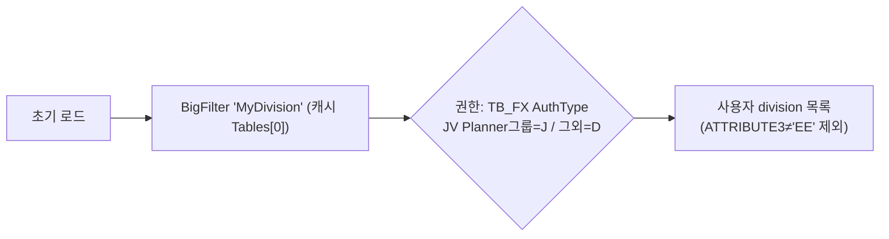
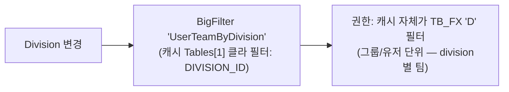
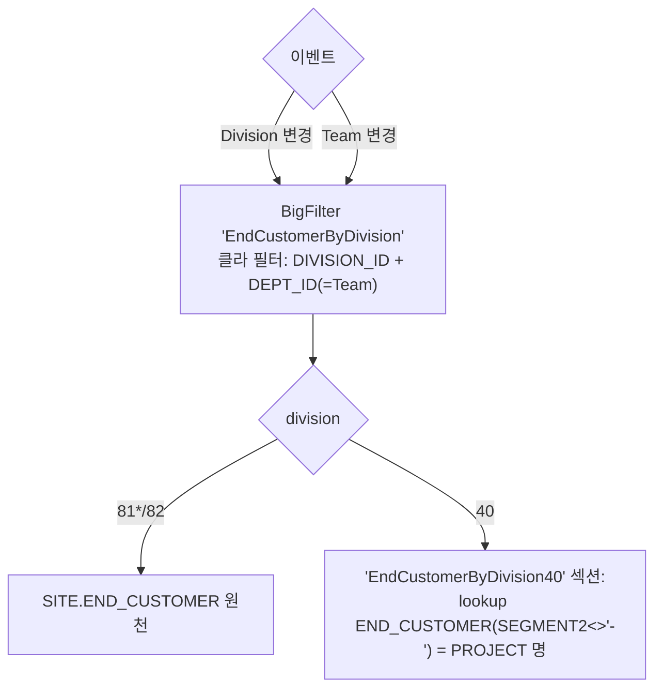
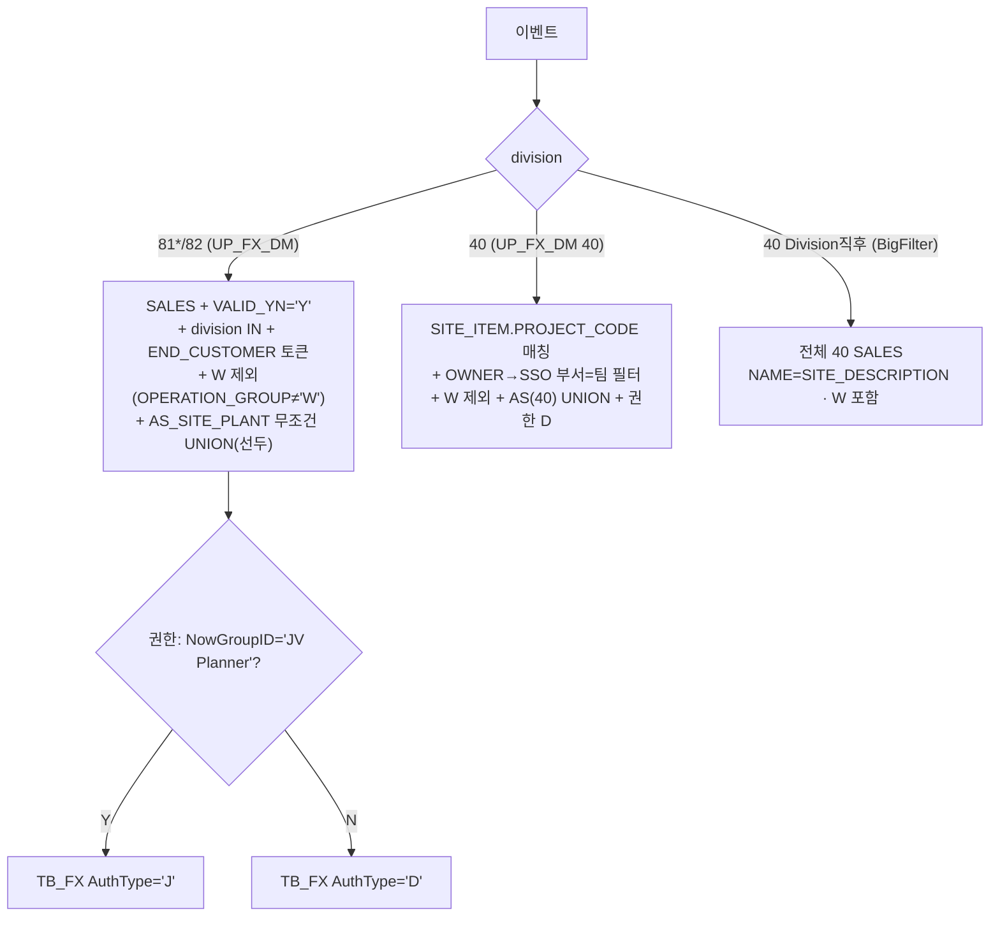
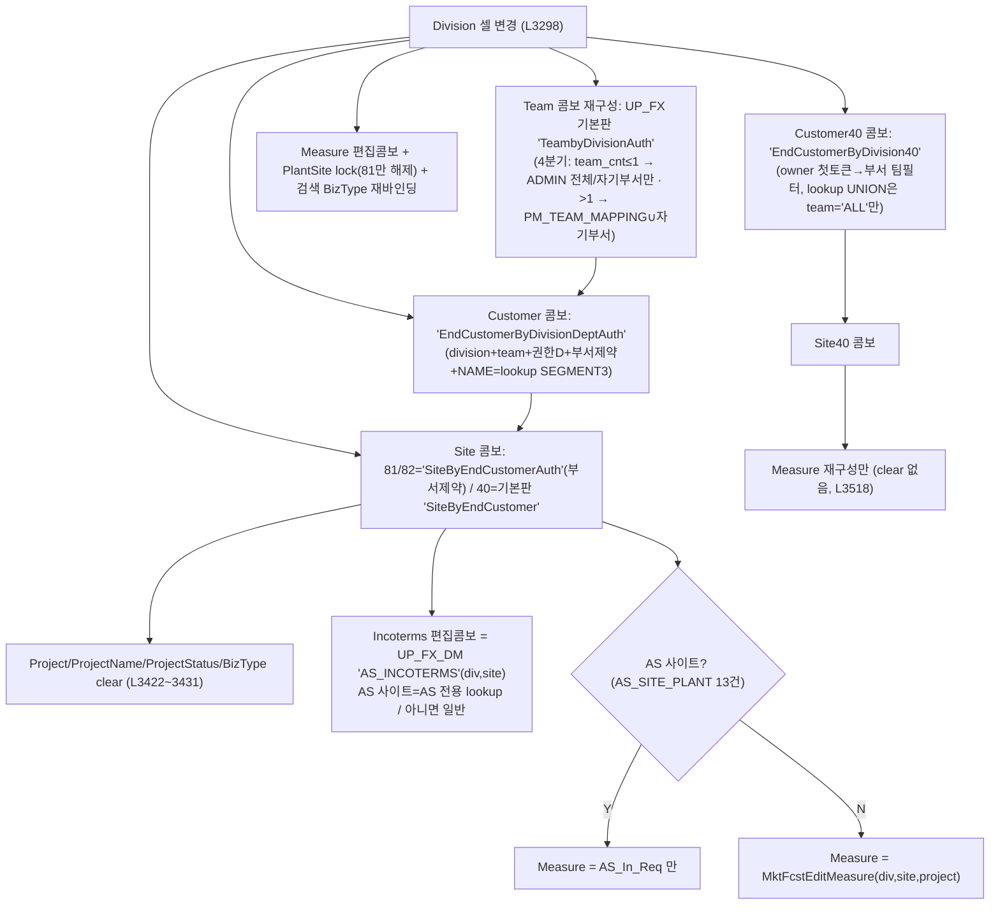
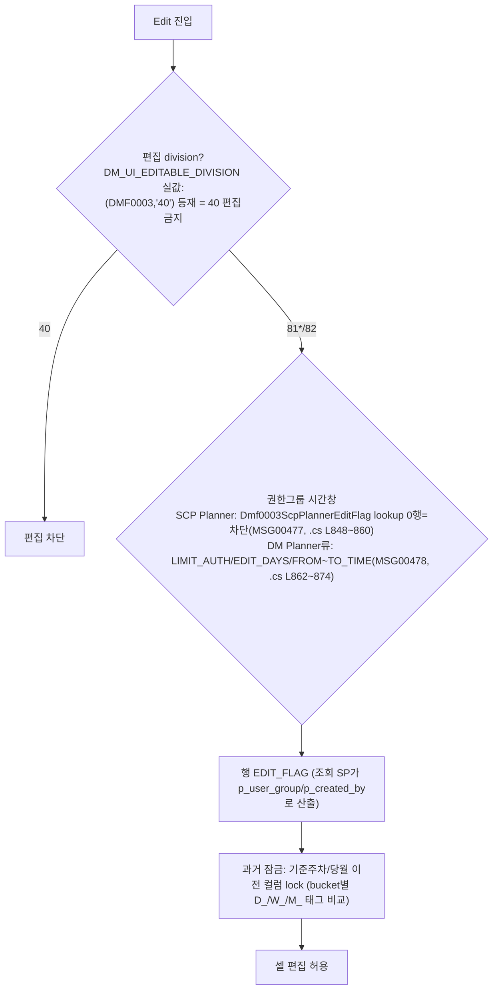

# DMF0003 (Mkt Fcst) — 조회조건·GRID Cascade/Filter 전 케이스 Flow (AS-IS 기준) v1.0

> 작성 2026-08-05 · 원천 = AS-IS `DMF0003_MktFcst.cs`(7,144줄) 전수 + `BigFilter.xml` + `UP_FX_GetCommonDataList`(기본판/_DM판) 원문 + AS-IS DB(LGCE_SCMDEV) lookup 실값.
> 각 케이스에 **TO-BE 반영 현황** 병기: ✅완료 / 🔶갭 / ❌미반영 / ⏸데이터 대기.
> TO-BE 정합 작업 이력 = `Doc/_archive/work_reports/2026-08-04_DMF0003_SalesSite_ASIS_전수정합.md`

## 0. 공통 축 정의

### 0.1 콤보 데이터 3계통 (AS-IS)
| 계통 | 방식 | 파라미터 | 특징 |
|---|---|---|---|
| **BigFilter** (`BigFilter.xml` list_line_dm 1회 배치 → 캐시 9섹션) | 화면 로드 1회 → `GetDMInnerTable(키, Filter)` 클라 필터 | SQL은 `@GROUP_ID`/`@USER_ID`만 — DIVISION/DEPT/CUSTOMER는 **클라이언트 RowFilter** | 'ALL'→'' 관대, W 미제외, AS 미포함 |
| **UP_FX_GetCommonDataList** (기본판, L9918) | 이벤트마다 SP 호출 | @Code + PARAM1~5 서버 필터 | 셀 콤보(Auth 계열) 사용 |
| **UP_FX_GetCommonDataList_DM** (_DM판, L16661) | 이벤트마다 SP 호출 | 동일 | 검색 콤보 최신 계열 (W 제외, AS 포함) |

### 0.2 권한 축 (AS-IS)
| 축 | 값 | 사용처 |
|---|---|---|
| NowGroupID (로그인 선택 그룹) | ADMIN / DM ADMIN / DM Planner / **DM Planner (W/S)** / SCP Planner / **JV Planner** | FCST_TYPE 콤보 분기 · Auth 셀 콤보 ADMIN 판정 · AuthType 스위치 |
| TB_FX_UserGroupAuthExtention | AuthType **'D'**(13,616행) / **'J'**(JV Planner 17행) | division 접근 권한 (`GroupID LIKE '%'+그룹+'%' AND UserID LIKE '%'+유저+'%'`) |
| 부서제약 | `TB_FX_User.DEPT_ID` + `PM_TEAM_MAPPING`(370행, SEGMENT1=자기부서→SEGMENT3=허용부서) | 셀 콤보 Auth 계열 (ADMIN 전체 / 그 외 자기부서∪매핑) |

> **TO-BE 권한 대체**: TB_FX → `SCM_ADM_USER_GR_UNIT_AUTH_MPG_M`(USER_ID×UNIT_TP_CD='D' — 보유그룹 합집합 AUTHUNION 2026-08-04 확정). NowGroupID='ADMIN' → `USER_GR_MPG_M` ADMIN 그룹 보유 판정. ✅

---

## §1 조회조건 13필드 — Division×권한 Cascade/Filter Flow

### 1-1. Division
- 트리거: 초기 로드(InitControls)만. 자체 cascade 원천.

- 쿼리 메모 (BigFilter.xml `-- 'MyDivision'` L22~35): `SCM_MST_DIVISION`류 + `A.ATTRIBUTE3 <> 'EE'` + TB_FX 권한(@AuthTypePara: list_line_dm 도입부에서 JV Planner면 'J').
- Division 변경 시 파생 cascade → §1-2~1-13 각 필드 참조. 그 외 40 전용 UI 토글: Project/PlantSite 비활성+CellQty 활성(40) / InvalidExec 강제 체크(82) / EDISender 활성(81) — `.cs L3050~3153`.
- **TO-BE**: ✅ CMBO `MyDivision` + MktFcst.tsx onChange reset 체계 (cellQtyYn/invalidYn/plantSiteIds — L152~167).

### 1-2. Team
- 트리거: Division 변경(L3036) · 초기 로드(L347 상당).

- 쿼리 메모: BigFilter `'TeambyDivision'` 섹션(L37~) — "40 사업부 외의 방식은 모두 주석처리, 기존 40사업부 방식으로 모두 사용하도록 수정" → **owner(SITE_ITEM) 기반 팀**. 검색 Team에는 부서제약/권한그룹 분기 없음.
- **TO-BE**: ✅ CMBO `UserTeamByDivision`(2026-07-23 P4 — owner 1토큰 부서 대조 정합).

### 1-3. End Customer
- 트리거: Division 변경(L3062/3095) · Team 변경(L3178/3193).

- 쿼리 메모: BigFilter L82~107(`EndCustomerByDivision`/`EndCustomerByDivision40` — `SEGMENT2 <> '-'`), 클라 필터 = `GetDMInnerTable` case `EndCustomerByDivision` (DIVISION_ID/DEPT_ID Contains).
- **TO-BE**: ✅ CMBO `EndCustomer`(DIVISION_ID/DEPT_ID 반환) + EndCustomerField `deptIds` opt-in(2026-08-05 — Team 변경 축소 재현).

### 1-4. Sales Site ⭐ (이벤트×division 매트릭스 — 3원천 혼용)
| 이벤트 | 81/82 | 40 |
|---|---|---|
| 초기 로드 (L555~562) | UP_FX_DM `SiteByEndCustomer`(P1=div,P2=cust) | UP_FX_DM `SiteByEndCustomer40`(P1=**팀**,P2=**PROJECT**) |
| Division 변경 (L3071/L3110) | UP_FX_DM `SiteByEndCustomer` | **BigFilter `ScmSitebyEndCustomer40`**(전40·NAME=SITE_DESCRIPTION·W포함) |
| Team 변경 (L3185/3199) | BigFilter `UserSiteByEndCustomer`(팀 미전달=무반응) | 동일 캐시, 팀 클라필터(DataService L3891: div=40만 팀 필터) |
| Customer 변경 (L3209/3213) | UP_FX_DM `SiteByEndCustomer` | UP_FX_DM `SiteByEndCustomer40` |

- 쿼리 메모: `_DM판 L16785~16873` (asYn 게이트는 [E20260211-001189]로 주석 — **AS 사이트 전 사용자 무조건 포함**이 정본).
- **TO-BE**: ✅ 전건 완료 — CMBO `UserSiteByEndCustomer`(asYn 게이트 제거) + Div40-직후 `ScmSitebyEndCustomer40` FE 스왑 + deptId/endCustomer reactive (2026-08-04~05).

### 1-5. Biz Type
- 트리거: Division 변경(L3077/3117) — `BigFilter 'BizType'`(`DM_BIZ_TYPE` lookup + `BizTypebyDivision` 40=PROJECT 원천). 그리드 Division 셀 변경도 검색 BizType 재바인딩(L3346 — 특이).
- **TO-BE**: ✅ CMBO `BizTypebyDivision`(P1 — 비40 SCM_MST_PROJECT UNION 포함).

### 1-6. Sender Code (EDI Sender)
- 트리거: Division 변경(L3046) — `BigFilter 'EdiSender'`. **81 계열만 활성**(L3041 disable → L3145 81 enable).
- **TO-BE**: ✅ CMBO `SenderCode`(EDI_SENDER_CODE lookup, NAME=ATTRIBUTE1) + 81 전용 enable.

### 1-7. Period
- 초기 로드: `PR_GET_DAY_RANGE(p_created_by, p_month=6)` → 당월 1일 ~ +6개월 말일. cascade 없음.
- **TO-BE**: ✅ (P6 — 로컬타임 포맷).

### 1-8. Bucket
- 초기 로드: `DMF0003_GET_BUCKET_TYPE_CODE` (Daily/Weekly/Monthly). 변경 시 컬럼 표시 전환(SetSpreadColumn)+당주 보더+Edit 유지(L3218~3290) — 데이터 cascade 없음.
- **TO-BE**: ✅ BucketType CMBO + Sum/보더 렌더.

### 1-9. Project (검색영역)
- `txtProject` 텍스트 + `btnProject` 팝업. **40 비활성**(L3052~3054), Division 변경 시 clear(L3160). 서버 필터는 조회 SP(`DMF0003_GET_MKT_FCST`) 파라미터로만 작용.
- **TO-BE**: ✅ (조회 payload — 40 비활성 포함).

### 1-10. Model/Nickname (검색영역 Item)
- `txtItemId` 텍스트(+팝업). Division 변경 시 clear(L3161). 조회 SP 파라미터.
- **TO-BE**: ✅ ItemField.

### 1-11. Plant Site
- 트리거: Division 변경/초기 로드 — **81 계열만** `BigFilter 'UserPlantSiteByEndCustomer'`(L3120~3127, PlantSiteByEndCustomer 섹션 L210~223: SITE_TYPE='PLANT'+TB_FX 'D', `GroupID LIKE @GROUP_ID+'%'` — 여기만 앞방향 LIKE). 40 비활성(L3053) · **82 비활성+clear**(L3134~3135).
- **TO-BE**: ✅ PlantSiteField(`PlantSitebyEndCustomer`, 81 전용 enable + reset).

### 1-12. Item Type
- 초기 로드: `GetItemType()`(UP_FX `ItemType` lookup). cascade 없음.
- **TO-BE**: ✅ CMBO `ItemType`.

### 1-13. Owner
- `txtOwner` 텍스트(40 계열 조회조건). Division 변경 시 clear(L3162). 조회 SP 파라미터.
- **TO-BE**: ✅ (조회 payload).

---

## §2 GRID INSERT/UPDATE Cascade/Filter Flow

### 2-1. INSERT — 신규행 셀 콤보 체인 (spdMain_ComboSelChange L3292~3930, 신규행 'I'만)

- **Measure 셀 변경 (L3532~3556)**: 신규행 && measure∉{AS_In_Req, BNPIn} → ItemId/ItemId40/ItemName/ItemType/NickName clear (MDM ACTIVE_FLAG 기반 DP 입력 차단).
- **FcstType 셀 변경 (L3557~3601)**: AS_FROM_SITE 게이트 —
  사이트∈AS 사이트 → 항상 clear+lock / 사이트∉AS && FcstType∈`SALES_TYPE_CODE2∪ADD` **실값 6종 {WS, WSF, AS, ASF, Recall, RMA}** → 활성(컬럼 없으면 MSG00472) / 그 외 → clear+lock.
- **Project 셀 (L3767)**: SCM0002 팝업(div, team, customer, **site**, project) → Project/Name/Status/BizType/Owner 자동 세팅.
- **ItemId/ItemId40 셀 (L3826/3889)**: DM0002 팝업(div, team, customer, site, project, item, **mdmActive='Y'**, **measure**) — measure∈{AS_In_Req,BNPIn}이면 팝업이 mdmActive를 ''로 리셋(L248~250) → 사용중지 모델 필터 미적용. 선택 시 ItemId/ItemName/ItemType/NickName 세팅.
- **페이스트 (L6492~6594)**: Site40 → Measure 재구성 / Site(81/82) → Incoterms(AS_INCOTERMS) + AS사이트=AS_In_Req만·비AS=MKT_FCST_RP만 + FcstType 따라 AS_FROM_SITE 활성/clear.

**Measure 후보 실데이터** — `MktFcstEditMeasure`(기본판 L12635): ①82+PARAM5 지정 시 해당 measure 단건 ②일반 = `MKT_FCST_MEASURE`(SEGMENT4='Y' INSERT허용, ATTRIBUTE2<>'Y' 비TMM, VMI_YN 사이트별 ATTRIBUTE1 분기) ∪ 고객FCST measure(`DM_MST_CUSTOMER_FCST`) ∪ TMM(TMM_MEASURE_ADMIN 사용자 등재 시). 82 실값 8종: RTF, MKT_FCST_RP, RTF_SYS_RP, VMI_In_Plan, VMI_In_Req, VMI_Inv, BNPIn, AS_In_Req.

**TO-BE 반영 현황 (§2-1)**: ✅ GRID_CASCADE_FILTERS(TEAM_ID/END_CUSTOMER/END_CUSTOMER40/SCM_SITE_ID/SCM_SITE_ID40 — TEAM_ID→DEPT_ID 포함) + GRID_CASCADE_CLEAR(END_CUSTOMER→SITE, SITE→Project계열) + MEASURE_MODEL_CLEAR + AS_FROM_SITE 게이트(isAsFromSiteEditable — AS사이트 제외 포함) + AS_INCOTERMS 스왑 + 모달 activeFlag/measure 예외 + Auth판 CMBO 4본(SiteByEndCustomerAuth/EndCustomerByDivisionDeptAuth/EndCustomerByDivision40Team/TeambyDivisionAuth). ⏸ 부서제약 실발동은 `SITE.DEPT_ID` 데이터 적재 후(현재 TO-BE 전건 NULL — 데이터 무변경 방침).

### 2-2. UPDATE — 편집 게이트 (EditButton 계열)

- 권한 payload: 조회 SP `DMF0003_GET_MKT_FCST`에 `p_user_group`(NowGroupID)/`p_created_by` 전달 → 서버가 `GET_ADMIN_GROUP*` lookup으로 EDIT_FLAG 판정.
- **TO-BE**: ✅ EDIT_FLAG(PKG v2 — AUTHUNION 보유그룹 합집합) + evalDynCell(bucket×measure×past matrix) + 시간창 MSG00477/478. 클라우드 QA·DEV 적용 대기분은 통합본 참조.

---

## §3 커버리지 대조표 (누락 0 증빙)

### 3-1. 13필드
| # | 필드 | 섹션 | 사용 여부 |
|---|---|---|---|
| 1 | Division | §1-1 | 사용 |
| 2 | Team | §1-2 | 사용 |
| 3 | End Customer | §1-3 | 사용 |
| 4 | Sales Site | §1-4 | 사용 |
| 5 | Biz.Type | §1-5 | 사용 |
| 6 | Sender Code | §1-6 | 사용(81 전용) |
| 7 | Period | §1-7 | 사용 |
| 8 | Bucket | §1-8 | 사용 |
| 9 | Project | §1-9 | 사용(40 비활성) |
| 10 | Model/Nickname | §1-10 | 사용 |
| 11 | Plant Site | §1-11 | 사용(81 전용) |
| 12 | Item Type | §1-12 | 사용 |
| 13 | Owner | §1-13 | 사용(40 계열) |

### 3-2. AS-IS 이벤트 핸들러 전수 (11) ↔ 문서 매핑
| 핸들러 (.cs 라인) | 문서 |
|---|---|
| cboDivision_SelectedIndexChanged L3020 | §1-1~1-13 division 분기 |
| clbTeam_SelectedIndexChanged L3167 | §1-3, §1-4 |
| clbCustomer_SelectedIndexChanged L3205 | §1-4 |
| cboBucketType_SelectedIndexChanged L3218 | §1-8 |
| spdMain_ComboSelChange L3292 (12분기: Division/Team/Customer/Customer40/ScmSiteId/ScmSiteId40/Measure/FcstType/Project/ItemId/ItemId40) | §2-1 |
| spdMain_CellDoubleClick L3605 | §2-1(헤더 드릴다운·SSP비교 — 표시/팝업) |
| chkColor L5629 / chkSum L5782 | §1-8(표시 — cascade 없음) |
| spdMain_EditChange L6483 | §2-1(페이스트 플래그) |
| spdMain_ClipboardPasted L6492 | §2-1 페이스트 |
| spdMain_CellClick L6597 | §2-1(PlantSite 목록 — 주석화 잔재 포함) |
| cboAS_CheckedChanged L7069 | §1-4(hidden — L553) |

### 3-3. 콤보/필터 원천 키 전수 ↔ 문서 매핑
MyDivision·UserTeamByDivision·EndCustomerByDivision(40)·UserSiteByEndCustomer·ScmSitebyEndCustomer40·UserPlantSiteByEndCustomer·EdiSender·BizType(BizTypebyDivision) → §1 / SiteByEndCustomer(40)·SiteByEndCustomerAuth·EndCustomerByDivisionDeptAuth·TeambyDivisionAuth·MktFcstEditMeasure·AS_INCOTERMS·AS_FROM_SITE·FCST_TYPE(SALES_TYPE_CODE2/ADD)·MKT_FCST_MEASURE → §2 / PR_GET_DAY_RANGE·DMF0003_GET_BUCKET_TYPE_CODE·ItemType → §1-7/8/12.
