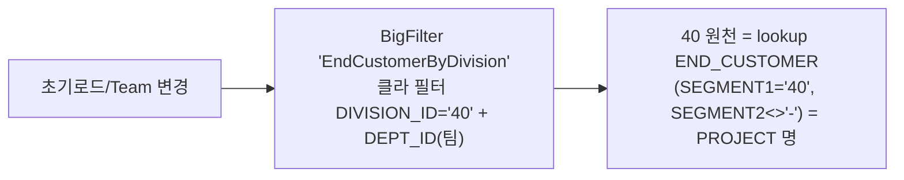
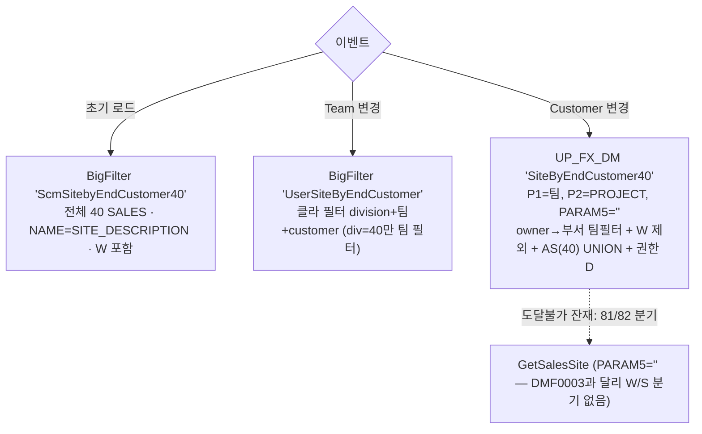
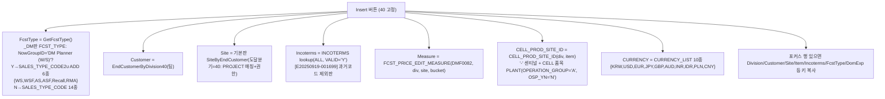
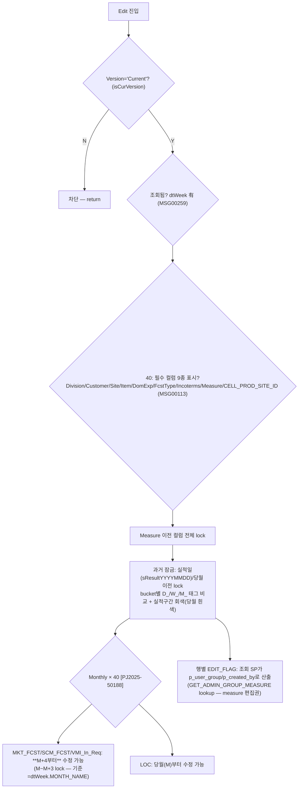

# DMF0082 (Fcst&Price Mgmt) — 조회조건·GRID Cascade/Filter 전 케이스 Flow (AS-IS 기준) v1.0

> 작성 2026-08-05 · 원천 = AS-IS `DMF0082_FcstNPrice_Mgmt.cs`(9,419줄) 전수 + `BigFilter.xml` + `UP_FX_GetCommonDataList`(기본판/_DM판) 원문 + AS-IS DB lookup 실값.
> 각 케이스에 **TO-BE 반영 현황** 병기: ✅완료 / 🔶갭 / ❌미반영 / ⏸데이터 대기.

## 0. ⭐ 최상위 구조 사실 — AS-IS는 Division='40' 고정 화면

- `InitControls` L341~343: `SetChangeControl("MyDivision")` 후 **`dtDivision.Select("CODE = '40'")`** — Division 콤보를 40 하나로 고정.
- `clbDivision_SelectedIndexChanged` L3039~3041 = **빈 함수** (Division 변경 이벤트 자체가 무의미).
- 소스에 남은 81/82 분기(clbCustomer L3065, ComboSelChange 등)는 DMF0003 계열 복제 잔재로 **도달 불가**.
- 권한 축: 검색 콤보는 BigFilter(TB_FX 'D') · 조회 SP `DMF0082_GET_MAIN_DATA`에 `p_user_group`(NowGroupID)/`p_created_by` 전달 → 서버 EDIT_FLAG/measure 편집권 판정.

> **TO-BE 구조 차이 (사용자 확정 사양)**: TO-BE forecast-price는 **Division 40/81/82 콤보 확장**(82=81 동일 경로 2026-07-30 확정, Div81/40 테이블 분기 규약). 따라서 TO-BE의 81/82 동작은 AS-IS DMF0082가 아니라 **신규 사양+DMF0003 계열 준용**이며, 본 문서의 AS-IS Flow는 40 기준이 정본. ✅(의도된 확장)

---

## §1 조회조건 13필드 — Cascade/Filter Flow

### 1-1. Division — **40 고정**
- 초기 로드: BigFilter `MyDivision` → `CODE='40'` 필터 고정 (L341~343). cascade 발생 없음(빈 핸들러).
- **TO-BE**: ✅(확장) DivisionField 40/81/82 + 변경 시 deptIds/endCustomers/salesSites reset (ForecastPriceForm L42~50).

### 1-2. Team
- 초기 로드(L347): BigFilter `UserTeamByDivision`(division='40' 클라 필터 — owner 기반 팀).
- Team 변경(L3043~3061) cascade → Customer·Sales Site 재구성 (§1-3, §1-4).
- **TO-BE**: ✅ TeamField(division) + 변경 시 endCustomers/salesSites reset (L56~60).

### 1-3. End Customer
- 트리거: 초기 로드(L352) · Team 변경(L3052).

- **TO-BE**: ✅ 'EndCustomer' CMBO + 인라인 division/dept 클라 cascade (ForecastPriceForm L62~88 — MetalLinkPriceForm 1:1 패턴).

### 1-4. Sales Site
- 트리거: 초기 로드(L364) · Team 변경(L3058) · Customer 변경(L3063~3073).

- 쿼리 메모: `_DM판 SiteByEndCustomer40` L16825~16873 (asYn 게이트 주석 — AS 무조건 UNION).
- **TO-BE**: ✅ SalesSiteField 카탈로그(40=owner-dept 경로 포함 `UserSiteByEndCustomer` 계열). 이벤트별 3원천 혼용은 reactive 단일화(DMF0003 §1-4 판정 동일).

### 1-5. Biz Type
- 초기 로드(L356): BigFilter `BizType`. 그리드 Division 셀 변경(도달 불가 잔재) 시 `SCM0001_GET_BIZ_TYPE_BY_DIVISION` 직접 SP(L3086) — DMF0003과 다른 원천.
- **TO-BE**: ✅ BizTypeField.

### 1-6. Sender Code — **미사용** (DMF0082 조회조건에 없음. FindData 파라미터 11종에 없음)
### 1-7. Period
- 초기 로드(L361): `PR_GET_DAY_RANGE(p_month=**6**)` — 당월 1일~+6개월 말일 (DMF0003과 동일 SP, 개월수만 6). 조회 시 최대 3년 검증(MSG00164, L1699).
- **TO-BE**: ✅ PeriodField.
### 1-8. Bucket
- 초기 로드(L368): `DMF0003_GET_BUCKET_TYPE_CODE`(공용) · 기본값 **Weekly**(DefineProperty L399). 변경 시 표시 전환+Edit 유지(L3248~) — 데이터 cascade 없음.
- 조회 후 `DefaultBucketDay`(DEFAULT_BUCKET_DAY lookup — 실값 40: MONTHLY=MON/WEEKLY=MON·4) 로드(L1773) → 월수량 일별 배분 기준.
- **TO-BE**: ✅ 인라인 Bucket 3종 + bucket-distribution 공용 룰.
### 1-9. Project — **검색조건 미사용** (그리드에도 Project 셀 없음 — Customer=PROJECT 명 lookup으로 대체)
### 1-10. Model/Nickname — 검색 `txtItemId` 텍스트만 (팝업 없음). 조회 SP `p_item_id`. **TO-BE**: ✅ ItemField(팝업+텍스트).
### 1-11. Plant Site — **검색조건 미사용** (그리드 PlantSiteId lock 로직만 잔재)
### 1-12. Item Type — **검색조건 미사용** (그리드 표시 컬럼만)
### 1-13. Owner — **검색조건 미사용**

### 1-14. (13필드 외 실존 조회조건 — 누락 방지 명기)
| 조건 | AS-IS | TO-BE |
|---|---|---|
| Version | `txtVersion`='Current' 기본 + 버전 팝업. 미선택 조회 차단(MSG00283). **Current 버전만 편집 가능**(isCurVersion) | ✅ VersionField |
| Qty (cboQty) | 조회 SP `p_qty_yn` | ✅ |
| Sum (chkSum) | 표시 토글 (L9046) | ✅ |
| 조회 SP 파라미터 전수(L1727~1738) | division/team/customer/biz_type/from·to/scm_site/item_id/version_type/qty_yn/created_by/**user_group** | ✅ |

---

## §2 GRID INSERT/UPDATE Cascade/Filter Flow

### 2-1. INSERT — 신규행 초기 콤보 (InsertRow 40 블록 L2555~2631 + 포커스행 복사 L2634~)

- **FCST_PRICE_EDIT_MEASURE 실데이터** (`DM_UI_EDITABLE_MEASURE`, SEGMENT1='DMF0082'): 40 = **MKT_FCST(입력Y)·SCM_FCST(입력N)·LOC(입력Y)·VMI_In_Req(입력Y, VMI 사이트만 — ATTRIBUTE3='Y'는 SITE.VMI_YN='Y'일 때만)**. Daily 버킷이면 LOC 제외(`SEGMENT3 NOT IN ('LOC')`, _DM판 L17057). 81계열/82도 lookup 등재(MKT_FCST/LOC)되어 있으나 AS-IS 화면은 40 고정.

### 2-2. INSERT/UPDATE — 셀 cascade (spdMain_ComboSelChange L8201~8373)
| 셀 | cascade (실도달 = 40) | 메모 |
|---|---|---|
| Division (도달 불가 잔재) | Team(Auth판)/Customer40/Site/BizType/Measure 재구성 | L8211~8264 |
| Team | Customer=EndCustomerByDivision40(팀) → Site=기본판 SiteByEndCustomer | L8266~8285 |
| Customer | Site 재구성 | L8287~8296 |
| **ScmSiteId** | Measure=FCST_PRICE_EDIT_MEASURE 재구성 + **BUCKET 자동 세팅** = `SALES_BUCKET(div,site,incoterms)` — `DM_MST_BUCKET_CONVERSION` 요일 7자리(예 0111110) PIVOT, 무데이터면 '' | L8297~8321 |
| **Incoterms** | BUCKET 자동 세팅(동일 SALES_BUCKET) | L8324~8342 |
| Measure | (model reset 로직은 전체 주석 — DMF0003과 달리 **미적용**) | L8347~8370 |
- **페이스트 (L7864~8201)**: M/I 행 && 노란(UnLock) 셀만 반영. ScmSiteId→Measure+Incoterms(AS_INCOTERMS) 재구성 / ItemId·CELL_PROD_SITE_ID→CELL_PROD_SITE_ID 재구성 / Measure→편집 measure 재구성. 1행 복사→다행 페이스트 시 첫 행 키 복제.

### 2-3. UPDATE — 편집 게이트 (활성 EditButton L1531~1610 + SetEditList/SetLockRange)

- 서버 권한 실체: `DMF0082_GET_MAIN_DATA`가 EDIT_FLAG·편집 가능 measure(AUTH_MEASURES: MKT_FCST/SCM_FCST/LOC/VMI_In_Req)를 행/커서로 반환 — NowGroupID(또는 사용자 보유그룹)의 `GET_ADMIN_GROUP_MEASURE` lookup 등재 여부.
- **TO-BE**: ✅ drop3(O_RC4) EDIT_AUTH_YN × 행 EDIT_FLAG × AUTH_MEASURES × bucket-컬럼 일치 × M+4/기준주차 잠금 (PKG_DMF0082 — AUTHUNION 합집합 판정 2026-08-04). Bucket 자동세팅=SALES_BUCKET 동일. ⭐TO-BE 그리드 셀 신규입력(INSERT)은 SHEET meta 전 컬럼 `INPUT_TP_CD='S'` — **셀 단위 신규행 입력 미구현**(Save All 팝업 경로로 대체: 'Sales Price Save All' 시트 — Division/DeptId/EndCustomer(40)/Site/BizType/FcstType(NOT_FREE)/Incoterms/Currency/PlantSite 콤보). 🔶 AS-IS Insert 셀 체인과의 대응은 Save All 팝업 + 측정값 편집으로 재배치된 구조(사용자 확정 운용).

---

## §3 커버리지 대조표 (누락 0 증빙)

### 3-1. 13필드
| # | 필드 | 섹션 | 사용 여부 |
|---|---|---|---|
| 1 | Division | §1-1 | **40 고정** |
| 2 | Team | §1-2 | 사용 |
| 3 | End Customer | §1-3 | 사용(=PROJECT 명) |
| 4 | Sales Site | §1-4 | 사용 |
| 5 | Biz.Type | §1-5 | 사용 |
| 6 | Sender Code | §1-6 | **미사용** |
| 7 | Period | §1-7 | 사용(6개월) |
| 8 | Bucket | §1-8 | 사용(Weekly 기본) |
| 9 | Project | §1-9 | **미사용** |
| 10 | Model/Nickname | §1-10 | 사용(텍스트만) |
| 11 | Plant Site | §1-11 | **미사용** |
| 12 | Item Type | §1-12 | **미사용** |
| 13 | Owner | §1-13 | **미사용** |
(+§1-14: Version/Qty/Sum — 13필드 외 실존 조건 명기)

### 3-2. AS-IS 이벤트 핸들러 전수 (10) ↔ 문서 매핑
| 핸들러 (.cs 라인) | 문서 |
|---|---|
| clbDivision_SelectedIndexChanged L3039 (빈 함수) | §0, §1-1 |
| clbTeam_SelectedIndexChanged L3043 | §1-3, §1-4 |
| clbCustomer_SelectedIndexChanged L3063 | §1-4 |
| cboBucketType_SelectedIndexChanged L3248 | §1-8 |
| spdMain_CellClick L3494 (전체 주석 잔재) | §2-2 메모 |
| spdMain_CellDoubleClick L3534 | 헤더 드릴다운(표시) |
| spdMain_ClipboardPasted L7864 | §2-2 페이스트 |
| spdMain_ComboSelChange L8201 (6분기) | §2-2 |
| spdMain_EditChange L8375 | §2-2(페이스트 플래그) |
| chkSum_CheckedChanged L9046 | §1-14(표시) |

### 3-3. 콤보/필터 원천 키 전수 (실측 인벤토리 20종) ↔ 문서 매핑
MyDivision·UserTeamByDivision·EndCustomerByDivision·UserSiteByEndCustomer·ScmSitebyEndCustomer40·UserPlantSiteByEndCustomer(잔재)·EdiSender(잔재)·BizType → §1 / UserTeamByDivisionAuth(잔재)·EndCustomerByDivision40·SiteByEndCustomer40·SiteByEndCustomer(GetSalesSite)·MktFcstEditMeasure(잔재)·PlantSiteByItem(주석 잔재)·SalesPlant(잔재)·FCST_PRICE_EDIT_MEASURE·SALES_BUCKET·CELL_PROD_SITE_ID·CURRENCY_LIST·DefaultBucketDay·DM_CUSTOMS_HANDBOOK·AS_INCOTERMS·FCST_TYPE → §2 / PR_GET_DAY_RANGE·DMF0003_GET_BUCKET_TYPE_CODE·DMF0082_GET_SPREAD_TITLE·DMF0082_GET_MAIN_DATA·DMF0082_POPUP_GET_FUTUREPRICE_INFO(환율 팝업)·DMF0003_GET_MKT_FCST_COMPARE_POPUP(SSP 비교)·SCM0001_GET_BIZ_TYPE_BY_DIVISION → §1-5/7/8, §1-14, §2.

---

## §4. [UICATEGORY 2026-08-07] 조회조건·컬럼 보완 변경 이력 (TO-BE 확장 — hook #124 문서·코드 동기)

> 사용자 요청: 81=편집·82=조회 대상 확장 + DMF0003(Mkt Fcst) 파리티. 상세 = `Doc/_archive/work_reports/2026-08-07_DMF0082_uicategory_보완.md`

### 4-1. 조회조건 재배치 (DMF0003 MktFcstForm 파리티 + 맨 뒤 Version/체크박스 — 사용자 지정)
| 행 | 배치 (신) | 비고 |
|---|---|---|
| Row1 | Division* / Team / End Customer / Sales Site | 기존 유지 |
| Row2 | Biz Type / **Sender Code(신규 — 81 계열만 enable, CMBO 'SenderCode', 단일+ALL)** / Period* / Bucket | Model 은 Row3 이동 |
| Row3(extra) | **Project(신규 — ProjectField/COM0005, div40 비활성, multiCheckbox)** / Model·Nickname / **Plant Site(신규 배선 — PlantSiteField, 81 전용)** | Item Type 미이식(SP 파라미터 부재 — 한계 명시) |
| Row4(extra) | **Owner(신규 — OwnerField/COM0006, multiCheckbox)** / Version* / 체크박스(Sum·Qty≥0) | 맨 뒤 Version+체크박스 = 사용자 지정 |

- SP 배선: `P_DMF0082_GET_MAIN_DATA`(+`_CURRENT`) 말미 `p_project_code/p_owner/p_sender_code DEFAULT 'ALL'` append + PROC_M IN 14~16, OUT 17~22 shift. plantSiteId 미전송 결함 동시 수정(store setFilters).
- 필터 의미론(실측): Project/Owner=엄격 매칭(불일치 행 제거) / **Sender Code=실값 보유 행만 매칭, 무값 행 통과**(사용자 확정 — DMF0003 EDI 한정 의미 승계). 실측: 81 project 1건=607행 / owner 무존재=0행 / sender 무존재=6,518행 유지.

### 4-2. SHEET_COLUMNS 44→61행 (5키 토큰 확장 + DMF0003 파리티 17컬럼)
- 필수 키 5(DIVISION_ID/END_CUSTOMER/SCM_SITE_ID/ITEM_ID/CELL_PROD_SITE_ID): '40' 단독 → 81계열+82 확장 — **81/82 조회·수정 불능 근본원인 해소**(titleset 교차 탈락 12→7컬럼 사고).
- 신규 17: PROJECT_CODE/NAME/STATUS/OWNER, PLANT_SITE_ID, BIZ_TYPE, ENERGE, CELL_QUANTITY, CELL_PER_CAR/MODULE, MODULE_PER_CAR, PROJECT_S_OP_REPORT, TEAM_NAME_KO + 캐리어 4(NEW_FLAG/ATTR1/VMI_STD_DIO/AS_YN — DEFAULT ' ', VISIBLE 'N'). *40 쌍둥이 4·SENDER_CODE 는 미이식(설계 충돌/DMF0003 메타에도 부재).
- division 노출: 40=49 / 81=42 / 82=41 (종전 44/23/23). titleset 47명 전체 재시드(사용자 확정 — DELETE 후 자동 재시드, 실증 C16+M6).

### 4-3. 82 = 조회 전용 (사용자 확정)
- 서버 권위: GET/CURRENT `EDIT_FLAG='N'` 일괄(82) + SAVE `V82-00` 가드(저장 거부). 실측: 82 Current 4,890행 전행 EDIT_FLAG='N'.
- FE: Insert/Delete/Save hotkey 82 비활성(`!isDiv82`). Excel Upload/Form 은 기존 81 전용 유지.

### 4-4. Tier3 캐리어 값 정책 (한계 명시)
| 컬럼 | 값 | 근거 |
|---|---|---|
| AS_YN | 조회 Sales Site 가 AS_SITE_PLANT 룩업 포함 시 전행 'Y' | DMF0003 LP_AS_YN 파리티 |
| ATTR1 | 40=DM_PLN_MKT_FCST(MKT_FCST) 일자 마커 PIVOT / 82=DM_PLN_PR_DETAIL / 81=NULL | DMF0003 원문(81 미정의). 실측 시점 원천 0건=정상 무매치 |
| VMI_STD_DIO | 82=SCM_MST_SITE(VMI_YN^ATTRIBUTE5) 실값 / 40·81 미적재 | DMF0003 40 원문 조인키 사문(ITEM↔SITE) — 이식 보류 |
| NEW_FLAG | 'N' 고정 | DMF0003 파생(수요/판가 FULL OUTER JOIN)이 본 SP 구조에 부재 — 임의 창작 금지 |

### 4-5. 동반 해소 잠복결함 3건
① CURRENT 전면 파손(C_TITLE `DEFAULT_FLAG IS NULL` 사문 → ORDER BY SORT_KEY ORA-00904 상시) → `= ' '` 교정+복구 실측 ② CURRENT GTT(GTT_MF_SP) AS_FROM_SITE/SENDER_NAME 등 부재(ORA-00904 잠복) → 14컬럼 ALTER+NULL 적재 ③ C_TITLE whitelist 가드 부재 → GET/CURRENT 이식(DMF0003 TITLESET IMMUNIZE 파리티).

### 4-6. [CASCADE 2026-08-07] DMF0003 cascade 전수 대조 판정표 (81/82용 누락분 반영 — 사용자 요청)

> 기준 = `DMF0003_조회조건_GRID_Cascade_Flow_ASIS_v1.0.md` §1(13필드)·§2(그리드) 전 행 대조. CMBO 실측 = 후보 16키 중 15 기등록 + `ProjectByDivision`=모달 키(CMBO 대상 아님) → **UP_FX 콤보 누락 0** (hook #117 §5 절차).

| DMF0003 항목 | DMF0082 판정 | 조치 |
|---|---|---|
| §1-1 Division(MyDivision+종속 reset) | 기존 reset 에 **bizTypes 누락** | ✅ F-A: Division onChange 에 bizTypes reset 추가 |
| §1-2 Team(TeambyDivision→EndCustomer·Site clear) | 동일 카탈로그+clear 기존재 | 유지 |
| §1-3 End Customer(division+dept 클라 필터→Site clear) | 인라인 콤보 동일 원천('EndCustomer')+clear 기존재 | 유지 |
| §1-4 Sales Site ⭐(div40초기 ScmSitebyEndCustomer40 ↔ UserSiteByEndCustomer div/dept/endCustomer 서버바인드) | **기존 'SalesSite'(division 클라 필터 단독) — 81/82 고객 종속 cascade 부재** | ✅ F-B: SalesSiteField comboId 스왑 이식(MktFcstForm L70~86 1:1) |
| §1-5 BizType | DMF0003 Form 과 동일 default(BizTypeField 'BizType') | 유지(파리티) |
| §1-6 SenderCode(81 enable+DIVISION 클라 필터) | 2026-08-07 UICATEGORY 로 이식 완료 | 완료 |
| §1-7 Period / §1-8 Bucket | 기존재(cascade 없음) | 유지 |
| §1-9 Project(40 비활성+division clear) | UICATEGORY 이식 완료(ProjectField disabled=div40+reset) | 완료 |
| §1-10 Model | ItemField 기존재 | 유지 |
| §1-11 PlantSite(81 전용 enable·82 비활성+clear) | UICATEGORY 이식 완료(PlantSiteField 내부 81 게이트+reset) | 완료 |
| §1-12 Item Type | 미이식 — 사용자 미지정+DMF0082 SP 파라미터 부재(한계 §4-1) | 제외(기록) |
| §1-13 Owner(division clear) | UICATEGORY 이식 완료(OwnerField+reset) | 완료 |
| §2-1 그리드 Insert 행 셀 체인 | DMF0082 는 시드 복사 설계(#7 셀 콤보 대체) — DMF0003 12분기 체인은 구조 상이로 비이식(DMF0082 AS-IS 자체 cascade 는 §2 기반영). 신규 IM 셀: PLANT_SITE_ID(FPComboBox PlantByDivisionCompany — @divisionId NULL 관대 가드 실측=미전달 무해)/BIZ_TYPE(BizType 무파라미터)/PROJECT_CODE(FPModal — 모달 배선 없음, 시드 승계로 커버) | ✅ F-E: handleInsert PLANT_SITE_ID 시드 승계(''→V81-01 차단 예방) |
| §2-2 편집 게이트 | EDIT_FLAG(서버)+editLock+measureAuth+82='N'(UICATEGORY) | 완료 |

### 4-7. [WS 2026-08-07] DM Planner (W/S) A/S·W/S 등록 지원 — AS-IS 파리티 복원 (사용자 지시)

> 지시: "DM Planner (W/S) 일때 A/S, W/S 메저가 등록 가능해야 합니다" + "AS-IS SOURCE 및 분석서 기준" / 범위 = DMF0082 만.

**AS-IS 실체 규명**: "A/S·W/S 메저" = SHEET_MEASURE 가 아니라 **신규행 등록 시 FCST Type 선택지**.
- `DMF0082_FcstNPrice_Mgmt.cs:8650-8668` `GetFcstType()` → `PARAM1 = NowGroupID`
- → SP `UP_FX_GETCOMMONDATALIST_DM:72` `IF @PARAM1 = N'DM Planner (W/S)'` → `LOOKUP_TYPE='SALES_TYPE_CODE2'`(**WS/WSF/AS/ASF 4종 한정**)
  · ELSE → `SALES_TYPE_CODE` + `NVL(ATTRIBUTE2,'')<>'Y'`(**WS/WSF 배제**)
- → `.cs:2492 InsertRow()` → `:2572 SetCellTypeCombo(DefColumns.FcstType, dtWarrType)`

**TO-BE 파리티 위반 2건(발견)**: FCST_TYPE 셀 콤보가 `FCST_TYPE_NOT_ETC`(13종) 단일 → ①일반 그룹에 WS/WSF 과다 노출 ②W/S 4종 한정 미적용.

**조치 3건** (`_apply_corporate/DMF0082_WS_FCSTTYPE_AUTH_20260807.sql`):
| # | 내용 | 근거·규약 |
|---|---|---|
| 1 | CMBO **신규 `FcstTypeByUserGroupDMF0082`** — AS-IS SP 분기 1:1(W/S 보유 시 SALES_TYPE_CODE2 / 아니면 SALES_TYPE_CODE−ETC−WS/WSF). 그룹 판정 = BE 자동 주입 `@sesUserId` 보유그룹(AUTHUNION 정합, comboParams 불요) | 공유 `FCST_TYPE_NOT_ETC`(5화면 소비) 무변경 — hook #117 §3/§5 |
| 2 | SHEET_COLUMNS DMF0082/FcstNPrice `FCST_TYPE` 셀 콤보를 신규 SQL_ID 로 교체 | 화면 전용 |
| 3 | `GET_ADMIN_GROUP_MEASURE` 에 `DM Planner (W/S)`×DMF0082×**81 계열 6 division**×`MKT_FCST` 등재 | AS-IS 근거 없음(신규 정책) — DMF0003 동일 그룹 패턴(MKT_FCST 단일) 파리티. ⚠️`SEGMENT5` NOT NULL='-'·DISPLAY_SEQ=6 실측 |

**권한 경로 규명**: `GET_ADMIN_GROUP`(SEGMENT2='ALL')에 ADMIN·DM ADMIN·DM Planner·SCM PI Admin·SCP Planner 는 등재돼 **measure 무관 EDIT_FLAG='Y'**, W/S 만 미등재(DMF0003 한정) → measure 권한 경로로 열어야 함이 확정.

**실행 검증(BE 경유)**: jaehyeok(81 W/S) — 콤보 = **['WS','WSF','AS','ASF'] 4종** · EDIT_FLAG='Y' = **MKT_FCST 145행 한정** / bpark416(81 Planner) — 콤보 11종(WS·WSF·ETC 배제) · EDIT_FLAG='Y' = KRW/USD/LOC/MKT_FCST/RTF_SYS_RP. 공유 콤보 소비 4화면 무변경 확인.
