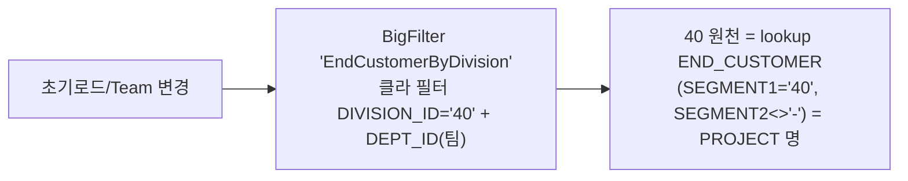
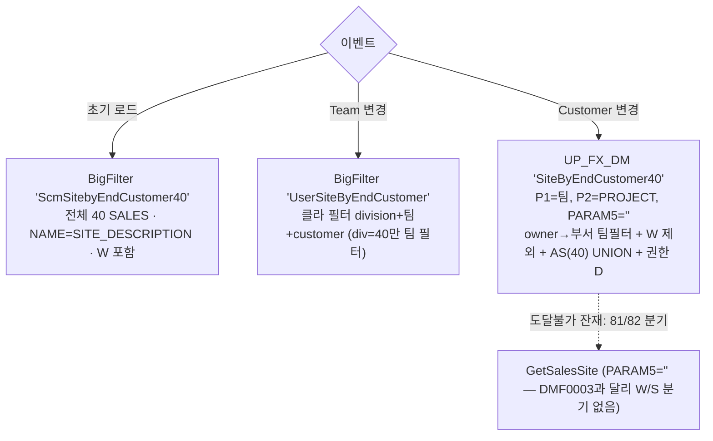
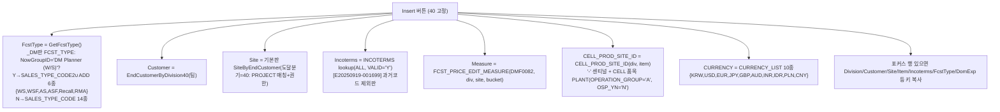
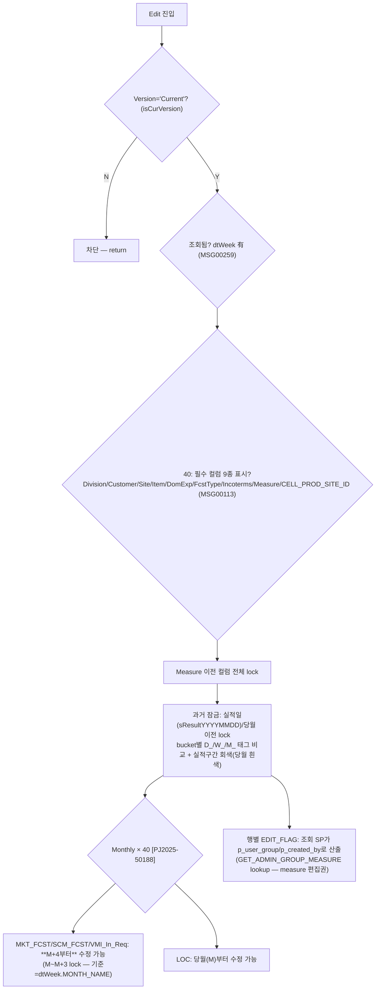

# DMF0082 (Fcst&Price Mgmt) — 조회조건·GRID Cascade/Filter 전 케이스 Flow (AS-IS 기준) v1.0

> 작성 2026-08-05 · 원천 = AS-IS `DMF0082_FcstNPrice_Mgmt.cs`(9,419줄) 전수 + `BigFilter.xml` + `UP_FX_GetCommonDataList`(기본판/_DM판) 원문 + AS-IS DB lookup 실값.
> 각 케이스에 **TO-BE 반영 현황** 병기: ✅완료 / 🔶갭 / ❌미반영 / ⏸데이터 대기.

## 0. ⭐ 최상위 구조 사실 — AS-IS는 Division='40' 고정 화면

- `InitControls` L341~343: `SetChangeControl("MyDivision")` 후 **`dtDivision.Select("CODE = '40'")`** — Division 콤보를 40 하나로 고정.
- `clbDivision_SelectedIndexChanged` L3039~3041 = **빈 함수** (Division 변경 이벤트 자체가 무의미).
- 소스에 남은 81/82 분기(clbCustomer L3065, ComboSelChange 등)는 DMF0003 계열 복제 잔재로 **도달 불가**.
- 권한 축: 검색 콤보는 BigFilter(TB_FX 'D') · 조회 SP `DMF0082_GET_MAIN_DATA`에 `p_user_group`(NowGroupID)/`p_created_by` 전달 → 서버 EDIT_FLAG/measure 편집권 판정.

> **TO-BE 구조 차이 (사용자 확정 사양)**: TO-BE forecast-price는 **Division 40/81/82 콤보 확장**(82=81 동일 경로 2026-07-30 확정, Div81/40 테이블 분기 규약). 따라서 TO-BE의 81/82 동작은 AS-IS DMF0082가 아니라 **신규 사양+DMF0003 계열 준용**이며, 본 문서의 AS-IS Flow는 40 기준이 정본. ✅(의도된 확장)

---

## §1 조회조건 13필드 — Cascade/Filter Flow

### 1-1. Division — **40 고정**
- 초기 로드: BigFilter `MyDivision` → `CODE='40'` 필터 고정 (L341~343). cascade 발생 없음(빈 핸들러).
- **TO-BE**: ✅(확장) DivisionField 40/81/82 + 변경 시 deptIds/endCustomers/salesSites reset (ForecastPriceForm L42~50).

### 1-2. Team
- 초기 로드(L347): BigFilter `UserTeamByDivision`(division='40' 클라 필터 — owner 기반 팀).
- Team 변경(L3043~3061) cascade → Customer·Sales Site 재구성 (§1-3, §1-4).
- **TO-BE**: ✅ TeamField(division) + 변경 시 endCustomers/salesSites reset (L56~60).

### 1-3. End Customer
- 트리거: 초기 로드(L352) · Team 변경(L3052).

- **TO-BE**: ✅ 'EndCustomer' CMBO + 인라인 division/dept 클라 cascade (ForecastPriceForm L62~88 — MetalLinkPriceForm 1:1 패턴).

### 1-4. Sales Site
- 트리거: 초기 로드(L364) · Team 변경(L3058) · Customer 변경(L3063~3073).

- 쿼리 메모: `_DM판 SiteByEndCustomer40` L16825~16873 (asYn 게이트 주석 — AS 무조건 UNION).
- **TO-BE**: ✅ SalesSiteField 카탈로그(40=owner-dept 경로 포함 `UserSiteByEndCustomer` 계열). 이벤트별 3원천 혼용은 reactive 단일화(DMF0003 §1-4 판정 동일).

### 1-5. Biz Type
- 초기 로드(L356): BigFilter `BizType`. 그리드 Division 셀 변경(도달 불가 잔재) 시 `SCM0001_GET_BIZ_TYPE_BY_DIVISION` 직접 SP(L3086) — DMF0003과 다른 원천.
- **TO-BE**: ✅ BizTypeField.

### 1-6. Sender Code — **미사용** (DMF0082 조회조건에 없음. FindData 파라미터 11종에 없음)
### 1-7. Period
- 초기 로드(L361): `PR_GET_DAY_RANGE(p_month=**6**)` — 당월 1일~+6개월 말일 (DMF0003과 동일 SP, 개월수만 6). 조회 시 최대 3년 검증(MSG00164, L1699).
- **TO-BE**: ✅ PeriodField.
### 1-8. Bucket
- 초기 로드(L368): `DMF0003_GET_BUCKET_TYPE_CODE`(공용) · 기본값 **Weekly**(DefineProperty L399). 변경 시 표시 전환+Edit 유지(L3248~) — 데이터 cascade 없음.
- 조회 후 `DefaultBucketDay`(DEFAULT_BUCKET_DAY lookup — 실값 40: MONTHLY=MON/WEEKLY=MON·4) 로드(L1773) → 월수량 일별 배분 기준.
- **TO-BE**: ✅ 인라인 Bucket 3종 + bucket-distribution 공용 룰.
### 1-9. Project — **검색조건 미사용** (그리드에도 Project 셀 없음 — Customer=PROJECT 명 lookup으로 대체)
### 1-10. Model/Nickname — 검색 `txtItemId` 텍스트만 (팝업 없음). 조회 SP `p_item_id`. **TO-BE**: ✅ ItemField(팝업+텍스트).
### 1-11. Plant Site — **검색조건 미사용** (그리드 PlantSiteId lock 로직만 잔재)
### 1-12. Item Type — **검색조건 미사용** (그리드 표시 컬럼만)
### 1-13. Owner — **검색조건 미사용**

### 1-14. (13필드 외 실존 조회조건 — 누락 방지 명기)
| 조건 | AS-IS | TO-BE |
|---|---|---|
| Version | `txtVersion`='Current' 기본 + 버전 팝업. 미선택 조회 차단(MSG00283). **Current 버전만 편집 가능**(isCurVersion) | ✅ VersionField |
| Qty (cboQty) | 조회 SP `p_qty_yn` | ✅ |
| Sum (chkSum) | 표시 토글 (L9046) | ✅ |
| 조회 SP 파라미터 전수(L1727~1738) | division/team/customer/biz_type/from·to/scm_site/item_id/version_type/qty_yn/created_by/**user_group** | ✅ |

---

## §2 GRID INSERT/UPDATE Cascade/Filter Flow

### 2-1. INSERT — 신규행 초기 콤보 (InsertRow 40 블록 L2555~2631 + 포커스행 복사 L2634~)

- **FCST_PRICE_EDIT_MEASURE 실데이터** (`DM_UI_EDITABLE_MEASURE`, SEGMENT1='DMF0082'): 40 = **MKT_FCST(입력Y)·SCM_FCST(입력N)·LOC(입력Y)·VMI_In_Req(입력Y, VMI 사이트만 — ATTRIBUTE3='Y'는 SITE.VMI_YN='Y'일 때만)**. Daily 버킷이면 LOC 제외(`SEGMENT3 NOT IN ('LOC')`, _DM판 L17057). 81계열/82도 lookup 등재(MKT_FCST/LOC)되어 있으나 AS-IS 화면은 40 고정.

### 2-2. INSERT/UPDATE — 셀 cascade (spdMain_ComboSelChange L8201~8373)
| 셀 | cascade (실도달 = 40) | 메모 |
|---|---|---|
| Division (도달 불가 잔재) | Team(Auth판)/Customer40/Site/BizType/Measure 재구성 | L8211~8264 |
| Team | Customer=EndCustomerByDivision40(팀) → Site=기본판 SiteByEndCustomer | L8266~8285 |
| Customer | Site 재구성 | L8287~8296 |
| **ScmSiteId** | Measure=FCST_PRICE_EDIT_MEASURE 재구성 + **BUCKET 자동 세팅** = `SALES_BUCKET(div,site,incoterms)` — `DM_MST_BUCKET_CONVERSION` 요일 7자리(예 0111110) PIVOT, 무데이터면 '' | L8297~8321 |
| **Incoterms** | BUCKET 자동 세팅(동일 SALES_BUCKET) | L8324~8342 |
| Measure | (model reset 로직은 전체 주석 — DMF0003과 달리 **미적용**) | L8347~8370 |
- **페이스트 (L7864~8201)**: M/I 행 && 노란(UnLock) 셀만 반영. ScmSiteId→Measure+Incoterms(AS_INCOTERMS) 재구성 / ItemId·CELL_PROD_SITE_ID→CELL_PROD_SITE_ID 재구성 / Measure→편집 measure 재구성. 1행 복사→다행 페이스트 시 첫 행 키 복제.

### 2-3. UPDATE — 편집 게이트 (활성 EditButton L1531~1610 + SetEditList/SetLockRange)

- 서버 권한 실체: `DMF0082_GET_MAIN_DATA`가 EDIT_FLAG·편집 가능 measure(AUTH_MEASURES: MKT_FCST/SCM_FCST/LOC/VMI_In_Req)를 행/커서로 반환 — NowGroupID(또는 사용자 보유그룹)의 `GET_ADMIN_GROUP_MEASURE` lookup 등재 여부.
- **TO-BE**: ✅ drop3(O_RC4) EDIT_AUTH_YN × 행 EDIT_FLAG × AUTH_MEASURES × bucket-컬럼 일치 × M+4/기준주차 잠금 (PKG_DMF0082 — AUTHUNION 합집합 판정 2026-08-04). Bucket 자동세팅=SALES_BUCKET 동일. ⭐TO-BE 그리드 셀 신규입력(INSERT)은 SHEET meta 전 컬럼 `INPUT_TP_CD='S'` — **셀 단위 신규행 입력 미구현**(Save All 팝업 경로로 대체: 'Sales Price Save All' 시트 — Division/DeptId/EndCustomer(40)/Site/BizType/FcstType(NOT_FREE)/Incoterms/Currency/PlantSite 콤보). 🔶 AS-IS Insert 셀 체인과의 대응은 Save All 팝업 + 측정값 편집으로 재배치된 구조(사용자 확정 운용).

---

## §3 커버리지 대조표 (누락 0 증빙)

### 3-1. 13필드
| # | 필드 | 섹션 | 사용 여부 |
|---|---|---|---|
| 1 | Division | §1-1 | **40 고정** |
| 2 | Team | §1-2 | 사용 |
| 3 | End Customer | §1-3 | 사용(=PROJECT 명) |
| 4 | Sales Site | §1-4 | 사용 |
| 5 | Biz.Type | §1-5 | 사용 |
| 6 | Sender Code | §1-6 | **미사용** |
| 7 | Period | §1-7 | 사용(6개월) |
| 8 | Bucket | §1-8 | 사용(Weekly 기본) |
| 9 | Project | §1-9 | **미사용** |
| 10 | Model/Nickname | §1-10 | 사용(텍스트만) |
| 11 | Plant Site | §1-11 | **미사용** |
| 12 | Item Type | §1-12 | **미사용** |
| 13 | Owner | §1-13 | **미사용** |
(+§1-14: Version/Qty/Sum — 13필드 외 실존 조건 명기)

### 3-2. AS-IS 이벤트 핸들러 전수 (10) ↔ 문서 매핑
| 핸들러 (.cs 라인) | 문서 |
|---|---|
| clbDivision_SelectedIndexChanged L3039 (빈 함수) | §0, §1-1 |
| clbTeam_SelectedIndexChanged L3043 | §1-3, §1-4 |
| clbCustomer_SelectedIndexChanged L3063 | §1-4 |
| cboBucketType_SelectedIndexChanged L3248 | §1-8 |
| spdMain_CellClick L3494 (전체 주석 잔재) | §2-2 메모 |
| spdMain_CellDoubleClick L3534 | 헤더 드릴다운(표시) |
| spdMain_ClipboardPasted L7864 | §2-2 페이스트 |
| spdMain_ComboSelChange L8201 (6분기) | §2-2 |
| spdMain_EditChange L8375 | §2-2(페이스트 플래그) |
| chkSum_CheckedChanged L9046 | §1-14(표시) |

### 3-3. 콤보/필터 원천 키 전수 (실측 인벤토리 20종) ↔ 문서 매핑
MyDivision·UserTeamByDivision·EndCustomerByDivision·UserSiteByEndCustomer·ScmSitebyEndCustomer40·UserPlantSiteByEndCustomer(잔재)·EdiSender(잔재)·BizType → §1 / UserTeamByDivisionAuth(잔재)·EndCustomerByDivision40·SiteByEndCustomer40·SiteByEndCustomer(GetSalesSite)·MktFcstEditMeasure(잔재)·PlantSiteByItem(주석 잔재)·SalesPlant(잔재)·FCST_PRICE_EDIT_MEASURE·SALES_BUCKET·CELL_PROD_SITE_ID·CURRENCY_LIST·DefaultBucketDay·DM_CUSTOMS_HANDBOOK·AS_INCOTERMS·FCST_TYPE → §2 / PR_GET_DAY_RANGE·DMF0003_GET_BUCKET_TYPE_CODE·DMF0082_GET_SPREAD_TITLE·DMF0082_GET_MAIN_DATA·DMF0082_POPUP_GET_FUTUREPRICE_INFO(환율 팝업)·DMF0003_GET_MKT_FCST_COMPARE_POPUP(SSP 비교)·SCM0001_GET_BIZ_TYPE_BY_DIVISION → §1-5/7/8, §1-14, §2.
