# SSP 배치 흐름(Batch Flow) — 2026-11-23 13:31 생성

> 분석서 `SSP_BATCH_ANALYSIS.md` 의 그림판. 그룹·엔터티 규칙은 화면 흐름과 동일(`ssp_flow.py` ENTITY_RULES · 배치 그룹 GROUPS).

## 1. 실행 기반 구조

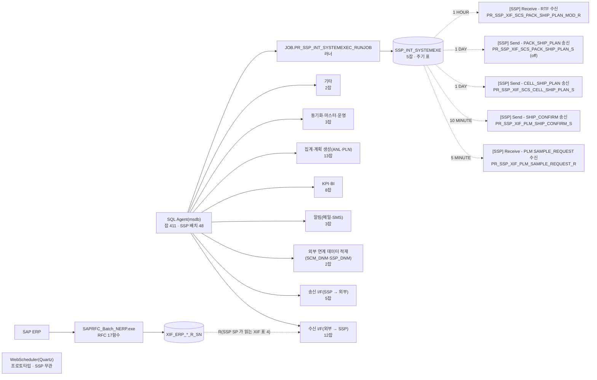

## 2. 배치 그룹 ⇒ SSP 엔터티 ⇒ 읽는 화면 단계 (배치가 만든 데이터를 화면이 봄)

- 대상 = SSP 배치(자체 스케줄러 포함) · 라벨 = 테이블 수 · 화면 단계 = ssp_flow 의 stage_of · 공통·로그 표 제외

<div class="spf-svg"><div class="tbl-wrap"><table class="mx"><thead><tr><th rowspan="2">SSP 엔터티</th><th class="mx-g mx-g0" colspan="7">쓰는 배치 그룹(W)</th><th class="mx-g mx-g1" colspan="6">읽는 화면 단계(R)</th></tr><tr><th class="mx-g0">KPI·BI</th><th class="mx-g0">기타</th><th class="mx-g0">동기화·마스터·운영</th><th class="mx-g0">수신 I/F</th><th class="mx-g0">알림</th><th class="mx-g0">외부 연계 데이터 적재</th><th class="mx-g0">집계·계획 생성</th><th class="mx-g1">출하요청<small>Request</small></th><th class="mx-g1">출하계획<small>Plan</small></th><th class="mx-g1">출하확정<small>Confirm</small></th><th class="mx-g1">변경요청<small>Change</small></th><th class="mx-g1">변경확정<small>ChangeConfirm</small></th><th class="mx-g1">분석 · 조회<small>Analysis</small></th></tr></thead><tbody><tr><th class="mx-e" data-k="E:재고(STOCK·ONHAND)">재고(STOCK·ONHAND)</th><td class="mx-0"></td><td class="mx-0"></td><td class="mx-0"></td><td class="mx-c" title="쓰기: SSP_ANL_OWMS_STOCK_C2, SSP_DNM_GMES_STOCK_40, SSP_DNM_GMES_STOCK_81_82, SSP_DNM_GMES_STOCK_EE, SSP_DNM_IWMS_STOCK_EE, SSP_DNM_OWMS_STOCK, SSP_DNM_OWMS_STOCK_EE"><b class="mx-w">W 7</b></td><td class="mx-0"></td><td class="mx-c" title="쓰기: SSP_ANL_STOCK_EE_C, SSP_ANL_STOCK_EE_C_COM, SSP_DNM_STOCK_C"><b class="mx-w">W 3</b></td><td class="mx-c" title="쓰기: SSP_ANL_BOH_CUTOFF_EE, SSP_ANL_HOLD_STOCK, SSP_ANL_INVENTORY_RAW, SSP_ANL_MES_FCS_STOCK_40_C, SSP_ANL_OWMS_STOCK_C, SSP_ANL_OWMS_STOCK_C2, SSP_ANL_STOCK_EE_C, SSP_ANL_TCO_STOCK_C"><b class="mx-w">W 8</b></td><td class="mx-c" title="읽기: SSP_ANL_BOH_CUTOFF_EE, SSP_ANL_HOLD_STOCK, SSP_ANL_STOCK_EE_C, SSP_DNM_STOCK_C"><b class="mx-r">R 4</b></td><td class="mx-c" title="읽기: SSP_ANL_BOH_CUTOFF_EE, SSP_ANL_HOLD_STOCK, SSP_ANL_MES_FCS_STOCK_40_C, SSP_ANL_OWMS_STOCK_C, SSP_ANL_OWMS_STOCK_C2, SSP_ANL_STOCK_EE_C, SSP_ANL_TCO_STOCK_C, SSP_DNM_GMES_STOCK_81_82, SSP_DNM_OWMS_STOCK, SSP_DNM_STOCK_C"><b class="mx-r">R 10</b></td><td class="mx-c" title="읽기: SSP_ANL_HOLD_STOCK, SSP_ANL_OWMS_STOCK_C2, SSP_DNM_GMES_STOCK_81_82, SSP_DNM_STOCK_C"><b class="mx-r">R 4</b></td><td class="mx-0"></td><td class="mx-0"></td><td class="mx-c" title="읽기: SSP_ANL_INVENTORY_RAW"><b class="mx-r">R 1</b></td></tr><tr><th class="mx-e" data-k="E:출하계획(SHIP_PLAN)">출하계획(SHIP_PLAN)</th><td class="mx-0"></td><td class="mx-0"></td><td class="mx-0"></td><td class="mx-0"></td><td class="mx-0"></td><td class="mx-c" title="쓰기: SSP_ANL_SHIP_PLAN_40, SSP_ANL_SHIP_PLAN_40_COM, SSP_ANL_SHIP_PLAN_C, SSP_ANL_SHIP_PLAN_C_COM, SSP_ANL_SHIP_PLAN_EE, SSP_ANL_SHIP_PLAN_EE_COM, SSP_ANL_SHIP_PLAN_P, SSP_ANL_SHIP_PLAN_P_COM"><b class="mx-w">W 8</b></td><td class="mx-c" title="쓰기: SSP_ANL_SHIP_PLAN_40, SSP_ANL_SHIP_PLAN_ALL, SSP_ANL_SHIP_PLAN_C, SSP_ANL_SHIP_PLAN_EE, SSP_ANL_SHIP_PLAN_P, SSP_MST_SHIP_PLAN_SCHEDULE, SSP_MST_SHIP_PLAN_SCHEDULE_EE"><b class="mx-w">W 7</b></td><td class="mx-c" title="읽기: SSP_ANL_SHIP_PLAN_40, SSP_ANL_SHIP_PLAN_EE"><b class="mx-r">R 2</b></td><td class="mx-c" title="읽기: SSP_ANL_SHIP_PLAN_40, SSP_ANL_SHIP_PLAN_ALL, SSP_ANL_SHIP_PLAN_C, SSP_ANL_SHIP_PLAN_EE, SSP_ANL_SHIP_PLAN_P"><b class="mx-r">R 5</b></td><td class="mx-c" title="읽기: SSP_ANL_SHIP_PLAN_ALL, SSP_ANL_SHIP_PLAN_C"><b class="mx-r">R 2</b></td><td class="mx-0"></td><td class="mx-0"></td><td class="mx-0"></td></tr><tr><th class="mx-e" data-k="E:출하확정(CONFIRM)">출하확정(CONFIRM)</th><td class="mx-0"></td><td class="mx-0"></td><td class="mx-c" title="쓰기: SSP_ANL_SHIP_CONFIRM"><b class="mx-w">W 1</b></td><td class="mx-c" title="쓰기: SSP_ANL_SHIP_CONFIRM"><b class="mx-w">W 1</b></td><td class="mx-0"></td><td class="mx-0"></td><td class="mx-c" title="쓰기: SSP_ANL_SHIP_CONFIRM, SSP_ANL_SHIP_CONFIRM_H, SSP_ANL_SHIP_CONFIRM_ROUTE"><b class="mx-w">W 3</b></td><td class="mx-c" title="읽기: SSP_ANL_SHIP_CONFIRM"><b class="mx-r">R 1</b></td><td class="mx-c" title="읽기: SSP_ANL_SHIP_CONFIRM"><b class="mx-r">R 1</b></td><td class="mx-c" title="읽기: SSP_ANL_SHIP_CONFIRM, SSP_ANL_SHIP_CONFIRM_H"><b class="mx-r">R 2</b></td><td class="mx-c" title="읽기: SSP_ANL_SHIP_CONFIRM, SSP_ANL_SHIP_CONFIRM_H"><b class="mx-r">R 2</b></td><td class="mx-c" title="읽기: SSP_ANL_SHIP_CONFIRM"><b class="mx-r">R 1</b></td><td class="mx-c" title="읽기: SSP_ANL_SHIP_CONFIRM, SSP_ANL_SHIP_CONFIRM_ROUTE"><b class="mx-r">R 2</b></td></tr><tr><th class="mx-e" data-k="E:출하확정 변경요청(CHG_REQ)">출하확정 변경요청(CHG_REQ)</th><td class="mx-0"></td><td class="mx-0"></td><td class="mx-c" title="쓰기: SSP_ANL_SHIP_CONFIRM_CHG_REQ, SSP_ANL_SHIP_CONFIRM_CHG_REQ_DE"><b class="mx-w">W 2</b></td><td class="mx-0"></td><td class="mx-0"></td><td class="mx-0"></td><td class="mx-0"></td><td class="mx-c" title="읽기: SSP_ANL_SHIP_CONFIRM_CHG_REQ_DE"><b class="mx-r">R 1</b></td><td class="mx-c" title="읽기: SSP_ANL_SHIP_CONFIRM_CHG_REQ, SSP_ANL_SHIP_CONFIRM_CHG_REQ_DE"><b class="mx-r">R 2</b></td><td class="mx-c" title="읽기: SSP_ANL_SHIP_CONFIRM_CHG_REQ, SSP_ANL_SHIP_CONFIRM_CHG_REQ_DE"><b class="mx-r">R 2</b></td><td class="mx-c" title="읽기: SSP_ANL_SHIP_CONFIRM_CHG_REQ, SSP_ANL_SHIP_CONFIRM_CHG_REQ_DE"><b class="mx-r">R 2</b></td><td class="mx-c" title="읽기: SSP_ANL_SHIP_CONFIRM_CHG_REQ, SSP_ANL_SHIP_CONFIRM_CHG_REQ_DE"><b class="mx-r">R 2</b></td><td class="mx-0"></td></tr><tr><th class="mx-e" data-k="E:출하요청(SHIP_REQ)">출하요청(SHIP_REQ)</th><td class="mx-c" title="쓰기: SSP_KPI_USR_URGENT_SHIP_REQ"><b class="mx-w">W 1</b></td><td class="mx-0"></td><td class="mx-0"></td><td class="mx-0"></td><td class="mx-0"></td><td class="mx-0"></td><td class="mx-c" title="쓰기: SSP_ANL_SHIP_REQ_EE, SSP_ANL_SHIP_REQ_EE_H, SSP_ANL_SHIP_REQ_P"><b class="mx-w">W 3</b></td><td class="mx-c" title="읽기: SSP_ANL_SHIP_REQ_EE, SSP_ANL_SHIP_REQ_P"><b class="mx-r">R 2</b></td><td class="mx-c" title="읽기: SSP_ANL_SHIP_REQ_EE, SSP_ANL_SHIP_REQ_P"><b class="mx-r">R 2</b></td><td class="mx-c" title="읽기: SSP_ANL_SHIP_REQ_EE"><b class="mx-r">R 1</b></td><td class="mx-0"></td><td class="mx-c" title="읽기: SSP_ANL_SHIP_REQ_EE"><b class="mx-r">R 1</b></td><td class="mx-0"></td></tr><tr><th class="mx-e" data-k="E:FP I/F">FP I/F</th><td class="mx-0"></td><td class="mx-c" title="쓰기: SSP_DNM_FP_AMEND_SHIPAVAL"><b class="mx-w">W 1</b></td><td class="mx-0"></td><td class="mx-0"></td><td class="mx-0"></td><td class="mx-c" title="쓰기: SSP_DNM_FP_PLAN_FROZEN"><b class="mx-w">W 1</b></td><td class="mx-0"></td><td class="mx-c" title="읽기: SSP_DNM_FP_PLAN_FROZEN"><b class="mx-r">R 1</b></td><td class="mx-c" title="읽기: SSP_DNM_FP_AMEND_SHIPAVAL, SSP_DNM_FP_PLAN_FROZEN"><b class="mx-r">R 2</b></td><td class="mx-c" title="읽기: SSP_DNM_FP_AMEND_SHIPAVAL, SSP_DNM_FP_PLAN_FROZEN"><b class="mx-r">R 2</b></td><td class="mx-0"></td><td class="mx-0"></td><td class="mx-0"></td></tr><tr><th class="mx-e" data-k="E:출하실적·반품(OWMS)">출하실적·반품(OWMS)</th><td class="mx-0"></td><td class="mx-0"></td><td class="mx-0"></td><td class="mx-c" title="쓰기: SSP_DNM_SHIP_RESULT_OWMS, SSP_DNM_SHIP_RETURN_OWMS"><b class="mx-w">W 2</b></td><td class="mx-0"></td><td class="mx-0"></td><td class="mx-0"></td><td class="mx-0"></td><td class="mx-c" title="읽기: SSP_DNM_SHIP_RESULT_OWMS, SSP_DNM_SHIP_RETURN_OWMS"><b class="mx-r">R 2</b></td><td class="mx-c" title="읽기: SSP_DNM_SHIP_RESULT_OWMS, SSP_DNM_SHIP_RETURN_OWMS"><b class="mx-r">R 2</b></td><td class="mx-0"></td><td class="mx-0"></td><td class="mx-0"></td></tr><tr><th class="mx-e" data-k="E:생산계획·PSI">생산계획·PSI</th><td class="mx-0"></td><td class="mx-0"></td><td class="mx-0"></td><td class="mx-0"></td><td class="mx-0"></td><td class="mx-c" title="쓰기: SSP_DNM_FORMATION_POST_CELL"><b class="mx-w">W 1</b></td><td class="mx-c" title="쓰기: SSP_ANL_FORMATION_C"><b class="mx-w">W 1</b></td><td class="mx-c" title="읽기: SSP_DNM_FORMATION_POST_CELL"><b class="mx-r">R 1</b></td><td class="mx-c" title="읽기: SSP_ANL_FORMATION_C"><b class="mx-r">R 1</b></td><td class="mx-0"></td><td class="mx-0"></td><td class="mx-0"></td><td class="mx-0"></td></tr><tr><th class="mx-e" data-k="E:ESS">ESS</th><td class="mx-0"></td><td class="mx-0"></td><td class="mx-0"></td><td class="mx-0"></td><td class="mx-0"></td><td class="mx-0"></td><td class="mx-c" title="쓰기: SSP_ANL_ESS_PO, SSP_ANL_ESS_PO_IN"><b class="mx-w">W 2</b></td><td class="mx-0"></td><td class="mx-c" title="읽기: SSP_ANL_ESS_PO, SSP_ANL_ESS_PO_IN"><b class="mx-r">R 2</b></td><td class="mx-0"></td><td class="mx-0"></td><td class="mx-0"></td><td class="mx-0"></td></tr><tr><th class="mx-e" data-k="E:기타 KPI_SPA">기타 KPI_SPA</th><td class="mx-c" title="쓰기: SSP_KPI_SPA_OTD1, SSP_KPI_SPA_OTD1_C, SSP_KPI_SPA_SHIPPING_PLAN_ACCURACY, SSP_KPI_SPA_SHIPPING_PLAN_ACCURACY_C"><b class="mx-w">W 4</b></td><td class="mx-0"></td><td class="mx-0"></td><td class="mx-0"></td><td class="mx-0"></td><td class="mx-0"></td><td class="mx-0"></td><td class="mx-0"></td><td class="mx-0"></td><td class="mx-0"></td><td class="mx-0"></td><td class="mx-0"></td><td class="mx-0"></td></tr><tr><th class="mx-e" data-k="E:기타 KPI_ASR">기타 KPI_ASR</th><td class="mx-c" title="쓰기: SSP_KPI_ASR_AUTO_SO_RATE, SSP_KPI_ASR_AUTO_SO_RATE_DW"><b class="mx-w">W 2</b></td><td class="mx-0"></td><td class="mx-0"></td><td class="mx-0"></td><td class="mx-0"></td><td class="mx-0"></td><td class="mx-0"></td><td class="mx-0"></td><td class="mx-0"></td><td class="mx-0"></td><td class="mx-0"></td><td class="mx-0"></td><td class="mx-0"></td></tr><tr><th class="mx-e" data-k="E:기타 KPI_SHIPMENT">기타 KPI_SHIPMENT</th><td class="mx-c" title="쓰기: SSP_KPI_SHIPMENT_PSI"><b class="mx-w">W 1</b></td><td class="mx-0"></td><td class="mx-0"></td><td class="mx-0"></td><td class="mx-0"></td><td class="mx-0"></td><td class="mx-0"></td><td class="mx-0"></td><td class="mx-0"></td><td class="mx-0"></td><td class="mx-0"></td><td class="mx-0"></td><td class="mx-0"></td></tr><tr><th class="mx-e" data-k="E:메일 발송">메일 발송</th><td class="mx-0"></td><td class="mx-0"></td><td class="mx-0"></td><td class="mx-0"></td><td class="mx-c" title="쓰기: SSP_MST_SEND_MAIL_REQ"><b class="mx-w">W 1</b></td><td class="mx-0"></td><td class="mx-0"></td><td class="mx-0"></td><td class="mx-0"></td><td class="mx-0"></td><td class="mx-0"></td><td class="mx-0"></td><td class="mx-0"></td></tr><tr><th class="mx-e" data-k="E:기타 DNM_MES">기타 DNM_MES</th><td class="mx-0"></td><td class="mx-0"></td><td class="mx-0"></td><td class="mx-0"></td><td class="mx-0"></td><td class="mx-c" title="쓰기: SSP_DNM_MES_WIP_HISTORY"><b class="mx-w">W 1</b></td><td class="mx-0"></td><td class="mx-0"></td><td class="mx-0"></td><td class="mx-0"></td><td class="mx-0"></td><td class="mx-0"></td><td class="mx-0"></td></tr><tr><th class="mx-e" data-k="E:기타 INT_SYSTEMEXE">기타 INT_SYSTEMEXE</th><td class="mx-0"></td><td class="mx-0"></td><td class="mx-c" title="쓰기: SSP_INT_SYSTEMEXE"><b class="mx-w">W 1</b></td><td class="mx-0"></td><td class="mx-0"></td><td class="mx-0"></td><td class="mx-0"></td><td class="mx-0"></td><td class="mx-0"></td><td class="mx-0"></td><td class="mx-0"></td><td class="mx-0"></td><td class="mx-0"></td></tr><tr><th class="mx-e" data-k="E:기타 KPI_BR">기타 KPI_BR</th><td class="mx-c" title="쓰기: SSP_KPI_BR_BOD_REGISTRATION"><b class="mx-w">W 1</b></td><td class="mx-0"></td><td class="mx-0"></td><td class="mx-0"></td><td class="mx-0"></td><td class="mx-0"></td><td class="mx-0"></td><td class="mx-0"></td><td class="mx-0"></td><td class="mx-0"></td><td class="mx-0"></td><td class="mx-0"></td><td class="mx-0"></td></tr><tr><th class="mx-e" data-k="E:기타 KPI_DIA">기타 KPI_DIA</th><td class="mx-c" title="쓰기: SSP_KPI_DIA_DELIVERY_INSTRUCTION_ACCURACY"><b class="mx-w">W 1</b></td><td class="mx-0"></td><td class="mx-0"></td><td class="mx-0"></td><td class="mx-0"></td><td class="mx-0"></td><td class="mx-0"></td><td class="mx-0"></td><td class="mx-0"></td><td class="mx-0"></td><td class="mx-0"></td><td class="mx-0"></td><td class="mx-0"></td></tr><tr><th class="mx-e" data-k="E:마스터(모델·담당·사이트·캘린더·버전)">마스터(모델·담당·사이트·캘린더·버전)</th><td class="mx-0"></td><td class="mx-0"></td><td class="mx-c" title="쓰기: SSP_MST_WS_CALL"><b class="mx-w">W 1</b></td><td class="mx-0"></td><td class="mx-0"></td><td class="mx-0"></td><td class="mx-0"></td><td class="mx-0"></td><td class="mx-0"></td><td class="mx-0"></td><td class="mx-0"></td><td class="mx-0"></td><td class="mx-0"></td></tr><tr><th class="mx-e" data-k="E:기타 INT_SYSTEMEXELOG">기타 INT_SYSTEMEXELOG</th><td class="mx-0"></td><td class="mx-0"></td><td class="mx-c" title="쓰기: SSP_INT_SYSTEMEXELOG"><b class="mx-w">W 1</b></td><td class="mx-0"></td><td class="mx-0"></td><td class="mx-0"></td><td class="mx-0"></td><td class="mx-0"></td><td class="mx-0"></td><td class="mx-0"></td><td class="mx-0"></td><td class="mx-0"></td><td class="mx-0"></td></tr></tbody></table></div><div class="bd-cap">왼쪽 열 묶음 W = 배치 그룹이 쓰는 테이블 수, 오른쪽 열 묶음 R = 그 엔터티를 읽는 화면 단계. 한 행을 가로로 읽으면 「어느 배치가 만든 데이터를 어느 단계 화면이 보는지」가 나옵니다. 칸에 마우스를 올리면 테이블 이름. 같은 내용의 그래프는 아래 「그래프로 보기」.</div></div>

<div class="spf-fold" data-label="그래프로 보기(같은 내용)"></div>

```mermaid
flowchart LR
  subgraph BG["배치 그룹(W)"]
    BW_KPI_BI["KPI·BI"]
    BW___["기타"]
    BW___________["동기화·마스터·운영"]
    BW____I_F______SSP_["수신 I/F(외부 → SSP)"]
    BW_______SMS_["알림(메일·SMS)"]
    BW______________SCM_DNM_SSP_DNM_["외부 연계 데이터 적재(SCM_DNM·SSP_DNM)"]
    BW__________ANL_PLN_["집계·계획 생성(ANL·PLN)"]
  end
  subgraph EN["SSP 엔터티"]
    E_ESS[("ESS")]
    E_FP_I_F[("FP I/F")]
    E____DNM_MES[("기타 DNM_MES")]
    E____INT_SYSTEMEXE[("기타 INT_SYSTEMEXE")]
    E____INT_SYSTEMEXELOG[("기타 INT_SYSTEMEXELOG")]
    E____KPI_ASR[("기타 KPI_ASR")]
    E____KPI_BR[("기타 KPI_BR")]
    E____KPI_DIA[("기타 KPI_DIA")]
    E____KPI_SHIPMENT[("기타 KPI_SHIPMENT")]
    E____KPI_SPA[("기타 KPI_SPA")]
    E______________________[("마스터(모델·담당·사이트·캘린더·버전)")]
    E______[("메일 발송")]
    E______PSI[("생산계획·PSI")]
    E____STOCK_ONHAND_[("재고(STOCK·ONHAND)")]
    E______SHIP_PLAN_[("출하계획(SHIP_PLAN)")]
    E_________OWMS_[("출하실적·반품(OWMS)")]
    E______SHIP_REQ_[("출하요청(SHIP_REQ)")]
    E___________CHG_REQ_[("출하확정 변경요청(CHG_REQ)")]
    E______CONFIRM_[("출하확정(CONFIRM)")]
  end
  subgraph SS["읽는 화면 단계(R)"]
    SR_Analysis["Analysis"]
    SR_Change["Change"]
    SR_ChangeConfirm["ChangeConfirm"]
    SR_Confirm["Confirm"]
    SR_Plan["Plan"]
    SR_Request["Request"]
  end
  BW_KPI_BI =="W 2"==> E____KPI_ASR
  BW_KPI_BI =="W 1"==> E____KPI_BR
  BW_KPI_BI =="W 1"==> E____KPI_DIA
  BW_KPI_BI =="W 1"==> E____KPI_SHIPMENT
  BW_KPI_BI =="W 4"==> E____KPI_SPA
  BW_KPI_BI =="W 1"==> E______SHIP_REQ_
  BW___ =="W 1"==> E_FP_I_F
  BW___________ =="W 1"==> E____INT_SYSTEMEXE
  BW___________ =="W 1"==> E____INT_SYSTEMEXELOG
  BW___________ =="W 1"==> E______________________
  BW___________ =="W 2"==> E___________CHG_REQ_
  BW___________ =="W 1"==> E______CONFIRM_
  BW____I_F______SSP_ =="W 7"==> E____STOCK_ONHAND_
  BW____I_F______SSP_ =="W 2"==> E_________OWMS_
  BW____I_F______SSP_ =="W 1"==> E______CONFIRM_
  BW_______SMS_ =="W 1"==> E______
  BW______________SCM_DNM_SSP_DNM_ =="W 1"==> E_FP_I_F
  BW______________SCM_DNM_SSP_DNM_ =="W 1"==> E____DNM_MES
  BW______________SCM_DNM_SSP_DNM_ =="W 1"==> E______PSI
  BW______________SCM_DNM_SSP_DNM_ =="W 3"==> E____STOCK_ONHAND_
  BW______________SCM_DNM_SSP_DNM_ =="W 8"==> E______SHIP_PLAN_
  BW__________ANL_PLN_ =="W 2"==> E_ESS
  BW__________ANL_PLN_ =="W 1"==> E______PSI
  BW__________ANL_PLN_ =="W 8"==> E____STOCK_ONHAND_
  BW__________ANL_PLN_ =="W 7"==> E______SHIP_PLAN_
  BW__________ANL_PLN_ =="W 3"==> E______SHIP_REQ_
  BW__________ANL_PLN_ =="W 3"==> E______CONFIRM_
  E_ESS -."R 2".-> SR_Plan
  E_FP_I_F -."R 2".-> SR_Confirm
  E_FP_I_F -."R 2".-> SR_Plan
  E_FP_I_F -."R 1".-> SR_Request
  E______PSI -."R 1".-> SR_Plan
  E______PSI -."R 1".-> SR_Request
  E____STOCK_ONHAND_ -."R 1".-> SR_Analysis
  E____STOCK_ONHAND_ -."R 4".-> SR_Confirm
  E____STOCK_ONHAND_ -."R 10".-> SR_Plan
  E____STOCK_ONHAND_ -."R 4".-> SR_Request
  E______SHIP_PLAN_ -."R 2".-> SR_Confirm
  E______SHIP_PLAN_ -."R 5".-> SR_Plan
  E______SHIP_PLAN_ -."R 2".-> SR_Request
  E_________OWMS_ -."R 2".-> SR_Confirm
  E_________OWMS_ -."R 2".-> SR_Plan
  E______SHIP_REQ_ -."R 1".-> SR_ChangeConfirm
  E______SHIP_REQ_ -."R 1".-> SR_Confirm
  E______SHIP_REQ_ -."R 2".-> SR_Plan
  E______SHIP_REQ_ -."R 2".-> SR_Request
  E___________CHG_REQ_ -."R 2".-> SR_Change
  E___________CHG_REQ_ -."R 2".-> SR_ChangeConfirm
  E___________CHG_REQ_ -."R 2".-> SR_Confirm
  E___________CHG_REQ_ -."R 2".-> SR_Plan
  E___________CHG_REQ_ -."R 1".-> SR_Request
  E______CONFIRM_ -."R 2".-> SR_Analysis
  E______CONFIRM_ -."R 2".-> SR_Change
  E______CONFIRM_ -."R 1".-> SR_ChangeConfirm
  E______CONFIRM_ -."R 2".-> SR_Confirm
  E______CONFIRM_ -."R 1".-> SR_Plan
  E______CONFIRM_ -."R 1".-> SR_Request
```

## 3. 화면 단계 ⇒ SSP 엔터티 ⇒ 배치 그룹 (화면이 만든 데이터를 배치가 가져감)

<div class="spf-svg"><div class="tbl-wrap"><table class="mx"><thead><tr><th rowspan="2">SSP 엔터티</th><th class="mx-g mx-g0" colspan="6">쓰는 화면 단계(W)</th><th class="mx-g mx-g1" colspan="8">읽는 배치 그룹(R)</th></tr><tr><th class="mx-g0">기준정보<small>Master</small></th><th class="mx-g0">출하요청<small>Request</small></th><th class="mx-g0">출하계획<small>Plan</small></th><th class="mx-g0">출하확정<small>Confirm</small></th><th class="mx-g0">변경요청<small>Change</small></th><th class="mx-g0">변경확정<small>ChangeConfirm</small></th><th class="mx-g1">KPI·BI</th><th class="mx-g1">기타</th><th class="mx-g1">동기화·마스터·운영</th><th class="mx-g1">송신 I/F</th><th class="mx-g1">수신 I/F</th><th class="mx-g1">알림</th><th class="mx-g1">외부 연계 데이터 적재</th><th class="mx-g1">집계·계획 생성</th></tr></thead><tbody><tr><th class="mx-e" data-k="E:재고(STOCK·ONHAND)">재고(STOCK·ONHAND)</th><td class="mx-0"></td><td class="mx-0"></td><td class="mx-c" title="쓰기: SSP_ANL_HOLD_STOCK, SSP_ANL_MES_FCS_STOCK_40_C"><b class="mx-w">W 2</b></td><td class="mx-0"></td><td class="mx-0"></td><td class="mx-0"></td><td class="mx-0"></td><td class="mx-0"></td><td class="mx-0"></td><td class="mx-0"></td><td class="mx-c" title="읽기: SSP_ANL_OWMS_STOCK_C2, SSP_DNM_GMES_STOCK_40, SSP_DNM_GMES_STOCK_81_82, SSP_DNM_GMES_STOCK_EE, SSP_DNM_IWMS_STOCK_EE, SSP_DNM_OWMS_STOCK, SSP_DNM_OWMS_STOCK_EE"><b class="mx-r">R 7</b></td><td class="mx-0"></td><td class="mx-c" title="읽기: SSP_ANL_STOCK_EE_C, SSP_DNM_STOCK_C"><b class="mx-r">R 2</b></td><td class="mx-c" title="읽기: SSP_ANL_BOH_CUTOFF_EE, SSP_ANL_HOLD_STOCK, SSP_ANL_INVENTORY_RAW, SSP_ANL_MES_FCS_STOCK_40_C, SSP_ANL_OWMS_STOCK_C, SSP_ANL_OWMS_STOCK_C2, SSP_ANL_STOCK_EE_C, SSP_ANL_TCO_STOCK_C, SSP_DNM_GMES_STOCK_40, SSP_DNM_GMES_STOCK_81_82, SSP_DNM_GMES_STOCK_EE, SSP_DNM_IWMS_STOCK_EE, SSP_DNM_OWMS_STOCK, SSP_DNM_OWMS_STOCK_EE, SSP_DNM_STOCK_C"><b class="mx-r">R 15</b></td></tr><tr><th class="mx-e" data-k="E:출하계획(SHIP_PLAN)">출하계획(SHIP_PLAN)</th><td class="mx-0"></td><td class="mx-c" title="쓰기: SSP_ANL_SHIP_PLAN_PACK_REQ"><b class="mx-w">W 1</b></td><td class="mx-c" title="쓰기: SSP_ANL_SHIP_PLAN_40, SSP_ANL_SHIP_PLAN_40_WH_IN_H, SSP_ANL_SHIP_PLAN_EE, SSP_ANL_SHIP_PLAN_SIMU_EE"><b class="mx-w">W 4</b></td><td class="mx-0"></td><td class="mx-0"></td><td class="mx-c" title="쓰기: SSP_ANL_SHIP_PLAN_40"><b class="mx-w">W 1</b></td><td class="mx-c" title="읽기: SSP_ANL_SHIP_PLAN_40, SSP_ANL_SHIP_PLAN_C"><b class="mx-r">R 2</b></td><td class="mx-0"></td><td class="mx-0"></td><td class="mx-c" title="읽기: SSP_ANL_SHIP_PLAN_40, SSP_ANL_SHIP_PLAN_C, SSP_MST_SHIP_PLAN_SCHEDULE, SSP_MST_SHIP_PLAN_SCHEDULE_EE"><b class="mx-r">R 4</b></td><td class="mx-0"></td><td class="mx-0"></td><td class="mx-c" title="읽기: SSP_ANL_SHIP_PLAN_40, SSP_ANL_SHIP_PLAN_C, SSP_ANL_SHIP_PLAN_EE, SSP_ANL_SHIP_PLAN_P"><b class="mx-r">R 4</b></td><td class="mx-c" title="읽기: SSP_ANL_SHIP_PLAN_40, SSP_ANL_SHIP_PLAN_40_WH_IN_H, SSP_ANL_SHIP_PLAN_C, SSP_ANL_SHIP_PLAN_EE, SSP_ANL_SHIP_PLAN_P, SSP_ANL_SHIP_PLAN_PACK_REQ, SSP_ANL_SHIP_PLAN_SIMU_EE, SSP_MST_SHIP_PLAN_SCHEDULE, SSP_MST_SHIP_PLAN_SCHEDULE_EE"><b class="mx-r">R 9</b></td></tr><tr><th class="mx-e" data-k="E:출하확정 변경요청(CHG_REQ)">출하확정 변경요청(CHG_REQ)</th><td class="mx-0"></td><td class="mx-0"></td><td class="mx-c" title="쓰기: SSP_ANL_SHIP_CONFIRM_CHG_REQ, SSP_ANL_SHIP_CONFIRM_CHG_REQ_DE"><b class="mx-w">W 2</b></td><td class="mx-c" title="쓰기: SSP_ANL_SHIP_CONFIRM_CHG_REQ, SSP_ANL_SHIP_CONFIRM_CHG_REQ_DE"><b class="mx-w">W 2</b></td><td class="mx-c" title="쓰기: SSP_ANL_SHIP_CONFIRM_CHG_REQ, SSP_ANL_SHIP_CONFIRM_CHG_REQ_DE"><b class="mx-w">W 2</b></td><td class="mx-c" title="쓰기: SSP_ANL_SHIP_CONFIRM_CHG_REQ, SSP_ANL_SHIP_CONFIRM_CHG_REQ_DE"><b class="mx-w">W 2</b></td><td class="mx-c" title="읽기: SSP_ANL_SHIP_CONFIRM_CHG_REQ"><b class="mx-r">R 1</b></td><td class="mx-0"></td><td class="mx-c" title="읽기: SSP_ANL_SHIP_CONFIRM_CHG_REQ, SSP_ANL_SHIP_CONFIRM_CHG_REQ_DE"><b class="mx-r">R 2</b></td><td class="mx-c" title="읽기: SSP_ANL_SHIP_CONFIRM_CHG_REQ, SSP_ANL_SHIP_CONFIRM_CHG_REQ_DE"><b class="mx-r">R 2</b></td><td class="mx-0"></td><td class="mx-c" title="읽기: SSP_ANL_SHIP_CONFIRM_CHG_REQ, SSP_ANL_SHIP_CONFIRM_CHG_REQ_DE"><b class="mx-r">R 2</b></td><td class="mx-0"></td><td class="mx-c" title="읽기: SSP_ANL_SHIP_CONFIRM_CHG_REQ, SSP_ANL_SHIP_CONFIRM_CHG_REQ_DE"><b class="mx-r">R 2</b></td></tr><tr><th class="mx-e" data-k="E:마스터(모델·담당·사이트·캘린더·버전)">마스터(모델·담당·사이트·캘린더·버전)</th><td class="mx-c" title="쓰기: SSP_MST_MODEL_USER, SSP_MST_MODEL_USER_EE, SSP_MST_SHIP_MASTER_EE"><b class="mx-w">W 3</b></td><td class="mx-0"></td><td class="mx-0"></td><td class="mx-0"></td><td class="mx-c" title="쓰기: SSP_MST_MODEL_USER"><b class="mx-w">W 1</b></td><td class="mx-0"></td><td class="mx-c" title="읽기: SSP_MST_MODEL_USER"><b class="mx-r">R 1</b></td><td class="mx-0"></td><td class="mx-c" title="읽기: SSP_MST_WS_CALL"><b class="mx-r">R 1</b></td><td class="mx-c" title="읽기: SSP_MST_MODEL_USER"><b class="mx-r">R 1</b></td><td class="mx-0"></td><td class="mx-c" title="읽기: SSP_MST_MODEL_USER, SSP_MST_MODEL_USER_EE"><b class="mx-r">R 2</b></td><td class="mx-c" title="읽기: SSP_MST_LOCATION_V"><b class="mx-r">R 1</b></td><td class="mx-c" title="읽기: SSP_MST_MODEL_USER, SSP_MST_PARTIAL_SEQ, SSP_MST_SHIP_MASTER_EE, SSP_MST_SITE_ITEM_EE_V, SSP_PLAN_VERSION_V"><b class="mx-r">R 5</b></td></tr><tr><th class="mx-e" data-k="E:출하확정(CONFIRM)">출하확정(CONFIRM)</th><td class="mx-0"></td><td class="mx-0"></td><td class="mx-c" title="쓰기: SSP_ANL_SHIP_CONFIRM, SSP_ANL_SHIP_CONFIRM_H"><b class="mx-w">W 2</b></td><td class="mx-c" title="쓰기: SSP_ANL_SHIP_CONFIRM, SSP_ANL_SHIP_CONFIRM_H"><b class="mx-w">W 2</b></td><td class="mx-c" title="쓰기: SSP_ANL_SHIP_CONFIRM"><b class="mx-w">W 1</b></td><td class="mx-c" title="쓰기: SSP_ANL_SHIP_CONFIRM, SSP_ANL_SHIP_CONFIRM_H"><b class="mx-w">W 2</b></td><td class="mx-c" title="읽기: SSP_ANL_SHIP_CONFIRM"><b class="mx-r">R 1</b></td><td class="mx-0"></td><td class="mx-c" title="읽기: SSP_ANL_SHIP_CONFIRM"><b class="mx-r">R 1</b></td><td class="mx-c" title="읽기: SSP_ANL_SHIP_CONFIRM, SSP_ANL_SHIP_CONFIRM_H"><b class="mx-r">R 2</b></td><td class="mx-c" title="읽기: SSP_ANL_SHIP_CONFIRM"><b class="mx-r">R 1</b></td><td class="mx-c" title="읽기: SSP_ANL_SHIP_CONFIRM"><b class="mx-r">R 1</b></td><td class="mx-0"></td><td class="mx-c" title="읽기: SSP_ANL_SHIP_CONFIRM"><b class="mx-r">R 1</b></td></tr><tr><th class="mx-e" data-k="E:생산계획·PSI">생산계획·PSI</th><td class="mx-0"></td><td class="mx-0"></td><td class="mx-c" title="쓰기: SSP_ANL_PROD_PLAN_OSP"><b class="mx-w">W 1</b></td><td class="mx-0"></td><td class="mx-0"></td><td class="mx-0"></td><td class="mx-0"></td><td class="mx-0"></td><td class="mx-0"></td><td class="mx-0"></td><td class="mx-0"></td><td class="mx-0"></td><td class="mx-c" title="읽기: SSP_DNM_FORMATION_POST_CELL, SSP_FORMATION_POST_CELL_V"><b class="mx-r">R 2</b></td><td class="mx-c" title="읽기: SSP_ANL_FORMATION_C, SSP_ANL_PROD_PLAN_OSP, SSP_FORMATION_POST_CELL_V"><b class="mx-r">R 3</b></td></tr><tr><th class="mx-e" data-k="E:출하요청(SHIP_REQ)">출하요청(SHIP_REQ)</th><td class="mx-0"></td><td class="mx-c" title="쓰기: SSP_ANL_SHIP_REQ_EE, SSP_ANL_SHIP_REQ_P"><b class="mx-w">W 2</b></td><td class="mx-0"></td><td class="mx-0"></td><td class="mx-0"></td><td class="mx-0"></td><td class="mx-c" title="읽기: SSP_KPI_USR_URGENT_SHIP_REQ"><b class="mx-r">R 1</b></td><td class="mx-0"></td><td class="mx-0"></td><td class="mx-0"></td><td class="mx-c" title="읽기: SSP_ANL_SHIP_REQ_P"><b class="mx-r">R 1</b></td><td class="mx-0"></td><td class="mx-0"></td><td class="mx-c" title="읽기: SSP_ANL_SHIP_REQ_EE, SSP_ANL_SHIP_REQ_P"><b class="mx-r">R 2</b></td></tr><tr><th class="mx-e" data-k="E:FP I/F">FP I/F</th><td class="mx-0"></td><td class="mx-0"></td><td class="mx-0"></td><td class="mx-0"></td><td class="mx-0"></td><td class="mx-0"></td><td class="mx-0"></td><td class="mx-c" title="읽기: SSP_DNM_FP_AMEND_SHIPAVAL"><b class="mx-r">R 1</b></td><td class="mx-0"></td><td class="mx-0"></td><td class="mx-0"></td><td class="mx-0"></td><td class="mx-c" title="읽기: SSP_DNM_FP_PLAN_FROZEN"><b class="mx-r">R 1</b></td><td class="mx-c" title="읽기: SSP_DNM_FP_MRP_INTRANSIT_SN, SSP_DNM_FP_PANCAKE_SIMUL_PLAN_V_SN, SSP_DNM_FP_PLAN_FROZEN"><b class="mx-r">R 3</b></td></tr><tr><th class="mx-e" data-k="E:기타 KPI_SPA">기타 KPI_SPA</th><td class="mx-0"></td><td class="mx-0"></td><td class="mx-0"></td><td class="mx-0"></td><td class="mx-0"></td><td class="mx-0"></td><td class="mx-c" title="읽기: SSP_KPI_SPA_OTD1, SSP_KPI_SPA_OTD1_C, SSP_KPI_SPA_SHIPPING_PLAN_ACCURACY, SSP_KPI_SPA_SHIPPING_PLAN_ACCURACY_C"><b class="mx-r">R 4</b></td><td class="mx-0"></td><td class="mx-0"></td><td class="mx-0"></td><td class="mx-0"></td><td class="mx-0"></td><td class="mx-0"></td><td class="mx-0"></td></tr><tr><th class="mx-e" data-k="E:메일 발송">메일 발송</th><td class="mx-0"></td><td class="mx-0"></td><td class="mx-c" title="쓰기: SSP_MST_SEND_MAIL_REQ"><b class="mx-w">W 1</b></td><td class="mx-c" title="쓰기: SSP_MST_SEND_MAIL_REQ"><b class="mx-w">W 1</b></td><td class="mx-0"></td><td class="mx-0"></td><td class="mx-0"></td><td class="mx-0"></td><td class="mx-0"></td><td class="mx-0"></td><td class="mx-0"></td><td class="mx-c" title="읽기: SSP_MST_SEND_MAIL_REQ"><b class="mx-r">R 1</b></td><td class="mx-0"></td><td class="mx-0"></td></tr><tr><th class="mx-e" data-k="E:출하실적·반품(OWMS)">출하실적·반품(OWMS)</th><td class="mx-0"></td><td class="mx-0"></td><td class="mx-0"></td><td class="mx-0"></td><td class="mx-0"></td><td class="mx-0"></td><td class="mx-c" title="읽기: SSP_DNM_SHIP_RESULT_OWMS, SSP_DNM_SHIP_RETURN_OWMS"><b class="mx-r">R 2</b></td><td class="mx-0"></td><td class="mx-0"></td><td class="mx-0"></td><td class="mx-0"></td><td class="mx-0"></td><td class="mx-0"></td><td class="mx-c" title="읽기: SSP_DNM_SHIP_RESULT_OWMS_V"><b class="mx-r">R 1</b></td></tr><tr><th class="mx-e" data-k="E:기타 KPI_ASR">기타 KPI_ASR</th><td class="mx-0"></td><td class="mx-0"></td><td class="mx-0"></td><td class="mx-0"></td><td class="mx-0"></td><td class="mx-0"></td><td class="mx-c" title="읽기: SSP_KPI_ASR_AUTO_SO_RATE, SSP_KPI_ASR_AUTO_SO_RATE_DW"><b class="mx-r">R 2</b></td><td class="mx-0"></td><td class="mx-0"></td><td class="mx-0"></td><td class="mx-0"></td><td class="mx-0"></td><td class="mx-0"></td><td class="mx-0"></td></tr><tr><th class="mx-e" data-k="E:기타 KPI_SHIPMENT">기타 KPI_SHIPMENT</th><td class="mx-0"></td><td class="mx-0"></td><td class="mx-0"></td><td class="mx-0"></td><td class="mx-0"></td><td class="mx-0"></td><td class="mx-c" title="읽기: SSP_KPI_SHIPMENT_PSI"><b class="mx-r">R 1</b></td><td class="mx-0"></td><td class="mx-0"></td><td class="mx-0"></td><td class="mx-0"></td><td class="mx-0"></td><td class="mx-0"></td><td class="mx-0"></td></tr><tr><th class="mx-e" data-k="E:ESS">ESS</th><td class="mx-0"></td><td class="mx-0"></td><td class="mx-0"></td><td class="mx-0"></td><td class="mx-0"></td><td class="mx-0"></td><td class="mx-0"></td><td class="mx-0"></td><td class="mx-0"></td><td class="mx-0"></td><td class="mx-0"></td><td class="mx-0"></td><td class="mx-0"></td><td class="mx-c" title="읽기: SSP_DNM_ESS_PACKER_STOCK_V"><b class="mx-r">R 1</b></td></tr><tr><th class="mx-e" data-k="E:기타 MKT_USER">기타 MKT_USER</th><td class="mx-0"></td><td class="mx-0"></td><td class="mx-0"></td><td class="mx-0"></td><td class="mx-0"></td><td class="mx-0"></td><td class="mx-0"></td><td class="mx-0"></td><td class="mx-0"></td><td class="mx-0"></td><td class="mx-0"></td><td class="mx-0"></td><td class="mx-0"></td><td class="mx-c" title="읽기: SSP_MKT_USER_V"><b class="mx-r">R 1</b></td></tr><tr><th class="mx-e" data-k="E:기타 KPI_DIA">기타 KPI_DIA</th><td class="mx-0"></td><td class="mx-0"></td><td class="mx-0"></td><td class="mx-0"></td><td class="mx-0"></td><td class="mx-0"></td><td class="mx-c" title="읽기: SSP_KPI_DIA_DELIVERY_INSTRUCTION_ACCURACY"><b class="mx-r">R 1</b></td><td class="mx-0"></td><td class="mx-0"></td><td class="mx-0"></td><td class="mx-0"></td><td class="mx-0"></td><td class="mx-0"></td><td class="mx-0"></td></tr><tr><th class="mx-e" data-k="E:기타 DNM_PLAN">기타 DNM_PLAN</th><td class="mx-0"></td><td class="mx-0"></td><td class="mx-0"></td><td class="mx-0"></td><td class="mx-0"></td><td class="mx-0"></td><td class="mx-0"></td><td class="mx-0"></td><td class="mx-0"></td><td class="mx-0"></td><td class="mx-0"></td><td class="mx-0"></td><td class="mx-0"></td><td class="mx-c" title="읽기: SSP_DNM_PLAN_FROZEN_V"><b class="mx-r">R 1</b></td></tr><tr><th class="mx-e" data-k="E:기타 INT_SYSTEMEXELOG">기타 INT_SYSTEMEXELOG</th><td class="mx-0"></td><td class="mx-0"></td><td class="mx-0"></td><td class="mx-0"></td><td class="mx-0"></td><td class="mx-0"></td><td class="mx-0"></td><td class="mx-0"></td><td class="mx-c" title="읽기: SSP_INT_SYSTEMEXELOG"><b class="mx-r">R 1</b></td><td class="mx-0"></td><td class="mx-0"></td><td class="mx-0"></td><td class="mx-0"></td><td class="mx-0"></td></tr></tbody></table></div><div class="bd-cap">왼쪽 열 묶음 W = 화면 단계가 쓰는 테이블 수, 오른쪽 열 묶음 R = 그 엔터티를 읽는 배치 그룹. 한 행을 가로로 읽으면 「어느 단계 화면이 만든 데이터를 어느 배치가 가져가는지」가 나옵니다. 칸에 마우스를 올리면 테이블 이름. 같은 내용의 그래프는 아래 「그래프로 보기」.</div></div>

<div class="spf-fold" data-label="그래프로 보기(같은 내용)"></div>

```mermaid
flowchart LR
  subgraph SS["쓰는 화면 단계(W)"]
    SW_Change["Change"]
    SW_ChangeConfirm["ChangeConfirm"]
    SW_Confirm["Confirm"]
    SW_Master["Master"]
    SW_Plan["Plan"]
    SW_Request["Request"]
  end
  subgraph EN["SSP 엔터티"]
    E_ESS[("ESS")]
    E_FP_I_F[("FP I/F")]
    E____DNM_PLAN[("기타 DNM_PLAN")]
    E____INT_SYSTEMEXELOG[("기타 INT_SYSTEMEXELOG")]
    E____KPI_ASR[("기타 KPI_ASR")]
    E____KPI_DIA[("기타 KPI_DIA")]
    E____KPI_SHIPMENT[("기타 KPI_SHIPMENT")]
    E____KPI_SPA[("기타 KPI_SPA")]
    E____MKT_USER[("기타 MKT_USER")]
    E______________________[("마스터(모델·담당·사이트·캘린더·버전)")]
    E______[("메일 발송")]
    E______PSI[("생산계획·PSI")]
    E____STOCK_ONHAND_[("재고(STOCK·ONHAND)")]
    E______SHIP_PLAN_[("출하계획(SHIP_PLAN)")]
    E_________OWMS_[("출하실적·반품(OWMS)")]
    E______SHIP_REQ_[("출하요청(SHIP_REQ)")]
    E___________CHG_REQ_[("출하확정 변경요청(CHG_REQ)")]
    E______CONFIRM_[("출하확정(CONFIRM)")]
  end
  subgraph BG["배치 그룹(R)"]
    BR_KPI_BI["KPI·BI"]
    BR___["기타"]
    BR___________["동기화·마스터·운영"]
    BR____I_F_SSP______["송신 I/F(SSP → 외부)"]
    BR____I_F______SSP_["수신 I/F(외부 → SSP)"]
    BR_______SMS_["알림(메일·SMS)"]
    BR______________SCM_DNM_SSP_DNM_["외부 연계 데이터 적재(SCM_DNM·SSP_DNM)"]
    BR__________ANL_PLN_["집계·계획 생성(ANL·PLN)"]
  end
  SW_Change =="W 1"==> E______________________
  SW_Change =="W 2"==> E___________CHG_REQ_
  SW_Change =="W 1"==> E______CONFIRM_
  SW_ChangeConfirm =="W 1"==> E______SHIP_PLAN_
  SW_ChangeConfirm =="W 2"==> E___________CHG_REQ_
  SW_ChangeConfirm =="W 2"==> E______CONFIRM_
  SW_Confirm =="W 1"==> E______
  SW_Confirm =="W 2"==> E___________CHG_REQ_
  SW_Confirm =="W 2"==> E______CONFIRM_
  SW_Master =="W 3"==> E______________________
  SW_Plan =="W 1"==> E______
  SW_Plan =="W 1"==> E______PSI
  SW_Plan =="W 2"==> E____STOCK_ONHAND_
  SW_Plan =="W 4"==> E______SHIP_PLAN_
  SW_Plan =="W 2"==> E___________CHG_REQ_
  SW_Plan =="W 2"==> E______CONFIRM_
  SW_Request =="W 1"==> E______SHIP_PLAN_
  SW_Request =="W 2"==> E______SHIP_REQ_
  E_ESS -."R 1".-> BR__________ANL_PLN_
  E_FP_I_F -."R 1".-> BR___
  E_FP_I_F -."R 1".-> BR______________SCM_DNM_SSP_DNM_
  E_FP_I_F -."R 3".-> BR__________ANL_PLN_
  E____DNM_PLAN -."R 1".-> BR__________ANL_PLN_
  E____INT_SYSTEMEXELOG -."R 1".-> BR___________
  E____KPI_ASR -."R 2".-> BR_KPI_BI
  E____KPI_DIA -."R 1".-> BR_KPI_BI
  E____KPI_SHIPMENT -."R 1".-> BR_KPI_BI
  E____KPI_SPA -."R 4".-> BR_KPI_BI
  E____MKT_USER -."R 1".-> BR__________ANL_PLN_
  E______________________ -."R 1".-> BR_KPI_BI
  E______________________ -."R 1".-> BR___________
  E______________________ -."R 1".-> BR____I_F_SSP______
  E______________________ -."R 2".-> BR_______SMS_
  E______________________ -."R 1".-> BR______________SCM_DNM_SSP_DNM_
  E______________________ -."R 5".-> BR__________ANL_PLN_
  E______ -."R 1".-> BR_______SMS_
  E______PSI -."R 2".-> BR______________SCM_DNM_SSP_DNM_
  E______PSI -."R 3".-> BR__________ANL_PLN_
  E____STOCK_ONHAND_ -."R 7".-> BR____I_F______SSP_
  E____STOCK_ONHAND_ -."R 2".-> BR______________SCM_DNM_SSP_DNM_
  E____STOCK_ONHAND_ -."R 15".-> BR__________ANL_PLN_
  E______SHIP_PLAN_ -."R 2".-> BR_KPI_BI
  E______SHIP_PLAN_ -."R 4".-> BR____I_F_SSP______
  E______SHIP_PLAN_ -."R 4".-> BR______________SCM_DNM_SSP_DNM_
  E______SHIP_PLAN_ -."R 9".-> BR__________ANL_PLN_
  E_________OWMS_ -."R 2".-> BR_KPI_BI
  E_________OWMS_ -."R 1".-> BR__________ANL_PLN_
  E______SHIP_REQ_ -."R 1".-> BR_KPI_BI
  E______SHIP_REQ_ -."R 1".-> BR____I_F______SSP_
  E______SHIP_REQ_ -."R 2".-> BR__________ANL_PLN_
  E___________CHG_REQ_ -."R 1".-> BR_KPI_BI
  E___________CHG_REQ_ -."R 2".-> BR___________
  E___________CHG_REQ_ -."R 2".-> BR____I_F_SSP______
  E___________CHG_REQ_ -."R 2".-> BR_______SMS_
  E___________CHG_REQ_ -."R 2".-> BR__________ANL_PLN_
  E______CONFIRM_ -."R 1".-> BR_KPI_BI
  E______CONFIRM_ -."R 1".-> BR___________
  E______CONFIRM_ -."R 2".-> BR____I_F_SSP______
  E______CONFIRM_ -."R 1".-> BR____I_F______SSP_
  E______CONFIRM_ -."R 1".-> BR_______SMS_
  E______CONFIRM_ -."R 1".-> BR__________ANL_PLN_
```

## 4. 배치 간 데이터 의존(잡 A 가 쓴 SSP 표를 잡 B 가 읽음) — 그룹 집계

- 대상 = SSP 배치 · 동일 SP 체인 잡은 묶음 대표 1건("외 n") · 실선 = (잡쌍,표) 5 이상 · 점선 = 미만 · 잡 단위 전체는 아래 표

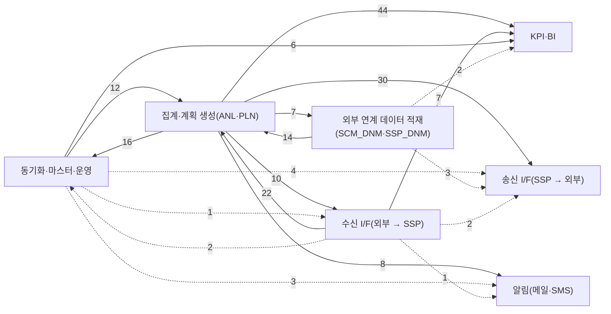

| 선행 잡(쓰기) | 후행 잡(읽기) | 매개 표 |
|---|---|---|
| JOB.PR_SSP_PLN_SHIP_PLAN_40 | JOB.PR_SSP_PLN_SHIP_PLAN_40_AZ | SSP_ANL_FORMATION_C, SSP_ANL_HOLD_STOCK, SSP_ANL_MES_FCS_STOCK_40_C, SSP_ANL_OWMS_STOCK_C, SSP_ANL_SHIP_CONFIRM, SSP_ANL_SHIP_PLAN_40, SSP_ANL_TCO_STOCK_C |
| JOB.PR_SSP_PLN_SHIP_PLAN_40 | JOB.PR_SSP_PLN_SHIP_PLAN_40_C | SSP_ANL_FORMATION_C, SSP_ANL_HOLD_STOCK, SSP_ANL_MES_FCS_STOCK_40_C, SSP_ANL_OWMS_STOCK_C, SSP_ANL_SHIP_CONFIRM, SSP_ANL_SHIP_PLAN_40, SSP_ANL_TCO_STOCK_C |
| JOB.PR_SSP_PLN_SHIP_PLAN_40_AZ | JOB.PR_SSP_PLN_SHIP_PLAN_40 | SSP_ANL_FORMATION_C, SSP_ANL_HOLD_STOCK, SSP_ANL_MES_FCS_STOCK_40_C, SSP_ANL_OWMS_STOCK_C, SSP_ANL_SHIP_CONFIRM, SSP_ANL_SHIP_PLAN_40, SSP_ANL_TCO_STOCK_C |
| JOB.PR_SSP_PLN_SHIP_PLAN_40_AZ | JOB.PR_SSP_PLN_SHIP_PLAN_40_C | SSP_ANL_FORMATION_C, SSP_ANL_HOLD_STOCK, SSP_ANL_MES_FCS_STOCK_40_C, SSP_ANL_OWMS_STOCK_C, SSP_ANL_SHIP_CONFIRM, SSP_ANL_SHIP_PLAN_40, SSP_ANL_TCO_STOCK_C |
| JOB.PR_SSP_PLN_SHIP_PLAN_40_C | JOB.PR_SSP_PLN_SHIP_PLAN_40 | SSP_ANL_FORMATION_C, SSP_ANL_HOLD_STOCK, SSP_ANL_MES_FCS_STOCK_40_C, SSP_ANL_OWMS_STOCK_C, SSP_ANL_SHIP_CONFIRM, SSP_ANL_SHIP_PLAN_40, SSP_ANL_TCO_STOCK_C |
| JOB.PR_SSP_PLN_SHIP_PLAN_40_C | JOB.PR_SSP_PLN_SHIP_PLAN_40_AZ | SSP_ANL_FORMATION_C, SSP_ANL_HOLD_STOCK, SSP_ANL_MES_FCS_STOCK_40_C, SSP_ANL_OWMS_STOCK_C, SSP_ANL_SHIP_CONFIRM, SSP_ANL_SHIP_PLAN_40, SSP_ANL_TCO_STOCK_C |
| JOB.PR_SSP_PLN_SHIP_PLAN_EE | JOB.PR_SSP_ANL_SHIP_PLAN_ALL | SSP_ANL_SHIP_CONFIRM, SSP_ANL_SHIP_PLAN_EE, SSP_ANL_SHIP_REQ_EE, SSP_MST_SHIP_PLAN_SCHEDULE_EE |
| JOB.PR_SSP_DNM_TABLE_COMPRESS | JOB.PR_SSP_ANL_SHIP_PLAN_ALL | SSP_ANL_SHIP_PLAN_40, SSP_ANL_SHIP_PLAN_C, SSP_ANL_SHIP_PLAN_EE |
| JOB.PR_SSP_MST_WS_CALL_BATCH | JOB.PR_SSP_ANL_SHIP_PLAN_ALL | SSP_ANL_SHIP_CONFIRM, SSP_ANL_SHIP_CONFIRM_CHG_REQ, SSP_ANL_SHIP_CONFIRM_CHG_REQ_DE |
| JOB.PR_SSP_MST_WS_CALL_BATCH | JOB.PR_SSP_XIF_DW_SHIP_CHANGE_HISTORY_S | SSP_ANL_SHIP_CONFIRM, SSP_ANL_SHIP_CONFIRM_CHG_REQ, SSP_ANL_SHIP_CONFIRM_CHG_REQ_DE |
| JOB.PR_SSP_PLN_SHIP_PLAN_81_82 | JOB.PR_SSP_ANL_SHIP_PLAN_ALL | SSP_ANL_SHIP_CONFIRM, SSP_ANL_SHIP_PLAN_C, SSP_MST_SHIP_PLAN_SCHEDULE |
| JOB.PR_SSP_ANL_ESS_SHIP_CONFIRM | JOB.PR_SSP_XIF_DW_SHIP_CHANGE_HISTORY_S | SSP_ANL_SHIP_CONFIRM, SSP_ANL_SHIP_CONFIRM_H |
| JOB.PR_SSP_DNM_TABLE_COMPRESS | JOB.PR_SSP_KPI_SHIPMENT_PSI_DW | SSP_ANL_SHIP_PLAN_40, SSP_ANL_SHIP_PLAN_C |
| JOB.PR_SSP_DNM_TABLE_COMPRESS | JOB.PR_SSP_PLN_SHIP_PLAN_EE | SSP_ANL_SHIP_PLAN_EE, SSP_ANL_STOCK_EE_C |
| JOB.PR_SSP_DNM_TABLE_COMPRESS | SYSTEMEXE:OSCM_OSCS_SCS_CELL_SHIP_PLAN | SSP_ANL_SHIP_PLAN_40, SSP_ANL_SHIP_PLAN_C |
| JOB.PR_SSP_MST_WS_CALL_BATCH | JOB.SCM_SSP_ADJUST_MAIL_SEND_BATCH | SSP_ANL_SHIP_CONFIRM_CHG_REQ, SSP_ANL_SHIP_CONFIRM_CHG_REQ_DE |
| JOB.PR_SSP_PLN_SHIP_PLAN_40 | JOB.PR_SSP_ANL_SHIP_PLAN_ALL | SSP_ANL_SHIP_CONFIRM, SSP_ANL_SHIP_PLAN_40 |
| JOB.PR_SSP_PLN_SHIP_PLAN_40 | JOB.PR_SSP_PLN_SHIP_PLAN_81_82 | SSP_ANL_HOLD_STOCK, SSP_ANL_SHIP_CONFIRM |
| JOB.PR_SSP_PLN_SHIP_PLAN_40 | JOB.PR_SSP_XIF_DW_SHIP_CHANGE_HISTORY_S | SSP_ANL_SHIP_CONFIRM, SSP_ANL_SHIP_CONFIRM_H |
| JOB.PR_SSP_PLN_SHIP_PLAN_40_AZ | JOB.PR_SSP_ANL_SHIP_PLAN_ALL | SSP_ANL_SHIP_CONFIRM, SSP_ANL_SHIP_PLAN_40 |
| JOB.PR_SSP_PLN_SHIP_PLAN_40_AZ | JOB.PR_SSP_PLN_SHIP_PLAN_81_82 | SSP_ANL_HOLD_STOCK, SSP_ANL_SHIP_CONFIRM |
| JOB.PR_SSP_PLN_SHIP_PLAN_40_AZ | JOB.PR_SSP_XIF_DW_SHIP_CHANGE_HISTORY_S | SSP_ANL_SHIP_CONFIRM, SSP_ANL_SHIP_CONFIRM_H |
| JOB.PR_SSP_PLN_SHIP_PLAN_40_C | JOB.PR_SSP_ANL_SHIP_PLAN_ALL | SSP_ANL_SHIP_CONFIRM, SSP_ANL_SHIP_PLAN_40 |
| JOB.PR_SSP_PLN_SHIP_PLAN_40_C | JOB.PR_SSP_PLN_SHIP_PLAN_81_82 | SSP_ANL_HOLD_STOCK, SSP_ANL_SHIP_CONFIRM |
| JOB.PR_SSP_PLN_SHIP_PLAN_40_C | JOB.PR_SSP_XIF_DW_SHIP_CHANGE_HISTORY_S | SSP_ANL_SHIP_CONFIRM, SSP_ANL_SHIP_CONFIRM_H |
| JOB.PR_SSP_PLN_SHIP_PLAN_81_82 | JOB.PR_SSP_PLN_SHIP_PLAN_40 | SSP_ANL_HOLD_STOCK, SSP_ANL_SHIP_CONFIRM |
| JOB.PR_SSP_PLN_SHIP_PLAN_81_82 | JOB.PR_SSP_PLN_SHIP_PLAN_40_AZ | SSP_ANL_HOLD_STOCK, SSP_ANL_SHIP_CONFIRM |
| JOB.PR_SSP_PLN_SHIP_PLAN_81_82 | JOB.PR_SSP_PLN_SHIP_PLAN_40_C | SSP_ANL_HOLD_STOCK, SSP_ANL_SHIP_CONFIRM |
| JOB.PR_SSP_PLN_SHIP_PLAN_81_82 | JOB.PR_SSP_XIF_DW_SHIP_CHANGE_HISTORY_S | SSP_ANL_SHIP_CONFIRM, SSP_ANL_SHIP_CONFIRM_H |
| JOB.PR_SSP_PLN_SHIP_PLAN_EE | JOB.PR_SSP_DNM_TABLE_COMPRESS | SSP_ANL_SHIP_PLAN_EE, SSP_ANL_STOCK_EE_C |
| JOB.PR_SSP_PLN_SHIP_PLAN_EE | JOB.PR_SSP_PLN_FP_SHIP_TARGET_ALL | SSP_ANL_SHIP_CONFIRM, SSP_ANL_SHIP_REQ_EE |
| JOB.PR_SSP_PLN_SHIP_PLAN_EE | JOB.PR_SSP_PLN_FP_SHIP_TARGET_WA | SSP_ANL_SHIP_CONFIRM, SSP_ANL_SHIP_REQ_EE |
| JOB.PR_SSP_PLN_SHIP_PLAN_EE | JOB.PR_SSP_PLN_SHIP_PLAN_81_82 | SSP_ANL_SHIP_CONFIRM, SSP_ANL_SHIP_REQ_EE |
| JOB.PR_SSP_PLN_SHIP_PLAN_EE | JOB.PR_SSP_XIF_DW_SHIP_CHANGE_HISTORY_S | SSP_ANL_SHIP_CONFIRM, SSP_ANL_SHIP_CONFIRM_H |
| JOB.PR_SSP_PLN_SHIP_PLAN_P | JOB.PR_SSP_XIF_DW_SHIP_CHANGE_HISTORY_S | SSP_ANL_SHIP_CONFIRM, SSP_ANL_SHIP_CONFIRM_H |
| JOB.PR_SSP_XIF_OWMS_STOCK_R | JOB.PR_SSP_PLN_SHIP_PLAN_81_82 | SSP_ANL_OWMS_STOCK_C2, SSP_DNM_OWMS_STOCK |
| JOB.PR_SSP_ANL_ESS_SHIP_CONFIRM | JOB.PR_DM_SSP_SYNC | SSP_ANL_SHIP_CONFIRM |
| JOB.PR_SSP_ANL_ESS_SHIP_CONFIRM | JOB.PR_SSP_ANL_SHIP_PLAN_ALL | SSP_ANL_SHIP_CONFIRM |
| JOB.PR_SSP_ANL_ESS_SHIP_CONFIRM | JOB.PR_SSP_BI_SSP_RESULT_H | SSP_ANL_SHIP_CONFIRM |
| JOB.PR_SSP_ANL_ESS_SHIP_CONFIRM | JOB.PR_SSP_KPI_ASR_AUTO_SO_RATE | SSP_ANL_SHIP_CONFIRM |
| JOB.PR_SSP_ANL_ESS_SHIP_CONFIRM | JOB.PR_SSP_KPI_DIA_DELIVERY_INSTRUCTION_ACCURACY | SSP_ANL_SHIP_CONFIRM |
| JOB.PR_SSP_ANL_ESS_SHIP_CONFIRM | JOB.PR_SSP_KPI_SPA_OTD1 | SSP_ANL_SHIP_CONFIRM |
| JOB.PR_SSP_ANL_ESS_SHIP_CONFIRM | JOB.PR_SSP_KPI_SPA_SHIPPING_PLAN_ACCURACY | SSP_ANL_SHIP_CONFIRM |
| JOB.PR_SSP_ANL_ESS_SHIP_CONFIRM | JOB.PR_SSP_MAIL_SEND_SHIP_PLAN_INTER_COM_PO | SSP_ANL_SHIP_CONFIRM |
| JOB.PR_SSP_ANL_ESS_SHIP_CONFIRM | JOB.PR_SSP_MST_WS_CALL_BATCH | SSP_ANL_SHIP_CONFIRM |
| JOB.PR_SSP_ANL_ESS_SHIP_CONFIRM | JOB.PR_SSP_PLN_FP_SHIP_TARGET_ALL | SSP_ANL_SHIP_CONFIRM |
| JOB.PR_SSP_ANL_ESS_SHIP_CONFIRM | JOB.PR_SSP_PLN_FP_SHIP_TARGET_WA | SSP_ANL_SHIP_CONFIRM |
| JOB.PR_SSP_ANL_ESS_SHIP_CONFIRM | JOB.PR_SSP_PLN_SHIP_PLAN_40 | SSP_ANL_SHIP_CONFIRM |
| JOB.PR_SSP_ANL_ESS_SHIP_CONFIRM | JOB.PR_SSP_PLN_SHIP_PLAN_40_AZ | SSP_ANL_SHIP_CONFIRM |
| JOB.PR_SSP_ANL_ESS_SHIP_CONFIRM | JOB.PR_SSP_PLN_SHIP_PLAN_40_C | SSP_ANL_SHIP_CONFIRM |
| JOB.PR_SSP_ANL_ESS_SHIP_CONFIRM | JOB.PR_SSP_PLN_SHIP_PLAN_81_82 | SSP_ANL_SHIP_CONFIRM |
| JOB.PR_SSP_ANL_ESS_SHIP_CONFIRM | JOB.PR_SSP_PLN_SHIP_PLAN_EE | SSP_ANL_SHIP_CONFIRM |
| JOB.PR_SSP_ANL_ESS_SHIP_CONFIRM | JOB.PR_SSP_PLN_SHIP_PLAN_P | SSP_ANL_SHIP_CONFIRM |
| JOB.PR_SSP_ANL_ESS_SHIP_CONFIRM | SYSTEMEXE:OPLM_OSCM_SAMPLE_REQUEST | SSP_ANL_SHIP_CONFIRM |
| JOB.PR_SSP_ANL_ESS_SHIP_CONFIRM | SYSTEMEXE:OSCM_OPLM_SHIP_CONFIRM | SSP_ANL_SHIP_CONFIRM |
| JOB.PR_SSP_ANL_SHIP_ERP_DOC_BATCH | JOB.PR_DM_SSP_SYNC | SSP_ANL_SHIP_CONFIRM |
| JOB.PR_SSP_ANL_SHIP_ERP_DOC_BATCH | JOB.PR_SSP_ANL_ESS_SHIP_CONFIRM | SSP_ANL_SHIP_CONFIRM |
| JOB.PR_SSP_ANL_SHIP_ERP_DOC_BATCH | JOB.PR_SSP_ANL_SHIP_PLAN_ALL | SSP_ANL_SHIP_CONFIRM |
| JOB.PR_SSP_ANL_SHIP_ERP_DOC_BATCH | JOB.PR_SSP_BI_SSP_RESULT_H | SSP_ANL_SHIP_CONFIRM |
| JOB.PR_SSP_ANL_SHIP_ERP_DOC_BATCH | JOB.PR_SSP_KPI_ASR_AUTO_SO_RATE | SSP_ANL_SHIP_CONFIRM |
| JOB.PR_SSP_ANL_SHIP_ERP_DOC_BATCH | JOB.PR_SSP_KPI_DIA_DELIVERY_INSTRUCTION_ACCURACY | SSP_ANL_SHIP_CONFIRM |
| JOB.PR_SSP_ANL_SHIP_ERP_DOC_BATCH | JOB.PR_SSP_KPI_SPA_OTD1 | SSP_ANL_SHIP_CONFIRM |
| JOB.PR_SSP_ANL_SHIP_ERP_DOC_BATCH | JOB.PR_SSP_KPI_SPA_SHIPPING_PLAN_ACCURACY | SSP_ANL_SHIP_CONFIRM |
| JOB.PR_SSP_ANL_SHIP_ERP_DOC_BATCH | JOB.PR_SSP_MAIL_SEND_SHIP_PLAN_INTER_COM_PO | SSP_ANL_SHIP_CONFIRM |
| JOB.PR_SSP_ANL_SHIP_ERP_DOC_BATCH | JOB.PR_SSP_MST_WS_CALL_BATCH | SSP_ANL_SHIP_CONFIRM |
| JOB.PR_SSP_ANL_SHIP_ERP_DOC_BATCH | JOB.PR_SSP_PLN_FP_SHIP_TARGET_ALL | SSP_ANL_SHIP_CONFIRM |
| JOB.PR_SSP_ANL_SHIP_ERP_DOC_BATCH | JOB.PR_SSP_PLN_FP_SHIP_TARGET_WA | SSP_ANL_SHIP_CONFIRM |
| JOB.PR_SSP_ANL_SHIP_ERP_DOC_BATCH | JOB.PR_SSP_PLN_SHIP_PLAN_40 | SSP_ANL_SHIP_CONFIRM |
| JOB.PR_SSP_ANL_SHIP_ERP_DOC_BATCH | JOB.PR_SSP_PLN_SHIP_PLAN_40_AZ | SSP_ANL_SHIP_CONFIRM |
| JOB.PR_SSP_ANL_SHIP_ERP_DOC_BATCH | JOB.PR_SSP_PLN_SHIP_PLAN_40_C | SSP_ANL_SHIP_CONFIRM |
| JOB.PR_SSP_ANL_SHIP_ERP_DOC_BATCH | JOB.PR_SSP_PLN_SHIP_PLAN_81_82 | SSP_ANL_SHIP_CONFIRM |
| JOB.PR_SSP_ANL_SHIP_ERP_DOC_BATCH | JOB.PR_SSP_PLN_SHIP_PLAN_EE | SSP_ANL_SHIP_CONFIRM |
| JOB.PR_SSP_ANL_SHIP_ERP_DOC_BATCH | JOB.PR_SSP_PLN_SHIP_PLAN_P | SSP_ANL_SHIP_CONFIRM |
| JOB.PR_SSP_ANL_SHIP_ERP_DOC_BATCH | JOB.PR_SSP_XIF_DW_SHIP_CHANGE_HISTORY_S | SSP_ANL_SHIP_CONFIRM |
| JOB.PR_SSP_ANL_SHIP_ERP_DOC_BATCH | SYSTEMEXE:OPLM_OSCM_SAMPLE_REQUEST | SSP_ANL_SHIP_CONFIRM |
| JOB.PR_SSP_ANL_SHIP_ERP_DOC_BATCH | SYSTEMEXE:OSCM_OPLM_SHIP_CONFIRM | SSP_ANL_SHIP_CONFIRM |
| JOB.PR_SSP_DNM_FP_PLAN_FROZEN | JOB.PR_SSP_PLN_SHIP_PLAN_40 | SSP_DNM_STOCK_C |
| JOB.PR_SSP_DNM_FP_PLAN_FROZEN | JOB.PR_SSP_PLN_SHIP_PLAN_40_AZ | SSP_DNM_STOCK_C |
| JOB.PR_SSP_DNM_FP_PLAN_FROZEN | JOB.PR_SSP_PLN_SHIP_PLAN_40_C | SSP_DNM_STOCK_C |
| JOB.PR_SSP_DNM_FP_PLAN_FROZEN | JOB.PR_SSP_PLN_SHIP_PLAN_81_82 | SSP_DNM_FP_PLAN_FROZEN |
| JOB.PR_SSP_DNM_TABLE_COMPRESS | JOB.PR_SSP_PLN_SHIP_PLAN_40 | SSP_ANL_SHIP_PLAN_40 |
| JOB.PR_SSP_DNM_TABLE_COMPRESS | JOB.PR_SSP_PLN_SHIP_PLAN_40_AZ | SSP_ANL_SHIP_PLAN_40 |
| JOB.PR_SSP_DNM_TABLE_COMPRESS | JOB.PR_SSP_PLN_SHIP_PLAN_40_C | SSP_ANL_SHIP_PLAN_40 |
| JOB.PR_SSP_DNM_TABLE_COMPRESS | JOB.PR_SSP_PLN_SHIP_PLAN_81_82 | SSP_ANL_SHIP_PLAN_C |
| JOB.PR_SSP_DNM_TABLE_COMPRESS | JOB.PR_SSP_PLN_SHIP_PLAN_P | SSP_ANL_SHIP_PLAN_P |
| JOB.PR_SSP_DNM_TABLE_COMPRESS | SYSTEMEXE:OSCM_OSCS_SCS_PACK_SHIP_PLAN | SSP_ANL_SHIP_PLAN_C |
| JOB.PR_SSP_MST_WS_CALL_BATCH | JOB.PR_DM_SSP_SYNC | SSP_ANL_SHIP_CONFIRM |
| JOB.PR_SSP_MST_WS_CALL_BATCH | JOB.PR_SSP_ANL_ESS_SHIP_CONFIRM | SSP_ANL_SHIP_CONFIRM |
| JOB.PR_SSP_MST_WS_CALL_BATCH | JOB.PR_SSP_BI_SSP_RESULT_H | SSP_ANL_SHIP_CONFIRM |
| JOB.PR_SSP_MST_WS_CALL_BATCH | JOB.PR_SSP_KPI_ASR_AUTO_SO_RATE | SSP_ANL_SHIP_CONFIRM |
| JOB.PR_SSP_MST_WS_CALL_BATCH | JOB.PR_SSP_KPI_DIA_DELIVERY_INSTRUCTION_ACCURACY | SSP_ANL_SHIP_CONFIRM |
| JOB.PR_SSP_MST_WS_CALL_BATCH | JOB.PR_SSP_KPI_SPA_OTD1 | SSP_ANL_SHIP_CONFIRM |
| JOB.PR_SSP_MST_WS_CALL_BATCH | JOB.PR_SSP_KPI_SPA_SHIPPING_PLAN_ACCURACY | SSP_ANL_SHIP_CONFIRM |
| JOB.PR_SSP_MST_WS_CALL_BATCH | JOB.PR_SSP_KPI_USR_URGENT_SHIP_REQ | SSP_ANL_SHIP_CONFIRM_CHG_REQ |
| JOB.PR_SSP_MST_WS_CALL_BATCH | JOB.PR_SSP_MAIL_SEND_SHIP_PLAN_INTER_COM_PO | SSP_ANL_SHIP_CONFIRM |
| JOB.PR_SSP_MST_WS_CALL_BATCH | JOB.PR_SSP_PLN_FP_SHIP_TARGET_ALL | SSP_ANL_SHIP_CONFIRM |
| JOB.PR_SSP_MST_WS_CALL_BATCH | JOB.PR_SSP_PLN_FP_SHIP_TARGET_WA | SSP_ANL_SHIP_CONFIRM |
| JOB.PR_SSP_MST_WS_CALL_BATCH | JOB.PR_SSP_PLN_SHIP_PLAN_40 | SSP_ANL_SHIP_CONFIRM |
| JOB.PR_SSP_MST_WS_CALL_BATCH | JOB.PR_SSP_PLN_SHIP_PLAN_40_AZ | SSP_ANL_SHIP_CONFIRM |
| JOB.PR_SSP_MST_WS_CALL_BATCH | JOB.PR_SSP_PLN_SHIP_PLAN_40_C | SSP_ANL_SHIP_CONFIRM |
| JOB.PR_SSP_MST_WS_CALL_BATCH | JOB.PR_SSP_PLN_SHIP_PLAN_81_82 | SSP_ANL_SHIP_CONFIRM |
| JOB.PR_SSP_MST_WS_CALL_BATCH | JOB.PR_SSP_PLN_SHIP_PLAN_EE | SSP_ANL_SHIP_CONFIRM |
| JOB.PR_SSP_MST_WS_CALL_BATCH | JOB.PR_SSP_PLN_SHIP_PLAN_P | SSP_ANL_SHIP_CONFIRM |
| JOB.PR_SSP_MST_WS_CALL_BATCH | SYSTEMEXE:OPLM_OSCM_SAMPLE_REQUEST | SSP_ANL_SHIP_CONFIRM |
| JOB.PR_SSP_MST_WS_CALL_BATCH | SYSTEMEXE:OSCM_OPLM_SHIP_CONFIRM | SSP_ANL_SHIP_CONFIRM |
| JOB.PR_SSP_PLN_SHIP_PLAN_40 | JOB.PR_DM_SSP_SYNC | SSP_ANL_SHIP_CONFIRM |
| JOB.PR_SSP_PLN_SHIP_PLAN_40 | JOB.PR_SSP_ANL_ESS_SHIP_CONFIRM | SSP_ANL_SHIP_CONFIRM |
| JOB.PR_SSP_PLN_SHIP_PLAN_40 | JOB.PR_SSP_BI_SSP_RESULT_H | SSP_ANL_SHIP_CONFIRM |
| JOB.PR_SSP_PLN_SHIP_PLAN_40 | JOB.PR_SSP_DNM_TABLE_COMPRESS | SSP_ANL_SHIP_PLAN_40 |
| JOB.PR_SSP_PLN_SHIP_PLAN_40 | JOB.PR_SSP_KPI_ASR_AUTO_SO_RATE | SSP_ANL_SHIP_CONFIRM |
| JOB.PR_SSP_PLN_SHIP_PLAN_40 | JOB.PR_SSP_KPI_DIA_DELIVERY_INSTRUCTION_ACCURACY | SSP_ANL_SHIP_CONFIRM |
| JOB.PR_SSP_PLN_SHIP_PLAN_40 | JOB.PR_SSP_KPI_SHIPMENT_PSI_DW | SSP_ANL_SHIP_PLAN_40 |
| JOB.PR_SSP_PLN_SHIP_PLAN_40 | JOB.PR_SSP_KPI_SPA_OTD1 | SSP_ANL_SHIP_CONFIRM |
| JOB.PR_SSP_PLN_SHIP_PLAN_40 | JOB.PR_SSP_KPI_SPA_SHIPPING_PLAN_ACCURACY | SSP_ANL_SHIP_CONFIRM |
| JOB.PR_SSP_PLN_SHIP_PLAN_40 | JOB.PR_SSP_MAIL_SEND_SHIP_PLAN_INTER_COM_PO | SSP_ANL_SHIP_CONFIRM |
| JOB.PR_SSP_PLN_SHIP_PLAN_40 | JOB.PR_SSP_MST_WS_CALL_BATCH | SSP_ANL_SHIP_CONFIRM |
| JOB.PR_SSP_PLN_SHIP_PLAN_40 | JOB.PR_SSP_PLN_FP_SHIP_TARGET_ALL | SSP_ANL_SHIP_CONFIRM |
| JOB.PR_SSP_PLN_SHIP_PLAN_40 | JOB.PR_SSP_PLN_FP_SHIP_TARGET_WA | SSP_ANL_SHIP_CONFIRM |
| JOB.PR_SSP_PLN_SHIP_PLAN_40 | JOB.PR_SSP_PLN_SHIP_PLAN_EE | SSP_ANL_SHIP_CONFIRM |
| JOB.PR_SSP_PLN_SHIP_PLAN_40 | JOB.PR_SSP_PLN_SHIP_PLAN_P | SSP_ANL_SHIP_CONFIRM |
| JOB.PR_SSP_PLN_SHIP_PLAN_40 | SYSTEMEXE:OPLM_OSCM_SAMPLE_REQUEST | SSP_ANL_SHIP_CONFIRM |
| JOB.PR_SSP_PLN_SHIP_PLAN_40 | SYSTEMEXE:OSCM_OPLM_SHIP_CONFIRM | SSP_ANL_SHIP_CONFIRM |
| JOB.PR_SSP_PLN_SHIP_PLAN_40 | SYSTEMEXE:OSCM_OSCS_SCS_CELL_SHIP_PLAN | SSP_ANL_SHIP_PLAN_40 |
| JOB.PR_SSP_PLN_SHIP_PLAN_40_AZ | JOB.PR_DM_SSP_SYNC | SSP_ANL_SHIP_CONFIRM |
| JOB.PR_SSP_PLN_SHIP_PLAN_40_AZ | JOB.PR_SSP_ANL_ESS_SHIP_CONFIRM | SSP_ANL_SHIP_CONFIRM |
| JOB.PR_SSP_PLN_SHIP_PLAN_40_AZ | JOB.PR_SSP_BI_SSP_RESULT_H | SSP_ANL_SHIP_CONFIRM |
| JOB.PR_SSP_PLN_SHIP_PLAN_40_AZ | JOB.PR_SSP_DNM_TABLE_COMPRESS | SSP_ANL_SHIP_PLAN_40 |
| JOB.PR_SSP_PLN_SHIP_PLAN_40_AZ | JOB.PR_SSP_KPI_ASR_AUTO_SO_RATE | SSP_ANL_SHIP_CONFIRM |
| JOB.PR_SSP_PLN_SHIP_PLAN_40_AZ | JOB.PR_SSP_KPI_DIA_DELIVERY_INSTRUCTION_ACCURACY | SSP_ANL_SHIP_CONFIRM |
| JOB.PR_SSP_PLN_SHIP_PLAN_40_AZ | JOB.PR_SSP_KPI_SHIPMENT_PSI_DW | SSP_ANL_SHIP_PLAN_40 |
| JOB.PR_SSP_PLN_SHIP_PLAN_40_AZ | JOB.PR_SSP_KPI_SPA_OTD1 | SSP_ANL_SHIP_CONFIRM |
| JOB.PR_SSP_PLN_SHIP_PLAN_40_AZ | JOB.PR_SSP_KPI_SPA_SHIPPING_PLAN_ACCURACY | SSP_ANL_SHIP_CONFIRM |
| JOB.PR_SSP_PLN_SHIP_PLAN_40_AZ | JOB.PR_SSP_MAIL_SEND_SHIP_PLAN_INTER_COM_PO | SSP_ANL_SHIP_CONFIRM |
| JOB.PR_SSP_PLN_SHIP_PLAN_40_AZ | JOB.PR_SSP_MST_WS_CALL_BATCH | SSP_ANL_SHIP_CONFIRM |
| JOB.PR_SSP_PLN_SHIP_PLAN_40_AZ | JOB.PR_SSP_PLN_FP_SHIP_TARGET_ALL | SSP_ANL_SHIP_CONFIRM |
| JOB.PR_SSP_PLN_SHIP_PLAN_40_AZ | JOB.PR_SSP_PLN_FP_SHIP_TARGET_WA | SSP_ANL_SHIP_CONFIRM |
| JOB.PR_SSP_PLN_SHIP_PLAN_40_AZ | JOB.PR_SSP_PLN_SHIP_PLAN_EE | SSP_ANL_SHIP_CONFIRM |
| JOB.PR_SSP_PLN_SHIP_PLAN_40_AZ | JOB.PR_SSP_PLN_SHIP_PLAN_P | SSP_ANL_SHIP_CONFIRM |
| JOB.PR_SSP_PLN_SHIP_PLAN_40_AZ | SYSTEMEXE:OPLM_OSCM_SAMPLE_REQUEST | SSP_ANL_SHIP_CONFIRM |
| JOB.PR_SSP_PLN_SHIP_PLAN_40_AZ | SYSTEMEXE:OSCM_OPLM_SHIP_CONFIRM | SSP_ANL_SHIP_CONFIRM |
| JOB.PR_SSP_PLN_SHIP_PLAN_40_AZ | SYSTEMEXE:OSCM_OSCS_SCS_CELL_SHIP_PLAN | SSP_ANL_SHIP_PLAN_40 |
| JOB.PR_SSP_PLN_SHIP_PLAN_40_C | JOB.PR_DM_SSP_SYNC | SSP_ANL_SHIP_CONFIRM |
| JOB.PR_SSP_PLN_SHIP_PLAN_40_C | JOB.PR_SSP_ANL_ESS_SHIP_CONFIRM | SSP_ANL_SHIP_CONFIRM |
| JOB.PR_SSP_PLN_SHIP_PLAN_40_C | JOB.PR_SSP_BI_SSP_RESULT_H | SSP_ANL_SHIP_CONFIRM |
| JOB.PR_SSP_PLN_SHIP_PLAN_40_C | JOB.PR_SSP_DNM_TABLE_COMPRESS | SSP_ANL_SHIP_PLAN_40 |
| JOB.PR_SSP_PLN_SHIP_PLAN_40_C | JOB.PR_SSP_KPI_ASR_AUTO_SO_RATE | SSP_ANL_SHIP_CONFIRM |
| JOB.PR_SSP_PLN_SHIP_PLAN_40_C | JOB.PR_SSP_KPI_DIA_DELIVERY_INSTRUCTION_ACCURACY | SSP_ANL_SHIP_CONFIRM |
| JOB.PR_SSP_PLN_SHIP_PLAN_40_C | JOB.PR_SSP_KPI_SHIPMENT_PSI_DW | SSP_ANL_SHIP_PLAN_40 |
| JOB.PR_SSP_PLN_SHIP_PLAN_40_C | JOB.PR_SSP_KPI_SPA_OTD1 | SSP_ANL_SHIP_CONFIRM |
| JOB.PR_SSP_PLN_SHIP_PLAN_40_C | JOB.PR_SSP_KPI_SPA_SHIPPING_PLAN_ACCURACY | SSP_ANL_SHIP_CONFIRM |
| JOB.PR_SSP_PLN_SHIP_PLAN_40_C | JOB.PR_SSP_MAIL_SEND_SHIP_PLAN_INTER_COM_PO | SSP_ANL_SHIP_CONFIRM |
| JOB.PR_SSP_PLN_SHIP_PLAN_40_C | JOB.PR_SSP_MST_WS_CALL_BATCH | SSP_ANL_SHIP_CONFIRM |
| JOB.PR_SSP_PLN_SHIP_PLAN_40_C | JOB.PR_SSP_PLN_FP_SHIP_TARGET_ALL | SSP_ANL_SHIP_CONFIRM |
| JOB.PR_SSP_PLN_SHIP_PLAN_40_C | JOB.PR_SSP_PLN_FP_SHIP_TARGET_WA | SSP_ANL_SHIP_CONFIRM |
| JOB.PR_SSP_PLN_SHIP_PLAN_40_C | JOB.PR_SSP_PLN_SHIP_PLAN_EE | SSP_ANL_SHIP_CONFIRM |
| JOB.PR_SSP_PLN_SHIP_PLAN_40_C | JOB.PR_SSP_PLN_SHIP_PLAN_P | SSP_ANL_SHIP_CONFIRM |
| JOB.PR_SSP_PLN_SHIP_PLAN_40_C | SYSTEMEXE:OPLM_OSCM_SAMPLE_REQUEST | SSP_ANL_SHIP_CONFIRM |
| JOB.PR_SSP_PLN_SHIP_PLAN_40_C | SYSTEMEXE:OSCM_OPLM_SHIP_CONFIRM | SSP_ANL_SHIP_CONFIRM |
| JOB.PR_SSP_PLN_SHIP_PLAN_40_C | SYSTEMEXE:OSCM_OSCS_SCS_CELL_SHIP_PLAN | SSP_ANL_SHIP_PLAN_40 |
| JOB.PR_SSP_PLN_SHIP_PLAN_81_82 | JOB.PR_DM_SSP_SYNC | SSP_ANL_SHIP_CONFIRM |
| JOB.PR_SSP_PLN_SHIP_PLAN_81_82 | JOB.PR_SSP_ANL_ESS_SHIP_CONFIRM | SSP_ANL_SHIP_CONFIRM |
| JOB.PR_SSP_PLN_SHIP_PLAN_81_82 | JOB.PR_SSP_BI_SSP_RESULT_H | SSP_ANL_SHIP_CONFIRM |
| JOB.PR_SSP_PLN_SHIP_PLAN_81_82 | JOB.PR_SSP_DAILY_PLAN_CUTOFF_CHECK_SMS_SEND 외 1 | SSP_MST_SHIP_PLAN_SCHEDULE |
| JOB.PR_SSP_PLN_SHIP_PLAN_81_82 | JOB.PR_SSP_DNM_TABLE_COMPRESS | SSP_ANL_SHIP_PLAN_C |
| JOB.PR_SSP_PLN_SHIP_PLAN_81_82 | JOB.PR_SSP_KPI_ASR_AUTO_SO_RATE | SSP_ANL_SHIP_CONFIRM |
| JOB.PR_SSP_PLN_SHIP_PLAN_81_82 | JOB.PR_SSP_KPI_DIA_DELIVERY_INSTRUCTION_ACCURACY | SSP_ANL_SHIP_CONFIRM |
| JOB.PR_SSP_PLN_SHIP_PLAN_81_82 | JOB.PR_SSP_KPI_SHIPMENT_PSI_DW | SSP_ANL_SHIP_PLAN_C |
| JOB.PR_SSP_PLN_SHIP_PLAN_81_82 | JOB.PR_SSP_KPI_SPA_OTD1 | SSP_ANL_SHIP_CONFIRM |
| JOB.PR_SSP_PLN_SHIP_PLAN_81_82 | JOB.PR_SSP_KPI_SPA_SHIPPING_PLAN_ACCURACY | SSP_ANL_SHIP_CONFIRM |
| JOB.PR_SSP_PLN_SHIP_PLAN_81_82 | JOB.PR_SSP_MAIL_SEND_SHIP_PLAN_INTER_COM_PO | SSP_ANL_SHIP_CONFIRM |
| JOB.PR_SSP_PLN_SHIP_PLAN_81_82 | JOB.PR_SSP_MST_WS_CALL_BATCH | SSP_ANL_SHIP_CONFIRM |
| JOB.PR_SSP_PLN_SHIP_PLAN_81_82 | JOB.PR_SSP_PLN_FP_SHIP_TARGET_ALL | SSP_ANL_SHIP_CONFIRM |
| JOB.PR_SSP_PLN_SHIP_PLAN_81_82 | JOB.PR_SSP_PLN_FP_SHIP_TARGET_WA | SSP_ANL_SHIP_CONFIRM |
| JOB.PR_SSP_PLN_SHIP_PLAN_81_82 | JOB.PR_SSP_PLN_SHIP_PLAN_EE | SSP_ANL_SHIP_CONFIRM |
| JOB.PR_SSP_PLN_SHIP_PLAN_81_82 | JOB.PR_SSP_PLN_SHIP_PLAN_P | SSP_ANL_SHIP_CONFIRM |
| JOB.PR_SSP_PLN_SHIP_PLAN_81_82 | JOB.PR_SSP_XIF_OWMS_STOCK_R | SSP_ANL_OWMS_STOCK_C2 |
| JOB.PR_SSP_PLN_SHIP_PLAN_81_82 | SYSTEMEXE:OPLM_OSCM_SAMPLE_REQUEST | SSP_ANL_SHIP_CONFIRM |
| JOB.PR_SSP_PLN_SHIP_PLAN_81_82 | SYSTEMEXE:OSCM_OPLM_SHIP_CONFIRM | SSP_ANL_SHIP_CONFIRM |
| JOB.PR_SSP_PLN_SHIP_PLAN_81_82 | SYSTEMEXE:OSCM_OSCS_SCS_CELL_SHIP_PLAN | SSP_ANL_SHIP_PLAN_C |
| JOB.PR_SSP_PLN_SHIP_PLAN_81_82 | SYSTEMEXE:OSCM_OSCS_SCS_PACK_SHIP_PLAN | SSP_ANL_SHIP_PLAN_C |
| JOB.PR_SSP_PLN_SHIP_PLAN_EE | JOB.PR_DM_SSP_SYNC | SSP_ANL_SHIP_CONFIRM |
| JOB.PR_SSP_PLN_SHIP_PLAN_EE | JOB.PR_SSP_ANL_ESS_SHIP_CONFIRM | SSP_ANL_SHIP_CONFIRM |
| JOB.PR_SSP_PLN_SHIP_PLAN_EE | JOB.PR_SSP_BI_SSP_RESULT_H | SSP_ANL_SHIP_CONFIRM |
| JOB.PR_SSP_PLN_SHIP_PLAN_EE | JOB.PR_SSP_DAILY_PLAN_CUTOFF_CHECK_SMS_SEND 외 1 | SSP_MST_SHIP_PLAN_SCHEDULE_EE |
| JOB.PR_SSP_PLN_SHIP_PLAN_EE | JOB.PR_SSP_KPI_ASR_AUTO_SO_RATE | SSP_ANL_SHIP_CONFIRM |
| JOB.PR_SSP_PLN_SHIP_PLAN_EE | JOB.PR_SSP_KPI_DIA_DELIVERY_INSTRUCTION_ACCURACY | SSP_ANL_SHIP_CONFIRM |
| JOB.PR_SSP_PLN_SHIP_PLAN_EE | JOB.PR_SSP_KPI_SPA_OTD1 | SSP_ANL_SHIP_CONFIRM |
| JOB.PR_SSP_PLN_SHIP_PLAN_EE | JOB.PR_SSP_KPI_SPA_SHIPPING_PLAN_ACCURACY | SSP_ANL_SHIP_CONFIRM |
| JOB.PR_SSP_PLN_SHIP_PLAN_EE | JOB.PR_SSP_MAIL_SEND_SHIP_PLAN_INTER_COM_PO | SSP_ANL_SHIP_CONFIRM |
| JOB.PR_SSP_PLN_SHIP_PLAN_EE | JOB.PR_SSP_MST_WS_CALL_BATCH | SSP_ANL_SHIP_CONFIRM |
| JOB.PR_SSP_PLN_SHIP_PLAN_EE | JOB.PR_SSP_PLN_SHIP_PLAN_40 | SSP_ANL_SHIP_CONFIRM |
| JOB.PR_SSP_PLN_SHIP_PLAN_EE | JOB.PR_SSP_PLN_SHIP_PLAN_40_AZ | SSP_ANL_SHIP_CONFIRM |
| JOB.PR_SSP_PLN_SHIP_PLAN_EE | JOB.PR_SSP_PLN_SHIP_PLAN_40_C | SSP_ANL_SHIP_CONFIRM |
| JOB.PR_SSP_PLN_SHIP_PLAN_EE | JOB.PR_SSP_PLN_SHIP_PLAN_P | SSP_ANL_SHIP_CONFIRM |
| JOB.PR_SSP_PLN_SHIP_PLAN_EE | SYSTEMEXE:OPLM_OSCM_SAMPLE_REQUEST | SSP_ANL_SHIP_CONFIRM |
| JOB.PR_SSP_PLN_SHIP_PLAN_EE | SYSTEMEXE:OSCM_OPLM_SHIP_CONFIRM | SSP_ANL_SHIP_CONFIRM |
| JOB.PR_SSP_PLN_SHIP_PLAN_P | JOB.PR_DM_SSP_SYNC | SSP_ANL_SHIP_CONFIRM |
| JOB.PR_SSP_PLN_SHIP_PLAN_P | JOB.PR_SSP_ANL_ESS_SHIP_CONFIRM | SSP_ANL_SHIP_CONFIRM |
| JOB.PR_SSP_PLN_SHIP_PLAN_P | JOB.PR_SSP_ANL_SHIP_PLAN_ALL | SSP_ANL_SHIP_CONFIRM |
| JOB.PR_SSP_PLN_SHIP_PLAN_P | JOB.PR_SSP_BI_SSP_RESULT_H | SSP_ANL_SHIP_CONFIRM |
| JOB.PR_SSP_PLN_SHIP_PLAN_P | JOB.PR_SSP_DNM_TABLE_COMPRESS | SSP_ANL_SHIP_PLAN_P |
| JOB.PR_SSP_PLN_SHIP_PLAN_P | JOB.PR_SSP_KPI_ASR_AUTO_SO_RATE | SSP_ANL_SHIP_CONFIRM |
| JOB.PR_SSP_PLN_SHIP_PLAN_P | JOB.PR_SSP_KPI_DIA_DELIVERY_INSTRUCTION_ACCURACY | SSP_ANL_SHIP_CONFIRM |
| JOB.PR_SSP_PLN_SHIP_PLAN_P | JOB.PR_SSP_KPI_SPA_OTD1 | SSP_ANL_SHIP_CONFIRM |
| JOB.PR_SSP_PLN_SHIP_PLAN_P | JOB.PR_SSP_KPI_SPA_SHIPPING_PLAN_ACCURACY | SSP_ANL_SHIP_CONFIRM |
| JOB.PR_SSP_PLN_SHIP_PLAN_P | JOB.PR_SSP_MAIL_SEND_SHIP_PLAN_INTER_COM_PO | SSP_ANL_SHIP_CONFIRM |
| JOB.PR_SSP_PLN_SHIP_PLAN_P | JOB.PR_SSP_MST_WS_CALL_BATCH | SSP_ANL_SHIP_CONFIRM |
| JOB.PR_SSP_PLN_SHIP_PLAN_P | JOB.PR_SSP_PLN_FP_SHIP_TARGET_ALL | SSP_ANL_SHIP_CONFIRM |
| JOB.PR_SSP_PLN_SHIP_PLAN_P | JOB.PR_SSP_PLN_FP_SHIP_TARGET_WA | SSP_ANL_SHIP_CONFIRM |
| JOB.PR_SSP_PLN_SHIP_PLAN_P | JOB.PR_SSP_PLN_SHIP_PLAN_40 | SSP_ANL_SHIP_CONFIRM |
| JOB.PR_SSP_PLN_SHIP_PLAN_P | JOB.PR_SSP_PLN_SHIP_PLAN_40_AZ | SSP_ANL_SHIP_CONFIRM |
| JOB.PR_SSP_PLN_SHIP_PLAN_P | JOB.PR_SSP_PLN_SHIP_PLAN_40_C | SSP_ANL_SHIP_CONFIRM |
| JOB.PR_SSP_PLN_SHIP_PLAN_P | JOB.PR_SSP_PLN_SHIP_PLAN_81_82 | SSP_ANL_SHIP_CONFIRM |
| JOB.PR_SSP_PLN_SHIP_PLAN_P | JOB.PR_SSP_PLN_SHIP_PLAN_EE | SSP_ANL_SHIP_CONFIRM |
| JOB.PR_SSP_PLN_SHIP_PLAN_P | SYSTEMEXE:OPLM_OSCM_SAMPLE_REQUEST | SSP_ANL_SHIP_CONFIRM |
| JOB.PR_SSP_PLN_SHIP_PLAN_P | SYSTEMEXE:OSCM_OPLM_SHIP_CONFIRM | SSP_ANL_SHIP_CONFIRM |
| JOB.PR_SSP_PLN_SHIP_PLAN_P | SYSTEMEXE:OSCS_OSCM_SCS_PACK_SHIP_PLAN_MOD | SSP_ANL_SHIP_REQ_P |
| JOB.PR_SSP_XIF_IWMS_STOCK_EE_R | JOB.PR_SSP_PLN_SHIP_PLAN_EE | SSP_DNM_IWMS_STOCK_EE |
| JOB.PR_SSP_XIF_MES_STOCK_40_R | JOB.PR_SSP_PLN_SHIP_PLAN_40 | SSP_DNM_GMES_STOCK_40 |
| JOB.PR_SSP_XIF_MES_STOCK_40_R | JOB.PR_SSP_PLN_SHIP_PLAN_40_AZ | SSP_DNM_GMES_STOCK_40 |
| JOB.PR_SSP_XIF_MES_STOCK_40_R | JOB.PR_SSP_PLN_SHIP_PLAN_40_C | SSP_DNM_GMES_STOCK_40 |
| JOB.PR_SSP_XIF_MES_STOCK_81_82_R | JOB.PR_SSP_PLN_SHIP_PLAN_81_82 | SSP_DNM_GMES_STOCK_81_82 |
| JOB.PR_SSP_XIF_MES_STOCK_EE_R | JOB.PR_SSP_PLN_SHIP_PLAN_EE | SSP_DNM_GMES_STOCK_EE |
| JOB.PR_SSP_XIF_OWMS_SHIP_RESULT_R | JOB.PR_SSP_BI_SSP_RESULT_H | SSP_DNM_SHIP_RESULT_OWMS |
| JOB.PR_SSP_XIF_OWMS_SHIP_RETURN_R | JOB.PR_SSP_BI_SSP_RESULT_H | SSP_DNM_SHIP_RETURN_OWMS |
| JOB.PR_SSP_XIF_OWMS_STOCK_EE_R | JOB.PR_SSP_PLN_SHIP_PLAN_EE | SSP_DNM_OWMS_STOCK_EE |
| JOB.PR_SSP_XIF_OWMS_STOCK_R | JOB.PR_SSP_PLN_SHIP_PLAN_40 | SSP_DNM_OWMS_STOCK |
| JOB.PR_SSP_XIF_OWMS_STOCK_R | JOB.PR_SSP_PLN_SHIP_PLAN_40_AZ | SSP_DNM_OWMS_STOCK |
| JOB.PR_SSP_XIF_OWMS_STOCK_R | JOB.PR_SSP_PLN_SHIP_PLAN_40_C | SSP_DNM_OWMS_STOCK |
| SYSTEMEXE:OPLM_OSCM_SAMPLE_REQUEST | JOB.PR_DM_SSP_SYNC | SSP_ANL_SHIP_CONFIRM |
| SYSTEMEXE:OPLM_OSCM_SAMPLE_REQUEST | JOB.PR_SSP_ANL_ESS_SHIP_CONFIRM | SSP_ANL_SHIP_CONFIRM |
| SYSTEMEXE:OPLM_OSCM_SAMPLE_REQUEST | JOB.PR_SSP_ANL_SHIP_PLAN_ALL | SSP_ANL_SHIP_CONFIRM |
| SYSTEMEXE:OPLM_OSCM_SAMPLE_REQUEST | JOB.PR_SSP_BI_SSP_RESULT_H | SSP_ANL_SHIP_CONFIRM |
| SYSTEMEXE:OPLM_OSCM_SAMPLE_REQUEST | JOB.PR_SSP_KPI_ASR_AUTO_SO_RATE | SSP_ANL_SHIP_CONFIRM |
| SYSTEMEXE:OPLM_OSCM_SAMPLE_REQUEST | JOB.PR_SSP_KPI_DIA_DELIVERY_INSTRUCTION_ACCURACY | SSP_ANL_SHIP_CONFIRM |
| SYSTEMEXE:OPLM_OSCM_SAMPLE_REQUEST | JOB.PR_SSP_KPI_SPA_OTD1 | SSP_ANL_SHIP_CONFIRM |
| SYSTEMEXE:OPLM_OSCM_SAMPLE_REQUEST | JOB.PR_SSP_KPI_SPA_SHIPPING_PLAN_ACCURACY | SSP_ANL_SHIP_CONFIRM |
| SYSTEMEXE:OPLM_OSCM_SAMPLE_REQUEST | JOB.PR_SSP_MAIL_SEND_SHIP_PLAN_INTER_COM_PO | SSP_ANL_SHIP_CONFIRM |
| SYSTEMEXE:OPLM_OSCM_SAMPLE_REQUEST | JOB.PR_SSP_MST_WS_CALL_BATCH | SSP_ANL_SHIP_CONFIRM |
| SYSTEMEXE:OPLM_OSCM_SAMPLE_REQUEST | JOB.PR_SSP_PLN_FP_SHIP_TARGET_ALL | SSP_ANL_SHIP_CONFIRM |
| SYSTEMEXE:OPLM_OSCM_SAMPLE_REQUEST | JOB.PR_SSP_PLN_FP_SHIP_TARGET_WA | SSP_ANL_SHIP_CONFIRM |
| SYSTEMEXE:OPLM_OSCM_SAMPLE_REQUEST | JOB.PR_SSP_PLN_SHIP_PLAN_40 | SSP_ANL_SHIP_CONFIRM |
| SYSTEMEXE:OPLM_OSCM_SAMPLE_REQUEST | JOB.PR_SSP_PLN_SHIP_PLAN_40_AZ | SSP_ANL_SHIP_CONFIRM |
| SYSTEMEXE:OPLM_OSCM_SAMPLE_REQUEST | JOB.PR_SSP_PLN_SHIP_PLAN_40_C | SSP_ANL_SHIP_CONFIRM |
| SYSTEMEXE:OPLM_OSCM_SAMPLE_REQUEST | JOB.PR_SSP_PLN_SHIP_PLAN_81_82 | SSP_ANL_SHIP_CONFIRM |
| SYSTEMEXE:OPLM_OSCM_SAMPLE_REQUEST | JOB.PR_SSP_PLN_SHIP_PLAN_EE | SSP_ANL_SHIP_CONFIRM |
| SYSTEMEXE:OPLM_OSCM_SAMPLE_REQUEST | JOB.PR_SSP_PLN_SHIP_PLAN_P | SSP_ANL_SHIP_CONFIRM |
| SYSTEMEXE:OPLM_OSCM_SAMPLE_REQUEST | JOB.PR_SSP_XIF_DW_SHIP_CHANGE_HISTORY_S | SSP_ANL_SHIP_CONFIRM |
| SYSTEMEXE:OPLM_OSCM_SAMPLE_REQUEST | SYSTEMEXE:OSCM_OPLM_SHIP_CONFIRM | SSP_ANL_SHIP_CONFIRM |

## 5. 외부 시스템 인터페이스 맵(수신·송신 배치)

<div class="spf-svg"><div class="tbl-wrap"><table class="mx if"><thead><tr><th>외부 시스템</th><th class="mx-g0">수신 잡(외부 → SSP)</th><th class="mx-g1">송신 잡(SSP → 외부)</th></tr></thead><tbody><tr><th class="mx-e">SCS</th><td class="if-c"><b class="mx-r">수신 5</b><span class="if-j in">PR_SCM_DNM_SCS_PROD_PLAN</span><span class="if-j in">PR_SCM_DNM_SCS_PROD_RESULT</span><span class="if-j in">PR_SCM_DNM_SCS_SHIP_RESULT</span><span class="if-j in">PR_SCM_DNM_SCS_STOCK</span><span class="if-j in">⏱OSCS_OSCM_SCS_PACK_SHIP_PLAN_MOD</span></td><td class="if-c"><b class="mx-w">송신 2</b><span class="if-j out">⏱OSCM_OSCS_SCS_CELL_SHIP_PLAN</span><span class="if-j out">⏱OSCM_OSCS_SCS_PACK_SHIP_PLAN</span></td></tr><tr><th class="mx-e">OWMS</th><td class="if-c"><b class="mx-r">수신 4</b><span class="if-j in">PR_SSP_XIF_OWMS_SHIP_RESULT_R</span><span class="if-j in">PR_SSP_XIF_OWMS_SHIP_RETURN_R</span><span class="if-j in">PR_SSP_XIF_OWMS_STOCK_EE_R</span><span class="if-j in">PR_SSP_XIF_OWMS_STOCK_R</span></td><td class="if-c"><b class="mx-w">송신 0</b><span class="if-0">없음</span></td></tr><tr><th class="mx-e">MES</th><td class="if-c"><b class="mx-r">수신 3</b><span class="if-j in">PR_SSP_XIF_MES_STOCK_40_R</span><span class="if-j in">PR_SSP_XIF_MES_STOCK_81_82_R</span><span class="if-j in">PR_SSP_XIF_MES_STOCK_EE_R</span></td><td class="if-c"><b class="mx-w">송신 0</b><span class="if-0">없음</span></td></tr><tr><th class="mx-e">PLM</th><td class="if-c"><b class="mx-r">수신 1</b><span class="if-j in">⏱OPLM_OSCM_SAMPLE_REQUEST</span></td><td class="if-c"><b class="mx-w">송신 1</b><span class="if-j out">⏱OSCM_OPLM_SHIP_CONFIRM</span></td></tr><tr><th class="mx-e">DM</th><td class="if-c"><b class="mx-r">수신 0</b><span class="if-0">없음</span></td><td class="if-c"><b class="mx-w">송신 1</b><span class="if-j out">PR_DM_TO_XIF_DM_SSPM_CELL_CAR_S</span></td></tr><tr><th class="mx-e">DW</th><td class="if-c"><b class="mx-r">수신 0</b><span class="if-0">없음</span></td><td class="if-c"><b class="mx-w">송신 1</b><span class="if-j out">PR_SSP_XIF_DW_SHIP_CHANGE_HISTORY_S</span></td></tr><tr><th class="mx-e">IWMS</th><td class="if-c"><b class="mx-r">수신 1</b><span class="if-j in">PR_SSP_XIF_IWMS_STOCK_EE_R</span></td><td class="if-c"><b class="mx-w">송신 0</b><span class="if-0">없음</span></td></tr></tbody></table></div><div class="bd-cap">잡 이름을 누르면 그 잡의 상세가 열립니다(이름 앞 ⏱ = SSP 자체 스케줄러 잡). 같은 내용의 그래프는 아래 「그래프로 보기」.</div></div>

<div class="spf-fold" data-label="그래프로 보기(같은 내용)"></div>

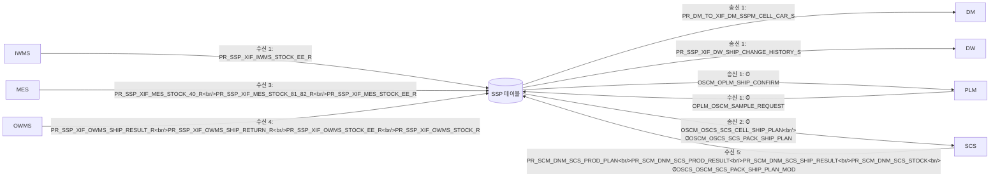

## 6. 잡별 상세 다이어그램(스텝 → SP → 엔터티)

- 엔터티 단위(SSP) · 타 도메인은 도메인명 · 라벨 = 테이블 수 · 테이블 단위는 분석서 §3 표

### JOB.PR_SSP_BI_SSP_RESULT_H

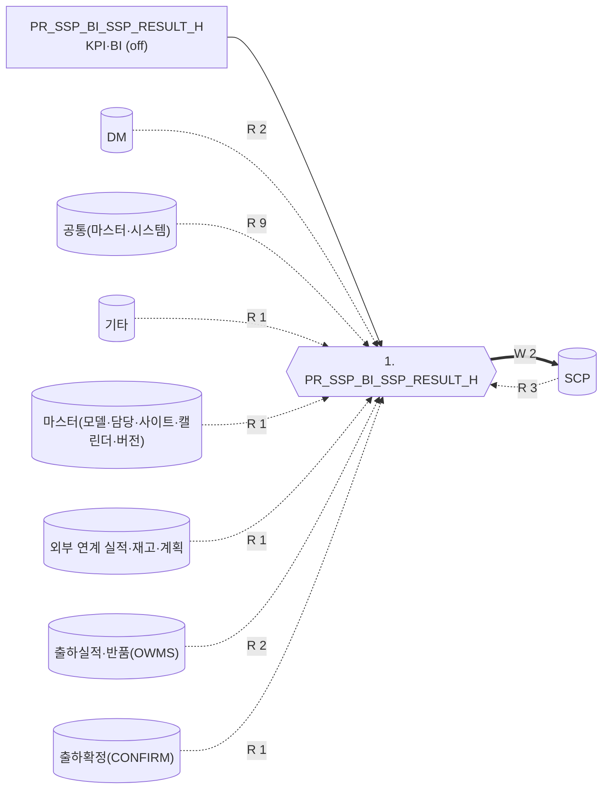

### JOB.PR_SSP_KPI_ASR_AUTO_SO_RATE

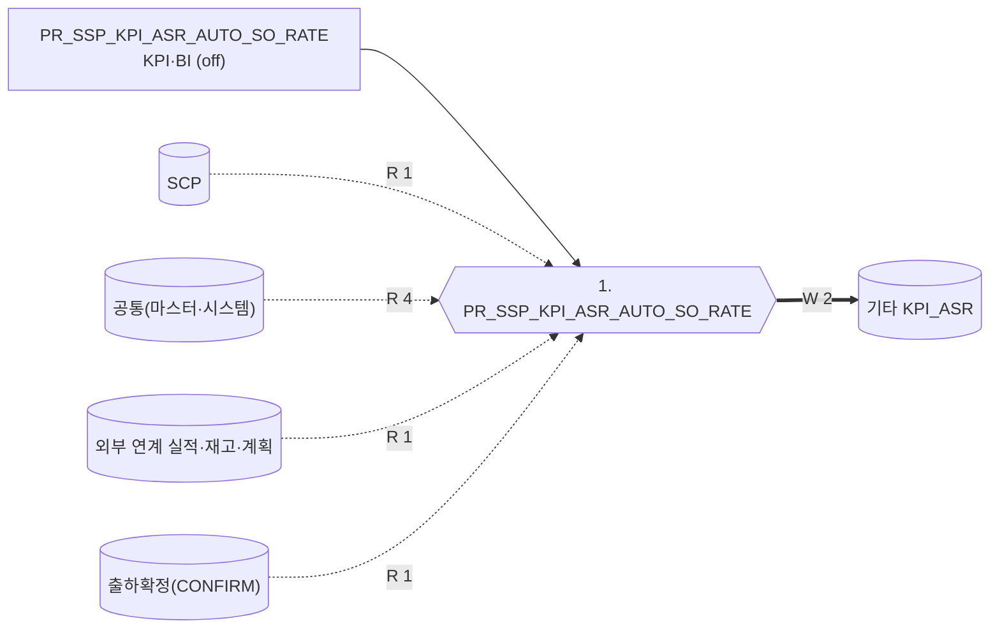

### JOB.PR_SSP_KPI_BR_BOD_REGISTRATION

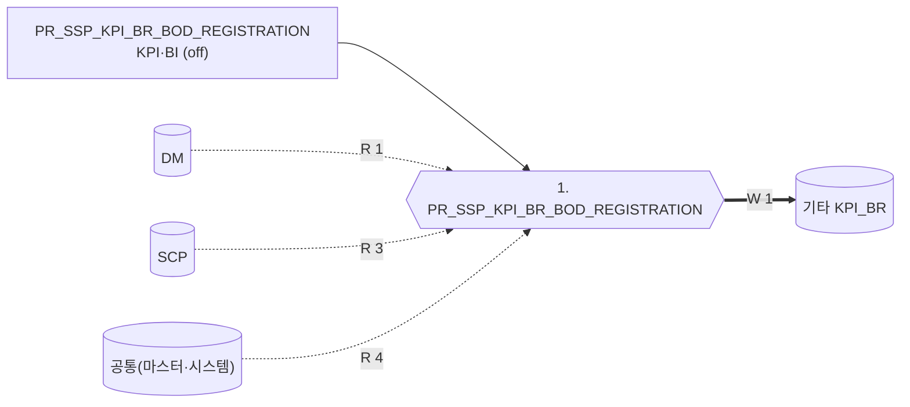

### JOB.PR_SSP_KPI_DIA_DELIVERY_INSTRUCTION_ACCURACY

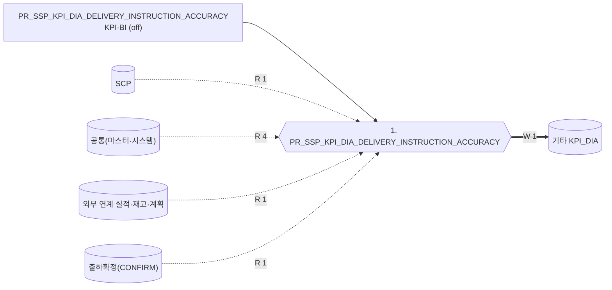

### JOB.PR_SSP_KPI_SHIPMENT_PSI_DW

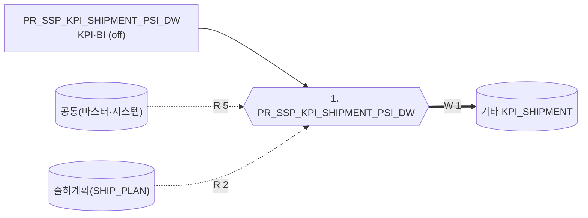

### JOB.PR_SSP_KPI_SPA_OTD1

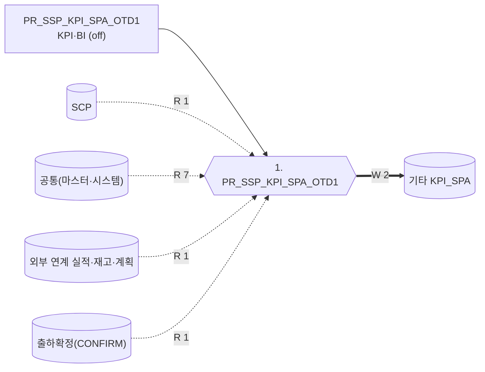

### JOB.PR_SSP_KPI_SPA_SHIPPING_PLAN_ACCURACY

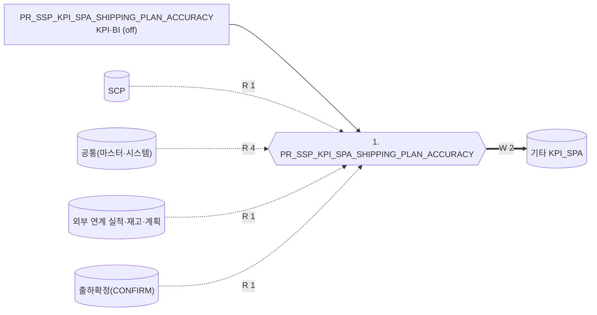

### JOB.PR_SSP_KPI_USR_URGENT_SHIP_REQ

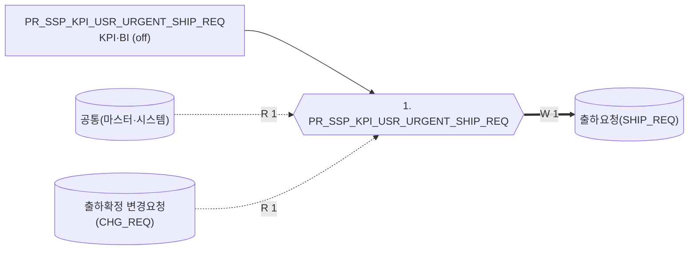

### JOB.PR_SSP_XIF_FP_AMEND_SHIPAVAL

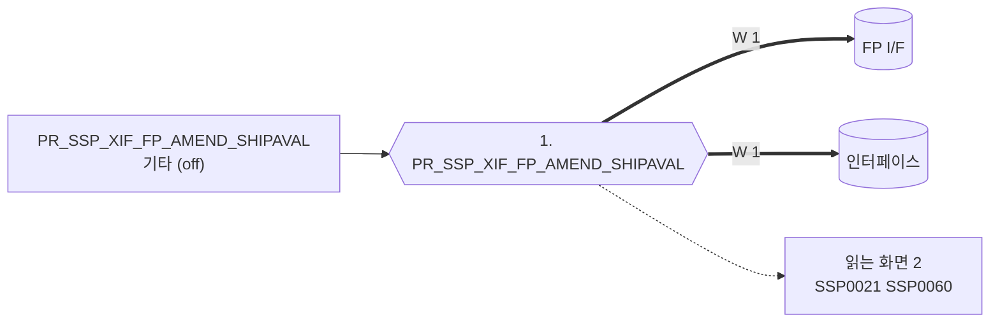

### JOB.SSP_WIP_LOT_40_NULL_LOTID_RT_UPDATE

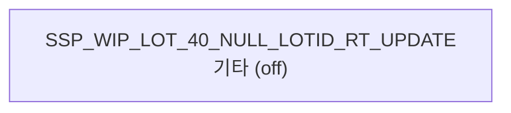

### JOB.PR_DM_SSP_SYNC

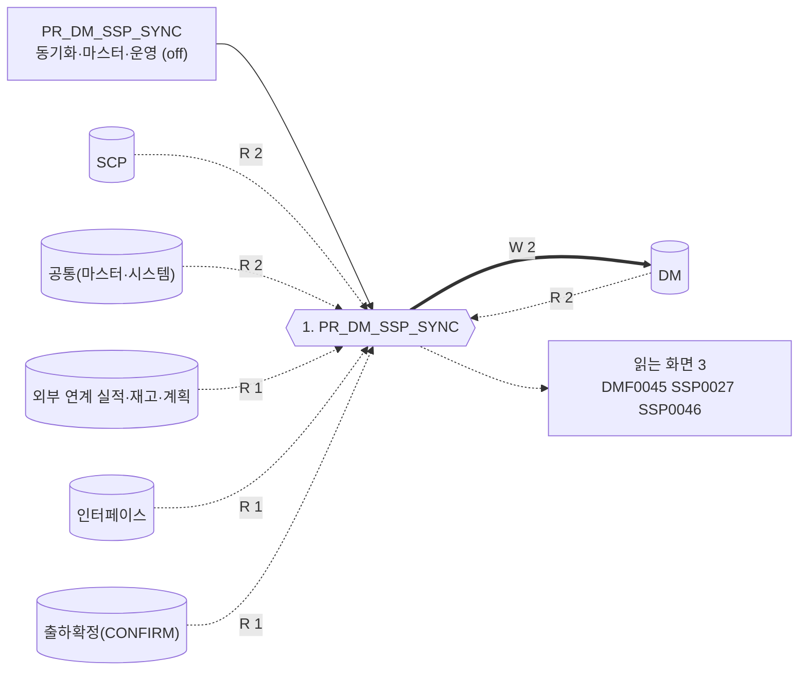

### JOB.PR_SSP_INT_SYSTEMEXEC_RUNJOB

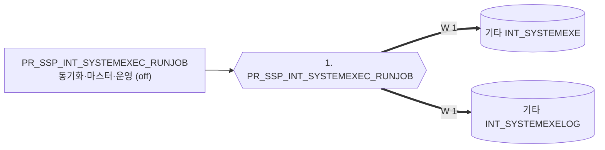

### JOB.PR_SSP_MST_WS_CALL_BATCH

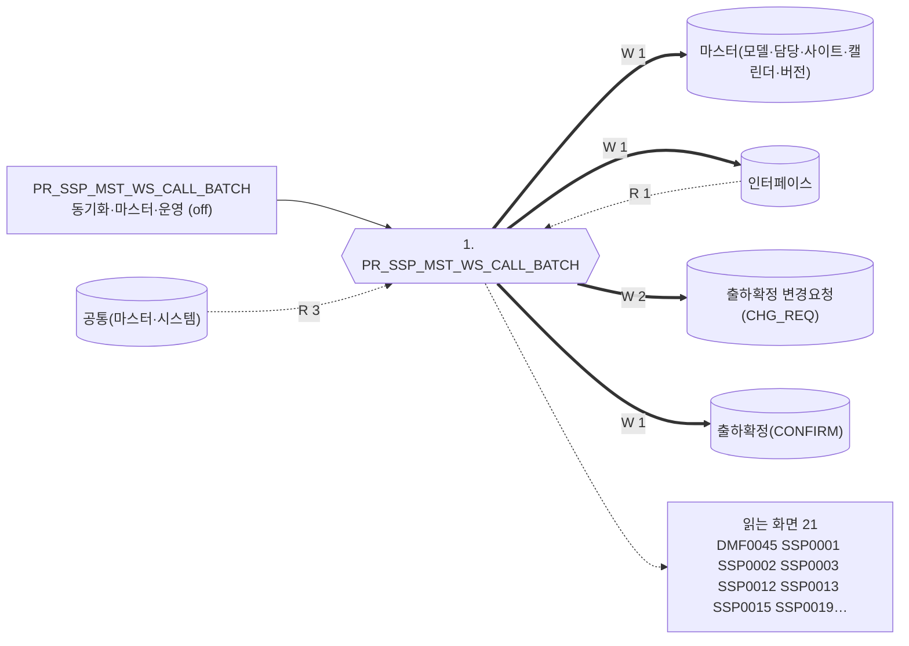

### JOB.PR_DM_TO_XIF_DM_SSPM_CELL_CAR_S

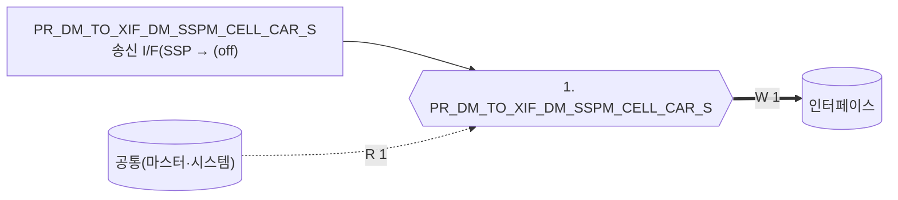

### JOB.PR_SSP_DAILY_PLAN_CUTOFF_CHECK_SMS_SEND

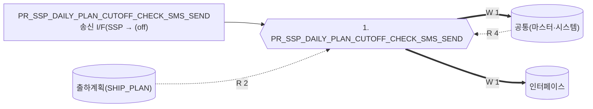

### JOB.PR_SSP_IF_CHECK_SMS_SEND

```mermaid
flowchart LR
  J_JOB_PR_SSP_IF_CHECK_SMS_SEND["PR_SSP_IF_CHECK_SMS_SEND<br/>송신 I/F(SSP → (off)"]
  P_PR_SSP_IF_CHECK_SMS_SEND{{"1. PR_SSP_IF_CHECK_SMS_SEND"}}
  J_JOB_PR_SSP_IF_CHECK_SMS_SEND --> P_PR_SSP_IF_CHECK_SMS_SEND
  P_PR_SSP_IF_CHECK_SMS_SEND =="W 1"==> E____________[("공통(마스터·시스템)")]
  P_PR_SSP_IF_CHECK_SMS_SEND =="W 1"==> E______[("인터페이스")]
  E____________[("공통(마스터·시스템)")] -."R 4".-> P_PR_SSP_IF_CHECK_SMS_SEND
  E______[("인터페이스")] -."R 6".-> P_PR_SSP_IF_CHECK_SMS_SEND
```

### JOB.PR_SSP_XIF_DW_SHIP_CHANGE_HISTORY_S

```mermaid
flowchart LR
  J_JOB_PR_SSP_XIF_DW_SHIP_CHANGE_HISTORY_S["PR_SSP_XIF_DW_SHIP_CHANGE_HISTORY_S<br/>송신 I/F(SSP → (off)"]
  P_PR_SSP_XIF_DW_SHIP_CHANGE_HISTORY_S{{"1. PR_SSP_XIF_DW_SHIP_CHANGE_HISTORY_S"}}
  J_JOB_PR_SSP_XIF_DW_SHIP_CHANGE_HISTORY_S --> P_PR_SSP_XIF_DW_SHIP_CHANGE_HISTORY_S
  P_PR_SSP_XIF_DW_SHIP_CHANGE_HISTORY_S =="W 1"==> E______[("인터페이스")]
  E____________[("공통(마스터·시스템)")] -."R 7".-> P_PR_SSP_XIF_DW_SHIP_CHANGE_HISTORY_S
  E______________________[("마스터(모델·담당·사이트·캘린더·버전)")] -."R 1".-> P_PR_SSP_XIF_DW_SHIP_CHANGE_HISTORY_S
  E___________CHG_REQ_[("출하확정 변경요청(CHG_REQ)")] -."R 2".-> P_PR_SSP_XIF_DW_SHIP_CHANGE_HISTORY_S
  E______CONFIRM_[("출하확정(CONFIRM)")] -."R 2".-> P_PR_SSP_XIF_DW_SHIP_CHANGE_HISTORY_S
```

### PR_SSP_DAILY_PLAN_CUTOFF_CHECK_SMS_SEND

```mermaid
flowchart LR
  J_PR_SSP_DAILY_PLAN_CUTOFF_CHECK_SMS_SEND["PR_SSP_DAILY_PLAN_CUTOFF_CHECK_SMS_SEND<br/>송신 I/F(SSP → (off)"]
  P_PR_SSP_DAILY_PLAN_CUTOFF_CHECK_SMS_SEND{{"1. PR_SSP_DAILY_PLAN_CUTOFF_CHECK_SMS_SEND"}}
  J_PR_SSP_DAILY_PLAN_CUTOFF_CHECK_SMS_SEND --> P_PR_SSP_DAILY_PLAN_CUTOFF_CHECK_SMS_SEND
  P_PR_SSP_DAILY_PLAN_CUTOFF_CHECK_SMS_SEND =="W 1"==> E____________[("공통(마스터·시스템)")]
  P_PR_SSP_DAILY_PLAN_CUTOFF_CHECK_SMS_SEND =="W 1"==> E______[("인터페이스")]
  E____________[("공통(마스터·시스템)")] -."R 4".-> P_PR_SSP_DAILY_PLAN_CUTOFF_CHECK_SMS_SEND
  E______SHIP_PLAN_[("출하계획(SHIP_PLAN)")] -."R 2".-> P_PR_SSP_DAILY_PLAN_CUTOFF_CHECK_SMS_SEND
```

### SYSTEMEXE:OSCM_OPLM_SHIP_CONFIRM

```mermaid
flowchart LR
  J_SYSTEMEXE_OSCM_OPLM_SHIP_CONFIRM["⏱OSCM_OPLM_SHIP_CONFIRM<br/>송신 I/F(SSP →"]
  P_PR_SSP_XIF_PLM_SHIP_CONFIRM_S{{"1. PR_SSP_XIF_PLM_SHIP_CONFIRM_S"}}
  J_SYSTEMEXE_OSCM_OPLM_SHIP_CONFIRM --> P_PR_SSP_XIF_PLM_SHIP_CONFIRM_S
  P_PR_SSP_XIF_PLM_SHIP_CONFIRM_S =="W 1"==> E______[("인터페이스")]
  E_SCP[("SCP")] -."R 1".-> P_PR_SSP_XIF_PLM_SHIP_CONFIRM_S
  E____________[("공통(마스터·시스템)")] -."R 4".-> P_PR_SSP_XIF_PLM_SHIP_CONFIRM_S
  E______________________[("마스터(모델·담당·사이트·캘린더·버전)")] -."R 1".-> P_PR_SSP_XIF_PLM_SHIP_CONFIRM_S
  E_______________[("외부 연계 실적·재고·계획")] -."R 1".-> P_PR_SSP_XIF_PLM_SHIP_CONFIRM_S
  E______CONFIRM_[("출하확정(CONFIRM)")] -."R 1".-> P_PR_SSP_XIF_PLM_SHIP_CONFIRM_S
```

### SYSTEMEXE:OSCM_OSCS_SCS_CELL_SHIP_PLAN

```mermaid
flowchart LR
  J_SYSTEMEXE_OSCM_OSCS_SCS_CELL_SHIP_PLAN["⏱OSCM_OSCS_SCS_CELL_SHIP_PLAN<br/>송신 I/F(SSP →"]
  P_PR_SSP_XIF_SCS_CELL_SHIP_PLAN_S{{"1. PR_SSP_XIF_SCS_CELL_SHIP_PLAN_S"}}
  J_SYSTEMEXE_OSCM_OSCS_SCS_CELL_SHIP_PLAN --> P_PR_SSP_XIF_SCS_CELL_SHIP_PLAN_S
  P_PR_SSP_XIF_SCS_CELL_SHIP_PLAN_S =="W 1"==> E_SCP[("SCP")]
  P_PR_SSP_XIF_SCS_CELL_SHIP_PLAN_S =="W 1"==> E______[("인터페이스")]
  E____________[("공통(마스터·시스템)")] -."R 1".-> P_PR_SSP_XIF_SCS_CELL_SHIP_PLAN_S
  E______[("인터페이스")] -."R 1".-> P_PR_SSP_XIF_SCS_CELL_SHIP_PLAN_S
  E______SHIP_PLAN_[("출하계획(SHIP_PLAN)")] -."R 2".-> P_PR_SSP_XIF_SCS_CELL_SHIP_PLAN_S
```

### SYSTEMEXE:OSCM_OSCS_SCS_PACK_SHIP_PLAN

```mermaid
flowchart LR
  J_SYSTEMEXE_OSCM_OSCS_SCS_PACK_SHIP_PLAN["⏱OSCM_OSCS_SCS_PACK_SHIP_PLAN<br/>송신 I/F(SSP → (off)"]
  P_PR_SSP_XIF_SCS_PACK_SHIP_PLAN_S{{"1. PR_SSP_XIF_SCS_PACK_SHIP_PLAN_S"}}
  J_SYSTEMEXE_OSCM_OSCS_SCS_PACK_SHIP_PLAN --> P_PR_SSP_XIF_SCS_PACK_SHIP_PLAN_S
  P_PR_SSP_XIF_SCS_PACK_SHIP_PLAN_S =="W 1"==> E_SCP[("SCP")]
  P_PR_SSP_XIF_SCS_PACK_SHIP_PLAN_S =="W 1"==> E______[("인터페이스")]
  E____________[("공통(마스터·시스템)")] -."R 5".-> P_PR_SSP_XIF_SCS_PACK_SHIP_PLAN_S
  E______________________[("마스터(모델·담당·사이트·캘린더·버전)")] -."R 1".-> P_PR_SSP_XIF_SCS_PACK_SHIP_PLAN_S
  E______[("인터페이스")] -."R 1".-> P_PR_SSP_XIF_SCS_PACK_SHIP_PLAN_S
  E______SHIP_PLAN_[("출하계획(SHIP_PLAN)")] -."R 1".-> P_PR_SSP_XIF_SCS_PACK_SHIP_PLAN_S
```

### JOB.PR_SCM_DNM_SCS_PROD_PLAN

```mermaid
flowchart LR
  J_JOB_PR_SCM_DNM_SCS_PROD_PLAN["PR_SCM_DNM_SCS_PROD_PLAN<br/>수신 I/F(외부 →  (off)"]
  P_PR_SSP_XIF_SCS_PROD_PLAN_R{{"1. PR_SSP_XIF_SCS_PROD_PLAN_R"}}
  J_JOB_PR_SCM_DNM_SCS_PROD_PLAN --> P_PR_SSP_XIF_SCS_PROD_PLAN_R
  P_PR_SSP_XIF_SCS_PROD_PLAN_R =="W 1"==> E_______________[("외부 연계 실적·재고·계획")]
  P_PR_SSP_XIF_SCS_PROD_PLAN_R =="W 1"==> E______[("인터페이스")]
  E______[("인터페이스")] -."R 1".-> P_PR_SSP_XIF_SCS_PROD_PLAN_R
  SCR["읽는 화면 2<br/>SSP0015 SSP0026"]
  P_PR_SSP_XIF_SCS_PROD_PLAN_R -.-> SCR
```

### JOB.PR_SCM_DNM_SCS_PROD_RESULT

```mermaid
flowchart LR
  J_JOB_PR_SCM_DNM_SCS_PROD_RESULT["PR_SCM_DNM_SCS_PROD_RESULT<br/>수신 I/F(외부 →  (off)"]
  P_PR_SSP_XIF_SCS_ASSY_RSLT_SUM_R{{"1. PR_SSP_XIF_SCS_ASSY_RSLT_SUM_R"}}
  J_JOB_PR_SCM_DNM_SCS_PROD_RESULT --> P_PR_SSP_XIF_SCS_ASSY_RSLT_SUM_R
  P_PR_SSP_XIF_SCS_ASSY_RSLT_SUM_R =="W 1"==> E_______________[("외부 연계 실적·재고·계획")]
  P_PR_SSP_XIF_SCS_ASSY_RSLT_SUM_R =="W 2"==> E______[("인터페이스")]
  E____________[("공통(마스터·시스템)")] -."R 1".-> P_PR_SSP_XIF_SCS_ASSY_RSLT_SUM_R
  E______[("인터페이스")] -."R 1".-> P_PR_SSP_XIF_SCS_ASSY_RSLT_SUM_R
```

### JOB.PR_SCM_DNM_SCS_SHIP_RESULT

```mermaid
flowchart LR
  J_JOB_PR_SCM_DNM_SCS_SHIP_RESULT["PR_SCM_DNM_SCS_SHIP_RESULT<br/>수신 I/F(외부 →  (off)"]
  P_PR_SSP_XIF_SCS_SHIP_RSLT_SUM_R{{"1. PR_SSP_XIF_SCS_SHIP_RSLT_SUM_R"}}
  J_JOB_PR_SCM_DNM_SCS_SHIP_RESULT --> P_PR_SSP_XIF_SCS_SHIP_RSLT_SUM_R
  P_PR_SSP_XIF_SCS_SHIP_RSLT_SUM_R =="W 1"==> E_______________[("외부 연계 실적·재고·계획")]
  P_PR_SSP_XIF_SCS_SHIP_RSLT_SUM_R =="W 1"==> E______[("인터페이스")]
  E______[("인터페이스")] -."R 1".-> P_PR_SSP_XIF_SCS_SHIP_RSLT_SUM_R
  SCR["읽는 화면 5<br/>SSP0015 SSP0026 SSP0029 SSP0201 SSP0202"]
  P_PR_SSP_XIF_SCS_SHIP_RSLT_SUM_R -.-> SCR
```

### JOB.PR_SCM_DNM_SCS_STOCK

```mermaid
flowchart LR
  J_JOB_PR_SCM_DNM_SCS_STOCK["PR_SCM_DNM_SCS_STOCK<br/>수신 I/F(외부 →  (off)"]
  P_PR_SSP_XIF_SCS_STOCK_RSLT_SUM_R{{"1. PR_SSP_XIF_SCS_STOCK_RSLT_SUM_R"}}
  J_JOB_PR_SCM_DNM_SCS_STOCK --> P_PR_SSP_XIF_SCS_STOCK_RSLT_SUM_R
  P_PR_SSP_XIF_SCS_STOCK_RSLT_SUM_R =="W 1"==> E_______________[("외부 연계 실적·재고·계획")]
  P_PR_SSP_XIF_SCS_STOCK_RSLT_SUM_R =="W 1"==> E______[("인터페이스")]
  E______[("인터페이스")] -."R 1".-> P_PR_SSP_XIF_SCS_STOCK_RSLT_SUM_R
  SCR["읽는 화면 2<br/>SSP0015 SSP0026"]
  P_PR_SSP_XIF_SCS_STOCK_RSLT_SUM_R -.-> SCR
```

### JOB.PR_SSP_XIF_IWMS_STOCK_EE_R

```mermaid
flowchart LR
  J_JOB_PR_SSP_XIF_IWMS_STOCK_EE_R["PR_SSP_XIF_IWMS_STOCK_EE_R<br/>수신 I/F(외부 →  (off)"]
  P_PR_SSP_XIF_IWMS_STOCK_EE_R{{"1. PR_SSP_XIF_IWMS_STOCK_EE_R"}}
  J_JOB_PR_SSP_XIF_IWMS_STOCK_EE_R --> P_PR_SSP_XIF_IWMS_STOCK_EE_R
  P_PR_SSP_XIF_IWMS_STOCK_EE_R =="W 1"==> E____________[("공통(마스터·시스템)")]
  P_PR_SSP_XIF_IWMS_STOCK_EE_R =="W 1"==> E______[("인터페이스")]
  P_PR_SSP_XIF_IWMS_STOCK_EE_R =="W 1"==> E____STOCK_ONHAND_[("재고(STOCK·ONHAND)")]
  E____________[("공통(마스터·시스템)")] -."R 1".-> P_PR_SSP_XIF_IWMS_STOCK_EE_R
  SCR["읽는 화면 31<br/>DMF0045 SCP0028 SSP0001 SSP0002 SSP0003 SSP0006 SSP0007 SSP0008…"]
  P_PR_SSP_XIF_IWMS_STOCK_EE_R -.-> SCR
```

### JOB.PR_SSP_XIF_MES_STOCK_40_R

```mermaid
flowchart LR
  J_JOB_PR_SSP_XIF_MES_STOCK_40_R["PR_SSP_XIF_MES_STOCK_40_R<br/>수신 I/F(외부 →  (off)"]
  P_PR_SSP_XIF_MES_WIP_LOT_40_R{{"1. PR_SSP_XIF_MES_WIP_LOT_40_R"}}
  J_JOB_PR_SSP_XIF_MES_STOCK_40_R --> P_PR_SSP_XIF_MES_WIP_LOT_40_R
  P_PR_SSP_XIF_MES_WIP_LOT_40_R =="W 1"==> E____________[("공통(마스터·시스템)")]
  P_PR_SSP_XIF_MES_WIP_LOT_40_R =="W 1"==> E______[("인터페이스")]
  P_PR_SSP_XIF_MES_WIP_LOT_40_R =="W 1"==> E____STOCK_ONHAND_[("재고(STOCK·ONHAND)")]
  E_SCP[("SCP")] -."R 1".-> P_PR_SSP_XIF_MES_WIP_LOT_40_R
  E____________[("공통(마스터·시스템)")] -."R 3".-> P_PR_SSP_XIF_MES_WIP_LOT_40_R
  E______[("인터페이스")] -."R 1".-> P_PR_SSP_XIF_MES_WIP_LOT_40_R
  SCR["읽는 화면 31<br/>DMF0045 SCP0028 SSP0001 SSP0002 SSP0003 SSP0006 SSP0007 SSP0008…"]
  P_PR_SSP_XIF_MES_WIP_LOT_40_R -.-> SCR
```

### JOB.PR_SSP_XIF_MES_STOCK_81_82_R

```mermaid
flowchart LR
  J_JOB_PR_SSP_XIF_MES_STOCK_81_82_R["PR_SSP_XIF_MES_STOCK_81_82_R<br/>수신 I/F(외부 →  (off)"]
  P_PR_SSP_XIF_MES_WIP_LOT_8X_R{{"1. PR_SSP_XIF_MES_WIP_LOT_8X_R"}}
  J_JOB_PR_SSP_XIF_MES_STOCK_81_82_R --> P_PR_SSP_XIF_MES_WIP_LOT_8X_R
  P_PR_SSP_XIF_MES_WIP_LOT_8X_R =="W 1"==> E____________[("공통(마스터·시스템)")]
  P_PR_SSP_XIF_MES_WIP_LOT_8X_R =="W 2"==> E______[("인터페이스")]
  P_PR_SSP_XIF_MES_WIP_LOT_8X_R =="W 1"==> E____STOCK_ONHAND_[("재고(STOCK·ONHAND)")]
  E_SCP[("SCP")] -."R 1".-> P_PR_SSP_XIF_MES_WIP_LOT_8X_R
  E____________[("공통(마스터·시스템)")] -."R 2".-> P_PR_SSP_XIF_MES_WIP_LOT_8X_R
  E______[("인터페이스")] -."R 1".-> P_PR_SSP_XIF_MES_WIP_LOT_8X_R
  SCR["읽는 화면 31<br/>DMF0045 SCP0028 SSP0001 SSP0002 SSP0003 SSP0006 SSP0007 SSP0008…"]
  P_PR_SSP_XIF_MES_WIP_LOT_8X_R -.-> SCR
```

### JOB.PR_SSP_XIF_MES_STOCK_EE_R

```mermaid
flowchart LR
  J_JOB_PR_SSP_XIF_MES_STOCK_EE_R["PR_SSP_XIF_MES_STOCK_EE_R<br/>수신 I/F(외부 →  (off)"]
  P_PR_SSP_XIF_MES_WIP_LOT_EE_R{{"1. PR_SSP_XIF_MES_WIP_LOT_EE_R"}}
  J_JOB_PR_SSP_XIF_MES_STOCK_EE_R --> P_PR_SSP_XIF_MES_WIP_LOT_EE_R
  P_PR_SSP_XIF_MES_WIP_LOT_EE_R =="W 1"==> E____________[("공통(마스터·시스템)")]
  P_PR_SSP_XIF_MES_WIP_LOT_EE_R =="W 1"==> E______[("인터페이스")]
  P_PR_SSP_XIF_MES_WIP_LOT_EE_R =="W 1"==> E____STOCK_ONHAND_[("재고(STOCK·ONHAND)")]
  E____________[("공통(마스터·시스템)")] -."R 1".-> P_PR_SSP_XIF_MES_WIP_LOT_EE_R
  E______[("인터페이스")] -."R 1".-> P_PR_SSP_XIF_MES_WIP_LOT_EE_R
  SCR["읽는 화면 31<br/>DMF0045 SCP0028 SSP0001 SSP0002 SSP0003 SSP0006 SSP0007 SSP0008…"]
  P_PR_SSP_XIF_MES_WIP_LOT_EE_R -.-> SCR
```

### JOB.PR_SSP_XIF_OWMS_SHIP_RESULT_R

```mermaid
flowchart LR
  J_JOB_PR_SSP_XIF_OWMS_SHIP_RESULT_R["PR_SSP_XIF_OWMS_SHIP_RESULT_R<br/>수신 I/F(외부 →  (off)"]
  P_PR_SSP_XIF_OWMS_SHIP_RESULT_R{{"1. PR_SSP_XIF_OWMS_SHIP_RESULT_R"}}
  J_JOB_PR_SSP_XIF_OWMS_SHIP_RESULT_R --> P_PR_SSP_XIF_OWMS_SHIP_RESULT_R
  P_PR_SSP_XIF_OWMS_SHIP_RESULT_R =="W 1"==> E______[("인터페이스")]
  P_PR_SSP_XIF_OWMS_SHIP_RESULT_R =="W 1"==> E_________OWMS_[("출하실적·반품(OWMS)")]
  E____________[("공통(마스터·시스템)")] -."R 3".-> P_PR_SSP_XIF_OWMS_SHIP_RESULT_R
  SCR["읽는 화면 6<br/>SSP0015 SSP0021 SSP0023 SSP0027 SSP0029 SSP0060"]
  P_PR_SSP_XIF_OWMS_SHIP_RESULT_R -.-> SCR
```

### JOB.PR_SSP_XIF_OWMS_SHIP_RETURN_R

```mermaid
flowchart LR
  J_JOB_PR_SSP_XIF_OWMS_SHIP_RETURN_R["PR_SSP_XIF_OWMS_SHIP_RETURN_R<br/>수신 I/F(외부 →  (off)"]
  P_PR_SSP_XIF_OWMS_SHIP_RETURN_R{{"1. PR_SSP_XIF_OWMS_SHIP_RETURN_R"}}
  J_JOB_PR_SSP_XIF_OWMS_SHIP_RETURN_R --> P_PR_SSP_XIF_OWMS_SHIP_RETURN_R
  P_PR_SSP_XIF_OWMS_SHIP_RETURN_R =="W 1"==> E______[("인터페이스")]
  P_PR_SSP_XIF_OWMS_SHIP_RETURN_R =="W 1"==> E_________OWMS_[("출하실적·반품(OWMS)")]
  E____________[("공통(마스터·시스템)")] -."R 2".-> P_PR_SSP_XIF_OWMS_SHIP_RETURN_R
  SCR["읽는 화면 6<br/>SSP0015 SSP0021 SSP0023 SSP0027 SSP0029 SSP0060"]
  P_PR_SSP_XIF_OWMS_SHIP_RETURN_R -.-> SCR
```

### JOB.PR_SSP_XIF_OWMS_STOCK_EE_R

```mermaid
flowchart LR
  J_JOB_PR_SSP_XIF_OWMS_STOCK_EE_R["PR_SSP_XIF_OWMS_STOCK_EE_R<br/>수신 I/F(외부 →  (off)"]
  P_PR_SSP_XIF_OWMS_STOCK_EE_R{{"1. PR_SSP_XIF_OWMS_STOCK_EE_R"}}
  J_JOB_PR_SSP_XIF_OWMS_STOCK_EE_R --> P_PR_SSP_XIF_OWMS_STOCK_EE_R
  P_PR_SSP_XIF_OWMS_STOCK_EE_R =="W 1"==> E____________[("공통(마스터·시스템)")]
  P_PR_SSP_XIF_OWMS_STOCK_EE_R =="W 1"==> E______[("인터페이스")]
  P_PR_SSP_XIF_OWMS_STOCK_EE_R =="W 1"==> E____STOCK_ONHAND_[("재고(STOCK·ONHAND)")]
  E____________[("공통(마스터·시스템)")] -."R 1".-> P_PR_SSP_XIF_OWMS_STOCK_EE_R
  SCR["읽는 화면 31<br/>DMF0045 SCP0028 SSP0001 SSP0002 SSP0003 SSP0006 SSP0007 SSP0008…"]
  P_PR_SSP_XIF_OWMS_STOCK_EE_R -.-> SCR
```

### JOB.PR_SSP_XIF_OWMS_STOCK_R

```mermaid
flowchart LR
  J_JOB_PR_SSP_XIF_OWMS_STOCK_R["PR_SSP_XIF_OWMS_STOCK_R<br/>수신 I/F(외부 →  (off)"]
  P_PR_SSP_XIF_OWMS_STOCK_R{{"1. PR_SSP_XIF_OWMS_STOCK_R"}}
  J_JOB_PR_SSP_XIF_OWMS_STOCK_R --> P_PR_SSP_XIF_OWMS_STOCK_R
  P_PR_SSP_XIF_OWMS_STOCK_R =="W 1"==> E____________[("공통(마스터·시스템)")]
  P_PR_SSP_XIF_OWMS_STOCK_R =="W 1"==> E______[("인터페이스")]
  P_PR_SSP_XIF_OWMS_STOCK_R =="W 1"==> E____STOCK_ONHAND_[("재고(STOCK·ONHAND)")]
  E____________[("공통(마스터·시스템)")] -."R 1".-> P_PR_SSP_XIF_OWMS_STOCK_R
  P_PR_SSP_XIF_OWMS_STOCK_REST_R{{"2. PR_SSP_XIF_OWMS_STOCK_REST_R"}}
  P_PR_SSP_XIF_OWMS_STOCK_R --> P_PR_SSP_XIF_OWMS_STOCK_REST_R
  P_PR_SSP_XIF_OWMS_STOCK_REST_R =="W 1"==> E____________[("공통(마스터·시스템)")]
  P_PR_SSP_XIF_OWMS_STOCK_REST_R =="W 2"==> E____STOCK_ONHAND_[("재고(STOCK·ONHAND)")]
  E____________[("공통(마스터·시스템)")] -."R 1".-> P_PR_SSP_XIF_OWMS_STOCK_REST_R
  E______[("인터페이스")] -."R 1".-> P_PR_SSP_XIF_OWMS_STOCK_REST_R
  SCR["읽는 화면 38<br/>DMF0045 SCP0028 SCP0033 SSP0001 SSP0002 SSP0003 SSP0006 SSP0007…"]
  P_PR_SSP_XIF_OWMS_STOCK_REST_R -.-> SCR
```

### SYSTEMEXE:OPLM_OSCM_SAMPLE_REQUEST

```mermaid
flowchart LR
  J_SYSTEMEXE_OPLM_OSCM_SAMPLE_REQUEST["⏱OPLM_OSCM_SAMPLE_REQUEST<br/>수신 I/F(외부 → "]
  P_PR_SSP_XIF_PLM_SAMPLE_REQUEST_R{{"1. PR_SSP_XIF_PLM_SAMPLE_REQUEST_R"}}
  J_SYSTEMEXE_OPLM_OSCM_SAMPLE_REQUEST --> P_PR_SSP_XIF_PLM_SAMPLE_REQUEST_R
  P_PR_SSP_XIF_PLM_SAMPLE_REQUEST_R =="W 1"==> E______[("인터페이스")]
  P_PR_SSP_XIF_PLM_SAMPLE_REQUEST_R =="W 1"==> E______CONFIRM_[("출하확정(CONFIRM)")]
  SCR["읽는 화면 21<br/>DMF0045 SSP0001 SSP0002 SSP0003 SSP0012 SSP0013 SSP0015 SSP0019…"]
  P_PR_SSP_XIF_PLM_SAMPLE_REQUEST_R -.-> SCR
```

### SYSTEMEXE:OSCS_OSCM_SCS_PACK_SHIP_PLAN_MOD

```mermaid
flowchart LR
  J_SYSTEMEXE_OSCS_OSCM_SCS_PACK_SHIP_PLAN_MOD["⏱OSCS_OSCM_SCS_PACK_SHIP_PLAN_MOD<br/>수신 I/F(외부 → "]
  P_PR_SSP_XIF_SCS_PACK_SHIP_PLAN_MOD_R{{"1. PR_SSP_XIF_SCS_PACK_SHIP_PLAN_MOD_R"}}
  J_SYSTEMEXE_OSCS_OSCM_SCS_PACK_SHIP_PLAN_MOD --> P_PR_SSP_XIF_SCS_PACK_SHIP_PLAN_MOD_R
  P_PR_SSP_XIF_SCS_PACK_SHIP_PLAN_MOD_R =="W 1"==> E______[("인터페이스")]
  E______SHIP_REQ_[("출하요청(SHIP_REQ)")] -."R 1".-> P_PR_SSP_XIF_SCS_PACK_SHIP_PLAN_MOD_R
```

### JOB.PR_SSP_MAIL_SEND_SCS_NORECEIVE_BOH

```mermaid
flowchart LR
  J_JOB_PR_SSP_MAIL_SEND_SCS_NORECEIVE_BOH["PR_SSP_MAIL_SEND_SCS_NORECEIVE_BOH<br/>알림(메일·SMS) (off)"]
  P_PR_SSP_MAIL_SEND_SCS_NORECEIVE_BOH{{"1. PR_SSP_MAIL_SEND_SCS_NORECEIVE_BOH"}}
  J_JOB_PR_SSP_MAIL_SEND_SCS_NORECEIVE_BOH --> P_PR_SSP_MAIL_SEND_SCS_NORECEIVE_BOH
  P_PR_SSP_MAIL_SEND_SCS_NORECEIVE_BOH =="W 1"==> E____________[("공통(마스터·시스템)")]
  E____________[("공통(마스터·시스템)")] -."R 4".-> P_PR_SSP_MAIL_SEND_SCS_NORECEIVE_BOH
  E______________________[("마스터(모델·담당·사이트·캘린더·버전)")] -."R 1".-> P_PR_SSP_MAIL_SEND_SCS_NORECEIVE_BOH
```

### JOB.PR_SSP_MAIL_SEND_SHIP_PLAN_INTER_COM_PO

```mermaid
flowchart LR
  J_JOB_PR_SSP_MAIL_SEND_SHIP_PLAN_INTER_COM_PO["PR_SSP_MAIL_SEND_SHIP_PLAN_INTER_COM_PO<br/>알림(메일·SMS) (off)"]
  P_PR_SSP_MAIL_SEND_SHIP_PLAN_INTER_COM_PO{{"1. PR_SSP_MAIL_SEND_SHIP_PLAN_INTER_COM_PO"}}
  J_JOB_PR_SSP_MAIL_SEND_SHIP_PLAN_INTER_COM_PO --> P_PR_SSP_MAIL_SEND_SHIP_PLAN_INTER_COM_PO
  P_PR_SSP_MAIL_SEND_SHIP_PLAN_INTER_COM_PO =="W 1"==> E____________[("공통(마스터·시스템)")]
  E____________[("공통(마스터·시스템)")] -."R 3".-> P_PR_SSP_MAIL_SEND_SHIP_PLAN_INTER_COM_PO
  E______________________[("마스터(모델·담당·사이트·캘린더·버전)")] -."R 2".-> P_PR_SSP_MAIL_SEND_SHIP_PLAN_INTER_COM_PO
  E______CONFIRM_[("출하확정(CONFIRM)")] -."R 1".-> P_PR_SSP_MAIL_SEND_SHIP_PLAN_INTER_COM_PO
```

### JOB.SCM_SSP_ADJUST_MAIL_SEND_BATCH

```mermaid
flowchart LR
  J_JOB_SCM_SSP_ADJUST_MAIL_SEND_BATCH["SCM_SSP_ADJUST_MAIL_SEND_BATCH<br/>알림(메일·SMS) (off)"]
  P_SCM_SSP_ADJUST_MAIL_SEND_BATCH{{"1. SCM_SSP_ADJUST_MAIL_SEND_BATCH"}}
  J_JOB_SCM_SSP_ADJUST_MAIL_SEND_BATCH --> P_SCM_SSP_ADJUST_MAIL_SEND_BATCH
  P_SCM_SSP_ADJUST_MAIL_SEND_BATCH =="W 1"==> E____________[("공통(마스터·시스템)")]
  P_SCM_SSP_ADJUST_MAIL_SEND_BATCH =="W 1"==> E______[("메일 발송")]
  E____________[("공통(마스터·시스템)")] -."R 3".-> P_SCM_SSP_ADJUST_MAIL_SEND_BATCH
  E___________CHG_REQ_[("출하확정 변경요청(CHG_REQ)")] -."R 2".-> P_SCM_SSP_ADJUST_MAIL_SEND_BATCH
```

### JOB.PR_SSP_DNM_FP_PLAN_FROZEN

```mermaid
flowchart LR
  J_JOB_PR_SSP_DNM_FP_PLAN_FROZEN["PR_SSP_DNM_FP_PLAN_FROZEN<br/>외부 연계 데이터 적재 (off)"]
  P_PR_SSP_DNM_FP_PLAN_FROZEN{{"1. PR_SSP_DNM_FP_PLAN_FROZEN"}}
  J_JOB_PR_SSP_DNM_FP_PLAN_FROZEN --> P_PR_SSP_DNM_FP_PLAN_FROZEN
  P_PR_SSP_DNM_FP_PLAN_FROZEN =="W 1"==> E_FP_I_F[("FP I/F")]
  P_PR_SSP_DNM_FP_PLAN_FROZEN =="W 1"==> E___[("기타")]
  E_SCP[("SCP")] -."R 1".-> P_PR_SSP_DNM_FP_PLAN_FROZEN
  E____________[("공통(마스터·시스템)")] -."R 2".-> P_PR_SSP_DNM_FP_PLAN_FROZEN
  E_______________[("외부 연계 실적·재고·계획")] -."R 1".-> P_PR_SSP_DNM_FP_PLAN_FROZEN
  P_PR_SSP_DNM_STOCK{{"2. PR_SSP_DNM_STOCK"}}
  P_PR_SSP_DNM_FP_PLAN_FROZEN --> P_PR_SSP_DNM_STOCK
  P_PR_SSP_DNM_STOCK =="W 1"==> E___[("기타")]
  P_PR_SSP_DNM_STOCK =="W 1"==> E____STOCK_ONHAND_[("재고(STOCK·ONHAND)")]
  E____________[("공통(마스터·시스템)")] -."R 3".-> P_PR_SSP_DNM_STOCK
  E______________________[("마스터(모델·담당·사이트·캘린더·버전)")] -."R 1".-> P_PR_SSP_DNM_STOCK
  E_______________[("외부 연계 실적·재고·계획")] -."R 2".-> P_PR_SSP_DNM_STOCK
  P_PR_SSP_DNM_FORMATION_POST_CELL{{"3. PR_SSP_DNM_FORMATION_POST_CELL"}}
  P_PR_SSP_DNM_STOCK --> P_PR_SSP_DNM_FORMATION_POST_CELL
  P_PR_SSP_DNM_FORMATION_POST_CELL =="W 1"==> E___[("기타")]
  P_PR_SSP_DNM_FORMATION_POST_CELL =="W 1"==> E______PSI[("생산계획·PSI")]
  E______PSI[("생산계획·PSI")] -."R 1".-> P_PR_SSP_DNM_FORMATION_POST_CELL
  P_PR_SSP_DNM_MES_WIP_HISTORY{{"4. PR_SSP_DNM_MES_WIP_HISTORY"}}
  P_PR_SSP_DNM_FORMATION_POST_CELL --> P_PR_SSP_DNM_MES_WIP_HISTORY
  P_PR_SSP_DNM_MES_WIP_HISTORY =="W 1"==> E____DNM_MES[("기타 DNM_MES")]
  E____________[("공통(마스터·시스템)")] -."R 2".-> P_PR_SSP_DNM_MES_WIP_HISTORY
  SCR["읽는 화면 6<br/>DMF0045 SSP0021 SSP0026 SSP0045 SSP0046 SSP0060"]
  P_PR_SSP_DNM_MES_WIP_HISTORY -.-> SCR
```

### JOB.PR_SSP_DNM_TABLE_COMPRESS

```mermaid
flowchart LR
  J_JOB_PR_SSP_DNM_TABLE_COMPRESS["PR_SSP_DNM_TABLE_COMPRESS<br/>외부 연계 데이터 적재 (off)"]
  P_PR_SSP_DNM_TABLE_COMPRESS{{"1. PR_SSP_DNM_TABLE_COMPRESS"}}
  J_JOB_PR_SSP_DNM_TABLE_COMPRESS --> P_PR_SSP_DNM_TABLE_COMPRESS
  P_PR_SSP_DNM_TABLE_COMPRESS =="W 2"==> E____STOCK_ONHAND_[("재고(STOCK·ONHAND)")]
  P_PR_SSP_DNM_TABLE_COMPRESS =="W 8"==> E______SHIP_PLAN_[("출하계획(SHIP_PLAN)")]
  E____________[("공통(마스터·시스템)")] -."R 1".-> P_PR_SSP_DNM_TABLE_COMPRESS
  SCR["읽는 화면 8<br/>SSP0015 SSP0021 SSP0022 SSP0023 SSP0026 SSP0029 SSP0045 SSP0060"]
  P_PR_SSP_DNM_TABLE_COMPRESS -.-> SCR
```

### JOB.PR_SSP_ANL_ESS_SHIP_CONFIRM

```mermaid
flowchart LR
  J_JOB_PR_SSP_ANL_ESS_SHIP_CONFIRM["PR_SSP_ANL_ESS_SHIP_CONFIRM<br/>집계·계획 생성(ANL (off)"]
  P_PR_SSP_ANL_ESS_SHIP_CONFIRM{{"1. PR_SSP_ANL_ESS_SHIP_CONFIRM"}}
  J_JOB_PR_SSP_ANL_ESS_SHIP_CONFIRM --> P_PR_SSP_ANL_ESS_SHIP_CONFIRM
  P_PR_SSP_ANL_ESS_SHIP_CONFIRM =="W 1"==> E_DM[("DM")]
  P_PR_SSP_ANL_ESS_SHIP_CONFIRM =="W 1"==> E____________[("공통(마스터·시스템)")]
  P_PR_SSP_ANL_ESS_SHIP_CONFIRM =="W 2"==> E______[("인터페이스")]
  P_PR_SSP_ANL_ESS_SHIP_CONFIRM =="W 3"==> E______CONFIRM_[("출하확정(CONFIRM)")]
  E_SCP[("SCP")] -."R 5".-> P_PR_SSP_ANL_ESS_SHIP_CONFIRM
  E____________[("공통(마스터·시스템)")] -."R 7".-> P_PR_SSP_ANL_ESS_SHIP_CONFIRM
  E______________________[("마스터(모델·담당·사이트·캘린더·버전)")] -."R 1".-> P_PR_SSP_ANL_ESS_SHIP_CONFIRM
  E______[("인터페이스")] -."R 1".-> P_PR_SSP_ANL_ESS_SHIP_CONFIRM
  SCR["읽는 화면 21<br/>DMF0045 SSP0001 SSP0002 SSP0003 SSP0012 SSP0013 SSP0015 SSP0019…"]
  P_PR_SSP_ANL_ESS_SHIP_CONFIRM -.-> SCR
```

### JOB.PR_SSP_ANL_SHIP_ERP_DOC_BATCH

```mermaid
flowchart LR
  J_JOB_PR_SSP_ANL_SHIP_ERP_DOC_BATCH["PR_SSP_ANL_SHIP_ERP_DOC_BATCH<br/>집계·계획 생성(ANL (off)"]
  P_PR_SSP_ANL_SHIP_ERP_DOC_BATCH{{"1. PR_SSP_ANL_SHIP_ERP_DOC_BATCH"}}
  J_JOB_PR_SSP_ANL_SHIP_ERP_DOC_BATCH --> P_PR_SSP_ANL_SHIP_ERP_DOC_BATCH
  P_PR_SSP_ANL_SHIP_ERP_DOC_BATCH =="W 1"==> E______[("인터페이스")]
  P_PR_SSP_ANL_SHIP_ERP_DOC_BATCH =="W 1"==> E______CONFIRM_[("출하확정(CONFIRM)")]
  SCR["읽는 화면 21<br/>DMF0045 SSP0001 SSP0002 SSP0003 SSP0012 SSP0013 SSP0015 SSP0019…"]
  P_PR_SSP_ANL_SHIP_ERP_DOC_BATCH -.-> SCR
```

### JOB.PR_SSP_ANL_SHIP_ERP_PO_BATCH

```mermaid
flowchart LR
  J_JOB_PR_SSP_ANL_SHIP_ERP_PO_BATCH["PR_SSP_ANL_SHIP_ERP_PO_BATCH<br/>집계·계획 생성(ANL (off)"]
  P_PR_SSP_ANL_SHIP_ERP_PO_BATCH{{"1. PR_SSP_ANL_SHIP_ERP_PO_BATCH"}}
  J_JOB_PR_SSP_ANL_SHIP_ERP_PO_BATCH --> P_PR_SSP_ANL_SHIP_ERP_PO_BATCH
  P_PR_SSP_ANL_SHIP_ERP_PO_BATCH =="W 1"==> E_ESS[("ESS")]
  P_PR_SSP_ANL_SHIP_ERP_PO_BATCH =="W 1"==> E______[("인터페이스")]
  E______[("인터페이스")] -."R 1".-> P_PR_SSP_ANL_SHIP_ERP_PO_BATCH
  SCR["읽는 화면 1<br/>SSP0027"]
  P_PR_SSP_ANL_SHIP_ERP_PO_BATCH -.-> SCR
```

### JOB.PR_SSP_ANL_SHIP_ERP_PO_IN_BATCH

```mermaid
flowchart LR
  J_JOB_PR_SSP_ANL_SHIP_ERP_PO_IN_BATCH["PR_SSP_ANL_SHIP_ERP_PO_IN_BATCH<br/>집계·계획 생성(ANL (off)"]
  P_PR_SSP_ANL_SHIP_ERP_PO_IN_BATCH{{"1. PR_SSP_ANL_SHIP_ERP_PO_IN_BATCH"}}
  J_JOB_PR_SSP_ANL_SHIP_ERP_PO_IN_BATCH --> P_PR_SSP_ANL_SHIP_ERP_PO_IN_BATCH
  P_PR_SSP_ANL_SHIP_ERP_PO_IN_BATCH =="W 1"==> E_ESS[("ESS")]
  P_PR_SSP_ANL_SHIP_ERP_PO_IN_BATCH =="W 1"==> E______[("인터페이스")]
  SCR["읽는 화면 1<br/>SSP0027"]
  P_PR_SSP_ANL_SHIP_ERP_PO_IN_BATCH -.-> SCR
```

### JOB.PR_SSP_ANL_SHIP_PLAN_ALL

```mermaid
flowchart LR
  J_JOB_PR_SSP_ANL_SHIP_PLAN_ALL["PR_SSP_ANL_SHIP_PLAN_ALL<br/>집계·계획 생성(ANL (off)"]
  P_PR_SSP_ANL_SHIP_PLAN_ALL{{"1. PR_SSP_ANL_SHIP_PLAN_ALL"}}
  J_JOB_PR_SSP_ANL_SHIP_PLAN_ALL --> P_PR_SSP_ANL_SHIP_PLAN_ALL
  P_PR_SSP_ANL_SHIP_PLAN_ALL =="W 1"==> E____________[("공통(마스터·시스템)")]
  P_PR_SSP_ANL_SHIP_PLAN_ALL =="W 1"==> E______SHIP_PLAN_[("출하계획(SHIP_PLAN)")]
  E_DM[("DM")] -."R 1".-> P_PR_SSP_ANL_SHIP_PLAN_ALL
  E_SCP[("SCP")] -."R 1".-> P_PR_SSP_ANL_SHIP_PLAN_ALL
  E____________[("공통(마스터·시스템)")] -."R 7".-> P_PR_SSP_ANL_SHIP_PLAN_ALL
  E______________________[("마스터(모델·담당·사이트·캘린더·버전)")] -."R 2".-> P_PR_SSP_ANL_SHIP_PLAN_ALL
  E______SHIP_PLAN_[("출하계획(SHIP_PLAN)")] -."R 5".-> P_PR_SSP_ANL_SHIP_PLAN_ALL
  E______SHIP_REQ_[("출하요청(SHIP_REQ)")] -."R 1".-> P_PR_SSP_ANL_SHIP_PLAN_ALL
  E___________CHG_REQ_[("출하확정 변경요청(CHG_REQ)")] -."R 2".-> P_PR_SSP_ANL_SHIP_PLAN_ALL
  E______CONFIRM_[("출하확정(CONFIRM)")] -."R 1".-> P_PR_SSP_ANL_SHIP_PLAN_ALL
  SCR["읽는 화면 31<br/>DMF0045 SCP0028 SSP0001 SSP0002 SSP0003 SSP0006 SSP0007 SSP0008…"]
  P_PR_SSP_ANL_SHIP_PLAN_ALL -.-> SCR
```

### JOB.PR_SSP_PLN_FP_SHIP_TARGET_ALL

```mermaid
flowchart LR
  J_JOB_PR_SSP_PLN_FP_SHIP_TARGET_ALL["PR_SSP_PLN_FP_SHIP_TARGET_ALL<br/>집계·계획 생성(ANL (off)"]
  P_PR_SSP_PLN_FP_SHIP_TARGET_ALL{{"1. PR_SSP_PLN_FP_SHIP_TARGET_ALL"}}
  J_JOB_PR_SSP_PLN_FP_SHIP_TARGET_ALL --> P_PR_SSP_PLN_FP_SHIP_TARGET_ALL
  P_PR_SSP_PLN_FP_SHIP_TARGET_ALL =="W 1"==> E_SCP[("SCP")]
  P_PR_SSP_PLN_FP_SHIP_TARGET_ALL =="W 1"==> E______[("인터페이스")]
  E_DM[("DM")] -."R 1".-> P_PR_SSP_PLN_FP_SHIP_TARGET_ALL
  E_SCP[("SCP")] -."R 2".-> P_PR_SSP_PLN_FP_SHIP_TARGET_ALL
  E____________[("공통(마스터·시스템)")] -."R 2".-> P_PR_SSP_PLN_FP_SHIP_TARGET_ALL
  E______________________[("마스터(모델·담당·사이트·캘린더·버전)")] -."R 1".-> P_PR_SSP_PLN_FP_SHIP_TARGET_ALL
  E______SHIP_REQ_[("출하요청(SHIP_REQ)")] -."R 1".-> P_PR_SSP_PLN_FP_SHIP_TARGET_ALL
  E______CONFIRM_[("출하확정(CONFIRM)")] -."R 1".-> P_PR_SSP_PLN_FP_SHIP_TARGET_ALL
```

### JOB.PR_SSP_PLN_FP_SHIP_TARGET_WA

```mermaid
flowchart LR
  J_JOB_PR_SSP_PLN_FP_SHIP_TARGET_WA["PR_SSP_PLN_FP_SHIP_TARGET_WA<br/>집계·계획 생성(ANL (off)"]
  P_PR_SSP_PLN_FP_SHIP_TARGET_WA{{"1. PR_SSP_PLN_FP_SHIP_TARGET_WA"}}
  J_JOB_PR_SSP_PLN_FP_SHIP_TARGET_WA --> P_PR_SSP_PLN_FP_SHIP_TARGET_WA
  P_PR_SSP_PLN_FP_SHIP_TARGET_WA =="W 1"==> E_SCP[("SCP")]
  P_PR_SSP_PLN_FP_SHIP_TARGET_WA =="W 1"==> E______[("인터페이스")]
  E_DM[("DM")] -."R 1".-> P_PR_SSP_PLN_FP_SHIP_TARGET_WA
  E_SCP[("SCP")] -."R 2".-> P_PR_SSP_PLN_FP_SHIP_TARGET_WA
  E____________[("공통(마스터·시스템)")] -."R 2".-> P_PR_SSP_PLN_FP_SHIP_TARGET_WA
  E______SHIP_REQ_[("출하요청(SHIP_REQ)")] -."R 1".-> P_PR_SSP_PLN_FP_SHIP_TARGET_WA
  E______CONFIRM_[("출하확정(CONFIRM)")] -."R 1".-> P_PR_SSP_PLN_FP_SHIP_TARGET_WA
```

### JOB.PR_SSP_PLN_SHIP_PLAN_40

```mermaid
flowchart LR
  J_JOB_PR_SSP_PLN_SHIP_PLAN_40["PR_SSP_PLN_SHIP_PLAN_40<br/>집계·계획 생성(ANL (off)"]
  P_PR_SSP_ANL_SHIP_PLAN_40_BALANCE{{"1. PR_SSP_ANL_SHIP_PLAN_40_BALANCE"}}
  J_JOB_PR_SSP_PLN_SHIP_PLAN_40 --> P_PR_SSP_ANL_SHIP_PLAN_40_BALANCE
  P_PR_SSP_ANL_SHIP_PLAN_40_BALANCE =="W 1"==> E______SHIP_PLAN_[("출하계획(SHIP_PLAN)")]
  E_SCP[("SCP")] -."R 1".-> P_PR_SSP_ANL_SHIP_PLAN_40_BALANCE
  E____________[("공통(마스터·시스템)")] -."R 1".-> P_PR_SSP_ANL_SHIP_PLAN_40_BALANCE
  E______________________[("마스터(모델·담당·사이트·캘린더·버전)")] -."R 1".-> P_PR_SSP_ANL_SHIP_PLAN_40_BALANCE
  E____STOCK_ONHAND_[("재고(STOCK·ONHAND)")] -."R 4".-> P_PR_SSP_ANL_SHIP_PLAN_40_BALANCE
  P_PR_SSP_ANL_SHIP_CONFIRM_BATCH_40{{"2. PR_SSP_ANL_SHIP_CONFIRM_BATCH_40"}}
  P_PR_SSP_ANL_SHIP_PLAN_40_BALANCE --> P_PR_SSP_ANL_SHIP_CONFIRM_BATCH_40
  P_PR_SSP_ANL_SHIP_CONFIRM_BATCH_40 =="W 1"==> E_DM[("DM")]
  P_PR_SSP_ANL_SHIP_CONFIRM_BATCH_40 =="W 1"==> E____________[("공통(마스터·시스템)")]
  P_PR_SSP_ANL_SHIP_CONFIRM_BATCH_40 =="W 2"==> E______[("인터페이스")]
  P_PR_SSP_ANL_SHIP_CONFIRM_BATCH_40 =="W 3"==> E______CONFIRM_[("출하확정(CONFIRM)")]
  E_SCP[("SCP")] -."R 4".-> P_PR_SSP_ANL_SHIP_CONFIRM_BATCH_40
  E____________[("공통(마스터·시스템)")] -."R 6".-> P_PR_SSP_ANL_SHIP_CONFIRM_BATCH_40
  E______________________[("마스터(모델·담당·사이트·캘린더·버전)")] -."R 1".-> P_PR_SSP_ANL_SHIP_CONFIRM_BATCH_40
  E______[("인터페이스")] -."R 1".-> P_PR_SSP_ANL_SHIP_CONFIRM_BATCH_40
  E______SHIP_PLAN_[("출하계획(SHIP_PLAN)")] -."R 1".-> P_PR_SSP_ANL_SHIP_CONFIRM_BATCH_40
  P_PR_SSP_ANL_SHIP_PLAN_40{{"3. PR_SSP_ANL_SHIP_PLAN_40"}}
  P_PR_SSP_ANL_SHIP_CONFIRM_BATCH_40 --> P_PR_SSP_ANL_SHIP_PLAN_40
  P_PR_SSP_ANL_SHIP_PLAN_40 =="W 3"==> E____________[("공통(마스터·시스템)")]
  P_PR_SSP_ANL_SHIP_PLAN_40 =="W 1"==> E______PSI[("생산계획·PSI")]
  P_PR_SSP_ANL_SHIP_PLAN_40 =="W 1"==> E______[("인터페이스")]
  P_PR_SSP_ANL_SHIP_PLAN_40 =="W 4"==> E____STOCK_ONHAND_[("재고(STOCK·ONHAND)")]
  P_PR_SSP_ANL_SHIP_PLAN_40 =="W 1"==> E______SHIP_PLAN_[("출하계획(SHIP_PLAN)")]
  E_DM[("DM")] -."R 1".-> P_PR_SSP_ANL_SHIP_PLAN_40
  E_SCP[("SCP")] -."R 4".-> P_PR_SSP_ANL_SHIP_PLAN_40
  E____________[("공통(마스터·시스템)")] -."R 8".-> P_PR_SSP_ANL_SHIP_PLAN_40
  E____DNM_PLAN[("기타 DNM_PLAN")] -."R 1".-> P_PR_SSP_ANL_SHIP_PLAN_40
  E______________________[("마스터(모델·담당·사이트·캘린더·버전)")] -."R 2".-> P_PR_SSP_ANL_SHIP_PLAN_40
  E______PSI[("생산계획·PSI")] -."R 2".-> P_PR_SSP_ANL_SHIP_PLAN_40
  E_______________[("외부 연계 실적·재고·계획")] -."R 2".-> P_PR_SSP_ANL_SHIP_PLAN_40
  E______[("인터페이스")] -."R 1".-> P_PR_SSP_ANL_SHIP_PLAN_40
  E____STOCK_ONHAND_[("재고(STOCK·ONHAND)")] -."R 3".-> P_PR_SSP_ANL_SHIP_PLAN_40
  E______SHIP_PLAN_[("출하계획(SHIP_PLAN)")] -."R 2".-> P_PR_SSP_ANL_SHIP_PLAN_40
  E______CONFIRM_[("출하확정(CONFIRM)")] -."R 1".-> P_PR_SSP_ANL_SHIP_PLAN_40
  P_PR_SSP_MAIL_SHIP_REQ_MINUS_BALANCE_40{{"4. PR_SSP_MAIL_SHIP_REQ_MINUS_BALANCE_40"}}
  P_PR_SSP_ANL_SHIP_PLAN_40 --> P_PR_SSP_MAIL_SHIP_REQ_MINUS_BALANCE_40
  P_PR_SSP_MAIL_SHIP_REQ_MINUS_BALANCE_40 =="W 1"==> E____________[("공통(마스터·시스템)")]
  E_DM[("DM")] -."R 1".-> P_PR_SSP_MAIL_SHIP_REQ_MINUS_BALANCE_40
  E_SCP[("SCP")] -."R 5".-> P_PR_SSP_MAIL_SHIP_REQ_MINUS_BALANCE_40
  E____________[("공통(마스터·시스템)")] -."R 9".-> P_PR_SSP_MAIL_SHIP_REQ_MINUS_BALANCE_40
  E____MKT_USER[("기타 MKT_USER")] -."R 1".-> P_PR_SSP_MAIL_SHIP_REQ_MINUS_BALANCE_40
  E______________________[("마스터(모델·담당·사이트·캘린더·버전)")] -."R 1".-> P_PR_SSP_MAIL_SHIP_REQ_MINUS_BALANCE_40
  E______PSI[("생산계획·PSI")] -."R 1".-> P_PR_SSP_MAIL_SHIP_REQ_MINUS_BALANCE_40
  E______SHIP_PLAN_[("출하계획(SHIP_PLAN)")] -."R 1".-> P_PR_SSP_MAIL_SHIP_REQ_MINUS_BALANCE_40
  E______CONFIRM_[("출하확정(CONFIRM)")] -."R 1".-> P_PR_SSP_MAIL_SHIP_REQ_MINUS_BALANCE_40
  SCR["읽는 화면 32<br/>DMF0045 SCP0028 SSP0001 SSP0002 SSP0003 SSP0006 SSP0007 SSP0008…"]
  P_PR_SSP_MAIL_SHIP_REQ_MINUS_BALANCE_40 -.-> SCR
```

### JOB.PR_SSP_PLN_SHIP_PLAN_40_AZ

```mermaid
flowchart LR
  J_JOB_PR_SSP_PLN_SHIP_PLAN_40_AZ["PR_SSP_PLN_SHIP_PLAN_40_AZ<br/>집계·계획 생성(ANL (off)"]
  P_PR_SSP_ANL_SHIP_CONFIRM_BATCH_40{{"1. PR_SSP_ANL_SHIP_CONFIRM_BATCH_40"}}
  J_JOB_PR_SSP_PLN_SHIP_PLAN_40_AZ --> P_PR_SSP_ANL_SHIP_CONFIRM_BATCH_40
  P_PR_SSP_ANL_SHIP_CONFIRM_BATCH_40 =="W 1"==> E_DM[("DM")]
  P_PR_SSP_ANL_SHIP_CONFIRM_BATCH_40 =="W 1"==> E____________[("공통(마스터·시스템)")]
  P_PR_SSP_ANL_SHIP_CONFIRM_BATCH_40 =="W 2"==> E______[("인터페이스")]
  P_PR_SSP_ANL_SHIP_CONFIRM_BATCH_40 =="W 3"==> E______CONFIRM_[("출하확정(CONFIRM)")]
  E_SCP[("SCP")] -."R 4".-> P_PR_SSP_ANL_SHIP_CONFIRM_BATCH_40
  E____________[("공통(마스터·시스템)")] -."R 6".-> P_PR_SSP_ANL_SHIP_CONFIRM_BATCH_40
  E______________________[("마스터(모델·담당·사이트·캘린더·버전)")] -."R 1".-> P_PR_SSP_ANL_SHIP_CONFIRM_BATCH_40
  E______[("인터페이스")] -."R 1".-> P_PR_SSP_ANL_SHIP_CONFIRM_BATCH_40
  E______SHIP_PLAN_[("출하계획(SHIP_PLAN)")] -."R 1".-> P_PR_SSP_ANL_SHIP_CONFIRM_BATCH_40
  P_PR_SSP_ANL_SHIP_PLAN_40{{"2. PR_SSP_ANL_SHIP_PLAN_40"}}
  P_PR_SSP_ANL_SHIP_CONFIRM_BATCH_40 --> P_PR_SSP_ANL_SHIP_PLAN_40
  P_PR_SSP_ANL_SHIP_PLAN_40 =="W 3"==> E____________[("공통(마스터·시스템)")]
  P_PR_SSP_ANL_SHIP_PLAN_40 =="W 1"==> E______PSI[("생산계획·PSI")]
  P_PR_SSP_ANL_SHIP_PLAN_40 =="W 1"==> E______[("인터페이스")]
  P_PR_SSP_ANL_SHIP_PLAN_40 =="W 4"==> E____STOCK_ONHAND_[("재고(STOCK·ONHAND)")]
  P_PR_SSP_ANL_SHIP_PLAN_40 =="W 1"==> E______SHIP_PLAN_[("출하계획(SHIP_PLAN)")]
  E_DM[("DM")] -."R 1".-> P_PR_SSP_ANL_SHIP_PLAN_40
  E_SCP[("SCP")] -."R 4".-> P_PR_SSP_ANL_SHIP_PLAN_40
  E____________[("공통(마스터·시스템)")] -."R 8".-> P_PR_SSP_ANL_SHIP_PLAN_40
  E____DNM_PLAN[("기타 DNM_PLAN")] -."R 1".-> P_PR_SSP_ANL_SHIP_PLAN_40
  E______________________[("마스터(모델·담당·사이트·캘린더·버전)")] -."R 2".-> P_PR_SSP_ANL_SHIP_PLAN_40
  E______PSI[("생산계획·PSI")] -."R 2".-> P_PR_SSP_ANL_SHIP_PLAN_40
  E_______________[("외부 연계 실적·재고·계획")] -."R 2".-> P_PR_SSP_ANL_SHIP_PLAN_40
  E______[("인터페이스")] -."R 1".-> P_PR_SSP_ANL_SHIP_PLAN_40
  E____STOCK_ONHAND_[("재고(STOCK·ONHAND)")] -."R 3".-> P_PR_SSP_ANL_SHIP_PLAN_40
  E______SHIP_PLAN_[("출하계획(SHIP_PLAN)")] -."R 2".-> P_PR_SSP_ANL_SHIP_PLAN_40
  E______CONFIRM_[("출하확정(CONFIRM)")] -."R 1".-> P_PR_SSP_ANL_SHIP_PLAN_40
  P_PR_SSP_MAIL_SHIP_REQ_MINUS_BALANCE_40{{"3. PR_SSP_MAIL_SHIP_REQ_MINUS_BALANCE_40"}}
  P_PR_SSP_ANL_SHIP_PLAN_40 --> P_PR_SSP_MAIL_SHIP_REQ_MINUS_BALANCE_40
  P_PR_SSP_MAIL_SHIP_REQ_MINUS_BALANCE_40 =="W 1"==> E____________[("공통(마스터·시스템)")]
  E_DM[("DM")] -."R 1".-> P_PR_SSP_MAIL_SHIP_REQ_MINUS_BALANCE_40
  E_SCP[("SCP")] -."R 5".-> P_PR_SSP_MAIL_SHIP_REQ_MINUS_BALANCE_40
  E____________[("공통(마스터·시스템)")] -."R 9".-> P_PR_SSP_MAIL_SHIP_REQ_MINUS_BALANCE_40
  E____MKT_USER[("기타 MKT_USER")] -."R 1".-> P_PR_SSP_MAIL_SHIP_REQ_MINUS_BALANCE_40
  E______________________[("마스터(모델·담당·사이트·캘린더·버전)")] -."R 1".-> P_PR_SSP_MAIL_SHIP_REQ_MINUS_BALANCE_40
  E______PSI[("생산계획·PSI")] -."R 1".-> P_PR_SSP_MAIL_SHIP_REQ_MINUS_BALANCE_40
  E______SHIP_PLAN_[("출하계획(SHIP_PLAN)")] -."R 1".-> P_PR_SSP_MAIL_SHIP_REQ_MINUS_BALANCE_40
  E______CONFIRM_[("출하확정(CONFIRM)")] -."R 1".-> P_PR_SSP_MAIL_SHIP_REQ_MINUS_BALANCE_40
  SCR["읽는 화면 32<br/>DMF0045 SCP0028 SSP0001 SSP0002 SSP0003 SSP0006 SSP0007 SSP0008…"]
  P_PR_SSP_MAIL_SHIP_REQ_MINUS_BALANCE_40 -.-> SCR
```

### JOB.PR_SSP_PLN_SHIP_PLAN_40_C

```mermaid
flowchart LR
  J_JOB_PR_SSP_PLN_SHIP_PLAN_40_C["PR_SSP_PLN_SHIP_PLAN_40_C<br/>집계·계획 생성(ANL (off)"]
  P_PR_SSP_ANL_SHIP_CONFIRM_BATCH_40{{"1. PR_SSP_ANL_SHIP_CONFIRM_BATCH_40"}}
  J_JOB_PR_SSP_PLN_SHIP_PLAN_40_C --> P_PR_SSP_ANL_SHIP_CONFIRM_BATCH_40
  P_PR_SSP_ANL_SHIP_CONFIRM_BATCH_40 =="W 1"==> E_DM[("DM")]
  P_PR_SSP_ANL_SHIP_CONFIRM_BATCH_40 =="W 1"==> E____________[("공통(마스터·시스템)")]
  P_PR_SSP_ANL_SHIP_CONFIRM_BATCH_40 =="W 2"==> E______[("인터페이스")]
  P_PR_SSP_ANL_SHIP_CONFIRM_BATCH_40 =="W 3"==> E______CONFIRM_[("출하확정(CONFIRM)")]
  E_SCP[("SCP")] -."R 4".-> P_PR_SSP_ANL_SHIP_CONFIRM_BATCH_40
  E____________[("공통(마스터·시스템)")] -."R 6".-> P_PR_SSP_ANL_SHIP_CONFIRM_BATCH_40
  E______________________[("마스터(모델·담당·사이트·캘린더·버전)")] -."R 1".-> P_PR_SSP_ANL_SHIP_CONFIRM_BATCH_40
  E______[("인터페이스")] -."R 1".-> P_PR_SSP_ANL_SHIP_CONFIRM_BATCH_40
  E______SHIP_PLAN_[("출하계획(SHIP_PLAN)")] -."R 1".-> P_PR_SSP_ANL_SHIP_CONFIRM_BATCH_40
  P_PR_SSP_ANL_SHIP_PLAN_40{{"2. PR_SSP_ANL_SHIP_PLAN_40"}}
  P_PR_SSP_ANL_SHIP_CONFIRM_BATCH_40 --> P_PR_SSP_ANL_SHIP_PLAN_40
  P_PR_SSP_ANL_SHIP_PLAN_40 =="W 3"==> E____________[("공통(마스터·시스템)")]
  P_PR_SSP_ANL_SHIP_PLAN_40 =="W 1"==> E______PSI[("생산계획·PSI")]
  P_PR_SSP_ANL_SHIP_PLAN_40 =="W 1"==> E______[("인터페이스")]
  P_PR_SSP_ANL_SHIP_PLAN_40 =="W 4"==> E____STOCK_ONHAND_[("재고(STOCK·ONHAND)")]
  P_PR_SSP_ANL_SHIP_PLAN_40 =="W 1"==> E______SHIP_PLAN_[("출하계획(SHIP_PLAN)")]
  E_DM[("DM")] -."R 1".-> P_PR_SSP_ANL_SHIP_PLAN_40
  E_SCP[("SCP")] -."R 4".-> P_PR_SSP_ANL_SHIP_PLAN_40
  E____________[("공통(마스터·시스템)")] -."R 8".-> P_PR_SSP_ANL_SHIP_PLAN_40
  E____DNM_PLAN[("기타 DNM_PLAN")] -."R 1".-> P_PR_SSP_ANL_SHIP_PLAN_40
  E______________________[("마스터(모델·담당·사이트·캘린더·버전)")] -."R 2".-> P_PR_SSP_ANL_SHIP_PLAN_40
  E______PSI[("생산계획·PSI")] -."R 2".-> P_PR_SSP_ANL_SHIP_PLAN_40
  E_______________[("외부 연계 실적·재고·계획")] -."R 2".-> P_PR_SSP_ANL_SHIP_PLAN_40
  E______[("인터페이스")] -."R 1".-> P_PR_SSP_ANL_SHIP_PLAN_40
  E____STOCK_ONHAND_[("재고(STOCK·ONHAND)")] -."R 3".-> P_PR_SSP_ANL_SHIP_PLAN_40
  E______SHIP_PLAN_[("출하계획(SHIP_PLAN)")] -."R 2".-> P_PR_SSP_ANL_SHIP_PLAN_40
  E______CONFIRM_[("출하확정(CONFIRM)")] -."R 1".-> P_PR_SSP_ANL_SHIP_PLAN_40
  P_PR_SSP_ANL_INVENTORY_RAW{{"3. PR_SSP_ANL_INVENTORY_RAW"}}
  P_PR_SSP_ANL_SHIP_PLAN_40 --> P_PR_SSP_ANL_INVENTORY_RAW
  P_PR_SSP_ANL_INVENTORY_RAW =="W 1"==> E____STOCK_ONHAND_[("재고(STOCK·ONHAND)")]
  E____________[("공통(마스터·시스템)")] -."R 2".-> P_PR_SSP_ANL_INVENTORY_RAW
  E______________________[("마스터(모델·담당·사이트·캘린더·버전)")] -."R 1".-> P_PR_SSP_ANL_INVENTORY_RAW
  E_______________[("외부 연계 실적·재고·계획")] -."R 1".-> P_PR_SSP_ANL_INVENTORY_RAW
  E____STOCK_ONHAND_[("재고(STOCK·ONHAND)")] -."R 1".-> P_PR_SSP_ANL_INVENTORY_RAW
  P_PR_SSP_MAIL_SHIP_REQ_MINUS_BALANCE_40{{"4. PR_SSP_MAIL_SHIP_REQ_MINUS_BALANCE_40"}}
  P_PR_SSP_ANL_INVENTORY_RAW --> P_PR_SSP_MAIL_SHIP_REQ_MINUS_BALANCE_40
  P_PR_SSP_MAIL_SHIP_REQ_MINUS_BALANCE_40 =="W 1"==> E____________[("공통(마스터·시스템)")]
  E_DM[("DM")] -."R 1".-> P_PR_SSP_MAIL_SHIP_REQ_MINUS_BALANCE_40
  E_SCP[("SCP")] -."R 5".-> P_PR_SSP_MAIL_SHIP_REQ_MINUS_BALANCE_40
  E____________[("공통(마스터·시스템)")] -."R 9".-> P_PR_SSP_MAIL_SHIP_REQ_MINUS_BALANCE_40
  E____MKT_USER[("기타 MKT_USER")] -."R 1".-> P_PR_SSP_MAIL_SHIP_REQ_MINUS_BALANCE_40
  E______________________[("마스터(모델·담당·사이트·캘린더·버전)")] -."R 1".-> P_PR_SSP_MAIL_SHIP_REQ_MINUS_BALANCE_40
  E______PSI[("생산계획·PSI")] -."R 1".-> P_PR_SSP_MAIL_SHIP_REQ_MINUS_BALANCE_40
  E______SHIP_PLAN_[("출하계획(SHIP_PLAN)")] -."R 1".-> P_PR_SSP_MAIL_SHIP_REQ_MINUS_BALANCE_40
  E______CONFIRM_[("출하확정(CONFIRM)")] -."R 1".-> P_PR_SSP_MAIL_SHIP_REQ_MINUS_BALANCE_40
  SCR["읽는 화면 33<br/>DMF0045 SCP0028 SSP0001 SSP0002 SSP0003 SSP0006 SSP0007 SSP0008…"]
  P_PR_SSP_MAIL_SHIP_REQ_MINUS_BALANCE_40 -.-> SCR
```

### JOB.PR_SSP_PLN_SHIP_PLAN_81_82

```mermaid
flowchart LR
  J_JOB_PR_SSP_PLN_SHIP_PLAN_81_82["PR_SSP_PLN_SHIP_PLAN_81_82<br/>집계·계획 생성(ANL (off)"]
  P_PR_SSP_PLN_SHIP_PLAN_CUTOFF{{"1. PR_SSP_PLN_SHIP_PLAN_CUTOFF"}}
  J_JOB_PR_SSP_PLN_SHIP_PLAN_81_82 --> P_PR_SSP_PLN_SHIP_PLAN_CUTOFF
  P_PR_SSP_PLN_SHIP_PLAN_CUTOFF =="W 1"==> E_SCP[("SCP")]
  P_PR_SSP_PLN_SHIP_PLAN_CUTOFF =="W 2"==> E____________[("공통(마스터·시스템)")]
  P_PR_SSP_PLN_SHIP_PLAN_CUTOFF =="W 3"==> E______[("인터페이스")]
  P_PR_SSP_PLN_SHIP_PLAN_CUTOFF =="W 2"==> E____STOCK_ONHAND_[("재고(STOCK·ONHAND)")]
  P_PR_SSP_PLN_SHIP_PLAN_CUTOFF =="W 2"==> E______SHIP_PLAN_[("출하계획(SHIP_PLAN)")]
  P_PR_SSP_PLN_SHIP_PLAN_CUTOFF =="W 3"==> E______CONFIRM_[("출하확정(CONFIRM)")]
  E_DM[("DM")] -."R 1".-> P_PR_SSP_PLN_SHIP_PLAN_CUTOFF
  E_ESS[("ESS")] -."R 1".-> P_PR_SSP_PLN_SHIP_PLAN_CUTOFF
  E_FP_I_F[("FP I/F")] -."R 1".-> P_PR_SSP_PLN_SHIP_PLAN_CUTOFF
  E_SCP[("SCP")] -."R 7".-> P_PR_SSP_PLN_SHIP_PLAN_CUTOFF
  E____________[("공통(마스터·시스템)")] -."R 7".-> P_PR_SSP_PLN_SHIP_PLAN_CUTOFF
  E______________________[("마스터(모델·담당·사이트·캘린더·버전)")] -."R 2".-> P_PR_SSP_PLN_SHIP_PLAN_CUTOFF
  E_______________[("외부 연계 실적·재고·계획")] -."R 2".-> P_PR_SSP_PLN_SHIP_PLAN_CUTOFF
  E______[("인터페이스")] -."R 1".-> P_PR_SSP_PLN_SHIP_PLAN_CUTOFF
  E____STOCK_ONHAND_[("재고(STOCK·ONHAND)")] -."R 2".-> P_PR_SSP_PLN_SHIP_PLAN_CUTOFF
  E______SHIP_REQ_[("출하요청(SHIP_REQ)")] -."R 1".-> P_PR_SSP_PLN_SHIP_PLAN_CUTOFF
  SCR["읽는 화면 32<br/>DMF0045 SSP0001 SSP0002 SSP0003 SSP0005 SSP0006 SSP0007 SSP0008…"]
  P_PR_SSP_PLN_SHIP_PLAN_CUTOFF -.-> SCR
```

### JOB.PR_SSP_PLN_SHIP_PLAN_EE

```mermaid
flowchart LR
  J_JOB_PR_SSP_PLN_SHIP_PLAN_EE["PR_SSP_PLN_SHIP_PLAN_EE<br/>집계·계획 생성(ANL (off)"]
  P_PR_SSP_ANL_SHIP_PLAN_EE{{"1. PR_SSP_ANL_SHIP_PLAN_EE"}}
  J_JOB_PR_SSP_PLN_SHIP_PLAN_EE --> P_PR_SSP_ANL_SHIP_PLAN_EE
  P_PR_SSP_ANL_SHIP_PLAN_EE =="W 2"==> E____________[("공통(마스터·시스템)")]
  P_PR_SSP_ANL_SHIP_PLAN_EE =="W 2"==> E______[("인터페이스")]
  P_PR_SSP_ANL_SHIP_PLAN_EE =="W 2"==> E____STOCK_ONHAND_[("재고(STOCK·ONHAND)")]
  P_PR_SSP_ANL_SHIP_PLAN_EE =="W 2"==> E______SHIP_PLAN_[("출하계획(SHIP_PLAN)")]
  P_PR_SSP_ANL_SHIP_PLAN_EE =="W 2"==> E______SHIP_REQ_[("출하요청(SHIP_REQ)")]
  P_PR_SSP_ANL_SHIP_PLAN_EE =="W 3"==> E______CONFIRM_[("출하확정(CONFIRM)")]
  E_FP_I_F[("FP I/F")] -."R 2".-> P_PR_SSP_ANL_SHIP_PLAN_EE
  E_SCP[("SCP")] -."R 9".-> P_PR_SSP_ANL_SHIP_PLAN_EE
  E____________[("공통(마스터·시스템)")] -."R 7".-> P_PR_SSP_ANL_SHIP_PLAN_EE
  E______________________[("마스터(모델·담당·사이트·캘린더·버전)")] -."R 1".-> P_PR_SSP_ANL_SHIP_PLAN_EE
  E______[("인터페이스")] -."R 1".-> P_PR_SSP_ANL_SHIP_PLAN_EE
  E____STOCK_ONHAND_[("재고(STOCK·ONHAND)")] -."R 3".-> P_PR_SSP_ANL_SHIP_PLAN_EE
  E______SHIP_PLAN_[("출하계획(SHIP_PLAN)")] -."R 1".-> P_PR_SSP_ANL_SHIP_PLAN_EE
  E_________OWMS_[("출하실적·반품(OWMS)")] -."R 1".-> P_PR_SSP_ANL_SHIP_PLAN_EE
  SCR["읽는 화면 32<br/>DMF0045 SCP0028 SSP0001 SSP0002 SSP0003 SSP0006 SSP0007 SSP0008…"]
  P_PR_SSP_ANL_SHIP_PLAN_EE -.-> SCR
```

### JOB.PR_SSP_PLN_SHIP_PLAN_P

```mermaid
flowchart LR
  J_JOB_PR_SSP_PLN_SHIP_PLAN_P["PR_SSP_PLN_SHIP_PLAN_P<br/>집계·계획 생성(ANL (off)"]
  P_PR_SSP_ANL_SHIP_PLAN_P{{"1. PR_SSP_ANL_SHIP_PLAN_P"}}
  J_JOB_PR_SSP_PLN_SHIP_PLAN_P --> P_PR_SSP_ANL_SHIP_PLAN_P
  P_PR_SSP_ANL_SHIP_PLAN_P =="W 1"==> E____________[("공통(마스터·시스템)")]
  P_PR_SSP_ANL_SHIP_PLAN_P =="W 1"==> E______SHIP_PLAN_[("출하계획(SHIP_PLAN)")]
  E_SCP[("SCP")] -."R 1".-> P_PR_SSP_ANL_SHIP_PLAN_P
  E____________[("공통(마스터·시스템)")] -."R 2".-> P_PR_SSP_ANL_SHIP_PLAN_P
  E_______________[("외부 연계 실적·재고·계획")] -."R 2".-> P_PR_SSP_ANL_SHIP_PLAN_P
  E______SHIP_REQ_[("출하요청(SHIP_REQ)")] -."R 1".-> P_PR_SSP_ANL_SHIP_PLAN_P
  E______CONFIRM_[("출하확정(CONFIRM)")] -."R 1".-> P_PR_SSP_ANL_SHIP_PLAN_P
  P_PR_SSP_ANL_SHIP_CONFIRM_P{{"2. PR_SSP_ANL_SHIP_CONFIRM_P"}}
  P_PR_SSP_ANL_SHIP_PLAN_P --> P_PR_SSP_ANL_SHIP_CONFIRM_P
  P_PR_SSP_ANL_SHIP_CONFIRM_P =="W 1"==> E____________[("공통(마스터·시스템)")]
  P_PR_SSP_ANL_SHIP_CONFIRM_P =="W 3"==> E______[("인터페이스")]
  P_PR_SSP_ANL_SHIP_CONFIRM_P =="W 1"==> E______SHIP_REQ_[("출하요청(SHIP_REQ)")]
  P_PR_SSP_ANL_SHIP_CONFIRM_P =="W 2"==> E______CONFIRM_[("출하확정(CONFIRM)")]
  E_SCP[("SCP")] -."R 1".-> P_PR_SSP_ANL_SHIP_CONFIRM_P
  E____________[("공통(마스터·시스템)")] -."R 10".-> P_PR_SSP_ANL_SHIP_CONFIRM_P
  E______________________[("마스터(모델·담당·사이트·캘린더·버전)")] -."R 1".-> P_PR_SSP_ANL_SHIP_CONFIRM_P
  E______[("인터페이스")] -."R 1".-> P_PR_SSP_ANL_SHIP_CONFIRM_P
  SCR["읽는 화면 32<br/>DMF0045 SCP0028 SSP0001 SSP0002 SSP0003 SSP0006 SSP0007 SSP0008…"]
  P_PR_SSP_ANL_SHIP_CONFIRM_P -.-> SCR
```

