# SSP 프로세스 흐름(Process Flow) — 2026-11-23 13:44 생성

- **업무 프로세스(운영 순서)의 기준 = `SSP_REF_PROCESS.md`**(PI SSP CUTOFF Process 22 Seq · 통합테스트 흐름 단계(V2 2026-11-12) — 사용자 제공 기존 분석 자료). 이 문서는 SP 본문에서 뽑은 **데이터 의존**을 보여 주며 운영 순서를 대신하지 않는다
- 근거: 화면 A 가 쓰는(W) 테이블을 화면 B 가 읽으면(R) A → B 선행(데이터 의존) · 공통 마스터·로그 표는 제외 · 메뉴 그룹 = TO-BE menu.csv(Shipping Master / Shipping Schedule) · AS-IS 전용 화면은 별도 묶음
- 이 순서는 데이터가 흐르는 방향이지 운영 절차서의 순서가 아니다 — 업무 절차 확정은 화면정의서 재작성 때 담당자 확인

## 1. TO-BE 메뉴 구조

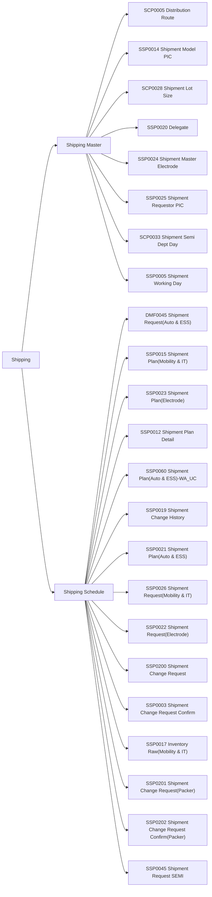

## 2. 업무 단계 흐름(데이터 의존 집계) — 단계 = 화면 이름·TO-BE 메뉴명 규칙 · 간선 라벨 = 선행 단계 화면이 쓰고 후행 단계 화면이 읽는 (화면쌍, 테이블) 수

- 노드 = 단계(화면 수 · TO-BE 수) · 실선 = (화면쌍,테이블) 5 이상 · 점선 = 5 미만 · 화면 단위는 §2-1(단계별)·§2-2(TO-BE 화면만) · 전체 쌍은 §3 표

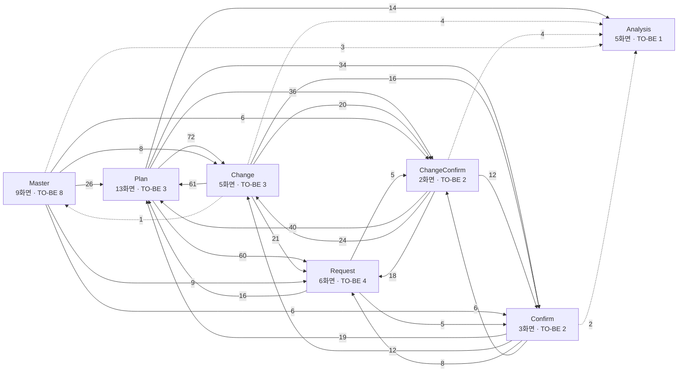

### 2-1. 단계별 화면 의존 — 단계 안 화면은 개별, 다른 단계는 한 노드로 접음(라벨 = 테이블 수)

#### Master (9화면)

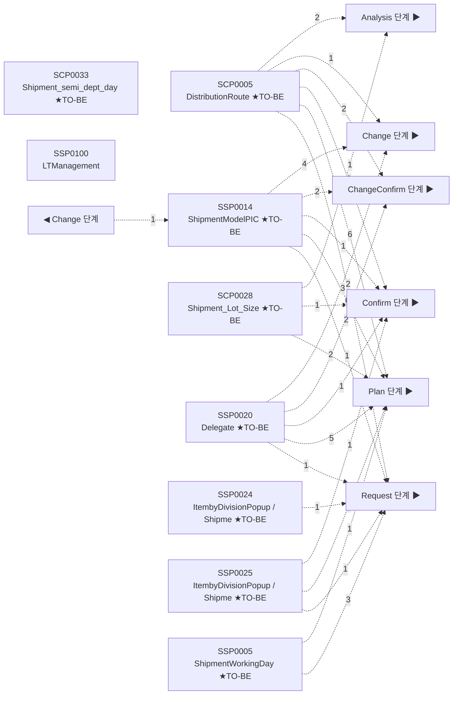

#### Request (6화면)

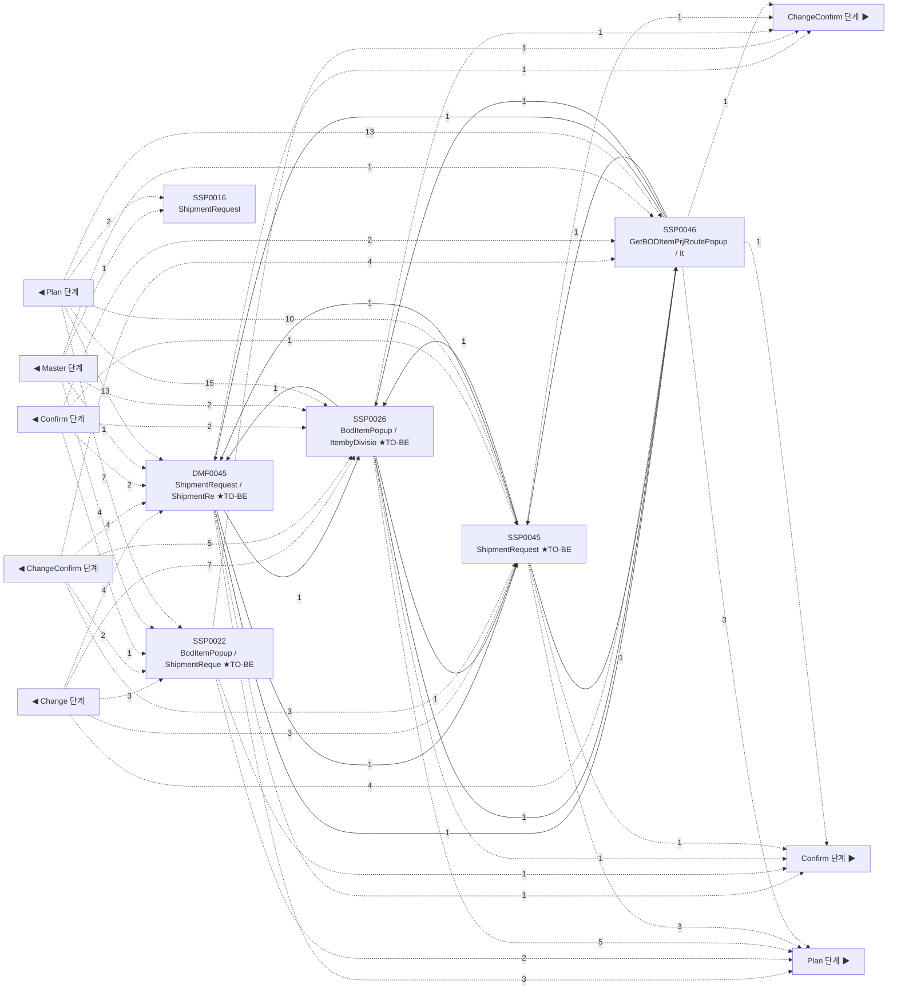

#### Plan (13화면)

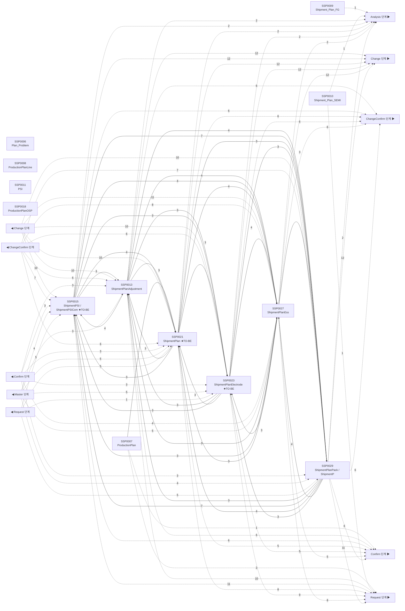

#### Confirm (3화면)

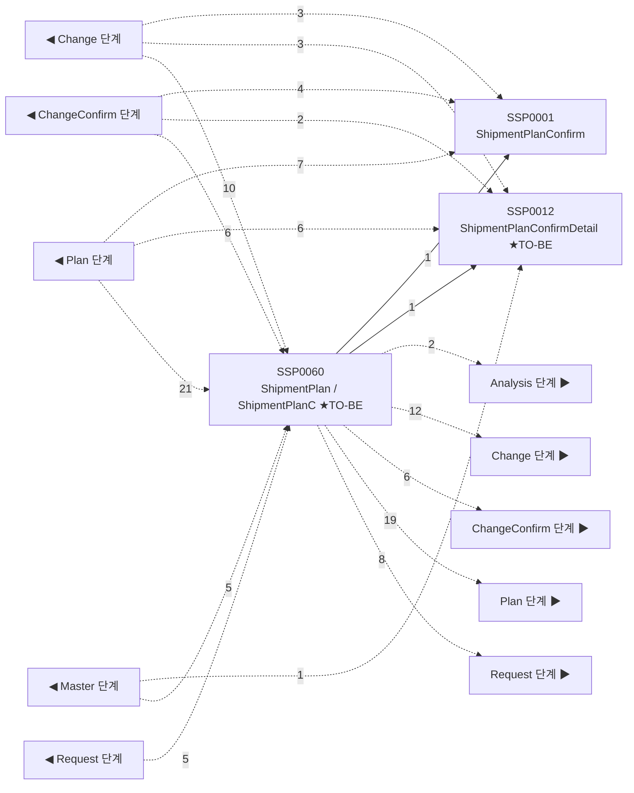

#### Change (5화면)

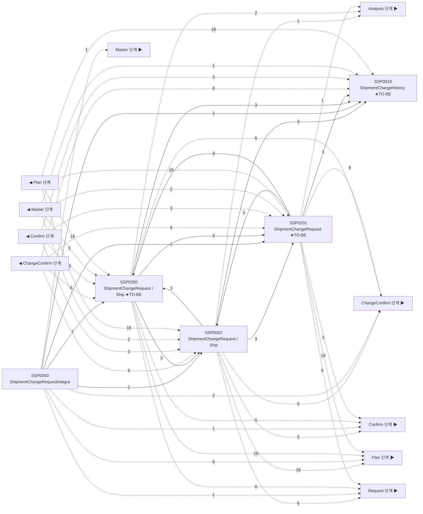

#### ChangeConfirm (2화면)

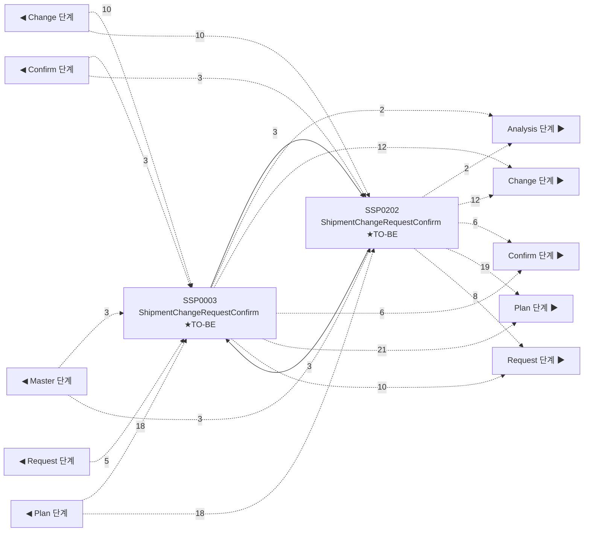

#### Analysis (5화면)

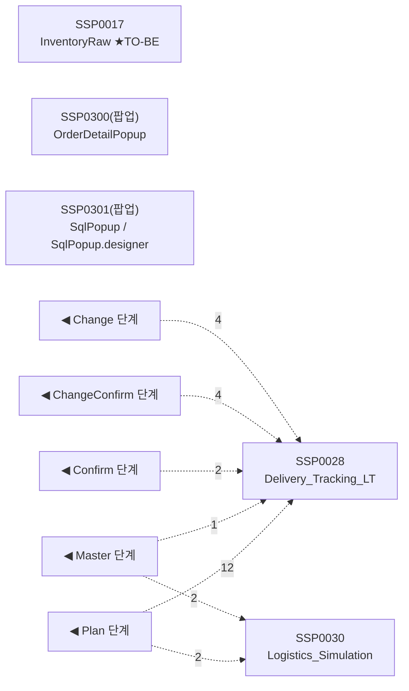

### 2-2. TO-BE 메뉴 화면 간 흐름(19 화면만 · 단계별 색)

- Master 단계 화면(기준정보 · 거의 모든 화면이 읽음)은 한 노드로 접음 · AS-IS 전용 화면을 거치는 의존은 제외 · 라벨 = 매개 테이블 수(쓰는 화면 → 읽기만 하는 화면 · 단방향 전달) · 여러 TO-BE 화면이 함께 쓰는 허브 표는 그림 아래 표 · 화면정의서 재작성 순서 검토용

<table class="mx"><thead><tr><th rowspan="2">쓰는 화면</th><th class="mx-g mx-g0" colspan="14">읽기만 하는 화면</th></tr><tr><th class="mx-g0">DMF0045<small>Shipment Request</small></th><th class="mx-g0">SSP0026<small>Shipment Request</small></th><th class="mx-g0">SSP0022<small>Shipment Request</small></th><th class="mx-g0">SSP0045<small>Shipment Request</small></th><th class="mx-g0">SSP0015<small>Shipment Plan(Mo</small></th><th class="mx-g0">SSP0023<small>Shipment Plan(El</small></th><th class="mx-g0">SSP0021<small>Shipment Plan(Au</small></th><th class="mx-g0">SSP0012<small>Shipment Plan De</small></th><th class="mx-g0">SSP0060<small>Shipment Plan(Au</small></th><th class="mx-g0">SSP0019<small>Shipment Change </small></th><th class="mx-g0">SSP0200<small>Shipment Change </small></th><th class="mx-g0">SSP0201<small>Shipment Change </small></th><th class="mx-g0">SSP0003<small>Shipment Change </small></th><th class="mx-g0">SSP0202<small>Shipment Change </small></th></tr></thead><tbody><tr><th class="mx-e">Master 화면 8<small>SCP0005, SCP0028, SCP0033, SSP0005, SSP0014, SSP0020, SSP002</small></th><td class="mx-c" title="SCP_MST_DISTRIBUTION_ROUTE"><b class="mx-w">1</b></td><td class="mx-c" title="SSP_MST_MODEL_USER, SSP_MST_SHIP_CALENDAR"><b class="mx-w">2</b></td><td class="mx-c" title="SSP_MST_DELEGATE, SSP_MST_MODEL_USER_EE, SSP_MST_SHIP_CALENDAR, SSP_MST_SHIP_MASTER_EE"><b class="mx-w">4</b></td><td class="mx-0"></td><td class="mx-c" title="SCP_MST_DISTRIBUTION_ROUTE, SSP_MST_DELEGATE, SSP_MST_MODEL_USER, SSP_MST_MODEL_USER_EE"><b class="mx-w">4</b></td><td class="mx-c" title="SCP_MST_DISTRIBUTION_ROUTE, SSP_MST_DELEGATE, SSP_MST_MODEL_USER, SSP_MST_MODEL_USER_EE, SSP_MST_SHIP_CALENDAR"><b class="mx-w">5</b></td><td class="mx-c" title="SCP_MST_DISTRIBUTION_ROUTE, SCP_MST_SHIPMENT_LOT_SIZE, SSP_MST_DELEGATE, SSP_MST_MODEL_USER, SSP_MST_MODEL_USER_EE"><b class="mx-w">5</b></td><td class="mx-c" title="SCP_MST_DISTRIBUTION_ROUTE"><b class="mx-w">1</b></td><td class="mx-c" title="SCP_MST_DISTRIBUTION_ROUTE, SCP_MST_SHIPMENT_LOT_SIZE, SSP_MST_DELEGATE, SSP_MST_MODEL_USER, SSP_MST_MODEL_USER_EE"><b class="mx-w">5</b></td><td class="mx-c" title="SSP_MST_MODEL_USER"><b class="mx-w">1</b></td><td class="mx-c" title="SCP_MST_DISTRIBUTION_ROUTE, SSP_MST_DELEGATE, SSP_MST_MODEL_USER"><b class="mx-w">3</b></td><td class="mx-c" title="SSP_MST_DELEGATE, SSP_MST_MODEL_USER"><b class="mx-w">2</b></td><td class="mx-c" title="SCP_MST_DISTRIBUTION_ROUTE, SSP_MST_DELEGATE, SSP_MST_MODEL_USER"><b class="mx-w">3</b></td><td class="mx-c" title="SCP_MST_DISTRIBUTION_ROUTE, SSP_MST_DELEGATE, SSP_MST_MODEL_USER"><b class="mx-w">3</b></td></tr><tr><th class="mx-e" data-k="DMF0045">DMF0045<small>Shipment Request(Auto &amp; ESS)</small></th><td class="mx-0"></td><td class="mx-0"></td><td class="mx-0"></td><td class="mx-0"></td><td class="mx-c" title="DM_PLN_SHIPMENT_REQ"><b class="mx-w">1</b></td><td class="mx-0"></td><td class="mx-c" title="DM_PLN_SHIPMENT_REQ"><b class="mx-w">1</b></td><td class="mx-0"></td><td class="mx-c" title="DM_PLN_SHIPMENT_REQ"><b class="mx-w">1</b></td><td class="mx-0"></td><td class="mx-0"></td><td class="mx-0"></td><td class="mx-c" title="DM_PLN_SHIPMENT_REQ"><b class="mx-w">1</b></td><td class="mx-0"></td></tr><tr><th class="mx-e" data-k="SSP0026">SSP0026<small>Shipment Request(Mobility &amp; IT)</small></th><td class="mx-0"></td><td class="mx-0"></td><td class="mx-0"></td><td class="mx-0"></td><td class="mx-c" title="DM_PLN_SHIPMENT_REQ, SSP_ANL_SHIP_REQ_P"><b class="mx-w">2</b></td><td class="mx-0"></td><td class="mx-c" title="DM_PLN_SHIPMENT_REQ"><b class="mx-w">1</b></td><td class="mx-0"></td><td class="mx-c" title="DM_PLN_SHIPMENT_REQ"><b class="mx-w">1</b></td><td class="mx-0"></td><td class="mx-0"></td><td class="mx-0"></td><td class="mx-c" title="DM_PLN_SHIPMENT_REQ"><b class="mx-w">1</b></td><td class="mx-0"></td></tr><tr><th class="mx-e" data-k="SSP0022">SSP0022<small>Shipment Request(Electrode)</small></th><td class="mx-0"></td><td class="mx-0"></td><td class="mx-0"></td><td class="mx-0"></td><td class="mx-0"></td><td class="mx-c" title="SSP_ANL_SHIP_REQ_EE"><b class="mx-w">1</b></td><td class="mx-c" title="SSP_ANL_SHIP_REQ_EE"><b class="mx-w">1</b></td><td class="mx-0"></td><td class="mx-c" title="SSP_ANL_SHIP_REQ_EE"><b class="mx-w">1</b></td><td class="mx-0"></td><td class="mx-0"></td><td class="mx-0"></td><td class="mx-c" title="SSP_ANL_SHIP_REQ_EE"><b class="mx-w">1</b></td><td class="mx-0"></td></tr><tr><th class="mx-e" data-k="SSP0045">SSP0045<small>Shipment Request SEMI</small></th><td class="mx-0"></td><td class="mx-0"></td><td class="mx-0"></td><td class="mx-0"></td><td class="mx-c" title="DM_PLN_SHIPMENT_REQ"><b class="mx-w">1</b></td><td class="mx-0"></td><td class="mx-c" title="DM_PLN_SHIPMENT_REQ"><b class="mx-w">1</b></td><td class="mx-0"></td><td class="mx-c" title="DM_PLN_SHIPMENT_REQ"><b class="mx-w">1</b></td><td class="mx-0"></td><td class="mx-0"></td><td class="mx-0"></td><td class="mx-c" title="DM_PLN_SHIPMENT_REQ"><b class="mx-w">1</b></td><td class="mx-0"></td></tr><tr><th class="mx-e" data-k="SSP0015">SSP0015<small>Shipment Plan(Mobility &amp; IT)</small></th><td class="mx-c" title="DM_PLN_MKT_FCST"><b class="mx-w">1</b></td><td class="mx-c" title="SSP_ANL_SHIP_PLAN_40"><b class="mx-w">1</b></td><td class="mx-0"></td><td class="mx-c" title="SSP_ANL_SHIP_PLAN_40"><b class="mx-w">1</b></td><td class="mx-0"></td><td class="mx-0"></td><td class="mx-c" title="SSP_ANL_HOLD_STOCK"><b class="mx-w">1</b></td><td class="mx-0"></td><td class="mx-c" title="SSP_ANL_HOLD_STOCK"><b class="mx-w">1</b></td><td class="mx-0"></td><td class="mx-0"></td><td class="mx-0"></td><td class="mx-0"></td><td class="mx-0"></td></tr><tr><th class="mx-e" data-k="SSP0023">SSP0023<small>Shipment Plan(Electrode)</small></th><td class="mx-c" title="DM_PLN_MKT_FCST"><b class="mx-w">1</b></td><td class="mx-0"></td><td class="mx-c" title="SSP_ANL_SHIP_PLAN_EE"><b class="mx-w">1</b></td><td class="mx-0"></td><td class="mx-0"></td><td class="mx-0"></td><td class="mx-0"></td><td class="mx-0"></td><td class="mx-0"></td><td class="mx-0"></td><td class="mx-0"></td><td class="mx-0"></td><td class="mx-0"></td><td class="mx-0"></td></tr><tr><th class="mx-e" data-k="SSP0021">SSP0021<small>Shipment Plan(Auto &amp; ESS)</small></th><td class="mx-c" title="DM_PLN_MKT_FCST"><b class="mx-w">1</b></td><td class="mx-0"></td><td class="mx-0"></td><td class="mx-0"></td><td class="mx-0"></td><td class="mx-0"></td><td class="mx-0"></td><td class="mx-0"></td><td class="mx-0"></td><td class="mx-0"></td><td class="mx-0"></td><td class="mx-0"></td><td class="mx-0"></td><td class="mx-0"></td></tr><tr><th class="mx-e" data-k="SSP0060">SSP0060<small>Shipment Plan(Auto &amp; ESS)-WA_UC</small></th><td class="mx-c" title="DM_PLN_MKT_FCST"><b class="mx-w">1</b></td><td class="mx-0"></td><td class="mx-0"></td><td class="mx-0"></td><td class="mx-0"></td><td class="mx-0"></td><td class="mx-0"></td><td class="mx-0"></td><td class="mx-0"></td><td class="mx-0"></td><td class="mx-0"></td><td class="mx-0"></td><td class="mx-0"></td><td class="mx-0"></td></tr><tr><th class="mx-e" data-k="SSP0200">SSP0200<small>Shipment Change Request</small></th><td class="mx-c" title="DM_PLN_MKT_FCST"><b class="mx-w">1</b></td><td class="mx-0"></td><td class="mx-0"></td><td class="mx-0"></td><td class="mx-0"></td><td class="mx-0"></td><td class="mx-0"></td><td class="mx-0"></td><td class="mx-0"></td><td class="mx-0"></td><td class="mx-0"></td><td class="mx-0"></td><td class="mx-0"></td><td class="mx-0"></td></tr><tr><th class="mx-e" data-k="SSP0003">SSP0003<small>Shipment Change Request Confirm</small></th><td class="mx-c" title="DM_PLN_MKT_FCST"><b class="mx-w">1</b></td><td class="mx-c" title="SSP_ANL_SHIP_PLAN_40"><b class="mx-w">1</b></td><td class="mx-0"></td><td class="mx-c" title="SSP_ANL_SHIP_PLAN_40"><b class="mx-w">1</b></td><td class="mx-0"></td><td class="mx-0"></td><td class="mx-0"></td><td class="mx-0"></td><td class="mx-0"></td><td class="mx-0"></td><td class="mx-0"></td><td class="mx-0"></td><td class="mx-0"></td><td class="mx-0"></td></tr><tr><th class="mx-e" data-k="SSP0202">SSP0202<small>Shipment Change Request Confirm(Packer)</small></th><td class="mx-c" title="DM_PLN_MKT_FCST"><b class="mx-w">1</b></td><td class="mx-0"></td><td class="mx-0"></td><td class="mx-0"></td><td class="mx-0"></td><td class="mx-0"></td><td class="mx-0"></td><td class="mx-0"></td><td class="mx-0"></td><td class="mx-0"></td><td class="mx-0"></td><td class="mx-0"></td><td class="mx-0"></td><td class="mx-0"></td></tr></tbody></table>

칸의 숫자 = 왼쪽 화면이 쓰고 위쪽 화면이 읽기만 하는 테이블 수. 칸에 마우스를 올리면 테이블 이름이 보입니다. 화면 ID 를 누르면 그 화면의 상세가 열립니다. 쓰는 TO-BE 화면이 4개 이상인 허브 표는 아래 표에 있습니다. 같은 내용의 그래프는 아래 「그래프로 보기」.

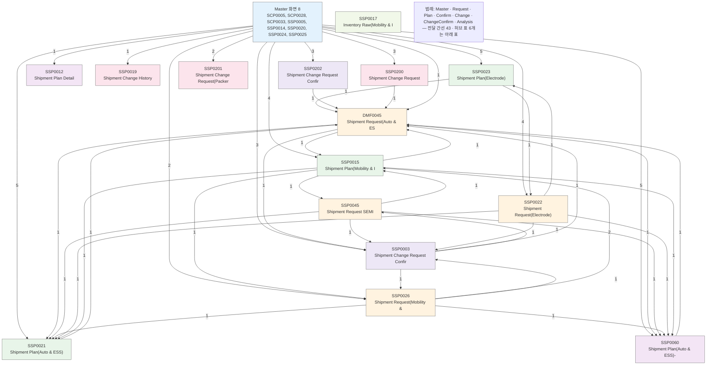

**허브 표** — 쓰는 TO-BE 화면 ≥ 4: 여러 화면이 함께 쓰고 읽는 표라 화면쌍 간선 대신 표로 제시(그림에 넣으면 간선이 폭발)

| 허브 표 | 쓰는 TO-BE 화면 | 읽기만 하는 TO-BE 화면 |
|---|---|---|
| SSP_ANL_SHIP_CONFIRM | SSP0003, SSP0015, SSP0021, SSP0023, SSP0060, SSP0200, SSP0201, SSP0202 | DMF0045, SSP0012, SSP0019, SSP0022, SSP0026, SSP0045 |
| SSP_ANL_SHIP_CONFIRM_CHG_REQ | SSP0003, SSP0015, SSP0021, SSP0023, SSP0060, SSP0200, SSP0201, SSP0202 | SSP0019 |
| SSP_ANL_SHIP_CONFIRM_CHG_REQ_DE | SSP0003, SSP0015, SSP0021, SSP0023, SSP0060, SSP0200, SSP0201, SSP0202 | SSP0019, SSP0026 |
| SSP_ANL_SHIP_CONFIRM_ROUTE | SSP0003, SSP0015, SSP0021, SSP0023, SSP0060, SSP0200, SSP0202 | - |
| SSP_ANL_SHIP_ERP_ERROR_CONFIRM | SSP0003, SSP0015, SSP0021, SSP0023, SSP0060, SSP0200 | - |
| SSP_MST_SEND_MAIL_REQ | SSP0015, SSP0021, SSP0023, SSP0060 | - |

## 3. 의존 표(선행 화면 → 후행 화면 · 매개 테이블)

| 선행(쓰기) | 후행(읽기) | 매개 테이블 |
|---|---|---|
| DMF0045 ShipmentRequest / ShipmentRequest_POPUP_DMF0046_GetBODItemPrjRoute | SSP0003 ShipmentChangeRequestConfirm | DM_PLN_SHIPMENT_REQ |
| DMF0045 ShipmentRequest / ShipmentRequest_POPUP_DMF0046_GetBODItemPrjRoute | SSP0015 ShipmentPSI / ShipmentPSICommentsPopup | DM_PLN_SHIPMENT_REQ |
| DMF0045 ShipmentRequest / ShipmentRequest_POPUP_DMF0046_GetBODItemPrjRoute | SSP0021 ShipmentPlan | DM_PLN_SHIPMENT_REQ |
| DMF0045 ShipmentRequest / ShipmentRequest_POPUP_DMF0046_GetBODItemPrjRoute | SSP0026 BodItemPopup / ItembyDivisionPopup / ShipmentRequestPack | DM_PLN_SHIPMENT_REQ |
| DMF0045 ShipmentRequest / ShipmentRequest_POPUP_DMF0046_GetBODItemPrjRoute | SSP0029 ShipmentPlanPack / ShipmentPlanPackPopup | DM_PLN_SHIPMENT_REQ |
| DMF0045 ShipmentRequest / ShipmentRequest_POPUP_DMF0046_GetBODItemPrjRoute | SSP0045 ShipmentRequest | DM_PLN_SHIPMENT_REQ |
| DMF0045 ShipmentRequest / ShipmentRequest_POPUP_DMF0046_GetBODItemPrjRoute | SSP0046 GetBODItemPrjRoutePopup / ItembyDivisionPopupEx / ProjectbyDivisionPopupEx / ShipmentRequest / TitleSetForm_Popup | DM_PLN_SHIPMENT_REQ |
| DMF0045 ShipmentRequest / ShipmentRequest_POPUP_DMF0046_GetBODItemPrjRoute | SSP0060 ShipmentPlan / ShipmentPlanConfirmDetailPopup / ShipmentPlanRequestPopup | DM_PLN_SHIPMENT_REQ |
| SCP0005 DistributionRoute | DMF0045 ShipmentRequest / ShipmentRequest_POPUP_DMF0046_GetBODItemPrjRoute | SCP_MST_DISTRIBUTION_ROUTE |
| SCP0005 DistributionRoute | SSP0003 ShipmentChangeRequestConfirm | SCP_MST_DISTRIBUTION_ROUTE |
| SCP0005 DistributionRoute | SSP0012 ShipmentPlanConfirmDetail | SCP_MST_DISTRIBUTION_ROUTE |
| SCP0005 DistributionRoute | SSP0013 ShipmentPlanAdjustment | SCP_MST_DISTRIBUTION_ROUTE |
| SCP0005 DistributionRoute | SSP0015 ShipmentPSI / ShipmentPSICommentsPopup | SCP_MST_DISTRIBUTION_ROUTE |
| SCP0005 DistributionRoute | SSP0021 ShipmentPlan | SCP_MST_DISTRIBUTION_ROUTE |
| SCP0005 DistributionRoute | SSP0023 ShipmentPlanElectrode | SCP_MST_DISTRIBUTION_ROUTE |
| SCP0005 DistributionRoute | SSP0027 ShipmentPlanEss | SCP_MST_DISTRIBUTION_ROUTE |
| SCP0005 DistributionRoute | SSP0028 Delivery_Tracking_LT | SCP_MST_DISTRIBUTION_ROUTE |
| SCP0005 DistributionRoute | SSP0029 ShipmentPlanPack / ShipmentPlanPackPopup | SCP_MST_DISTRIBUTION_ROUTE |
| SCP0005 DistributionRoute | SSP0030 Logistics_Simulation | SCP_MST_DISTRIBUTION_ROUTE |
| SCP0005 DistributionRoute | SSP0046 GetBODItemPrjRoutePopup / ItembyDivisionPopupEx / ProjectbyDivisionPopupEx / ShipmentRequest / TitleSetForm_Popup | SCP_MST_DISTRIBUTION_ROUTE |
| SCP0005 DistributionRoute | SSP0060 ShipmentPlan / ShipmentPlanConfirmDetailPopup / ShipmentPlanRequestPopup | SCP_MST_DISTRIBUTION_ROUTE |
| SCP0005 DistributionRoute | SSP0200 ShipmentChangeRequest / ShipmentChangeRequestInsertPopup | SCP_MST_DISTRIBUTION_ROUTE |
| SCP0005 DistributionRoute | SSP0202 ShipmentChangeRequestConfirm | SCP_MST_DISTRIBUTION_ROUTE |
| SCP0028 Shipment_Lot_Size | SSP0021 ShipmentPlan | SCP_MST_SHIPMENT_LOT_SIZE |
| SCP0028 Shipment_Lot_Size | SSP0027 ShipmentPlanEss | SCP_MST_SHIPMENT_LOT_SIZE |
| SCP0028 Shipment_Lot_Size | SSP0030 Logistics_Simulation | SCP_MST_SHIPMENT_LOT_SIZE |
| SCP0028 Shipment_Lot_Size | SSP0060 ShipmentPlan / ShipmentPlanConfirmDetailPopup / ShipmentPlanRequestPopup | SCP_MST_SHIPMENT_LOT_SIZE |
| SSP0002 ShipmentChangeRequest / ShipmentChangeRequest_Backup / ShipmentConfirmInsertPopup / UserInfoPopup | DMF0045 ShipmentRequest / ShipmentRequest_POPUP_DMF0046_GetBODItemPrjRoute | SSP_ANL_SHIP_CONFIRM |
| SSP0002 ShipmentChangeRequest / ShipmentChangeRequest_Backup / ShipmentConfirmInsertPopup / UserInfoPopup | SSP0001 ShipmentPlanConfirm | SSP_ANL_SHIP_CONFIRM |
| SSP0002 ShipmentChangeRequest / ShipmentChangeRequest_Backup / ShipmentConfirmInsertPopup / UserInfoPopup | SSP0003 ShipmentChangeRequestConfirm | SSP_ANL_SHIP_CONFIRM, SSP_ANL_SHIP_CONFIRM_CHG_REQ, SSP_ANL_SHIP_CONFIRM_CHG_REQ_DE |
| SSP0002 ShipmentChangeRequest / ShipmentChangeRequest_Backup / ShipmentConfirmInsertPopup / UserInfoPopup | SSP0012 ShipmentPlanConfirmDetail | SSP_ANL_SHIP_CONFIRM |
| SSP0002 ShipmentChangeRequest / ShipmentChangeRequest_Backup / ShipmentConfirmInsertPopup / UserInfoPopup | SSP0013 ShipmentPlanAdjustment | SSP_ANL_SHIP_CONFIRM, SSP_ANL_SHIP_CONFIRM_CHG_REQ, SSP_ANL_SHIP_CONFIRM_CHG_REQ_DE |
| SSP0002 ShipmentChangeRequest / ShipmentChangeRequest_Backup / ShipmentConfirmInsertPopup / UserInfoPopup | SSP0015 ShipmentPSI / ShipmentPSICommentsPopup | SSP_ANL_SHIP_CONFIRM, SSP_ANL_SHIP_CONFIRM_CHG_REQ, SSP_ANL_SHIP_CONFIRM_CHG_REQ_DE |
| SSP0002 ShipmentChangeRequest / ShipmentChangeRequest_Backup / ShipmentConfirmInsertPopup / UserInfoPopup | SSP0019 ShipmentChangeHistory | SSP_ANL_SHIP_CONFIRM, SSP_ANL_SHIP_CONFIRM_CHG_REQ, SSP_ANL_SHIP_CONFIRM_CHG_REQ_DE |
| SSP0002 ShipmentChangeRequest / ShipmentChangeRequest_Backup / ShipmentConfirmInsertPopup / UserInfoPopup | SSP0021 ShipmentPlan | SSP_ANL_SHIP_CONFIRM, SSP_ANL_SHIP_CONFIRM_CHG_REQ, SSP_ANL_SHIP_CONFIRM_CHG_REQ_DE |
| SSP0002 ShipmentChangeRequest / ShipmentChangeRequest_Backup / ShipmentConfirmInsertPopup / UserInfoPopup | SSP0022 BodItemPopup / ShipmentRequestElectrode / ShipmentRequestPopup | SSP_ANL_SHIP_CONFIRM |
| SSP0002 ShipmentChangeRequest / ShipmentChangeRequest_Backup / ShipmentConfirmInsertPopup / UserInfoPopup | SSP0023 ShipmentPlanElectrode | SSP_ANL_SHIP_CONFIRM, SSP_ANL_SHIP_CONFIRM_CHG_REQ, SSP_ANL_SHIP_CONFIRM_CHG_REQ_DE |
| SSP0002 ShipmentChangeRequest / ShipmentChangeRequest_Backup / ShipmentConfirmInsertPopup / UserInfoPopup | SSP0026 BodItemPopup / ItembyDivisionPopup / ShipmentRequestPack | SSP_ANL_SHIP_CONFIRM, SSP_ANL_SHIP_CONFIRM_CHG_REQ_DE |
| SSP0002 ShipmentChangeRequest / ShipmentChangeRequest_Backup / ShipmentConfirmInsertPopup / UserInfoPopup | SSP0027 ShipmentPlanEss | SSP_ANL_SHIP_CONFIRM, SSP_ANL_SHIP_CONFIRM_CHG_REQ, SSP_ANL_SHIP_CONFIRM_CHG_REQ_DE |
| SSP0002 ShipmentChangeRequest / ShipmentChangeRequest_Backup / ShipmentConfirmInsertPopup / UserInfoPopup | SSP0028 Delivery_Tracking_LT | SSP_ANL_SHIP_CONFIRM |
| SSP0002 ShipmentChangeRequest / ShipmentChangeRequest_Backup / ShipmentConfirmInsertPopup / UserInfoPopup | SSP0029 ShipmentPlanPack / ShipmentPlanPackPopup | SSP_ANL_SHIP_CONFIRM, SSP_ANL_SHIP_CONFIRM_CHG_REQ, SSP_ANL_SHIP_CONFIRM_CHG_REQ_DE |
| SSP0002 ShipmentChangeRequest / ShipmentChangeRequest_Backup / ShipmentConfirmInsertPopup / UserInfoPopup | SSP0045 ShipmentRequest | SSP_ANL_SHIP_CONFIRM |
| SSP0002 ShipmentChangeRequest / ShipmentChangeRequest_Backup / ShipmentConfirmInsertPopup / UserInfoPopup | SSP0046 GetBODItemPrjRoutePopup / ItembyDivisionPopupEx / ProjectbyDivisionPopupEx / ShipmentRequest / TitleSetForm_Popup | SSP_ANL_SHIP_CONFIRM |
| SSP0002 ShipmentChangeRequest / ShipmentChangeRequest_Backup / ShipmentConfirmInsertPopup / UserInfoPopup | SSP0060 ShipmentPlan / ShipmentPlanConfirmDetailPopup / ShipmentPlanRequestPopup | SSP_ANL_SHIP_CONFIRM, SSP_ANL_SHIP_CONFIRM_CHG_REQ, SSP_ANL_SHIP_CONFIRM_CHG_REQ_DE |
| SSP0002 ShipmentChangeRequest / ShipmentChangeRequest_Backup / ShipmentConfirmInsertPopup / UserInfoPopup | SSP0200 ShipmentChangeRequest / ShipmentChangeRequestInsertPopup | SSP_ANL_SHIP_CONFIRM, SSP_ANL_SHIP_CONFIRM_CHG_REQ, SSP_ANL_SHIP_CONFIRM_CHG_REQ_DE |
| SSP0002 ShipmentChangeRequest / ShipmentChangeRequest_Backup / ShipmentConfirmInsertPopup / UserInfoPopup | SSP0201 ShipmentChangeRequest | SSP_ANL_SHIP_CONFIRM, SSP_ANL_SHIP_CONFIRM_CHG_REQ, SSP_ANL_SHIP_CONFIRM_CHG_REQ_DE |
| SSP0002 ShipmentChangeRequest / ShipmentChangeRequest_Backup / ShipmentConfirmInsertPopup / UserInfoPopup | SSP0202 ShipmentChangeRequestConfirm | SSP_ANL_SHIP_CONFIRM, SSP_ANL_SHIP_CONFIRM_CHG_REQ, SSP_ANL_SHIP_CONFIRM_CHG_REQ_DE |
| SSP0003 ShipmentChangeRequestConfirm | DMF0045 ShipmentRequest / ShipmentRequest_POPUP_DMF0046_GetBODItemPrjRoute | DM_PLN_MKT_FCST, SSP_ANL_SHIP_CONFIRM |
| SSP0003 ShipmentChangeRequestConfirm | SSP0001 ShipmentPlanConfirm | SSP_ANL_SHIP_CONFIRM, SSP_ANL_SHIP_PLAN |
| SSP0003 ShipmentChangeRequestConfirm | SSP0002 ShipmentChangeRequest / ShipmentChangeRequest_Backup / ShipmentConfirmInsertPopup / UserInfoPopup | SSP_ANL_SHIP_CONFIRM, SSP_ANL_SHIP_CONFIRM_CHG_REQ, SSP_ANL_SHIP_CONFIRM_CHG_REQ_DE |
| SSP0003 ShipmentChangeRequestConfirm | SSP0012 ShipmentPlanConfirmDetail | SSP_ANL_SHIP_CONFIRM |
| SSP0003 ShipmentChangeRequestConfirm | SSP0013 ShipmentPlanAdjustment | SSP_ANL_SHIP_CONFIRM, SSP_ANL_SHIP_CONFIRM_CHG_REQ, SSP_ANL_SHIP_CONFIRM_CHG_REQ_DE |
| SSP0003 ShipmentChangeRequestConfirm | SSP0015 ShipmentPSI / ShipmentPSICommentsPopup | SSP_ANL_SHIP_CONFIRM, SSP_ANL_SHIP_CONFIRM_CHG_REQ, SSP_ANL_SHIP_CONFIRM_CHG_REQ_DE, SSP_ANL_SHIP_PLAN_40 |
| SSP0003 ShipmentChangeRequestConfirm | SSP0019 ShipmentChangeHistory | SSP_ANL_SHIP_CONFIRM, SSP_ANL_SHIP_CONFIRM_CHG_REQ, SSP_ANL_SHIP_CONFIRM_CHG_REQ_DE |
| SSP0003 ShipmentChangeRequestConfirm | SSP0021 ShipmentPlan | SSP_ANL_SHIP_CONFIRM, SSP_ANL_SHIP_CONFIRM_CHG_REQ, SSP_ANL_SHIP_CONFIRM_CHG_REQ_DE |
| SSP0003 ShipmentChangeRequestConfirm | SSP0022 BodItemPopup / ShipmentRequestElectrode / ShipmentRequestPopup | SSP_ANL_SHIP_CONFIRM |
| SSP0003 ShipmentChangeRequestConfirm | SSP0023 ShipmentPlanElectrode | SSP_ANL_SHIP_CONFIRM, SSP_ANL_SHIP_CONFIRM_CHG_REQ, SSP_ANL_SHIP_CONFIRM_CHG_REQ_DE |
| SSP0003 ShipmentChangeRequestConfirm | SSP0026 BodItemPopup / ItembyDivisionPopup / ShipmentRequestPack | SSP_ANL_SHIP_CONFIRM, SSP_ANL_SHIP_CONFIRM_CHG_REQ_DE, SSP_ANL_SHIP_PLAN_40 |
| SSP0003 ShipmentChangeRequestConfirm | SSP0027 ShipmentPlanEss | DM_PLN_MKT_FCST, SSP_ANL_SHIP_CONFIRM, SSP_ANL_SHIP_CONFIRM_CHG_REQ, SSP_ANL_SHIP_CONFIRM_CHG_REQ_DE |
| SSP0003 ShipmentChangeRequestConfirm | SSP0028 Delivery_Tracking_LT | SSP_ANL_SHIP_CONFIRM, SSP_ANL_SHIP_CONFIRM_ROUTE |
| SSP0003 ShipmentChangeRequestConfirm | SSP0029 ShipmentPlanPack / ShipmentPlanPackPopup | SSP_ANL_SHIP_CONFIRM, SSP_ANL_SHIP_CONFIRM_CHG_REQ, SSP_ANL_SHIP_CONFIRM_CHG_REQ_DE, SSP_ANL_SHIP_PLAN_40 |
| SSP0003 ShipmentChangeRequestConfirm | SSP0045 ShipmentRequest | SSP_ANL_SHIP_CONFIRM, SSP_ANL_SHIP_PLAN_40 |
| SSP0003 ShipmentChangeRequestConfirm | SSP0046 GetBODItemPrjRoutePopup / ItembyDivisionPopupEx / ProjectbyDivisionPopupEx / ShipmentRequest / TitleSetForm_Popup | DM_PLN_MKT_FCST, SSP_ANL_SHIP_CONFIRM |
| SSP0003 ShipmentChangeRequestConfirm | SSP0060 ShipmentPlan / ShipmentPlanConfirmDetailPopup / ShipmentPlanRequestPopup | SSP_ANL_SHIP_CONFIRM, SSP_ANL_SHIP_CONFIRM_CHG_REQ, SSP_ANL_SHIP_CONFIRM_CHG_REQ_DE |
| SSP0003 ShipmentChangeRequestConfirm | SSP0200 ShipmentChangeRequest / ShipmentChangeRequestInsertPopup | SSP_ANL_SHIP_CONFIRM, SSP_ANL_SHIP_CONFIRM_CHG_REQ, SSP_ANL_SHIP_CONFIRM_CHG_REQ_DE |
| SSP0003 ShipmentChangeRequestConfirm | SSP0201 ShipmentChangeRequest | SSP_ANL_SHIP_CONFIRM, SSP_ANL_SHIP_CONFIRM_CHG_REQ, SSP_ANL_SHIP_CONFIRM_CHG_REQ_DE |
| SSP0003 ShipmentChangeRequestConfirm | SSP0202 ShipmentChangeRequestConfirm | SSP_ANL_SHIP_CONFIRM, SSP_ANL_SHIP_CONFIRM_CHG_REQ, SSP_ANL_SHIP_CONFIRM_CHG_REQ_DE |
| SSP0005 ShipmentWorkingDay | SSP0016 ShipmentRequest | SSP_MST_SHIP_CALENDAR |
| SSP0005 ShipmentWorkingDay | SSP0022 BodItemPopup / ShipmentRequestElectrode / ShipmentRequestPopup | SSP_MST_SHIP_CALENDAR |
| SSP0005 ShipmentWorkingDay | SSP0023 ShipmentPlanElectrode | SSP_MST_SHIP_CALENDAR |
| SSP0005 ShipmentWorkingDay | SSP0026 BodItemPopup / ItembyDivisionPopup / ShipmentRequestPack | SSP_MST_SHIP_CALENDAR |
| SSP0007 ProductionPlan | DMF0045 ShipmentRequest / ShipmentRequest_POPUP_DMF0046_GetBODItemPrjRoute | SCP_ANL_PRODUCTION_PLAN |
| SSP0007 ProductionPlan | SSP0021 ShipmentPlan | SCP_ANL_PRODUCTION_PLAN |
| SSP0007 ProductionPlan | SSP0046 GetBODItemPrjRoutePopup / ItembyDivisionPopupEx / ProjectbyDivisionPopupEx / ShipmentRequest / TitleSetForm_Popup | SCP_ANL_PRODUCTION_PLAN |
| SSP0007 ProductionPlan | SSP0060 ShipmentPlan / ShipmentPlanConfirmDetailPopup / ShipmentPlanRequestPopup | SCP_ANL_PRODUCTION_PLAN |
| SSP0009 Shipment_Plan_FG | SSP0030 Logistics_Simulation | SCP_ANL_SHIPMENT_PLAN_FG |
| SSP0010 Shipment_Plan_SEMI | SSP0030 Logistics_Simulation | SCP_ANL_SHIPMENT_PLAN_SEMI |
| SSP0010 Shipment_Plan_SEMI | SSP0045 ShipmentRequest | SCP_ANL_SHIPMENT_PLAN_SEMI |
| SSP0013 ShipmentPlanAdjustment | DMF0045 ShipmentRequest / ShipmentRequest_POPUP_DMF0046_GetBODItemPrjRoute | DM_PLN_MKT_FCST, SSP_ANL_SHIP_CONFIRM |
| SSP0013 ShipmentPlanAdjustment | SSP0001 ShipmentPlanConfirm | SSP_ANL_SHIP_CONFIRM, SSP_ANL_SHIP_PLAN |
| SSP0013 ShipmentPlanAdjustment | SSP0002 ShipmentChangeRequest / ShipmentChangeRequest_Backup / ShipmentConfirmInsertPopup / UserInfoPopup | SSP_ANL_SHIP_CONFIRM, SSP_ANL_SHIP_CONFIRM_CHG_REQ, SSP_ANL_SHIP_CONFIRM_CHG_REQ_DE |
| SSP0013 ShipmentPlanAdjustment | SSP0003 ShipmentChangeRequestConfirm | SSP_ANL_SHIP_CONFIRM, SSP_ANL_SHIP_CONFIRM_CHG_REQ, SSP_ANL_SHIP_CONFIRM_CHG_REQ_DE |
| SSP0013 ShipmentPlanAdjustment | SSP0012 ShipmentPlanConfirmDetail | SSP_ANL_SHIP_CONFIRM |
| SSP0013 ShipmentPlanAdjustment | SSP0015 ShipmentPSI / ShipmentPSICommentsPopup | SSP_ANL_SHIP_CONFIRM, SSP_ANL_SHIP_CONFIRM_CHG_REQ, SSP_ANL_SHIP_CONFIRM_CHG_REQ_DE, SSP_ANL_SHIP_PLAN_40 |
| SSP0013 ShipmentPlanAdjustment | SSP0019 ShipmentChangeHistory | SSP_ANL_SHIP_CONFIRM, SSP_ANL_SHIP_CONFIRM_CHG_REQ, SSP_ANL_SHIP_CONFIRM_CHG_REQ_DE |
| SSP0013 ShipmentPlanAdjustment | SSP0021 ShipmentPlan | SSP_ANL_SHIP_CONFIRM, SSP_ANL_SHIP_CONFIRM_CHG_REQ, SSP_ANL_SHIP_CONFIRM_CHG_REQ_DE |
| SSP0013 ShipmentPlanAdjustment | SSP0022 BodItemPopup / ShipmentRequestElectrode / ShipmentRequestPopup | SSP_ANL_SHIP_CONFIRM |
| SSP0013 ShipmentPlanAdjustment | SSP0023 ShipmentPlanElectrode | SSP_ANL_SHIP_CONFIRM, SSP_ANL_SHIP_CONFIRM_CHG_REQ, SSP_ANL_SHIP_CONFIRM_CHG_REQ_DE |
| SSP0013 ShipmentPlanAdjustment | SSP0026 BodItemPopup / ItembyDivisionPopup / ShipmentRequestPack | SSP_ANL_SHIP_CONFIRM, SSP_ANL_SHIP_CONFIRM_CHG_REQ_DE, SSP_ANL_SHIP_PLAN_40 |
| SSP0013 ShipmentPlanAdjustment | SSP0027 ShipmentPlanEss | DM_PLN_MKT_FCST, SSP_ANL_SHIP_CONFIRM, SSP_ANL_SHIP_CONFIRM_CHG_REQ, SSP_ANL_SHIP_CONFIRM_CHG_REQ_DE |
| SSP0013 ShipmentPlanAdjustment | SSP0028 Delivery_Tracking_LT | SSP_ANL_SHIP_CONFIRM, SSP_ANL_SHIP_CONFIRM_ROUTE |
| SSP0013 ShipmentPlanAdjustment | SSP0029 ShipmentPlanPack / ShipmentPlanPackPopup | SSP_ANL_SHIP_CONFIRM, SSP_ANL_SHIP_CONFIRM_CHG_REQ, SSP_ANL_SHIP_CONFIRM_CHG_REQ_DE, SSP_ANL_SHIP_PLAN_40 |
| SSP0013 ShipmentPlanAdjustment | SSP0045 ShipmentRequest | SSP_ANL_SHIP_CONFIRM, SSP_ANL_SHIP_PLAN_40 |
| SSP0013 ShipmentPlanAdjustment | SSP0046 GetBODItemPrjRoutePopup / ItembyDivisionPopupEx / ProjectbyDivisionPopupEx / ShipmentRequest / TitleSetForm_Popup | DM_PLN_MKT_FCST, SSP_ANL_SHIP_CONFIRM |
| SSP0013 ShipmentPlanAdjustment | SSP0060 ShipmentPlan / ShipmentPlanConfirmDetailPopup / ShipmentPlanRequestPopup | SSP_ANL_SHIP_CONFIRM, SSP_ANL_SHIP_CONFIRM_CHG_REQ, SSP_ANL_SHIP_CONFIRM_CHG_REQ_DE |
| SSP0013 ShipmentPlanAdjustment | SSP0200 ShipmentChangeRequest / ShipmentChangeRequestInsertPopup | SSP_ANL_SHIP_CONFIRM, SSP_ANL_SHIP_CONFIRM_CHG_REQ, SSP_ANL_SHIP_CONFIRM_CHG_REQ_DE |
| SSP0013 ShipmentPlanAdjustment | SSP0201 ShipmentChangeRequest | SSP_ANL_SHIP_CONFIRM, SSP_ANL_SHIP_CONFIRM_CHG_REQ, SSP_ANL_SHIP_CONFIRM_CHG_REQ_DE |
| SSP0013 ShipmentPlanAdjustment | SSP0202 ShipmentChangeRequestConfirm | SSP_ANL_SHIP_CONFIRM, SSP_ANL_SHIP_CONFIRM_CHG_REQ, SSP_ANL_SHIP_CONFIRM_CHG_REQ_DE |
| SSP0014 ShipmentModelPIC | SSP0002 ShipmentChangeRequest / ShipmentChangeRequest_Backup / ShipmentConfirmInsertPopup / UserInfoPopup | SSP_MST_MODEL_USER |
| SSP0014 ShipmentModelPIC | SSP0003 ShipmentChangeRequestConfirm | SSP_MST_MODEL_USER |
| SSP0014 ShipmentModelPIC | SSP0013 ShipmentPlanAdjustment | SSP_MST_MODEL_USER |
| SSP0014 ShipmentModelPIC | SSP0015 ShipmentPSI / ShipmentPSICommentsPopup | SSP_MST_MODEL_USER |
| SSP0014 ShipmentModelPIC | SSP0019 ShipmentChangeHistory | SSP_MST_MODEL_USER |
| SSP0014 ShipmentModelPIC | SSP0021 ShipmentPlan | SSP_MST_MODEL_USER |
| SSP0014 ShipmentModelPIC | SSP0023 ShipmentPlanElectrode | SSP_MST_MODEL_USER |
| SSP0014 ShipmentModelPIC | SSP0026 BodItemPopup / ItembyDivisionPopup / ShipmentRequestPack | SSP_MST_MODEL_USER |
| SSP0014 ShipmentModelPIC | SSP0027 ShipmentPlanEss | SSP_MST_MODEL_USER |
| SSP0014 ShipmentModelPIC | SSP0029 ShipmentPlanPack / ShipmentPlanPackPopup | SSP_MST_MODEL_USER |
| SSP0014 ShipmentModelPIC | SSP0060 ShipmentPlan / ShipmentPlanConfirmDetailPopup / ShipmentPlanRequestPopup | SSP_MST_MODEL_USER |
| SSP0014 ShipmentModelPIC | SSP0200 ShipmentChangeRequest / ShipmentChangeRequestInsertPopup | SSP_MST_MODEL_USER |
| SSP0014 ShipmentModelPIC | SSP0201 ShipmentChangeRequest | SSP_MST_MODEL_USER |
| SSP0014 ShipmentModelPIC | SSP0202 ShipmentChangeRequestConfirm | SSP_MST_MODEL_USER |
| SSP0015 ShipmentPSI / ShipmentPSICommentsPopup | DMF0045 ShipmentRequest / ShipmentRequest_POPUP_DMF0046_GetBODItemPrjRoute | DM_PLN_MKT_FCST, SSP_ANL_SHIP_CONFIRM |
| SSP0015 ShipmentPSI / ShipmentPSICommentsPopup | SSP0001 ShipmentPlanConfirm | SSP_ANL_SHIP_CONFIRM |
| SSP0015 ShipmentPSI / ShipmentPSICommentsPopup | SSP0002 ShipmentChangeRequest / ShipmentChangeRequest_Backup / ShipmentConfirmInsertPopup / UserInfoPopup | SSP_ANL_SHIP_CONFIRM, SSP_ANL_SHIP_CONFIRM_CHG_REQ, SSP_ANL_SHIP_CONFIRM_CHG_REQ_DE |
| SSP0015 ShipmentPSI / ShipmentPSICommentsPopup | SSP0003 ShipmentChangeRequestConfirm | SSP_ANL_SHIP_CONFIRM, SSP_ANL_SHIP_CONFIRM_CHG_REQ, SSP_ANL_SHIP_CONFIRM_CHG_REQ_DE |
| SSP0015 ShipmentPSI / ShipmentPSICommentsPopup | SSP0012 ShipmentPlanConfirmDetail | SSP_ANL_SHIP_CONFIRM |
| SSP0015 ShipmentPSI / ShipmentPSICommentsPopup | SSP0013 ShipmentPlanAdjustment | SSP_ANL_SHIP_CONFIRM, SSP_ANL_SHIP_CONFIRM_CHG_REQ, SSP_ANL_SHIP_CONFIRM_CHG_REQ_DE |
| SSP0015 ShipmentPSI / ShipmentPSICommentsPopup | SSP0016 ShipmentRequest | SSP_ANL_HOLD_STOCK |
| SSP0015 ShipmentPSI / ShipmentPSICommentsPopup | SSP0019 ShipmentChangeHistory | SSP_ANL_SHIP_CONFIRM, SSP_ANL_SHIP_CONFIRM_CHG_REQ, SSP_ANL_SHIP_CONFIRM_CHG_REQ_DE |
| SSP0015 ShipmentPSI / ShipmentPSICommentsPopup | SSP0021 ShipmentPlan | SSP_ANL_HOLD_STOCK, SSP_ANL_SHIP_CONFIRM, SSP_ANL_SHIP_CONFIRM_CHG_REQ, SSP_ANL_SHIP_CONFIRM_CHG_REQ_DE |
| SSP0015 ShipmentPSI / ShipmentPSICommentsPopup | SSP0022 BodItemPopup / ShipmentRequestElectrode / ShipmentRequestPopup | SSP_ANL_SHIP_CONFIRM |
| SSP0015 ShipmentPSI / ShipmentPSICommentsPopup | SSP0023 ShipmentPlanElectrode | SSP_ANL_SHIP_CONFIRM, SSP_ANL_SHIP_CONFIRM_CHG_REQ, SSP_ANL_SHIP_CONFIRM_CHG_REQ_DE |
| SSP0015 ShipmentPSI / ShipmentPSICommentsPopup | SSP0026 BodItemPopup / ItembyDivisionPopup / ShipmentRequestPack | SSP_ANL_SHIP_CONFIRM, SSP_ANL_SHIP_CONFIRM_CHG_REQ_DE, SSP_ANL_SHIP_PLAN_40 |
| SSP0015 ShipmentPSI / ShipmentPSICommentsPopup | SSP0027 ShipmentPlanEss | DM_PLN_MKT_FCST, SSP_ANL_SHIP_CONFIRM, SSP_ANL_SHIP_CONFIRM_CHG_REQ, SSP_ANL_SHIP_CONFIRM_CHG_REQ_DE |
| SSP0015 ShipmentPSI / ShipmentPSICommentsPopup | SSP0028 Delivery_Tracking_LT | SSP_ANL_SHIP_CONFIRM, SSP_ANL_SHIP_CONFIRM_ROUTE |
| SSP0015 ShipmentPSI / ShipmentPSICommentsPopup | SSP0029 ShipmentPlanPack / ShipmentPlanPackPopup | SSP_ANL_HOLD_STOCK, SSP_ANL_MES_FCS_STOCK_40_C, SSP_ANL_SHIP_CONFIRM, SSP_ANL_SHIP_CONFIRM_CHG_REQ, SSP_ANL_SHIP_CONFIRM_CHG_REQ_DE, SSP_ANL_SHIP_PLAN_40, SSP_ANL_SHIP_PLAN_40_WH_IN_CMT |
| SSP0015 ShipmentPSI / ShipmentPSICommentsPopup | SSP0045 ShipmentRequest | SSP_ANL_SHIP_CONFIRM, SSP_ANL_SHIP_PLAN_40 |
| SSP0015 ShipmentPSI / ShipmentPSICommentsPopup | SSP0046 GetBODItemPrjRoutePopup / ItembyDivisionPopupEx / ProjectbyDivisionPopupEx / ShipmentRequest / TitleSetForm_Popup | DM_PLN_MKT_FCST, SSP_ANL_SHIP_CONFIRM |
| SSP0015 ShipmentPSI / ShipmentPSICommentsPopup | SSP0060 ShipmentPlan / ShipmentPlanConfirmDetailPopup / ShipmentPlanRequestPopup | SSP_ANL_HOLD_STOCK, SSP_ANL_SHIP_CONFIRM, SSP_ANL_SHIP_CONFIRM_CHG_REQ, SSP_ANL_SHIP_CONFIRM_CHG_REQ_DE |
| SSP0015 ShipmentPSI / ShipmentPSICommentsPopup | SSP0200 ShipmentChangeRequest / ShipmentChangeRequestInsertPopup | SSP_ANL_SHIP_CONFIRM, SSP_ANL_SHIP_CONFIRM_CHG_REQ, SSP_ANL_SHIP_CONFIRM_CHG_REQ_DE |
| SSP0015 ShipmentPSI / ShipmentPSICommentsPopup | SSP0201 ShipmentChangeRequest | SSP_ANL_SHIP_CONFIRM, SSP_ANL_SHIP_CONFIRM_CHG_REQ, SSP_ANL_SHIP_CONFIRM_CHG_REQ_DE |
| SSP0015 ShipmentPSI / ShipmentPSICommentsPopup | SSP0202 ShipmentChangeRequestConfirm | SSP_ANL_SHIP_CONFIRM, SSP_ANL_SHIP_CONFIRM_CHG_REQ, SSP_ANL_SHIP_CONFIRM_CHG_REQ_DE |
| SSP0020 Delegate | SSP0002 ShipmentChangeRequest / ShipmentChangeRequest_Backup / ShipmentConfirmInsertPopup / UserInfoPopup | SSP_MST_DELEGATE |
| SSP0020 Delegate | SSP0003 ShipmentChangeRequestConfirm | SSP_MST_DELEGATE |
| SSP0020 Delegate | SSP0015 ShipmentPSI / ShipmentPSICommentsPopup | SSP_MST_DELEGATE |
| SSP0020 Delegate | SSP0021 ShipmentPlan | SSP_MST_DELEGATE |
| SSP0020 Delegate | SSP0022 BodItemPopup / ShipmentRequestElectrode / ShipmentRequestPopup | SSP_MST_DELEGATE |
| SSP0020 Delegate | SSP0023 ShipmentPlanElectrode | SSP_MST_DELEGATE |
| SSP0020 Delegate | SSP0027 ShipmentPlanEss | SSP_MST_DELEGATE |
| SSP0020 Delegate | SSP0029 ShipmentPlanPack / ShipmentPlanPackPopup | SSP_MST_DELEGATE |
| SSP0020 Delegate | SSP0060 ShipmentPlan / ShipmentPlanConfirmDetailPopup / ShipmentPlanRequestPopup | SSP_MST_DELEGATE |
| SSP0020 Delegate | SSP0200 ShipmentChangeRequest / ShipmentChangeRequestInsertPopup | SSP_MST_DELEGATE |
| SSP0020 Delegate | SSP0201 ShipmentChangeRequest | SSP_MST_DELEGATE |
| SSP0020 Delegate | SSP0202 ShipmentChangeRequestConfirm | SSP_MST_DELEGATE |
| SSP0021 ShipmentPlan | DMF0045 ShipmentRequest / ShipmentRequest_POPUP_DMF0046_GetBODItemPrjRoute | DM_PLN_MKT_FCST, SSP_ANL_SHIP_CONFIRM |
| SSP0021 ShipmentPlan | SSP0001 ShipmentPlanConfirm | SSP_ANL_SHIP_CONFIRM |
| SSP0021 ShipmentPlan | SSP0002 ShipmentChangeRequest / ShipmentChangeRequest_Backup / ShipmentConfirmInsertPopup / UserInfoPopup | SSP_ANL_SHIP_CONFIRM, SSP_ANL_SHIP_CONFIRM_CHG_REQ, SSP_ANL_SHIP_CONFIRM_CHG_REQ_DE |
| SSP0021 ShipmentPlan | SSP0003 ShipmentChangeRequestConfirm | SSP_ANL_SHIP_CONFIRM, SSP_ANL_SHIP_CONFIRM_CHG_REQ, SSP_ANL_SHIP_CONFIRM_CHG_REQ_DE |
| SSP0021 ShipmentPlan | SSP0012 ShipmentPlanConfirmDetail | SSP_ANL_SHIP_CONFIRM |
| SSP0021 ShipmentPlan | SSP0013 ShipmentPlanAdjustment | SSP_ANL_SHIP_CONFIRM, SSP_ANL_SHIP_CONFIRM_CHG_REQ, SSP_ANL_SHIP_CONFIRM_CHG_REQ_DE |
| SSP0021 ShipmentPlan | SSP0015 ShipmentPSI / ShipmentPSICommentsPopup | SSP_ANL_SHIP_CONFIRM, SSP_ANL_SHIP_CONFIRM_CHG_REQ, SSP_ANL_SHIP_CONFIRM_CHG_REQ_DE |
| SSP0021 ShipmentPlan | SSP0019 ShipmentChangeHistory | SSP_ANL_SHIP_CONFIRM, SSP_ANL_SHIP_CONFIRM_CHG_REQ, SSP_ANL_SHIP_CONFIRM_CHG_REQ_DE |
| SSP0021 ShipmentPlan | SSP0022 BodItemPopup / ShipmentRequestElectrode / ShipmentRequestPopup | SSP_ANL_SHIP_CONFIRM |
| SSP0021 ShipmentPlan | SSP0023 ShipmentPlanElectrode | SSP_ANL_SHIP_CONFIRM, SSP_ANL_SHIP_CONFIRM_CHG_REQ, SSP_ANL_SHIP_CONFIRM_CHG_REQ_DE |
| SSP0021 ShipmentPlan | SSP0026 BodItemPopup / ItembyDivisionPopup / ShipmentRequestPack | SSP_ANL_SHIP_CONFIRM, SSP_ANL_SHIP_CONFIRM_CHG_REQ_DE |
| SSP0021 ShipmentPlan | SSP0027 ShipmentPlanEss | DM_PLN_MKT_FCST, SSP_ANL_SHIP_CONFIRM, SSP_ANL_SHIP_CONFIRM_CHG_REQ, SSP_ANL_SHIP_CONFIRM_CHG_REQ_DE |
| SSP0021 ShipmentPlan | SSP0028 Delivery_Tracking_LT | SSP_ANL_SHIP_CONFIRM, SSP_ANL_SHIP_CONFIRM_ROUTE |
| SSP0021 ShipmentPlan | SSP0029 ShipmentPlanPack / ShipmentPlanPackPopup | SSP_ANL_SHIP_CONFIRM, SSP_ANL_SHIP_CONFIRM_CHG_REQ, SSP_ANL_SHIP_CONFIRM_CHG_REQ_DE |
| SSP0021 ShipmentPlan | SSP0045 ShipmentRequest | SSP_ANL_SHIP_CONFIRM |
| SSP0021 ShipmentPlan | SSP0046 GetBODItemPrjRoutePopup / ItembyDivisionPopupEx / ProjectbyDivisionPopupEx / ShipmentRequest / TitleSetForm_Popup | DM_PLN_MKT_FCST, SSP_ANL_SHIP_CONFIRM |
| SSP0021 ShipmentPlan | SSP0060 ShipmentPlan / ShipmentPlanConfirmDetailPopup / ShipmentPlanRequestPopup | SSP_ANL_SHIP_CONFIRM, SSP_ANL_SHIP_CONFIRM_CHG_REQ, SSP_ANL_SHIP_CONFIRM_CHG_REQ_DE |
| SSP0021 ShipmentPlan | SSP0200 ShipmentChangeRequest / ShipmentChangeRequestInsertPopup | SSP_ANL_SHIP_CONFIRM, SSP_ANL_SHIP_CONFIRM_CHG_REQ, SSP_ANL_SHIP_CONFIRM_CHG_REQ_DE |
| SSP0021 ShipmentPlan | SSP0201 ShipmentChangeRequest | SSP_ANL_SHIP_CONFIRM, SSP_ANL_SHIP_CONFIRM_CHG_REQ, SSP_ANL_SHIP_CONFIRM_CHG_REQ_DE |
| SSP0021 ShipmentPlan | SSP0202 ShipmentChangeRequestConfirm | SSP_ANL_SHIP_CONFIRM, SSP_ANL_SHIP_CONFIRM_CHG_REQ, SSP_ANL_SHIP_CONFIRM_CHG_REQ_DE |
| SSP0022 BodItemPopup / ShipmentRequestElectrode / ShipmentRequestPopup | SSP0003 ShipmentChangeRequestConfirm | SSP_ANL_SHIP_REQ_EE |
| SSP0022 BodItemPopup / ShipmentRequestElectrode / ShipmentRequestPopup | SSP0021 ShipmentPlan | SSP_ANL_SHIP_REQ_EE |
| SSP0022 BodItemPopup / ShipmentRequestElectrode / ShipmentRequestPopup | SSP0023 ShipmentPlanElectrode | SSP_ANL_SHIP_REQ_EE |
| SSP0022 BodItemPopup / ShipmentRequestElectrode / ShipmentRequestPopup | SSP0060 ShipmentPlan / ShipmentPlanConfirmDetailPopup / ShipmentPlanRequestPopup | SSP_ANL_SHIP_REQ_EE |
| SSP0023 ShipmentPlanElectrode | DMF0045 ShipmentRequest / ShipmentRequest_POPUP_DMF0046_GetBODItemPrjRoute | DM_PLN_MKT_FCST, SSP_ANL_SHIP_CONFIRM |
| SSP0023 ShipmentPlanElectrode | SSP0001 ShipmentPlanConfirm | SSP_ANL_SHIP_CONFIRM |
| SSP0023 ShipmentPlanElectrode | SSP0002 ShipmentChangeRequest / ShipmentChangeRequest_Backup / ShipmentConfirmInsertPopup / UserInfoPopup | SSP_ANL_SHIP_CONFIRM, SSP_ANL_SHIP_CONFIRM_CHG_REQ, SSP_ANL_SHIP_CONFIRM_CHG_REQ_DE |
| SSP0023 ShipmentPlanElectrode | SSP0003 ShipmentChangeRequestConfirm | SSP_ANL_SHIP_CONFIRM, SSP_ANL_SHIP_CONFIRM_CHG_REQ, SSP_ANL_SHIP_CONFIRM_CHG_REQ_DE |
| SSP0023 ShipmentPlanElectrode | SSP0012 ShipmentPlanConfirmDetail | SSP_ANL_SHIP_CONFIRM |
| SSP0023 ShipmentPlanElectrode | SSP0013 ShipmentPlanAdjustment | SSP_ANL_SHIP_CONFIRM, SSP_ANL_SHIP_CONFIRM_CHG_REQ, SSP_ANL_SHIP_CONFIRM_CHG_REQ_DE |
| SSP0023 ShipmentPlanElectrode | SSP0015 ShipmentPSI / ShipmentPSICommentsPopup | SSP_ANL_SHIP_CONFIRM, SSP_ANL_SHIP_CONFIRM_CHG_REQ, SSP_ANL_SHIP_CONFIRM_CHG_REQ_DE |
| SSP0023 ShipmentPlanElectrode | SSP0019 ShipmentChangeHistory | SSP_ANL_SHIP_CONFIRM, SSP_ANL_SHIP_CONFIRM_CHG_REQ, SSP_ANL_SHIP_CONFIRM_CHG_REQ_DE |
| SSP0023 ShipmentPlanElectrode | SSP0021 ShipmentPlan | SSP_ANL_SHIP_CONFIRM, SSP_ANL_SHIP_CONFIRM_CHG_REQ, SSP_ANL_SHIP_CONFIRM_CHG_REQ_DE |
| SSP0023 ShipmentPlanElectrode | SSP0022 BodItemPopup / ShipmentRequestElectrode / ShipmentRequestPopup | SSP_ANL_SHIP_CONFIRM, SSP_ANL_SHIP_PLAN_EE |
| SSP0023 ShipmentPlanElectrode | SSP0026 BodItemPopup / ItembyDivisionPopup / ShipmentRequestPack | SSP_ANL_SHIP_CONFIRM, SSP_ANL_SHIP_CONFIRM_CHG_REQ_DE |
| SSP0023 ShipmentPlanElectrode | SSP0027 ShipmentPlanEss | DM_PLN_MKT_FCST, SSP_ANL_SHIP_CONFIRM, SSP_ANL_SHIP_CONFIRM_CHG_REQ, SSP_ANL_SHIP_CONFIRM_CHG_REQ_DE |
| SSP0023 ShipmentPlanElectrode | SSP0028 Delivery_Tracking_LT | SSP_ANL_SHIP_CONFIRM, SSP_ANL_SHIP_CONFIRM_ROUTE |
| SSP0023 ShipmentPlanElectrode | SSP0029 ShipmentPlanPack / ShipmentPlanPackPopup | SSP_ANL_SHIP_CONFIRM, SSP_ANL_SHIP_CONFIRM_CHG_REQ, SSP_ANL_SHIP_CONFIRM_CHG_REQ_DE |
| SSP0023 ShipmentPlanElectrode | SSP0045 ShipmentRequest | SSP_ANL_SHIP_CONFIRM |
| SSP0023 ShipmentPlanElectrode | SSP0046 GetBODItemPrjRoutePopup / ItembyDivisionPopupEx / ProjectbyDivisionPopupEx / ShipmentRequest / TitleSetForm_Popup | DM_PLN_MKT_FCST, SSP_ANL_SHIP_CONFIRM |
| SSP0023 ShipmentPlanElectrode | SSP0060 ShipmentPlan / ShipmentPlanConfirmDetailPopup / ShipmentPlanRequestPopup | SSP_ANL_SHIP_CONFIRM, SSP_ANL_SHIP_CONFIRM_CHG_REQ, SSP_ANL_SHIP_CONFIRM_CHG_REQ_DE |
| SSP0023 ShipmentPlanElectrode | SSP0200 ShipmentChangeRequest / ShipmentChangeRequestInsertPopup | SSP_ANL_SHIP_CONFIRM, SSP_ANL_SHIP_CONFIRM_CHG_REQ, SSP_ANL_SHIP_CONFIRM_CHG_REQ_DE |
| SSP0023 ShipmentPlanElectrode | SSP0201 ShipmentChangeRequest | SSP_ANL_SHIP_CONFIRM, SSP_ANL_SHIP_CONFIRM_CHG_REQ, SSP_ANL_SHIP_CONFIRM_CHG_REQ_DE |
| SSP0023 ShipmentPlanElectrode | SSP0202 ShipmentChangeRequestConfirm | SSP_ANL_SHIP_CONFIRM, SSP_ANL_SHIP_CONFIRM_CHG_REQ, SSP_ANL_SHIP_CONFIRM_CHG_REQ_DE |
| SSP0024 ItembyDivisionPopup / ShipmentMasterElectrode | SSP0022 BodItemPopup / ShipmentRequestElectrode / ShipmentRequestPopup | SSP_MST_SHIP_MASTER_EE |
| SSP0025 ItembyDivisionPopup / ShipmentRequestorPIC | SSP0013 ShipmentPlanAdjustment | SSP_MST_MODEL_USER_EE |
| SSP0025 ItembyDivisionPopup / ShipmentRequestorPIC | SSP0015 ShipmentPSI / ShipmentPSICommentsPopup | SSP_MST_MODEL_USER_EE |
| SSP0025 ItembyDivisionPopup / ShipmentRequestorPIC | SSP0021 ShipmentPlan | SSP_MST_MODEL_USER_EE |
| SSP0025 ItembyDivisionPopup / ShipmentRequestorPIC | SSP0022 BodItemPopup / ShipmentRequestElectrode / ShipmentRequestPopup | SSP_MST_MODEL_USER_EE |
| SSP0025 ItembyDivisionPopup / ShipmentRequestorPIC | SSP0023 ShipmentPlanElectrode | SSP_MST_MODEL_USER_EE |
| SSP0025 ItembyDivisionPopup / ShipmentRequestorPIC | SSP0027 ShipmentPlanEss | SSP_MST_MODEL_USER_EE |
| SSP0025 ItembyDivisionPopup / ShipmentRequestorPIC | SSP0029 ShipmentPlanPack / ShipmentPlanPackPopup | SSP_MST_MODEL_USER_EE |
| SSP0025 ItembyDivisionPopup / ShipmentRequestorPIC | SSP0060 ShipmentPlan / ShipmentPlanConfirmDetailPopup / ShipmentPlanRequestPopup | SSP_MST_MODEL_USER_EE |
| SSP0026 BodItemPopup / ItembyDivisionPopup / ShipmentRequestPack | DMF0045 ShipmentRequest / ShipmentRequest_POPUP_DMF0046_GetBODItemPrjRoute | DM_PLN_SHIPMENT_REQ |
| SSP0026 BodItemPopup / ItembyDivisionPopup / ShipmentRequestPack | SSP0003 ShipmentChangeRequestConfirm | DM_PLN_SHIPMENT_REQ |
| SSP0026 BodItemPopup / ItembyDivisionPopup / ShipmentRequestPack | SSP0015 ShipmentPSI / ShipmentPSICommentsPopup | DM_PLN_SHIPMENT_REQ, SSP_ANL_SHIP_REQ_P |
| SSP0026 BodItemPopup / ItembyDivisionPopup / ShipmentRequestPack | SSP0021 ShipmentPlan | DM_PLN_SHIPMENT_REQ |
| SSP0026 BodItemPopup / ItembyDivisionPopup / ShipmentRequestPack | SSP0029 ShipmentPlanPack / ShipmentPlanPackPopup | DM_PLN_SHIPMENT_REQ, SSP_ANL_SHIP_REQ_P |
| SSP0026 BodItemPopup / ItembyDivisionPopup / ShipmentRequestPack | SSP0045 ShipmentRequest | DM_PLN_SHIPMENT_REQ |
| SSP0026 BodItemPopup / ItembyDivisionPopup / ShipmentRequestPack | SSP0046 GetBODItemPrjRoutePopup / ItembyDivisionPopupEx / ProjectbyDivisionPopupEx / ShipmentRequest / TitleSetForm_Popup | DM_PLN_SHIPMENT_REQ |
| SSP0026 BodItemPopup / ItembyDivisionPopup / ShipmentRequestPack | SSP0060 ShipmentPlan / ShipmentPlanConfirmDetailPopup / ShipmentPlanRequestPopup | DM_PLN_SHIPMENT_REQ |
| SSP0027 ShipmentPlanEss | DMF0045 ShipmentRequest / ShipmentRequest_POPUP_DMF0046_GetBODItemPrjRoute | DM_PLN_MKT_FCST, SSP_ANL_SHIP_CONFIRM |
| SSP0027 ShipmentPlanEss | SSP0001 ShipmentPlanConfirm | SSP_ANL_SHIP_CONFIRM |
| SSP0027 ShipmentPlanEss | SSP0002 ShipmentChangeRequest / ShipmentChangeRequest_Backup / ShipmentConfirmInsertPopup / UserInfoPopup | SSP_ANL_SHIP_CONFIRM, SSP_ANL_SHIP_CONFIRM_CHG_REQ, SSP_ANL_SHIP_CONFIRM_CHG_REQ_DE |
| SSP0027 ShipmentPlanEss | SSP0003 ShipmentChangeRequestConfirm | SSP_ANL_SHIP_CONFIRM, SSP_ANL_SHIP_CONFIRM_CHG_REQ, SSP_ANL_SHIP_CONFIRM_CHG_REQ_DE |
| SSP0027 ShipmentPlanEss | SSP0012 ShipmentPlanConfirmDetail | SSP_ANL_SHIP_CONFIRM |
| SSP0027 ShipmentPlanEss | SSP0013 ShipmentPlanAdjustment | SSP_ANL_SHIP_CONFIRM, SSP_ANL_SHIP_CONFIRM_CHG_REQ, SSP_ANL_SHIP_CONFIRM_CHG_REQ_DE |
| SSP0027 ShipmentPlanEss | SSP0015 ShipmentPSI / ShipmentPSICommentsPopup | SSP_ANL_SHIP_CONFIRM, SSP_ANL_SHIP_CONFIRM_CHG_REQ, SSP_ANL_SHIP_CONFIRM_CHG_REQ_DE |
| SSP0027 ShipmentPlanEss | SSP0019 ShipmentChangeHistory | SSP_ANL_SHIP_CONFIRM, SSP_ANL_SHIP_CONFIRM_CHG_REQ, SSP_ANL_SHIP_CONFIRM_CHG_REQ_DE |
| SSP0027 ShipmentPlanEss | SSP0021 ShipmentPlan | SSP_ANL_SHIP_CONFIRM, SSP_ANL_SHIP_CONFIRM_CHG_REQ, SSP_ANL_SHIP_CONFIRM_CHG_REQ_DE |
| SSP0027 ShipmentPlanEss | SSP0022 BodItemPopup / ShipmentRequestElectrode / ShipmentRequestPopup | SSP_ANL_SHIP_CONFIRM |
| SSP0027 ShipmentPlanEss | SSP0023 ShipmentPlanElectrode | SSP_ANL_SHIP_CONFIRM, SSP_ANL_SHIP_CONFIRM_CHG_REQ, SSP_ANL_SHIP_CONFIRM_CHG_REQ_DE |
| SSP0027 ShipmentPlanEss | SSP0026 BodItemPopup / ItembyDivisionPopup / ShipmentRequestPack | SSP_ANL_SHIP_CONFIRM, SSP_ANL_SHIP_CONFIRM_CHG_REQ_DE |
| SSP0027 ShipmentPlanEss | SSP0028 Delivery_Tracking_LT | SSP_ANL_SHIP_CONFIRM, SSP_ANL_SHIP_CONFIRM_ROUTE |
| SSP0027 ShipmentPlanEss | SSP0029 ShipmentPlanPack / ShipmentPlanPackPopup | SSP_ANL_SHIP_CONFIRM, SSP_ANL_SHIP_CONFIRM_CHG_REQ, SSP_ANL_SHIP_CONFIRM_CHG_REQ_DE |
| SSP0027 ShipmentPlanEss | SSP0045 ShipmentRequest | SSP_ANL_SHIP_CONFIRM |
| SSP0027 ShipmentPlanEss | SSP0046 GetBODItemPrjRoutePopup / ItembyDivisionPopupEx / ProjectbyDivisionPopupEx / ShipmentRequest / TitleSetForm_Popup | DM_PLN_MKT_FCST, SSP_ANL_SHIP_CONFIRM |
| SSP0027 ShipmentPlanEss | SSP0060 ShipmentPlan / ShipmentPlanConfirmDetailPopup / ShipmentPlanRequestPopup | SSP_ANL_SHIP_CONFIRM, SSP_ANL_SHIP_CONFIRM_CHG_REQ, SSP_ANL_SHIP_CONFIRM_CHG_REQ_DE |
| SSP0027 ShipmentPlanEss | SSP0200 ShipmentChangeRequest / ShipmentChangeRequestInsertPopup | SSP_ANL_SHIP_CONFIRM, SSP_ANL_SHIP_CONFIRM_CHG_REQ, SSP_ANL_SHIP_CONFIRM_CHG_REQ_DE |
| SSP0027 ShipmentPlanEss | SSP0201 ShipmentChangeRequest | SSP_ANL_SHIP_CONFIRM, SSP_ANL_SHIP_CONFIRM_CHG_REQ, SSP_ANL_SHIP_CONFIRM_CHG_REQ_DE |
| SSP0027 ShipmentPlanEss | SSP0202 ShipmentChangeRequestConfirm | SSP_ANL_SHIP_CONFIRM, SSP_ANL_SHIP_CONFIRM_CHG_REQ, SSP_ANL_SHIP_CONFIRM_CHG_REQ_DE |
| SSP0029 ShipmentPlanPack / ShipmentPlanPackPopup | DMF0045 ShipmentRequest / ShipmentRequest_POPUP_DMF0046_GetBODItemPrjRoute | DM_PLN_MKT_FCST, SSP_ANL_SHIP_CONFIRM |
| SSP0029 ShipmentPlanPack / ShipmentPlanPackPopup | SSP0001 ShipmentPlanConfirm | SSP_ANL_SHIP_CONFIRM |
| SSP0029 ShipmentPlanPack / ShipmentPlanPackPopup | SSP0002 ShipmentChangeRequest / ShipmentChangeRequest_Backup / ShipmentConfirmInsertPopup / UserInfoPopup | SSP_ANL_SHIP_CONFIRM, SSP_ANL_SHIP_CONFIRM_CHG_REQ, SSP_ANL_SHIP_CONFIRM_CHG_REQ_DE |
| SSP0029 ShipmentPlanPack / ShipmentPlanPackPopup | SSP0003 ShipmentChangeRequestConfirm | SSP_ANL_SHIP_CONFIRM, SSP_ANL_SHIP_CONFIRM_CHG_REQ, SSP_ANL_SHIP_CONFIRM_CHG_REQ_DE |
| SSP0029 ShipmentPlanPack / ShipmentPlanPackPopup | SSP0012 ShipmentPlanConfirmDetail | SSP_ANL_SHIP_CONFIRM |
| SSP0029 ShipmentPlanPack / ShipmentPlanPackPopup | SSP0013 ShipmentPlanAdjustment | SSP_ANL_SHIP_CONFIRM, SSP_ANL_SHIP_CONFIRM_CHG_REQ, SSP_ANL_SHIP_CONFIRM_CHG_REQ_DE |
| SSP0029 ShipmentPlanPack / ShipmentPlanPackPopup | SSP0015 ShipmentPSI / ShipmentPSICommentsPopup | SSP_ANL_HOLD_STOCK, SSP_ANL_MES_FCS_STOCK_40_C, SSP_ANL_SHIP_CONFIRM, SSP_ANL_SHIP_CONFIRM_CHG_REQ, SSP_ANL_SHIP_CONFIRM_CHG_REQ_DE, SSP_ANL_SHIP_PLAN_40, SSP_ANL_SHIP_PLAN_40_WH_IN_CMT |
| SSP0029 ShipmentPlanPack / ShipmentPlanPackPopup | SSP0016 ShipmentRequest | SSP_ANL_HOLD_STOCK |
| SSP0029 ShipmentPlanPack / ShipmentPlanPackPopup | SSP0019 ShipmentChangeHistory | SSP_ANL_SHIP_CONFIRM, SSP_ANL_SHIP_CONFIRM_CHG_REQ, SSP_ANL_SHIP_CONFIRM_CHG_REQ_DE |
| SSP0029 ShipmentPlanPack / ShipmentPlanPackPopup | SSP0021 ShipmentPlan | SSP_ANL_HOLD_STOCK, SSP_ANL_SHIP_CONFIRM, SSP_ANL_SHIP_CONFIRM_CHG_REQ, SSP_ANL_SHIP_CONFIRM_CHG_REQ_DE |
| SSP0029 ShipmentPlanPack / ShipmentPlanPackPopup | SSP0022 BodItemPopup / ShipmentRequestElectrode / ShipmentRequestPopup | SSP_ANL_SHIP_CONFIRM |
| SSP0029 ShipmentPlanPack / ShipmentPlanPackPopup | SSP0023 ShipmentPlanElectrode | SSP_ANL_SHIP_CONFIRM, SSP_ANL_SHIP_CONFIRM_CHG_REQ, SSP_ANL_SHIP_CONFIRM_CHG_REQ_DE |
| SSP0029 ShipmentPlanPack / ShipmentPlanPackPopup | SSP0026 BodItemPopup / ItembyDivisionPopup / ShipmentRequestPack | SSP_ANL_SHIP_CONFIRM, SSP_ANL_SHIP_CONFIRM_CHG_REQ_DE, SSP_ANL_SHIP_PLAN_40 |
| SSP0029 ShipmentPlanPack / ShipmentPlanPackPopup | SSP0027 ShipmentPlanEss | DM_PLN_MKT_FCST, SSP_ANL_SHIP_CONFIRM, SSP_ANL_SHIP_CONFIRM_CHG_REQ, SSP_ANL_SHIP_CONFIRM_CHG_REQ_DE |
| SSP0029 ShipmentPlanPack / ShipmentPlanPackPopup | SSP0028 Delivery_Tracking_LT | SSP_ANL_SHIP_CONFIRM, SSP_ANL_SHIP_CONFIRM_ROUTE |
| SSP0029 ShipmentPlanPack / ShipmentPlanPackPopup | SSP0045 ShipmentRequest | SSP_ANL_SHIP_CONFIRM, SSP_ANL_SHIP_PLAN_40 |
| SSP0029 ShipmentPlanPack / ShipmentPlanPackPopup | SSP0046 GetBODItemPrjRoutePopup / ItembyDivisionPopupEx / ProjectbyDivisionPopupEx / ShipmentRequest / TitleSetForm_Popup | DM_PLN_MKT_FCST, SSP_ANL_SHIP_CONFIRM |
| SSP0029 ShipmentPlanPack / ShipmentPlanPackPopup | SSP0060 ShipmentPlan / ShipmentPlanConfirmDetailPopup / ShipmentPlanRequestPopup | SSP_ANL_HOLD_STOCK, SSP_ANL_SHIP_CONFIRM, SSP_ANL_SHIP_CONFIRM_CHG_REQ, SSP_ANL_SHIP_CONFIRM_CHG_REQ_DE |
| SSP0029 ShipmentPlanPack / ShipmentPlanPackPopup | SSP0200 ShipmentChangeRequest / ShipmentChangeRequestInsertPopup | SSP_ANL_SHIP_CONFIRM, SSP_ANL_SHIP_CONFIRM_CHG_REQ, SSP_ANL_SHIP_CONFIRM_CHG_REQ_DE |
| SSP0029 ShipmentPlanPack / ShipmentPlanPackPopup | SSP0201 ShipmentChangeRequest | SSP_ANL_SHIP_CONFIRM, SSP_ANL_SHIP_CONFIRM_CHG_REQ, SSP_ANL_SHIP_CONFIRM_CHG_REQ_DE |
| SSP0029 ShipmentPlanPack / ShipmentPlanPackPopup | SSP0202 ShipmentChangeRequestConfirm | SSP_ANL_SHIP_CONFIRM, SSP_ANL_SHIP_CONFIRM_CHG_REQ, SSP_ANL_SHIP_CONFIRM_CHG_REQ_DE |
| SSP0045 ShipmentRequest | DMF0045 ShipmentRequest / ShipmentRequest_POPUP_DMF0046_GetBODItemPrjRoute | DM_PLN_SHIPMENT_REQ |
| SSP0045 ShipmentRequest | SSP0003 ShipmentChangeRequestConfirm | DM_PLN_SHIPMENT_REQ |
| SSP0045 ShipmentRequest | SSP0015 ShipmentPSI / ShipmentPSICommentsPopup | DM_PLN_SHIPMENT_REQ |
| SSP0045 ShipmentRequest | SSP0021 ShipmentPlan | DM_PLN_SHIPMENT_REQ |
| SSP0045 ShipmentRequest | SSP0026 BodItemPopup / ItembyDivisionPopup / ShipmentRequestPack | DM_PLN_SHIPMENT_REQ |
| SSP0045 ShipmentRequest | SSP0029 ShipmentPlanPack / ShipmentPlanPackPopup | DM_PLN_SHIPMENT_REQ |
| SSP0045 ShipmentRequest | SSP0046 GetBODItemPrjRoutePopup / ItembyDivisionPopupEx / ProjectbyDivisionPopupEx / ShipmentRequest / TitleSetForm_Popup | DM_PLN_SHIPMENT_REQ |
| SSP0045 ShipmentRequest | SSP0060 ShipmentPlan / ShipmentPlanConfirmDetailPopup / ShipmentPlanRequestPopup | DM_PLN_SHIPMENT_REQ |
| SSP0046 GetBODItemPrjRoutePopup / ItembyDivisionPopupEx / ProjectbyDivisionPopupEx / ShipmentRequest / TitleSetForm_Popup | DMF0045 ShipmentRequest / ShipmentRequest_POPUP_DMF0046_GetBODItemPrjRoute | DM_PLN_SHIPMENT_REQ |
| SSP0046 GetBODItemPrjRoutePopup / ItembyDivisionPopupEx / ProjectbyDivisionPopupEx / ShipmentRequest / TitleSetForm_Popup | SSP0003 ShipmentChangeRequestConfirm | DM_PLN_SHIPMENT_REQ |
| SSP0046 GetBODItemPrjRoutePopup / ItembyDivisionPopupEx / ProjectbyDivisionPopupEx / ShipmentRequest / TitleSetForm_Popup | SSP0015 ShipmentPSI / ShipmentPSICommentsPopup | DM_PLN_SHIPMENT_REQ |
| SSP0046 GetBODItemPrjRoutePopup / ItembyDivisionPopupEx / ProjectbyDivisionPopupEx / ShipmentRequest / TitleSetForm_Popup | SSP0021 ShipmentPlan | DM_PLN_SHIPMENT_REQ |
| SSP0046 GetBODItemPrjRoutePopup / ItembyDivisionPopupEx / ProjectbyDivisionPopupEx / ShipmentRequest / TitleSetForm_Popup | SSP0026 BodItemPopup / ItembyDivisionPopup / ShipmentRequestPack | DM_PLN_SHIPMENT_REQ |
| SSP0046 GetBODItemPrjRoutePopup / ItembyDivisionPopupEx / ProjectbyDivisionPopupEx / ShipmentRequest / TitleSetForm_Popup | SSP0029 ShipmentPlanPack / ShipmentPlanPackPopup | DM_PLN_SHIPMENT_REQ |
| SSP0046 GetBODItemPrjRoutePopup / ItembyDivisionPopupEx / ProjectbyDivisionPopupEx / ShipmentRequest / TitleSetForm_Popup | SSP0045 ShipmentRequest | DM_PLN_SHIPMENT_REQ |
| SSP0046 GetBODItemPrjRoutePopup / ItembyDivisionPopupEx / ProjectbyDivisionPopupEx / ShipmentRequest / TitleSetForm_Popup | SSP0060 ShipmentPlan / ShipmentPlanConfirmDetailPopup / ShipmentPlanRequestPopup | DM_PLN_SHIPMENT_REQ |
| SSP0050 ShipmentChangeRequestIntegration | SSP0002 ShipmentChangeRequest / ShipmentChangeRequest_Backup / ShipmentConfirmInsertPopup / UserInfoPopup | SSP_MST_MODEL_USER |
| SSP0050 ShipmentChangeRequestIntegration | SSP0003 ShipmentChangeRequestConfirm | SSP_MST_MODEL_USER |
| SSP0050 ShipmentChangeRequestIntegration | SSP0013 ShipmentPlanAdjustment | SSP_MST_MODEL_USER |
| SSP0050 ShipmentChangeRequestIntegration | SSP0014 ShipmentModelPIC | SSP_MST_MODEL_USER |
| SSP0050 ShipmentChangeRequestIntegration | SSP0015 ShipmentPSI / ShipmentPSICommentsPopup | SSP_MST_MODEL_USER |
| SSP0050 ShipmentChangeRequestIntegration | SSP0019 ShipmentChangeHistory | SSP_MST_MODEL_USER |
| SSP0050 ShipmentChangeRequestIntegration | SSP0021 ShipmentPlan | SSP_MST_MODEL_USER |
| SSP0050 ShipmentChangeRequestIntegration | SSP0023 ShipmentPlanElectrode | SSP_MST_MODEL_USER |
| SSP0050 ShipmentChangeRequestIntegration | SSP0026 BodItemPopup / ItembyDivisionPopup / ShipmentRequestPack | SSP_MST_MODEL_USER |
| SSP0050 ShipmentChangeRequestIntegration | SSP0027 ShipmentPlanEss | SSP_MST_MODEL_USER |
| SSP0050 ShipmentChangeRequestIntegration | SSP0029 ShipmentPlanPack / ShipmentPlanPackPopup | SSP_MST_MODEL_USER |
| SSP0050 ShipmentChangeRequestIntegration | SSP0060 ShipmentPlan / ShipmentPlanConfirmDetailPopup / ShipmentPlanRequestPopup | SSP_MST_MODEL_USER |
| SSP0050 ShipmentChangeRequestIntegration | SSP0200 ShipmentChangeRequest / ShipmentChangeRequestInsertPopup | SSP_MST_MODEL_USER |
| SSP0050 ShipmentChangeRequestIntegration | SSP0201 ShipmentChangeRequest | SSP_MST_MODEL_USER |
| SSP0050 ShipmentChangeRequestIntegration | SSP0202 ShipmentChangeRequestConfirm | SSP_MST_MODEL_USER |
| SSP0060 ShipmentPlan / ShipmentPlanConfirmDetailPopup / ShipmentPlanRequestPopup | DMF0045 ShipmentRequest / ShipmentRequest_POPUP_DMF0046_GetBODItemPrjRoute | DM_PLN_MKT_FCST, SSP_ANL_SHIP_CONFIRM |
| SSP0060 ShipmentPlan / ShipmentPlanConfirmDetailPopup / ShipmentPlanRequestPopup | SSP0001 ShipmentPlanConfirm | SSP_ANL_SHIP_CONFIRM |
| SSP0060 ShipmentPlan / ShipmentPlanConfirmDetailPopup / ShipmentPlanRequestPopup | SSP0002 ShipmentChangeRequest / ShipmentChangeRequest_Backup / ShipmentConfirmInsertPopup / UserInfoPopup | SSP_ANL_SHIP_CONFIRM, SSP_ANL_SHIP_CONFIRM_CHG_REQ, SSP_ANL_SHIP_CONFIRM_CHG_REQ_DE |
| SSP0060 ShipmentPlan / ShipmentPlanConfirmDetailPopup / ShipmentPlanRequestPopup | SSP0003 ShipmentChangeRequestConfirm | SSP_ANL_SHIP_CONFIRM, SSP_ANL_SHIP_CONFIRM_CHG_REQ, SSP_ANL_SHIP_CONFIRM_CHG_REQ_DE |
| SSP0060 ShipmentPlan / ShipmentPlanConfirmDetailPopup / ShipmentPlanRequestPopup | SSP0012 ShipmentPlanConfirmDetail | SSP_ANL_SHIP_CONFIRM |
| SSP0060 ShipmentPlan / ShipmentPlanConfirmDetailPopup / ShipmentPlanRequestPopup | SSP0013 ShipmentPlanAdjustment | SSP_ANL_SHIP_CONFIRM, SSP_ANL_SHIP_CONFIRM_CHG_REQ, SSP_ANL_SHIP_CONFIRM_CHG_REQ_DE |
| SSP0060 ShipmentPlan / ShipmentPlanConfirmDetailPopup / ShipmentPlanRequestPopup | SSP0015 ShipmentPSI / ShipmentPSICommentsPopup | SSP_ANL_SHIP_CONFIRM, SSP_ANL_SHIP_CONFIRM_CHG_REQ, SSP_ANL_SHIP_CONFIRM_CHG_REQ_DE |
| SSP0060 ShipmentPlan / ShipmentPlanConfirmDetailPopup / ShipmentPlanRequestPopup | SSP0019 ShipmentChangeHistory | SSP_ANL_SHIP_CONFIRM, SSP_ANL_SHIP_CONFIRM_CHG_REQ, SSP_ANL_SHIP_CONFIRM_CHG_REQ_DE |
| SSP0060 ShipmentPlan / ShipmentPlanConfirmDetailPopup / ShipmentPlanRequestPopup | SSP0021 ShipmentPlan | SSP_ANL_SHIP_CONFIRM, SSP_ANL_SHIP_CONFIRM_CHG_REQ, SSP_ANL_SHIP_CONFIRM_CHG_REQ_DE |
| SSP0060 ShipmentPlan / ShipmentPlanConfirmDetailPopup / ShipmentPlanRequestPopup | SSP0022 BodItemPopup / ShipmentRequestElectrode / ShipmentRequestPopup | SSP_ANL_SHIP_CONFIRM |
| SSP0060 ShipmentPlan / ShipmentPlanConfirmDetailPopup / ShipmentPlanRequestPopup | SSP0023 ShipmentPlanElectrode | SSP_ANL_SHIP_CONFIRM, SSP_ANL_SHIP_CONFIRM_CHG_REQ, SSP_ANL_SHIP_CONFIRM_CHG_REQ_DE |
| SSP0060 ShipmentPlan / ShipmentPlanConfirmDetailPopup / ShipmentPlanRequestPopup | SSP0026 BodItemPopup / ItembyDivisionPopup / ShipmentRequestPack | SSP_ANL_SHIP_CONFIRM, SSP_ANL_SHIP_CONFIRM_CHG_REQ_DE |
| SSP0060 ShipmentPlan / ShipmentPlanConfirmDetailPopup / ShipmentPlanRequestPopup | SSP0027 ShipmentPlanEss | DM_PLN_MKT_FCST, SSP_ANL_SHIP_CONFIRM, SSP_ANL_SHIP_CONFIRM_CHG_REQ, SSP_ANL_SHIP_CONFIRM_CHG_REQ_DE |
| SSP0060 ShipmentPlan / ShipmentPlanConfirmDetailPopup / ShipmentPlanRequestPopup | SSP0028 Delivery_Tracking_LT | SSP_ANL_SHIP_CONFIRM, SSP_ANL_SHIP_CONFIRM_ROUTE |
| SSP0060 ShipmentPlan / ShipmentPlanConfirmDetailPopup / ShipmentPlanRequestPopup | SSP0029 ShipmentPlanPack / ShipmentPlanPackPopup | SSP_ANL_SHIP_CONFIRM, SSP_ANL_SHIP_CONFIRM_CHG_REQ, SSP_ANL_SHIP_CONFIRM_CHG_REQ_DE |
| SSP0060 ShipmentPlan / ShipmentPlanConfirmDetailPopup / ShipmentPlanRequestPopup | SSP0045 ShipmentRequest | SSP_ANL_SHIP_CONFIRM |
| SSP0060 ShipmentPlan / ShipmentPlanConfirmDetailPopup / ShipmentPlanRequestPopup | SSP0046 GetBODItemPrjRoutePopup / ItembyDivisionPopupEx / ProjectbyDivisionPopupEx / ShipmentRequest / TitleSetForm_Popup | DM_PLN_MKT_FCST, SSP_ANL_SHIP_CONFIRM |
| SSP0060 ShipmentPlan / ShipmentPlanConfirmDetailPopup / ShipmentPlanRequestPopup | SSP0200 ShipmentChangeRequest / ShipmentChangeRequestInsertPopup | SSP_ANL_SHIP_CONFIRM, SSP_ANL_SHIP_CONFIRM_CHG_REQ, SSP_ANL_SHIP_CONFIRM_CHG_REQ_DE |
| SSP0060 ShipmentPlan / ShipmentPlanConfirmDetailPopup / ShipmentPlanRequestPopup | SSP0201 ShipmentChangeRequest | SSP_ANL_SHIP_CONFIRM, SSP_ANL_SHIP_CONFIRM_CHG_REQ, SSP_ANL_SHIP_CONFIRM_CHG_REQ_DE |
| SSP0060 ShipmentPlan / ShipmentPlanConfirmDetailPopup / ShipmentPlanRequestPopup | SSP0202 ShipmentChangeRequestConfirm | SSP_ANL_SHIP_CONFIRM, SSP_ANL_SHIP_CONFIRM_CHG_REQ, SSP_ANL_SHIP_CONFIRM_CHG_REQ_DE |
| SSP0200 ShipmentChangeRequest / ShipmentChangeRequestInsertPopup | DMF0045 ShipmentRequest / ShipmentRequest_POPUP_DMF0046_GetBODItemPrjRoute | DM_PLN_MKT_FCST, SSP_ANL_SHIP_CONFIRM |
| SSP0200 ShipmentChangeRequest / ShipmentChangeRequestInsertPopup | SSP0001 ShipmentPlanConfirm | SSP_ANL_SHIP_CONFIRM |
| SSP0200 ShipmentChangeRequest / ShipmentChangeRequestInsertPopup | SSP0002 ShipmentChangeRequest / ShipmentChangeRequest_Backup / ShipmentConfirmInsertPopup / UserInfoPopup | SSP_ANL_SHIP_CONFIRM, SSP_ANL_SHIP_CONFIRM_CHG_REQ, SSP_ANL_SHIP_CONFIRM_CHG_REQ_DE |
| SSP0200 ShipmentChangeRequest / ShipmentChangeRequestInsertPopup | SSP0003 ShipmentChangeRequestConfirm | SSP_ANL_SHIP_CONFIRM, SSP_ANL_SHIP_CONFIRM_CHG_REQ, SSP_ANL_SHIP_CONFIRM_CHG_REQ_DE |
| SSP0200 ShipmentChangeRequest / ShipmentChangeRequestInsertPopup | SSP0012 ShipmentPlanConfirmDetail | SSP_ANL_SHIP_CONFIRM |
| SSP0200 ShipmentChangeRequest / ShipmentChangeRequestInsertPopup | SSP0013 ShipmentPlanAdjustment | SSP_ANL_SHIP_CONFIRM, SSP_ANL_SHIP_CONFIRM_CHG_REQ, SSP_ANL_SHIP_CONFIRM_CHG_REQ_DE |
| SSP0200 ShipmentChangeRequest / ShipmentChangeRequestInsertPopup | SSP0015 ShipmentPSI / ShipmentPSICommentsPopup | SSP_ANL_SHIP_CONFIRM, SSP_ANL_SHIP_CONFIRM_CHG_REQ, SSP_ANL_SHIP_CONFIRM_CHG_REQ_DE |
| SSP0200 ShipmentChangeRequest / ShipmentChangeRequestInsertPopup | SSP0019 ShipmentChangeHistory | SSP_ANL_SHIP_CONFIRM, SSP_ANL_SHIP_CONFIRM_CHG_REQ, SSP_ANL_SHIP_CONFIRM_CHG_REQ_DE |
| SSP0200 ShipmentChangeRequest / ShipmentChangeRequestInsertPopup | SSP0021 ShipmentPlan | SSP_ANL_SHIP_CONFIRM, SSP_ANL_SHIP_CONFIRM_CHG_REQ, SSP_ANL_SHIP_CONFIRM_CHG_REQ_DE |
| SSP0200 ShipmentChangeRequest / ShipmentChangeRequestInsertPopup | SSP0022 BodItemPopup / ShipmentRequestElectrode / ShipmentRequestPopup | SSP_ANL_SHIP_CONFIRM |
| SSP0200 ShipmentChangeRequest / ShipmentChangeRequestInsertPopup | SSP0023 ShipmentPlanElectrode | SSP_ANL_SHIP_CONFIRM, SSP_ANL_SHIP_CONFIRM_CHG_REQ, SSP_ANL_SHIP_CONFIRM_CHG_REQ_DE |
| SSP0200 ShipmentChangeRequest / ShipmentChangeRequestInsertPopup | SSP0026 BodItemPopup / ItembyDivisionPopup / ShipmentRequestPack | SSP_ANL_SHIP_CONFIRM, SSP_ANL_SHIP_CONFIRM_CHG_REQ_DE |
| SSP0200 ShipmentChangeRequest / ShipmentChangeRequestInsertPopup | SSP0027 ShipmentPlanEss | DM_PLN_MKT_FCST, SSP_ANL_SHIP_CONFIRM, SSP_ANL_SHIP_CONFIRM_CHG_REQ, SSP_ANL_SHIP_CONFIRM_CHG_REQ_DE |
| SSP0200 ShipmentChangeRequest / ShipmentChangeRequestInsertPopup | SSP0028 Delivery_Tracking_LT | SSP_ANL_SHIP_CONFIRM, SSP_ANL_SHIP_CONFIRM_ROUTE |
| SSP0200 ShipmentChangeRequest / ShipmentChangeRequestInsertPopup | SSP0029 ShipmentPlanPack / ShipmentPlanPackPopup | SSP_ANL_SHIP_CONFIRM, SSP_ANL_SHIP_CONFIRM_CHG_REQ, SSP_ANL_SHIP_CONFIRM_CHG_REQ_DE |
| SSP0200 ShipmentChangeRequest / ShipmentChangeRequestInsertPopup | SSP0045 ShipmentRequest | SSP_ANL_SHIP_CONFIRM |
| SSP0200 ShipmentChangeRequest / ShipmentChangeRequestInsertPopup | SSP0046 GetBODItemPrjRoutePopup / ItembyDivisionPopupEx / ProjectbyDivisionPopupEx / ShipmentRequest / TitleSetForm_Popup | DM_PLN_MKT_FCST, SSP_ANL_SHIP_CONFIRM |
| SSP0200 ShipmentChangeRequest / ShipmentChangeRequestInsertPopup | SSP0060 ShipmentPlan / ShipmentPlanConfirmDetailPopup / ShipmentPlanRequestPopup | SSP_ANL_SHIP_CONFIRM, SSP_ANL_SHIP_CONFIRM_CHG_REQ, SSP_ANL_SHIP_CONFIRM_CHG_REQ_DE |
| SSP0200 ShipmentChangeRequest / ShipmentChangeRequestInsertPopup | SSP0201 ShipmentChangeRequest | SSP_ANL_SHIP_CONFIRM, SSP_ANL_SHIP_CONFIRM_CHG_REQ, SSP_ANL_SHIP_CONFIRM_CHG_REQ_DE |
| SSP0200 ShipmentChangeRequest / ShipmentChangeRequestInsertPopup | SSP0202 ShipmentChangeRequestConfirm | SSP_ANL_SHIP_CONFIRM, SSP_ANL_SHIP_CONFIRM_CHG_REQ, SSP_ANL_SHIP_CONFIRM_CHG_REQ_DE |
| SSP0201 ShipmentChangeRequest | DMF0045 ShipmentRequest / ShipmentRequest_POPUP_DMF0046_GetBODItemPrjRoute | SSP_ANL_SHIP_CONFIRM |
| SSP0201 ShipmentChangeRequest | SSP0001 ShipmentPlanConfirm | SSP_ANL_SHIP_CONFIRM |
| SSP0201 ShipmentChangeRequest | SSP0002 ShipmentChangeRequest / ShipmentChangeRequest_Backup / ShipmentConfirmInsertPopup / UserInfoPopup | SSP_ANL_SHIP_CONFIRM, SSP_ANL_SHIP_CONFIRM_CHG_REQ, SSP_ANL_SHIP_CONFIRM_CHG_REQ_DE |
| SSP0201 ShipmentChangeRequest | SSP0003 ShipmentChangeRequestConfirm | SSP_ANL_SHIP_CONFIRM, SSP_ANL_SHIP_CONFIRM_CHG_REQ, SSP_ANL_SHIP_CONFIRM_CHG_REQ_DE |
| SSP0201 ShipmentChangeRequest | SSP0012 ShipmentPlanConfirmDetail | SSP_ANL_SHIP_CONFIRM |
| SSP0201 ShipmentChangeRequest | SSP0013 ShipmentPlanAdjustment | SSP_ANL_SHIP_CONFIRM, SSP_ANL_SHIP_CONFIRM_CHG_REQ, SSP_ANL_SHIP_CONFIRM_CHG_REQ_DE |
| SSP0201 ShipmentChangeRequest | SSP0015 ShipmentPSI / ShipmentPSICommentsPopup | SSP_ANL_SHIP_CONFIRM, SSP_ANL_SHIP_CONFIRM_CHG_REQ, SSP_ANL_SHIP_CONFIRM_CHG_REQ_DE |
| SSP0201 ShipmentChangeRequest | SSP0019 ShipmentChangeHistory | SSP_ANL_SHIP_CONFIRM, SSP_ANL_SHIP_CONFIRM_CHG_REQ, SSP_ANL_SHIP_CONFIRM_CHG_REQ_DE |
| SSP0201 ShipmentChangeRequest | SSP0021 ShipmentPlan | SSP_ANL_SHIP_CONFIRM, SSP_ANL_SHIP_CONFIRM_CHG_REQ, SSP_ANL_SHIP_CONFIRM_CHG_REQ_DE |
| SSP0201 ShipmentChangeRequest | SSP0022 BodItemPopup / ShipmentRequestElectrode / ShipmentRequestPopup | SSP_ANL_SHIP_CONFIRM |
| SSP0201 ShipmentChangeRequest | SSP0023 ShipmentPlanElectrode | SSP_ANL_SHIP_CONFIRM, SSP_ANL_SHIP_CONFIRM_CHG_REQ, SSP_ANL_SHIP_CONFIRM_CHG_REQ_DE |
| SSP0201 ShipmentChangeRequest | SSP0026 BodItemPopup / ItembyDivisionPopup / ShipmentRequestPack | SSP_ANL_SHIP_CONFIRM, SSP_ANL_SHIP_CONFIRM_CHG_REQ_DE |
| SSP0201 ShipmentChangeRequest | SSP0027 ShipmentPlanEss | SSP_ANL_SHIP_CONFIRM, SSP_ANL_SHIP_CONFIRM_CHG_REQ, SSP_ANL_SHIP_CONFIRM_CHG_REQ_DE |
| SSP0201 ShipmentChangeRequest | SSP0028 Delivery_Tracking_LT | SSP_ANL_SHIP_CONFIRM |
| SSP0201 ShipmentChangeRequest | SSP0029 ShipmentPlanPack / ShipmentPlanPackPopup | SSP_ANL_SHIP_CONFIRM, SSP_ANL_SHIP_CONFIRM_CHG_REQ, SSP_ANL_SHIP_CONFIRM_CHG_REQ_DE |
| SSP0201 ShipmentChangeRequest | SSP0045 ShipmentRequest | SSP_ANL_SHIP_CONFIRM |
| SSP0201 ShipmentChangeRequest | SSP0046 GetBODItemPrjRoutePopup / ItembyDivisionPopupEx / ProjectbyDivisionPopupEx / ShipmentRequest / TitleSetForm_Popup | SSP_ANL_SHIP_CONFIRM |
| SSP0201 ShipmentChangeRequest | SSP0060 ShipmentPlan / ShipmentPlanConfirmDetailPopup / ShipmentPlanRequestPopup | SSP_ANL_SHIP_CONFIRM, SSP_ANL_SHIP_CONFIRM_CHG_REQ, SSP_ANL_SHIP_CONFIRM_CHG_REQ_DE |
| SSP0201 ShipmentChangeRequest | SSP0200 ShipmentChangeRequest / ShipmentChangeRequestInsertPopup | SSP_ANL_SHIP_CONFIRM, SSP_ANL_SHIP_CONFIRM_CHG_REQ, SSP_ANL_SHIP_CONFIRM_CHG_REQ_DE |
| SSP0201 ShipmentChangeRequest | SSP0202 ShipmentChangeRequestConfirm | SSP_ANL_SHIP_CONFIRM, SSP_ANL_SHIP_CONFIRM_CHG_REQ, SSP_ANL_SHIP_CONFIRM_CHG_REQ_DE |
| SSP0202 ShipmentChangeRequestConfirm | DMF0045 ShipmentRequest / ShipmentRequest_POPUP_DMF0046_GetBODItemPrjRoute | DM_PLN_MKT_FCST, SSP_ANL_SHIP_CONFIRM |
| SSP0202 ShipmentChangeRequestConfirm | SSP0001 ShipmentPlanConfirm | SSP_ANL_SHIP_CONFIRM, SSP_ANL_SHIP_PLAN |
| SSP0202 ShipmentChangeRequestConfirm | SSP0002 ShipmentChangeRequest / ShipmentChangeRequest_Backup / ShipmentConfirmInsertPopup / UserInfoPopup | SSP_ANL_SHIP_CONFIRM, SSP_ANL_SHIP_CONFIRM_CHG_REQ, SSP_ANL_SHIP_CONFIRM_CHG_REQ_DE |
| SSP0202 ShipmentChangeRequestConfirm | SSP0003 ShipmentChangeRequestConfirm | SSP_ANL_SHIP_CONFIRM, SSP_ANL_SHIP_CONFIRM_CHG_REQ, SSP_ANL_SHIP_CONFIRM_CHG_REQ_DE |
| SSP0202 ShipmentChangeRequestConfirm | SSP0012 ShipmentPlanConfirmDetail | SSP_ANL_SHIP_CONFIRM |
| SSP0202 ShipmentChangeRequestConfirm | SSP0013 ShipmentPlanAdjustment | SSP_ANL_SHIP_CONFIRM, SSP_ANL_SHIP_CONFIRM_CHG_REQ, SSP_ANL_SHIP_CONFIRM_CHG_REQ_DE |
| SSP0202 ShipmentChangeRequestConfirm | SSP0015 ShipmentPSI / ShipmentPSICommentsPopup | SSP_ANL_SHIP_CONFIRM, SSP_ANL_SHIP_CONFIRM_CHG_REQ, SSP_ANL_SHIP_CONFIRM_CHG_REQ_DE |
| SSP0202 ShipmentChangeRequestConfirm | SSP0019 ShipmentChangeHistory | SSP_ANL_SHIP_CONFIRM, SSP_ANL_SHIP_CONFIRM_CHG_REQ, SSP_ANL_SHIP_CONFIRM_CHG_REQ_DE |
| SSP0202 ShipmentChangeRequestConfirm | SSP0021 ShipmentPlan | SSP_ANL_SHIP_CONFIRM, SSP_ANL_SHIP_CONFIRM_CHG_REQ, SSP_ANL_SHIP_CONFIRM_CHG_REQ_DE |
| SSP0202 ShipmentChangeRequestConfirm | SSP0022 BodItemPopup / ShipmentRequestElectrode / ShipmentRequestPopup | SSP_ANL_SHIP_CONFIRM |
| SSP0202 ShipmentChangeRequestConfirm | SSP0023 ShipmentPlanElectrode | SSP_ANL_SHIP_CONFIRM, SSP_ANL_SHIP_CONFIRM_CHG_REQ, SSP_ANL_SHIP_CONFIRM_CHG_REQ_DE |
| SSP0202 ShipmentChangeRequestConfirm | SSP0026 BodItemPopup / ItembyDivisionPopup / ShipmentRequestPack | SSP_ANL_SHIP_CONFIRM, SSP_ANL_SHIP_CONFIRM_CHG_REQ_DE |
| SSP0202 ShipmentChangeRequestConfirm | SSP0027 ShipmentPlanEss | DM_PLN_MKT_FCST, SSP_ANL_SHIP_CONFIRM, SSP_ANL_SHIP_CONFIRM_CHG_REQ, SSP_ANL_SHIP_CONFIRM_CHG_REQ_DE |
| SSP0202 ShipmentChangeRequestConfirm | SSP0028 Delivery_Tracking_LT | SSP_ANL_SHIP_CONFIRM, SSP_ANL_SHIP_CONFIRM_ROUTE |
| SSP0202 ShipmentChangeRequestConfirm | SSP0029 ShipmentPlanPack / ShipmentPlanPackPopup | SSP_ANL_SHIP_CONFIRM, SSP_ANL_SHIP_CONFIRM_CHG_REQ, SSP_ANL_SHIP_CONFIRM_CHG_REQ_DE |
| SSP0202 ShipmentChangeRequestConfirm | SSP0045 ShipmentRequest | SSP_ANL_SHIP_CONFIRM |
| SSP0202 ShipmentChangeRequestConfirm | SSP0046 GetBODItemPrjRoutePopup / ItembyDivisionPopupEx / ProjectbyDivisionPopupEx / ShipmentRequest / TitleSetForm_Popup | DM_PLN_MKT_FCST, SSP_ANL_SHIP_CONFIRM |
| SSP0202 ShipmentChangeRequestConfirm | SSP0060 ShipmentPlan / ShipmentPlanConfirmDetailPopup / ShipmentPlanRequestPopup | SSP_ANL_SHIP_CONFIRM, SSP_ANL_SHIP_CONFIRM_CHG_REQ, SSP_ANL_SHIP_CONFIRM_CHG_REQ_DE |
| SSP0202 ShipmentChangeRequestConfirm | SSP0200 ShipmentChangeRequest / ShipmentChangeRequestInsertPopup | SSP_ANL_SHIP_CONFIRM, SSP_ANL_SHIP_CONFIRM_CHG_REQ, SSP_ANL_SHIP_CONFIRM_CHG_REQ_DE |
| SSP0202 ShipmentChangeRequestConfirm | SSP0201 ShipmentChangeRequest | SSP_ANL_SHIP_CONFIRM, SSP_ANL_SHIP_CONFIRM_CHG_REQ, SSP_ANL_SHIP_CONFIRM_CHG_REQ_DE |

## 4. 단계(위상 정렬 — 선행 의존이 없는 화면부터)

1. SCP0005(DistributionRoute) → SCP0028(Shipment_Lot_Size) → SCP0033(Shipment_semi_dept) → SSP0005(ShipmentWorkingDay) → SSP0006(Plan_Problem) → SSP0007(ProductionPlan) → SSP0008(ProductionPlanLine) → SSP0009(Shipment_Plan_FG) → SSP0010(Shipment_Plan_SEMI) → SSP0011(PSI) → SSP0017(InventoryRaw) → SSP0018(ProductionPlanOSP) → SSP0020(Delegate) → SSP0024(ItembyDivisionPopu) → SSP0025(ItembyDivisionPopu) → SSP0050(ShipmentChangeRequ) → SSP0100(LTManagement) → SSP0300(OrderDetailPopup) → SSP0301(SqlPopup / SqlPopu) → SSP0030(Logistics_Simulati) → SSP0014(ShipmentModelPIC)

- 상호 의존(사이클)으로 순서를 못 정한 화면 22: DMF0045, SSP0001, SSP0002, SSP0003, SSP0012, SSP0013, SSP0015, SSP0016, SSP0019, SSP0021, SSP0022, SSP0023, SSP0026, SSP0027, SSP0028, SSP0029, SSP0045, SSP0046, SSP0060, SSP0200, SSP0201, SSP0202 — 같은 표를 서로 쓰고 읽음(의존 표 참조)

## 5. 화면 내부 표준 프로세스

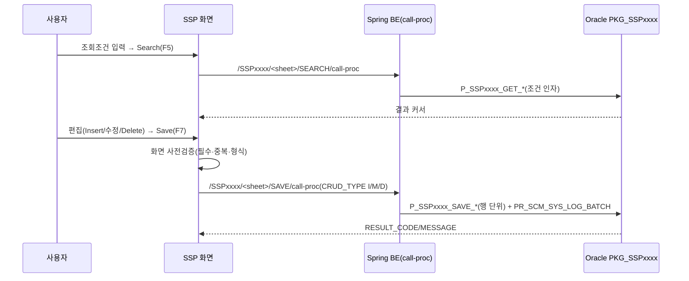

> 화면별 실제 SP 이름·호출 종류(GET/SAVE)는 `SSP_DATA_FLOW_DETAIL.md` 각 절의 다이어그램 참조
