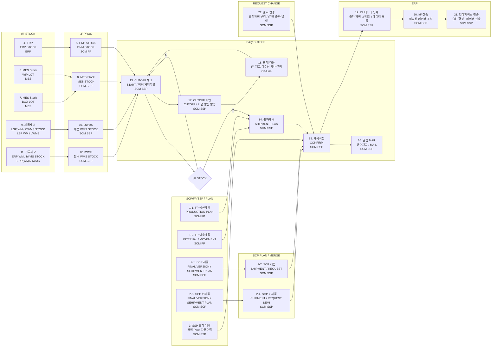
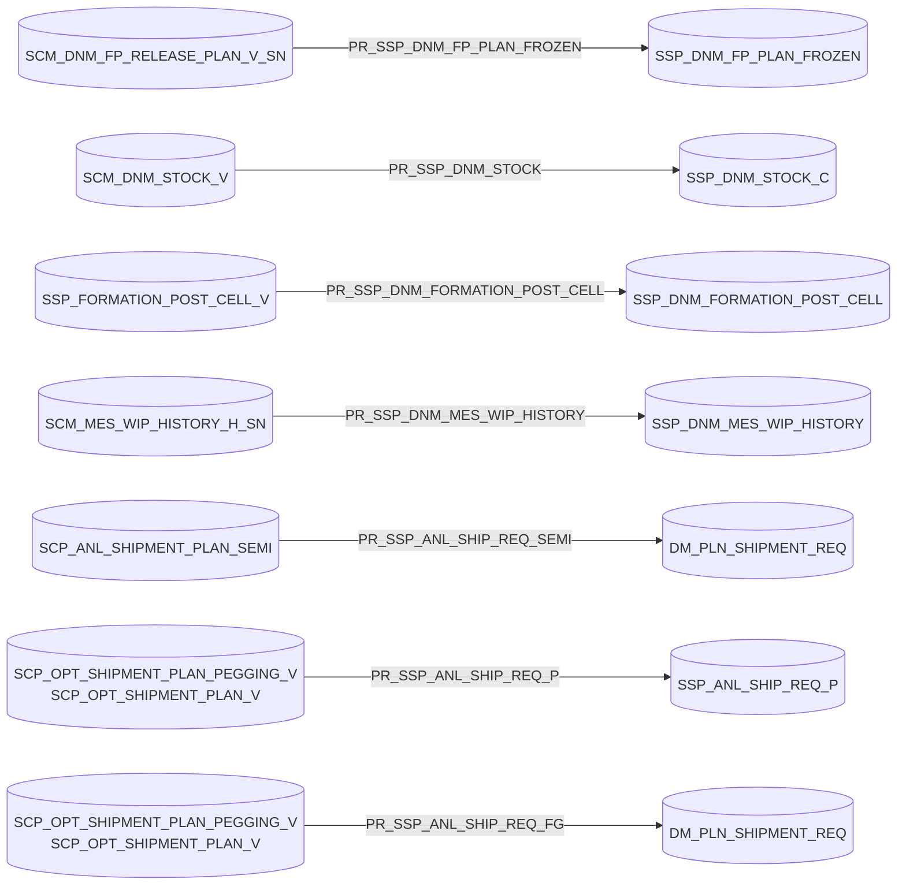
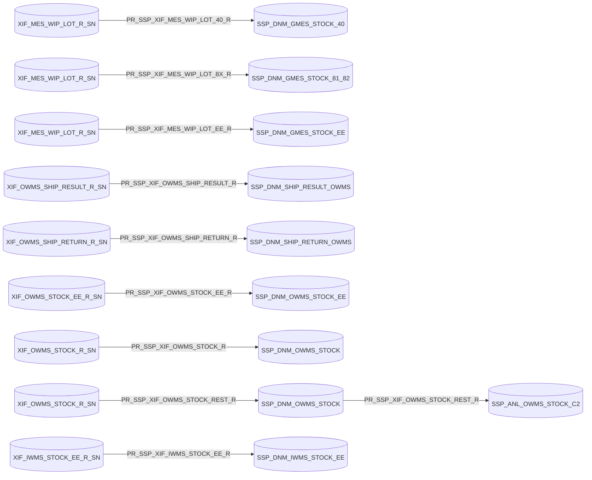
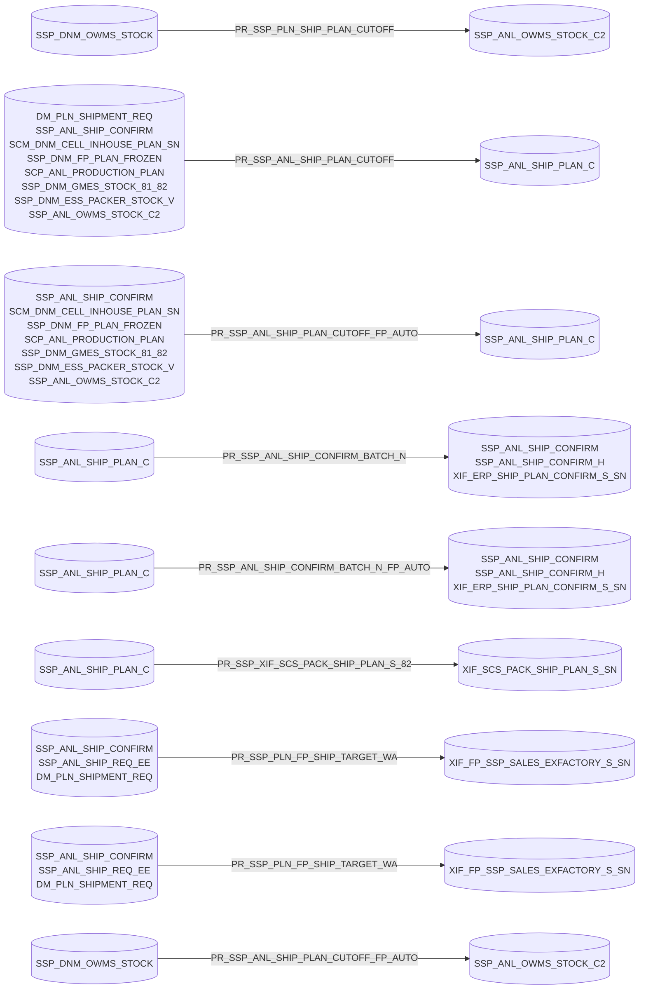
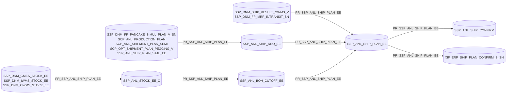
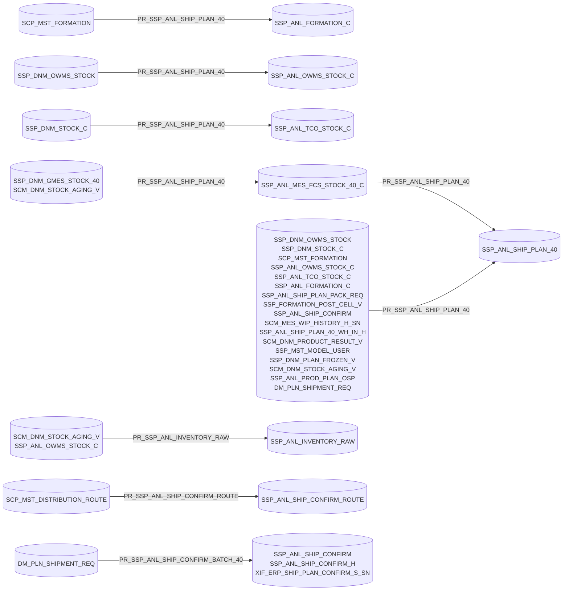
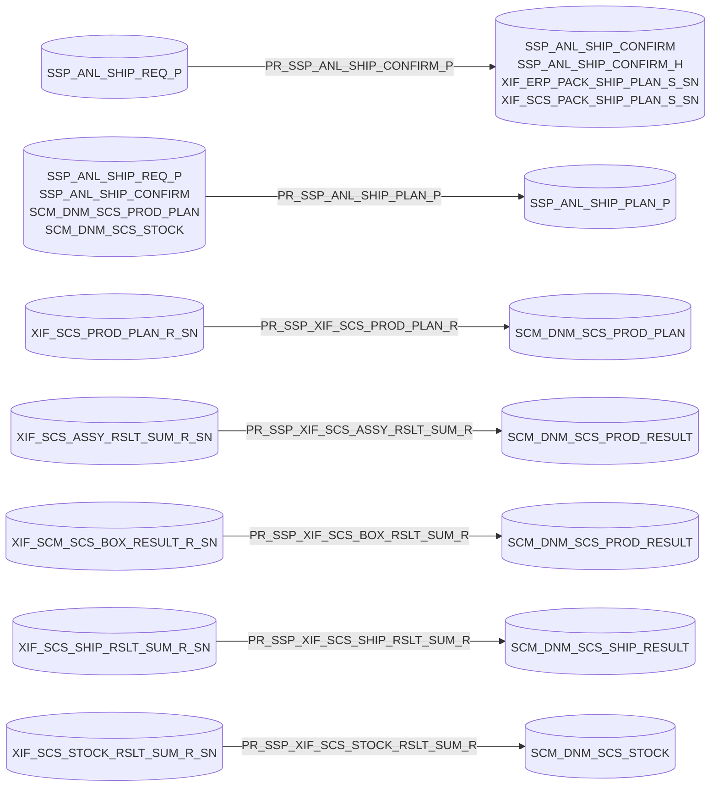
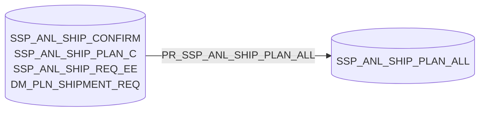
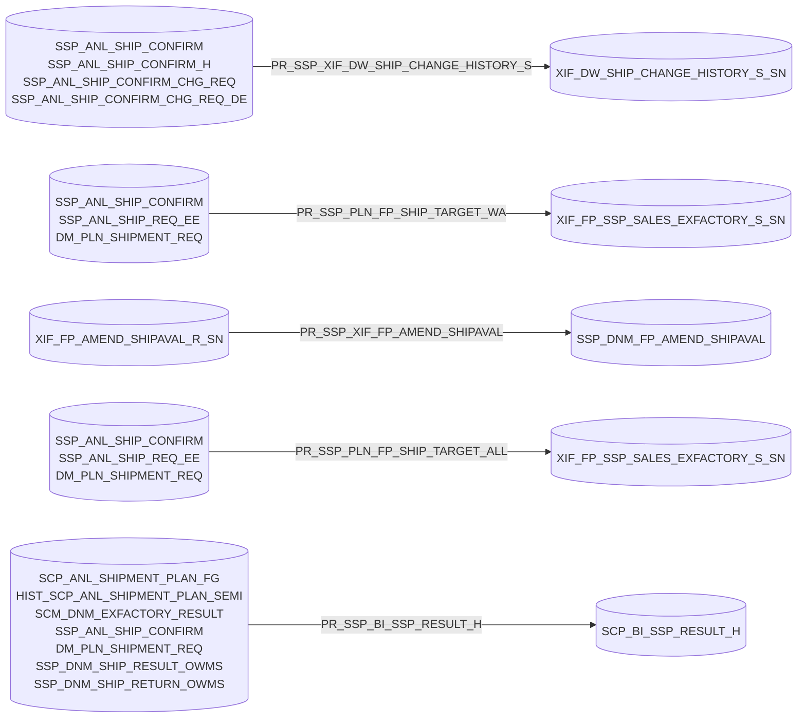

# SSP 업무 프로세스 — 기존 분석 자료 반영 · 2026-11-16 18:43 생성

> 원천(사용자 제공 2026-11-11 · 사본 `Doc/asisfacts/ref_ssp/src/`): ① `SSP 프로세스 확인 내용.pptx`(SSP CUTOFF Process · 배치별 입출력) ② `SCP_SSP_Batch List_261103.xlsx`(운영 LGCE_SCMPROD 잡 스케줄 · 프로시저 목록 · TO-BE 객체 상태) ③ `(20261112) SSP 통합테스트 시나리오-V2.xlsx`(흐름 14단계 · 112건). 구조화 = `tools/Analysis/ssp_ref_extract.py` → `Doc/asisfacts/ref_ssp/*.csv` · 이 문서 = `tools/Analysis/ssp_ref.py`
> 자료 원문을 그대로 옮겼다. 이 저장소의 분석(SP 본문 파싱 · DEV msdb)과 어긋나는 곳은 고치지 않고 §6 교차검증에 나란히 적었다.

## 1. SSP CUTOFF Process — PI 프로세스 맵(22 Seq)

- 출처 = SSP 프로세스 확인 내용.pptx 1번 슬라이드 · 단계 박스 26개(Seq 1-1 ~ 22) · 레인 7 · 흐름 간선 28개(연결선 30개에서 해석) · 풀지 못한 줄기 0
- 연결선 판정: 연결선의 실제 꺾인 경로를 계산해 ① 끝점이 도형에 붙었는지(도형 id · 없으면 테두리 90000 EMU 이내) ② 끝점이 다른 연결선에 60000 EMU 이내로 닿으면 한 줄기로 묶음 ③ 줄기의 화살표 없는 쪽 박스 → 화살표가 닿는 박스. 풀지 못한 선은 §1-2. PowerPoint 로 내보낸 슬라이드 이미지와 눈으로 대조함

### 1-1. Seq 별 대응 — 통합테스트 · 화면 · 운영 잡 · 프로시저 · 대상 테이블

- 대응 = 통합테스트 시나리오의 「시나리오 ID(PI n)」 칸 · 잡 스케줄 = 배치 목록의 운영 잡 시트

| Seq | 레인 | 데이터 종류 | Activity | 시스템 | 통합테스트 | 화면 | 운영 잡(주기 · 시간) | 프로시저 | 대상 테이블 |
|---|---|---|---|---|---|---|---|---|---|
| 1-1 | SCP/FP/SSP / PLAN | FP 생산계획 | PRODUCTION PLAN | SCM FP | - | - | - | - | - |
| 1-2 | SCP/FP/SSP / PLAN | FP 이송계획 | INTERNAL / MOVEMENT | SCM FP | - | - | - | - | - |
| 2-1 | SCP/FP/SSP / PLAN | SCP 제품 | FINAL VERSION / SEHIPMENT PLAN | SCM SCP | S01-03, S01-04, S01-05, S01-06, S01-07, S01-08, S01-09 | SCP0009, SCP0010, DMF0045, SSP0045 | JOB.SCMPROD_PLAN_FINAL_81_Creation (화 22:00) JOB.SCMPROD_PLAN_FINAL_81_HD_Creation (수 10:50) JOB.SCMPROD_PLAN_FINAL_81_HG_Creation (화 21:40) JOB.SCMPROD_PLAN_FINAL_81_HM_Creation (화 21:50) JOB.SCMPROD_PLAN_FINAL_81_ST_Creation (수 00:20) JOB.SCMPROD_PLAN_FINAL_81_UC_Creation (수 11:00:10) JOB.SCMPROD_PLAN_FINAL_82_Creation (목 00:01) | PR_SCP_PLN_INTERFACE_PLAN PR_SSP_ANL_SHIP_REQ_SEMI PR_SSP_ANL_SHIP_REQ_FG | DM_PLN_SHIPMENT_REQ(_H) SCP_PLN_INTERFACE_SEND_H |
| 2-2 | SCP PLAN / MERGE | SCP 제품 | SHIPMENT / REQUEST | SCM SSP | S01-01, S01-02, S01-03, S01-04, S01-05, S01-06, S01-07, S01-08, S01-09 | SCP0009, SSP0026, SCP0010, DMF0045, SSP0045 | JOB.SCMPROD_PLAN_FINAL_40_Creation (화 15:30:10) JOB.SCMPROD_PLAN_FINAL_81_Creation (화 22:00) JOB.SCMPROD_PLAN_FINAL_81_HD_Creation (수 10:50) JOB.SCMPROD_PLAN_FINAL_81_HG_Creation (화 21:40) JOB.SCMPROD_PLAN_FINAL_81_HM_Creation (화 21:50) JOB.SCMPROD_PLAN_FINAL_81_ST_Creation (수 00:20) JOB.SCMPROD_PLAN_FINAL_81_UC_Creation (수 11:00:10) JOB.SCMPROD_PLAN_FINAL_82_Creation (목 00:01) | PR_SCP_PLN_INTERFACE_PLAN PR_SSP_ANL_SHIP_REQ_P PR_SSP_ANL_SHIP_REQ_SEMI PR_SSP_ANL_SHIP_REQ_FG | DM_PLN_SHIPMENT_REQ SCP_PLN_INTERFACE_SEND_H SSP_ANL_SHIP_REQ_P DM_PLN_SHIPMENT_REQ(_H) |
| 2-3 | SCP/FP/SSP / PLAN | SCP 반제품 | FINAL VERSION / SEHIPMENT PLAN | SCM SCP | S01-03, S01-04, S01-05, S01-06, S01-07, S01-08, S01-09 | SCP0009, SCP0010, DMF0045, SSP0045 | JOB.SCMPROD_PLAN_FINAL_81_Creation (화 22:00) JOB.SCMPROD_PLAN_FINAL_81_HD_Creation (수 10:50) JOB.SCMPROD_PLAN_FINAL_81_HG_Creation (화 21:40) JOB.SCMPROD_PLAN_FINAL_81_HM_Creation (화 21:50) JOB.SCMPROD_PLAN_FINAL_81_ST_Creation (수 00:20) JOB.SCMPROD_PLAN_FINAL_81_UC_Creation (수 11:00:10) JOB.SCMPROD_PLAN_FINAL_82_Creation (목 00:01) | PR_SCP_PLN_INTERFACE_PLAN PR_SSP_ANL_SHIP_REQ_SEMI PR_SSP_ANL_SHIP_REQ_FG | DM_PLN_SHIPMENT_REQ(_H) SCP_PLN_INTERFACE_SEND_H |
| 2-4 | SCP PLAN / MERGE | SCP 반제품 | SHIPMENT / REQUEST SEMI | SCM SSP | S01-03, S01-04, S01-05, S01-06, S01-07, S01-08, S01-09, S05-10 | SCP0009, SCP0010, DMF0045, SSP0045 | JOB.SCMPROD_PLAN_FINAL_81_Creation (화 22:00) JOB.SCMPROD_PLAN_FINAL_81_HD_Creation (수 10:50) JOB.SCMPROD_PLAN_FINAL_81_HG_Creation (화 21:40) JOB.SCMPROD_PLAN_FINAL_81_HM_Creation (화 21:50) JOB.SCMPROD_PLAN_FINAL_81_ST_Creation (수 00:20) JOB.SCMPROD_PLAN_FINAL_81_UC_Creation (수 11:00:10) JOB.SCMPROD_PLAN_FINAL_82_Creation (목 00:01) | PR_SCP_PLN_INTERFACE_PLAN PR_SSP_ANL_SHIP_REQ_SEMI PR_SSP_ANL_SHIP_REQ_FG PKG_SSP0045 | DM_PLN_SHIPMENT_REQ(_H) SCP_PLN_INTERFACE_SEND_H DM_PLN_SHIPMENT_REQ |
| 3 | SCP/FP/SSP / PLAN | SSP 출하 계획 | 북미 Pack 자동수립 | SCM SSP | S03-12 | SSP0015, SSP0026 | JOB.PR_SSP_PLN_SHIP_PLAN_P (월, 화, 수, 목, 금, 토, 일 07:15) | PR_SSP_ANL_SHIP_PLAN_P PR_SSP_ANL_SHIP_CONFIRM_P | SSP_ANL_SHIP_PLAN_P SSP_ANL_SHIP_CONFIRM(_H) XIF_ERP_PACK_SHIP_PLAN_S XIF_SCS_PACK_SHIP_PLAN_S |
| 4 | I/F STOCK | ERP | ERP STOCK | ERP | S02-02 | - | JOB.RFC_ERP_GSCM_END_STOCK_D (운영 잡 시트에 없음) | PR_SCM_SYS_RFC_CALL | XIF_ERP_ZMM_GSCM_END_STOCK_R |
| 5 | I/F PROC | ERP STOCK | DNM STOCK | SCM FP | S02-03 | SSP0015 | JOB.PR_SCM_DNM_STOCK_V (월, 화, 수, 목, 금, 토, 일 08:00, 11:00, 14:00, 17:00, 20:00, 23:10) | PR_SCM_DNM_STOCK_V | SCM_DNM_STOCK (조회 뷰 SCM_DNM_STOCK_V) |
| 6 | I/F STOCK | MES Stock | WIP LOT | MES | S02-04, S02-05, S02-06 | SSP0021, SSP0060 | JOB.PR_SSP_XIF_MES_STOCK_40_R (매일 06:05~11:00 10분마다) JOB.PR_SSP_XIF_MES_STOCK_81_82_R (매일 종일 10분마다) JOB.PR_SSP_XIF_MES_STOCK_EE_R (매일 종일 30분마다) | PR_SSP_XIF_MES_WIP_LOT_40_R PR_SSP_XIF_MES_WIP_LOT_8X_R PR_SSP_XIF_MES_WIP_LOT_EE_R | SSP_DNM_GMES_STOCK_40 SCM_ADM_LOOKUP_MASTER_DETAIL(IF_STOCK_CHECK) SSP_DNM_GMES_STOCK_81_82 SSP_DNM_GMES_STOCK_EE |
| 7 | I/F STOCK | MES Stock | BOX LOT | MES | S02-04, S02-05, S02-06 | SSP0021, SSP0060 | JOB.PR_SSP_XIF_MES_STOCK_40_R (매일 06:05~11:00 10분마다) JOB.PR_SSP_XIF_MES_STOCK_81_82_R (매일 종일 10분마다) JOB.PR_SSP_XIF_MES_STOCK_EE_R (매일 종일 30분마다) | PR_SSP_XIF_MES_WIP_LOT_40_R PR_SSP_XIF_MES_WIP_LOT_8X_R PR_SSP_XIF_MES_WIP_LOT_EE_R | SSP_DNM_GMES_STOCK_40 SCM_ADM_LOOKUP_MASTER_DETAIL(IF_STOCK_CHECK) SSP_DNM_GMES_STOCK_81_82 SSP_DNM_GMES_STOCK_EE |
| 8 | I/F PROC | MES Stock | MES STOCK | SCM SSP | S02-04, S02-05, S02-06 | SSP0021, SSP0060 | JOB.PR_SSP_XIF_MES_STOCK_40_R (매일 06:05~11:00 10분마다) JOB.PR_SSP_XIF_MES_STOCK_81_82_R (매일 종일 10분마다) JOB.PR_SSP_XIF_MES_STOCK_EE_R (매일 종일 30분마다) | PR_SSP_XIF_MES_WIP_LOT_40_R PR_SSP_XIF_MES_WIP_LOT_8X_R PR_SSP_XIF_MES_WIP_LOT_EE_R | SSP_DNM_GMES_STOCK_40 SCM_ADM_LOOKUP_MASTER_DETAIL(IF_STOCK_CHECK) SSP_DNM_GMES_STOCK_81_82 SSP_DNM_GMES_STOCK_EE |
| 9 | I/F STOCK | 제품재고 | LSP WM / OWMS STOCK | LSP WM / oWMS | S02-07, S02-08 | - | JOB.PR_SSP_XIF_OWMS_STOCK_R (매일 종일 5분마다) JOB.PR_SSP_XIF_OWMS_STOCK_EE_R (매일 종일 10분마다) | PR_SSP_XIF_OWMS_STOCK_R PR_SSP_XIF_OWMS_STOCK_REST_R PR_SSP_XIF_OWMS_STOCK_EE_R | SSP_DNM_OWMS_STOCK SCM_ADM_LOOKUP_MASTER_DETAIL(IF_STOCK_CHECK) SSP_DNM_OWMS_STOCK_EE |
| 10 | I/F PROC | OWMS | 제품 WMS STOCK | SCM SSP | S02-07, S02-08 | - | JOB.PR_SSP_XIF_OWMS_STOCK_R (매일 종일 5분마다) JOB.PR_SSP_XIF_OWMS_STOCK_EE_R (매일 종일 10분마다) | PR_SSP_XIF_OWMS_STOCK_R PR_SSP_XIF_OWMS_STOCK_REST_R PR_SSP_XIF_OWMS_STOCK_EE_R | SSP_DNM_OWMS_STOCK SCM_ADM_LOOKUP_MASTER_DETAIL(IF_STOCK_CHECK) SSP_DNM_OWMS_STOCK_EE |
| 11 | I/F STOCK | 전극재고 | ERP WM / IWMS STOCK | ERP(WM) / iWMS | S02-09 | - | JOB.PR_SSP_XIF_IWMS_STOCK_EE_R (매일 종일 10분마다) | PR_SSP_XIF_IWMS_STOCK_EE_R | SSP_DNM_IWMS_STOCK_EE SCM_ADM_LOOKUP_MASTER_DETAIL(IF_STOCK_CHECK) |
| 12 | I/F PROC | IWMS | 전극 WMS STOCK | SCM SSP | S02-09 | - | JOB.PR_SSP_XIF_IWMS_STOCK_EE_R (매일 종일 10분마다) | PR_SSP_XIF_IWMS_STOCK_EE_R | SSP_DNM_IWMS_STOCK_EE SCM_ADM_LOOKUP_MASTER_DETAIL(IF_STOCK_CHECK) |
| 13 | Daily CUTOFF | CUTOFF 체크 | START / 법인/사업부별 | SCM SSP | S02-10, S03-01, S03-02, S03-10, S03-11, S03-13 | SSP0021, SSP0060, SCM0016, SSP0023, SSP0022, SSP0012 | JOB.PR_SSP_PLN_SHIP_PLAN_81_82 (매일 05:07~23:59:59 10분마다) JOB.PR_SSP_PLN_SHIP_PLAN_EE (매일 종일 10분마다) | PR_SSP_PLN_SHIP_PLAN_CUTOFF PR_SSP_ANL_SHIP_PLAN_CUTOFF PR_SSP_ANL_SHIP_PLAN_CUTOFF_FP_AUTO PR_SSP_ANL_SHIP_CONFIRM_BATCH_N PR_SSP_ANL_SHIP_CONFIRM_BATCH_N_FP_AUTO PR_SSP_MAIL_SEND_BATCH_N PR_SSP_MAIL_SEND_SHIP_REQ_DELETE PR_SSP_XIF_SCS_PACK_SHIP_PLAN_S_82 PR_SSP_ANL_SHIP_PLAN_EE | SSP_MST_SHIP_PLAN_SCHEDULE SSP_ANL_OWMS_STOCK_C2 SSP_ANL_SHIP_PLAN_C SSP_ANL_HOLD_STOCK SSP_ANL_SHIP_CONFIRM(_H) XIF_ERP_SHIP_PLAN_CONFIRM_S XIF_SCS_PACK_SHIP_PLAN_S(82) SSP_MST_SHIP_PLAN_SCHEDULE_EE SSP_ANL_SHIP_PLAN_EE SSP_ANL_SHIP_REQ_EE(_H) SSP_ANL_STOCK_EE_C SSP_ANL_BOH_CUTOFF_EE |
| 14 | Daily CUTOFF | 출하계획 | SHIPMENT PLAN | SCM SSP | S03-02, S03-03, S03-04, S03-05, S03-06, S03-07, S03-08, S03-09, S03-11, S03-12, S03-14, S03-15, S03-16 | SSP0021, SSP0060, SCM0016, SSP0012, SSP0023, SSP0022, SSP0015, SSP0026, SSP0017 | JOB.PR_SSP_PLN_SHIP_PLAN_81_82 (매일 05:07~23:59:59 10분마다) JOB.PR_SSP_PLN_SHIP_PLAN_EE (매일 종일 10분마다) JOB.PR_SSP_PLN_SHIP_PLAN_P (월, 화, 수, 목, 금, 토, 일 07:15) JOB.PR_SSP_PLN_SHIP_PLAN_40 (월, 화, 수, 목, 금, 토, 일 08:00) JOB.PR_SSP_PLN_SHIP_PLAN_40_AZ (월, 화, 수, 목, 금, 토, 일 10:30) JOB.PR_SSP_PLN_SHIP_PLAN_40_C (월, 화, 수, 목, 금, 토, 일 11:00) | PR_SSP_PLN_SHIP_PLAN_CUTOFF PR_SSP_ANL_SHIP_PLAN_CUTOFF PR_SSP_ANL_SHIP_PLAN_CUTOFF_FP_AUTO PR_SSP_ANL_SHIP_CONFIRM_BATCH_N PR_SSP_ANL_SHIP_CONFIRM_BATCH_N_FP_AUTO PR_SSP_MAIL_SEND_BATCH_N PR_SSP_MAIL_SEND_SHIP_REQ_DELETE PR_SSP_XIF_SCS_PACK_SHIP_PLAN_S_82 PR_SSP_ANL_SHIP_PLAN_EE PR_SSP_ANL_SHIP_PLAN_P PR_SSP_ANL_SHIP_CONFIRM_P PR_SSP_ANL_SHIP_PLAN_40_BALANCE PR_SSP_ANL_SHIP_CONFIRM_BATCH_40 PR_SSP_ANL_SHIP_PLAN_40 PR_SSP_MAIL_SHIP_REQ_MINUS_BALANCE_40 PR_SSP_ANL_INVENTORY_RAW | SSP_MST_SHIP_PLAN_SCHEDULE SSP_ANL_OWMS_STOCK_C2 SSP_ANL_SHIP_PLAN_C SSP_ANL_HOLD_STOCK SSP_ANL_SHIP_CONFIRM(_H) XIF_ERP_SHIP_PLAN_CONFIRM_S XIF_SCS_PACK_SHIP_PLAN_S(82) SSP_ANL_SHIP_CONFIRM XIF_SCS_PACK_SHIP_PLAN_S SSP_MST_SHIP_PLAN_SCHEDULE_EE SSP_ANL_SHIP_PLAN_EE SSP_ANL_SHIP_REQ_EE(_H) SSP_ANL_STOCK_EE_C SSP_ANL_BOH_CUTOFF_EE SSP_ANL_SHIP_PLAN_P XIF_ERP_PACK_SHIP_PLAN_S SSP_ANL_SHIP_PLAN_40 DM_PLN_SHIPMENT_REQ(확정분 차감) SCM_MST_PLAN_DETAIL(SP) SSP_ANL_INVENTORY_RAW |
| 15 | Daily CUTOFF | 계획확정 | CONFIRM | SCM SSP | S03-02, S03-03, S03-04, S03-05, S03-06, S03-07, S03-08, S03-09, S03-11, S03-12, S03-14, S03-15, S03-16 | SSP0021, SSP0060, SCM0016, SSP0012, SSP0023, SSP0022, SSP0015, SSP0026, SSP0017 | JOB.PR_SSP_PLN_SHIP_PLAN_81_82 (매일 05:07~23:59:59 10분마다) JOB.PR_SSP_PLN_SHIP_PLAN_EE (매일 종일 10분마다) JOB.PR_SSP_PLN_SHIP_PLAN_P (월, 화, 수, 목, 금, 토, 일 07:15) JOB.PR_SSP_PLN_SHIP_PLAN_40 (월, 화, 수, 목, 금, 토, 일 08:00) JOB.PR_SSP_PLN_SHIP_PLAN_40_AZ (월, 화, 수, 목, 금, 토, 일 10:30) JOB.PR_SSP_PLN_SHIP_PLAN_40_C (월, 화, 수, 목, 금, 토, 일 11:00) | PR_SSP_PLN_SHIP_PLAN_CUTOFF PR_SSP_ANL_SHIP_PLAN_CUTOFF PR_SSP_ANL_SHIP_PLAN_CUTOFF_FP_AUTO PR_SSP_ANL_SHIP_CONFIRM_BATCH_N PR_SSP_ANL_SHIP_CONFIRM_BATCH_N_FP_AUTO PR_SSP_MAIL_SEND_BATCH_N PR_SSP_MAIL_SEND_SHIP_REQ_DELETE PR_SSP_XIF_SCS_PACK_SHIP_PLAN_S_82 PR_SSP_ANL_SHIP_PLAN_EE PR_SSP_ANL_SHIP_PLAN_P PR_SSP_ANL_SHIP_CONFIRM_P PR_SSP_ANL_SHIP_PLAN_40_BALANCE PR_SSP_ANL_SHIP_CONFIRM_BATCH_40 PR_SSP_ANL_SHIP_PLAN_40 PR_SSP_MAIL_SHIP_REQ_MINUS_BALANCE_40 PR_SSP_ANL_INVENTORY_RAW | SSP_MST_SHIP_PLAN_SCHEDULE SSP_ANL_OWMS_STOCK_C2 SSP_ANL_SHIP_PLAN_C SSP_ANL_HOLD_STOCK SSP_ANL_SHIP_CONFIRM(_H) XIF_ERP_SHIP_PLAN_CONFIRM_S XIF_SCS_PACK_SHIP_PLAN_S(82) SSP_ANL_SHIP_CONFIRM XIF_SCS_PACK_SHIP_PLAN_S SSP_MST_SHIP_PLAN_SCHEDULE_EE SSP_ANL_SHIP_PLAN_EE SSP_ANL_SHIP_REQ_EE(_H) SSP_ANL_STOCK_EE_C SSP_ANL_BOH_CUTOFF_EE SSP_ANL_SHIP_PLAN_P XIF_ERP_PACK_SHIP_PLAN_S SSP_ANL_SHIP_PLAN_40 DM_PLN_SHIPMENT_REQ(확정분 차감) SCM_MST_PLAN_DETAIL(SP) SSP_ANL_INVENTORY_RAW |
| 16 | Daily CUTOFF | 알림 MAIL | 음수재고 / MAIL | SCM SSP | S03-02, S03-14, S03-15, S03-16 | SSP0021, SSP0060, SCM0016, SSP0015, SSP0012, SSP0017 | JOB.PR_SSP_PLN_SHIP_PLAN_81_82 (매일 05:07~23:59:59 10분마다) JOB.PR_SSP_PLN_SHIP_PLAN_40 (월, 화, 수, 목, 금, 토, 일 08:00) JOB.PR_SSP_PLN_SHIP_PLAN_40_AZ (월, 화, 수, 목, 금, 토, 일 10:30) JOB.PR_SSP_PLN_SHIP_PLAN_40_C (월, 화, 수, 목, 금, 토, 일 11:00) | PR_SSP_PLN_SHIP_PLAN_CUTOFF PR_SSP_ANL_SHIP_PLAN_CUTOFF PR_SSP_ANL_SHIP_PLAN_CUTOFF_FP_AUTO PR_SSP_ANL_SHIP_CONFIRM_BATCH_N PR_SSP_ANL_SHIP_CONFIRM_BATCH_N_FP_AUTO PR_SSP_MAIL_SEND_BATCH_N PR_SSP_MAIL_SEND_SHIP_REQ_DELETE PR_SSP_XIF_SCS_PACK_SHIP_PLAN_S_82 PR_SSP_ANL_SHIP_PLAN_40_BALANCE PR_SSP_ANL_SHIP_CONFIRM_BATCH_40 PR_SSP_ANL_SHIP_PLAN_40 PR_SSP_MAIL_SHIP_REQ_MINUS_BALANCE_40 PR_SSP_ANL_INVENTORY_RAW | SSP_MST_SHIP_PLAN_SCHEDULE SSP_ANL_OWMS_STOCK_C2 SSP_ANL_SHIP_PLAN_C SSP_ANL_HOLD_STOCK SSP_ANL_SHIP_CONFIRM(_H) XIF_ERP_SHIP_PLAN_CONFIRM_S XIF_SCS_PACK_SHIP_PLAN_S(82) SSP_ANL_SHIP_PLAN_40 DM_PLN_SHIPMENT_REQ(확정분 차감) SCM_MST_PLAN_DETAIL(SP) SSP_ANL_INVENTORY_RAW |
| 17 | Daily CUTOFF | CUTOFF 지연 | CUTOFF / 지연 알림 발송 | SCM SSP | S04-01 | - | JOB.PR_SSP_DAILY_PLAN_CUTOFF_CHECK_SMS_SEND (매일 종일 10분마다) | PR_SSP_DAILY_PLAN_CUTOFF_CHECK_SMS_SEND SCM_ADM_SMS_SEND_BATCH | XIF_IFS_SMS_DATA |
| 18 | Daily CUTOFF | 장애 대응 | I/F 재고 미수신 의사 결정 | Off-Line | S02-11 | - | - | - | SCM_ADM_LOOKUP_MASTER_DETAIL(IF_STOCK_CHECK) |
| 19 | ERP | I/F 데이터 등록 | 출하 확정 I/F대상 / 데이터 등록 | SCM SSP | S05-06, S06-01 | SSP0202, SSP0015 | - | PKG_SSP0202 PR_SSP_ANL_SHIP_CONFIRM_CHG_BATCH_PACKER | SSP_ANL_SHIP_CONFIRM XIF_ERP_PACK_SHIP_PLAN_S XIF_SCS_PACK_SHIP_PLAN_S XIF_ERP_SHIP_PLAN_CONFIRM_S |
| 20 | ERP | I/F 전송 | 미송신 데이터 조회 | SCM SSP | S06-02 | - | - | - | - |
| 21 | ERP | 인터페이스 전송 | 출하 확정 / 데이터 전송 | SCM SSP | S06-03 | - | - | PR_SSP_XIF_ERP_UI_SHIP_PLAN_CONFIRM_REQUEST PR_SSP_XIF_ERP_SHIP_PLAN_CONFIRM_S_UPD | XIF_ERP_SHIP_PLAN_CONFIRM_S(TRANSFER_FLAG) |
| 22 | REQUEST CHANGE | 출하 변경 | 출하확정 변경 / /긴급 출하 발생 | SCM SSP | S05-01, S05-02, S05-03, S05-04, S05-05, S05-06, S05-07, S05-08, S05-09, S05-10, S05-11, S05-12, S05-13, S05-14, S05-15, S05-16, S05-17, S05-18, S05-19, S05-20, S05-21, S05-22, S05-23, S05-24, S05-25, S05-26, S05-27, S05-28, S05-29, S05-30, S05-31, S05-32, S05-33, S05-34, S05-35, S05-36, S05-37, S05-38, S05-39, S05-40, S05-41, S05-42, S05-43, S05-44, S05-45, S05-46 | SSP0015, SSP0012, SSP0019, SSP0200, SSP0003, SSP0201, SSP0202, SSP0021, SSP0060, SSP0045, SSP0022, SSP0023 | - | PKG_SSP0015 PR_SSP_ANL_SHIP_CONFIRM_CHG_BATCH PKG_SSP0200 PKG_SSP0003 PKG_SSP0201 PKG_SSP0202 PR_SSP_ANL_SHIP_CONFIRM_CHG_BATCH_PACKER PKG_SSP0021 PR_SSP_ANL_SHIP_CONFIRM_CHG_BATCH_NEW PKG_SSP0060 PR_SSP_ANL_SHIP_CONFIRM_CHG_BATCH_NEW_C PR_SSP_ANL_SHIP_CONFIRM_CHG_BATCH_SCS PKG_SSP0045 PKG_SSP0022 PKG_SSP0023 | SSP_ANL_SHIP_CONFIRM_CHG_REQ(_DE) SSP_ANL_SHIP_CONFIRM(_H) XIF_ERP_SHIP_PLAN_CONFIRM_S SSP_ANL_SHIP_CONFIRM XIF_ERP_PACK_SHIP_PLAN_S XIF_SCS_PACK_SHIP_PLAN_S DM_PLN_SHIPMENT_REQ SSP_ANL_SHIP_REQ_EE(_H) |

### 1-2. 그림에 넣지 않은 연결선(0)

| 연결선 id | 사유 |
|---|---|

## 2. 통합테스트 흐름 14단계(업무 순서 · 112건)

- **구성**: 공통 배치 · 점검(비고 [공통])과 사업부별 실행(비고 [40] · [81_HD] 등)을 흐름 순서 한 시트로 배열. 단계마다 구분 행. ③ 단계는 운영 시각 순(81·82 05:07~ → 전극 시업 시각 이후 → Packer 07:15 → 40 08:00 · 10:30 · 11:00)
- **범위**: SCP FINAL 확정 · 출하계획 생성 이후 ~ SSP Daily Cutoff(일 마감) · 출하확정 변경 · ERP 송신 · 회신 · 실적 · KPI
- **근거 자료**: 260903_PI관점 프로세스 보완(SSP CUTOFF Process 22단계) · Job_List_20261015_검토_v1.0(SSP 잡) · AS-IS 프로세스 분석 산출물(20261008 · 20261012 · 20261104 · 20261106) · TO-BE 데이터베이스 ZIOUI1 실측(2026-11-09)
- **JOB · 프로시저**: AS-IS = LGCE_SCMPROD 잡 이름, TO-BE = SCM_MGR 스케줄러 잡(같은 이름에 JOB_ 접두) · 프로시저. 실행절차(To-Be)는 잡 단계와 같은 프로시저 호출 문장
- **검증 방법**: 화면 확인 우선 : 검증방법(화면/To-Be) 열의 화면 · 조회조건 · 확인 항목으로 먼저 판정. 화면 ID 열에 사용 화면 표시. 화면이 없는 항목(수신 · 송신 테이블, 진입 조건, KPI 등)만 검증 SQL(SQL 보조 열)로 판정. 통합 시나리오 화면 확인 85건 · 화면 없음 27건

<b>① Shipment Request(선적요청) 생성 (SCP FINAL 확정 연계)</b>9건 · 배치 9

▶

<b>② 일 계획 · 재고 · FP 입력 수신</b>14건 · 배치 11 · ETL 1 · 점검 1 · 수동조치 1

▶

<b>③ Shipment Plan(사업부별 일 마감) (Daily Cutoff)</b>16건 · 점검 10 · 배치 6

▶

<b>④ 일 마감 감시 · 출하계획 통합 · FP 목표</b>6건 · 배치 6

▶

<b>⑤ 출하확정 변경 · 긴급 출하 (화면)</b>13건 · UI 13

<i></i><u></u>

<b>⑤-1 Change Request : SO 상태별</b>6건 · UI 6

▶

<b>⑤-2 Change Request : 변경 항목 · 처리 결과별</b>9건 · UI 9

▶

<b>⑤-3 Change Request : From Site · To Site 유형별 (ERP SO 오더타입)</b>12건 · UI 12

▶

<b>⑤-4 Change Request : 송신 컬럼 값 유형별</b>6건 · UI 6

▶

<b>⑥ ERP 송신 · 회신</b>7건 · 점검 3 · ETL 1 · 배치 3

<i></i><u></u>

<b>⑦ 외부 송신 (SCS · PLM · DW · SSPM)</b>3건 · 배치 3

▶

<b>⑧ 출하 실적 수신</b>3건 · 배치 3

▶

<b>⑨ KPI · 보고 · 정리</b>5건 · 배치 5

▶

<b>⑩ 조회 확인 · 최종 판정</b>3건 · UI 2 · 점검 1

### ① Shipment Request(선적요청) 생성 (SCP FINAL 확정 연계) (9건)

| 테스트ID | 세부 | PI | 구분 | 타임라인 | 스케줄 | 단계 | 사업부 | 화면 | 테스트명 | 운영 잡 · 프로시저 | 대상 테이블 |
|---|---|---|---|---|---|---|---|---|---|---|---|
| S01-01 | 40 선적요청 생성 | PI 2-2 | 배치 | FINAL 확정 직후 | 주 1회(FINAL 확정 시) | SCP 제품 SHIPMENT REQUEST | [40] / 확정 연계는 FP 목표 · MRP 목표 · SCS 목표 송신도 함께 수행. TO-BE Plan Management(SCP0134)는 이 연계를 호출하지 않으며 FINAL 잡(PR_SCP_ENG_CONTROL)에서 호출 | SCP0009, SSP0026 | SCP FINAL 확정 연계로 40 선적요청(DM_PLN_SHIPMENT_REQ) 생성 확인 / [화면] SSP0026 Shipment Request(Mobility & IT) 조회 결과 일치 | AS-IS : JOB.SCMPROD_PLAN_FINAL_40_Creation (PR_SCP_ENG_CONTROL 안에서 호출) / TO-BE : SCM_MGR.JOB_SCMPROD_PLAN_FINAL_40_CREATION SCM_MGR.PR_SCP_PLN_INTERFACE_PLAN | DM_PLN_SHIPMENT_REQ / SCP_PLN_INTERFACE_SEND_H |
| S01-02 | Packer 선적요청 생성 | PI 2-2 | 배치 | FINAL 확정 직후 | 주 1회(FINAL 확정 시) | SCP 제품 SHIPMENT REQUEST(Packer) | [Packer(40)] / S01-01 확정 연계 실행 시 함께 생성 | SCP0009, SSP0026 | SCP FINAL 확정 연계 안의 Packer 선적요청 생성(SSP_ANL_SHIP_REQ_P) 확인 | - SCM_MGR.PR_SCP_PLN_INTERFACE_PLAN / SCM_MGR.PR_SSP_ANL_SHIP_REQ_P | SSP_ANL_SHIP_REQ_P |
| S01-03 | 81 선적요청 생성 | PI 2-1 ~ 2-4 | 배치 | FINAL 확정 직후 | 주 1회(FINAL 확정 시) | SCP 제품 · 반제품 SHIPMENT REQUEST | [81] / 81 계열은 사업부마다 FINAL 시각이 다름 — 81 하나로 대표하지 않고 각각 수행(IF-6) | SCP0009, SCP0010, DMF0045, SSP0045 | SCP FINAL 확정 연계로 81 선적요청 · 반제품(SEMI) 선적요청 생성 확인 / [화면] DMF0045 Shipment Request(Auto & ESS) · SSP0045 Shipment Request SEMI 조회 결과 일치 | AS-IS : JOB.SCMPROD_PLAN_FINAL_81_Creation (PR_SCP_ENG_CONTROL 안에서 호출) / TO-BE : SCM_MGR.JOB_SCMPROD_PLAN_FINAL_81_CREATION SCM_MGR.PR_SCP_PLN_INTERFACE_PLAN / SCM_MGR.PR_SSP_ANL_SHIP_REQ_SEMI | DM_PLN_SHIPMENT_REQ(_H) / SCP_PLN_INTERFACE_SEND_H |
| S01-04 | 81_HD 선적요청 생성 | PI 2-1 ~ 2-4 | 배치 | FINAL 확정 직후 | 주 1회(FINAL 확정 시) | SCP 제품 · 반제품 SHIPMENT REQUEST | [81_HD] / 81 계열은 사업부마다 FINAL 시각이 다름 — 81 하나로 대표하지 않고 각각 수행(IF-6) | SCP0009, SCP0010, DMF0045, SSP0045 | SCP FINAL 확정 연계로 81_HD 선적요청 생성 확인 / [화면] DMF0045 Shipment Request(Auto & ESS) · SSP0045 Shipment Request SEMI 조회 결과 일치 | AS-IS : JOB.SCMPROD_PLAN_FINAL_81_HD_Creation (PR_SCP_ENG_CONTROL 안에서 호출) / TO-BE : SCM_MGR.JOB_SCMPROD_PLAN_FINAL_81_HD_CREATION SCM_MGR.PR_SCP_PLN_INTERFACE_PLAN / SCM_MGR.PR_SSP_ANL_SHIP_REQ_SEMI | DM_PLN_SHIPMENT_REQ(_H) / SCP_PLN_INTERFACE_SEND_H |
| S01-05 | 81_HG 선적요청 생성 | PI 2-1 ~ 2-4 | 배치 | FINAL 확정 직후 | 주 1회(FINAL 확정 시) | SCP 제품 · 반제품 SHIPMENT REQUEST | [81_HG] / 81 계열은 사업부마다 FINAL 시각이 다름 — 81 하나로 대표하지 않고 각각 수행(IF-6) | SCP0009, SCP0010, DMF0045, SSP0045 | SCP FINAL 확정 연계로 81_HG 선적요청 생성 확인 / [화면] DMF0045 Shipment Request(Auto & ESS) · SSP0045 Shipment Request SEMI 조회 결과 일치 | AS-IS : JOB.SCMPROD_PLAN_FINAL_81_HG_Creation (PR_SCP_ENG_CONTROL 안에서 호출) / TO-BE : SCM_MGR.JOB_SCMPROD_PLAN_FINAL_81_HG_CREATION SCM_MGR.PR_SCP_PLN_INTERFACE_PLAN / SCM_MGR.PR_SSP_ANL_SHIP_REQ_SEMI | DM_PLN_SHIPMENT_REQ(_H) / SCP_PLN_INTERFACE_SEND_H |
| S01-06 | 81_HM 선적요청 생성 | PI 2-1 ~ 2-4 | 배치 | FINAL 확정 직후 | 주 1회(FINAL 확정 시) | SCP 제품 · 반제품 SHIPMENT REQUEST | [81_HM] / 81 계열은 사업부마다 FINAL 시각이 다름 — 81 하나로 대표하지 않고 각각 수행(IF-6) | SCP0009, SCP0010, DMF0045, SSP0045 | SCP FINAL 확정 연계로 81_HM 선적요청 생성 확인 / [화면] DMF0045 Shipment Request(Auto & ESS) · SSP0045 Shipment Request SEMI 조회 결과 일치 | AS-IS : JOB.SCMPROD_PLAN_FINAL_81_HM_Creation (PR_SCP_ENG_CONTROL 안에서 호출) / TO-BE : SCM_MGR.JOB_SCMPROD_PLAN_FINAL_81_HM_CREATION SCM_MGR.PR_SCP_PLN_INTERFACE_PLAN / SCM_MGR.PR_SSP_ANL_SHIP_REQ_SEMI | DM_PLN_SHIPMENT_REQ(_H) / SCP_PLN_INTERFACE_SEND_H |
| S01-07 | 81_ST 선적요청 생성 | PI 2-1 ~ 2-4 | 배치 | FINAL 확정 직후 | 주 1회(FINAL 확정 시) | SCP 제품 · 반제품 SHIPMENT REQUEST | [81_ST] / 81 계열은 사업부마다 FINAL 시각이 다름 — 81 하나로 대표하지 않고 각각 수행(IF-6) | SCP0009, SCP0010, DMF0045, SSP0045 | SCP FINAL 확정 연계로 81_ST 선적요청 생성 확인 / [화면] DMF0045 Shipment Request(Auto & ESS) · SSP0045 Shipment Request SEMI 조회 결과 일치 | AS-IS : JOB.SCMPROD_PLAN_FINAL_81_ST_Creation (PR_SCP_ENG_CONTROL 안에서 호출) / TO-BE : SCM_MGR.JOB_SCMPROD_PLAN_FINAL_81_ST_CREATION SCM_MGR.PR_SCP_PLN_INTERFACE_PLAN / SCM_MGR.PR_SSP_ANL_SHIP_REQ_SEMI | DM_PLN_SHIPMENT_REQ(_H) / SCP_PLN_INTERFACE_SEND_H |
| S01-08 | 81_UC 선적요청 생성 | PI 2-1 ~ 2-4 | 배치 | FINAL 확정 직후 | 주 1회(FINAL 확정 시) | SCP 제품 · 반제품 SHIPMENT REQUEST | [81_UC] / 81 계열은 사업부마다 FINAL 시각이 다름 — 81 하나로 대표하지 않고 각각 수행(IF-6) | SCP0009, SCP0010, DMF0045, SSP0045 | SCP FINAL 확정 연계로 81_UC 선적요청 생성 확인 / [화면] DMF0045 Shipment Request(Auto & ESS) · SSP0045 Shipment Request SEMI 조회 결과 일치 | AS-IS : JOB.SCMPROD_PLAN_FINAL_81_UC_Creation (PR_SCP_ENG_CONTROL 안에서 호출) / TO-BE : SCM_MGR.JOB_SCMPROD_PLAN_FINAL_81_UC_CREATION SCM_MGR.PR_SCP_PLN_INTERFACE_PLAN / SCM_MGR.PR_SSP_ANL_SHIP_REQ_SEMI | DM_PLN_SHIPMENT_REQ(_H) / SCP_PLN_INTERFACE_SEND_H |
| S01-09 | 82 선적요청 생성 | PI 2-1 ~ 2-4 | 배치 | FINAL 확정 직후 | 주 1회(FINAL 확정 시) | SCP 제품 · 반제품 SHIPMENT REQUEST | [82] / 81 계열은 사업부마다 FINAL 시각이 다름 — 81 하나로 대표하지 않고 각각 수행(IF-6) | SCP0009, SCP0010, DMF0045, SSP0045 | SCP FINAL 확정 연계로 82 선적요청 · 반제품(SEMI) · FG 선적요청 생성 확인 / [화면] DMF0045 Shipment Request(Auto & ESS) · SSP0045 Shipment Request SEMI 조회 결과 일치 | AS-IS : JOB.SCMPROD_PLAN_FINAL_82_Creation (PR_SCP_ENG_CONTROL 안에서 호출) / TO-BE : SCM_MGR.JOB_SCMPROD_PLAN_FINAL_82_CREATION SCM_MGR.PR_SCP_PLN_INTERFACE_PLAN / SCM_MGR.PR_SSP_ANL_SHIP_REQ_SEMI / SCM_MGR.PR_SSP_ANL_SHIP_REQ_FG | DM_PLN_SHIPMENT_REQ(_H) / SCP_PLN_INTERFACE_SEND_H |

### ② 일 계획 · 재고 · FP 입력 수신 (14건)

| 테스트ID | 세부 | PI | 구분 | 타임라인 | 스케줄 | 단계 | 사업부 | 화면 | 테스트명 | 운영 잡 · 프로시저 | 대상 테이블 |
|---|---|---|---|---|---|---|---|---|---|---|---|
| S02-01 | 일 계획 ID 생성 | - | 배치 | D일 00:10 | 매일 00:10 | 일 계획 ID 생성 | [공통] / 40 출하계획 생성(S03-14~05)이 이 계획 ID 아래 SP 행을 만든다 | - | 사업부별 오늘 일 단위(DAILY) 계획 ID 생성 확인 | AS-IS : JOB.SCMPROD_PLAN_ID_DAILY_Creation (매일 00:10) / TO-BE : SCM_MGR.JOB_SCMPROD_PLAN_ID_DAILY_CREATION SCM_MGR.PR_SCM_MST_PLAN | SCM_MST_PLAN |
| S02-02 | 재고 수신 (PI 4 ERP STOCK) | PI 4 | ETL | D일 일 마감 전 | 매시 10분 | 재고 수신 (PI 4 ERP STOCK) | [공통] / ERP RFC 호출 잡. 시험 환경에서 ERP 연결이 없으면 운영 수신분 동기화로 대체 | - | ERP 기말 재고(전일 마감) 수신 확인 | AS-IS : JOB.RFC_ERP_GSCM_END_STOCK_D (매시 10분) / TO-BE : SCM_MGR.JOB_RFC_ERP_GSCM_END_STOCK_D SCM_MGR.PR_SCM_SYS_RFC_CALL | XIF_ERP_ZMM_GSCM_END_STOCK_R |
| S02-03 | 재고 수신 (PI 5 DNM STOCK) | PI 5 | 배치 | D-1일 23:10(전일 재고) | 매일 08 · 11 · 14 · 17 · 20시, 23:10 | 재고 수신 (PI 5 DNM STOCK) | [공통] / 81·82 일 마감(S03-02)은 이 조회 결과가 0건인 법인을 진행하지 않음 | SSP0015 | 법인별 전일 재고(INVENTORY) 생성 확인 / = 81·82 일 마감 진입 조건(ERP 재고 존재) | AS-IS : JOB.PR_SCM_DNM_STOCK_V / TO-BE : SCM_MGR.JOB_PR_SCM_DNM_STOCK_V SCM_MGR.PR_SCM_DNM_STOCK_V | SCM_DNM_STOCK (조회 뷰 SCM_DNM_STOCK_V) |
| S02-04 | 재고 수신 (PI 6~8 MES STOCK) | PI 6~8 | 배치 | D일 일 마감 전 | 06:05~11:00, 10분 | 재고 수신 (PI 6~8 MES STOCK) | [공통] / 운영 수행 시간 06:05 ~ 11:00 | - | 40 MES 재고 수신 · 수신 확인 표시(PLAN_40 / MES_W · MES_F) 갱신 확인 | AS-IS : JOB.PR_SSP_XIF_MES_STOCK_40_R (06:05~11:00, 10분) / TO-BE : SCM_MGR.JOB_PR_SSP_XIF_MES_STOCK_40_R SCM_MGR.PR_SSP_XIF_MES_WIP_LOT_40_R | SSP_DNM_GMES_STOCK_40 / SCM_ADM_LOOKUP_MASTER_DETAIL(IF_STOCK_CHECK) |
| S02-05 | 재고 수신 (PI 6~8 MES STOCK) | PI 6~8 | 배치 | D일 일 마감 전 | 10분 | 재고 수신 (PI 6~8 MES STOCK) | [공통] | SSP0021, SSP0060 | 81·82 MES 재고(LOT · BOX LOT) 수신 · 수신 확인 표시(PLAN_AUTO / MES_W) 갱신 확인 | AS-IS : JOB.PR_SSP_XIF_MES_STOCK_81_82_R (10분) / TO-BE : SCM_MGR.JOB_PR_SSP_XIF_MES_STOCK_81_82_R SCM_MGR.PR_SSP_XIF_MES_WIP_LOT_8X_R | SSP_DNM_GMES_STOCK_81_82 / SCM_ADM_LOOKUP_MASTER_DETAIL(IF_STOCK_CHECK) |
| S02-06 | 재고 수신 (PI 6~8 MES STOCK) | PI 6~8 | 배치 | D일 일 마감 전 | 30분 | 재고 수신 (PI 6~8 MES STOCK) | [공통] | - | 전극 MES 재고 수신 · 수신 확인 표시(PLAN_EE / MES) 갱신 확인 | AS-IS : JOB.PR_SSP_XIF_MES_STOCK_EE_R (30분) / TO-BE : SCM_MGR.JOB_PR_SSP_XIF_MES_STOCK_EE_R SCM_MGR.PR_SSP_XIF_MES_WIP_LOT_EE_R | SSP_DNM_GMES_STOCK_EE / SCM_ADM_LOOKUP_MASTER_DETAIL(IF_STOCK_CHECK) |
| S02-07 | 재고 수신 (PI 9~10 OWMS STOCK) | PI 9~10 | 배치 | D일 일 마감 전 | 5분 | 재고 수신 (PI 9~10 OWMS STOCK) | [공통] / 재고 수량 0 인 건도 수신되어야 함(PI 프로세스맵 I/F 점검 기준) | - | 제품 창고(OWMS) 재고 수신 · 수신 확인 표시(OWMS) 갱신 확인 | AS-IS : JOB.PR_SSP_XIF_OWMS_STOCK_R (5분) / TO-BE : SCM_MGR.JOB_PR_SSP_XIF_OWMS_STOCK_R SCM_MGR.PR_SSP_XIF_OWMS_STOCK_R / SCM_MGR.PR_SSP_XIF_OWMS_STOCK_REST_R | SSP_DNM_OWMS_STOCK / SCM_ADM_LOOKUP_MASTER_DETAIL(IF_STOCK_CHECK) |
| S02-08 | 재고 수신 (PI 9~10 OWMS STOCK) | PI 9~10 | 배치 | D일 일 마감 전 | 10분 | 재고 수신 (PI 9~10 OWMS STOCK) | [공통] | - | 전극 창고(OWMS) 재고 수신 · 수신 확인 표시(PLAN_EE / OWMS) 갱신 확인 | AS-IS : JOB.PR_SSP_XIF_OWMS_STOCK_EE_R (10분) / TO-BE : SCM_MGR.JOB_PR_SSP_XIF_OWMS_STOCK_EE_R SCM_MGR.PR_SSP_XIF_OWMS_STOCK_EE_R | SSP_DNM_OWMS_STOCK_EE / SCM_ADM_LOOKUP_MASTER_DETAIL(IF_STOCK_CHECK) |
| S02-09 | 재고 수신 (PI 11~12 IWMS STOCK) | PI 11~12 | 배치 | D일 일 마감 전 | 10분 | 재고 수신 (PI 11~12 IWMS STOCK) | [공통] | - | 전극 원자재 창고(IWMS) 재고 수신 · 수신 확인 표시(IWMS) 갱신 확인 | AS-IS : JOB.PR_SSP_XIF_IWMS_STOCK_EE_R (10분) / TO-BE : SCM_MGR.JOB_PR_SSP_XIF_IWMS_STOCK_EE_R SCM_MGR.PR_SSP_XIF_IWMS_STOCK_EE_R | SSP_DNM_IWMS_STOCK_EE / SCM_ADM_LOOKUP_MASTER_DETAIL(IF_STOCK_CHECK) |
| S02-10 | 재고 수신 확인 (PI 13 CUTOFF 체크) | PI 13 | 점검 | D일 일 마감 전 | - | 재고 수신 확인 (PI 13 CUTOFF 체크) | [공통] / 일 마감 진입 조건. PLAN_40 · PLAN_AUTO 는 SEGMENT5 = 오늘 + ATTRIBUTE1 = Y, PLAN_EE 는 SEGMENT5 = 오늘만 판정 | - | 법인별 재고 수신 확인 표시가 모두 오늘 · Y 인지 확인 / (PLAN_40 = 40, PLAN_AUTO = 81·82, PLAN_EE = 전극) | - - | - |
| S02-11 | 재고 미수신 의사결정 (PI 18) | PI 18 | 수동조치 | D일 일 마감 전 | - | 재고 미수신 의사결정 (PI 18) | [공통] / AS-IS 조치(LOOKUP IF_STOCK_CHECK 의 PROC_DATE 를 당일로 수정)와 같은 조치. TO-BE 는 수신일 = SEGMENT5, 수신 여부 = ATTRIBUTE1. 반드시 백업 후 수행 | - | 재고 I/F 미수신 법인을 수동으로 수신 완료 처리 후 다음 일 마감 주기에 마감이 진행되는지 확인 | - - | SCM_ADM_LOOKUP_MASTER_DETAIL(IF_STOCK_CHECK) |
| S02-12 | FP 확정계획 · 재고 스냅샷 | - | 배치 | D일 일 마감 전 | 1시간 | FP 확정계획 · 재고 스냅샷 | [공통] / 출하계획 생성(40 · 81·82 · 전극)이 읽는 입력 | SSP0021, SSP0026 | FP 확정(Frozen) 생산계획 · SSP 재고 스냅샷 · 화성 후 셀 · MES 재공 이력 생성 확인 | AS-IS : JOB.PR_SSP_DNM_FP_PLAN_FROZEN (1시간) / TO-BE : SCM_MGR.JOB_PR_SSP_DNM_FP_PLAN_FROZEN SCM_MGR.PR_SSP_DNM_FP_PLAN_FROZEN / SCM_MGR.PR_SSP_DNM_STOCK / SCM_MGR.PR_SSP_DNM_FORMATION_POST_CELL / SCM_MGR.PR_SSP_DNM_MES_WIP_HISTORY | SSP_DNM_FP_PLAN_FROZEN / SSP_DNM_STOCK_C / SSP_DNM_FORMATION_POST_CELL / SSP_DNM_MES_WIP_HISTORY |
| S02-13 | FP 출하가능량 수신 | - | 배치 | D일 일 마감 전 | 2분 | FP 출하가능량 수신 | [공통] | SSP0021, SSP0060 | FP 출하가능량 변경분 수신 확인 | AS-IS : JOB.PR_SSP_XIF_FP_AMEND_SHIPAVAL (2분) / TO-BE : SCM_MGR.JOB_PR_SSP_XIF_FP_AMEND_SHIPAVAL SCM_MGR.PR_SSP_XIF_FP_AMEND_SHIPAVAL | SSP_DNM_FP_AMEND_SHIPAVAL |
| S02-14 | SCS 생산계획 · 재고 수신 | - | 배치 | D일 10:31 ~ | 매일 하루 5회(10:31 ~ 23:02) | SCS 생산계획 · 재고 수신 | [공통] / 운영 수행 시각 10:31 · 11:31 · 13:31 · 16:11 · 23:01(생산계획), 10:32 · 11:32 · 13:32 · 15:32 · 23:02(재고) | SSP0026, SSP0015 | SCS 생산계획 · 재고 수신 확인 | AS-IS : JOB.PR_SCM_DNM_SCS_PROD_PLAN · JOB.PR_SCM_DNM_SCS_STOCK / TO-BE : SCM_MGR.JOB_PR_SCM_DNM_SCS_PROD_PLAN / TO-BE : SCM_MGR.JOB_PR_SCM_DNM_SCS_STOCK SCM_MGR.PR_SSP_XIF_SCS_PROD_PLAN_R / SCM_MGR.PR_SSP_XIF_SCS_STOCK_RSLT_SUM_R | SCM_DNM_SCS_PROD_PLAN / SCM_DNM_SCS_STOCK |

### ③ Shipment Plan(사업부별 일 마감) (Daily Cutoff) (16건)

| 테스트ID | 세부 | PI | 구분 | 타임라인 | 스케줄 | 단계 | 사업부 | 화면 | 테스트명 | 운영 잡 · 프로시저 | 대상 테이블 |
|---|---|---|---|---|---|---|---|---|---|---|---|
| S03-01 | 81·82 일 마감 진입 조건 | PI 13 | 점검 | D일 05:07 전 | 매일 | CUTOFF 체크(법인별) | [81 · 81 계열 · 82] / ③ 은 S02-10 결과 사용. 조건 미충족 법인은 일 마감이 진행되지 않음(오류 없음) | - | 법인별 진입 조건 3가지 확인 / ① 오늘 행 CURRENT_PLAN_DATE_YN = N ② 전일 ERP 재고(INVENTORY) 존재 ③ 재고 수신 확인(PLAN_AUTO) 모두 오늘 · Y | - - | - |
| S03-02 | 81·82 일 마감 실행 | PI 13 · 14 · 15 · 16 | 배치 | D일 05:07 ~ | 매일 05:07부터 10분 | CUTOFF → SHIPMENT PLAN → CONFIRM → 음수재고 MAIL | [81 · 81 계열 · 82] / 2026-11-09 실측 PR_SSP_PLN_SHIP_PLAN_CUTOFF · PR_SSP_ANL_SHIP_CONFIRM_BATCH_N · _FP_AUTO INVALID — 해소 후 수행. 법인당 1회만 진행(오늘 행 Y 이후 재실행해도 건너뜀) | SSP0021, SSP0060, SCM0016 | 진입 조건 충족 법인마다 순서대로 진행되는지 확인 / ERP 재고 확인 → OWMS 재고 마감(SSP_ANL_OWMS_STOCK_C2) → 마감 계획(SSP_ANL_SHIP_PLAN_C) → 확정 원장 · ERP 송신 자료 → FP 목표 송신 표시 → 음수재고 · 삭제 대상 메일 → 오늘 행 완료(Y) → SCS 팩 출하계획 송신(82 법인) | AS-IS : JOB.PR_SSP_PLN_SHIP_PLAN_81_82 (매일 05:07부터 10분) / TO-BE : SCM_MGR.JOB_PR_SSP_PLN_SHIP_PLAN_81_82 SCM_MGR.PR_SSP_PLN_SHIP_PLAN_CUTOFF / SCM_MGR.PR_SSP_ANL_SHIP_PLAN_CUTOFF / SCM_MGR.PR_SSP_ANL_SHIP_PLAN_CUTOFF_FP_AUTO / SCM_MGR.PR_SSP_ANL_SHIP_CONFIRM_BATCH_N / SCM_MGR.PR_SSP_ANL_SHIP_CONFIRM_BATCH_N_FP_AUTO / SCM_MGR.PR_SSP_MAIL_SEND_BATCH_N / SCM_MGR.PR_SSP_MAIL_SEND_SHIP_REQ_DELETE / SCM_MGR.PR_SSP_XIF_SCS_PACK_SHIP_PLAN_S_82 | SSP_MST_SHIP_PLAN_SCHEDULE / SSP_ANL_OWMS_STOCK_C2 / SSP_ANL_SHIP_PLAN_C / SSP_ANL_HOLD_STOCK / SSP_ANL_SHIP_CONFIRM(_H) / XIF_ERP_SHIP_PLAN_CONFIRM_S / XIF_SCS_PACK_SHIP_PLAN_S(82) |
| S03-03 | 81 일 마감 결과 | PI 14 · 15 | 점검 | D일 일 마감 후 | 매일 | SHIPMENT PLAN · CONFIRM 결과 | [81 / HQ00, MI00, NA00, NB00, ST00, WA00] / 81 계열은 대표 사업부 하나로 판단하지 않음(IF-6) | SSP0021, SSP0012 | 81 사업부 법인(HQ00, MI00, NA00, NB00, ST00, WA00) 일 마감 완료 · 확정 원장 · ERP 송신 자료 확인 / [화면] SSP0021 Shipment Plan(Auto & ESS) 조회 결과 일치 | - - | SSP_ANL_SHIP_CONFIRM / XIF_ERP_SHIP_PLAN_CONFIRM_S |
| S03-04 | 81_HD 일 마감 결과 | PI 14 · 15 | 점검 | D일 일 마감 후 | 매일 | SHIPMENT PLAN · CONFIRM 결과 | [81_HD / HD00] / 81 계열은 대표 사업부 하나로 판단하지 않음(IF-6) | SSP0021, SSP0012 | 81_HD 사업부 법인(HD00) 일 마감 완료 · 확정 원장 · ERP 송신 자료 확인 / [화면] SSP0021 Shipment Plan(Auto & ESS) 조회 결과 일치 | - - | SSP_ANL_SHIP_CONFIRM / XIF_ERP_SHIP_PLAN_CONFIRM_S |
| S03-05 | 81_HG 일 마감 결과 | PI 14 · 15 | 점검 | D일 일 마감 후 | 매일 | SHIPMENT PLAN · CONFIRM 결과 | [81_HG / HG00] / 81 계열은 대표 사업부 하나로 판단하지 않음(IF-6) | SSP0021, SSP0012 | 81_HG 사업부 법인(HG00) 일 마감 완료 · 확정 원장 · ERP 송신 자료 확인 / [화면] SSP0021 Shipment Plan(Auto & ESS) 조회 결과 일치 | - - | SSP_ANL_SHIP_CONFIRM / XIF_ERP_SHIP_PLAN_CONFIRM_S |
| S03-06 | 81_HM 일 마감 결과 | PI 14 · 15 | 점검 | D일 일 마감 후 | 매일 | SHIPMENT PLAN · CONFIRM 결과 | [81_HM / HM00] / 81 계열은 대표 사업부 하나로 판단하지 않음(IF-6) | SSP0021, SSP0012 | 81_HM 사업부 법인(HM00) 일 마감 완료 · 확정 원장 · ERP 송신 자료 확인 / [화면] SSP0021 Shipment Plan(Auto & ESS) 조회 결과 일치 | - - | SSP_ANL_SHIP_CONFIRM / XIF_ERP_SHIP_PLAN_CONFIRM_S |
| S03-07 | 81_ST 일 마감 결과 | PI 14 · 15 | 점검 | D일 일 마감 후 | 매일 | SHIPMENT PLAN · CONFIRM 결과 | [81_ST / ST00] / 81 계열은 대표 사업부 하나로 판단하지 않음(IF-6) | SSP0021, SSP0012 | 81_ST 사업부 법인(ST00) 일 마감 완료 · 확정 원장 · ERP 송신 자료 확인 / [화면] SSP0021 Shipment Plan(Auto & ESS) 조회 결과 일치 | - - | SSP_ANL_SHIP_CONFIRM / XIF_ERP_SHIP_PLAN_CONFIRM_S |
| S03-08 | 81_UC 일 마감 결과 | PI 14 · 15 | 점검 | D일 일 마감 후 | 매일 | SHIPMENT PLAN · CONFIRM 결과 | [81_UC / GM00] / 81 계열은 대표 사업부 하나로 판단하지 않음(IF-6) | SSP0060, SSP0012 | 81_UC 사업부 법인(GM00) 일 마감 완료 · 확정 원장 · ERP 송신 자료 확인 / [화면] SSP0060 Shipment Plan(Auto & ESS)-WA_UC 조회 결과 일치 | - - | SSP_ANL_SHIP_CONFIRM / XIF_ERP_SHIP_PLAN_CONFIRM_S |
| S03-09 | 82 일 마감 결과 | PI 14 · 15 | 점검 | D일 일 마감 후 | 매일 | SHIPMENT PLAN · CONFIRM 결과 | [82 / HQ00, NJ00, MI00, NB00, WA00, GM00, HD00, ST00] / 81 계열은 대표 사업부 하나로 판단하지 않음(IF-6) | SSP0021, SSP0012 | 82 사업부 법인(HQ00, NJ00, MI00, NB00, WA00, GM00, HD00, ST00) 일 마감 완료 · 확정 원장 · ERP 송신 자료 확인 / 82 법인 SCS 팩 출하계획 송신 포함 / [화면] SSP0021 Shipment Plan(Auto & ESS) 조회 결과 일치 | - - | SSP_ANL_SHIP_CONFIRM / XIF_ERP_SHIP_PLAN_CONFIRM_S / XIF_SCS_PACK_SHIP_PLAN_S |
| S03-10 | 전극 일 마감 진입 조건 | PI 13 | 점검 | D일 시업 시각 전 | 매일 | CUTOFF 체크(법인별) | [EE · EE 계열] / 조건 미충족 법인은 건너뜀(오류 없음) | - | 전극 법인별 진입 조건 확인 / ① 재고 수신 확인(PLAN_EE : IWMS · MES · OWMS) 모두 오늘 ② 오늘 행 CURRENT_PLAN_DATE_YN = N ③ 법인 시업 시각(BASIS_START_TIME_PLANT) 경과 | - - | - |
| S03-11 | 전극 출하계획 · 확정 | PI 13 · 14 · 15 | 배치 | D일 시업 시각 이후 | 매일 10분 | CUTOFF → SHIPMENT PLAN → CONFIRM | [EE · EE 계열] / 2026-11-09 실측 PR_SSP_ANL_SHIP_PLAN_EE INVALID — 해소 후 수행. 진행 중 CURRENT_PLAN_DATE_YN = P, 오류 시 E | SSP0023, SSP0022, SSP0012 | 전극 법인별 출하요청 반영 → 출하계획(SSP_ANL_SHIP_PLAN_EE) → 확정 원장 · ERP 송신 자료 → 재고 스냅샷(SSP_ANL_STOCK_EE_C) · 기초재고 마감(SSP_ANL_BOH_CUTOFF_EE) → 일 마감 표시(_EE) 확인 / [화면] SSP0022 · SSP0023 조회 결과 일치 | AS-IS : JOB.PR_SSP_PLN_SHIP_PLAN_EE (10분) / TO-BE : SCM_MGR.JOB_PR_SSP_PLN_SHIP_PLAN_EE SCM_MGR.PR_SSP_ANL_SHIP_PLAN_EE | SSP_MST_SHIP_PLAN_SCHEDULE_EE / SSP_ANL_SHIP_PLAN_EE / SSP_ANL_SHIP_REQ_EE(_H) / SSP_ANL_STOCK_EE_C / SSP_ANL_BOH_CUTOFF_EE / SSP_ANL_SHIP_CONFIRM(_H) / XIF_ERP_SHIP_PLAN_CONFIRM_S |
| S03-12 | Packer 출하계획 · 확정 | PI 3 · 14 · 15 | 배치 | D일 07:15 | 매일 07:15 | 북미 Pack 자동수립 → CONFIRM | [Packer(40)] / ERP 송신은 XIF_ERP_PACK_SHIP_PLAN_S(XIF_ERP_SHIP_PLAN_CONFIRM_S 아님) | SSP0015, SSP0026 | Packer 출하계획 생성 → 확정 원장 반영 → ERP(팩) · SCS(팩) 송신 자료 적재 확인 | AS-IS : JOB.PR_SSP_PLN_SHIP_PLAN_P (매일 07:15) / TO-BE : SCM_MGR.JOB_PR_SSP_PLN_SHIP_PLAN_P SCM_MGR.PR_SSP_ANL_SHIP_PLAN_P / SCM_MGR.PR_SSP_ANL_SHIP_CONFIRM_P | SSP_ANL_SHIP_PLAN_P / SSP_ANL_SHIP_CONFIRM(_H) / XIF_ERP_PACK_SHIP_PLAN_S / XIF_SCS_PACK_SHIP_PLAN_S |
| S03-13 | 40 일 마감 진입 조건 | PI 13 | 점검 | D일 08:00 전 | 매일 | CUTOFF 체크 | [40] / PLAN_STATUS 0 = 수행 중(이 상태면 출하 변경 승인 차단), 1 = 완료, -1 = 오류 | - | 40 법인(HQ00 · AZ00 · NJ00) 재고 수신 확인 · 오늘 일 계획 SP 상태 확인 | - - | - |
| S03-14 | 40 출하계획 생성 · 자동 확정 (HQ00) | PI 14 · 15 · 16 | 배치 | D일 08:00 | 매일 08:00 | SHIPMENT PLAN → CONFIRM → 음수재고 MAIL | [40 / HQ00] / 40 은 정해진 시각 3회(08:00 HQ00 · 10:30 AZ00 · 11:00 NJ00) 각각 수행 — 세 법인 모두 별도 확인(IF-4) | SSP0015, SSP0012 | 법인 HQ00 기준 잔량 정리 → 확정 원장 반영(경로 · 선적요청 차감 · ERP 송신 자료) → 출하계획 생성(일 계획 SP) → 선적요청 부족 메일 확인 / [화면] SSP0015 Shipment Plan(Mobility & IT) 조회 결과 일치 | AS-IS : JOB.PR_SSP_PLN_SHIP_PLAN_40 (매일 08:00) / TO-BE : SCM_MGR.JOB_PR_SSP_PLN_SHIP_PLAN_40 SCM_MGR.PR_SSP_ANL_SHIP_PLAN_40_BALANCE / SCM_MGR.PR_SSP_ANL_SHIP_CONFIRM_BATCH_40 / SCM_MGR.PR_SSP_ANL_SHIP_PLAN_40 / SCM_MGR.PR_SSP_MAIL_SHIP_REQ_MINUS_BALANCE_40 | SSP_ANL_SHIP_PLAN_40 / SSP_ANL_SHIP_CONFIRM(_H) / DM_PLN_SHIPMENT_REQ(확정분 차감) / SCM_MST_PLAN_DETAIL(SP) / XIF_ERP_SHIP_PLAN_CONFIRM_S |
| S03-15 | 40 출하계획 생성 · 자동 확정 (AZ00) | PI 14 · 15 · 16 | 배치 | D일 10:30 | 매일 10:30 | SHIPMENT PLAN → CONFIRM → 음수재고 MAIL | [40 / AZ00] / 40 은 정해진 시각 3회(08:00 HQ00 · 10:30 AZ00 · 11:00 NJ00) 각각 수행 — 세 법인 모두 별도 확인(IF-4) | SSP0015, SSP0012 | 법인 AZ00 기준 확정 원장 반영(경로 · 선적요청 차감 · ERP 송신 자료) → 출하계획 생성(일 계획 SP) → 선적요청 부족 메일 확인 / [화면] SSP0015 Shipment Plan(Mobility & IT) 조회 결과 일치 | AS-IS : JOB.PR_SSP_PLN_SHIP_PLAN_40_AZ (매일 10:30) / TO-BE : SCM_MGR.JOB_PR_SSP_PLN_SHIP_PLAN_40_AZ SCM_MGR.PR_SSP_ANL_SHIP_CONFIRM_BATCH_40 / SCM_MGR.PR_SSP_ANL_SHIP_PLAN_40 / SCM_MGR.PR_SSP_MAIL_SHIP_REQ_MINUS_BALANCE_40 | SSP_ANL_SHIP_PLAN_40 / SSP_ANL_SHIP_CONFIRM(_H) / DM_PLN_SHIPMENT_REQ(확정분 차감) / SCM_MST_PLAN_DETAIL(SP) / XIF_ERP_SHIP_PLAN_CONFIRM_S |
| S03-16 | 40 출하계획 생성 · 자동 확정 (NJ00) | PI 14 · 15 · 16 | 배치 | D일 11:00 | 매일 11:00 | SHIPMENT PLAN → CONFIRM → 음수재고 MAIL | [40 / NJ00] / 40 은 정해진 시각 3회(08:00 HQ00 · 10:30 AZ00 · 11:00 NJ00) 각각 수행 — 세 법인 모두 별도 확인(IF-4) | SSP0015, SSP0012, SSP0017 | 법인 NJ00 기준 확정 원장 반영(경로 · 선적요청 차감 · ERP 송신 자료) → 출하계획 생성(일 계획 SP) → 재고 원장(Inventory Raw) → 선적요청 부족 메일 확인 / [화면] SSP0015 Shipment Plan(Mobility & IT) · SSP0017 Inventory Raw(Mobility & IT) 조회 결과 일치 | AS-IS : JOB.PR_SSP_PLN_SHIP_PLAN_40_C (매일 11:00) / TO-BE : SCM_MGR.JOB_PR_SSP_PLN_SHIP_PLAN_40_C SCM_MGR.PR_SSP_ANL_SHIP_CONFIRM_BATCH_40 / SCM_MGR.PR_SSP_ANL_SHIP_PLAN_40 / SCM_MGR.PR_SSP_ANL_INVENTORY_RAW / SCM_MGR.PR_SSP_MAIL_SHIP_REQ_MINUS_BALANCE_40 | SSP_ANL_SHIP_PLAN_40 / SSP_ANL_SHIP_CONFIRM(_H) / DM_PLN_SHIPMENT_REQ(확정분 차감) / SCM_MST_PLAN_DETAIL(SP) / XIF_ERP_SHIP_PLAN_CONFIRM_S / SSP_ANL_INVENTORY_RAW |

### ④ 일 마감 감시 · 출하계획 통합 · FP 목표 (6건)

| 테스트ID | 세부 | PI | 구분 | 타임라인 | 스케줄 | 단계 | 사업부 | 화면 | 테스트명 | 운영 잡 · 프로시저 | 대상 테이블 |
|---|---|---|---|---|---|---|---|---|---|---|---|
| S04-01 | 일 마감 지연 알림 (PI 17) | PI 17 | 배치 | D일 일 마감 후 | 10분 | 일 마감 지연 알림 (PI 17) | [공통] / 정상 마감 법인은 발송 없음. 의도적으로 1개 법인의 재고 수신 확인을 N 으로 둔 상태에서 재현 | - | 일 마감 수행 시간이 지나도 마감이 끝나지 않은 법인에 대해 지연 문자(SMS) 적재 확인 | AS-IS : JOB.PR_SSP_DAILY_PLAN_CUTOFF_CHECK_SMS_SEND (10분) / TO-BE : SCM_MGR.JOB_PR_SSP_DAILY_PLAN_CUTOFF_CHECK_SMS_SEND SCM_MGR.PR_SSP_DAILY_PLAN_CUTOFF_CHECK_SMS_SEND / SCM_MGR.SCM_ADM_SMS_SEND_BATCH | XIF_IFS_SMS_DATA |
| S04-02 | I/F 수신 점검 알림 | - | 배치 | D일 일 마감 후 | 1시간 | I/F 수신 점검 알림 | [공통] | - | MES · OWMS 재고 · 출하 실적 I/F 미수신 · 오류 시 문자 적재 확인 | AS-IS : JOB.PR_SSP_IF_CHECK_SMS_SEND (1시간) / TO-BE : SCM_MGR.JOB_PR_SSP_IF_CHECK_SMS_SEND SCM_MGR.PR_SSP_IF_CHECK_SMS_SEND / SCM_MGR.SCM_ADM_SMS_SEND_BATCH | XIF_IFS_SMS_DATA |
| S04-03 | 전 사업부 출하계획 통합 | - | 배치 | D일 일 마감 후 | 30분 | 전 사업부 출하계획 통합 | [공통] / 사업부별 일 마감(Division 탭) 이후 수행 | SSP0021, SSP0023, SSP0015 | 사업부별 출하계획 · 확정 원장을 통합본으로 생성 확인 / [화면] SSP0015 · SSP0021 · SSP0023 · SSP0060 조회 결과와 일치 | AS-IS : JOB.PR_SSP_ANL_SHIP_PLAN_ALL (30분) / TO-BE : SCM_MGR.JOB_PR_SSP_ANL_SHIP_PLAN_ALL SCM_MGR.PR_SSP_ANL_SHIP_PLAN_ALL | SSP_ANL_SHIP_PLAN_ALL |
| S04-04 | ESS 확정 | - | 배치 | D일 일 마감 후 | 1시간 | ESS 확정 | [공통] / 2026-11-09 실측 PR_SSP_ANL_ESS_SHIP_CONFIRM INVALID — 해소 후 수행 | SSP0021, SSP0012, SSP0019 | ESS 출하 확정 반영(DM MKT FCST 반영 · 확정 원장 · ERP 송신 자료 적재) 확인 | AS-IS : JOB.PR_SSP_ANL_ESS_SHIP_CONFIRM (1시간) / TO-BE : SCM_MGR.JOB_PR_SSP_ANL_ESS_SHIP_CONFIRM SCM_MGR.PR_SSP_ANL_ESS_SHIP_CONFIRM | SSP_ANL_SHIP_CONFIRM / SSP_ANL_SHIP_CONFIRM_H / DM_PLN_MKT_FCST / XIF_ERP_SHIP_PLAN_CONFIRM_S |
| S04-05 | FP 출하목표 송신 | - | 배치 | D일 일 마감 후 | 1시간 | FP 출하목표 송신 | [공통] | - | 확정 출하계획 기준 FP 출하목표(전체) 송신 자료 적재 확인 | AS-IS : JOB.PR_SSP_PLN_FP_SHIP_TARGET_ALL (1시간) / TO-BE : SCM_MGR.JOB_PR_SSP_PLN_FP_SHIP_TARGET_ALL SCM_MGR.PR_SSP_PLN_FP_SHIP_TARGET_ALL | XIF_SSP_SALES_EXFACTORY_R / SCP_PLN_INTERFACE_SEND_H |
| S04-06 | FP 출하목표 송신 | - | 배치 | D일 일 마감 후 | 3시간 | FP 출하목표 송신 | [공통] | - | 확정 출하계획 기준 FP 출하목표(WA) 송신 자료 적재 확인 | AS-IS : JOB.PR_SSP_PLN_FP_SHIP_TARGET_WA (3시간) / TO-BE : SCM_MGR.JOB_PR_SSP_PLN_FP_SHIP_TARGET_WA SCM_MGR.PR_SSP_PLN_FP_SHIP_TARGET_WA | XIF_FP_SSP_SALES_EXFACTORY_S / SCP_PLN_INTERFACE_SEND_H |

### ⑤ 출하확정 변경 · 긴급 출하 (화면) (13건)

| 테스트ID | 세부 | PI | 구분 | 타임라인 | 스케줄 | 단계 | 사업부 | 화면 | 테스트명 | 운영 잡 · 프로시저 | 대상 테이블 |
|---|---|---|---|---|---|---|---|---|---|---|---|
| S05-01 | 40 확정 상세 수정 (승인 없음) | PI 22 | UI | D일 업무 시간 | 실시간 | 출하확정 변경 | [40] / 승인 절차 없이 즉시 확정되는 경로(SSP0003 승인 경로와 구분). 저장 후 2분 잠금 | SSP0015, SSP0012, SSP0019 | [화면] SSP0015 하단 Confirm Detail 에서 확정 수량 · 출하일 수정 후 저장 1회로 변경요청 생성 → ERP 송신 → 확정 반영까지 진행되는지 확인(IF-11) | - SCM_MGR.PKG_SSP0015 / SCM_MGR.PR_SSP_ANL_SHIP_CONFIRM_CHG_BATCH | SSP_ANL_SHIP_CONFIRM_CHG_REQ(_DE) / SSP_ANL_SHIP_CONFIRM(_H) / XIF_ERP_SHIP_PLAN_CONFIRM_S |
| S05-02 | 40 변경요청 작성 · 요청 | PI 22 | UI | D일 업무 시간 | 실시간 | 출하확정 변경 / 긴급 출하 | [40] / ERP 연계 서버 미기동 시 요청확정 진행 불가(IF-12). 수정 저장은 변경 전 수량으로 ERP 송신 자료 적재(TRANSFER_FLAG P) | SSP0200 | [화면] SSP0200 Shipment Change Request 에서 40 확정 건 수정 · 신규 행 작성 → 요청(Request Confirm) 저장 확인 | - SCM_MGR.PKG_SSP0200 | SSP_ANL_SHIP_CONFIRM_CHG_REQ(_DE) / XIF_ERP_SHIP_PLAN_CONFIRM_S |
| S05-03 | 40 변경요청 승인 (전체 · 부분) | PI 22 | UI | D일 업무 시간 | 실시간 | 출하확정 변경 승인 | [40] / IF-7(부분 승인) · IF-8 : 40 승인은 SSP_ANL_SHIP_PLAN_40 에 오늘 ~ 2일 전 기준일 행이 있어야 확정 저장 성공(없으면 ORA-01400) | SSP0003, SSP0015, SSP0019 | [화면] SSP0003 Shipment Change Request Confirm 에서 S05-02 요청의 하단 2건 중 1건만 체크해 승인 / → 헤더 Partial Approved(P) · 체크 행 A · 미체크 행 R 확인, 재조회 시 A 행 체크 · R 행 해제 확인 | - SCM_MGR.PKG_SSP0003 / SCM_MGR.PR_SSP_ANL_SHIP_CONFIRM_CHG_BATCH | SSP_ANL_SHIP_CONFIRM_CHG_REQ(_DE) / SSP_ANL_SHIP_CONFIRM(_H) / XIF_ERP_SHIP_PLAN_CONFIRM_S |
| S05-04 | 40 변경요청 반려 | PI 22 | UI | D일 업무 시간 | 실시간 | 출하확정 변경 반려 | [40] / V2 수정 : 반려 시 송신 테이블에 D 행 적재(실측 40 · 81 · 82) | SSP0003, SSP0015 | [화면] SSP0003 에서 별도 요청 전체 반려 → 헤더 R · 확정 원장 변화 없음 · ERP 송신 자료 반려(D) 행 적재 확인 | - SCM_MGR.PKG_SSP0003 | SSP_ANL_SHIP_CONFIRM_CHG_REQ(_DE) / XIF_ERP_SHIP_PLAN_CONFIRM_S |
| S05-05 | Packer 변경요청 | PI 22 | UI | D일 업무 시간 | 실시간 | 출하확정 변경(Packer) | [Packer(40)] / 요청 단계에서는 XIF 적재 없음(AS-IS 동일) | SSP0201 | [화면] SSP0201 Shipment Change Request(Packer) 에서 팩 확정 건 수정 → 요청(Request Confirm) 확인 | - SCM_MGR.PKG_SSP0201 | SSP_ANL_SHIP_CONFIRM_CHG_REQ(_DE) |
| S05-06 | Packer 변경 승인 | PI 19 · 22 | UI | D일 업무 시간 | 실시간 | 출하확정 변경 승인(Packer) | [Packer(40)] / 잡이 아니라 승인 시점 적재(PR_SSP_ANL_SHIP_CONFIRM_CHG_BATCH_PACKER). 반려는 적재 없음 | SSP0202, SSP0015 | [화면] SSP0202 Shipment Change Request Confirm(Packer) 승인 → 확정 반영 · ERP(팩) · SCS(팩) 송신 자료가 승인 시각에 적재되는지 확인 | - SCM_MGR.PKG_SSP0202 / SCM_MGR.PR_SSP_ANL_SHIP_CONFIRM_CHG_BATCH_PACKER | SSP_ANL_SHIP_CONFIRM / XIF_ERP_PACK_SHIP_PLAN_S / XIF_SCS_PACK_SHIP_PLAN_S |
| S05-07 | 81·82 계획 화면 확정 · 변경 (SSP0021) | PI 22 | UI | D일 업무 시간 | 실시간 | 출하확정 변경 / 긴급 출하 | [81 · 81 계열 · 82 (81_UC 제외)] / IF-9 · IF-10 : 저장 위치(상단 · 팝업 · 하단 수정 · 하단 Insert)마다 남는 상태가 다름 — 경로별로 결과 기록 | SSP0021, SSP0012, SSP0019 | [화면] SSP0021 하단 Shipment Plan Detail 에서 ① 기존 확정 행 수량 · 출하일 수정 저장 ② Insert 신규 행 저장 / → ① 변경요청 · ERP 송신 · 확정 반영 ② 신규 확정 ID 생성 · ERP 송신 자료(A) 적재 확인 | - SCM_MGR.PKG_SSP0021 / SCM_MGR.PR_SSP_ANL_SHIP_CONFIRM_CHG_BATCH / SCM_MGR.PR_SSP_ANL_SHIP_CONFIRM_CHG_BATCH_NEW | SSP_ANL_SHIP_CONFIRM_CHG_REQ(_DE) / SSP_ANL_SHIP_CONFIRM(_H) / XIF_ERP_SHIP_PLAN_CONFIRM_S |
| S05-08 | 81 WA · UC 계획 화면 저장 (SSP0060) | PI 22 | UI | D일 업무 시간 | 실시간 | 출하확정 변경 / 긴급 출하 | [81 · 81_UC · 82] / 상단 Save = 헤더 C · Q · N, 상세 VALID N(ERP 반영 없음) / 팝업 Save = 헤더 Q · N 유지 / 하단 수정 = 변경요청 → 송신 → 확정 / 하단 Insert = 신규 확정(XIF A · N) | SSP0060, SSP0012, SSP0019 | [화면] SSP0060 Shipment Plan(Auto & ESS)-WA_UC 에서 상단 Save · 팝업 Save · 하단 수정 · 하단 Insert 4경로 각각 저장 / → 경로별 헤더 · 상세 · 확정 원장 · ERP 송신 자료 상태 확인 | - SCM_MGR.PKG_SSP0060 / SCM_MGR.PR_SSP_ANL_SHIP_CONFIRM_CHG_BATCH / SCM_MGR.PR_SSP_ANL_SHIP_CONFIRM_CHG_BATCH_NEW / SCM_MGR.PR_SSP_ANL_SHIP_CONFIRM_CHG_BATCH_NEW_C | SSP_ANL_SHIP_CONFIRM_CHG_REQ(_DE) / SSP_ANL_SHIP_CONFIRM(_H) / XIF_ERP_SHIP_PLAN_CONFIRM_S |
| S05-09 | 81·82 변경요청 → 승인 | PI 22 | UI | D일 업무 시간 | 실시간 | 출하확정 변경 요청 · 승인 | [81 · 81 계열 · 82] / 40 이외 사업부 승인은 공통 확정 경로(+ SCS 송신 · WA 목표) | SSP0200, SSP0003, SSP0021, SSP0019 | [화면] SSP0200 에서 81 · 82 확정 건 변경요청 → [화면] SSP0003 승인 / → 확정 원장 반영 · ERP 송신 자료 적재 · SCS 송신(CHG_BATCH_SCS) 확인 | - SCM_MGR.PKG_SSP0200 / SCM_MGR.PKG_SSP0003 / SCM_MGR.PR_SSP_ANL_SHIP_CONFIRM_CHG_BATCH / SCM_MGR.PR_SSP_ANL_SHIP_CONFIRM_CHG_BATCH_SCS | SSP_ANL_SHIP_CONFIRM_CHG_REQ(_DE) / SSP_ANL_SHIP_CONFIRM(_H) / XIF_ERP_SHIP_PLAN_CONFIRM_S / XIF_SCS_PACK_SHIP_PLAN_S |
| S05-10 | 82 반제품 선적요청 수정 | PI 2-4 · 22 | UI | D일 업무 시간 | 실시간 | SHIPMENT REQUEST SEMI | [82] / 빈 값 저장 처리(0 저장) 패키지 수정안 2026-11-09 작성 — 반영 여부 확인 후 수행 | SSP0045 | [화면] SSP0045 Shipment Request SEMI 에서 Ship Req 수량 수정 · 빈 값 저장 후 재조회 확인 | - SCM_MGR.PKG_SSP0045 | DM_PLN_SHIPMENT_REQ |
| S05-11 | 전극 출하요청 등록 | PI 22 | UI | D일 업무 시간 | 실시간 | SHIPMENT REQUEST(전극) | [EE · EE 계열] / Material 을 직접 입력하면 Model 이 비어 저장 오류(ORA-01400 MODEL_ID) — 2026-11-09 확인, 화면 수정 대상. 팝업 선택으로 시험 | SSP0022 | [화면] SSP0022 Shipment Request(Electrode) 하단 Insert → From Site · To Site · Incoterms · Trans Mode 입력 → Material 칸 더블클릭 팝업으로 품목 선택 → 출하일 · 수량 입력 저장 / → 출하요청 생성 · 재조회 확인 | - SCM_MGR.PKG_SSP0022 | SSP_ANL_SHIP_REQ_EE(_H) |
| S05-12 | 전극 계획 화면 확정 · 변경 (SSP0023) | PI 22 | UI | D일 업무 시간 | 실시간 | 출하확정 변경 / 긴급 출하 | [EE · EE 계열] / 신규 행은 복사 원본 확정 행의 Package Type · Factory · DOM 값으로 저장(화면 입력값 미반영, AS-IS 동일). 수정 저장 시 EDIT_MAIN 미전달 결함(2026-11-09 단위테스트) 확인 | SSP0023, SSP0012, SSP0019 | [화면] SSP0023 Shipment Plan(Electrode) 하단 Plan Detail 에서 ① 확정 행 수량 · 출하일 수정 저장 ② Insert 신규 행 저장 / → ① 확정 기록(_H) · 상태 재확인 ② 새 확정 ID · ERP 송신 자료(A) 적재 확인 | - SCM_MGR.PKG_SSP0023 | SSP_ANL_SHIP_CONFIRM(_H) / XIF_ERP_SHIP_PLAN_CONFIRM_S |
| S05-13 | 전극 변경요청 → 승인 | PI 22 | UI | D일 업무 시간 | 실시간 | 출하확정 변경 요청 · 승인 | [EE · EE 계열] | SSP0200, SSP0003, SSP0023 | [화면] SSP0200 에서 전극 확정 건 변경요청 → [화면] SSP0003 승인 → 확정 원장 · ERP 송신 자료 확인 | - SCM_MGR.PKG_SSP0200 / SCM_MGR.PKG_SSP0003 / SCM_MGR.PR_SSP_ANL_SHIP_CONFIRM_CHG_BATCH | SSP_ANL_SHIP_CONFIRM_CHG_REQ(_DE) / SSP_ANL_SHIP_CONFIRM(_H) / XIF_ERP_SHIP_PLAN_CONFIRM_S |

### ⑤-1 Change Request : SO 상태별 (6건)

| 테스트ID | 세부 | PI | 구분 | 타임라인 | 스케줄 | 단계 | 사업부 | 화면 | 테스트명 | 운영 잡 · 프로시저 | 대상 테이블 |
|---|---|---|---|---|---|---|---|---|---|---|---|
| S05-14 | SO 미생성 확정 행 수량 변경 | PI 22 | UI | D일 업무 시간 | 실시간 | 출하확정 변경 요청 · 승인 | [81] / SO 없는 행은 행마다 저장 1회(SO 묶음 없음). 저장 시 변경 전 값으로 C 행, 승인 시 변경 후 값으로 A 행 적재 | SSP0200, SSP0003, SSP0019 | [화면] SSP0200 에서 ERP SO 가 없는 확정 행 1건 수량 변경 → Save → Request Confirm → [화면] SSP0003 승인 | - SCM_MGR.PKG_SSP0200 / SCM_MGR.PR_SSP_ANL_SHIP_CONFIRM_CHG_BATCH_NEW / SCM_MGR.PKG_SSP0003 / SCM_MGR.PR_SSP_ANL_SHIP_CONFIRM_CHG_BATCH | SSP_ANL_SHIP_CONFIRM_CHG_REQ(_DE) / XIF_ERP_SHIP_PLAN_CONFIRM_S |
| S05-15 | SO 생성 확정 행 · 같은 SO 여러 줄 변경 | PI 22 | UI | D일 업무 시간 | 실시간 | 출하확정 변경 요청 · 승인 | [81 · 82] / 같은 SO 는 한 묶음으로 저장 1회 · 2줄 이상이면 송신 번호(IFSEQNO) 병합. SO 단위로 ERP 가 처리하므로 줄마다 다른 IFSEQNO 이면 결함 | SSP0200, SSP0003 | [화면] SSP0200 에서 같은 ERP SO 번호를 가진 확정 행 2줄 이상을 함께 수정 → Save | - SCM_MGR.PKG_SSP0200 / SCM_MGR.PR_SSP_ANL_SHIP_CONFIRM_CHG_BATCH_NEW / SCM_MGR.PKG_SSP0003 / SCM_MGR.PR_SSP_ANL_SHIP_CONFIRM_CHG_BATCH | SSP_ANL_SHIP_CONFIRM_CHG_REQ(_DE) / XIF_ERP_SHIP_PLAN_CONFIRM_S |
| S05-16 | 같은 SO 일부 줄만 요청확정 (차단) | PI 22 | UI | D일 업무 시간 | 실시간 | 출하확정 변경 요청 · 승인 | [공통] / MSG00247 'All rows of the same SO must be selected.' — 메시지 테이블 미등록(영문 기본 문구 표시) | SSP0200 | [화면] SSP0200 에서 같은 SO 의 일부 줄만 선택해 Request Confirm | - SCM_MGR.PKG_SSP0200 / SCM_MGR.PR_SSP_ANL_SHIP_CONFIRM_CHG_BATCH_NEW / SCM_MGR.PKG_SSP0003 / SCM_MGR.PR_SSP_ANL_SHIP_CONFIRM_CHG_BATCH | SSP_ANL_SHIP_CONFIRM_CHG_REQ(_DE) / XIF_ERP_SHIP_PLAN_CONFIRM_S |
| S05-17 | SO 줄 수 불일치 (차단) | PI 22 | UI | D일 업무 시간 | 실시간 | 출하확정 변경 요청 · 승인 | [공통] / 저장 전 검사 : 화면에 보이는 같은 SO 줄 수 ≠ 확정 원장 줄 수이면 저장 중단 | SSP0200 | [화면] SSP0200 조회 화면의 SO 줄 수와 DB 의 SO 줄 수가 다를 때 Save | - SCM_MGR.PKG_SSP0200 / SCM_MGR.PR_SSP_ANL_SHIP_CONFIRM_CHG_BATCH_NEW / SCM_MGR.PKG_SSP0003 / SCM_MGR.PR_SSP_ANL_SHIP_CONFIRM_CHG_BATCH | SSP_ANL_SHIP_CONFIRM_CHG_REQ(_DE) / XIF_ERP_SHIP_PLAN_CONFIRM_S |
| S05-18 | ERP DO 생성 확정 행 (차단) | PI 22 | UI | D일 업무 시간 | 실시간 | 출하확정 변경 요청 · 승인 | [공통] / MSG01202 'In ERP, DO is created and can not request change. Please cancel the generated DO and request a change.' · ERP_STATUS C 행은 편집 잠금 | SSP0200 | [화면] SSP0200 에서 ERP DO 가 생성된 확정 행(ERP_STATUS C) 수정 시도 | - SCM_MGR.PKG_SSP0200 / SCM_MGR.PR_SSP_ANL_SHIP_CONFIRM_CHG_BATCH_NEW / SCM_MGR.PKG_SSP0003 / SCM_MGR.PR_SSP_ANL_SHIP_CONFIRM_CHG_BATCH | SSP_ANL_SHIP_CONFIRM_CHG_REQ(_DE) / XIF_ERP_SHIP_PLAN_CONFIRM_S |
| S05-19 | 다른 사용자 요청 중 확정 행 (차단) | PI 22 | UI | D일 업무 시간 | 실시간 | 출하확정 변경 요청 · 승인 | [공통] / MSG01258 '다른 사용자가 출하 계획 변경 요청을 한 ConfirmID가 존재합니다. [ CONFIRM ID : {0} ]' | SSP0200 | [화면] 사용자 A 가 요청 중(R)인 확정 행을 사용자 B 가 수정 → Save | - SCM_MGR.PKG_SSP0200 / SCM_MGR.PR_SSP_ANL_SHIP_CONFIRM_CHG_BATCH_NEW / SCM_MGR.PKG_SSP0003 / SCM_MGR.PR_SSP_ANL_SHIP_CONFIRM_CHG_BATCH | SSP_ANL_SHIP_CONFIRM_CHG_REQ(_DE) / XIF_ERP_SHIP_PLAN_CONFIRM_S |

### ⑤-2 Change Request : 변경 항목 · 처리 결과별 (9건)

| 테스트ID | 세부 | PI | 구분 | 타임라인 | 스케줄 | 단계 | 사업부 | 화면 | 테스트명 | 운영 잡 · 프로시저 | 대상 테이블 |
|---|---|---|---|---|---|---|---|---|---|---|---|
| S05-20 | 출하일 변경 (확정구간 마지막 일자) | PI 22 | UI | D일 업무 시간 | 실시간 | 출하확정 변경 요청 · 승인 | [공통] / 확인 필요 : 승인 A 행의 LAST_CONFIRM_DATE 는 실행일+9 고정이라 출하일보다 앞설 수 있음(11-09·11-11 실측 4건). 신규 확정(신규 행 승인)만 MAX(출하일, 실행일+9). AS-IS 원문 대조 필요 | SSP0200, SSP0003, SSP0019 | [화면] SSP0200 출하일을 D+10 이후로 변경 → 요청 → SSP0003 승인 | - SCM_MGR.PKG_SSP0200 / SCM_MGR.PR_SSP_ANL_SHIP_CONFIRM_CHG_BATCH_NEW / SCM_MGR.PKG_SSP0003 / SCM_MGR.PR_SSP_ANL_SHIP_CONFIRM_CHG_BATCH | SSP_ANL_SHIP_CONFIRM_CHG_REQ(_DE) / XIF_ERP_SHIP_PLAN_CONFIRM_S |
| S05-21 | BOD · 운송 경로 변경 (Trans mode · Incoterms · 항구) | PI 22 | UI | D일 업무 시간 | 실시간 | 출하확정 변경 요청 · 승인 | [공통] / BOD 무효 시 결과 X · MSG01296 'Div, From Site, To Site 에 해당되는 BOD(Trans mode, Incoterms) 정보가 유효하지 않습니다.' · Route 변경 시 확정 원장 ETA 즉시 갱신 | SSP0200, SSP0003 | [화면] SSP0200 BOD(Route) 변경 → 운송모드 · Incoterms · 선적/도착항 · ETD · ETA 가 새 BOD 값으로 송신되는지 확인 | - SCM_MGR.PKG_SSP0200 / SCM_MGR.PR_SSP_ANL_SHIP_CONFIRM_CHG_BATCH_NEW / SCM_MGR.PKG_SSP0003 / SCM_MGR.PR_SSP_ANL_SHIP_CONFIRM_CHG_BATCH | SSP_ANL_SHIP_CONFIRM_CHG_REQ(_DE) / XIF_ERP_SHIP_PLAN_CONFIRM_S |
| S05-22 | 수량 0 변경 (확정 삭제) | PI 22 | UI | D일 업무 시간 | 실시간 | 출하확정 변경 요청 · 승인 | [공통] / 요청확정 수량 0 검사(MSG01213 '0보다 큰 수를 입력하십시오.')는 신규 행(NEW_YN Y)에만 적용. 기존 확정 행 0 은 삭제 요청으로 진행되고 승인 송신에 수량 0 제외 조건 없음 | SSP0200, SSP0003 | [화면] SSP0200 확정 행 수량을 0 으로 변경 → Request Confirm | - SCM_MGR.PKG_SSP0200 / SCM_MGR.PR_SSP_ANL_SHIP_CONFIRM_CHG_BATCH_NEW / SCM_MGR.PKG_SSP0003 / SCM_MGR.PR_SSP_ANL_SHIP_CONFIRM_CHG_BATCH | SSP_ANL_SHIP_CONFIRM_CHG_REQ(_DE) / XIF_ERP_SHIP_PLAN_CONFIRM_S |
| S05-23 | 신규 행 추가 (Insert) → 승인 | PI 22 | UI | D일 업무 시간 | 실시간 | 출하확정 변경 요청 · 승인 | [40 · 81 · 82] / 신규 확정 ID 가 만들어지고 승인 시 신규확정(A) 분기로 송신. 수량 0 행은 송신 제외. Site 정보는 저장 시점 기준정보로 계산 | SSP0200, SSP0003, SSP0021 | [화면] SSP0200 하단 Insert 로 새 출하 행 추가 → Save → Request Confirm → SSP0003 승인 | - SCM_MGR.PKG_SSP0200 / SCM_MGR.PR_SSP_ANL_SHIP_CONFIRM_CHG_BATCH_NEW / SCM_MGR.PKG_SSP0003 / SCM_MGR.PR_SSP_ANL_SHIP_CONFIRM_CHG_BATCH | SSP_ANL_SHIP_CONFIRM_CHG_REQ(_DE) / XIF_ERP_SHIP_PLAN_CONFIRM_S |
| S05-24 | 부분 승인 | PI 22 | UI | D일 업무 시간 | 실시간 | 출하확정 변경 요청 · 승인 | [공통] / 체크 행만 상세 A(승인) · 미체크 행 R(VALID_YN N). 승인 송신은 VALID_YN Y 행만이라 미승인 행은 송신 없음. 부분 승인이면 같은 요청의 미전송 행 송신 번호(IFSEQNO)를 하나로 병합 | SSP0003 | [화면] SSP0003 에서 요청 2줄 중 1줄만 승인 | - SCM_MGR.PKG_SSP0200 / SCM_MGR.PR_SSP_ANL_SHIP_CONFIRM_CHG_BATCH_NEW / SCM_MGR.PKG_SSP0003 / SCM_MGR.PR_SSP_ANL_SHIP_CONFIRM_CHG_BATCH | SSP_ANL_SHIP_CONFIRM_CHG_REQ(_DE) / XIF_ERP_SHIP_PLAN_CONFIRM_S |
| S05-25 | 반려 | PI 22 | UI | D일 업무 시간 | 실시간 | 출하확정 변경 요청 · 승인 | [공통] / 반려 시 상세 반려 송신 표시(ATTRIBUTE1 Y) 후 XIF D 행 적재, 적재 뒤 표시 N. 기존 S05-04 예상결과(ERP 송신 자료 미적재)와 다름 | SSP0003, SSP0019 | [화면] SSP0003 요청 전체 반려 | - SCM_MGR.PKG_SSP0200 / SCM_MGR.PR_SSP_ANL_SHIP_CONFIRM_CHG_BATCH_NEW / SCM_MGR.PKG_SSP0003 / SCM_MGR.PR_SSP_ANL_SHIP_CONFIRM_CHG_BATCH | SSP_ANL_SHIP_CONFIRM_CHG_REQ(_DE) / XIF_ERP_SHIP_PLAN_CONFIRM_S |
| S05-26 | 작성 중 취소 (Cancel) | PI 22 | UI | D일 업무 시간 | 실시간 | 출하확정 변경 요청 · 승인 | [공통] / 변경 유형 C · N 이면 취소 송신(XIF D) 후 ERP 전송. 신규 행 확정은 삭제 | SSP0200 | [화면] SSP0200 Save 후 하단 작성중 행 Cancel | - SCM_MGR.PKG_SSP0200 / SCM_MGR.PR_SSP_ANL_SHIP_CONFIRM_CHG_BATCH_NEW / SCM_MGR.PKG_SSP0003 / SCM_MGR.PR_SSP_ANL_SHIP_CONFIRM_CHG_BATCH | SSP_ANL_SHIP_CONFIRM_CHG_REQ(_DE) / XIF_ERP_SHIP_PLAN_CONFIRM_S |
| S05-27 | ERP 오류 회신 (E · S_E) | PI 22 | UI | D일 업무 시간 | 실시간 | 출하확정 변경 요청 · 승인 | [공통] / MSG01208 '하기 ERP ISSUE로 인해 처리할 수 없습니다. ERP 해결 후 재처리 바랍니다. {0}' · 오류 CONFIRM 은 XIF E 행(TRANSFER_FLAG X) 적재 | SSP0200 | ERP 가 일부 CONFIRM 을 오류로 회신할 때 해당 CONFIRM 초안만 되돌리고 오류 안내 | - SCM_MGR.PKG_SSP0200 / SCM_MGR.PR_SSP_ANL_SHIP_CONFIRM_CHG_BATCH_NEW / SCM_MGR.PKG_SSP0003 / SCM_MGR.PR_SSP_ANL_SHIP_CONFIRM_CHG_BATCH | SSP_ANL_SHIP_CONFIRM_CHG_REQ(_DE) / XIF_ERP_SHIP_PLAN_CONFIRM_S |
| S05-28 | ERP 연계 실패 (F · C_E) | PI 22 | UI | D일 업무 시간 | 실시간 | 출하확정 변경 요청 · 승인 | [공통] / MSG01215 '시스템 오류입니다. 화면 캡쳐해서 시스템 담당자에게 전달하세요. Request No : {0}' · 해당 묶음 CONFIRM 초안 전체 되돌림(XIF E 행 TRANSFER_FLAG X) 후 ERP 재전송 | SSP0200 | ERP 연계 서버 미기동 · 응답 없음 상태에서 Save | - SCM_MGR.PKG_SSP0200 / SCM_MGR.PR_SSP_ANL_SHIP_CONFIRM_CHG_BATCH_NEW / SCM_MGR.PKG_SSP0003 / SCM_MGR.PR_SSP_ANL_SHIP_CONFIRM_CHG_BATCH | SSP_ANL_SHIP_CONFIRM_CHG_REQ(_DE) / XIF_ERP_SHIP_PLAN_CONFIRM_S |

### ⑤-3 Change Request : From Site · To Site 유형별 (ERP SO 오더타입) (12건)

| 테스트ID | 세부 | PI | 구분 | 타임라인 | 스케줄 | 단계 | 사업부 | 화면 | 테스트명 | 운영 잡 · 프로시저 | 대상 테이블 |
|---|---|---|---|---|---|---|---|---|---|---|---|
| S05-29 | 40 공장 → 판매 Site 내수 (ZOR) | PI 22 | UI | D일 업무 시간 | 실시간 | 출하확정 변경 요청 · 승인 | [40] / SO 오더타입은 SSP 가 송신하지 않고 ERP 가 From · To · 법인 · 고객으로 결정. 실적 기준 ZOR(내수 오더) | SSP0200, SSP0003, SSP0015 | 40 From 공장(B) → To 판매(A) · 같은 국가 고객 변경요청 승인 | - SCM_MGR.PKG_SSP0200 / SCM_MGR.PR_SSP_ANL_SHIP_CONFIRM_CHG_BATCH_NEW / SCM_MGR.PKG_SSP0003 / SCM_MGR.PR_SSP_ANL_SHIP_CONFIRM_CHG_BATCH | SSP_ANL_SHIP_CONFIRM_CHG_REQ(_DE) / XIF_ERP_SHIP_PLAN_CONFIRM_S |
| S05-30 | 40 공장 → 판매 Site 수출 (ZEX) | PI 22 | UI | D일 업무 시간 | 실시간 | 출하확정 변경 요청 · 승인 | [40] / 실적 기준 ZEX(수출 주문). 법인 다름(G182-A 등) 조합 포함 | SSP0200, SSP0003, SSP0015 | 40 From 공장(B) → To 판매(A) · 해외 고객 변경요청 승인 | - SCM_MGR.PKG_SSP0200 / SCM_MGR.PR_SSP_ANL_SHIP_CONFIRM_CHG_BATCH_NEW / SCM_MGR.PKG_SSP0003 / SCM_MGR.PR_SSP_ANL_SHIP_CONFIRM_CHG_BATCH | SSP_ANL_SHIP_CONFIRM_CHG_REQ(_DE) / XIF_ERP_SHIP_PLAN_CONFIRM_S |
| S05-31 | 판매 Site VMI (위탁품보충 ZKB · ZKM) | PI 22 | UI | D일 업무 시간 | 실시간 | 출하확정 변경 요청 · 승인 | [40 · 81 · 82] / VMI 이면 INCOTERMS 를 MKT FCST Incoterms 로 대체(없으면 입력값). VMI Site 40 48 · 81 6 · 82 7 개. 실적 기준 ZKB · ZKM | SSP0200, SSP0003 | To Site 가 VMI(VMI_YN Y)인 확정 행 변경요청 승인 | - SCM_MGR.PKG_SSP0200 / SCM_MGR.PR_SSP_ANL_SHIP_CONFIRM_CHG_BATCH_NEW / SCM_MGR.PKG_SSP0003 / SCM_MGR.PR_SSP_ANL_SHIP_CONFIRM_CHG_BATCH | SSP_ANL_SHIP_CONFIRM_CHG_REQ(_DE) / XIF_ERP_SHIP_PLAN_CONFIRM_S |
| S05-32 | 공장 → Packer 사급 (ZSC · ZEMM · ZSCM · ZSMM) | PI 22 | UI | D일 업무 시간 | 실시간 | 출하확정 변경 요청 · 승인 | [40 · 82] / TO_SITE_TYPE C · TO_SITE_VENDOR_ID = Packer Plant. 40 사급 Packer 2곳은 HQ_VENDOR_CODE 로 Vendor 대체(CN00732500_40-P → TW00177500). 같은 법인 ZSC, 다른 법인 ZEMM · ZSCM · ZSMM | SSP0200, SSP0003 | From 공장(B) → To Packer(C, OSP_YN Y) 사급 출하 변경요청 승인 | - SCM_MGR.PKG_SSP0200 / SCM_MGR.PR_SSP_ANL_SHIP_CONFIRM_CHG_BATCH_NEW / SCM_MGR.PKG_SSP0003 / SCM_MGR.PR_SSP_ANL_SHIP_CONFIRM_CHG_BATCH | SSP_ANL_SHIP_CONFIRM_CHG_REQ(_DE) / XIF_ERP_SHIP_PLAN_CONFIRM_S |
| S05-33 | 공장 → 공장 법인간 (ZEX · ZOR) | PI 22 | UI | D일 업무 시간 | 실시간 | 출하확정 변경 요청 · 승인 | [40 · 81 · 82] / 법인간 거래는 판가 검사 제외. 실적 기준 81 G451-A → HQ07-P ZEX, 82 미국 내 ZOR | SSP0200, SSP0003 | From 공장(B) → To 공장(B) 법인간 출하 변경요청 승인 | - SCM_MGR.PKG_SSP0200 / SCM_MGR.PR_SSP_ANL_SHIP_CONFIRM_CHG_BATCH_NEW / SCM_MGR.PKG_SSP0003 / SCM_MGR.PR_SSP_ANL_SHIP_CONFIRM_CHG_BATCH | SSP_ANL_SHIP_CONFIRM_CHG_REQ(_DE) / XIF_ERP_SHIP_PLAN_CONFIRM_S |
| S05-34 | Packer → 판매 Site (82 ZEX · ZOR · ZKB) | PI 22 | UI | D일 업무 시간 | 실시간 | 출하확정 변경 요청 · 승인 | [82] / FROM_SITE_TYPE C · FROM_SITE_VENDOR_ID = Packer Plant | SSP0200, SSP0003, SSP0021 | 82 From Packer(C) → To 판매(A) 출하 변경요청 승인 | - SCM_MGR.PKG_SSP0200 / SCM_MGR.PR_SSP_ANL_SHIP_CONFIRM_CHG_BATCH_NEW / SCM_MGR.PKG_SSP0003 / SCM_MGR.PR_SSP_ANL_SHIP_CONFIRM_CHG_BATCH | SSP_ANL_SHIP_CONFIRM_CHG_REQ(_DE) / XIF_ERP_SHIP_PLAN_CONFIRM_S |
| S05-35 | Packer → 공장 · Packer → Packer (82 STO) | PI 22 | UI | D일 업무 시간 | 실시간 | 출하확정 변경 요청 · 승인 | [82] / 실적 기준 오더타입 '-'(STO 데이터) · Packer → Packer 같은 법인 ZSC | SSP0200, SSP0003 | 82 From Packer(C) → To 공장(B) 또는 Packer(C) 이동 변경요청 승인 | - SCM_MGR.PKG_SSP0200 / SCM_MGR.PR_SSP_ANL_SHIP_CONFIRM_CHG_BATCH_NEW / SCM_MGR.PKG_SSP0003 / SCM_MGR.PR_SSP_ANL_SHIP_CONFIRM_CHG_BATCH | SSP_ANL_SHIP_CONFIRM_CHG_REQ(_DE) / XIF_ERP_SHIP_PLAN_CONFIRM_S |
| S05-36 | To Site 유형 예외 (82 LGESVT 판매 → 공장 B) | PI 22 | UI | D일 업무 시간 | 실시간 | 출하확정 변경 요청 · 승인 | [82] / 기준정보는 판매 Site 지만 송신 TO_SITE_TYPE 은 B 로 바뀜 | SSP0200, SSP0003 | To Site 가 SSP_SITE_INFO_EXCEPTION 의 Site 유형 예외(LGESVT_US_PHX · LGESVT_US_WRO)인 행 변경요청 | - SCM_MGR.PKG_SSP0200 / SCM_MGR.PR_SSP_ANL_SHIP_CONFIRM_CHG_BATCH_NEW / SCM_MGR.PKG_SSP0003 / SCM_MGR.PR_SSP_ANL_SHIP_CONFIRM_CHG_BATCH | SSP_ANL_SHIP_CONFIRM_CHG_REQ(_DE) / XIF_ERP_SHIP_PLAN_CONFIRM_S |
| S05-37 | To 법인 예외 (81 Ford_MX_CTN · Porsche AS · Ampere) | PI 22 | UI | D일 업무 시간 | 실시간 | 출하확정 변경 요청 · 승인 | [81] / SSP_SITE_INFO_EXCEPTION company_id 4행. From 공장 Plant 기준으로 TO_SITE_COMPANY_ID 결정 | SSP0200, SSP0003 | To Site 법인이 From 공장에 따라 바뀌는 예외 Site 변경요청(From MI → MI00, From HQ07 · HQ11 → HQ00) | - SCM_MGR.PKG_SSP0200 / SCM_MGR.PR_SSP_ANL_SHIP_CONFIRM_CHG_BATCH_NEW / SCM_MGR.PKG_SSP0003 / SCM_MGR.PR_SSP_ANL_SHIP_CONFIRM_CHG_BATCH | SSP_ANL_SHIP_CONFIRM_CHG_REQ(_DE) / XIF_ERP_SHIP_PLAN_CONFIRM_S |
| S05-38 | 81 계열 사업부 (81_HD · 81_HG · 81_HM · 81_ST · 81_UC) | PI 22 | UI | D일 업무 시간 | 실시간 | 출하확정 변경 요청 · 승인 | [81 계열] / 송신 DIVISION_ID = 사업부 기준정보 ATTRIBUTE3(81 계열 모두 81). 81 계열 오늘 이후 확정 없음 → S05-23 으로 생성 | SSP0200, SSP0003, SSP0021 | 81 계열 사업부 확정 행 변경요청 승인 — 송신 사업부가 81 로 바뀌는지 확인 | - SCM_MGR.PKG_SSP0200 / SCM_MGR.PR_SSP_ANL_SHIP_CONFIRM_CHG_BATCH_NEW / SCM_MGR.PKG_SSP0003 / SCM_MGR.PR_SSP_ANL_SHIP_CONFIRM_CHG_BATCH | SSP_ANL_SHIP_CONFIRM_CHG_REQ(_DE) / XIF_ERP_SHIP_PLAN_CONFIRM_S |
| S05-39 | 전극 출하 (EE → 원 사업부) | PI 22 | UI | D일 업무 시간 | 실시간 | 출하확정 변경 요청 · 승인 | [EE · EE 계열] / 송신 DIVISION_ID = ORIGIN_FROM_DIVISION_ID · SALES_COMPANY_ID = ELECTRODE_SHIP_FROM_TO 룩업(3자 거래) · PACKAGE_TYPE · FACTORY_ID · PACKAGE_QTY · DOM_EXP 전극만 채움 | SSP0200, SSP0003, SSP0023 | 전극 확정 행(ELECTRODE_YN Y) 변경요청 승인 | - SCM_MGR.PKG_SSP0200 / SCM_MGR.PR_SSP_ANL_SHIP_CONFIRM_CHG_BATCH_NEW / SCM_MGR.PKG_SSP0003 / SCM_MGR.PR_SSP_ANL_SHIP_CONFIRM_CHG_BATCH | SSP_ANL_SHIP_CONFIRM_CHG_REQ(_DE) / XIF_ERP_SHIP_PLAN_CONFIRM_S |
| S05-40 | Packer 변경요청 오더 상세 유형 (SSP0201 · SSP0202) | PI 22 | UI | D일 업무 시간 | 실시간 | 출하확정 변경 요청 · 승인 | [Packer(40)] / ORDER_TYPE_DETAIL = SALES_TYPE_CODE 룩업 명칭(MPS → Mass, SDC → Sample(Dev/Chargeable) 등). 룩업 없으면 FCST_TYPE 그대로 | SSP0201, SSP0202 | Packer 변경 승인 시 팩 ERP 송신 테이블의 ORDER_TYPE_DETAIL 이 FCST_TYPE 명칭으로 들어가는지 확인 | - SCM_MGR.PKG_SSP0201 / SCM_MGR.PKG_SSP0202 / SCM_MGR.PR_SSP_ANL_SHIP_CONFIRM_CHG_BATCH_PACKER | XIF_ERP_PACK_SHIP_PLAN_S / XIF_SCS_PACK_SHIP_PLAN_S |

### ⑤-4 Change Request : 송신 컬럼 값 유형별 (6건)

| 테스트ID | 세부 | PI | 구분 | 타임라인 | 스케줄 | 단계 | 사업부 | 화면 | 테스트명 | 운영 잡 · 프로시저 | 대상 테이블 |
|---|---|---|---|---|---|---|---|---|---|---|---|
| S05-41 | FCST_TYPE 유상 · 무상 · 샘플 · A/S | PI 22 | UI | D일 업무 시간 | 실시간 | 출하확정 변경 요청 · 승인 | [40 · 81 · 82] / 무상 · 샘플 · Claim 은 ERP 무상 오더(ZFD · ZEF · ZFDC · ZEFC), A/S 는 ZORS 등으로 갈림. 판가 검사 제외 FCST_TYPE 룩업 MKT_FCST_VALIDATION_PRICE | SSP0200, SSP0003 | FCST_TYPE 별(MPS · AS · ASF · SDC · SDF · SMC · SMF · SPF · WS · TST) 변경요청 승인 | - SCM_MGR.PKG_SSP0200 / SCM_MGR.PR_SSP_ANL_SHIP_CONFIRM_CHG_BATCH_NEW / SCM_MGR.PKG_SSP0003 / SCM_MGR.PR_SSP_ANL_SHIP_CONFIRM_CHG_BATCH | SSP_ANL_SHIP_CONFIRM_CHG_REQ(_DE) / XIF_ERP_SHIP_PLAN_CONFIRM_S |
| S05-42 | PROJECT_CODE 없음 → TBD | PI 22 | UI | D일 업무 시간 | 실시간 | 출하확정 변경 요청 · 승인 | [공통] / 송신 PROJECT_CODE = 'TBD' | SSP0200, SSP0003 | Project Code 가 없거나 '-' 인 확정 행 변경요청 승인 | - SCM_MGR.PKG_SSP0200 / SCM_MGR.PR_SSP_ANL_SHIP_CONFIRM_CHG_BATCH_NEW / SCM_MGR.PKG_SSP0003 / SCM_MGR.PR_SSP_ANL_SHIP_CONFIRM_CHG_BATCH | SSP_ANL_SHIP_CONFIRM_CHG_REQ(_DE) / XIF_ERP_SHIP_PLAN_CONFIRM_S |
| S05-43 | 변경 사유 미입력 → T07 기본값 | PI 22 | UI | D일 업무 시간 | 실시간 | 출하확정 변경 요청 · 승인 | [공통] / 확인 필요 : 사유가 비면 저장 프로그램이 T07(Natural disaster)로 채움 → ERP 에 'Natural disaster' 로 송신. 'Select' 는 NULL 로 송신 | SSP0200, SSP0003, SSP0019 | Change Reason 을 비우고 저장되는 경로에서 송신 CHANGE_CODE 확인 | - SCM_MGR.PKG_SSP0200 / SCM_MGR.PR_SSP_ANL_SHIP_CONFIRM_CHG_BATCH_NEW / SCM_MGR.PKG_SSP0003 / SCM_MGR.PR_SSP_ANL_SHIP_CONFIRM_CHG_BATCH | SSP_ANL_SHIP_CONFIRM_CHG_REQ(_DE) / XIF_ERP_SHIP_PLAN_CONFIRM_S |
| S05-44 | To Site Sold-to · Ship-to 없음 (차단) | PI 22 | UI | D일 업무 시간 | 실시간 | 출하확정 변경 요청 · 승인 | [공통] / 결과 X · 사유 'no soldto code' / 'no shipto code'. Sold-to · Ship-to 없는 판매 Site : 40 180 · 81 75 · 82 152 · 81 계열 19 | SSP0200 | To Site 대표 고객(Sold-to · Ship-to)이 없는 Site 로 변경 · 신규 저장 | - SCM_MGR.PKG_SSP0200 / SCM_MGR.PR_SSP_ANL_SHIP_CONFIRM_CHG_BATCH_NEW / SCM_MGR.PKG_SSP0003 / SCM_MGR.PR_SSP_ANL_SHIP_CONFIRM_CHG_BATCH | SSP_ANL_SHIP_CONFIRM_CHG_REQ(_DE) / XIF_ERP_SHIP_PLAN_CONFIRM_S |
| S05-45 | ERP 코드 변환 (신 ERP 코드) | PI 22 | UI | D일 업무 시간 | 실시간 | 출하확정 변경 요청 · 승인 | [공통] / NERP_CONV_MASTER 변환 : COMPANY_ID 22 · SCP_SITE_ID 349 · PLANT_ID 65 · VENDOR_ID 12,672 · END_CUSTOMER_ID 2,172 행. 변환 전 TO_SITE_PLANT_ID 는 ERP_ATTR4 에 보존 | SSP0200, SSP0003 | 송신 직전 회사 · Site · Plant · Vendor · 고객 코드가 신 ERP 코드로 바뀌는지 확인 | - SCM_MGR.PKG_SSP0200 / SCM_MGR.PR_SSP_ANL_SHIP_CONFIRM_CHG_BATCH_NEW / SCM_MGR.PKG_SSP0003 / SCM_MGR.PR_SSP_ANL_SHIP_CONFIRM_CHG_BATCH | SSP_ANL_SHIP_CONFIRM_CHG_REQ(_DE) / XIF_ERP_SHIP_PLAN_CONFIRM_S |
| S05-46 | ERP 중단 기간 안내 | PI 22 | UI | D일 업무 시간 | 실시간 | 출하확정 변경 요청 · 승인 | [공통] / MSG01275 '하기 기간동안 서버 교체 작업으로 인한 SCM 시스템 가동 중단 됩니다. 기간:{0}' | SSP0200 | ERP 연계 중단 기간 설정 중 Save · Request Confirm | - SCM_MGR.PKG_SSP0200 / SCM_MGR.PR_SSP_ANL_SHIP_CONFIRM_CHG_BATCH_NEW / SCM_MGR.PKG_SSP0003 / SCM_MGR.PR_SSP_ANL_SHIP_CONFIRM_CHG_BATCH | SSP_ANL_SHIP_CONFIRM_CHG_REQ(_DE) / XIF_ERP_SHIP_PLAN_CONFIRM_S |

### ⑥ ERP 송신 · 회신 (7건)

| 테스트ID | 세부 | PI | 구분 | 타임라인 | 스케줄 | 단계 | 사업부 | 화면 | 테스트명 | 운영 잡 · 프로시저 | 대상 테이블 |
|---|---|---|---|---|---|---|---|---|---|---|---|
| S06-01 | 출하확정 I/F 대상 등록 (PI 19) | PI 19 | 점검 | D일 확정 · 승인 후 | - | 출하확정 I/F 대상 등록 (PI 19) | [공통] / TRANSFER_FLAG : N = 적재(미전송), P = 전송 처리 중, Y = 전송 완료, X = 전송 제외 | - | 일 마감 · 화면 확정 · 승인으로 생성된 ERP 송신 자료가 사업부별로 적재되었는지 확인(팩은 XIF_ERP_PACK_SHIP_PLAN_S) | - - | XIF_ERP_SHIP_PLAN_CONFIRM_S / XIF_ERP_PACK_SHIP_PLAN_S |
| S06-02 | 미송신 데이터 조회 (PI 20) | PI 20 | 점검 | D일 확정 · 승인 후 | - | 미송신 데이터 조회 (PI 20) | [공통] / 0 건이 아니면 S06-03 전송 경로(ERP 연계 서버) 확인 | - | 적재 후 30분이 지나도 ERP 로 전송되지 않은 자료 확인 | - - | - |
| S06-03 | 인터페이스 전송 (PI 21) | PI 21 | ETL | D일 확정 · 승인 후 | - | 인터페이스 전송 (PI 21) | [공통] / 데이터베이스 밖 호출(ERP 연계 서버). 서버가 기동되지 않으면 화면 승인 · 요청확정이 진행되지 않음. AS-IS 는 UI 배치 · 화면 호출 | - | ERP 연계 서버가 송신 대상을 읽어 ERP 웹서비스를 호출하고 결과를 반영하는지 확인 / (대상 조회 → 호출 → 결과 반영으로 TRANSFER_FLAG = Y) | - SCM_MGR.PR_SSP_XIF_ERP_UI_SHIP_PLAN_CONFIRM_REQUEST / SCM_MGR.PR_SSP_XIF_ERP_SHIP_PLAN_CONFIRM_S_UPD | XIF_ERP_SHIP_PLAN_CONFIRM_S(TRANSFER_FLAG) |
| S06-04 | ERP 회신 반영 (S/O · D/O) | - | 배치 | D일 확정 · 승인 후 | 1분 | ERP 회신 반영 (S/O · D/O) | [공통] / 회신 수신 자체는 ERP 연계 서버가 PR_SSP_XIF_ERP_SHIP_DOC_R 호출(데이터베이스 밖) | SSP0021, SSP0060, SSP0023, SSP0015 | ERP 가 보낸 판매오더(S/O) · 출고지시(D/O) 회신을 확정 원장에 반영하는지 확인 | AS-IS : JOB.PR_SSP_ANL_SHIP_ERP_DOC_BATCH (1분) / TO-BE : SCM_MGR.JOB_PR_SSP_ANL_SHIP_ERP_DOC_BATCH SCM_MGR.PR_SSP_ANL_SHIP_ERP_DOC_BATCH / SCM_MGR.PR_SSP_XIF_ERP_SHIP_DOC_R | SSP_ANL_SHIP_CONFIRM(ERP_STATUS) / XIF_ERP_SHIP_DOC_R(TRANSFER_FLAG) |
| S06-05 | ERP 거부 처리 | - | 점검 | D일 확정 · 승인 후 | - | ERP 거부 처리 | [공통] / 화면 저장 · 승인 중 ERP 거부 응답 시 SCM_SSP_ANL_SHIP_ERP_ERROR_CONFIRM 이 기록(호출 : PKG_SSP0003 · 0015 · 0021 · 0023 · 0060 · 0200) | - | ERP 가 거부한 확정 ID 의 오류 기록 · 해당 변경요청 정리 확인 | - SCM_MGR.SCM_SSP_ANL_SHIP_ERP_ERROR_CONFIRM / SCM_MGR.SCM_SSP_DELETE_SHIPMENT_REQUEST_DRAFTING_BY_CONFIRM | SSP_ANL_SHIP_ERP_ERROR_CONFIRM |
| S06-06 | ERP 회신 반영 (ESS PO · 입고) | - | 배치 | D일 확정 · 승인 후 | 1분 | ERP 회신 반영 (ESS PO · 입고) | [공통] | - | ERP PO · PO 입고 회신 반영 확인 | AS-IS : JOB.PR_SSP_ANL_SHIP_ERP_PO_BATCH · _PO_IN_BATCH (1분) / TO-BE : SCM_MGR.JOB_PR_SSP_ANL_SHIP_ERP_PO_BATCH / TO-BE : SCM_MGR.JOB_PR_SSP_ANL_SHIP_ERP_PO_IN_BATCH SCM_MGR.PR_SSP_ANL_SHIP_ERP_PO_BATCH / SCM_MGR.PR_SSP_ANL_SHIP_ERP_PO_IN_BATCH | SSP_ANL_ESS_PO / SSP_ANL_ESS_PO_IN |
| S06-07 | 작성 중 변경요청 정리 · ERP 재송신 | - | 배치 | D+1일 01:00 | 매일 01:00 | 작성 중 변경요청 정리 · ERP 재송신 | [공통] / IF-13 : WS_CALL_FLAG Y = 호출 성공, N = 미호출, E = 호출 실패 | SSP0200 | 작성 중(D) 상태로 2일 지난 변경요청 정리 · 재송신 대상 생성 · 호출 결과 기록 확인 | AS-IS : JOB.PR_SSP_MST_WS_CALL_BATCH (매일 01:00) / TO-BE : SCM_MGR.JOB_PR_SSP_MST_WS_CALL_BATCH SCM_MGR.PR_SSP_MST_WS_CALL_BATCH | SSP_MST_WS_CALL / SSP_ANL_SHIP_CONFIRM_CHG_REQ(_DE) / SSP_ANL_SHIP_CONFIRM / XIF_ERP_SHIP_PLAN_CONFIRM_S |

### ⑦ 외부 송신 (SCS · PLM · DW · SSPM) (3건)

| 테스트ID | 세부 | PI | 구분 | 타임라인 | 스케줄 | 단계 | 사업부 | 화면 | 테스트명 | 운영 잡 · 프로시저 | 대상 테이블 |
|---|---|---|---|---|---|---|---|---|---|---|---|
| S07-01 | 외부 송신 (SSPM) | - | 배치 | D일 06:40 | 매일 06:40 | 외부 송신 (SSPM) | [공통] | - | SSPM 셀 차량 정보 송신 자료 적재 확인 | AS-IS : JOB.PR_DM_TO_XIF_DM_SSPM_CELL_CAR_S (매일 06:40) / TO-BE : SCM_MGR.JOB_PR_DM_TO_XIF_DM_SSPM_CELL_CAR_S SCM_MGR.PR_DM_TO_XIF_DM_SSPM_CELL_CAR_S | XIF_DM_SSPM_CELL_CAR_S |
| S07-02 | 외부 송신 (DW) | - | 배치 | D일 07:00 | 매일 07:00 | 외부 송신 (DW) | [공통] | SSP0019 | 출하 변경 이력 DW 송신 자료 적재 확인 | AS-IS : JOB.PR_SSP_XIF_DW_SHIP_CHANGE_HISTORY_S (매일 07:00) / TO-BE : SCM_MGR.JOB_PR_SSP_XIF_DW_SHIP_CHANGE_HISTORY_S SCM_MGR.PR_SSP_XIF_DW_SHIP_CHANGE_HISTORY_S | XIF_DW_SHIP_CHANGE_HISTORY_S |
| S07-03 | 외부 송수신 (SCS · PLM) | - | 배치 | D일 | 1분 | 외부 송수신 (SCS · PLM) | [공통] / 사용 여부(USEYN) N 인 OSCM_OSCS_SCS_PACK_SHIP_PLAN 은 대상 아님(2024-11-19 이후 중지) | - | 외부 인터페이스 실행 관리 대상(PLM 샘플요청 수신 · PLM 출하확정 송신 · SCS 셀 출하계획 송신 · SCS 팩 수정 수신)이 주기대로 수행되는지 확인 | AS-IS : JOB.PR_SSP_INT_SYSTEMEXEC_RUNJOB (1분) / TO-BE : SCM_MGR.JOB_PR_SSP_INT_SYSTEMEXEC_RUNJOB SCM_MGR.PR_SSP_INT_SYSTEMEXEC_RUNJOB / SCM_MGR.PR_SSP_XIF_PLM_SAMPLE_REQUEST_R / SCM_MGR.PR_SSP_XIF_PLM_SHIP_CONFIRM_S / SCM_MGR.PR_SSP_XIF_SCS_CELL_SHIP_PLAN_S / SCM_MGR.PR_SSP_XIF_SCS_PACK_SHIP_PLAN_MOD_R | XIF_PLM_SHIP_CONFIRM_S / XIF_SCS_CELL_SHIP_PLAN_S / SSP_INT_SYSTEMEXELOG |

### ⑧ 출하 실적 수신 (3건)

| 테스트ID | 세부 | PI | 구분 | 타임라인 | 스케줄 | 단계 | 사업부 | 화면 | 테스트명 | 운영 잡 · 프로시저 | 대상 테이블 |
|---|---|---|---|---|---|---|---|---|---|---|---|
| S08-01 | 출하 실적 수신 (OWMS) | - | 배치 | D일 | 10분 | 출하 실적 수신 (OWMS) | [공통] / 일 마감 최종 판정 근거 | SSP0021, SSP0023, SSP0015 | 창고(OWMS) 출하 실적 수신 확인 | AS-IS : JOB.PR_SSP_XIF_OWMS_SHIP_RESULT_R (10분) / TO-BE : SCM_MGR.JOB_PR_SSP_XIF_OWMS_SHIP_RESULT_R SCM_MGR.PR_SSP_XIF_OWMS_SHIP_RESULT_R | SSP_DNM_SHIP_RESULT_OWMS |
| S08-02 | 출하 실적 수신 (OWMS 반품) | - | 배치 | D일 | 10분 | 출하 실적 수신 (OWMS 반품) | [공통] | SSP0021, SSP0023, SSP0015 | 창고(OWMS) 반품 실적 수신 확인 | AS-IS : JOB.PR_SSP_XIF_OWMS_SHIP_RETURN_R (10분) / TO-BE : SCM_MGR.JOB_PR_SSP_XIF_OWMS_SHIP_RETURN_R SCM_MGR.PR_SSP_XIF_OWMS_SHIP_RETURN_R | SSP_DNM_SHIP_RETURN_OWMS |
| S08-03 | 출하 · 생산 실적 수신 (SCS) | - | 배치 | D일 10:31 ~ | 매일 하루 5회(10:31 ~ 23:01) | 출하 · 생산 실적 수신 (SCS) | [공통] / 운영 수행 시각 10:31 ~ 23:01 하루 5회 | SSP0026, SSP0015, SSP0202 | SCS 출하 실적 · 조립 생산 실적 수신 확인 | AS-IS : JOB.PR_SCM_DNM_SCS_SHIP_RESULT · JOB.PR_SCM_DNM_SCS_PROD_RESULT / TO-BE : SCM_MGR.JOB_PR_SCM_DNM_SCS_SHIP_RESULT / TO-BE : SCM_MGR.JOB_PR_SCM_DNM_SCS_PROD_RESULT SCM_MGR.PR_SSP_XIF_SCS_SHIP_RSLT_SUM_R / SCM_MGR.PR_SSP_XIF_SCS_ASSY_RSLT_SUM_R | SCM_DNM_SCS_SHIP_RESULT / SCM_DNM_SCS_PROD_RESULT |

### ⑨ KPI · 보고 · 정리 (5건)

| 테스트ID | 세부 | PI | 구분 | 타임라인 | 스케줄 | 단계 | 사업부 | 화면 | 테스트명 | 운영 잡 · 프로시저 | 대상 테이블 |
|---|---|---|---|---|---|---|---|---|---|---|---|
| S09-01 | KPI (일) | - | 배치 | D일 07:00 | 매일 07:00 · 07:10 | KPI (일) | [공통] / 2026-11-09 실측 PR_SSP_KPI_BR_BOD_REGISTRATION INVALID — 해소 후 수행 | - | 긴급 출하요청 KPI(07:00) · BOD 등록률 KPI(07:10) 집계 확인 | AS-IS : JOB.PR_SSP_KPI_USR_URGENT_SHIP_REQ (07:00) · JOB.PR_SSP_KPI_BR_BOD_REGISTRATION (07:10) / TO-BE : SCM_MGR.JOB_PR_SSP_KPI_USR_URGENT_SHIP_REQ / TO-BE : SCM_MGR.JOB_PR_SSP_KPI_BR_BOD_REGISTRATION SCM_MGR.PR_SSP_KPI_USR_URGENT_SHIP_REQ / SCM_MGR.PR_SSP_KPI_BR_BOD_REGISTRATION | SSP_KPI_USR_URGENT_SHIP_REQ / SSP_KPI_BR_BOD_REGISTRATION |
| S09-02 | BI 출하 결과 | - | 배치 | D일 07:30 | 매일 07:30 | BI 출하 결과 | [공통] | - | BI 출하 결과 이력 집계 확인 | AS-IS : JOB.PR_SSP_BI_SSP_RESULT_H (매일 07:30) / TO-BE : SCM_MGR.JOB_PR_SSP_BI_SSP_RESULT_H SCM_MGR.PR_SSP_BI_SSP_RESULT_H | SCP_BI_SSP_RESULT_H / SCP_BI_SSP_RESULT_H_COM |
| S09-03 | 계획 테이블 압축 | - | 배치 | D일 13:00 | 매일 13:00 | 계획 테이블 압축 | [공통] | - | 출하계획 테이블(40 · 81·82 · 전극 · 팩) 보관분 압축 테이블 이관 확인 | AS-IS : JOB.PR_SSP_DNM_TABLE_COMPRESS (매일 13:00) / TO-BE : SCM_MGR.JOB_PR_SSP_DNM_TABLE_COMPRESS SCM_MGR.PR_SSP_DNM_TABLE_COMPRESS | SSP_ANL_SHIP_PLAN_40_COM · _C_COM · _EE_COM · _P_COM |
| S09-04 | 알림 메일 | - | 배치 | D일 16:00 | 월~토 16:00 · 일 10:00 / 10분 | 알림 메일 | [공통] | SSP0014, SSP0025 | SCS 재고 미수신 메일(월~토 16:00 · 일 10:00) · 법인간 거래 PO 메일(10분) 수행 확인 | AS-IS : JOB.PR_SSP_MAIL_SEND_SCS_NORECEIVE_BOH · JOB.PR_SSP_MAIL_SEND_SHIP_PLAN_INTER_COM_PO / TO-BE : SCM_MGR.JOB_PR_SSP_MAIL_SEND_SCS_NORECEIVE_BOH / TO-BE : SCM_MGR.JOB_PR_SSP_MAIL_SEND_SHIP_PLAN_INTER_COM_PO SCM_MGR.PR_SSP_MAIL_SEND_SCS_NORECEIVE_BOH / SCM_MGR.PR_SSP_MAIL_SEND_SHIP_PLAN_INTER_COM_PO | 메일 발송(실행 기록) |
| S09-05 | KPI (주간, 월요일) | - | 배치 | 월요일 01:00 ~ 21:59 | 매주 월(자동 S/O 비율은 일 · 월) | KPI (주간, 월요일) | [공통] / 월요일 시험 대상. PR_SSP_KPI_SHIPMENT_PSI_DW 실행 기록 이름은 PR_SSP_KPI_SHIPMENT_PSI | - | 출하 PSI(06:00) · 자동 S/O 비율(07:00, 일·월) · 납품지시 정확도(11:00) · 출하계획 정확도(11:20) · OTD(01:00 ~ 21:59, 15분) 집계 확인 | AS-IS : JOB.PR_SSP_KPI_SHIPMENT_PSI_DW · _ASR_AUTO_SO_RATE · _DIA_DELIVERY_INSTRUCTION_ACCURACY · _SPA_SHIPPING_PLAN_ACCURACY · _SPA_OTD1 / TO-BE : SCM_MGR.JOB_PR_SSP_KPI_SHIPMENT_PSI_DW 외 4개(같은 이름 JOB_ 접두) SCM_MGR.PR_SSP_KPI_SHIPMENT_PSI_DW / SCM_MGR.PR_SSP_KPI_ASR_AUTO_SO_RATE / SCM_MGR.PR_SSP_KPI_DIA_DELIVERY_INSTRUCTION_ACCURACY / SCM_MGR.PR_SSP_KPI_SPA_SHIPPING_PLAN_ACCURACY / SCM_MGR.PR_SSP_KPI_SPA_OTD1 | SSP_KPI_SHIPMENT_PSI / SSP_KPI_ASR_AUTO_SO_RATE / SSP_KPI_DIA_DELIVERY_INSTRUCTION_ACCURACY / SSP_KPI_SPA_SHIPPING_PLAN_ACCURACY / SSP_KPI_SPA_OTD1 |

### ⑩ 조회 확인 · 최종 판정 (3건)

| 테스트ID | 세부 | PI | 구분 | 타임라인 | 스케줄 | 단계 | 사업부 | 화면 | 테스트명 | 운영 잡 · 프로시저 | 대상 테이블 |
|---|---|---|---|---|---|---|---|---|---|---|---|
| S10-01 | 확정 상세 조회 | - | UI | D일 종료 시 | 실시간 | 확정 상세 조회 | [공통] | SSP0012 | [화면] SSP0012 Shipment Plan Detail / 사업부별 오늘 확정 건이 확정 원장과 같은 건수 · 수량으로 조회되는지 확인 | - SCM_MGR.PKG_SSP0012 | - |
| S10-02 | 변경 이력 조회 | - | UI | D일 종료 시 | 실시간 | 변경 이력 조회 | [공통] | SSP0019 | [화면] SSP0019 Shipment Change History / 오늘 화면 저장 · 승인 · 일 마감으로 생긴 확정 이력이 조회되는지 확인 | - SCM_MGR.PKG_SSP0019 | - |
| S10-03 | 일 마감 최종 판정 | - | 점검 | D일 종료 시 | - | 일 마감 최종 판정 | [공통] / ERP 송신 완료(S06-02) · ERP 회신(S06-04) · 출하 실적(S08-01) 결과와 함께 판정 | SCM0016 | 하루 단위 종료 판정 : 81·82 · 전극 일 마감 단계 완료 · 오늘 SSP 배치 오류 0건 확인 | - - | - |

### 사전 점검(14건) — 시험 시작 전

| 테스트ID | 점검 항목 | 화면 |
|---|---|---|
| P-01 | SSP 배치 · 확정 연계 프로그램의 컴파일 상태 확인 | - |
| P-02 | SSP 잡 등록 · 사용 상태 확인 | SCM0016 Batch Log |
| P-03 | ERP 연계 차단 기간이 시험 일시에 걸리지 않는지 확인 | - |
| P-04 | 시작 조건 : 이번 주 SCP FINAL(FN) 정상 종료 · 확정 여부 확인(사업부별) | SCP0134 Plan Management |
| P-05 | 확정 연계 차단 여부 확인(FP 목표 · MRP 목표 · DM RTF) | SCM0019 SCP IF Blocking |
| P-06 | 일 마감 진행 행(오늘) 존재 · 초기 상태 확인 | - |
| P-07 | 기준정보 : Shipment Lot Size | SCP0028 Shipment Lot Size |
| P-08 | 기준정보 : BOD | SCP0007 BOD |
| P-09 | 기준정보 : Distribution Route | SCP0005 Distribution Route |
| P-10 | 기준정보 : Shipment Model PIC | SSP0014 Shipment Model PIC |
| P-11 | 기준정보 : Delegate | SSP0020 Delegate |
| P-12 | 기준정보 : Shipment Master Electrode | SSP0024 Shipment Master Electrode |
| P-13 | 기준정보 : Shipment Requestor PIC | SSP0025 Shipment Requestor PIC |
| P-14 | 기준정보 : Shipment Working Day | SSP0005 Shipment Working Day |

### 협의사항 · 수정 필요사항(자료 원문)

| 구분 | No | 항목/UI | 내용 | 상태 |
|---|---|---|---|---|
| 협의사항 | 1 | 통합테스트 기간 잡 수행 방식 | TO-BE SSP 잡 47개가 모두 사용 안 함(DISABLED) 상태. 잡 사용 전환으로 자동 수행할지, 시나리오별 실행절차(To-Be) 문장으로 수동 실행할지 결정 필요 | - |
| 협의사항 | 2 | 컴파일 오류(INVALID) 8건 해소 일정 | 81·82 일 마감(PR_SSP_PLN_SHIP_PLAN_CUTOFF · CONFIRM_BATCH_N 2종) · 전극(PR_SSP_ANL_SHIP_PLAN_EE) · ESS 확정 · BOD 등록률 KPI 등. 해소 전 해당 시나리오 수행 불가 | - |
| 협의사항 | 3 | SCP FINAL 확정 연계 호출 경로 | TO-BE Plan Management(SCP0134)는 확정 연계(PR_SCP_PLN_INTERFACE_PLAN)를 호출하지 않음. FINAL 잡(PR_SCP_ENG_CONTROL)만 호출. 화면 확정 시에도 선적요청 생성이 필요한지 결정 필요 | - |
| 협의사항 | 4 | ERP 연계 서버 · ERP QA 연결 | ERP 송신(TRANSFER_FLAG Y 전환) · S/O · D/O 회신 · 승인 화면 요청확정이 ERP 연계 서버 기동과 ERP QA 연결을 전제로 함 | - |
| 협의사항 | 5 | 재고 I/F 시험 데이터 공급 | MES · OWMS · IWMS · ERP 기말 재고 수신 테이블에 시험일 자료가 들어와야 일 마감 진입 조건 충족. 운영 동기화 · 임의 생성 · 수동 수신 처리(S02-11) 중 방식 결정 필요 | - |
| 협의사항 | 6 | 팩 ERP 송신 테이블 시험 행 정리 | XIF_ERP_PACK_SHIP_PLAN_S 는 SCM_MGR 에 삭제 권한 없음. 시험 후 정리 담당 결정 필요 | - |
| 협의사항 | 7 | 40 출하계획 잡 법인 고정 | TO-BE 40 잡 3개가 법인을 고정 호출(08:00 HQ00 · 10:30 AZ00 · 11:00 NJ00). AS-IS 운영 설정과 같은지 확인 필요 | - |
| 협의사항 | 8 | 변경 승인 송신 확정구간 마지막 일자 | 변경 승인 · 변경요청 · 반려 송신 행의 LAST_CONFIRM_DATE 가 실행일 + 9 고정(신규 확정만 MAX(출하일, 실행일 + 9)). 출하일이 그보다 뒤인 송신 4건 실측(R20261109543077 · R20261109543079 · R20261111543118 · R20261111543121). AS-IS 원문 대조 및 ERP 수신 영향 확인 필요(S05-20) | - |
| 협의사항 | 9 | 변경 사유 미입력 기본값 | 변경 사유 코드 · 상세가 비면 T07(Natural disaster)로 저장 · ERP 송신. 업무상 맞는 기본값인지 결정 필요(S05-43) | - |
| 협의사항 | 10 | ERP SO 오더타입 확인 담당 | SO 오더타입은 SSP 송신 값이 아니라 ERP 결정 값. S05-29 ~ S05-41 판정을 위해 ERP QA SO 조회 담당 지정 필요(출고 전에는 SSP 에서 확인 불가) | - |
| 수정 필요 | 1 | 배치 | SSP 배치 프로시저 컴파일 오류 8건 : PR_SSP_PLN_SHIP_PLAN_CUTOFF · PR_SSP_ANL_SHIP_CONFIRM_BATCH_N · PR_SSP_ANL_SHIP_CONFIRM_BATCH_N_FP_AUTO · PR_SSP_ANL_SHIP_PLAN_EE · PR_SSP_ANL_ESS_SHIP_CONFIRM · PR_SSP_ANL_ESS_PLAN_CUTOFF · PR_SSP_KPI_BR_BOD_REGISTRATION · PKG_SSP0023_CHK | 미조치 (접수 2026-11-09) |
| 수정 필요 | 2 | SSP0022 | 하단 Insert 행에서 Material 을 직접 입력하면 BOD/Item 팝업이 열리지 않아 Model 이 비고, 저장 시 ORA-01400(SSP_ANL_SHIP_REQ_EE.MODEL_ID NULL) 발생. 저장 전 필수 값 검사도 통과함(화면 담당) | 미조치 (접수 2026-11-09) |
| 수정 필요 | 3 | SSP0023 | 하단 Insert 행에서 입력한 Package Type · Factory · DOM 값이 저장되지 않음(저장 프로시저가 복사 원본 확정 행 값을 사용, AS-IS 동일). 입력값 반영 여부 결정 필요 | 협의 (접수 2026-11-09) |
| 수정 필요 | 4 | SSP0023 | 하단 수량 · 출하일 수정 저장 시 EDIT_MAIN 이 N 으로 전달되어 확정 기록 · 메일 요청 · 상태 재확인 누락(2026-11-09 단위테스트, 화면 담당) | 미조치 (접수 2026-11-09) |
| 수정 필요 | 5 | SSP0045 | Ship Req 수량을 빈 값으로 붙여 넣으면 저장되지 않음 → 빈 값 0 저장 패키지 수정안 작성(수동 반영 대기) | 수정안 작성 (접수 2026-11-09) |
| 수정 필요 | 6 | SSP0200 | 같은 SO 일부 줄만 요청확정 시 안내 메시지 MSG00247('All rows of the same SO must be selected.')가 메시지 테이블에 없어 영문 기본 문구만 표시 → MSG00247 다국어(KO · EN · CN) 등록 필요(S05-16) | 미조치 (접수 2026-11-12) |

### 2-1. ERP 송신 규칙(V2 추가 시트 · 원문)

#### SO 오더타입 매핑 — ERP SO 오더타입 ↔ From · To Site 유형 대응 (출고 실적 기준, ZIOUI1 2026-11-11)

| 오더타입 | 오더타입 이름 | 관찰된 From → To 유형 (A 판매 · B 공장 · C Packer) | 케이스 | 케이스 실존 |
|---|---|---|---|---|
| ZOR | Standard Order(내수오더) | B → A (국내 고객) · 82 C → A · 82 B → B · 82 B → C (미국 내) | S05-29 · S05-34 · S05-33 | 있음 3 |
| ZEX | Export Order(수출주문) | B → A (해외 고객) · B → B 법인간 · B → C · C → A · C → B · C → C | S05-30 · S05-33 · S05-34 | 있음 3 |
| ZKB · ZKM | 위탁품보충 · Consign Fill-up(POD) | B → A · C → A (VMI 포함 위탁 고객) | S05-31 | 있음 1 |
| ZSC | Subcon Cell | B → C 같은 법인 · 82 C → C | S05-32 · S05-35 | 있음 2 |
| ZEMM · ZSCM · ZSMM · ZEML | 사급 주문(유상 · 무상 · Subcon) | B → C (주로 다른 법인 Packer) | S05-32 | 있음 1 |
| ZFD · ZFDC · ZEF · ZEFC | 무상 주문(견본 · Claim · 수출 무상) | B → A · C → A (FCST_TYPE 무상 · 샘플 · Claim) | S05-41 | 있음 1 |
| ZORS | 주문-SVC | 81 B → A (A/S) | S05-41 | 있음 1 |
| - | STO 데이터 | 82 C → B · C → C (Packer 이동) | S05-35 | 있음 1 |

- 상세 101행(상세 : 사업부 · 오더타입 · From/To 유형 · 법인 관계 · VMI 별 확정 건수 (같은 CONFIRM_ID 의 출고 실적 기준)) · 사업부별 오더타입 수: 40 13, 81 9, 81_HD 1, 81_HG 2, 81_HM 3, 81_ST 1, 81_UC 1, 82 11 · 원문 행은 `Doc/asisfacts/ref_ssp/it_so_ordertype_detail.csv`

#### 송신 컬럼 값 규칙 — 변경요청 ERP 송신 컬럼 값 결정 규칙 (XIF_ERP_SHIP_PLAN_CONFIRM_S)

- 대조 1 = 규칙의 송신 컬럼 이름이 AS-IS SP 본문의 `INSERT INTO XIF_ERP_SHIP_PLAN_CONFIRM_S_SN (…)` 열 목록에 있는지(적재 SP 19개 · 열 75종). 대조 2 = 케이스 ID 가 통합 시나리오에 있는지. 한글 이름(회사 · Site …, 항구)은 대조하지 않음. 축약 표기(접두 생략 · ETD/ETA)는 적재 열 이름으로 풀어 대조하고 푼 내용을 표에 적음

| 송신 컬럼 | 값 결정 규칙 | 값 유형 | 케이스 | AS-IS 적재 열 | 케이스 실존 |
|---|---|---|---|---|---|
| SHIPMENT_STATUS | Save = C(변경 전 값) · 승인 = A · 반려 = D · 취소 = D · ERP 오류 되돌림 = E | A · C · D · E | S05-14 · S05-24 · S05-25 · S05-26 · S05-27 | 있음 1 | 있음 5 |
| VERSION_TYPE | 모든 행 'B' | B | S05-14 | 있음 1 | 있음 1 |
| TRANSFER_FLAG | 적재 시 'P' (E 행은 'X') | P · X → Y | S05-27 | 있음 1 | 있음 1 |
| DIVISION_ID | 사업부 기준정보 ATTRIBUTE3 (81 계열 → 81) · 전극은 원 출하 사업부 | 40 · 81 · 82 · 원 사업부 | S05-38 · S05-39 | 있음 1 | 있음 2 |
| SALES_COMPANY_ID | ELECTRODE_SHIP_FROM_TO 룩업 ATTRIBUTE2, 없으면 CELL_SHIP_FROM_TO 룩업 ATTRIBUTE2 (From/To 법인 · Site 일치) | 룩업 값 · NULL | S05-39 | 있음 1 | 있음 1 |
| FROM_SITE_TYPE / TO_SITE_TYPE | Site 유형 SALES → A, PLANT · OSP_YN N → B, PLANT · OSP_YN Y → C. To 는 SSP_SITE_INFO_EXCEPTION site_type 예외 우선 | A · B · C | S05-29 ~ S05-36 | 있음 2 | 있음 8 |
| FROM_SITE_VENDOR_ID | From Site HQ_VENDOR_CODE 있으면 그 값, 없으면 Packer Plant(유형 C 만) | Vendor · NULL | S05-32 · S05-34 | 있음 1 | 있음 2 |
| TO_SITE_VENDOR_ID | To Site HQ_VENDOR_CODE 있으면 그 값, 없으면 Packer Plant(유형 C 만) | Vendor · NULL | S05-32 | 있음 1 | 있음 1 |
| FROM/TO_SITE_PLANT_ID | Site 물류 Plant(LOGISTIC_PLANT_ID) | Plant | S05-33 | 있음 2 | 있음 1 |
| TO_SITE_SOLDTO_CODE / SHIPTO_CODE | To Site 대표 고객(SCM_MST_SITE_CUSTOMER REP_YN Y). 없으면 저장 차단(no soldto code / no shipto code) | 고객 코드 · 차단 | S05-44 | 있음 2 (표기 → 열: SHIPTO_CODE → TO_SITE_SHIPTO_CODE) | 있음 1 |
| TO_SITE_COMPANY_ID | SSP_SITE_INFO_EXCEPTION company_id 예외(From Plant 기준) 우선, 없으면 To Site 법인 | 법인 · 예외 법인 | S05-37 | 있음 1 | 있음 1 |
| PROJECT_CODE | NULL 또는 '-' → 'TBD' | Project · TBD | S05-42 | 있음 1 | 있음 1 |
| INCOTERMS | To Site VMI_YN Y 이면 MKT FCST Incoterms(없으면 입력값), 아니면 입력값 | Incoterms | S05-31 | 있음 1 | 있음 1 |
| YYYYMMDD · QTY | C 행 = 변경 전, A 행 = 변경 후. 신규 확정은 수량 0 행 제외 | 날짜 · 수량 | S05-14 · S05-20 · S05-22 | 있음 2 | 있음 3 |
| LAST_CONFIRM_DATE | 신규 확정 = MAX(출하일, 실행일+9), 그 외 = 실행일+9 | 날짜 | S05-20 · S05-23 | 있음 1 | 있음 2 |
| BOD_ID · ROUTE_ID · TRANSPORT_MODE · 항구 · ETD · ETA | A 행 = 새 BOD 값, C 행 = 변경 전 값 | BOD 값 | S05-21 | 있음 5 (표기 → 열: ETD → ETD_DATE, ETA → ETA_DATE) | 있음 1 |
| FCST_TYPE | 확정 행 값 그대로 | MPS · AS · ASF · SDC · SDF · SMC · SMF · SPF · WS · TST · ETC | S05-41 | 있음 1 | 있음 1 |
| CHANGE_CODE / CHANGE_CODE_NAME | 요청 사유 코드('Select' → NULL, 미입력 → T07) / 사유 룩업 이름(C00 → 'Shipment Plan Adjustment') | 사유 코드 | S05-43 | 있음 2 | 있음 1 |
| 회사 · Site · Plant · Vendor · 고객 코드 | NERP_CONV_MASTER(COMPANY_ID · SCP_SITE_ID · PLANT_ID · VENDOR_ID · END_CUSTOMER_ID) 변환값 우선 | 신 ERP 코드 | S05-45 | - | 있음 1 |
| ERP_ATTR4 | 변환 전 TO_SITE_PLANT_ID | Plant | S05-45 | 있음 1 | 있음 1 |
| PACKAGE_TYPE · FACTORY_ID · PACKAGE_QTY · DOM_EXP | 전극 행만 값 있음 | Box · Steelcrate · Steelrack / ALL · E1 · E2 / DOM · EXP | S05-39 | 있음 4 | 있음 1 |
| ATTRIBUTE1 | 변경요청 번호 | R+일자+순번 | 전체 | 있음 1 | - |

- AS-IS 적재 SP: PR_SSP_ANL_ESS_SHIP_CONFIRM, PR_SSP_ANL_SHIP_CONFIRM_BATCH_40, PR_SSP_ANL_SHIP_CONFIRM_BATCH_40_PROD, PR_SSP_ANL_SHIP_CONFIRM_BATCH_N, PR_SSP_ANL_SHIP_CONFIRM_BATCH_N_FP_AUTO, PR_SSP_ANL_SHIP_CONFIRM_CHG_BATCH, PR_SSP_ANL_SHIP_CONFIRM_CHG_BATCH_C, PR_SSP_ANL_SHIP_CONFIRM_CHG_BATCH_NEW, PR_SSP_ANL_SHIP_CONFIRM_CHG_BATCH_NEW_C, PR_SSP_ANL_SHIP_PLAN_EE, PR_SSP_MST_WS_CALL_BATCH, SCM_SSP_DELETE_SHIPMENT_REQUEST_DRAFTING_BY_CONFIRM, SSP0003_SAVE_SHIPMENT_REQUEST_DE_CONFIRM, SSP0015_SAVE_SHIPMENT_REQUEST_CONFIRM_40, SSP0021_SAVE_SHIPMENT_REQUEST_CONFIRM, SSP0023_SAVE_SHIPMENT_REQUEST_CONFIRM, SSP0027_SAVE_SHIPMENT_REQUEST_CONFIRM, SSP0029_SAVE_SHIPMENT_REQUEST_CONFIRM_40, SSP0060_SAVE_SHIPMENT_REQUEST_CONFIRM

## 3. 화면별 연계 — PI Seq · 통합테스트 · 수정 필요사항

| 화면 | 이름 | PI Seq | 통합테스트(흐름 단계) | 수정 필요사항 |
|---|---|---|---|---|
| DMF0045 | Shipment Request(Auto & ESS) | 2-1, 2-2, 2-3, 2-4 | S01-03 ① Shipment Request(선적요청) 생성 (SCP FINAL 확정 연계) S01-04 ① Shipment Request(선적요청) 생성 (SCP FINAL 확정 연계) S01-05 ① Shipment Request(선적요청) 생성 (SCP FINAL 확정 연계) S01-06 ① Shipment Request(선적요청) 생성 (SCP FINAL 확정 연계) S01-07 ① Shipment Request(선적요청) 생성 (SCP FINAL 확정 연계) S01-08 ① Shipment Request(선적요청) 생성 (SCP FINAL 확정 연계) S01-09 ① Shipment Request(선적요청) 생성 (SCP FINAL 확정 연계) | - |
| SCM0016 |  | 13, 14, 15, 16 | S03-02 ③ Shipment Plan(사업부별 일 마감) (Daily Cutoff) S10-03 ⑩ 조회 확인 · 최종 판정 P-02 사전 점검 | - |
| SCM0019 |  | - | P-05 사전 점검 | - |
| SCP0005 | Distribution Route | - | P-09 사전 점검 | - |
| SCP0007 |  | - | P-08 사전 점검 | - |
| SCP0009 |  | 2-2, 2-1, 2-3, 2-4 | S01-01 ① Shipment Request(선적요청) 생성 (SCP FINAL 확정 연계) S01-02 ① Shipment Request(선적요청) 생성 (SCP FINAL 확정 연계) S01-03 ① Shipment Request(선적요청) 생성 (SCP FINAL 확정 연계) S01-04 ① Shipment Request(선적요청) 생성 (SCP FINAL 확정 연계) S01-05 ① Shipment Request(선적요청) 생성 (SCP FINAL 확정 연계) S01-06 ① Shipment Request(선적요청) 생성 (SCP FINAL 확정 연계) S01-07 ① Shipment Request(선적요청) 생성 (SCP FINAL 확정 연계) S01-08 ① Shipment Request(선적요청) 생성 (SCP FINAL 확정 연계) S01-09 ① Shipment Request(선적요청) 생성 (SCP FINAL 확정 연계) | - |
| SCP0010 |  | 2-1, 2-2, 2-3, 2-4 | S01-03 ① Shipment Request(선적요청) 생성 (SCP FINAL 확정 연계) S01-04 ① Shipment Request(선적요청) 생성 (SCP FINAL 확정 연계) S01-05 ① Shipment Request(선적요청) 생성 (SCP FINAL 확정 연계) S01-06 ① Shipment Request(선적요청) 생성 (SCP FINAL 확정 연계) S01-07 ① Shipment Request(선적요청) 생성 (SCP FINAL 확정 연계) S01-08 ① Shipment Request(선적요청) 생성 (SCP FINAL 확정 연계) S01-09 ① Shipment Request(선적요청) 생성 (SCP FINAL 확정 연계) | - |
| SCP0028 | Shipment Lot Size | - | P-07 사전 점검 | - |
| SCP0134 |  | - | P-04 사전 점검 | - |
| SSP0003 | Shipment Change Request Confirm | 22 | S05-03 ⑤ 출하확정 변경 · 긴급 출하 (화면) S05-04 ⑤ 출하확정 변경 · 긴급 출하 (화면) S05-09 ⑤ 출하확정 변경 · 긴급 출하 (화면) S05-13 ⑤ 출하확정 변경 · 긴급 출하 (화면) S05-14 ⑤-1 Change Request : SO 상태별 S05-15 ⑤-1 Change Request : SO 상태별 S05-20 ⑤-2 Change Request : 변경 항목 · 처리 결과별 S05-21 ⑤-2 Change Request : 변경 항목 · 처리 결과별 S05-22 ⑤-2 Change Request : 변경 항목 · 처리 결과별 S05-23 ⑤-2 Change Request : 변경 항목 · 처리 결과별 S05-24 ⑤-2 Change Request : 변경 항목 · 처리 결과별 S05-25 ⑤-2 Change Request : 변경 항목 · 처리 결과별 S05-29 ⑤-3 Change Request : From Site · To Site 유형별 (ERP SO 오더타입) S05-30 ⑤-3 Change Request : From Site · To Site 유형별 (ERP SO 오더타입) S05-31 ⑤-3 Change Request : From Site · To Site 유형별 (ERP SO 오더타입) S05-32 ⑤-3 Change Request : From Site · To Site 유형별 (ERP SO 오더타입) S05-33 ⑤-3 Change Request : From Site · To Site 유형별 (ERP SO 오더타입) S05-34 ⑤-3 Change Request : From Site · To Site 유형별 (ERP SO 오더타입) S05-35 ⑤-3 Change Request : From Site · To Site 유형별 (ERP SO 오더타입) S05-36 ⑤-3 Change Request : From Site · To Site 유형별 (ERP SO 오더타입) S05-37 ⑤-3 Change Request : From Site · To Site 유형별 (ERP SO 오더타입) S05-38 ⑤-3 Change Request : From Site · To Site 유형별 (ERP SO 오더타입) S05-39 ⑤-3 Change Request : From Site · To Site 유형별 (ERP SO 오더타입) S05-41 ⑤-4 Change Request : 송신 컬럼 값 유형별 S05-42 ⑤-4 Change Request : 송신 컬럼 값 유형별 S05-43 ⑤-4 Change Request : 송신 컬럼 값 유형별 S05-45 ⑤-4 Change Request : 송신 컬럼 값 유형별 | - |
| SSP0005 | Shipment Working Day | - | P-14 사전 점검 | - |
| SSP0012 | Shipment Plan Detail | 14, 15, 13, 16, 22 | S03-03 ③ Shipment Plan(사업부별 일 마감) (Daily Cutoff) S03-04 ③ Shipment Plan(사업부별 일 마감) (Daily Cutoff) S03-05 ③ Shipment Plan(사업부별 일 마감) (Daily Cutoff) S03-06 ③ Shipment Plan(사업부별 일 마감) (Daily Cutoff) S03-07 ③ Shipment Plan(사업부별 일 마감) (Daily Cutoff) S03-08 ③ Shipment Plan(사업부별 일 마감) (Daily Cutoff) S03-09 ③ Shipment Plan(사업부별 일 마감) (Daily Cutoff) S03-11 ③ Shipment Plan(사업부별 일 마감) (Daily Cutoff) S03-14 ③ Shipment Plan(사업부별 일 마감) (Daily Cutoff) S03-15 ③ Shipment Plan(사업부별 일 마감) (Daily Cutoff) S03-16 ③ Shipment Plan(사업부별 일 마감) (Daily Cutoff) S04-04 ④ 일 마감 감시 · 출하계획 통합 · FP 목표 S05-01 ⑤ 출하확정 변경 · 긴급 출하 (화면) S05-07 ⑤ 출하확정 변경 · 긴급 출하 (화면) S05-08 ⑤ 출하확정 변경 · 긴급 출하 (화면) S05-12 ⑤ 출하확정 변경 · 긴급 출하 (화면) S10-01 ⑩ 조회 확인 · 최종 판정 | - |
| SSP0014 | Shipment Model PIC | - | S09-04 ⑨ KPI · 보고 · 정리 P-10 사전 점검 | - |
| SSP0015 | Shipment Plan(Mobility & IT) | 5, 3, 14, 15, 16, 22, 19 | S02-03 ② 일 계획 · 재고 · FP 입력 수신 S02-14 ② 일 계획 · 재고 · FP 입력 수신 S03-12 ③ Shipment Plan(사업부별 일 마감) (Daily Cutoff) S03-14 ③ Shipment Plan(사업부별 일 마감) (Daily Cutoff) S03-15 ③ Shipment Plan(사업부별 일 마감) (Daily Cutoff) S03-16 ③ Shipment Plan(사업부별 일 마감) (Daily Cutoff) S04-03 ④ 일 마감 감시 · 출하계획 통합 · FP 목표 S05-01 ⑤ 출하확정 변경 · 긴급 출하 (화면) S05-03 ⑤ 출하확정 변경 · 긴급 출하 (화면) S05-04 ⑤ 출하확정 변경 · 긴급 출하 (화면) S05-06 ⑤ 출하확정 변경 · 긴급 출하 (화면) S05-29 ⑤-3 Change Request : From Site · To Site 유형별 (ERP SO 오더타입) S05-30 ⑤-3 Change Request : From Site · To Site 유형별 (ERP SO 오더타입) S06-04 ⑥ ERP 송신 · 회신 S08-01 ⑧ 출하 실적 수신 S08-02 ⑧ 출하 실적 수신 S08-03 ⑧ 출하 실적 수신 | - |
| SSP0017 | Inventory Raw(Mobility & IT) | 14, 15, 16 | S03-16 ③ Shipment Plan(사업부별 일 마감) (Daily Cutoff) | - |
| SSP0019 | Shipment Change History | 22 | S04-04 ④ 일 마감 감시 · 출하계획 통합 · FP 목표 S05-01 ⑤ 출하확정 변경 · 긴급 출하 (화면) S05-03 ⑤ 출하확정 변경 · 긴급 출하 (화면) S05-07 ⑤ 출하확정 변경 · 긴급 출하 (화면) S05-08 ⑤ 출하확정 변경 · 긴급 출하 (화면) S05-09 ⑤ 출하확정 변경 · 긴급 출하 (화면) S05-12 ⑤ 출하확정 변경 · 긴급 출하 (화면) S05-14 ⑤-1 Change Request : SO 상태별 S05-20 ⑤-2 Change Request : 변경 항목 · 처리 결과별 S05-25 ⑤-2 Change Request : 변경 항목 · 처리 결과별 S05-43 ⑤-4 Change Request : 송신 컬럼 값 유형별 S07-02 ⑦ 외부 송신 (SCS · PLM · DW · SSPM) S10-02 ⑩ 조회 확인 · 최종 판정 | - |
| SSP0020 | Delegate | - | P-11 사전 점검 | - |
| SSP0021 | Shipment Plan(Auto & ESS) | 6, 7, 8, 13, 14, 15, 16, 22 | S02-05 ② 일 계획 · 재고 · FP 입력 수신 S02-12 ② 일 계획 · 재고 · FP 입력 수신 S02-13 ② 일 계획 · 재고 · FP 입력 수신 S03-02 ③ Shipment Plan(사업부별 일 마감) (Daily Cutoff) S03-03 ③ Shipment Plan(사업부별 일 마감) (Daily Cutoff) S03-04 ③ Shipment Plan(사업부별 일 마감) (Daily Cutoff) S03-05 ③ Shipment Plan(사업부별 일 마감) (Daily Cutoff) S03-06 ③ Shipment Plan(사업부별 일 마감) (Daily Cutoff) S03-07 ③ Shipment Plan(사업부별 일 마감) (Daily Cutoff) S03-09 ③ Shipment Plan(사업부별 일 마감) (Daily Cutoff) S04-03 ④ 일 마감 감시 · 출하계획 통합 · FP 목표 S04-04 ④ 일 마감 감시 · 출하계획 통합 · FP 목표 S05-07 ⑤ 출하확정 변경 · 긴급 출하 (화면) S05-09 ⑤ 출하확정 변경 · 긴급 출하 (화면) S05-23 ⑤-2 Change Request : 변경 항목 · 처리 결과별 S05-34 ⑤-3 Change Request : From Site · To Site 유형별 (ERP SO 오더타입) S05-38 ⑤-3 Change Request : From Site · To Site 유형별 (ERP SO 오더타입) S06-04 ⑥ ERP 송신 · 회신 S08-01 ⑧ 출하 실적 수신 S08-02 ⑧ 출하 실적 수신 | - |
| SSP0022 | Shipment Request(Electrode) | 13, 14, 15, 22 | S03-11 ③ Shipment Plan(사업부별 일 마감) (Daily Cutoff) S05-11 ⑤ 출하확정 변경 · 긴급 출하 (화면) | 하단 Insert 행에서 Material 을 직접 입력하면 BOD/Item 팝업이 열리지 않아 Model 이 비고, 저장 시 ORA-01400(SSP_ANL_SHIP_REQ_EE.MODEL_ID NULL) 발생. 저장 전 필수 값 검사도 통과함(화면 담당) — 미조치 |
| SSP0023 | Shipment Plan(Electrode) | 13, 14, 15, 22 | S03-11 ③ Shipment Plan(사업부별 일 마감) (Daily Cutoff) S04-03 ④ 일 마감 감시 · 출하계획 통합 · FP 목표 S05-12 ⑤ 출하확정 변경 · 긴급 출하 (화면) S05-13 ⑤ 출하확정 변경 · 긴급 출하 (화면) S05-39 ⑤-3 Change Request : From Site · To Site 유형별 (ERP SO 오더타입) S06-04 ⑥ ERP 송신 · 회신 S08-01 ⑧ 출하 실적 수신 S08-02 ⑧ 출하 실적 수신 | 하단 Insert 행에서 입력한 Package Type · Factory · DOM 값이 저장되지 않음(저장 프로시저가 복사 원본 확정 행 값을 사용, AS-IS 동일). 입력값 반영 여부 결정 필요 — 협의 하단 수량 · 출하일 수정 저장 시 EDIT_MAIN 이 N 으로 전달되어 확정 기록 · 메일 요청 · 상태 재확인 누락(2026-11-09 단위테스트, 화면 담당) — 미조치 |
| SSP0024 | Shipment Master Electrode | - | P-12 사전 점검 | - |
| SSP0025 | Shipment Requestor PIC | - | S09-04 ⑨ KPI · 보고 · 정리 P-13 사전 점검 | - |
| SSP0026 | Shipment Request(Mobility & IT) | 2-2, 3, 14, 15 | S01-01 ① Shipment Request(선적요청) 생성 (SCP FINAL 확정 연계) S01-02 ① Shipment Request(선적요청) 생성 (SCP FINAL 확정 연계) S02-12 ② 일 계획 · 재고 · FP 입력 수신 S02-14 ② 일 계획 · 재고 · FP 입력 수신 S03-12 ③ Shipment Plan(사업부별 일 마감) (Daily Cutoff) S08-03 ⑧ 출하 실적 수신 | - |
| SSP0045 | Shipment Request SEMI | 2-1, 2-2, 2-3, 2-4, 22 | S01-03 ① Shipment Request(선적요청) 생성 (SCP FINAL 확정 연계) S01-04 ① Shipment Request(선적요청) 생성 (SCP FINAL 확정 연계) S01-05 ① Shipment Request(선적요청) 생성 (SCP FINAL 확정 연계) S01-06 ① Shipment Request(선적요청) 생성 (SCP FINAL 확정 연계) S01-07 ① Shipment Request(선적요청) 생성 (SCP FINAL 확정 연계) S01-08 ① Shipment Request(선적요청) 생성 (SCP FINAL 확정 연계) S01-09 ① Shipment Request(선적요청) 생성 (SCP FINAL 확정 연계) S05-10 ⑤ 출하확정 변경 · 긴급 출하 (화면) | Ship Req 수량을 빈 값으로 붙여 넣으면 저장되지 않음 → 빈 값 0 저장 패키지 수정안 작성(수동 반영 대기) — 수정안 작성 |
| SSP0060 | Shipment Plan(Auto & ESS)-WA_UC | 6, 7, 8, 13, 14, 15, 16, 22 | S02-05 ② 일 계획 · 재고 · FP 입력 수신 S02-13 ② 일 계획 · 재고 · FP 입력 수신 S03-02 ③ Shipment Plan(사업부별 일 마감) (Daily Cutoff) S03-08 ③ Shipment Plan(사업부별 일 마감) (Daily Cutoff) S05-08 ⑤ 출하확정 변경 · 긴급 출하 (화면) S06-04 ⑥ ERP 송신 · 회신 | - |
| SSP0200 | Shipment Change Request | 22 | S05-02 ⑤ 출하확정 변경 · 긴급 출하 (화면) S05-09 ⑤ 출하확정 변경 · 긴급 출하 (화면) S05-13 ⑤ 출하확정 변경 · 긴급 출하 (화면) S05-14 ⑤-1 Change Request : SO 상태별 S05-15 ⑤-1 Change Request : SO 상태별 S05-16 ⑤-1 Change Request : SO 상태별 S05-17 ⑤-1 Change Request : SO 상태별 S05-18 ⑤-1 Change Request : SO 상태별 S05-19 ⑤-1 Change Request : SO 상태별 S05-20 ⑤-2 Change Request : 변경 항목 · 처리 결과별 S05-21 ⑤-2 Change Request : 변경 항목 · 처리 결과별 S05-22 ⑤-2 Change Request : 변경 항목 · 처리 결과별 S05-23 ⑤-2 Change Request : 변경 항목 · 처리 결과별 S05-26 ⑤-2 Change Request : 변경 항목 · 처리 결과별 S05-27 ⑤-2 Change Request : 변경 항목 · 처리 결과별 S05-28 ⑤-2 Change Request : 변경 항목 · 처리 결과별 S05-29 ⑤-3 Change Request : From Site · To Site 유형별 (ERP SO 오더타입) S05-30 ⑤-3 Change Request : From Site · To Site 유형별 (ERP SO 오더타입) S05-31 ⑤-3 Change Request : From Site · To Site 유형별 (ERP SO 오더타입) S05-32 ⑤-3 Change Request : From Site · To Site 유형별 (ERP SO 오더타입) S05-33 ⑤-3 Change Request : From Site · To Site 유형별 (ERP SO 오더타입) S05-34 ⑤-3 Change Request : From Site · To Site 유형별 (ERP SO 오더타입) S05-35 ⑤-3 Change Request : From Site · To Site 유형별 (ERP SO 오더타입) S05-36 ⑤-3 Change Request : From Site · To Site 유형별 (ERP SO 오더타입) S05-37 ⑤-3 Change Request : From Site · To Site 유형별 (ERP SO 오더타입) S05-38 ⑤-3 Change Request : From Site · To Site 유형별 (ERP SO 오더타입) S05-39 ⑤-3 Change Request : From Site · To Site 유형별 (ERP SO 오더타입) S05-41 ⑤-4 Change Request : 송신 컬럼 값 유형별 S05-42 ⑤-4 Change Request : 송신 컬럼 값 유형별 S05-43 ⑤-4 Change Request : 송신 컬럼 값 유형별 S05-44 ⑤-4 Change Request : 송신 컬럼 값 유형별 S05-45 ⑤-4 Change Request : 송신 컬럼 값 유형별 S05-46 ⑤-4 Change Request : 송신 컬럼 값 유형별 S06-07 ⑥ ERP 송신 · 회신 | 같은 SO 일부 줄만 요청확정 시 안내 메시지 MSG00247('All rows of the same SO must be selected.')가 메시지 테이블에 없어 영문 기본 문구만 표시 → MSG00247 다국어(KO · EN · CN) 등록 필요(S05-16) — 미조치 |
| SSP0201 | Shipment Change Request(Packer) | 22 | S05-05 ⑤ 출하확정 변경 · 긴급 출하 (화면) S05-40 ⑤-3 Change Request : From Site · To Site 유형별 (ERP SO 오더타입) | - |
| SSP0202 | Shipment Change Request Confirm(Packer) | 19, 22 | S05-06 ⑤ 출하확정 변경 · 긴급 출하 (화면) S05-40 ⑤-3 Change Request : From Site · To Site 유형별 (ERP SO 오더타입) S08-03 ⑧ 출하 실적 수신 | - |

## 4. 운영 잡 스케줄 — SSP(46잡 · 운영 LGCE_SCMPROD 기준)

- 출처 = SCP_SSP_Batch List_261103.xlsx 시트 JOB-Daily&Weekly · JOB-RealTime · JOB-Monthly · Job 시간대별 실행 요일. DEV msdb 복제본에는 없던 운영 주기·시각이다

### 4-1. 시각 지정 잡(시각순)

| 시각 | 잡 | 월 | 화 | 수 | 목 | 금 | 토 | 일 | 호출 프로시저 |
|---|---|---|---|---|---|---|---|---|---|
| 01:00 | JOB.PR_SSP_MST_WS_CALL_BATCH | O | O | O | O | O | O | O | PR_SSP_MST_WS_CALL_BATCH |
| 06:00 | JOB.PR_SSP_KPI_SHIPMENT_PSI_DW | O |  |  |  |  |  |  | PR_SSP_KPI_SHIPMENT_PSI_DW |
| 07:00 | JOB.PR_SSP_KPI_ASR_AUTO_SO_RATE | O |  |  |  |  |  | O | PR_SSP_KPI_ASR_AUTO_SO_RATE |
| 07:00 | JOB.PR_SSP_KPI_USR_URGENT_SHIP_REQ | O | O | O | O | O | O | O | PR_SSP_KPI_USR_URGENT_SHIP_REQ |
| 07:00 | JOB.PR_SSP_XIF_DW_SHIP_CHANGE_HISTORY_S | O | O | O | O | O | O | O | PR_SSP_XIF_DW_SHIP_CHANGE_HISTORY_S |
| 07:05 | JOB.SSP_WIP_LOT_40_NULL_LOTID_RT_UPDATE | O | O | O | O | O | O | O | (없음) |
| 07:10 | JOB.PR_SSP_KPI_BR_BOD_REGISTRATION | O | O | O | O | O | O | O | PR_SSP_KPI_BR_BOD_REGISTRATION |
| 07:15 | JOB.PR_SSP_PLN_SHIP_PLAN_P | O | O | O | O | O | O | O | PR_SSP_ANL_SHIP_PLAN_P PR_SSP_ANL_SHIP_CONFIRM_P |
| 07:30 | JOB.PR_SSP_BI_SSP_RESULT_H | O | O | O | O | O | O | O | PR_SSP_BI_SSP_RESULT_H |
| 08:00 | JOB.PR_SCM_MST_SLOC | O | O | O | O | O | O | O | PR_SCM_MST_SLOC |
| 08:00 | JOB.PR_SSP_PLN_SHIP_PLAN_40 | O | O | O | O | O | O | O | PR_SSP_ANL_SHIP_PLAN_40_BALANCE PR_SSP_ANL_SHIP_CONFIRM_BATCH_40 PR_SSP_ANL_SHIP_PLAN_40 PR_SSP_MAIL_SHIP_REQ_MINUS_BALANCE_40 |
| 10:00 | JOB.PR_SSP_MAIL_SEND_SCS_NORECEIVE_BOH |  |  |  |  |  |  | O | PR_SSP_MAIL_SEND_SCS_NORECEIVE_BOH |
| 10:30 | JOB.PR_SSP_PLN_SHIP_PLAN_40_AZ | O | O | O | O | O | O | O | PR_SSP_ANL_SHIP_CONFIRM_BATCH_40 PR_SSP_ANL_SHIP_PLAN_40 PR_SSP_MAIL_SHIP_REQ_MINUS_BALANCE_40 |
| 10:31 | JOB.PR_SCM_DNM_SCS_PROD_PLAN | O | O | O | O | O | O | O | PR_SSP_XIF_SCS_PROD_PLAN_R |
| 10:31 | JOB.PR_SCM_DNM_SCS_PROD_RESULT | O | O | O | O | O | O | O | PR_SSP_XIF_SCS_ASSY_RSLT_SUM_R |
| 10:32 | JOB.PR_SCM_DNM_SCS_SHIP_RESULT | O | O | O | O | O | O | O | PR_SSP_XIF_SCS_SHIP_RSLT_SUM_R |
| 10:32 | JOB.PR_SCM_DNM_SCS_STOCK | O | O | O | O | O | O | O | PR_SSP_XIF_SCS_STOCK_RSLT_SUM_R |
| 11:00 | JOB.PR_SSP_KPI_DIA_DELIVERY_INSTRUCTION_ACCURACY | O |  |  |  |  |  |  | PR_SSP_KPI_DIA_DELIVERY_INSTRUCTION_ACCURACY |
| 11:00 | JOB.PR_SSP_PLN_SHIP_PLAN_40_C | O | O | O | O | O | O | O | PR_SSP_ANL_SHIP_CONFIRM_BATCH_40 PR_SSP_ANL_SHIP_PLAN_40 PR_SSP_ANL_INVENTORY_RAW PR_SSP_MAIL_SHIP_REQ_MINUS_BALANCE_40 |
| 11:20 | JOB.PR_SSP_KPI_SPA_SHIPPING_PLAN_ACCURACY | O |  |  |  |  |  |  | PR_SSP_KPI_SPA_SHIPPING_PLAN_ACCURACY |
| 11:31 | JOB.PR_SCM_DNM_SCS_PROD_PLAN | O | O | O | O | O | O | O | PR_SSP_XIF_SCS_PROD_PLAN_R |
| 11:31 | JOB.PR_SCM_DNM_SCS_PROD_RESULT | O | O | O | O | O | O | O | PR_SSP_XIF_SCS_ASSY_RSLT_SUM_R |
| 11:32 | JOB.PR_SCM_DNM_SCS_SHIP_RESULT | O | O | O | O | O | O | O | PR_SSP_XIF_SCS_SHIP_RSLT_SUM_R |
| 11:32 | JOB.PR_SCM_DNM_SCS_STOCK | O | O | O | O | O | O | O | PR_SSP_XIF_SCS_STOCK_RSLT_SUM_R |
| 13:00 | JOB.PR_SSP_DNM_TABLE_COMPRESS | O | O | O | O | O | O | O | PR_SSP_DNM_TABLE_COMPRESS |
| 13:31 | JOB.PR_SCM_DNM_SCS_PROD_PLAN | O | O | O | O | O | O | O | PR_SSP_XIF_SCS_PROD_PLAN_R |
| 13:31 | JOB.PR_SCM_DNM_SCS_PROD_RESULT | O | O | O | O | O | O | O | PR_SSP_XIF_SCS_ASSY_RSLT_SUM_R |
| 13:32 | JOB.PR_SCM_DNM_SCS_SHIP_RESULT | O | O | O | O | O | O | O | PR_SSP_XIF_SCS_SHIP_RSLT_SUM_R |
| 13:32 | JOB.PR_SCM_DNM_SCS_STOCK | O | O | O | O | O | O | O | PR_SSP_XIF_SCS_STOCK_RSLT_SUM_R |
| 15:31 | JOB.PR_SCM_DNM_SCS_PROD_RESULT | O | O | O | O | O | O | O | PR_SSP_XIF_SCS_ASSY_RSLT_SUM_R |
| 15:32 | JOB.PR_SCM_DNM_SCS_SHIP_RESULT | O | O | O | O | O | O | O | PR_SSP_XIF_SCS_SHIP_RSLT_SUM_R |
| 15:32 | JOB.PR_SCM_DNM_SCS_STOCK | O | O | O | O | O | O | O | PR_SSP_XIF_SCS_STOCK_RSLT_SUM_R |
| 16:00 | JOB.PR_SSP_MAIL_SEND_SCS_NORECEIVE_BOH | O | O | O | O | O | O |  | PR_SSP_MAIL_SEND_SCS_NORECEIVE_BOH |
| 16:11 | JOB.PR_SCM_DNM_SCS_PROD_PLAN | O | O | O | O | O | O | O | PR_SSP_XIF_SCS_PROD_PLAN_R |
| 22:02 | JOB.PR_SCM_DNM_SCS_SHIP_RESULT | O | O | O | O | O | O | O | PR_SSP_XIF_SCS_SHIP_RSLT_SUM_R |
| 23:01 | JOB.PR_SCM_DNM_SCS_PROD_PLAN | O | O | O | O | O | O | O | PR_SSP_XIF_SCS_PROD_PLAN_R |
| 23:01 | JOB.PR_SCM_DNM_SCS_PROD_RESULT | O | O | O | O | O | O | O | PR_SSP_XIF_SCS_ASSY_RSLT_SUM_R |
| 23:02 | JOB.PR_SCM_DNM_SCS_STOCK | O | O | O | O | O | O | O | PR_SSP_XIF_SCS_STOCK_RSLT_SUM_R |

### 4-2. 주기 반복 잡(RealTime)

| 잡 | I/F | 주기 | 시간 | 호출 프로시저 | 비고 |
|---|---|---|---|---|---|
| JOB.PR_SCM_DNM_EXFACTORY_RESULT | - | 매일 | 종일 1시간마다 | PR_SCM_DNM_EXFACTORY_RESULT | 출하실적 |
| JOB.PR_SSP_ANL_ESS_SHIP_CONFIRM | - | 매일 | 종일 1시간마다 | PR_SSP_ANL_ESS_SHIP_CONFIRM | - |
| JOB.PR_SSP_ANL_SHIP_ERP_DOC_BATCH | - | 매일 | 종일 1분마다 | PR_SSP_ANL_SHIP_ERP_DOC_BATCH | - |
| JOB.PR_SSP_ANL_SHIP_ERP_PO_BATCH | - | 매일 | 종일 1분마다 | PR_SSP_ANL_SHIP_ERP_PO_BATCH | - |
| JOB.PR_SSP_ANL_SHIP_ERP_PO_IN_BATCH | - | 매일 | 종일 1분마다 | PR_SSP_ANL_SHIP_ERP_PO_IN_BATCH | - |
| JOB.PR_SSP_ANL_SHIP_PLAN_ALL | - | 매일 | 종일 30분마다 | PR_SSP_ANL_SHIP_PLAN_ALL | - |
| JOB.PR_SSP_DAILY_PLAN_CUTOFF_CHECK_SMS_SEND | - | 매일 | 종일 10분마다 | PR_SSP_DAILY_PLAN_CUTOFF_CHECK_SMS_SEND | - |
| JOB.PR_SSP_DNM_FP_PLAN_FROZEN | - | 매일 | 종일 1시간마다 | PR_SSP_DNM_FP_PLAN_FROZEN PR_SSP_DNM_STOCK PR_SSP_DNM_FORMATION_POST_CELL PR_SSP_DNM_MES_WIP_HISTORY | - |
| JOB.PR_SSP_IF_CHECK_SMS_SEND | S | 매일 | 종일 1시간마다 | PR_SSP_IF_CHECK_SMS_SEND | - |
| JOB.PR_SSP_INT_SYSTEMEXEC_RUNJOB | - | 매일 | 종일 1분마다 | PR_SSP_INT_SYSTEMEXEC_RUNJOB | - |
| JOB.PR_SSP_KPI_SPA_OTD1 | - | 주간 월 | 01:00~21:59:59 15분마다 | PR_SSP_KPI_SPA_OTD1 | - |
| JOB.PR_SSP_MAIL_SEND_SHIP_PLAN_INTER_COM_PO | - | 매일 | 종일 10분마다 | PR_SSP_MAIL_SEND_SHIP_PLAN_INTER_COM_PO | - |
| JOB.PR_SSP_PLN_FP_SHIP_TARGET_ALL | - | 매일 | 종일 1시간마다 | PR_SSP_PLN_FP_SHIP_TARGET_ALL | - |
| JOB.PR_SSP_PLN_FP_SHIP_TARGET_WA | - | 매일 | 종일 3시간마다 | PR_SSP_PLN_FP_SHIP_TARGET_WA | - |
| JOB.PR_SSP_PLN_SHIP_PLAN_81_82 | (S) | 매일 | 05:07~23:59:59 10분마다 | PR_SSP_PLN_SHIP_PLAN_CUTOFF | - |
| JOB.PR_SSP_PLN_SHIP_PLAN_EE | - | 매일 | 종일 10분마다 | PR_SSP_ANL_SHIP_PLAN_EE | - |
| JOB.PR_SSP_XIF_FP_AMEND_SHIPAVAL | R | 매일 | 종일 2분마다 | PR_SSP_XIF_FP_AMEND_SHIPAVAL | - |
| JOB.PR_SSP_XIF_IWMS_STOCK_EE_R | R | 매일 | 종일 10분마다 | PR_SSP_XIF_IWMS_STOCK_EE_R | - |
| JOB.PR_SSP_XIF_MES_STOCK_40_R | R | 매일 | 06:05~11:00 10분마다 | PR_SSP_XIF_MES_WIP_LOT_40_R | - |
| JOB.PR_SSP_XIF_MES_STOCK_81_82_R | R | 매일 | 종일 10분마다 | PR_SSP_XIF_MES_WIP_LOT_8X_R | - |
| JOB.PR_SSP_XIF_MES_STOCK_EE_R | R | 매일 | 종일 30분마다 | PR_SSP_XIF_MES_WIP_LOT_EE_R | - |
| JOB.PR_SSP_XIF_OWMS_SHIP_RESULT_R | R | 매일 | 종일 10분마다 | PR_SSP_XIF_OWMS_SHIP_RESULT_R | - |
| JOB.PR_SSP_XIF_OWMS_SHIP_RETURN_R | R | 매일 | 종일 10분마다 | PR_SSP_XIF_OWMS_SHIP_RETURN_R | - |
| JOB.PR_SSP_XIF_OWMS_STOCK_EE_R | R | 매일 | 종일 10분마다 | PR_SSP_XIF_OWMS_STOCK_EE_R | - |
| JOB.PR_SSP_XIF_OWMS_STOCK_R | R | 매일 | 종일 5분마다 | PR_SSP_XIF_OWMS_STOCK_R PR_SSP_XIF_OWMS_STOCK_REST_R | - |

### 4-3. 잡 → 프로시저 호출 트리(SSP 잡)

| 잡 | 깊이 | 구분 | 프로시저 | 호출 인자 |
|---|---|---|---|---|
| JOB.PR_SCM_DNM_SCS_PROD_PLAN | 1 | 직접 | PR_SSP_XIF_SCS_PROD_PLAN_R |  |
| JOB.PR_SCM_DNM_SCS_PROD_RESULT | 1 | 직접 | PR_SSP_XIF_SCS_ASSY_RSLT_SUM_R |  |
| JOB.PR_SCM_DNM_SCS_PROD_RESULT | 2 | 간접 | └ PR_SSP_XIF_SCS_BOX_RSLT_SUM_R |  |
| JOB.PR_SCM_DNM_SCS_SHIP_RESULT | 1 | 직접 | PR_SSP_XIF_SCS_SHIP_RSLT_SUM_R |  |
| JOB.PR_SCM_DNM_SCS_STOCK | 1 | 직접 | PR_SSP_XIF_SCS_STOCK_RSLT_SUM_R |  |
| JOB.PR_SCM_MST_SLOC | 1 | 직접 | PR_SCM_MST_SLOC |  |
| JOB.PR_SSP_BI_SSP_RESULT_H | 1 | 직접 | PR_SSP_BI_SSP_RESULT_H |  |
| JOB.PR_SSP_DNM_TABLE_COMPRESS | 1 | 직접 | PR_SSP_DNM_TABLE_COMPRESS |  |
| JOB.PR_SSP_KPI_ASR_AUTO_SO_RATE | 1 | 직접 | PR_SSP_KPI_ASR_AUTO_SO_RATE |  |
| JOB.PR_SSP_KPI_BR_BOD_REGISTRATION | 1 | 직접 | PR_SSP_KPI_BR_BOD_REGISTRATION |  |
| JOB.PR_SSP_KPI_DIA_DELIVERY_INSTRUCTION_ACCURACY | 1 | 직접 | PR_SSP_KPI_DIA_DELIVERY_INSTRUCTION_ACCURACY |  |
| JOB.PR_SSP_KPI_SHIPMENT_PSI_DW | 1 | 직접 | PR_SSP_KPI_SHIPMENT_PSI_DW |  |
| JOB.PR_SSP_KPI_SPA_SHIPPING_PLAN_ACCURACY | 1 | 직접 | PR_SSP_KPI_SPA_SHIPPING_PLAN_ACCURACY |  |
| JOB.PR_SSP_KPI_USR_URGENT_SHIP_REQ | 1 | 직접 | PR_SSP_KPI_USR_URGENT_SHIP_REQ |  |
| JOB.PR_SSP_MAIL_SEND_SCS_NORECEIVE_BOH | 1 | 직접 | PR_SSP_MAIL_SEND_SCS_NORECEIVE_BOH |  |
| JOB.PR_SSP_MAIL_SEND_SCS_NORECEIVE_BOH | 2 | 간접 | └ SCM_ADM_MAIL_SEND | @v_to_mail , @v_mail_title , @TABLE_BODY , 'Y' |
| JOB.PR_SSP_MST_WS_CALL_BATCH | 1 | 직접 | PR_SSP_MST_WS_CALL_BATCH | 'IN','' |
| JOB.PR_SSP_PLN_SHIP_PLAN_40 | 1 | 직접 | PR_SSP_ANL_SHIP_PLAN_40_BALANCE |  |
| JOB.PR_SSP_PLN_SHIP_PLAN_40 | 1 | 직접 | PR_SSP_ANL_SHIP_CONFIRM_BATCH_40 | '40', 'HQ00' |
| JOB.PR_SSP_PLN_SHIP_PLAN_40 | 2 | 간접 | └ PR_SSP_ANL_SHIP_CONFIRM_ROUTE | @lv_confirm_id, @lv_route_id |
| JOB.PR_SSP_PLN_SHIP_PLAN_40 | 2 | 간접 | └ SCM_ADM_SMS_SEND_BATCH | 45, @v_sms_desc |
| JOB.PR_SSP_PLN_SHIP_PLAN_40 | 1 | 직접 | PR_SSP_ANL_SHIP_PLAN_40 | '40', 'HQ00' |
| JOB.PR_SSP_PLN_SHIP_PLAN_40 | 2 | 간접 | └ SCM_ADM_SMS_SEND_BATCH | 52, @v_sms_desc |
| JOB.PR_SSP_PLN_SHIP_PLAN_40 | 1 | 직접 | PR_SSP_MAIL_SHIP_REQ_MINUS_BALANCE_40 | 'HQ00', '' |
| JOB.PR_SSP_PLN_SHIP_PLAN_40 | 2 | 간접 | └ SCM_ADM_MAIL_SEND | @v_to_mail , @v_mail_title , @TABLE_BODY , 'Y' |
| JOB.PR_SSP_PLN_SHIP_PLAN_40_AZ | 1 | 직접 | PR_SSP_ANL_SHIP_CONFIRM_BATCH_40 | '40', 'AZ00' |
| JOB.PR_SSP_PLN_SHIP_PLAN_40_AZ | 2 | 간접 | └ PR_SSP_ANL_SHIP_CONFIRM_ROUTE | @lv_confirm_id, @lv_route_id |
| JOB.PR_SSP_PLN_SHIP_PLAN_40_AZ | 2 | 간접 | └ SCM_ADM_SMS_SEND_BATCH | 45, @v_sms_desc |
| JOB.PR_SSP_PLN_SHIP_PLAN_40_AZ | 1 | 직접 | PR_SSP_ANL_SHIP_PLAN_40 | '40', 'AZ00' |
| JOB.PR_SSP_PLN_SHIP_PLAN_40_AZ | 2 | 간접 | └ SCM_ADM_SMS_SEND_BATCH | 52, @v_sms_desc |
| JOB.PR_SSP_PLN_SHIP_PLAN_40_AZ | 1 | 직접 | PR_SSP_MAIL_SHIP_REQ_MINUS_BALANCE_40 | 'AZ00', '' |
| JOB.PR_SSP_PLN_SHIP_PLAN_40_AZ | 2 | 간접 | └ SCM_ADM_MAIL_SEND | @v_to_mail , @v_mail_title , @TABLE_BODY , 'Y' |
| JOB.PR_SSP_PLN_SHIP_PLAN_40_C | 1 | 직접 | PR_SSP_ANL_SHIP_CONFIRM_BATCH_40 | '40', 'NJ00' |
| JOB.PR_SSP_PLN_SHIP_PLAN_40_C | 2 | 간접 | └ PR_SSP_ANL_SHIP_CONFIRM_ROUTE | @lv_confirm_id, @lv_route_id |
| JOB.PR_SSP_PLN_SHIP_PLAN_40_C | 2 | 간접 | └ SCM_ADM_SMS_SEND_BATCH | 45, @v_sms_desc |
| JOB.PR_SSP_PLN_SHIP_PLAN_40_C | 1 | 직접 | PR_SSP_ANL_SHIP_PLAN_40 | '40', 'NJ00' |
| JOB.PR_SSP_PLN_SHIP_PLAN_40_C | 2 | 간접 | └ SCM_ADM_SMS_SEND_BATCH | 52, @v_sms_desc |
| JOB.PR_SSP_PLN_SHIP_PLAN_40_C | 1 | 직접 | PR_SSP_ANL_INVENTORY_RAW | '40' |
| JOB.PR_SSP_PLN_SHIP_PLAN_40_C | 1 | 직접 | PR_SSP_MAIL_SHIP_REQ_MINUS_BALANCE_40 | 'NJ00', '' |
| JOB.PR_SSP_PLN_SHIP_PLAN_40_C | 2 | 간접 | └ SCM_ADM_MAIL_SEND | @v_to_mail , @v_mail_title , @TABLE_BODY , 'Y' |
| JOB.PR_SSP_PLN_SHIP_PLAN_P | 1 | 직접 | PR_SSP_ANL_SHIP_PLAN_P |  |
| JOB.PR_SSP_PLN_SHIP_PLAN_P | 1 | 직접 | PR_SSP_ANL_SHIP_CONFIRM_P |  |
| JOB.PR_SSP_PLN_SHIP_PLAN_P | 2 | 간접 | └ SCM_ADM_SMS_SEND_BATCH | 45, @v_sms_desc |
| JOB.PR_SSP_XIF_DW_SHIP_CHANGE_HISTORY_S | 1 | 직접 | PR_SSP_XIF_DW_SHIP_CHANGE_HISTORY_S |  |
| JOB.SSP_WIP_LOT_40_NULL_LOTID_RT_UPDATE | 1 | 직접 | (단계 1 안 직접 실행 SQL) |  |
| JOB.PR_SCM_DNM_EXFACTORY_RESULT | 1 | 직접 | PR_SCM_DNM_EXFACTORY_RESULT |  |
| JOB.PR_SSP_ANL_ESS_SHIP_CONFIRM | 1 | 직접 | PR_SSP_ANL_ESS_SHIP_CONFIRM | NULL |
| JOB.PR_SSP_ANL_ESS_SHIP_CONFIRM | 2 | 간접 | └ PR_SSP_ANL_SHIP_CONFIRM_ROUTE | @lv_confirm_id, @lv_route_id |
| JOB.PR_SSP_ANL_ESS_SHIP_CONFIRM | 2 | 간접 | └ PR_SSP_MAIL_SEND_BOD_REGISTRATION | 75 |
| JOB.PR_SSP_ANL_ESS_SHIP_CONFIRM | 3 | 간접 | └ SCM_ADM_MAIL_SEND | @v_receiver_temp ,@v_mail_title ,@TABLE_BODY ,'Y' |
| JOB.PR_SSP_ANL_ESS_SHIP_CONFIRM | 2 | 간접 | └ SCM_ADM_SMS_SEND_BATCH | 45, @v_sms_desc |
| JOB.PR_SSP_ANL_SHIP_ERP_DOC_BATCH | 1 | 직접 | PR_SSP_ANL_SHIP_ERP_DOC_BATCH |  |
| JOB.PR_SSP_ANL_SHIP_ERP_PO_BATCH | 1 | 직접 | PR_SSP_ANL_SHIP_ERP_PO_BATCH |  |
| JOB.PR_SSP_ANL_SHIP_ERP_PO_IN_BATCH | 1 | 직접 | PR_SSP_ANL_SHIP_ERP_PO_IN_BATCH |  |
| JOB.PR_SSP_ANL_SHIP_PLAN_ALL | 1 | 직접 | PR_SSP_ANL_SHIP_PLAN_ALL | NULL |
| JOB.PR_SSP_DAILY_PLAN_CUTOFF_CHECK_SMS_SEND | 1 | 직접 | PR_SSP_DAILY_PLAN_CUTOFF_CHECK_SMS_SEND |  |
| JOB.PR_SSP_DAILY_PLAN_CUTOFF_CHECK_SMS_SEND | 2 | 간접 | └ SCM_ADM_SMS_SEND_BATCH | @v_code, @v_text |
| JOB.PR_SSP_DNM_FP_PLAN_FROZEN | 1 | 직접 | PR_SSP_DNM_FP_PLAN_FROZEN |  |
| JOB.PR_SSP_DNM_FP_PLAN_FROZEN | 1 | 직접 | PR_SSP_DNM_STOCK |  |
| JOB.PR_SSP_DNM_FP_PLAN_FROZEN | 1 | 직접 | PR_SSP_DNM_FORMATION_POST_CELL |  |
| JOB.PR_SSP_DNM_FP_PLAN_FROZEN | 1 | 직접 | PR_SSP_DNM_MES_WIP_HISTORY |  |
| JOB.PR_SSP_IF_CHECK_SMS_SEND | 1 | 직접 | PR_SSP_IF_CHECK_SMS_SEND |  |
| JOB.PR_SSP_IF_CHECK_SMS_SEND | 2 | 간접 | └ SCM_ADM_SMS_SEND_BATCH | @v_code, @v_text |
| JOB.PR_SSP_INT_SYSTEMEXEC_RUNJOB | 1 | 직접 | PR_SSP_INT_SYSTEMEXEC_RUNJOB |  |
| JOB.PR_SSP_INT_SYSTEMEXEC_RUNJOB | 2 | 간접 | └ PR_SSP_INT_SYSTEMEXECLOG | @C_JOBID ,@V_EXECDTTM ,@V_EXECDTTM2 ,@V_EXECRSLTCODE ,@V_ERRMSG ,@V_INQUIRYSTARTDTTM ,@V_INQUIRYENDDTTM |
| JOB.PR_SSP_KPI_SPA_OTD1 | 1 | 직접 | PR_SSP_KPI_SPA_OTD1 |  |
| JOB.PR_SSP_MAIL_SEND_SHIP_PLAN_INTER_COM_PO | 1 | 직접 | PR_SSP_MAIL_SEND_SHIP_PLAN_INTER_COM_PO |  |
| JOB.PR_SSP_PLN_FP_SHIP_TARGET_ALL | 1 | 직접 | PR_SSP_PLN_FP_SHIP_TARGET_ALL |  |
| JOB.PR_SSP_PLN_FP_SHIP_TARGET_WA | 1 | 직접 | PR_SSP_PLN_FP_SHIP_TARGET_WA |  |
| JOB.PR_SSP_PLN_SHIP_PLAN_81_82 | 1 | 직접 | PR_SSP_PLN_SHIP_PLAN_CUTOFF |  |
| JOB.PR_SSP_PLN_SHIP_PLAN_81_82 | 2 | 간접 | └ PR_SSP_ANL_SHIP_PLAN_CUTOFF | @company_id , @cutoff_date , @v_log_message OUTPUT |
| JOB.PR_SSP_PLN_SHIP_PLAN_81_82 | 2 | 간접 | └ PR_SSP_ANL_SHIP_PLAN_CUTOFF_FP_AUTO | @company_id , @cutoff_date , @v_log_message OUTPUT |
| JOB.PR_SSP_PLN_SHIP_PLAN_81_82 | 2 | 간접 | └ PR_SSP_ANL_SHIP_CONFIRM_BATCH_N | @company_id , @cutoff_date , @v_log_message OUTPUT |
| JOB.PR_SSP_PLN_SHIP_PLAN_81_82 | 3 | 간접 | └ PR_SSP_ANL_SHIP_CONFIRM_ROUTE | @lv_confirm_id, @lv_route_id |
| JOB.PR_SSP_PLN_SHIP_PLAN_81_82 | 3 | 간접 | └ PR_SSP_PLN_FP_SHIP_TARGET_WA |  |
| JOB.PR_SSP_PLN_SHIP_PLAN_81_82 | 2 | 간접 | └ PR_SSP_ANL_SHIP_CONFIRM_BATCH_N_FP_AUTO | @company_id , @cutoff_date , @v_log_message OUTPUT |
| JOB.PR_SSP_PLN_SHIP_PLAN_81_82 | 3 | 간접 | └ PR_SSP_ANL_SHIP_CONFIRM_ROUTE | @lv_confirm_id, @lv_route_id |
| JOB.PR_SSP_PLN_SHIP_PLAN_81_82 | 3 | 간접 | └ PR_SSP_PLN_FP_SHIP_TARGET_WA |  |
| JOB.PR_SSP_PLN_SHIP_PLAN_81_82 | 2 | 간접 | └ PR_SSP_MAIL_SEND_BATCH_N | @company_id , @v_log_message OUTPUT |
| JOB.PR_SSP_PLN_SHIP_PLAN_81_82 | 3 | 간접 | └ SCM_ADM_MAIL_SEND | @v_to_mail , @v_mail_title , @TABLE_BODY , 'Y' |
| JOB.PR_SSP_PLN_SHIP_PLAN_81_82 | 2 | 간접 | └ PR_SSP_MAIL_SEND_SHIP_REQ_DELETE | @company_id , @v_log_message OUTPUT |
| JOB.PR_SSP_PLN_SHIP_PLAN_81_82 | 2 | 간접 | └ PR_SSP_XIF_SCS_PACK_SHIP_PLAN_S_82 | @company_id,'','','' |
| JOB.PR_SSP_PLN_SHIP_PLAN_81_82 | 2 | 간접 | └ SCM_ADM_SMS_SEND_BATCH | 57, @v_sms_desc |
| JOB.PR_SSP_PLN_SHIP_PLAN_EE | 1 | 직접 | PR_SSP_ANL_SHIP_PLAN_EE |  |
| JOB.PR_SSP_PLN_SHIP_PLAN_EE | 2 | 간접 | └ PR_SSP_ANL_SHIP_CONFIRM_ROUTE | @lv_confirm_id, @lv_route_id |
| JOB.PR_SSP_PLN_SHIP_PLAN_EE | 2 | 간접 | └ SCM_ADM_SMS_SEND_BATCH | 52, @v_sms_desc |
| JOB.PR_SSP_XIF_FP_AMEND_SHIPAVAL | 1 | 직접 | PR_SSP_XIF_FP_AMEND_SHIPAVAL |  |
| JOB.PR_SSP_XIF_IWMS_STOCK_EE_R | 1 | 직접 | PR_SSP_XIF_IWMS_STOCK_EE_R |  |
| JOB.PR_SSP_XIF_MES_STOCK_40_R | 1 | 직접 | PR_SSP_XIF_MES_WIP_LOT_40_R |  |
| JOB.PR_SSP_XIF_MES_STOCK_81_82_R | 1 | 직접 | PR_SSP_XIF_MES_WIP_LOT_8X_R |  |
| JOB.PR_SSP_XIF_MES_STOCK_EE_R | 1 | 직접 | PR_SSP_XIF_MES_WIP_LOT_EE_R |  |
| JOB.PR_SSP_XIF_OWMS_SHIP_RESULT_R | 1 | 직접 | PR_SSP_XIF_OWMS_SHIP_RESULT_R |  |
| JOB.PR_SSP_XIF_OWMS_SHIP_RETURN_R | 1 | 직접 | PR_SSP_XIF_OWMS_SHIP_RETURN_R |  |
| JOB.PR_SSP_XIF_OWMS_STOCK_EE_R | 1 | 직접 | PR_SSP_XIF_OWMS_STOCK_EE_R |  |
| JOB.PR_SSP_XIF_OWMS_STOCK_R | 1 | 직접 | PR_SSP_XIF_OWMS_STOCK_R |  |
| JOB.PR_SSP_XIF_OWMS_STOCK_R | 1 | 직접 | PR_SSP_XIF_OWMS_STOCK_REST_R |  |

## 5. 배치별 입출력 · 처리 규칙 — SSP 프로세스 확인 내용.pptx 2~9번 슬라이드(2026-11-16 판 · 9장)

### 5-0. 프로세스 진행 조건 — 배치가 실제로 계획을 만들기 전에 확인하는 것(2026-11-16 판에 추가된 「■ 프로세스 진행여부 체크 기준」)

- 소속 규칙: 체크 패널이 있는 슬라이드는 패널 안 「- 프로시저」 줄 또는 「- 프로세스 진행여부 체크 -」 표지에 가장 가까운 머리 상자 · 패널이 없는 슬라이드는 같은 세로 줄 바로 위(없으면 가장 가까운) 머리 상자 · 운영 잡 = 배치 목록 운영 잡 시트 + 잡 호출 트리

| 슬라이드 | 프로시저 | 운영 잡(주기 · 시각) | 진행 조건(원문 순서) | 소속 판정 |
|---|---|---|---|---|
| 3 | PR_SSP_XIF_MES_WIP_LOT_40_R | JOB.PR_SSP_XIF_MES_STOCK_40_R (매일 06:05~11:00 10분마다) | 1. 보낸데이터건수와 받은데이터건수가 일치하고 2. 룩업 기준 동기화 이력이 없는 경우 | 같은 세로 줄 바로 위 머리 상자 |
| 3 | PR_SSP_XIF_MES_WIP_LOT_8X_R | JOB.PR_SSP_XIF_MES_STOCK_81_82_R (매일 종일 10분마다) | 1. 보낸데이터건수와 받은데이터건수가 일치하고 2. 룩업 기준 동기화 이력이 없는 경우 | 같은 세로 줄 바로 위 머리 상자 |
| 3 | PR_SSP_XIF_MES_WIP_LOT_EE_R | JOB.PR_SSP_XIF_MES_STOCK_EE_R (매일 종일 30분마다) | 1. 보낸데이터건수와 받은데이터건수가 일치하고 2. 룩업 기준 동기화 이력이 없는 경우 | 같은 세로 줄 바로 위 머리 상자 |
| 3 | PR_SSP_XIF_OWMS_STOCK_EE_R | JOB.PR_SSP_XIF_OWMS_STOCK_EE_R (매일 종일 10분마다) | 1. 보낸데이터건수와 받은데이터건수가 일치하고 2. 룩업 기준 동기화 이력이 없는 경우 | 같은 세로 줄 바로 위 머리 상자 |
| 3 | PR_SSP_XIF_OWMS_STOCK_R | JOB.PR_SSP_XIF_OWMS_STOCK_R (매일 종일 5분마다) | 1. 보낸데이터건수와 받은데이터건수가 일치하고 2. 룩업 기준 동기화 이력이 없는 경우 ※ 40 사업부 Look up 도 Update 함 | 같은 세로 줄 바로 위 머리 상자 |
| 3 | PR_SSP_XIF_OWMS_STOCK_REST_R | JOB.PR_SSP_XIF_OWMS_STOCK_R (매일 종일 5분마다) | ※ PR_SSP_XIF_OWMS_STOCK_R 호출 이후 바로 호출 1. 보낸데이터건수와 받은데이터건수가 일치하고 2. 룩업 기준 동기화 이력이 있는 경우 3. 받은 데이터가 오늘데이터이면 (전일 <> 현재(Max Date) - I/F 받은 데이터 키 기준 Merge 처리 | 같은 세로 줄 바로 위 머리 상자 |
| 3 | PR_SSP_XIF_IWMS_STOCK_EE_R | JOB.PR_SSP_XIF_IWMS_STOCK_EE_R (매일 종일 10분마다) | 1. 보낸데이터건수와 받은데이터건수가 일치하고 2. 룩업 기준 동기화 이력이 없는 경우 | 같은 세로 줄 바로 위 머리 상자 |
| 4 | PR_SSP_PLN_SHIP_PLAN_CUTOFF | JOB.PR_SSP_PLN_SHIP_PLAN_81_82 (매일 05:07~23:59:59 10분마다) | 1. 법인별 당일계획 수립이력 확인해서 수립하지 않은 법인확인 2. View데이터 확인해서 ERP 재고 데이터 유무 확인 ※ CUTOFF_DATE 는 전일임 3. 룩업 기준 당일 재고 I/F 완료 확인 ※ SSP_ANL_OWMS_STOCK_C2 데이터 없으면 여기서도 생성 ※ 앞서 PR_SSP_XIF_OWMS_STOCK_REST_R 에서 생성하는 테이블 / 차이점 / - PR_SSP_XIF_OWMS_STOCK_REST_R / : PLANT_ID 가 V_G673 = ‘GM01’ 인 경우만 생성 / - 여기서는 법인기준으로 확인하고 없으면 생성 4. 2에서 ERP 재고가 있고 당일 SSP용 재고 I/F 가 온전하면 이후 프로세스 진행 | '- 프로세스 진행여부 체크 -' 표지에 가장 가까운 머리 상자 |
| 5 | PR_SSP_ANL_SHIP_PLAN_EE | JOB.PR_SSP_PLN_SHIP_PLAN_EE (매일 종일 10분마다) | 1. 법인별 당일계획 수립이력 확인해서 수립하지 않은 법인확인 2. 1에서 확인된 법인들 중 전극 재고 당일 유효한 법인확인 3. 2에서 해당 법인이 있으면 진행, 없으면 종료 | '- 프로세스 진행여부 체크 -' 표지에 가장 가까운 머리 상자 |
| 6 | PR_SSP_ANL_SHIP_CONFIRM_BATCH_40 | JOB.PR_SSP_PLN_SHIP_PLAN_40 (월, 화, 수, 목, 금, 토, 일 08:00) JOB.PR_SSP_PLN_SHIP_PLAN_40_AZ (월, 화, 수, 목, 금, 토, 일 10:30) JOB.PR_SSP_PLN_SHIP_PLAN_40_C (월, 화, 수, 목, 금, 토, 일 11:00) | 1. 당일기준 계획이 있으면 진행 X | 패널 안 '- 프로시저' 줄 아래 |
| 6 | PR_SSP_ANL_SHIP_PLAN_40 | JOB.PR_SSP_PLN_SHIP_PLAN_40 (월, 화, 수, 목, 금, 토, 일 08:00) JOB.PR_SSP_PLN_SHIP_PLAN_40_AZ (월, 화, 수, 목, 금, 토, 일 10:30) JOB.PR_SSP_PLN_SHIP_PLAN_40_C (월, 화, 수, 목, 금, 토, 일 11:00) | 1. 당일기준 계획이 유무 확인 2. 당일기준 재고 I/F 확인 3. 계획이 없고 재고가 있으면 진행 (둘 중 하나라도 없으면 진행 X) ※ 사업부-법인별로 1회 호출하기 때문에 각 JOB 실행시엔 일반적으론 프로세스항상 진행할 것으로 보임 | 패널 안 '- 프로시저' 줄 아래 |
| 7 | PR_SSP_ANL_SHIP_PLAN_P | JOB.PR_SSP_PLN_SHIP_PLAN_P (월, 화, 수, 목, 금, 토, 일 07:15) | - 당일 계획된 Packer 출하계획이 있는경우엔 수행 X ※ DIVISION_CD 는 변수선언부에서 40으로 지정됨 | 가장 가까운 머리 상자 |
| 7 | PR_SSP_ANL_SHIP_CONFIRM_P | JOB.PR_SSP_PLN_SHIP_PLAN_P (월, 화, 수, 목, 금, 토, 일 07:15) | - 프로세스 진행 여부 체크 없음 | 가장 가까운 머리 상자 |
| 8 | PR_SSP_ANL_SHIP_PLAN_ALL | JOB.PR_SSP_ANL_SHIP_PLAN_ALL (매일 종일 30분마다) | ※ V_PLAN_START_YYYYMMDD = 전일 1. 한번 Snapshot 한 사업부-법인 은 제외 | 가장 가까운 머리 상자 |

- 진행 조건 묶음 14 · 소속 미확인 0

### 5-1. 슬라이드별 입출력

- 슬라이드 그림 규칙(PowerPoint 이미지로 확인): 프로시저 머리 상자 아래에 「원천 테이블(묶음) → 대상 테이블(묶음)」 화살표. 화살표의 소속 프로시저 = 같은 세로 줄에서 바로 위 머리 상자(슬라이드 배치 기준). 설명 문구는 원문 그대로

#### 슬라이드 2 — 2. SCP 계획 기준 출하계획 · 1. FP 생산계획 및 SCM 재고

- 프로시저 8 · 연결선 8 → 입출력 화살표 7 · 풀지 못한 선 1

| 소속 프로시저(바로 위 머리 상자) | 원천 테이블 | 대상 테이블 | 선 판정 |
|---|---|---|---|
| PR_SSP_DNM_FP_PLAN_FROZEN | SCM_DNM_FP_RELEASE_PLAN_V_SN | SSP_DNM_FP_PLAN_FROZEN | 좌표 · 소속=같은 세로 줄 |
| PR_SSP_DNM_STOCK | SCM_DNM_STOCK_V | SSP_DNM_STOCK_C | 좌표 · 소속=같은 세로 줄 |
| PR_SSP_DNM_FORMATION_POST_CELL | SSP_FORMATION_POST_CELL_V | SSP_DNM_FORMATION_POST_CELL | 좌표 · 소속=같은 세로 줄 |
| PR_SSP_DNM_MES_WIP_HISTORY | SCM_MES_WIP_HISTORY_H_SN | SSP_DNM_MES_WIP_HISTORY | 좌표 · 소속=같은 세로 줄 |
| PR_SSP_ANL_SHIP_REQ_SEMI | SCP_ANL_SHIPMENT_PLAN_SEMI | DM_PLN_SHIPMENT_REQ | 좌표 · 소속=같은 세로 줄 |
| PR_SSP_ANL_SHIP_REQ_P | SCP_OPT_SHIPMENT_PLAN_PEGGING_V, SCP_OPT_SHIPMENT_PLAN_V | SSP_ANL_SHIP_REQ_P | 좌표 · 소속=같은 세로 줄 |
| PR_SSP_ANL_SHIP_REQ_FG | SCP_OPT_SHIPMENT_PLAN_PEGGING_V, SCP_OPT_SHIPMENT_PLAN_V | DM_PLN_SHIPMENT_REQ | 좌표 · 소속=같은 세로 줄 |

- 화살표 없이 머리 상자만 있는 프로시저: PR_SCP_PLN_INTERFACE_PLAN
- 도형에 붙지 않은 선(구역 구분선 등): 21(도형에 붙은 끝 0개(출발 0 · 도착 0) · 어디에도 안 붙은 끝 2개)

| 설명 문구(원문 · 위 → 아래) |
|---|
| 2. SCP 계획 기준 출하계획 |
| 1. FP 생산계획 및 SCM 재고 |
| ※ SCP 계획유형이 Final Plan 인 경우에만 생성 |
| 1시간마다 FP계획, 재고 등의 정보 갱신 |
| … |
| 동일키 기준 수량 업데이트 / 그 외 Insert없으면 Delete |
| 전극 사업부 아니면 생성 |
| 동일키 기준 수량 업데이트 / 그 외 Insert없으면 Delete |
| 40 사업부만 생성 |
| 40 사업부만 반영 / 동일키 기준 수량 업데이트 / 그 외 Insert / 없으면 Delete |
| 동일키 기준 수량 업데이트 / 그 외 Insert |

#### 슬라이드 3 — 3. SSP 용 추가 재고정보

- 프로시저 9 · 연결선 10 → 입출력 화살표 10 · 풀지 못한 선 0

| 소속 프로시저(바로 위 머리 상자) | 원천 테이블 | 대상 테이블 | 선 판정 |
|---|---|---|---|
| PR_SSP_XIF_MES_WIP_LOT_40_R | XIF_MES_WIP_LOT_R_SN | SSP_DNM_GMES_STOCK_40 | 좌표 · 소속=같은 세로 줄 |
| PR_SSP_XIF_MES_WIP_LOT_8X_R | XIF_MES_WIP_LOT_R_SN | SSP_DNM_GMES_STOCK_81_82 | 좌표 · 소속=같은 세로 줄 |
| PR_SSP_XIF_MES_WIP_LOT_EE_R | XIF_MES_WIP_LOT_R_SN | SSP_DNM_GMES_STOCK_EE | 좌표 · 소속=같은 세로 줄 |
| PR_SSP_XIF_OWMS_SHIP_RESULT_R | XIF_OWMS_SHIP_RESULT_R_SN | SSP_DNM_SHIP_RESULT_OWMS | 좌표 · 소속=같은 세로 줄 |
| PR_SSP_XIF_OWMS_SHIP_RETURN_R | XIF_OWMS_SHIP_RETURN_R_SN | SSP_DNM_SHIP_RETURN_OWMS | 좌표 · 소속=같은 세로 줄 |
| PR_SSP_XIF_OWMS_STOCK_EE_R | XIF_OWMS_STOCK_EE_R_SN | SSP_DNM_OWMS_STOCK_EE | 좌표 · 소속=같은 세로 줄 |
| PR_SSP_XIF_OWMS_STOCK_R | XIF_OWMS_STOCK_R_SN | SSP_DNM_OWMS_STOCK | 좌표 · 소속=같은 세로 줄 |
| PR_SSP_XIF_OWMS_STOCK_REST_R | XIF_OWMS_STOCK_R_SN | SSP_DNM_OWMS_STOCK | 좌표 · 소속=같은 세로 줄 |
| PR_SSP_XIF_IWMS_STOCK_EE_R | XIF_IWMS_STOCK_EE_R_SN | SSP_DNM_IWMS_STOCK_EE | 좌표 · 소속=같은 세로 줄 |
| PR_SSP_XIF_OWMS_STOCK_REST_R | SSP_DNM_OWMS_STOCK | SSP_ANL_OWMS_STOCK_C2 | 좌표 · 소속=같은 세로 줄 |

| 설명 문구(원문 · 위 → 아래) |
|---|
| 3. SSP 용 추가 재고정보 |
| SSP 용 재고 I/F |
| - 출하 실적정보 / - 신규 또는 변경된 데이터만 전송되는걸로 보임) / - I/F 받은 데이터 키 기준 Merge 처리 |
| 1. 보낸데이터건수와 받은데이터건수가 일치하고 / 2. 룩업 기준 동기화 이력이 없는 경우 / ※ 40 사업부 Look up 도 Update 함 |
| 1. 보낸데이터건수와 받은데이터건수가 일치하고 / 2. 룩업 기준 동기화 이력이 없는 경우 |
| 1. 보낸데이터건수와 받은데이터건수가 일치하고 / 2. 룩업 기준 동기화 이력이 없는 경우 |
| ※ PR_SSP_XIF_OWMS_STOCK_R 호출 이후 바로 호출 / 1. 보낸데이터건수와 받은데이터건수가 일치하고 / 2. 룩업 기준 동기화 이력이 있는 경우 / 3. 받은 데이터가 오늘데이터이면 (전일 <> 현재(Max Date) / - I/F 받은 데이터 키 기준 Merge 처리 |
| - 반품 정보 / - 신규 또는 변경된 데이터만 전송되는걸로 보임) / - I/F 받은 데이터 키 기준 Merge 처리 |
| SSP_ANL_OWMS_STOCK_C2 에 전일날짜 기준 특정 법인 데이터가 없으면 생성 / ※ CUTOFFDATE 를 전일로 함 |
| 1. 보낸데이터건수와 받은데이터건수가 일치하고 / 2. 룩업 기준 동기화 이력이 없는 경우 |
| 1. 보낸데이터건수와 받은데이터건수가 일치하고 / 2. 룩업 기준 동기화 이력이 없는 경우 |
| 1. 보낸데이터건수와 받은데이터건수가 일치하고 / 2. 룩업 기준 동기화 이력이 없는 경우 |

#### 슬라이드 4 — 4-1. SSP 수립 - 81,82 사업부

- 프로시저 10 · 연결선 10 → 입출력 화살표 9 · 풀지 못한 선 1

| 소속 프로시저(바로 위 머리 상자) | 원천 테이블 | 대상 테이블 | 선 판정 |
|---|---|---|---|
| PR_SSP_PLN_SHIP_PLAN_CUTOFF | SSP_DNM_OWMS_STOCK | SSP_ANL_OWMS_STOCK_C2 | id · 소속=같은 세로 줄 |
| PR_SSP_ANL_SHIP_PLAN_CUTOFF | DM_PLN_SHIPMENT_REQ, SSP_ANL_SHIP_CONFIRM, SCM_DNM_CELL_INHOUSE_PLAN_SN, SSP_DNM_FP_PLAN_FROZEN, SCP_ANL_PRODUCTION_PLAN, SSP_DNM_GMES_STOCK_81_82, SSP_DNM_ESS_PACKER_STOCK_V, SSP_ANL_OWMS_STOCK_C2 | SSP_ANL_SHIP_PLAN_C | 좌표 · 소속=같은 세로 줄 |
| PR_SSP_ANL_SHIP_PLAN_CUTOFF_FP_AUTO | SSP_ANL_SHIP_CONFIRM, SCM_DNM_CELL_INHOUSE_PLAN_SN, SSP_DNM_FP_PLAN_FROZEN, SCP_ANL_PRODUCTION_PLAN, SSP_DNM_GMES_STOCK_81_82, SSP_DNM_ESS_PACKER_STOCK_V, SSP_ANL_OWMS_STOCK_C2 | SSP_ANL_SHIP_PLAN_C | 좌표 · 소속=같은 세로 줄 |
| PR_SSP_ANL_SHIP_CONFIRM_BATCH_N | SSP_ANL_SHIP_PLAN_C | SSP_ANL_SHIP_CONFIRM, SSP_ANL_SHIP_CONFIRM_H, XIF_ERP_SHIP_PLAN_CONFIRM_S_SN | 좌표 · 소속=같은 세로 줄 |
| PR_SSP_ANL_SHIP_CONFIRM_BATCH_N_FP_AUTO | SSP_ANL_SHIP_PLAN_C | SSP_ANL_SHIP_CONFIRM, SSP_ANL_SHIP_CONFIRM_H, XIF_ERP_SHIP_PLAN_CONFIRM_S_SN | 좌표 · 소속=같은 세로 줄 |
| PR_SSP_XIF_SCS_PACK_SHIP_PLAN_S_82 | SSP_ANL_SHIP_PLAN_C | XIF_SCS_PACK_SHIP_PLAN_S_SN | 좌표 · 소속=같은 세로 줄 |
| PR_SSP_PLN_FP_SHIP_TARGET_WA | SSP_ANL_SHIP_CONFIRM, SSP_ANL_SHIP_REQ_EE, DM_PLN_SHIPMENT_REQ | XIF_FP_SSP_SALES_EXFACTORY_S_SN | 좌표 · 소속=같은 세로 줄 |
| PR_SSP_PLN_FP_SHIP_TARGET_WA | SSP_ANL_SHIP_CONFIRM, SSP_ANL_SHIP_REQ_EE, DM_PLN_SHIPMENT_REQ | XIF_FP_SSP_SALES_EXFACTORY_S_SN | 좌표 · 소속=같은 세로 줄 |
| PR_SSP_ANL_SHIP_PLAN_CUTOFF_FP_AUTO | SSP_DNM_OWMS_STOCK | SSP_ANL_OWMS_STOCK_C2 | id · 소속=위쪽 가장 가까운 머리 상자 |

- 화살표 없이 머리 상자만 있는 프로시저: PR_SSP_ANL_SHIP_CONFIRM_ROUTE, PR_SSP_MAIL_SEND_BATCH_N, PR_SSP_MAIL_SEND_SHIP_REQ_DELETE
- 화살표에 연결되지 않은 테이블 문구: SSP_ANL_HOLD_STOCK
- 도형에 붙지 않은 선(구역 구분선 등): 52(도형에 붙은 끝 1개(출발 1 · 도착 0) · 어디에도 안 붙은 끝 1개)

| 설명 문구(원문 · 위 → 아래) |
|---|
| 4-1. SSP 수립 - 81,82 사업부 |
| 10분마다 재고 cutoff 체크 -> 81,82 사업부 |
| ■ 프로세스 진행여부 체크 기준 |
| 1. 법인별 당일계획 수립이력 확인해서 수립하지 않은 법인확인 |
| - 프로세스 진행여부 체크 - |
| 2. View데이터 확인해서 ERP 재고 데이터 유무 확인 |
| ※ CUTOFF_DATE 는 전일임 |
| 3. 룩업 기준 당일 재고 I/F 완료 확인 |
| ※ SSP_ANL_OWMS_STOCK_C2 데이터 없으면 여기서도 생성 |
| ※ 앞서 PR_SSP_XIF_OWMS_STOCK_REST_R 에서 생성하는 테이블 / 차이점 / - PR_SSP_XIF_OWMS_STOCK_REST_R / : PLANT_ID 가 V_G673 = ‘GM01’ 인 경우만 생성 / - 여기서는 법인기준으로 확인하고 없으면 생성 |
| 4. 2에서 ERP 재고가 있고 당일 SSP용 재고 I/F 가 온전하면 이후 프로세스 진행 |
| ※ 음수재고 메일 발송 |
| ※ 재고부족으로인한 출하계획 삭제분 메일 발송 |

#### 슬라이드 5 — 4-2. SSP 수립 – 전극

- 프로시저 1 · 연결선 8 → 입출력 화살표 8 · 풀지 못한 선 0

| 소속 프로시저(바로 위 머리 상자) | 원천 테이블 | 대상 테이블 | 선 판정 |
|---|---|---|---|
| PR_SSP_ANL_SHIP_PLAN_EE | SSP_DNM_GMES_STOCK_EE, SSP_DNM_IWMS_STOCK_EE, SSP_DNM_OWMS_STOCK_EE | SSP_ANL_STOCK_EE_C | id · 소속=같은 세로 줄 |
| PR_SSP_ANL_SHIP_PLAN_EE | SSP_ANL_STOCK_EE_C | SSP_ANL_BOH_CUTOFF_EE | id · 소속=같은 세로 줄 |
| PR_SSP_ANL_SHIP_PLAN_EE | SSP_DNM_FP_PANCAKE_SIMUL_PLAN_V_SN, SCP_ANL_PRODUCTION_PLAN, SCP_ANL_SHIPMENT_PLAN_SEMI, SCP_OPT_SHIPMENT_PLAN_PEGGING_V, SSP_ANL_SHIP_PLAN_SIMU_EE | SSP_ANL_SHIP_REQ_EE | 좌표 · 소속=같은 세로 줄 |
| PR_SSP_ANL_SHIP_PLAN_EE | SSP_DNM_SHIP_RESULT_OWMS_V, SSP_DNM_FP_MRP_INTRANSIT_SN | SSP_ANL_SHIP_PLAN_EE | id · 소속=같은 세로 줄 |
| PR_SSP_ANL_SHIP_PLAN_EE | SSP_ANL_SHIP_REQ_EE | SSP_ANL_SHIP_PLAN_EE | 좌표 · 소속=같은 세로 줄 |
| PR_SSP_ANL_SHIP_PLAN_EE | SSP_ANL_SHIP_PLAN_EE | SSP_ANL_SHIP_CONFIRM | id · 소속=같은 세로 줄 |
| PR_SSP_ANL_SHIP_PLAN_EE | SSP_ANL_SHIP_PLAN_EE | XIF_ERP_SHIP_PLAN_CONFIRM_S_SN | id · 소속=같은 세로 줄 |
| PR_SSP_ANL_SHIP_PLAN_EE | SSP_ANL_BOH_CUTOFF_EE | SSP_ANL_SHIP_PLAN_EE | id · 소속=같은 세로 줄 |

| 설명 문구(원문 · 위 → 아래) |
|---|
| ■ 프로세스 진행여부 체크 기준 |
| 4-2. SSP 수립 – 전극 |
| 10분마다 실행 -> 전극 |
| 1. 법인별 당일계획 수립이력 확인해서 수립하지 않은 법인확인 |
| - 프로세스 진행여부 체크 - |
| 2. 1에서 확인된 법인들 중 전극 재고 당일 유효한 법인확인 |
| 3. 2에서 해당 법인이 있으면 진행, 없으면 종료 |

#### 슬라이드 6 — 4-3. SSP 수립 – 40 사업부

- 프로시저 6 · 연결선 9 → 입출력 화살표 9 · 풀지 못한 선 0

| 소속 프로시저(바로 위 머리 상자) | 원천 테이블 | 대상 테이블 | 선 판정 |
|---|---|---|---|
| PR_SSP_ANL_SHIP_PLAN_40 | SCP_MST_FORMATION | SSP_ANL_FORMATION_C | 좌표 · 소속=위쪽 가장 가까운 머리 상자 |
| PR_SSP_ANL_SHIP_PLAN_40 | SSP_DNM_OWMS_STOCK | SSP_ANL_OWMS_STOCK_C | 좌표 · 소속=같은 세로 줄 |
| PR_SSP_ANL_SHIP_PLAN_40 | SSP_DNM_STOCK_C | SSP_ANL_TCO_STOCK_C | 좌표 · 소속=같은 세로 줄 |
| PR_SSP_ANL_SHIP_PLAN_40 | SSP_DNM_GMES_STOCK_40, SCM_DNM_STOCK_AGING_V | SSP_ANL_MES_FCS_STOCK_40_C | 좌표 · 소속=같은 세로 줄 |
| PR_SSP_ANL_SHIP_PLAN_40 | SSP_ANL_MES_FCS_STOCK_40_C | SSP_ANL_SHIP_PLAN_40 | 좌표 · 소속=같은 세로 줄 |
| PR_SSP_ANL_SHIP_PLAN_40 | SSP_DNM_OWMS_STOCK, SSP_DNM_STOCK_C, SCP_MST_FORMATION, SSP_ANL_OWMS_STOCK_C, SSP_ANL_TCO_STOCK_C, SSP_ANL_FORMATION_C, SSP_ANL_SHIP_PLAN_PACK_REQ, SSP_FORMATION_POST_CELL_V, SSP_ANL_SHIP_CONFIRM, SCM_MES_WIP_HISTORY_H_SN, SSP_ANL_SHIP_PLAN_40_WH_IN_H, SCM_DNM_PRODUCT_RESULT_V, SSP_MST_MODEL_USER, SSP_DNM_PLAN_FROZEN_V, SCM_DNM_STOCK_AGING_V, SSP_ANL_PROD_PLAN_OSP, DM_PLN_SHIPMENT_REQ | SSP_ANL_SHIP_PLAN_40 | 좌표 · 소속=같은 세로 줄 |
| PR_SSP_ANL_INVENTORY_RAW | SCM_DNM_STOCK_AGING_V, SSP_ANL_OWMS_STOCK_C | SSP_ANL_INVENTORY_RAW | 좌표 · 소속=같은 세로 줄 |
| PR_SSP_ANL_SHIP_CONFIRM_ROUTE | SCP_MST_DISTRIBUTION_ROUTE | SSP_ANL_SHIP_CONFIRM_ROUTE | 좌표 · 소속=같은 세로 줄 |
| PR_SSP_ANL_SHIP_CONFIRM_BATCH_40 | DM_PLN_SHIPMENT_REQ | SSP_ANL_SHIP_CONFIRM, SSP_ANL_SHIP_CONFIRM_H, XIF_ERP_SHIP_PLAN_CONFIRM_S_SN | 좌표 · 소속=같은 세로 줄 |

- 화살표 없이 머리 상자만 있는 프로시저: PR_SSP_ANL_SHIP_PLAN_40_BALANCE, PR_SSP_MAIL_SHIP_REQ_MINUS_BALANCE_40
- 화살표에 연결되지 않은 테이블 문구: SSP_ANL_HOLD_STOCK

| 설명 문구(원문 · 위 → 아래) |
|---|
| 4-3. SSP 수립 – 40 사업부 |
| 호출 시간별 법인 / 8시 = HQ00 / 10시반 = AZ00 / 11시 = NJ00 |
| ■ 프로세스 진행여부 체크 기준 |
| - PR_SSP_ANL_SHIP_CONFIRM_BATCH_40 |
| ※ 8시에만 1회 호출 |
| 1. 당일기준 계획이 있으면 진행 X |
| SSP_ANL_SHIP_PLAN_40 : 전일 PLAN_START_YYYYMMDD 기준 / 변경된 수치를 반영한 Balance 재계산 해서 수치만 UPDATE |
| ※ 확정일이 되는 특정날짜 하루만 가져와서 신규 항목으로 확정 출하계획 으로 함 |
| - PR_SSP_ANL_SHIP_PLAN_40 |
| 1. 당일기준 계획이 유무 확인 |
| 2. 당일기준 재고 I/F 확인 |
| ※ 11시에만 1회 호출 / - DELETE/INSERT |
| 3. 계획이 없고 재고가 있으면 진행 (둘 중 하나라도 없으면 진행 X) |
| = 음수 재고 체크해서 체크된 부분은 메일로 전송 / ※ 당일 메일 보낸 이력이 있으면 바로 종료 |
| ※ 사업부-법인별로 1회 호출하기 때문에 각 JOB 실행시엔 일반적으론 프로세스항상 진행할 것으로 보임 |

#### 슬라이드 7 — 5. 외주 Packer 출하계획

- 프로시저 7 · 연결선 8 → 입출력 화살표 7 · 풀지 못한 선 1

| 소속 프로시저(바로 위 머리 상자) | 원천 테이블 | 대상 테이블 | 선 판정 |
|---|---|---|---|
| PR_SSP_ANL_SHIP_CONFIRM_P | SSP_ANL_SHIP_REQ_P | SSP_ANL_SHIP_CONFIRM, SSP_ANL_SHIP_CONFIRM_H, XIF_ERP_PACK_SHIP_PLAN_S_SN, XIF_SCS_PACK_SHIP_PLAN_S_SN | 좌표 · 소속=같은 세로 줄 |
| PR_SSP_ANL_SHIP_PLAN_P | SSP_ANL_SHIP_REQ_P, SSP_ANL_SHIP_CONFIRM, SCM_DNM_SCS_PROD_PLAN, SCM_DNM_SCS_STOCK | SSP_ANL_SHIP_PLAN_P | 좌표 · 소속=같은 세로 줄 |
| PR_SSP_XIF_SCS_PROD_PLAN_R | XIF_SCS_PROD_PLAN_R_SN | SCM_DNM_SCS_PROD_PLAN | 좌표 · 소속=같은 세로 줄 |
| PR_SSP_XIF_SCS_ASSY_RSLT_SUM_R | XIF_SCS_ASSY_RSLT_SUM_R_SN | SCM_DNM_SCS_PROD_RESULT | 좌표 · 소속=같은 세로 줄 |
| PR_SSP_XIF_SCS_BOX_RSLT_SUM_R | XIF_SCM_SCS_BOX_RESULT_R_SN | SCM_DNM_SCS_PROD_RESULT | 좌표 · 소속=같은 세로 줄 |
| PR_SSP_XIF_SCS_SHIP_RSLT_SUM_R | XIF_SCS_SHIP_RSLT_SUM_R_SN | SCM_DNM_SCS_SHIP_RESULT | 좌표 · 소속=같은 세로 줄 |
| PR_SSP_XIF_SCS_STOCK_RSLT_SUM_R | XIF_SCS_STOCK_RSLT_SUM_R_SN | SCM_DNM_SCS_STOCK | 좌표 · 소속=같은 세로 줄 |

- 도형에 붙지 않은 선(구역 구분선 등): 2(도형에 붙은 끝 0개(출발 0 · 도착 0) · 어디에도 안 붙은 끝 2개)

| 설명 문구(원문 · 위 → 아래) |
|---|
| 5. 외주 Packer 출하계획 |
| - 출하계획 |
| - Source 계획 & 재고 |
| 매일 07시 15분 전일 기준으로 생성 |
| 매일 5회 시간별 반영 |
| - 당일 계획된 Packer 출하계획이 있는경우엔 수행 X / ※ DIVISION_CD 는 변수선언부에서 40으로 지정됨 |
| = Packer 생산계획 I/F |
| ※ I/F 받은 항목 모두 체크해서 각 I/F SEQ 기준 커서 돌려서 MERGE로 반영 |
| = Packer 생산실적 I/F |
| ※ I/F 받은 항목 모두 체크해서 각 I/F SEQ 기준 커서 돌려서 MERGE로 반영 |
| - 프로세스 진행 여부 체크 없음 |
| = Packer 출하실적 I/F |
| ※ I/F 받은 항목 모두 체크해서 MERGE로 반영 |
| = Packer 재고 I/F |
| ※ I/F 받은 항목 모두 체크해서 각 I/F SEQ 기준 커서 돌려서 MERGE로 반영 |

#### 슬라이드 8 — 7. 기타(1/2)

- 프로시저 3 · 연결선 1 → 입출력 화살표 1 · 풀지 못한 선 0

| 소속 프로시저(바로 위 머리 상자) | 원천 테이블 | 대상 테이블 | 선 판정 |
|---|---|---|---|
| PR_SSP_ANL_SHIP_PLAN_ALL | SSP_ANL_SHIP_CONFIRM, SSP_ANL_SHIP_PLAN_C, SSP_ANL_SHIP_REQ_EE, DM_PLN_SHIPMENT_REQ | SSP_ANL_SHIP_PLAN_ALL | 좌표 · 소속=같은 세로 줄 |

- 화살표 없이 머리 상자만 있는 프로시저: PR_SSP_INT_SYSTEMEXEC_RUNJOB, PR_SSP_MST_WS_CALL_BATCH
- 화살표에 연결되지 않은 테이블 문구: XIF_ERP_SHIP_PLAN_CONFIRM_S_SN

슬라이드 안 표(원문):

| 칸1 | 칸2 | 칸3 |
|---|---|---|
| PR_SSP_XIF_PLM_SAMPLE_REQUEST_R | 5분마다 | 단순 업데이트XIF_PLM_SAMPLE_REQUEST_R_SN -> SSP_ANL_SHIP_CONFIRM, Confirm ID 기준, ATTRBT_2~6 값변경 |
| PR_SSP_XIF_SCS_PACK_SHIP_PLAN_MOD_R | 1시간마다 | 단순 업데이트 / XIF_SCS_PACK_SHIP_PLAN_MOD_R -> SSP_ANL_SHIP_REQ_P REQUEST_ID 기준 ATTRBT_2~6 값 변경 |
| PR_SSP_XIF_PLM_SHIP_CONFIRM_S | 10분마다 | SSP_ANL_SHIP_CONFIRM -> XIF_PLM_SHIP_CONFIRM_S_SN / 40 사업부의 송신용정보 생성 / ※ 7시반~39분 까지는 1판 모두 전송, 그 외시간엔 호출되기 15분 전까지 Update 된 데이터만 전송 |
| PR_SSP_XIF_SCS_CELL_SHIP_PLAN_S | 매일 1회 | Packer 용 Cell 출하계획 / 40은 SSP_ANL_SHIP_PLAN_40 -> XIF_SCS_CELL_SHIP_PLAN_S_SN = PLAN_START_YYYYMMDD = 당일 / 82는 SSP_ANL_SHIP_PLAN_C -> XIF_SCS_CELL_SHIP_PLAN_S_SN = PLAN_START_YYYYMMDD = 전일 |

| 설명 문구(원문 · 위 → 아래) |
|---|
| 7. 기타(1/2) |
| 1분마다 호출 |
| 매일 새벽1시 : 출하요청 draft 상태인 대상 삭제 |
| 30분마다 호출, Cutoff된 사업부, 전극 SSP 계획 각각 있으면 전일 계획 Snapshot |
| ※ V_PLAN_START_YYYYMMDD = 전일 / 1. 한번 Snapshot 한 사업부-법인 은 제외 |
| 40 , 전극N = 계획 있으면 |
| 81,82 & 전극N = CUTOFF 계획 있으면 생성 |
| 81,82,40 & 전극Y = CUTOFF 계획 있으면 생성 |

#### 슬라이드 9 — 7. 기타(2/2)

- 프로시저 5 · 연결선 5 → 입출력 화살표 5 · 풀지 못한 선 0

| 소속 프로시저(바로 위 머리 상자) | 원천 테이블 | 대상 테이블 | 선 판정 |
|---|---|---|---|
| PR_SSP_XIF_DW_SHIP_CHANGE_HISTORY_S | SSP_ANL_SHIP_CONFIRM, SSP_ANL_SHIP_CONFIRM_H, SSP_ANL_SHIP_CONFIRM_CHG_REQ, SSP_ANL_SHIP_CONFIRM_CHG_REQ_DE | XIF_DW_SHIP_CHANGE_HISTORY_S_SN | 좌표 · 소속=같은 세로 줄 |
| PR_SSP_PLN_FP_SHIP_TARGET_WA | SSP_ANL_SHIP_CONFIRM, SSP_ANL_SHIP_REQ_EE, DM_PLN_SHIPMENT_REQ | XIF_FP_SSP_SALES_EXFACTORY_S_SN | 좌표 · 소속=같은 세로 줄 |
| PR_SSP_XIF_FP_AMEND_SHIPAVAL | XIF_FP_AMEND_SHIPAVAL_R_SN | SSP_DNM_FP_AMEND_SHIPAVAL | 좌표 · 소속=같은 세로 줄 |
| PR_SSP_PLN_FP_SHIP_TARGET_ALL | SSP_ANL_SHIP_CONFIRM, SSP_ANL_SHIP_REQ_EE, DM_PLN_SHIPMENT_REQ | XIF_FP_SSP_SALES_EXFACTORY_S_SN | 좌표 · 소속=같은 세로 줄 |
| PR_SSP_BI_SSP_RESULT_H | SCP_ANL_SHIPMENT_PLAN_FG, HIST_SCP_ANL_SHIPMENT_PLAN_SEMI, SCM_DNM_EXFACTORY_RESULT, SSP_ANL_SHIP_CONFIRM, DM_PLN_SHIPMENT_REQ, SSP_DNM_SHIP_RESULT_OWMS, SSP_DNM_SHIP_RETURN_OWMS | SCP_BI_SSP_RESULT_H | 좌표 · 소속=같은 세로 줄 |

| 설명 문구(원문 · 위 → 아래) |
|---|
| 7. 기타(2/2) |
| 매일 7시반 호출, 계획대비 실적 비교 데이터 생성 |
| 매일 07시 호출 : 출하계획 변경사유 DW DATA 전송 |
| 매일 1시간마다 : FP 출하 TARGET 전송 |
| 매일 3시간마다 : 폴란드법인 출하대상 전체 송부※PR_SSP_PLN_SHIP_PLAN_CUTOFF 에서도 1번 호출함 |
| 종일 2분마다 FP Ship Avail 정보 갱신 -> UI 용 |

## 6. 교차검증 — 기존 자료 ↔ 이 저장소 분석

### 6-1. 운영 잡 목록 ↔ DEV msdb 잡(SSP 배치)

- 운영 목록(SSP 모듈) 46 · DEV msdb SSP 배치 48 · 양쪽 모두 44
- 운영 목록에만: JOB.PR_SCM_DNM_EXFACTORY_RESULT, JOB.PR_SCM_MST_SLOC
- DEV msdb 에만: JOB.PR_DM_SSP_SYNC, JOB.PR_DM_TO_XIF_DM_SSPM_CELL_CAR_S, JOB.SCM_SSP_ADJUST_MAIL_SEND_BATCH, PR_SSP_DAILY_PLAN_CUTOFF_CHECK_SMS_SEND

### 6-2. 자료에 나온 프로시저 ↔ AS-IS DB 모듈 추출본

- 자료에 나온 프로시저 96종(TO-BE 패키지 12 포함) · AS-IS 모듈 추출본(`Doc/asisfacts/db/modules`)에 없는 것 0

### 6-3. 통합테스트 대상 테이블 ↔ AS-IS SP 본문 쓰기 테이블

- 시나리오 「TGT 테이블」과, 같은 행 프로시저의 AS-IS 본문에서 찾은 쓰기 대상(중첩 호출 깊이 3)을 대조. 이름 끝 `_SN`(시노님)은 떼고 비교. TO-BE 화면 패키지(PKG_화면ID)는 그 화면의 AS-IS 화면 SP 가 쓰는 테이블로 대조

| 테스트ID | 대조한 AS-IS 프로시저 · 화면 | 양쪽 일치 | 시나리오에만 | 본문 파싱에만(로그 표 제외) |
|---|---|---|---|---|
| S01-01 | PR_SCP_PLN_INTERFACE_PLAN | DM_PLN_SHIPMENT_REQ, SCP_PLN_INTERFACE_SEND_H | - | DM_MST_EXCHANGE_RATE_C, DM_MST_VERSION, DM_PLN_CFM_MKT_DEMAND_PLAN, DM_PLN_CFM_MKT_DEMAND_PLAN_C, DM_PLN_CFM_SELLING_PRICE_C, DM_PLN_MKT_FCST, DM_PLN_MKT_FCST_C, DM_PLN_SALES_ETC_PLAN, DM_PLN_SALES_ETC_PLAN_C, DM_PLN_SALES_PLAN, DM_PLN_SALES_PLAN_C, DM_PLN_SALES_PLAN_RESULT, DM_PLN_SALES_PLAN_RESULT_C, DM_PLN_SHIPMENT_REQ_H, SCM_ADM_LOOKUP_MASTER_DETAIL, SCM_MST_DIVISION, SCM_MST_FUTURE_PRICE_C, SCP_PLN_INTERFACE_SEND_NPP_H, SCP_PLN_PEGGING_GCS, SSP_ANL_SHIP_REQ_P, XIF_FP_SCP_PROD_TARGET_S, XIF_IFS_SMS_DATA, XIF_SCP_PROD_TARGET_NPP_S, XIF_SCP_PROD_TARGET_R, XIF_SCP_SALES_EXFACTORY_R, XIF_SCS_PACK_SHIP_PLAN_S, XIF_SCS_PROD_TARGET_S |
| S01-02 | PR_SCP_PLN_INTERFACE_PLAN, PR_SSP_ANL_SHIP_REQ_P | SSP_ANL_SHIP_REQ_P | - | DM_MST_EXCHANGE_RATE_C, DM_MST_VERSION, DM_PLN_CFM_MKT_DEMAND_PLAN, DM_PLN_CFM_MKT_DEMAND_PLAN_C, DM_PLN_CFM_SELLING_PRICE_C, DM_PLN_MKT_FCST, DM_PLN_MKT_FCST_C, DM_PLN_SALES_ETC_PLAN, DM_PLN_SALES_ETC_PLAN_C, DM_PLN_SALES_PLAN, DM_PLN_SALES_PLAN_C, DM_PLN_SALES_PLAN_RESULT, DM_PLN_SALES_PLAN_RESULT_C, DM_PLN_SHIPMENT_REQ, DM_PLN_SHIPMENT_REQ_H, SCM_ADM_LOOKUP_MASTER_DETAIL, SCM_MST_DIVISION, SCM_MST_FUTURE_PRICE_C, SCP_PLN_INTERFACE_SEND_H, SCP_PLN_INTERFACE_SEND_NPP_H, SCP_PLN_PEGGING_GCS, XIF_FP_SCP_PROD_TARGET_S, XIF_IFS_SMS_DATA, XIF_SCP_PROD_TARGET_NPP_S, XIF_SCP_PROD_TARGET_R, XIF_SCP_SALES_EXFACTORY_R, XIF_SCS_PACK_SHIP_PLAN_S, XIF_SCS_PROD_TARGET_S |
| S01-03 | PR_SCP_PLN_INTERFACE_PLAN, PR_SSP_ANL_SHIP_REQ_SEMI | DM_PLN_SHIPMENT_REQ, DM_PLN_SHIPMENT_REQ_H, SCP_PLN_INTERFACE_SEND_H | - | DM_MST_EXCHANGE_RATE_C, DM_MST_VERSION, DM_PLN_CFM_MKT_DEMAND_PLAN, DM_PLN_CFM_MKT_DEMAND_PLAN_C, DM_PLN_CFM_SELLING_PRICE_C, DM_PLN_MKT_FCST, DM_PLN_MKT_FCST_C, DM_PLN_SALES_ETC_PLAN, DM_PLN_SALES_ETC_PLAN_C, DM_PLN_SALES_PLAN, DM_PLN_SALES_PLAN_C, DM_PLN_SALES_PLAN_RESULT, DM_PLN_SALES_PLAN_RESULT_C, SCM_ADM_LOOKUP_MASTER_DETAIL, SCM_MST_DIVISION, SCM_MST_FUTURE_PRICE_C, SCP_PLN_INTERFACE_SEND_NPP_H, SCP_PLN_PEGGING_GCS, SSP_ANL_SHIP_REQ_P, XIF_FP_SCP_PROD_TARGET_S, XIF_IFS_SMS_DATA, XIF_SCP_PROD_TARGET_NPP_S, XIF_SCP_PROD_TARGET_R, XIF_SCP_SALES_EXFACTORY_R, XIF_SCS_PACK_SHIP_PLAN_S, XIF_SCS_PROD_TARGET_S |
| S01-04 | PR_SCP_PLN_INTERFACE_PLAN, PR_SSP_ANL_SHIP_REQ_SEMI | DM_PLN_SHIPMENT_REQ, DM_PLN_SHIPMENT_REQ_H, SCP_PLN_INTERFACE_SEND_H | - | DM_MST_EXCHANGE_RATE_C, DM_MST_VERSION, DM_PLN_CFM_MKT_DEMAND_PLAN, DM_PLN_CFM_MKT_DEMAND_PLAN_C, DM_PLN_CFM_SELLING_PRICE_C, DM_PLN_MKT_FCST, DM_PLN_MKT_FCST_C, DM_PLN_SALES_ETC_PLAN, DM_PLN_SALES_ETC_PLAN_C, DM_PLN_SALES_PLAN, DM_PLN_SALES_PLAN_C, DM_PLN_SALES_PLAN_RESULT, DM_PLN_SALES_PLAN_RESULT_C, SCM_ADM_LOOKUP_MASTER_DETAIL, SCM_MST_DIVISION, SCM_MST_FUTURE_PRICE_C, SCP_PLN_INTERFACE_SEND_NPP_H, SCP_PLN_PEGGING_GCS, SSP_ANL_SHIP_REQ_P, XIF_FP_SCP_PROD_TARGET_S, XIF_IFS_SMS_DATA, XIF_SCP_PROD_TARGET_NPP_S, XIF_SCP_PROD_TARGET_R, XIF_SCP_SALES_EXFACTORY_R, XIF_SCS_PACK_SHIP_PLAN_S, XIF_SCS_PROD_TARGET_S |
| S01-05 | PR_SCP_PLN_INTERFACE_PLAN, PR_SSP_ANL_SHIP_REQ_SEMI | DM_PLN_SHIPMENT_REQ, DM_PLN_SHIPMENT_REQ_H, SCP_PLN_INTERFACE_SEND_H | - | DM_MST_EXCHANGE_RATE_C, DM_MST_VERSION, DM_PLN_CFM_MKT_DEMAND_PLAN, DM_PLN_CFM_MKT_DEMAND_PLAN_C, DM_PLN_CFM_SELLING_PRICE_C, DM_PLN_MKT_FCST, DM_PLN_MKT_FCST_C, DM_PLN_SALES_ETC_PLAN, DM_PLN_SALES_ETC_PLAN_C, DM_PLN_SALES_PLAN, DM_PLN_SALES_PLAN_C, DM_PLN_SALES_PLAN_RESULT, DM_PLN_SALES_PLAN_RESULT_C, SCM_ADM_LOOKUP_MASTER_DETAIL, SCM_MST_DIVISION, SCM_MST_FUTURE_PRICE_C, SCP_PLN_INTERFACE_SEND_NPP_H, SCP_PLN_PEGGING_GCS, SSP_ANL_SHIP_REQ_P, XIF_FP_SCP_PROD_TARGET_S, XIF_IFS_SMS_DATA, XIF_SCP_PROD_TARGET_NPP_S, XIF_SCP_PROD_TARGET_R, XIF_SCP_SALES_EXFACTORY_R, XIF_SCS_PACK_SHIP_PLAN_S, XIF_SCS_PROD_TARGET_S |
| S01-06 | PR_SCP_PLN_INTERFACE_PLAN, PR_SSP_ANL_SHIP_REQ_SEMI | DM_PLN_SHIPMENT_REQ, DM_PLN_SHIPMENT_REQ_H, SCP_PLN_INTERFACE_SEND_H | - | DM_MST_EXCHANGE_RATE_C, DM_MST_VERSION, DM_PLN_CFM_MKT_DEMAND_PLAN, DM_PLN_CFM_MKT_DEMAND_PLAN_C, DM_PLN_CFM_SELLING_PRICE_C, DM_PLN_MKT_FCST, DM_PLN_MKT_FCST_C, DM_PLN_SALES_ETC_PLAN, DM_PLN_SALES_ETC_PLAN_C, DM_PLN_SALES_PLAN, DM_PLN_SALES_PLAN_C, DM_PLN_SALES_PLAN_RESULT, DM_PLN_SALES_PLAN_RESULT_C, SCM_ADM_LOOKUP_MASTER_DETAIL, SCM_MST_DIVISION, SCM_MST_FUTURE_PRICE_C, SCP_PLN_INTERFACE_SEND_NPP_H, SCP_PLN_PEGGING_GCS, SSP_ANL_SHIP_REQ_P, XIF_FP_SCP_PROD_TARGET_S, XIF_IFS_SMS_DATA, XIF_SCP_PROD_TARGET_NPP_S, XIF_SCP_PROD_TARGET_R, XIF_SCP_SALES_EXFACTORY_R, XIF_SCS_PACK_SHIP_PLAN_S, XIF_SCS_PROD_TARGET_S |
| S01-07 | PR_SCP_PLN_INTERFACE_PLAN, PR_SSP_ANL_SHIP_REQ_SEMI | DM_PLN_SHIPMENT_REQ, DM_PLN_SHIPMENT_REQ_H, SCP_PLN_INTERFACE_SEND_H | - | DM_MST_EXCHANGE_RATE_C, DM_MST_VERSION, DM_PLN_CFM_MKT_DEMAND_PLAN, DM_PLN_CFM_MKT_DEMAND_PLAN_C, DM_PLN_CFM_SELLING_PRICE_C, DM_PLN_MKT_FCST, DM_PLN_MKT_FCST_C, DM_PLN_SALES_ETC_PLAN, DM_PLN_SALES_ETC_PLAN_C, DM_PLN_SALES_PLAN, DM_PLN_SALES_PLAN_C, DM_PLN_SALES_PLAN_RESULT, DM_PLN_SALES_PLAN_RESULT_C, SCM_ADM_LOOKUP_MASTER_DETAIL, SCM_MST_DIVISION, SCM_MST_FUTURE_PRICE_C, SCP_PLN_INTERFACE_SEND_NPP_H, SCP_PLN_PEGGING_GCS, SSP_ANL_SHIP_REQ_P, XIF_FP_SCP_PROD_TARGET_S, XIF_IFS_SMS_DATA, XIF_SCP_PROD_TARGET_NPP_S, XIF_SCP_PROD_TARGET_R, XIF_SCP_SALES_EXFACTORY_R, XIF_SCS_PACK_SHIP_PLAN_S, XIF_SCS_PROD_TARGET_S |
| S01-08 | PR_SCP_PLN_INTERFACE_PLAN, PR_SSP_ANL_SHIP_REQ_SEMI | DM_PLN_SHIPMENT_REQ, DM_PLN_SHIPMENT_REQ_H, SCP_PLN_INTERFACE_SEND_H | - | DM_MST_EXCHANGE_RATE_C, DM_MST_VERSION, DM_PLN_CFM_MKT_DEMAND_PLAN, DM_PLN_CFM_MKT_DEMAND_PLAN_C, DM_PLN_CFM_SELLING_PRICE_C, DM_PLN_MKT_FCST, DM_PLN_MKT_FCST_C, DM_PLN_SALES_ETC_PLAN, DM_PLN_SALES_ETC_PLAN_C, DM_PLN_SALES_PLAN, DM_PLN_SALES_PLAN_C, DM_PLN_SALES_PLAN_RESULT, DM_PLN_SALES_PLAN_RESULT_C, SCM_ADM_LOOKUP_MASTER_DETAIL, SCM_MST_DIVISION, SCM_MST_FUTURE_PRICE_C, SCP_PLN_INTERFACE_SEND_NPP_H, SCP_PLN_PEGGING_GCS, SSP_ANL_SHIP_REQ_P, XIF_FP_SCP_PROD_TARGET_S, XIF_IFS_SMS_DATA, XIF_SCP_PROD_TARGET_NPP_S, XIF_SCP_PROD_TARGET_R, XIF_SCP_SALES_EXFACTORY_R, XIF_SCS_PACK_SHIP_PLAN_S, XIF_SCS_PROD_TARGET_S |
| S01-09 | PR_SCP_PLN_INTERFACE_PLAN, PR_SSP_ANL_SHIP_REQ_SEMI, PR_SSP_ANL_SHIP_REQ_FG | DM_PLN_SHIPMENT_REQ, DM_PLN_SHIPMENT_REQ_H, SCP_PLN_INTERFACE_SEND_H | - | DM_MST_EXCHANGE_RATE_C, DM_MST_VERSION, DM_PLN_CFM_MKT_DEMAND_PLAN, DM_PLN_CFM_MKT_DEMAND_PLAN_C, DM_PLN_CFM_SELLING_PRICE_C, DM_PLN_MKT_FCST, DM_PLN_MKT_FCST_C, DM_PLN_SALES_ETC_PLAN, DM_PLN_SALES_ETC_PLAN_C, DM_PLN_SALES_PLAN, DM_PLN_SALES_PLAN_C, DM_PLN_SALES_PLAN_RESULT, DM_PLN_SALES_PLAN_RESULT_C, SCM_ADM_LOOKUP_MASTER_DETAIL, SCM_MST_DIVISION, SCM_MST_FUTURE_PRICE_C, SCP_PLN_INTERFACE_SEND_NPP_H, SCP_PLN_PEGGING_GCS, SSP_ANL_SHIP_REQ_P, XIF_FP_SCP_PROD_TARGET_S, XIF_IFS_SMS_DATA, XIF_SCP_PROD_TARGET_NPP_S, XIF_SCP_PROD_TARGET_R, XIF_SCP_SALES_EXFACTORY_R, XIF_SCS_PACK_SHIP_PLAN_S, XIF_SCS_PROD_TARGET_S |
| S02-01 | PR_SCM_MST_PLAN | SCM_MST_PLAN | - | - |
| S02-02 | PR_SCM_SYS_RFC_CALL | - | XIF_ERP_ZMM_GSCM_END_STOCK_R | - |
| S02-03 | PR_SCM_DNM_STOCK_V | SCM_DNM_STOCK | - | - |
| S02-04 | PR_SSP_XIF_MES_WIP_LOT_40_R | SCM_ADM_LOOKUP_MASTER_DETAIL, SSP_DNM_GMES_STOCK_40 | - | XIF_MES_WIP_LOT_R |
| S02-05 | PR_SSP_XIF_MES_WIP_LOT_8X_R | SCM_ADM_LOOKUP_MASTER_DETAIL, SSP_DNM_GMES_STOCK_81_82 | - | XIF_MES_WIP_BOXLOT_R, XIF_MES_WIP_LOT_R |
| S02-06 | PR_SSP_XIF_MES_WIP_LOT_EE_R | SCM_ADM_LOOKUP_MASTER_DETAIL, SSP_DNM_GMES_STOCK_EE | - | XIF_MES_WIP_LOT_R |
| S02-07 | PR_SSP_XIF_OWMS_STOCK_R, PR_SSP_XIF_OWMS_STOCK_REST_R | SCM_ADM_LOOKUP_MASTER_DETAIL, SSP_DNM_OWMS_STOCK | - | SCM_MST_SITE, SSP_ANL_OWMS_STOCK_C2, XIF_OWMS_STOCK_R |
| S02-08 | PR_SSP_XIF_OWMS_STOCK_EE_R | SCM_ADM_LOOKUP_MASTER_DETAIL, SSP_DNM_OWMS_STOCK_EE | - | XIF_OWMS_STOCK_EE_R |
| S02-09 | PR_SSP_XIF_IWMS_STOCK_EE_R | SCM_ADM_LOOKUP_MASTER_DETAIL, SSP_DNM_IWMS_STOCK_EE | - | XIF_IWMS_STOCK_EE_R |
| S02-12 | PR_SSP_DNM_FP_PLAN_FROZEN, PR_SSP_DNM_STOCK, PR_SSP_DNM_FORMATION_POST_CELL, PR_SSP_DNM_MES_WIP_HISTORY | SSP_DNM_FORMATION_POST_CELL, SSP_DNM_FP_PLAN_FROZEN, SSP_DNM_MES_WIP_HISTORY, SSP_DNM_STOCK_C | - | T |
| S02-13 | PR_SSP_XIF_FP_AMEND_SHIPAVAL | SSP_DNM_FP_AMEND_SHIPAVAL | - | XIF_FP_AMEND_SHIPAVAL_R |
| S02-14 | PR_SSP_XIF_SCS_PROD_PLAN_R, PR_SSP_XIF_SCS_STOCK_RSLT_SUM_R | SCM_DNM_SCS_PROD_PLAN, SCM_DNM_SCS_STOCK | - | XIF_SCS_PROD_PLAN_R, XIF_SCS_STOCK_RSLT_SUM_R |
| S03-02 | PR_SSP_PLN_SHIP_PLAN_CUTOFF, PR_SSP_ANL_SHIP_PLAN_CUTOFF, PR_SSP_ANL_SHIP_PLAN_CUTOFF_FP_AUTO, PR_SSP_ANL_SHIP_CONFIRM_BATCH_N, PR_SSP_ANL_SHIP_CONFIRM_BATCH_N_FP_AUTO, PR_SSP_MAIL_SEND_BATCH_N, PR_SSP_MAIL_SEND_SHIP_REQ_DELETE, PR_SSP_XIF_SCS_PACK_SHIP_PLAN_S_82 | SSP_ANL_HOLD_STOCK, SSP_ANL_OWMS_STOCK_C2, SSP_ANL_SHIP_CONFIRM, SSP_ANL_SHIP_CONFIRM_H, SSP_ANL_SHIP_PLAN_C, SSP_MST_SHIP_PLAN_SCHEDULE, XIF_ERP_SHIP_PLAN_CONFIRM_S, XIF_SCS_PACK_SHIP_PLAN_S | - | SCM_SYS_CALENDAR_M, SCP_PLN_INTERFACE_SEND_H, SSP_ANL_SHIP_CONFIRM_ROUTE, XIF_FP_SSP_SALES_EXFACTORY_S, XIF_IFS_SMS_DATA |
| S03-11 | PR_SSP_ANL_SHIP_PLAN_EE | SSP_ANL_BOH_CUTOFF_EE, SSP_ANL_SHIP_CONFIRM, SSP_ANL_SHIP_CONFIRM_H, SSP_ANL_SHIP_PLAN_EE, SSP_ANL_SHIP_REQ_EE, SSP_ANL_SHIP_REQ_EE_H, SSP_ANL_STOCK_EE_C, SSP_MST_SHIP_PLAN_SCHEDULE_EE, XIF_ERP_SHIP_PLAN_CONFIRM_S | - | SCM_ADM_LOOKUP_MASTER_DETAIL, SSP_ANL_SHIP_CONFIRM_ROUTE, XIF_IFS_SMS_DATA |
| S03-12 | PR_SSP_ANL_SHIP_PLAN_P, PR_SSP_ANL_SHIP_CONFIRM_P | SSP_ANL_SHIP_CONFIRM, SSP_ANL_SHIP_CONFIRM_H, SSP_ANL_SHIP_PLAN_P, XIF_ERP_PACK_SHIP_PLAN_S, XIF_SCS_PACK_SHIP_PLAN_S | - | SCM_ADM_LOOKUP_MASTER_DETAIL, SSP_ANL_SHIP_REQ_P, XIF_IFS_SMS_DATA |
| S03-14 | PR_SSP_ANL_SHIP_PLAN_40_BALANCE, PR_SSP_ANL_SHIP_CONFIRM_BATCH_40, PR_SSP_ANL_SHIP_PLAN_40, PR_SSP_MAIL_SHIP_REQ_MINUS_BALANCE_40 | DM_PLN_SHIPMENT_REQ, SCM_MST_PLAN_DETAIL, SSP_ANL_SHIP_CONFIRM, SSP_ANL_SHIP_CONFIRM_H, SSP_ANL_SHIP_PLAN_40, XIF_ERP_SHIP_PLAN_CONFIRM_S | - | SCM_ADM_LOOKUP_MASTER_DETAIL, SSP_ANL_FORMATION_C, SSP_ANL_HOLD_STOCK, SSP_ANL_MES_FCS_STOCK_40_C, SSP_ANL_OWMS_STOCK_C, SSP_ANL_SHIP_CONFIRM_ROUTE, SSP_ANL_TCO_STOCK_C, XIF_IFS_SMS_DATA |
| S03-15 | PR_SSP_ANL_SHIP_CONFIRM_BATCH_40, PR_SSP_ANL_SHIP_PLAN_40, PR_SSP_MAIL_SHIP_REQ_MINUS_BALANCE_40 | DM_PLN_SHIPMENT_REQ, SCM_MST_PLAN_DETAIL, SSP_ANL_SHIP_CONFIRM, SSP_ANL_SHIP_CONFIRM_H, SSP_ANL_SHIP_PLAN_40, XIF_ERP_SHIP_PLAN_CONFIRM_S | - | SCM_ADM_LOOKUP_MASTER_DETAIL, SSP_ANL_FORMATION_C, SSP_ANL_HOLD_STOCK, SSP_ANL_MES_FCS_STOCK_40_C, SSP_ANL_OWMS_STOCK_C, SSP_ANL_SHIP_CONFIRM_ROUTE, SSP_ANL_TCO_STOCK_C, XIF_IFS_SMS_DATA |
| S03-16 | PR_SSP_ANL_SHIP_CONFIRM_BATCH_40, PR_SSP_ANL_SHIP_PLAN_40, PR_SSP_ANL_INVENTORY_RAW, PR_SSP_MAIL_SHIP_REQ_MINUS_BALANCE_40 | DM_PLN_SHIPMENT_REQ, SCM_MST_PLAN_DETAIL, SSP_ANL_INVENTORY_RAW, SSP_ANL_SHIP_CONFIRM, SSP_ANL_SHIP_CONFIRM_H, SSP_ANL_SHIP_PLAN_40, XIF_ERP_SHIP_PLAN_CONFIRM_S | - | SCM_ADM_LOOKUP_MASTER_DETAIL, SSP_ANL_FORMATION_C, SSP_ANL_HOLD_STOCK, SSP_ANL_MES_FCS_STOCK_40_C, SSP_ANL_OWMS_STOCK_C, SSP_ANL_SHIP_CONFIRM_ROUTE, SSP_ANL_TCO_STOCK_C, XIF_IFS_SMS_DATA |
| S04-01 | PR_SSP_DAILY_PLAN_CUTOFF_CHECK_SMS_SEND, SCM_ADM_SMS_SEND_BATCH | XIF_IFS_SMS_DATA | - | - |
| S04-02 | PR_SSP_IF_CHECK_SMS_SEND, SCM_ADM_SMS_SEND_BATCH | XIF_IFS_SMS_DATA | - | - |
| S04-03 | PR_SSP_ANL_SHIP_PLAN_ALL | SSP_ANL_SHIP_PLAN_ALL | - | SCM_ADM_LOOKUP_MASTER_DETAIL |
| S04-04 | PR_SSP_ANL_ESS_SHIP_CONFIRM | DM_PLN_MKT_FCST, SSP_ANL_SHIP_CONFIRM, SSP_ANL_SHIP_CONFIRM_H, XIF_ERP_SHIP_PLAN_CONFIRM_S | - | SSP_ANL_SHIP_CONFIRM_ROUTE, XIF_IFS_SMS_DATA |
| S04-05 | PR_SSP_PLN_FP_SHIP_TARGET_ALL | SCP_PLN_INTERFACE_SEND_H, XIF_SSP_SALES_EXFACTORY_R | - | - |
| S04-06 | PR_SSP_PLN_FP_SHIP_TARGET_WA | SCP_PLN_INTERFACE_SEND_H, XIF_FP_SSP_SALES_EXFACTORY_S | - | - |
| S05-01 | PR_SSP_ANL_SHIP_CONFIRM_CHG_BATCH, 화면 SSP0015 저장 SP | SSP_ANL_SHIP_CONFIRM, SSP_ANL_SHIP_CONFIRM_CHG_REQ, SSP_ANL_SHIP_CONFIRM_CHG_REQ_DE, SSP_ANL_SHIP_CONFIRM_H, XIF_ERP_SHIP_PLAN_CONFIRM_S | - | DM_PLN_MKT_FCST, DM_PLN_MKT_FCST_CONFIRM, SSP_ANL_HOLD_STOCK, SSP_ANL_MES_FCS_STOCK_40_C, SSP_ANL_SHIP_CONFIRM_ROUTE, SSP_ANL_SHIP_ERP_ERROR_CONFIRM, SSP_ANL_SHIP_PLAN_40, SSP_ANL_SHIP_PLAN_40_WH_IN_CMT, SSP_ANL_SHIP_PLAN_40_WH_IN_CMT_H, SSP_ANL_SHIP_PLAN_40_WH_IN_H, SSP_MST_SEND_MAIL_REQ, XIF_ERP_PACK_SHIP_PLAN_S, XIF_SCS_PACK_SHIP_PLAN_S |
| S05-02 | 화면 SSP0200 저장 SP | SSP_ANL_SHIP_CONFIRM_CHG_REQ, SSP_ANL_SHIP_CONFIRM_CHG_REQ_DE, XIF_ERP_SHIP_PLAN_CONFIRM_S | - | DM_PLN_MKT_FCST, DM_PLN_MKT_FCST_CONFIRM, SSP_ANL_SHIP_CONFIRM, SSP_ANL_SHIP_CONFIRM_ROUTE, SSP_ANL_SHIP_ERP_ERROR_CONFIRM |
| S05-03 | PR_SSP_ANL_SHIP_CONFIRM_CHG_BATCH, 화면 SSP0003 저장 SP | SSP_ANL_SHIP_CONFIRM, SSP_ANL_SHIP_CONFIRM_CHG_REQ, SSP_ANL_SHIP_CONFIRM_CHG_REQ_DE, SSP_ANL_SHIP_CONFIRM_H, XIF_ERP_SHIP_PLAN_CONFIRM_S | - | DM_PLN_MKT_FCST, DM_PLN_MKT_FCST_CONFIRM, SCP_PLN_INTERFACE_SEND_H, SSP_ANL_SHIP_CONFIRM_ROUTE, SSP_ANL_SHIP_ERP_ERROR_CONFIRM, SSP_ANL_SHIP_PLAN, SSP_ANL_SHIP_PLAN_40, XIF_FP_SSP_SALES_EXFACTORY_S, XIF_SCS_PACK_SHIP_PLAN_S |
| S05-04 | 화면 SSP0003 저장 SP | SSP_ANL_SHIP_CONFIRM_CHG_REQ, SSP_ANL_SHIP_CONFIRM_CHG_REQ_DE, XIF_ERP_SHIP_PLAN_CONFIRM_S | - | DM_PLN_MKT_FCST, DM_PLN_MKT_FCST_CONFIRM, SCP_PLN_INTERFACE_SEND_H, SSP_ANL_SHIP_CONFIRM, SSP_ANL_SHIP_CONFIRM_H, SSP_ANL_SHIP_CONFIRM_ROUTE, SSP_ANL_SHIP_ERP_ERROR_CONFIRM, SSP_ANL_SHIP_PLAN, SSP_ANL_SHIP_PLAN_40, XIF_FP_SSP_SALES_EXFACTORY_S, XIF_SCS_PACK_SHIP_PLAN_S |
| S05-05 | 화면 SSP0201 저장 SP | SSP_ANL_SHIP_CONFIRM_CHG_REQ, SSP_ANL_SHIP_CONFIRM_CHG_REQ_DE | - | SSP_ANL_SHIP_CONFIRM, XIF_ERP_PACK_SHIP_PLAN_S, XIF_SCS_PACK_SHIP_PLAN_S |
| S05-06 | PR_SSP_ANL_SHIP_CONFIRM_CHG_BATCH_PACKER, 화면 SSP0202 저장 SP | SSP_ANL_SHIP_CONFIRM, XIF_ERP_PACK_SHIP_PLAN_S, XIF_SCS_PACK_SHIP_PLAN_S | - | DM_PLN_MKT_FCST, DM_PLN_MKT_FCST_CONFIRM, SSP_ANL_SHIP_CONFIRM_CHG_REQ, SSP_ANL_SHIP_CONFIRM_CHG_REQ_DE, SSP_ANL_SHIP_CONFIRM_H, SSP_ANL_SHIP_CONFIRM_ROUTE, SSP_ANL_SHIP_PLAN |
| S05-07 | PR_SSP_ANL_SHIP_CONFIRM_CHG_BATCH, PR_SSP_ANL_SHIP_CONFIRM_CHG_BATCH_NEW, 화면 SSP0021 저장 SP | SSP_ANL_SHIP_CONFIRM, SSP_ANL_SHIP_CONFIRM_CHG_REQ, SSP_ANL_SHIP_CONFIRM_CHG_REQ_DE, SSP_ANL_SHIP_CONFIRM_H, XIF_ERP_SHIP_PLAN_CONFIRM_S | - | DM_PLN_MKT_FCST, DM_PLN_MKT_FCST_CONFIRM, SCP_PLN_INTERFACE_SEND_H, SSP_ANL_SHIP_CONFIRM_ROUTE, SSP_ANL_SHIP_ERP_ERROR_CONFIRM, SSP_MST_SEND_MAIL_REQ, XIF_FP_SSP_SALES_EXFACTORY_S, XIF_SCS_PACK_SHIP_PLAN_S |
| S05-08 | PR_SSP_ANL_SHIP_CONFIRM_CHG_BATCH, PR_SSP_ANL_SHIP_CONFIRM_CHG_BATCH_NEW, PR_SSP_ANL_SHIP_CONFIRM_CHG_BATCH_NEW_C, 화면 SSP0060 저장 SP | SSP_ANL_SHIP_CONFIRM, SSP_ANL_SHIP_CONFIRM_CHG_REQ, SSP_ANL_SHIP_CONFIRM_CHG_REQ_DE, SSP_ANL_SHIP_CONFIRM_H, XIF_ERP_SHIP_PLAN_CONFIRM_S | - | DM_PLN_MKT_FCST, DM_PLN_MKT_FCST_CONFIRM, SCP_PLN_INTERFACE_SEND_H, SSP_ANL_SHIP_CONFIRM_ROUTE, SSP_ANL_SHIP_ERP_ERROR_CONFIRM, SSP_MST_SEND_MAIL_REQ, XIF_ERP_PACK_SHIP_PLAN_S, XIF_FP_SSP_SALES_EXFACTORY_S, XIF_SCS_PACK_SHIP_PLAN_S |
| S05-09 | PR_SSP_ANL_SHIP_CONFIRM_CHG_BATCH, PR_SSP_ANL_SHIP_CONFIRM_CHG_BATCH_SCS, 화면 SSP0200 저장 SP, 화면 SSP0003 저장 SP | SSP_ANL_SHIP_CONFIRM, SSP_ANL_SHIP_CONFIRM_CHG_REQ, SSP_ANL_SHIP_CONFIRM_CHG_REQ_DE, SSP_ANL_SHIP_CONFIRM_H, XIF_ERP_SHIP_PLAN_CONFIRM_S, XIF_SCS_PACK_SHIP_PLAN_S | - | DM_PLN_MKT_FCST, DM_PLN_MKT_FCST_CONFIRM, SCP_PLN_INTERFACE_SEND_H, SSP_ANL_SHIP_CONFIRM_ROUTE, SSP_ANL_SHIP_ERP_ERROR_CONFIRM, SSP_ANL_SHIP_PLAN, SSP_ANL_SHIP_PLAN_40, XIF_FP_SSP_SALES_EXFACTORY_S |
| S05-10 | 화면 SSP0045 저장 SP | DM_PLN_SHIPMENT_REQ | - | DM_PLN_SHIPMENT_REQ_H |
| S05-11 | 화면 SSP0022 저장 SP | SSP_ANL_SHIP_REQ_EE, SSP_ANL_SHIP_REQ_EE_H | - | - |
| S05-12 | 화면 SSP0023 저장 SP | SSP_ANL_SHIP_CONFIRM, SSP_ANL_SHIP_CONFIRM_H, XIF_ERP_SHIP_PLAN_CONFIRM_S | - | DM_PLN_MKT_FCST, DM_PLN_MKT_FCST_CONFIRM, SSP_ANL_SHIP_CONFIRM_CHG_REQ, SSP_ANL_SHIP_CONFIRM_CHG_REQ_DE, SSP_ANL_SHIP_CONFIRM_ROUTE, SSP_ANL_SHIP_ERP_ERROR_CONFIRM, SSP_ANL_SHIP_PLAN_EE, SSP_ANL_SHIP_PLAN_SIMU_EE, SSP_MST_SEND_MAIL_REQ |
| S05-13 | PR_SSP_ANL_SHIP_CONFIRM_CHG_BATCH, 화면 SSP0200 저장 SP, 화면 SSP0003 저장 SP | SSP_ANL_SHIP_CONFIRM, SSP_ANL_SHIP_CONFIRM_CHG_REQ, SSP_ANL_SHIP_CONFIRM_CHG_REQ_DE, SSP_ANL_SHIP_CONFIRM_H, XIF_ERP_SHIP_PLAN_CONFIRM_S | - | DM_PLN_MKT_FCST, DM_PLN_MKT_FCST_CONFIRM, SCP_PLN_INTERFACE_SEND_H, SSP_ANL_SHIP_CONFIRM_ROUTE, SSP_ANL_SHIP_ERP_ERROR_CONFIRM, SSP_ANL_SHIP_PLAN, SSP_ANL_SHIP_PLAN_40, XIF_FP_SSP_SALES_EXFACTORY_S, XIF_SCS_PACK_SHIP_PLAN_S |
| S05-14 | PR_SSP_ANL_SHIP_CONFIRM_CHG_BATCH_NEW, PR_SSP_ANL_SHIP_CONFIRM_CHG_BATCH, 화면 SSP0200 저장 SP, 화면 SSP0003 저장 SP | SSP_ANL_SHIP_CONFIRM_CHG_REQ, SSP_ANL_SHIP_CONFIRM_CHG_REQ_DE, XIF_ERP_SHIP_PLAN_CONFIRM_S | - | DM_PLN_MKT_FCST, DM_PLN_MKT_FCST_CONFIRM, SCP_PLN_INTERFACE_SEND_H, SSP_ANL_SHIP_CONFIRM, SSP_ANL_SHIP_CONFIRM_H, SSP_ANL_SHIP_CONFIRM_ROUTE, SSP_ANL_SHIP_ERP_ERROR_CONFIRM, SSP_ANL_SHIP_PLAN, SSP_ANL_SHIP_PLAN_40, XIF_FP_SSP_SALES_EXFACTORY_S, XIF_SCS_PACK_SHIP_PLAN_S |
| S05-15 | PR_SSP_ANL_SHIP_CONFIRM_CHG_BATCH_NEW, PR_SSP_ANL_SHIP_CONFIRM_CHG_BATCH, 화면 SSP0200 저장 SP, 화면 SSP0003 저장 SP | SSP_ANL_SHIP_CONFIRM_CHG_REQ, SSP_ANL_SHIP_CONFIRM_CHG_REQ_DE, XIF_ERP_SHIP_PLAN_CONFIRM_S | - | DM_PLN_MKT_FCST, DM_PLN_MKT_FCST_CONFIRM, SCP_PLN_INTERFACE_SEND_H, SSP_ANL_SHIP_CONFIRM, SSP_ANL_SHIP_CONFIRM_H, SSP_ANL_SHIP_CONFIRM_ROUTE, SSP_ANL_SHIP_ERP_ERROR_CONFIRM, SSP_ANL_SHIP_PLAN, SSP_ANL_SHIP_PLAN_40, XIF_FP_SSP_SALES_EXFACTORY_S, XIF_SCS_PACK_SHIP_PLAN_S |
| S05-16 | PR_SSP_ANL_SHIP_CONFIRM_CHG_BATCH_NEW, PR_SSP_ANL_SHIP_CONFIRM_CHG_BATCH, 화면 SSP0200 저장 SP, 화면 SSP0003 저장 SP | SSP_ANL_SHIP_CONFIRM_CHG_REQ, SSP_ANL_SHIP_CONFIRM_CHG_REQ_DE, XIF_ERP_SHIP_PLAN_CONFIRM_S | - | DM_PLN_MKT_FCST, DM_PLN_MKT_FCST_CONFIRM, SCP_PLN_INTERFACE_SEND_H, SSP_ANL_SHIP_CONFIRM, SSP_ANL_SHIP_CONFIRM_H, SSP_ANL_SHIP_CONFIRM_ROUTE, SSP_ANL_SHIP_ERP_ERROR_CONFIRM, SSP_ANL_SHIP_PLAN, SSP_ANL_SHIP_PLAN_40, XIF_FP_SSP_SALES_EXFACTORY_S, XIF_SCS_PACK_SHIP_PLAN_S |
| S05-17 | PR_SSP_ANL_SHIP_CONFIRM_CHG_BATCH_NEW, PR_SSP_ANL_SHIP_CONFIRM_CHG_BATCH, 화면 SSP0200 저장 SP, 화면 SSP0003 저장 SP | SSP_ANL_SHIP_CONFIRM_CHG_REQ, SSP_ANL_SHIP_CONFIRM_CHG_REQ_DE, XIF_ERP_SHIP_PLAN_CONFIRM_S | - | DM_PLN_MKT_FCST, DM_PLN_MKT_FCST_CONFIRM, SCP_PLN_INTERFACE_SEND_H, SSP_ANL_SHIP_CONFIRM, SSP_ANL_SHIP_CONFIRM_H, SSP_ANL_SHIP_CONFIRM_ROUTE, SSP_ANL_SHIP_ERP_ERROR_CONFIRM, SSP_ANL_SHIP_PLAN, SSP_ANL_SHIP_PLAN_40, XIF_FP_SSP_SALES_EXFACTORY_S, XIF_SCS_PACK_SHIP_PLAN_S |
| S05-18 | PR_SSP_ANL_SHIP_CONFIRM_CHG_BATCH_NEW, PR_SSP_ANL_SHIP_CONFIRM_CHG_BATCH, 화면 SSP0200 저장 SP, 화면 SSP0003 저장 SP | SSP_ANL_SHIP_CONFIRM_CHG_REQ, SSP_ANL_SHIP_CONFIRM_CHG_REQ_DE, XIF_ERP_SHIP_PLAN_CONFIRM_S | - | DM_PLN_MKT_FCST, DM_PLN_MKT_FCST_CONFIRM, SCP_PLN_INTERFACE_SEND_H, SSP_ANL_SHIP_CONFIRM, SSP_ANL_SHIP_CONFIRM_H, SSP_ANL_SHIP_CONFIRM_ROUTE, SSP_ANL_SHIP_ERP_ERROR_CONFIRM, SSP_ANL_SHIP_PLAN, SSP_ANL_SHIP_PLAN_40, XIF_FP_SSP_SALES_EXFACTORY_S, XIF_SCS_PACK_SHIP_PLAN_S |
| S05-19 | PR_SSP_ANL_SHIP_CONFIRM_CHG_BATCH_NEW, PR_SSP_ANL_SHIP_CONFIRM_CHG_BATCH, 화면 SSP0200 저장 SP, 화면 SSP0003 저장 SP | SSP_ANL_SHIP_CONFIRM_CHG_REQ, SSP_ANL_SHIP_CONFIRM_CHG_REQ_DE, XIF_ERP_SHIP_PLAN_CONFIRM_S | - | DM_PLN_MKT_FCST, DM_PLN_MKT_FCST_CONFIRM, SCP_PLN_INTERFACE_SEND_H, SSP_ANL_SHIP_CONFIRM, SSP_ANL_SHIP_CONFIRM_H, SSP_ANL_SHIP_CONFIRM_ROUTE, SSP_ANL_SHIP_ERP_ERROR_CONFIRM, SSP_ANL_SHIP_PLAN, SSP_ANL_SHIP_PLAN_40, XIF_FP_SSP_SALES_EXFACTORY_S, XIF_SCS_PACK_SHIP_PLAN_S |
| S05-20 | PR_SSP_ANL_SHIP_CONFIRM_CHG_BATCH_NEW, PR_SSP_ANL_SHIP_CONFIRM_CHG_BATCH, 화면 SSP0200 저장 SP, 화면 SSP0003 저장 SP | SSP_ANL_SHIP_CONFIRM_CHG_REQ, SSP_ANL_SHIP_CONFIRM_CHG_REQ_DE, XIF_ERP_SHIP_PLAN_CONFIRM_S | - | DM_PLN_MKT_FCST, DM_PLN_MKT_FCST_CONFIRM, SCP_PLN_INTERFACE_SEND_H, SSP_ANL_SHIP_CONFIRM, SSP_ANL_SHIP_CONFIRM_H, SSP_ANL_SHIP_CONFIRM_ROUTE, SSP_ANL_SHIP_ERP_ERROR_CONFIRM, SSP_ANL_SHIP_PLAN, SSP_ANL_SHIP_PLAN_40, XIF_FP_SSP_SALES_EXFACTORY_S, XIF_SCS_PACK_SHIP_PLAN_S |
| S05-21 | PR_SSP_ANL_SHIP_CONFIRM_CHG_BATCH_NEW, PR_SSP_ANL_SHIP_CONFIRM_CHG_BATCH, 화면 SSP0200 저장 SP, 화면 SSP0003 저장 SP | SSP_ANL_SHIP_CONFIRM_CHG_REQ, SSP_ANL_SHIP_CONFIRM_CHG_REQ_DE, XIF_ERP_SHIP_PLAN_CONFIRM_S | - | DM_PLN_MKT_FCST, DM_PLN_MKT_FCST_CONFIRM, SCP_PLN_INTERFACE_SEND_H, SSP_ANL_SHIP_CONFIRM, SSP_ANL_SHIP_CONFIRM_H, SSP_ANL_SHIP_CONFIRM_ROUTE, SSP_ANL_SHIP_ERP_ERROR_CONFIRM, SSP_ANL_SHIP_PLAN, SSP_ANL_SHIP_PLAN_40, XIF_FP_SSP_SALES_EXFACTORY_S, XIF_SCS_PACK_SHIP_PLAN_S |
| S05-22 | PR_SSP_ANL_SHIP_CONFIRM_CHG_BATCH_NEW, PR_SSP_ANL_SHIP_CONFIRM_CHG_BATCH, 화면 SSP0200 저장 SP, 화면 SSP0003 저장 SP | SSP_ANL_SHIP_CONFIRM_CHG_REQ, SSP_ANL_SHIP_CONFIRM_CHG_REQ_DE, XIF_ERP_SHIP_PLAN_CONFIRM_S | - | DM_PLN_MKT_FCST, DM_PLN_MKT_FCST_CONFIRM, SCP_PLN_INTERFACE_SEND_H, SSP_ANL_SHIP_CONFIRM, SSP_ANL_SHIP_CONFIRM_H, SSP_ANL_SHIP_CONFIRM_ROUTE, SSP_ANL_SHIP_ERP_ERROR_CONFIRM, SSP_ANL_SHIP_PLAN, SSP_ANL_SHIP_PLAN_40, XIF_FP_SSP_SALES_EXFACTORY_S, XIF_SCS_PACK_SHIP_PLAN_S |
| S05-23 | PR_SSP_ANL_SHIP_CONFIRM_CHG_BATCH_NEW, PR_SSP_ANL_SHIP_CONFIRM_CHG_BATCH, 화면 SSP0200 저장 SP, 화면 SSP0003 저장 SP | SSP_ANL_SHIP_CONFIRM_CHG_REQ, SSP_ANL_SHIP_CONFIRM_CHG_REQ_DE, XIF_ERP_SHIP_PLAN_CONFIRM_S | - | DM_PLN_MKT_FCST, DM_PLN_MKT_FCST_CONFIRM, SCP_PLN_INTERFACE_SEND_H, SSP_ANL_SHIP_CONFIRM, SSP_ANL_SHIP_CONFIRM_H, SSP_ANL_SHIP_CONFIRM_ROUTE, SSP_ANL_SHIP_ERP_ERROR_CONFIRM, SSP_ANL_SHIP_PLAN, SSP_ANL_SHIP_PLAN_40, XIF_FP_SSP_SALES_EXFACTORY_S, XIF_SCS_PACK_SHIP_PLAN_S |
| S05-24 | PR_SSP_ANL_SHIP_CONFIRM_CHG_BATCH_NEW, PR_SSP_ANL_SHIP_CONFIRM_CHG_BATCH, 화면 SSP0200 저장 SP, 화면 SSP0003 저장 SP | SSP_ANL_SHIP_CONFIRM_CHG_REQ, SSP_ANL_SHIP_CONFIRM_CHG_REQ_DE, XIF_ERP_SHIP_PLAN_CONFIRM_S | - | DM_PLN_MKT_FCST, DM_PLN_MKT_FCST_CONFIRM, SCP_PLN_INTERFACE_SEND_H, SSP_ANL_SHIP_CONFIRM, SSP_ANL_SHIP_CONFIRM_H, SSP_ANL_SHIP_CONFIRM_ROUTE, SSP_ANL_SHIP_ERP_ERROR_CONFIRM, SSP_ANL_SHIP_PLAN, SSP_ANL_SHIP_PLAN_40, XIF_FP_SSP_SALES_EXFACTORY_S, XIF_SCS_PACK_SHIP_PLAN_S |
| S05-25 | PR_SSP_ANL_SHIP_CONFIRM_CHG_BATCH_NEW, PR_SSP_ANL_SHIP_CONFIRM_CHG_BATCH, 화면 SSP0200 저장 SP, 화면 SSP0003 저장 SP | SSP_ANL_SHIP_CONFIRM_CHG_REQ, SSP_ANL_SHIP_CONFIRM_CHG_REQ_DE, XIF_ERP_SHIP_PLAN_CONFIRM_S | - | DM_PLN_MKT_FCST, DM_PLN_MKT_FCST_CONFIRM, SCP_PLN_INTERFACE_SEND_H, SSP_ANL_SHIP_CONFIRM, SSP_ANL_SHIP_CONFIRM_H, SSP_ANL_SHIP_CONFIRM_ROUTE, SSP_ANL_SHIP_ERP_ERROR_CONFIRM, SSP_ANL_SHIP_PLAN, SSP_ANL_SHIP_PLAN_40, XIF_FP_SSP_SALES_EXFACTORY_S, XIF_SCS_PACK_SHIP_PLAN_S |
| S05-26 | PR_SSP_ANL_SHIP_CONFIRM_CHG_BATCH_NEW, PR_SSP_ANL_SHIP_CONFIRM_CHG_BATCH, 화면 SSP0200 저장 SP, 화면 SSP0003 저장 SP | SSP_ANL_SHIP_CONFIRM_CHG_REQ, SSP_ANL_SHIP_CONFIRM_CHG_REQ_DE, XIF_ERP_SHIP_PLAN_CONFIRM_S | - | DM_PLN_MKT_FCST, DM_PLN_MKT_FCST_CONFIRM, SCP_PLN_INTERFACE_SEND_H, SSP_ANL_SHIP_CONFIRM, SSP_ANL_SHIP_CONFIRM_H, SSP_ANL_SHIP_CONFIRM_ROUTE, SSP_ANL_SHIP_ERP_ERROR_CONFIRM, SSP_ANL_SHIP_PLAN, SSP_ANL_SHIP_PLAN_40, XIF_FP_SSP_SALES_EXFACTORY_S, XIF_SCS_PACK_SHIP_PLAN_S |
| S05-27 | PR_SSP_ANL_SHIP_CONFIRM_CHG_BATCH_NEW, PR_SSP_ANL_SHIP_CONFIRM_CHG_BATCH, 화면 SSP0200 저장 SP, 화면 SSP0003 저장 SP | SSP_ANL_SHIP_CONFIRM_CHG_REQ, SSP_ANL_SHIP_CONFIRM_CHG_REQ_DE, XIF_ERP_SHIP_PLAN_CONFIRM_S | - | DM_PLN_MKT_FCST, DM_PLN_MKT_FCST_CONFIRM, SCP_PLN_INTERFACE_SEND_H, SSP_ANL_SHIP_CONFIRM, SSP_ANL_SHIP_CONFIRM_H, SSP_ANL_SHIP_CONFIRM_ROUTE, SSP_ANL_SHIP_ERP_ERROR_CONFIRM, SSP_ANL_SHIP_PLAN, SSP_ANL_SHIP_PLAN_40, XIF_FP_SSP_SALES_EXFACTORY_S, XIF_SCS_PACK_SHIP_PLAN_S |
| S05-28 | PR_SSP_ANL_SHIP_CONFIRM_CHG_BATCH_NEW, PR_SSP_ANL_SHIP_CONFIRM_CHG_BATCH, 화면 SSP0200 저장 SP, 화면 SSP0003 저장 SP | SSP_ANL_SHIP_CONFIRM_CHG_REQ, SSP_ANL_SHIP_CONFIRM_CHG_REQ_DE, XIF_ERP_SHIP_PLAN_CONFIRM_S | - | DM_PLN_MKT_FCST, DM_PLN_MKT_FCST_CONFIRM, SCP_PLN_INTERFACE_SEND_H, SSP_ANL_SHIP_CONFIRM, SSP_ANL_SHIP_CONFIRM_H, SSP_ANL_SHIP_CONFIRM_ROUTE, SSP_ANL_SHIP_ERP_ERROR_CONFIRM, SSP_ANL_SHIP_PLAN, SSP_ANL_SHIP_PLAN_40, XIF_FP_SSP_SALES_EXFACTORY_S, XIF_SCS_PACK_SHIP_PLAN_S |
| S05-29 | PR_SSP_ANL_SHIP_CONFIRM_CHG_BATCH_NEW, PR_SSP_ANL_SHIP_CONFIRM_CHG_BATCH, 화면 SSP0200 저장 SP, 화면 SSP0003 저장 SP | SSP_ANL_SHIP_CONFIRM_CHG_REQ, SSP_ANL_SHIP_CONFIRM_CHG_REQ_DE, XIF_ERP_SHIP_PLAN_CONFIRM_S | - | DM_PLN_MKT_FCST, DM_PLN_MKT_FCST_CONFIRM, SCP_PLN_INTERFACE_SEND_H, SSP_ANL_SHIP_CONFIRM, SSP_ANL_SHIP_CONFIRM_H, SSP_ANL_SHIP_CONFIRM_ROUTE, SSP_ANL_SHIP_ERP_ERROR_CONFIRM, SSP_ANL_SHIP_PLAN, SSP_ANL_SHIP_PLAN_40, XIF_FP_SSP_SALES_EXFACTORY_S, XIF_SCS_PACK_SHIP_PLAN_S |
| S05-30 | PR_SSP_ANL_SHIP_CONFIRM_CHG_BATCH_NEW, PR_SSP_ANL_SHIP_CONFIRM_CHG_BATCH, 화면 SSP0200 저장 SP, 화면 SSP0003 저장 SP | SSP_ANL_SHIP_CONFIRM_CHG_REQ, SSP_ANL_SHIP_CONFIRM_CHG_REQ_DE, XIF_ERP_SHIP_PLAN_CONFIRM_S | - | DM_PLN_MKT_FCST, DM_PLN_MKT_FCST_CONFIRM, SCP_PLN_INTERFACE_SEND_H, SSP_ANL_SHIP_CONFIRM, SSP_ANL_SHIP_CONFIRM_H, SSP_ANL_SHIP_CONFIRM_ROUTE, SSP_ANL_SHIP_ERP_ERROR_CONFIRM, SSP_ANL_SHIP_PLAN, SSP_ANL_SHIP_PLAN_40, XIF_FP_SSP_SALES_EXFACTORY_S, XIF_SCS_PACK_SHIP_PLAN_S |
| S05-31 | PR_SSP_ANL_SHIP_CONFIRM_CHG_BATCH_NEW, PR_SSP_ANL_SHIP_CONFIRM_CHG_BATCH, 화면 SSP0200 저장 SP, 화면 SSP0003 저장 SP | SSP_ANL_SHIP_CONFIRM_CHG_REQ, SSP_ANL_SHIP_CONFIRM_CHG_REQ_DE, XIF_ERP_SHIP_PLAN_CONFIRM_S | - | DM_PLN_MKT_FCST, DM_PLN_MKT_FCST_CONFIRM, SCP_PLN_INTERFACE_SEND_H, SSP_ANL_SHIP_CONFIRM, SSP_ANL_SHIP_CONFIRM_H, SSP_ANL_SHIP_CONFIRM_ROUTE, SSP_ANL_SHIP_ERP_ERROR_CONFIRM, SSP_ANL_SHIP_PLAN, SSP_ANL_SHIP_PLAN_40, XIF_FP_SSP_SALES_EXFACTORY_S, XIF_SCS_PACK_SHIP_PLAN_S |
| S05-32 | PR_SSP_ANL_SHIP_CONFIRM_CHG_BATCH_NEW, PR_SSP_ANL_SHIP_CONFIRM_CHG_BATCH, 화면 SSP0200 저장 SP, 화면 SSP0003 저장 SP | SSP_ANL_SHIP_CONFIRM_CHG_REQ, SSP_ANL_SHIP_CONFIRM_CHG_REQ_DE, XIF_ERP_SHIP_PLAN_CONFIRM_S | - | DM_PLN_MKT_FCST, DM_PLN_MKT_FCST_CONFIRM, SCP_PLN_INTERFACE_SEND_H, SSP_ANL_SHIP_CONFIRM, SSP_ANL_SHIP_CONFIRM_H, SSP_ANL_SHIP_CONFIRM_ROUTE, SSP_ANL_SHIP_ERP_ERROR_CONFIRM, SSP_ANL_SHIP_PLAN, SSP_ANL_SHIP_PLAN_40, XIF_FP_SSP_SALES_EXFACTORY_S, XIF_SCS_PACK_SHIP_PLAN_S |
| S05-33 | PR_SSP_ANL_SHIP_CONFIRM_CHG_BATCH_NEW, PR_SSP_ANL_SHIP_CONFIRM_CHG_BATCH, 화면 SSP0200 저장 SP, 화면 SSP0003 저장 SP | SSP_ANL_SHIP_CONFIRM_CHG_REQ, SSP_ANL_SHIP_CONFIRM_CHG_REQ_DE, XIF_ERP_SHIP_PLAN_CONFIRM_S | - | DM_PLN_MKT_FCST, DM_PLN_MKT_FCST_CONFIRM, SCP_PLN_INTERFACE_SEND_H, SSP_ANL_SHIP_CONFIRM, SSP_ANL_SHIP_CONFIRM_H, SSP_ANL_SHIP_CONFIRM_ROUTE, SSP_ANL_SHIP_ERP_ERROR_CONFIRM, SSP_ANL_SHIP_PLAN, SSP_ANL_SHIP_PLAN_40, XIF_FP_SSP_SALES_EXFACTORY_S, XIF_SCS_PACK_SHIP_PLAN_S |
| S05-34 | PR_SSP_ANL_SHIP_CONFIRM_CHG_BATCH_NEW, PR_SSP_ANL_SHIP_CONFIRM_CHG_BATCH, 화면 SSP0200 저장 SP, 화면 SSP0003 저장 SP | SSP_ANL_SHIP_CONFIRM_CHG_REQ, SSP_ANL_SHIP_CONFIRM_CHG_REQ_DE, XIF_ERP_SHIP_PLAN_CONFIRM_S | - | DM_PLN_MKT_FCST, DM_PLN_MKT_FCST_CONFIRM, SCP_PLN_INTERFACE_SEND_H, SSP_ANL_SHIP_CONFIRM, SSP_ANL_SHIP_CONFIRM_H, SSP_ANL_SHIP_CONFIRM_ROUTE, SSP_ANL_SHIP_ERP_ERROR_CONFIRM, SSP_ANL_SHIP_PLAN, SSP_ANL_SHIP_PLAN_40, XIF_FP_SSP_SALES_EXFACTORY_S, XIF_SCS_PACK_SHIP_PLAN_S |
| S05-35 | PR_SSP_ANL_SHIP_CONFIRM_CHG_BATCH_NEW, PR_SSP_ANL_SHIP_CONFIRM_CHG_BATCH, 화면 SSP0200 저장 SP, 화면 SSP0003 저장 SP | SSP_ANL_SHIP_CONFIRM_CHG_REQ, SSP_ANL_SHIP_CONFIRM_CHG_REQ_DE, XIF_ERP_SHIP_PLAN_CONFIRM_S | - | DM_PLN_MKT_FCST, DM_PLN_MKT_FCST_CONFIRM, SCP_PLN_INTERFACE_SEND_H, SSP_ANL_SHIP_CONFIRM, SSP_ANL_SHIP_CONFIRM_H, SSP_ANL_SHIP_CONFIRM_ROUTE, SSP_ANL_SHIP_ERP_ERROR_CONFIRM, SSP_ANL_SHIP_PLAN, SSP_ANL_SHIP_PLAN_40, XIF_FP_SSP_SALES_EXFACTORY_S, XIF_SCS_PACK_SHIP_PLAN_S |
| S05-36 | PR_SSP_ANL_SHIP_CONFIRM_CHG_BATCH_NEW, PR_SSP_ANL_SHIP_CONFIRM_CHG_BATCH, 화면 SSP0200 저장 SP, 화면 SSP0003 저장 SP | SSP_ANL_SHIP_CONFIRM_CHG_REQ, SSP_ANL_SHIP_CONFIRM_CHG_REQ_DE, XIF_ERP_SHIP_PLAN_CONFIRM_S | - | DM_PLN_MKT_FCST, DM_PLN_MKT_FCST_CONFIRM, SCP_PLN_INTERFACE_SEND_H, SSP_ANL_SHIP_CONFIRM, SSP_ANL_SHIP_CONFIRM_H, SSP_ANL_SHIP_CONFIRM_ROUTE, SSP_ANL_SHIP_ERP_ERROR_CONFIRM, SSP_ANL_SHIP_PLAN, SSP_ANL_SHIP_PLAN_40, XIF_FP_SSP_SALES_EXFACTORY_S, XIF_SCS_PACK_SHIP_PLAN_S |
| S05-37 | PR_SSP_ANL_SHIP_CONFIRM_CHG_BATCH_NEW, PR_SSP_ANL_SHIP_CONFIRM_CHG_BATCH, 화면 SSP0200 저장 SP, 화면 SSP0003 저장 SP | SSP_ANL_SHIP_CONFIRM_CHG_REQ, SSP_ANL_SHIP_CONFIRM_CHG_REQ_DE, XIF_ERP_SHIP_PLAN_CONFIRM_S | - | DM_PLN_MKT_FCST, DM_PLN_MKT_FCST_CONFIRM, SCP_PLN_INTERFACE_SEND_H, SSP_ANL_SHIP_CONFIRM, SSP_ANL_SHIP_CONFIRM_H, SSP_ANL_SHIP_CONFIRM_ROUTE, SSP_ANL_SHIP_ERP_ERROR_CONFIRM, SSP_ANL_SHIP_PLAN, SSP_ANL_SHIP_PLAN_40, XIF_FP_SSP_SALES_EXFACTORY_S, XIF_SCS_PACK_SHIP_PLAN_S |
| S05-38 | PR_SSP_ANL_SHIP_CONFIRM_CHG_BATCH_NEW, PR_SSP_ANL_SHIP_CONFIRM_CHG_BATCH, 화면 SSP0200 저장 SP, 화면 SSP0003 저장 SP | SSP_ANL_SHIP_CONFIRM_CHG_REQ, SSP_ANL_SHIP_CONFIRM_CHG_REQ_DE, XIF_ERP_SHIP_PLAN_CONFIRM_S | - | DM_PLN_MKT_FCST, DM_PLN_MKT_FCST_CONFIRM, SCP_PLN_INTERFACE_SEND_H, SSP_ANL_SHIP_CONFIRM, SSP_ANL_SHIP_CONFIRM_H, SSP_ANL_SHIP_CONFIRM_ROUTE, SSP_ANL_SHIP_ERP_ERROR_CONFIRM, SSP_ANL_SHIP_PLAN, SSP_ANL_SHIP_PLAN_40, XIF_FP_SSP_SALES_EXFACTORY_S, XIF_SCS_PACK_SHIP_PLAN_S |
| S05-39 | PR_SSP_ANL_SHIP_CONFIRM_CHG_BATCH_NEW, PR_SSP_ANL_SHIP_CONFIRM_CHG_BATCH, 화면 SSP0200 저장 SP, 화면 SSP0003 저장 SP | SSP_ANL_SHIP_CONFIRM_CHG_REQ, SSP_ANL_SHIP_CONFIRM_CHG_REQ_DE, XIF_ERP_SHIP_PLAN_CONFIRM_S | - | DM_PLN_MKT_FCST, DM_PLN_MKT_FCST_CONFIRM, SCP_PLN_INTERFACE_SEND_H, SSP_ANL_SHIP_CONFIRM, SSP_ANL_SHIP_CONFIRM_H, SSP_ANL_SHIP_CONFIRM_ROUTE, SSP_ANL_SHIP_ERP_ERROR_CONFIRM, SSP_ANL_SHIP_PLAN, SSP_ANL_SHIP_PLAN_40, XIF_FP_SSP_SALES_EXFACTORY_S, XIF_SCS_PACK_SHIP_PLAN_S |
| S05-40 | PR_SSP_ANL_SHIP_CONFIRM_CHG_BATCH_PACKER, 화면 SSP0201 저장 SP, 화면 SSP0202 저장 SP | XIF_ERP_PACK_SHIP_PLAN_S, XIF_SCS_PACK_SHIP_PLAN_S | - | DM_PLN_MKT_FCST, DM_PLN_MKT_FCST_CONFIRM, SSP_ANL_SHIP_CONFIRM, SSP_ANL_SHIP_CONFIRM_CHG_REQ, SSP_ANL_SHIP_CONFIRM_CHG_REQ_DE, SSP_ANL_SHIP_CONFIRM_H, SSP_ANL_SHIP_CONFIRM_ROUTE, SSP_ANL_SHIP_PLAN |
| S05-41 | PR_SSP_ANL_SHIP_CONFIRM_CHG_BATCH_NEW, PR_SSP_ANL_SHIP_CONFIRM_CHG_BATCH, 화면 SSP0200 저장 SP, 화면 SSP0003 저장 SP | SSP_ANL_SHIP_CONFIRM_CHG_REQ, SSP_ANL_SHIP_CONFIRM_CHG_REQ_DE, XIF_ERP_SHIP_PLAN_CONFIRM_S | - | DM_PLN_MKT_FCST, DM_PLN_MKT_FCST_CONFIRM, SCP_PLN_INTERFACE_SEND_H, SSP_ANL_SHIP_CONFIRM, SSP_ANL_SHIP_CONFIRM_H, SSP_ANL_SHIP_CONFIRM_ROUTE, SSP_ANL_SHIP_ERP_ERROR_CONFIRM, SSP_ANL_SHIP_PLAN, SSP_ANL_SHIP_PLAN_40, XIF_FP_SSP_SALES_EXFACTORY_S, XIF_SCS_PACK_SHIP_PLAN_S |
| S05-42 | PR_SSP_ANL_SHIP_CONFIRM_CHG_BATCH_NEW, PR_SSP_ANL_SHIP_CONFIRM_CHG_BATCH, 화면 SSP0200 저장 SP, 화면 SSP0003 저장 SP | SSP_ANL_SHIP_CONFIRM_CHG_REQ, SSP_ANL_SHIP_CONFIRM_CHG_REQ_DE, XIF_ERP_SHIP_PLAN_CONFIRM_S | - | DM_PLN_MKT_FCST, DM_PLN_MKT_FCST_CONFIRM, SCP_PLN_INTERFACE_SEND_H, SSP_ANL_SHIP_CONFIRM, SSP_ANL_SHIP_CONFIRM_H, SSP_ANL_SHIP_CONFIRM_ROUTE, SSP_ANL_SHIP_ERP_ERROR_CONFIRM, SSP_ANL_SHIP_PLAN, SSP_ANL_SHIP_PLAN_40, XIF_FP_SSP_SALES_EXFACTORY_S, XIF_SCS_PACK_SHIP_PLAN_S |
| S05-43 | PR_SSP_ANL_SHIP_CONFIRM_CHG_BATCH_NEW, PR_SSP_ANL_SHIP_CONFIRM_CHG_BATCH, 화면 SSP0200 저장 SP, 화면 SSP0003 저장 SP | SSP_ANL_SHIP_CONFIRM_CHG_REQ, SSP_ANL_SHIP_CONFIRM_CHG_REQ_DE, XIF_ERP_SHIP_PLAN_CONFIRM_S | - | DM_PLN_MKT_FCST, DM_PLN_MKT_FCST_CONFIRM, SCP_PLN_INTERFACE_SEND_H, SSP_ANL_SHIP_CONFIRM, SSP_ANL_SHIP_CONFIRM_H, SSP_ANL_SHIP_CONFIRM_ROUTE, SSP_ANL_SHIP_ERP_ERROR_CONFIRM, SSP_ANL_SHIP_PLAN, SSP_ANL_SHIP_PLAN_40, XIF_FP_SSP_SALES_EXFACTORY_S, XIF_SCS_PACK_SHIP_PLAN_S |
| S05-44 | PR_SSP_ANL_SHIP_CONFIRM_CHG_BATCH_NEW, PR_SSP_ANL_SHIP_CONFIRM_CHG_BATCH, 화면 SSP0200 저장 SP, 화면 SSP0003 저장 SP | SSP_ANL_SHIP_CONFIRM_CHG_REQ, SSP_ANL_SHIP_CONFIRM_CHG_REQ_DE, XIF_ERP_SHIP_PLAN_CONFIRM_S | - | DM_PLN_MKT_FCST, DM_PLN_MKT_FCST_CONFIRM, SCP_PLN_INTERFACE_SEND_H, SSP_ANL_SHIP_CONFIRM, SSP_ANL_SHIP_CONFIRM_H, SSP_ANL_SHIP_CONFIRM_ROUTE, SSP_ANL_SHIP_ERP_ERROR_CONFIRM, SSP_ANL_SHIP_PLAN, SSP_ANL_SHIP_PLAN_40, XIF_FP_SSP_SALES_EXFACTORY_S, XIF_SCS_PACK_SHIP_PLAN_S |
| S05-45 | PR_SSP_ANL_SHIP_CONFIRM_CHG_BATCH_NEW, PR_SSP_ANL_SHIP_CONFIRM_CHG_BATCH, 화면 SSP0200 저장 SP, 화면 SSP0003 저장 SP | SSP_ANL_SHIP_CONFIRM_CHG_REQ, SSP_ANL_SHIP_CONFIRM_CHG_REQ_DE, XIF_ERP_SHIP_PLAN_CONFIRM_S | - | DM_PLN_MKT_FCST, DM_PLN_MKT_FCST_CONFIRM, SCP_PLN_INTERFACE_SEND_H, SSP_ANL_SHIP_CONFIRM, SSP_ANL_SHIP_CONFIRM_H, SSP_ANL_SHIP_CONFIRM_ROUTE, SSP_ANL_SHIP_ERP_ERROR_CONFIRM, SSP_ANL_SHIP_PLAN, SSP_ANL_SHIP_PLAN_40, XIF_FP_SSP_SALES_EXFACTORY_S, XIF_SCS_PACK_SHIP_PLAN_S |
| S05-46 | PR_SSP_ANL_SHIP_CONFIRM_CHG_BATCH_NEW, PR_SSP_ANL_SHIP_CONFIRM_CHG_BATCH, 화면 SSP0200 저장 SP, 화면 SSP0003 저장 SP | SSP_ANL_SHIP_CONFIRM_CHG_REQ, SSP_ANL_SHIP_CONFIRM_CHG_REQ_DE, XIF_ERP_SHIP_PLAN_CONFIRM_S | - | DM_PLN_MKT_FCST, DM_PLN_MKT_FCST_CONFIRM, SCP_PLN_INTERFACE_SEND_H, SSP_ANL_SHIP_CONFIRM, SSP_ANL_SHIP_CONFIRM_H, SSP_ANL_SHIP_CONFIRM_ROUTE, SSP_ANL_SHIP_ERP_ERROR_CONFIRM, SSP_ANL_SHIP_PLAN, SSP_ANL_SHIP_PLAN_40, XIF_FP_SSP_SALES_EXFACTORY_S, XIF_SCS_PACK_SHIP_PLAN_S |
| S06-03 | PR_SSP_XIF_ERP_UI_SHIP_PLAN_CONFIRM_REQUEST, PR_SSP_XIF_ERP_SHIP_PLAN_CONFIRM_S_UPD | XIF_ERP_SHIP_PLAN_CONFIRM_S | - | - |
| S06-04 | PR_SSP_ANL_SHIP_ERP_DOC_BATCH, PR_SSP_XIF_ERP_SHIP_DOC_R | SSP_ANL_SHIP_CONFIRM, XIF_ERP_SHIP_DOC_R | - | SSP_ANL_SHIP_ERP_DO, SSP_ANL_SHIP_ERP_SO |
| S06-05 | SCM_SSP_ANL_SHIP_ERP_ERROR_CONFIRM, SCM_SSP_DELETE_SHIPMENT_REQUEST_DRAFTING_BY_CONFIRM | SSP_ANL_SHIP_ERP_ERROR_CONFIRM | - | SSP_ANL_SHIP_CONFIRM, SSP_ANL_SHIP_CONFIRM_CHG_REQ, SSP_ANL_SHIP_CONFIRM_CHG_REQ_DE, XIF_ERP_SHIP_PLAN_CONFIRM_S |
| S06-06 | PR_SSP_ANL_SHIP_ERP_PO_BATCH, PR_SSP_ANL_SHIP_ERP_PO_IN_BATCH | SSP_ANL_ESS_PO, SSP_ANL_ESS_PO_IN | - | XIF_ERP_PO_INFO_IN_R, XIF_ERP_PO_INFO_R |
| S06-07 | PR_SSP_MST_WS_CALL_BATCH | SSP_ANL_SHIP_CONFIRM, SSP_ANL_SHIP_CONFIRM_CHG_REQ, SSP_ANL_SHIP_CONFIRM_CHG_REQ_DE, SSP_MST_WS_CALL, XIF_ERP_SHIP_PLAN_CONFIRM_S | - | - |
| S07-01 | PR_DM_TO_XIF_DM_SSPM_CELL_CAR_S | XIF_DM_SSPM_CELL_CAR_S | - | - |
| S07-02 | PR_SSP_XIF_DW_SHIP_CHANGE_HISTORY_S | XIF_DW_SHIP_CHANGE_HISTORY_S | - | - |
| S07-03 | PR_SSP_INT_SYSTEMEXEC_RUNJOB, PR_SSP_XIF_PLM_SAMPLE_REQUEST_R, PR_SSP_XIF_PLM_SHIP_CONFIRM_S, PR_SSP_XIF_SCS_CELL_SHIP_PLAN_S, PR_SSP_XIF_SCS_PACK_SHIP_PLAN_MOD_R | SSP_INT_SYSTEMEXELOG, XIF_PLM_SHIP_CONFIRM_S, XIF_SCS_CELL_SHIP_PLAN_S | - | SCP_PLN_INTERFACE_SEND_H, SSP_ANL_SHIP_CONFIRM, SSP_INT_SYSTEMEXE, XIF_PLM_SAMPLE_REQUEST_R, XIF_SCS_PACK_SHIP_PLAN_MOD_R |
| S08-01 | PR_SSP_XIF_OWMS_SHIP_RESULT_R | SSP_DNM_SHIP_RESULT_OWMS | - | XIF_OWMS_SHIP_RESULT_R |
| S08-02 | PR_SSP_XIF_OWMS_SHIP_RETURN_R | SSP_DNM_SHIP_RETURN_OWMS | - | XIF_OWMS_SHIP_RETURN_R |
| S08-03 | PR_SSP_XIF_SCS_SHIP_RSLT_SUM_R, PR_SSP_XIF_SCS_ASSY_RSLT_SUM_R | SCM_DNM_SCS_PROD_RESULT, SCM_DNM_SCS_SHIP_RESULT | - | XIF_SCM_SCS_BOX_RESULT_R, XIF_SCS_ASSY_RSLT_SUM_R, XIF_SCS_SHIP_RSLT_SUM_R |
| S09-01 | PR_SSP_KPI_USR_URGENT_SHIP_REQ, PR_SSP_KPI_BR_BOD_REGISTRATION | SSP_KPI_BR_BOD_REGISTRATION, SSP_KPI_USR_URGENT_SHIP_REQ | - | - |
| S09-02 | PR_SSP_BI_SSP_RESULT_H | SCP_BI_SSP_RESULT_H, SCP_BI_SSP_RESULT_H_COM | - | - |
| S09-03 | PR_SSP_DNM_TABLE_COMPRESS | SSP_ANL_SHIP_PLAN_40_COM | - | SSP_ANL_SHIP_PLAN_40, SSP_ANL_SHIP_PLAN_C, SSP_ANL_SHIP_PLAN_C_COM, SSP_ANL_SHIP_PLAN_EE, SSP_ANL_SHIP_PLAN_EE_COM, SSP_ANL_SHIP_PLAN_P, SSP_ANL_SHIP_PLAN_P_COM, SSP_ANL_STOCK_EE_C, SSP_ANL_STOCK_EE_C_COM |
| S09-05 | PR_SSP_KPI_SHIPMENT_PSI_DW, PR_SSP_KPI_ASR_AUTO_SO_RATE, PR_SSP_KPI_DIA_DELIVERY_INSTRUCTION_ACCURACY, PR_SSP_KPI_SPA_SHIPPING_PLAN_ACCURACY, PR_SSP_KPI_SPA_OTD1 | SSP_KPI_ASR_AUTO_SO_RATE, SSP_KPI_DIA_DELIVERY_INSTRUCTION_ACCURACY, SSP_KPI_SHIPMENT_PSI, SSP_KPI_SPA_OTD1, SSP_KPI_SPA_SHIPPING_PLAN_ACCURACY | - | SSP_KPI_ASR_AUTO_SO_RATE_DW, SSP_KPI_SPA_OTD1_C, SSP_KPI_SPA_SHIPPING_PLAN_ACCURACY_C |

- 대조한 시나리오 94건. 「시나리오에만」 = 동적 SQL·깊이 4 이상 호출·TO-BE 에서 바뀐 이름일 수 있어 원인 확인 대상 · 「본문 파싱에만」 = 시나리오가 검증 대상으로 잡지 않은 부수 쓰기

### 6-4. 프로세스 PPT 입출력 ↔ AS-IS SP 본문

- PPT 화살표의 「대상 테이블」이 그 프로시저 본문의 쓰기 대상에, 「원천 테이블」이 읽기 대상에 있는지 대조(중첩 호출 깊이 3 · 이름 끝 `_SN` 제외 비교)

| 슬라이드 | 프로시저 | 대상(쓰기) 일치 | 대상 — 본문에 없음 | 원천(읽기) 일치 | 원천 — 본문에 없음 |
|---|---|---|---|---|---|
| 2 | PR_SSP_DNM_FP_PLAN_FROZEN | SSP_DNM_FP_PLAN_FROZEN | - | SCM_DNM_FP_RELEASE_PLAN_V | - |
| 2 | PR_SSP_DNM_STOCK | SSP_DNM_STOCK_C | - | SCM_DNM_STOCK_V | - |
| 2 | PR_SSP_DNM_FORMATION_POST_CELL | SSP_DNM_FORMATION_POST_CELL | - | SSP_FORMATION_POST_CELL_V | - |
| 2 | PR_SSP_DNM_MES_WIP_HISTORY | SSP_DNM_MES_WIP_HISTORY | - | SCM_MES_WIP_HISTORY_H | - |
| 2 | PR_SSP_ANL_SHIP_REQ_SEMI | DM_PLN_SHIPMENT_REQ | - | SCP_ANL_SHIPMENT_PLAN_SEMI | - |
| 2 | PR_SSP_ANL_SHIP_REQ_P | SSP_ANL_SHIP_REQ_P | - | - | SCP_OPT_SHIPMENT_PLAN_PEGGING_V, SCP_OPT_SHIPMENT_PLAN_V |
| 2 | PR_SSP_ANL_SHIP_REQ_FG | DM_PLN_SHIPMENT_REQ | - | - | SCP_OPT_SHIPMENT_PLAN_PEGGING_V, SCP_OPT_SHIPMENT_PLAN_V |
| 3 | PR_SSP_XIF_MES_WIP_LOT_40_R | SSP_DNM_GMES_STOCK_40 | - | XIF_MES_WIP_LOT_R | - |
| 3 | PR_SSP_XIF_MES_WIP_LOT_8X_R | SSP_DNM_GMES_STOCK_81_82 | - | XIF_MES_WIP_LOT_R | - |
| 3 | PR_SSP_XIF_MES_WIP_LOT_EE_R | SSP_DNM_GMES_STOCK_EE | - | XIF_MES_WIP_LOT_R | - |
| 3 | PR_SSP_XIF_OWMS_SHIP_RESULT_R | SSP_DNM_SHIP_RESULT_OWMS | - | XIF_OWMS_SHIP_RESULT_R | - |
| 3 | PR_SSP_XIF_OWMS_SHIP_RETURN_R | SSP_DNM_SHIP_RETURN_OWMS | - | XIF_OWMS_SHIP_RETURN_R | - |
| 3 | PR_SSP_XIF_OWMS_STOCK_EE_R | SSP_DNM_OWMS_STOCK_EE | - | XIF_OWMS_STOCK_EE_R | - |
| 3 | PR_SSP_XIF_OWMS_STOCK_R | SSP_DNM_OWMS_STOCK | - | XIF_OWMS_STOCK_R | - |
| 3 | PR_SSP_XIF_OWMS_STOCK_REST_R | SSP_DNM_OWMS_STOCK | - | XIF_OWMS_STOCK_R | - |
| 3 | PR_SSP_XIF_IWMS_STOCK_EE_R | SSP_DNM_IWMS_STOCK_EE | - | XIF_IWMS_STOCK_EE_R | - |
| 3 | PR_SSP_XIF_OWMS_STOCK_REST_R | SSP_ANL_OWMS_STOCK_C2 | - | SSP_DNM_OWMS_STOCK | - |
| 4 | PR_SSP_PLN_SHIP_PLAN_CUTOFF | SSP_ANL_OWMS_STOCK_C2 | - | SSP_DNM_OWMS_STOCK | - |
| 4 | PR_SSP_ANL_SHIP_PLAN_CUTOFF | SSP_ANL_SHIP_PLAN_C | - | DM_PLN_SHIPMENT_REQ, SSP_ANL_SHIP_CONFIRM, SCM_DNM_CELL_INHOUSE_PLAN, SSP_DNM_FP_PLAN_FROZEN, SCP_ANL_PRODUCTION_PLAN, SSP_DNM_GMES_STOCK_81_82, SSP_DNM_ESS_PACKER_STOCK_V, SSP_ANL_OWMS_STOCK_C2 | - |
| 4 | PR_SSP_ANL_SHIP_PLAN_CUTOFF_FP_AUTO | SSP_ANL_SHIP_PLAN_C | - | SSP_ANL_SHIP_CONFIRM, SCM_DNM_CELL_INHOUSE_PLAN, SSP_DNM_FP_PLAN_FROZEN, SCP_ANL_PRODUCTION_PLAN, SSP_DNM_GMES_STOCK_81_82, SSP_DNM_ESS_PACKER_STOCK_V, SSP_ANL_OWMS_STOCK_C2 | - |
| 4 | PR_SSP_ANL_SHIP_CONFIRM_BATCH_N | SSP_ANL_SHIP_CONFIRM, SSP_ANL_SHIP_CONFIRM_H, XIF_ERP_SHIP_PLAN_CONFIRM_S | - | SSP_ANL_SHIP_PLAN_C | - |
| 4 | PR_SSP_ANL_SHIP_CONFIRM_BATCH_N_FP_AUTO | SSP_ANL_SHIP_CONFIRM, SSP_ANL_SHIP_CONFIRM_H, XIF_ERP_SHIP_PLAN_CONFIRM_S | - | SSP_ANL_SHIP_PLAN_C | - |
| 4 | PR_SSP_XIF_SCS_PACK_SHIP_PLAN_S_82 | XIF_SCS_PACK_SHIP_PLAN_S | - | SSP_ANL_SHIP_PLAN_C | - |
| 4 | PR_SSP_PLN_FP_SHIP_TARGET_WA | XIF_FP_SSP_SALES_EXFACTORY_S | - | SSP_ANL_SHIP_CONFIRM, SSP_ANL_SHIP_REQ_EE, DM_PLN_SHIPMENT_REQ | - |
| 4 | PR_SSP_PLN_FP_SHIP_TARGET_WA | XIF_FP_SSP_SALES_EXFACTORY_S | - | SSP_ANL_SHIP_CONFIRM, SSP_ANL_SHIP_REQ_EE, DM_PLN_SHIPMENT_REQ | - |
| 4 | PR_SSP_ANL_SHIP_PLAN_CUTOFF_FP_AUTO | - | SSP_ANL_OWMS_STOCK_C2 | - | SSP_DNM_OWMS_STOCK |
| 5 | PR_SSP_ANL_SHIP_PLAN_EE | SSP_ANL_STOCK_EE_C | - | SSP_DNM_GMES_STOCK_EE, SSP_DNM_IWMS_STOCK_EE, SSP_DNM_OWMS_STOCK_EE | - |
| 5 | PR_SSP_ANL_SHIP_PLAN_EE | SSP_ANL_BOH_CUTOFF_EE | - | SSP_ANL_STOCK_EE_C | - |
| 5 | PR_SSP_ANL_SHIP_PLAN_EE | SSP_ANL_SHIP_REQ_EE | - | SSP_DNM_FP_PANCAKE_SIMUL_PLAN_V, SCP_ANL_PRODUCTION_PLAN, SCP_ANL_SHIPMENT_PLAN_SEMI, SSP_ANL_SHIP_PLAN_SIMU_EE | SCP_OPT_SHIPMENT_PLAN_PEGGING_V |
| 5 | PR_SSP_ANL_SHIP_PLAN_EE | SSP_ANL_SHIP_PLAN_EE | - | SSP_DNM_SHIP_RESULT_OWMS_V, SSP_DNM_FP_MRP_INTRANSIT | - |
| 5 | PR_SSP_ANL_SHIP_PLAN_EE | SSP_ANL_SHIP_PLAN_EE | - | SSP_ANL_SHIP_REQ_EE | - |
| 5 | PR_SSP_ANL_SHIP_PLAN_EE | SSP_ANL_SHIP_CONFIRM | - | SSP_ANL_SHIP_PLAN_EE | - |
| 5 | PR_SSP_ANL_SHIP_PLAN_EE | XIF_ERP_SHIP_PLAN_CONFIRM_S | - | SSP_ANL_SHIP_PLAN_EE | - |
| 5 | PR_SSP_ANL_SHIP_PLAN_EE | SSP_ANL_SHIP_PLAN_EE | - | SSP_ANL_BOH_CUTOFF_EE | - |
| 6 | PR_SSP_ANL_SHIP_PLAN_40 | SSP_ANL_FORMATION_C | - | SCP_MST_FORMATION | - |
| 6 | PR_SSP_ANL_SHIP_PLAN_40 | SSP_ANL_OWMS_STOCK_C | - | SSP_DNM_OWMS_STOCK | - |
| 6 | PR_SSP_ANL_SHIP_PLAN_40 | SSP_ANL_TCO_STOCK_C | - | SSP_DNM_STOCK_C | - |
| 6 | PR_SSP_ANL_SHIP_PLAN_40 | SSP_ANL_MES_FCS_STOCK_40_C | - | SSP_DNM_GMES_STOCK_40, SCM_DNM_STOCK_AGING_V | - |
| 6 | PR_SSP_ANL_SHIP_PLAN_40 | SSP_ANL_SHIP_PLAN_40 | - | SSP_ANL_MES_FCS_STOCK_40_C | - |
| 6 | PR_SSP_ANL_SHIP_PLAN_40 | SSP_ANL_SHIP_PLAN_40 | - | SSP_DNM_OWMS_STOCK, SSP_DNM_STOCK_C, SCP_MST_FORMATION, SSP_ANL_OWMS_STOCK_C, SSP_ANL_TCO_STOCK_C, SSP_ANL_FORMATION_C, SSP_ANL_SHIP_PLAN_PACK_REQ, SSP_FORMATION_POST_CELL_V, SSP_ANL_SHIP_CONFIRM, SCM_MES_WIP_HISTORY_H, SSP_ANL_SHIP_PLAN_40_WH_IN_H, SCM_DNM_PRODUCT_RESULT_V, SSP_MST_MODEL_USER, SSP_DNM_PLAN_FROZEN_V, SCM_DNM_STOCK_AGING_V, SSP_ANL_PROD_PLAN_OSP, DM_PLN_SHIPMENT_REQ | - |
| 6 | PR_SSP_ANL_INVENTORY_RAW | SSP_ANL_INVENTORY_RAW | - | SCM_DNM_STOCK_AGING_V, SSP_ANL_OWMS_STOCK_C | - |
| 6 | PR_SSP_ANL_SHIP_CONFIRM_ROUTE | SSP_ANL_SHIP_CONFIRM_ROUTE | - | SCP_MST_DISTRIBUTION_ROUTE | - |
| 6 | PR_SSP_ANL_SHIP_CONFIRM_BATCH_40 | SSP_ANL_SHIP_CONFIRM, SSP_ANL_SHIP_CONFIRM_H, XIF_ERP_SHIP_PLAN_CONFIRM_S | - | DM_PLN_SHIPMENT_REQ | - |
| 7 | PR_SSP_ANL_SHIP_CONFIRM_P | SSP_ANL_SHIP_CONFIRM, SSP_ANL_SHIP_CONFIRM_H, XIF_ERP_PACK_SHIP_PLAN_S, XIF_SCS_PACK_SHIP_PLAN_S | - | SSP_ANL_SHIP_REQ_P | - |
| 7 | PR_SSP_ANL_SHIP_PLAN_P | SSP_ANL_SHIP_PLAN_P | - | SSP_ANL_SHIP_REQ_P, SSP_ANL_SHIP_CONFIRM, SCM_DNM_SCS_PROD_PLAN, SCM_DNM_SCS_STOCK | - |
| 7 | PR_SSP_XIF_SCS_PROD_PLAN_R | SCM_DNM_SCS_PROD_PLAN | - | XIF_SCS_PROD_PLAN_R | - |
| 7 | PR_SSP_XIF_SCS_ASSY_RSLT_SUM_R | SCM_DNM_SCS_PROD_RESULT | - | XIF_SCS_ASSY_RSLT_SUM_R | - |
| 7 | PR_SSP_XIF_SCS_BOX_RSLT_SUM_R | SCM_DNM_SCS_PROD_RESULT | - | XIF_SCM_SCS_BOX_RESULT_R | - |
| 7 | PR_SSP_XIF_SCS_SHIP_RSLT_SUM_R | SCM_DNM_SCS_SHIP_RESULT | - | XIF_SCS_SHIP_RSLT_SUM_R | - |
| 7 | PR_SSP_XIF_SCS_STOCK_RSLT_SUM_R | SCM_DNM_SCS_STOCK | - | XIF_SCS_STOCK_RSLT_SUM_R | - |
| 8 | PR_SSP_ANL_SHIP_PLAN_ALL | SSP_ANL_SHIP_PLAN_ALL | - | SSP_ANL_SHIP_CONFIRM, SSP_ANL_SHIP_PLAN_C, SSP_ANL_SHIP_REQ_EE, DM_PLN_SHIPMENT_REQ | - |
| 9 | PR_SSP_XIF_DW_SHIP_CHANGE_HISTORY_S | XIF_DW_SHIP_CHANGE_HISTORY_S | - | SSP_ANL_SHIP_CONFIRM, SSP_ANL_SHIP_CONFIRM_H, SSP_ANL_SHIP_CONFIRM_CHG_REQ, SSP_ANL_SHIP_CONFIRM_CHG_REQ_DE | - |
| 9 | PR_SSP_PLN_FP_SHIP_TARGET_WA | XIF_FP_SSP_SALES_EXFACTORY_S | - | SSP_ANL_SHIP_CONFIRM, SSP_ANL_SHIP_REQ_EE, DM_PLN_SHIPMENT_REQ | - |
| 9 | PR_SSP_XIF_FP_AMEND_SHIPAVAL | SSP_DNM_FP_AMEND_SHIPAVAL | - | XIF_FP_AMEND_SHIPAVAL_R | - |
| 9 | PR_SSP_PLN_FP_SHIP_TARGET_ALL | - | XIF_FP_SSP_SALES_EXFACTORY_S | SSP_ANL_SHIP_CONFIRM, SSP_ANL_SHIP_REQ_EE, DM_PLN_SHIPMENT_REQ | - |
| 9 | PR_SSP_BI_SSP_RESULT_H | SCP_BI_SSP_RESULT_H | - | SCP_ANL_SHIPMENT_PLAN_FG, HIST_SCP_ANL_SHIPMENT_PLAN_SEMI, SCM_DNM_EXFACTORY_RESULT, SSP_ANL_SHIP_CONFIRM, DM_PLN_SHIPMENT_REQ, SSP_DNM_SHIP_RESULT_OWMS, SSP_DNM_SHIP_RETURN_OWMS | - |

- 대조한 화살표 56개

### 6-5. 프로세스 진행 조건(5-0) ↔ AS-IS SP 본문

- 조건 문구에 나온 테이블 이름과 '룩업'(= `SCM_ADM_LOOKUP_MASTER_DETAIL`)이 그 프로시저 본문의 읽기·쓰기 대상에 있는지 대조. 조건의 논리(건수 비교·당일 여부)는 본문 판독 대상이라 여기서는 대상 객체만 본다

| 슬라이드 | 프로시저 | 조건에 나온 객체 | 본문에 있음 | 본문에 없음 |
|---|---|---|---|---|
| 3 | PR_SSP_XIF_MES_WIP_LOT_40_R | SCM_ADM_LOOKUP_MASTER_DETAIL | SCM_ADM_LOOKUP_MASTER_DETAIL | - |
| 3 | PR_SSP_XIF_MES_WIP_LOT_8X_R | SCM_ADM_LOOKUP_MASTER_DETAIL | SCM_ADM_LOOKUP_MASTER_DETAIL | - |
| 3 | PR_SSP_XIF_MES_WIP_LOT_EE_R | SCM_ADM_LOOKUP_MASTER_DETAIL | SCM_ADM_LOOKUP_MASTER_DETAIL | - |
| 3 | PR_SSP_XIF_OWMS_STOCK_EE_R | SCM_ADM_LOOKUP_MASTER_DETAIL | SCM_ADM_LOOKUP_MASTER_DETAIL | - |
| 3 | PR_SSP_XIF_OWMS_STOCK_R | SCM_ADM_LOOKUP_MASTER_DETAIL | SCM_ADM_LOOKUP_MASTER_DETAIL | - |
| 3 | PR_SSP_XIF_OWMS_STOCK_REST_R | SCM_ADM_LOOKUP_MASTER_DETAIL | SCM_ADM_LOOKUP_MASTER_DETAIL | - |
| 3 | PR_SSP_XIF_IWMS_STOCK_EE_R | SCM_ADM_LOOKUP_MASTER_DETAIL | SCM_ADM_LOOKUP_MASTER_DETAIL | - |
| 4 | PR_SSP_PLN_SHIP_PLAN_CUTOFF | SSP_ANL_OWMS_STOCK_C2, SCM_ADM_LOOKUP_MASTER_DETAIL | SSP_ANL_OWMS_STOCK_C2, SCM_ADM_LOOKUP_MASTER_DETAIL | - |

- 대조한 진행 조건 묶음 8

### 6-6. TO-BE 객체 상태 — 배치 목록(개발서버 Oracle 10-28 확인분)

- SSP 프로시저 115 · VALID 115 · VALID 아님 0 · I/F 수신(R) 31 · 송신(S) 12 · 잡 관련 61 · UI 연계 3
- VALID 아님: 없음
- 통합테스트 「수정 필요사항」 1번(11-09 접수)의 컴파일 오류 8건과는 확인 시점이 달라 목록이 다를 수 있음 — 두 목록을 그대로 병기

