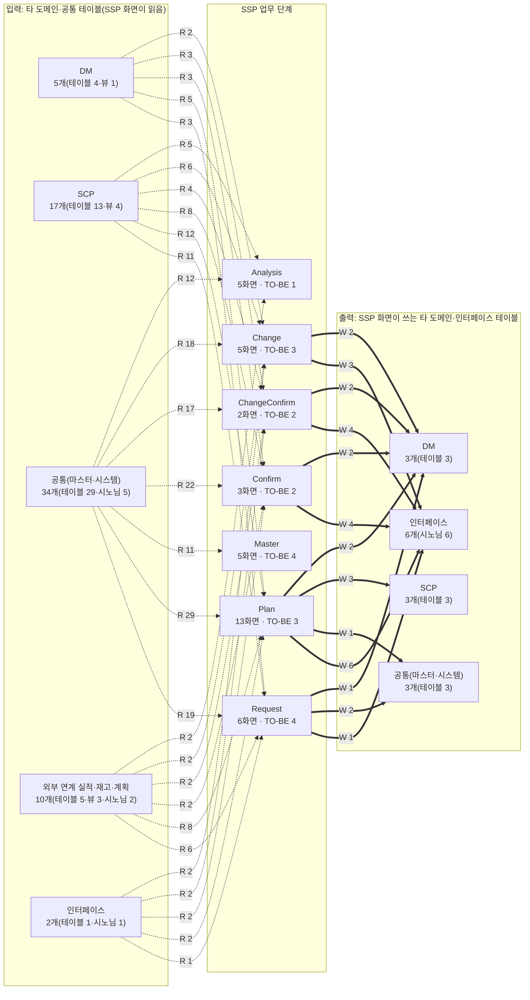
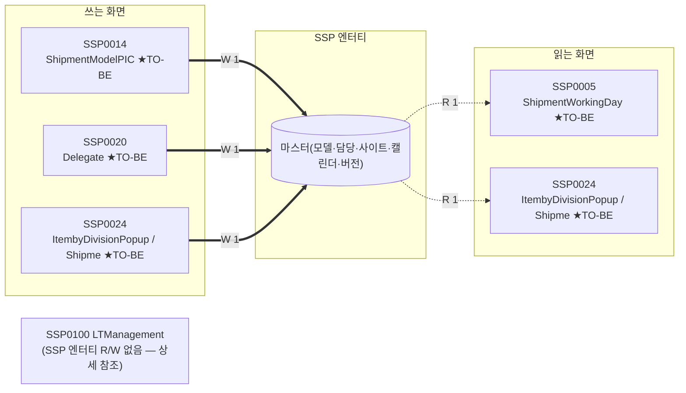
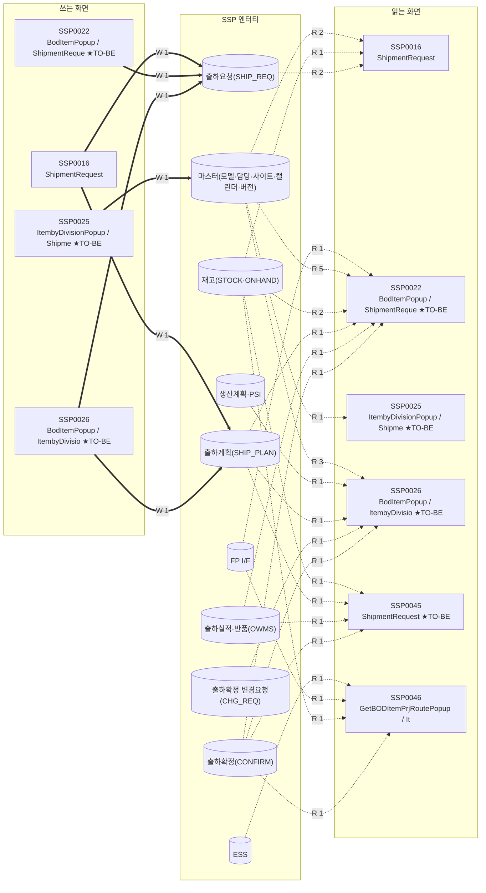
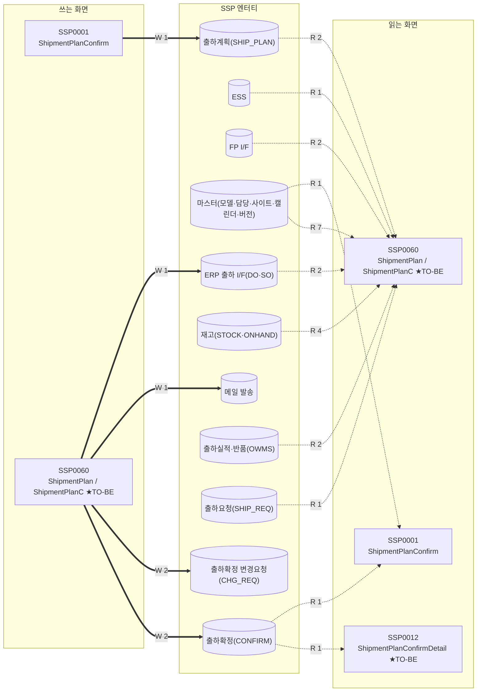
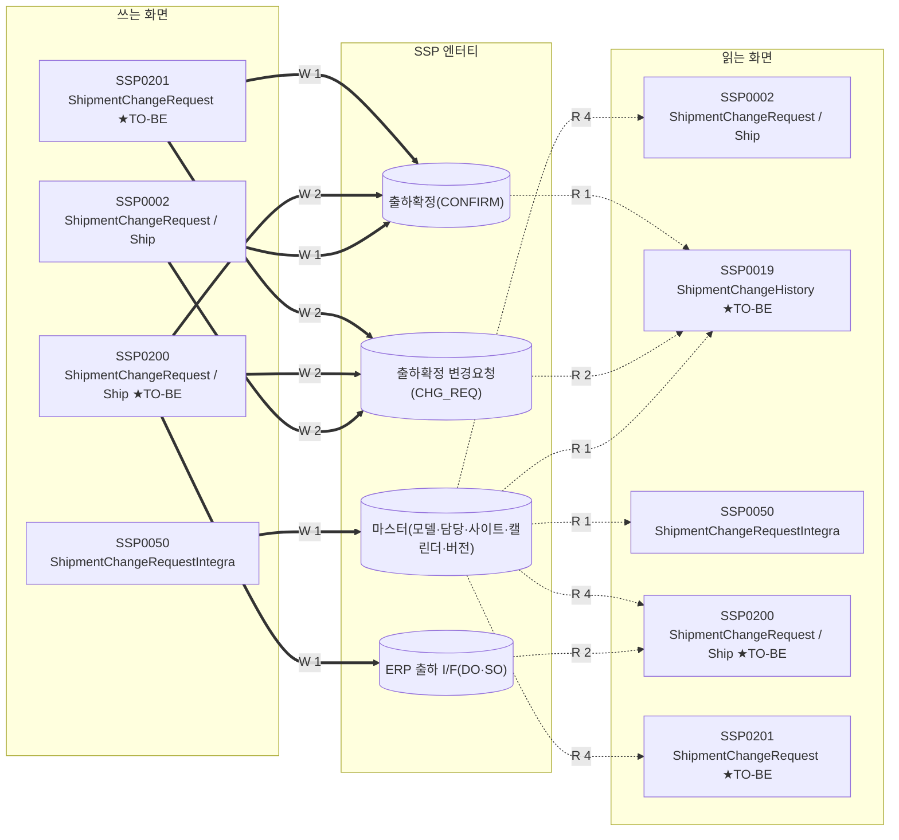
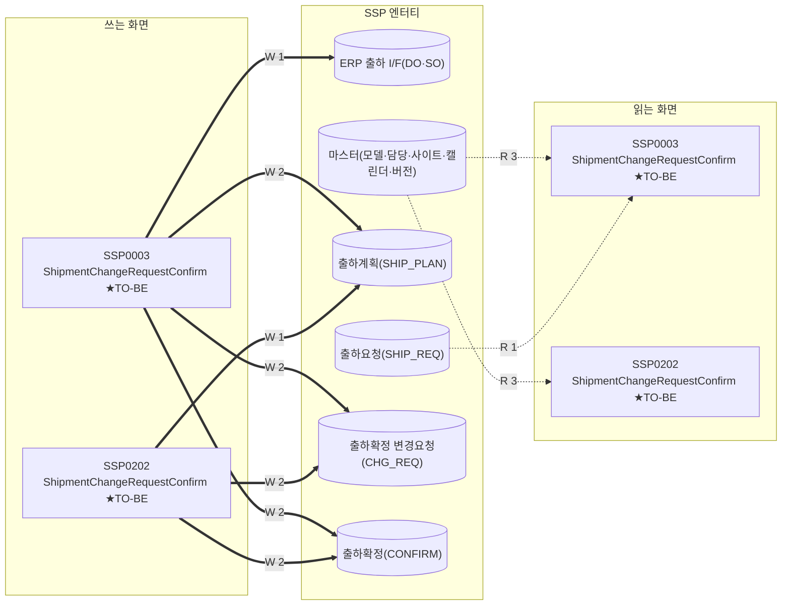
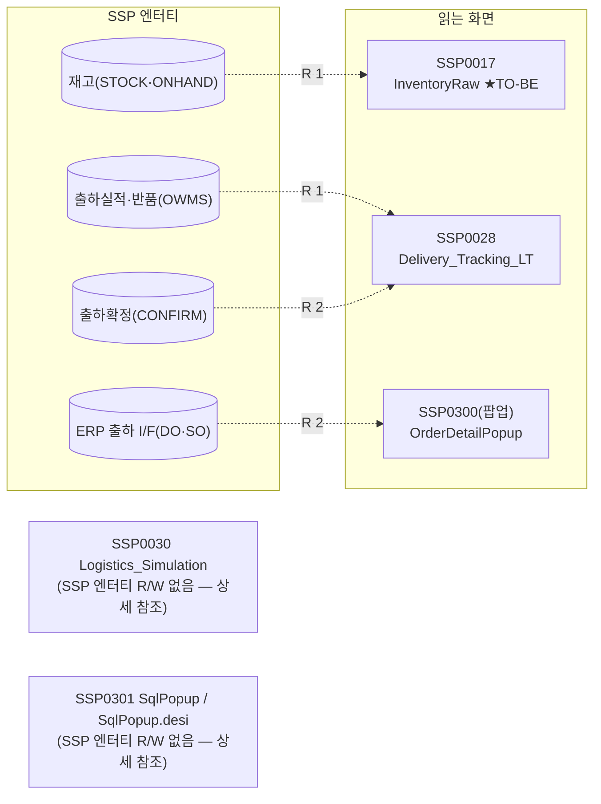

# SSP 데이터 흐름(Data Flow) — 2026-11-09 11:16 생성 · 원천 = AS-IS 화면→SP 호출(매트릭스+endpoints) · SP 본문 읽기/쓰기(깊이 3)

- 화면 39(메인 37 · 팝업 전용 2) · TO-BE 메뉴 19 · AS-IS 전용 20 · SP 296(본문 없음 24) · 테이블 162
- 화살표: 화면 → 테이블 = 쓰기(W, SP INSERT/UPDATE/MERGE/DELETE) · 테이블 → 화면 = 읽기(R) · 팝업의 호출은 부모 메인 화면으로 귀속 · 로그/이력 표와 공통 마스터 읽기는 개요에서 생략(상세 파일에 전부 있음)

## 1. 컨텍스트 — 타 도메인·공통 테이블 → SSP 업무 단계 → 타 도메인·인터페이스 테이블

- 노드 수량 = N개(테이블·뷰·시노님 — AS-IS 객체 카탈로그 종류) · 단계 = 화면 이름·TO-BE 메뉴명 규칙(`stage_of`) · 간선 라벨 = 매개 객체 수 · R = 읽기(점선) · W = 쓰기(굵은 선) · 화면 단위는 §2-1, 테이블 단위는 §3 표



### 1-1. 「외부 연계 실적·재고·계획」 설명 — 10개(테이블 5·뷰 3·시노님 2)

- AS-IS 이름 접두 `SCM_DNM_` 묶음. 외부 시스템(ERP·SCS·MES·FP)에서 받은 원본(`XIF_*` 표·타 DB 표)을 공통 적재 SP 가 정제해 쌓은 **실적·재고·계획 데이터**이며, SSP 화면은 읽기만 한다(쓰기 화면 0).
- 접두 `DNM` 의 원어 풀이는 AS-IS 소스·문서에서 찾지 못함(미확인) — 위 의미는 아래 표의 적재 SP 설명 원문·원천 표로 확인한 것.

| 표 | 종류 | 원천(적재 SP 설명 원문 · 원본) | 행 수(DEV) | 읽는 SSP 화면 |
|---|---|---|---|---|
| SCM_DNM_CELL_INHOUSE_PLAN_SN | 동의어 | 타 DB 표 `[LGCE_FPDEV_TR].[dbo].[FP_CELL_INHOUSE_PLAN_H]` 를 직접 참조 | - | SSP0021, SSP0045, SSP0046, SSP0060 |
| SCM_DNM_DELIVERY_TRACKING | 테이블 | PR_SCM_DNM_DELIVERY_TRACKING「Delivery Tracking 정보 I/F」 ← XIF_ERP_DELIVERY_TRACKING_R_SN | 180409 | SSP0028 |
| SCM_DNM_EXFACTORY_RESULT | 테이블 | PR_SCM_DNM_EXFACTORY_RESULT「출하실적 I/F」 ← XIF_ERP_EXFACTORY_RESULT_R_SN, XIF_ERP_EXFACTORY_RESULT_R_SN_TEMP | 901524 | SSP0003, SSP0009, SSP0010, SSP0013, SSP0015, SSP0021, SSP0023, SSP0027, SSP0028, SSP0029, SSP0045, SSP0060, SSP0200, SSP0202 |
| SCM_DNM_PLAN_FROZEN_V | 뷰 | 뷰: SCM_DNM_FP_RELEASE_PLAN_V_SN | - | SSP0045 |
| SCM_DNM_PRODUCT_RESULT_V | 뷰 | 뷰: SCM_DNM_DAILY_PRODUCT_RESULT_SN, SCM_DNM_SCS_PROD_RESULT | - | SSP0007, SSP0008 |
| SCM_DNM_SCS_PROD_PLAN | 테이블 | PR_SSP_XIF_SCS_PROD_PLAN_R「Packer 생산계획 I/F」 ← XIF_SCS_PROD_PLAN_R_SN | 1059134 | SSP0015, SSP0026 |
| SCM_DNM_SCS_SHIP_RESULT | 테이블 | PR_SSP_XIF_SCS_SHIP_RSLT_SUM_R「Packer 출하실적 I/F」 ← XIF_SCS_SHIP_RSLT_SUM_R_SN | 21495 | SSP0015, SSP0026, SSP0029, SSP0201, SSP0202 |
| SCM_DNM_SCS_STOCK | 테이블 | PR_SSP_XIF_SCS_STOCK_RSLT_SUM_R「Packer 재고 I/F」 ← XIF_SCS_STOCK_RSLT_SUM_R_SN | 230194 | SSP0015, SSP0026 |
| SCM_DNM_STOCK_SN | 동의어 | 타 DB 표 `[LGCE_FPDEV_TR].[dbo].[SCM_STOCK_H]` 를 직접 참조 | - | SSP0027 |
| SCM_DNM_STOCK_V | 뷰 | 뷰: SCM_DNM_SCS_STOCK, SCM_DNM_STOCK_CUSTOMER_CONSIGN, SCM_DNM_STOCK_OSP, SCM_DNM_STOCK_PUR, SCM_DNM_STOCK_SN, SCM_DNM_STOCK_VMI, SSP_DNM_OWMS_STOCK | - | SSP0015, SSP0027 |

## 2. SSP 엔터티 흐름 — 만드는 단계(W) ⇒ 엔터티(테이블 군) ⇒ 쓰는 단계(R)

- 엔터티 = SSP 테이블을 업무 의미 규칙표(`ENTITY_RULES`)로 묶음 · 왼쪽 = 쓰는 단계 · 오른쪽 = 읽는 단계(같은 단계가 양쪽에 나올 수 있음) · 라벨 = 테이블 수 · 공통 마스터·로그 표 제외

```mermaid
flowchart LR
  subgraph WS["만드는 단계(W)"]
    W_Master["Master<br/>5화면 · TO-BE 4"]
    W_Request["Request<br/>6화면 · TO-BE 4"]
    W_Plan["Plan<br/>13화면 · TO-BE 3"]
    W_Confirm["Confirm<br/>3화면 · TO-BE 2"]
    W_Change["Change<br/>5화면 · TO-BE 3"]
    W_ChangeConfirm["ChangeConfirm<br/>2화면 · TO-BE 2"]
  end
  subgraph EN["SSP 엔터티"]
    E____STOCK_ONHAND_[("재고(STOCK·ONHAND)<br/>13개(테이블 12·뷰 1)")]
    E______SHIP_PLAN_[("출하계획(SHIP_PLAN)<br/>11개(테이블 11)")]
    E______________________[("마스터(모델·담당·사이트·캘린더·버전)<br/>10개(테이블 7·뷰 3)")]
    E_ESS[("ESS<br/>8개(테이블 7·뷰 1)")]
    E______SHIP_REQ_[("출하요청(SHIP_REQ)<br/>5개(테이블 5)")]
    E______PSI[("생산계획·PSI<br/>5개(테이블 5)")]
    E_________OWMS_[("출하실적·반품(OWMS)<br/>4개(테이블 2·뷰 2)")]
    E_ERP____I_F_DO_SO_[("ERP 출하 I/F(DO·SO)<br/>3개(테이블 3)")]
    E________PROBLEM_[("문제 리포트(PROBLEM)<br/>3개(테이블 3)")]
    E_FP_I_F[("FP I/F<br/>3개(테이블 2·시노님 1)")]
    E______CONFIRM_[("출하확정(CONFIRM)<br/>2개(테이블 2)")]
    E___________CHG_REQ_[("출하확정 변경요청(CHG_REQ)<br/>2개(테이블 2)")]
    E______[("메일 발송<br/>1개(테이블 1)")]
  end
  subgraph RS["읽는 단계(R)"]
    R_Master["Master<br/>5화면 · TO-BE 4"]
    R_Request["Request<br/>6화면 · TO-BE 4"]
    R_Plan["Plan<br/>13화면 · TO-BE 3"]
    R_Confirm["Confirm<br/>3화면 · TO-BE 2"]
    R_Change["Change<br/>5화면 · TO-BE 3"]
    R_ChangeConfirm["ChangeConfirm<br/>2화면 · TO-BE 2"]
    R_Analysis["Analysis<br/>5화면 · TO-BE 1"]
  end
  W_Change =="W 1"==> E_ERP____I_F_DO_SO_
  W_Change =="W 1"==> E______________________
  W_Change =="W 2"==> E___________CHG_REQ_
  W_Change =="W 2"==> E______CONFIRM_
  W_ChangeConfirm =="W 1"==> E_ERP____I_F_DO_SO_
  W_ChangeConfirm =="W 2"==> E______SHIP_PLAN_
  W_ChangeConfirm =="W 2"==> E___________CHG_REQ_
  W_ChangeConfirm =="W 2"==> E______CONFIRM_
  W_Confirm =="W 1"==> E_ERP____I_F_DO_SO_
  W_Confirm =="W 1"==> E______
  W_Confirm =="W 1"==> E______SHIP_PLAN_
  W_Confirm =="W 2"==> E___________CHG_REQ_
  W_Confirm =="W 2"==> E______CONFIRM_
  W_Master =="W 3"==> E______________________
  W_Plan =="W 1"==> E_ERP____I_F_DO_SO_
  W_Plan =="W 4"==> E_ESS
  W_Plan =="W 1"==> E______
  W_Plan =="W 1"==> E______PSI
  W_Plan =="W 2"==> E____STOCK_ONHAND_
  W_Plan =="W 5"==> E______SHIP_PLAN_
  W_Plan =="W 2"==> E___________CHG_REQ_
  W_Plan =="W 2"==> E______CONFIRM_
  W_Request =="W 1"==> E______________________
  W_Request =="W 2"==> E______SHIP_PLAN_
  W_Request =="W 3"==> E______SHIP_REQ_
  E_ERP____I_F_DO_SO_ -."R 2".-> R_Analysis
  E____STOCK_ONHAND_ -."R 1".-> R_Analysis
  E_________OWMS_ -."R 1".-> R_Analysis
  E______CONFIRM_ -."R 2".-> R_Analysis
  E_ERP____I_F_DO_SO_ -."R 2".-> R_Change
  E______________________ -."R 5".-> R_Change
  E___________CHG_REQ_ -."R 2".-> R_Change
  E______CONFIRM_ -."R 1".-> R_Change
  E______________________ -."R 3".-> R_ChangeConfirm
  E______SHIP_REQ_ -."R 1".-> R_ChangeConfirm
  E_ERP____I_F_DO_SO_ -."R 2".-> R_Confirm
  E_ESS -."R 1".-> R_Confirm
  E_FP_I_F -."R 2".-> R_Confirm
  E______________________ -."R 7".-> R_Confirm
  E____STOCK_ONHAND_ -."R 4".-> R_Confirm
  E______SHIP_PLAN_ -."R 2".-> R_Confirm
  E_________OWMS_ -."R 2".-> R_Confirm
  E______SHIP_REQ_ -."R 1".-> R_Confirm
  E______CONFIRM_ -."R 1".-> R_Confirm
  E______________________ -."R 2".-> R_Master
  E_ERP____I_F_DO_SO_ -."R 2".-> R_Plan
  E_ESS -."R 4".-> R_Plan
  E_FP_I_F -."R 3".-> R_Plan
  E______________________ -."R 8".-> R_Plan
  E________PROBLEM_ -."R 3".-> R_Plan
  E______PSI -."R 3".-> R_Plan
  E____STOCK_ONHAND_ -."R 11".-> R_Plan
  E______SHIP_PLAN_ -."R 5".-> R_Plan
  E_________OWMS_ -."R 3".-> R_Plan
  E______SHIP_REQ_ -."R 2".-> R_Plan
  E_ESS -."R 1".-> R_Request
  E_FP_I_F -."R 2".-> R_Request
  E______________________ -."R 7".-> R_Request
  E______PSI -."R 1".-> R_Request
  E____STOCK_ONHAND_ -."R 4".-> R_Request
  E______SHIP_PLAN_ -."R 2".-> R_Request
  E_________OWMS_ -."R 1".-> R_Request
  E______SHIP_REQ_ -."R 2".-> R_Request
  E___________CHG_REQ_ -."R 1".-> R_Request
  E______CONFIRM_ -."R 1".-> R_Request
```



### 2-1. 단계별 화면 ⇒ 엔터티 ⇒ 화면(화면 단위)

- 각 단계의 화면이 쓰는(W)/읽는(R) SSP 엔터티 · 라벨 = 테이블 수 · 화면·SP·테이블 단위 전체는 `SSP_DATA_FLOW_DETAIL.md`

#### Master (5화면)



#### Request (6화면)



#### Plan (13화면)

```mermaid
flowchart LR
  subgraph WS["쓰는 화면"]
    W_SSP0013["SSP0013<br/>ShipmentPlanAdjustment"]
    W_SSP0015["SSP0015<br/>ShipmentPSI / ShipmentPSICom ★TO-BE"]
    W_SSP0018["SSP0018<br/>ProductionPlanOSP"]
    W_SSP0021["SSP0021<br/>ShipmentPlan ★TO-BE"]
    W_SSP0023["SSP0023<br/>ShipmentPlanElectrode ★TO-BE"]
    W_SSP0027["SSP0027<br/>ShipmentPlanEss"]
    W_SSP0029["SSP0029<br/>ShipmentPlanPack / ShipmentP"]
  end
  subgraph EN["SSP 엔터티"]
    E_ERP____I_F_DO_SO_[("ERP 출하 I/F(DO·SO)")]
    E_ESS[("ESS")]
    E_FP_I_F[("FP I/F")]
    E______________________[("마스터(모델·담당·사이트·캘린더·버전)")]
    E______[("메일 발송")]
    E________PROBLEM_[("문제 리포트(PROBLEM)")]
    E______PSI[("생산계획·PSI")]
    E____STOCK_ONHAND_[("재고(STOCK·ONHAND)")]
    E______SHIP_PLAN_[("출하계획(SHIP_PLAN)")]
    E_________OWMS_[("출하실적·반품(OWMS)")]
    E______SHIP_REQ_[("출하요청(SHIP_REQ)")]
    E___________CHG_REQ_[("출하확정 변경요청(CHG_REQ)")]
    E______CONFIRM_[("출하확정(CONFIRM)")]
  end
  subgraph RS["읽는 화면"]
    R_SSP0006["SSP0006<br/>Plan_Problem"]
    R_SSP0007["SSP0007<br/>ProductionPlan"]
    R_SSP0008["SSP0008<br/>ProductionPlanLine"]
    R_SSP0009["SSP0009<br/>Shipment_Plan_FG"]
    R_SSP0010["SSP0010<br/>Shipment_Plan_SEMI"]
    R_SSP0011["SSP0011<br/>PSI"]
    R_SSP0013["SSP0013<br/>ShipmentPlanAdjustment"]
    R_SSP0015["SSP0015<br/>ShipmentPSI / ShipmentPSICom ★TO-BE"]
    R_SSP0021["SSP0021<br/>ShipmentPlan ★TO-BE"]
    R_SSP0023["SSP0023<br/>ShipmentPlanElectrode ★TO-BE"]
    R_SSP0027["SSP0027<br/>ShipmentPlanEss"]
    R_SSP0029["SSP0029<br/>ShipmentPlanPack / ShipmentP"]
  end
  W_SSP0013 =="W 1"==> E______
  W_SSP0013 =="W 2"==> E______SHIP_PLAN_
  W_SSP0013 =="W 2"==> E___________CHG_REQ_
  W_SSP0013 =="W 2"==> E______CONFIRM_
  W_SSP0015 =="W 1"==> E_ERP____I_F_DO_SO_
  W_SSP0015 =="W 1"==> E______
  W_SSP0015 =="W 2"==> E____STOCK_ONHAND_
  W_SSP0015 =="W 2"==> E______SHIP_PLAN_
  W_SSP0015 =="W 2"==> E___________CHG_REQ_
  W_SSP0015 =="W 2"==> E______CONFIRM_
  W_SSP0018 =="W 1"==> E______PSI
  W_SSP0021 =="W 1"==> E_ERP____I_F_DO_SO_
  W_SSP0021 =="W 1"==> E______
  W_SSP0021 =="W 2"==> E___________CHG_REQ_
  W_SSP0021 =="W 2"==> E______CONFIRM_
  W_SSP0023 =="W 1"==> E_ERP____I_F_DO_SO_
  W_SSP0023 =="W 1"==> E______
  W_SSP0023 =="W 2"==> E______SHIP_PLAN_
  W_SSP0023 =="W 2"==> E___________CHG_REQ_
  W_SSP0023 =="W 2"==> E______CONFIRM_
  W_SSP0027 =="W 1"==> E_ERP____I_F_DO_SO_
  W_SSP0027 =="W 4"==> E_ESS
  W_SSP0027 =="W 1"==> E______
  W_SSP0027 =="W 2"==> E___________CHG_REQ_
  W_SSP0027 =="W 2"==> E______CONFIRM_
  W_SSP0029 =="W 1"==> E______
  W_SSP0029 =="W 2"==> E____STOCK_ONHAND_
  W_SSP0029 =="W 2"==> E______SHIP_PLAN_
  W_SSP0029 =="W 2"==> E___________CHG_REQ_
  W_SSP0029 =="W 2"==> E______CONFIRM_
  E________PROBLEM_ -."R 3".-> R_SSP0006
  E______PSI -."R 1".-> R_SSP0007
  E______PSI -."R 1".-> R_SSP0008
  E________PROBLEM_ -."R 2".-> R_SSP0009
  E______SHIP_PLAN_ -."R 1".-> R_SSP0009
  E____STOCK_ONHAND_ -."R 1".-> R_SSP0010
  E______SHIP_PLAN_ -."R 1".-> R_SSP0010
  E______PSI -."R 1".-> R_SSP0011
  E____STOCK_ONHAND_ -."R 1".-> R_SSP0011
  E______________________ -."R 4".-> R_SSP0013
  E____STOCK_ONHAND_ -."R 1".-> R_SSP0013
  E_ERP____I_F_DO_SO_ -."R 2".-> R_SSP0015
  E______________________ -."R 6".-> R_SSP0015
  E______PSI -."R 1".-> R_SSP0015
  E____STOCK_ONHAND_ -."R 3".-> R_SSP0015
  E______SHIP_PLAN_ -."R 2".-> R_SSP0015
  E_________OWMS_ -."R 2".-> R_SSP0015
  E______SHIP_REQ_ -."R 1".-> R_SSP0015
  E_ERP____I_F_DO_SO_ -."R 2".-> R_SSP0021
  E_ESS -."R 1".-> R_SSP0021
  E_FP_I_F -."R 2".-> R_SSP0021
  E______________________ -."R 6".-> R_SSP0021
  E____STOCK_ONHAND_ -."R 4".-> R_SSP0021
  E______SHIP_PLAN_ -."R 2".-> R_SSP0021
  E_________OWMS_ -."R 2".-> R_SSP0021
  E______SHIP_REQ_ -."R 1".-> R_SSP0021
  E_ERP____I_F_DO_SO_ -."R 2".-> R_SSP0023
  E_FP_I_F -."R 1".-> R_SSP0023
  E______________________ -."R 6".-> R_SSP0023
  E____STOCK_ONHAND_ -."R 2".-> R_SSP0023
  E______SHIP_PLAN_ -."R 1".-> R_SSP0023
  E_________OWMS_ -."R 3".-> R_SSP0023
  E______SHIP_REQ_ -."R 1".-> R_SSP0023
  E_ERP____I_F_DO_SO_ -."R 2".-> R_SSP0027
  E_ESS -."R 3".-> R_SSP0027
  E______________________ -."R 6".-> R_SSP0027
  E_________OWMS_ -."R 2".-> R_SSP0027
  E_ERP____I_F_DO_SO_ -."R 2".-> R_SSP0029
  E______________________ -."R 5".-> R_SSP0029
  E______PSI -."R 1".-> R_SSP0029
  E____STOCK_ONHAND_ -."R 2".-> R_SSP0029
  E______SHIP_PLAN_ -."R 1".-> R_SSP0029
  E_________OWMS_ -."R 2".-> R_SSP0029
  E______SHIP_REQ_ -."R 1".-> R_SSP0029
```



#### Confirm (3화면)



#### Change (5화면)



#### ChangeConfirm (2화면)



#### Analysis (5화면)



### 2-2. 엔터티 군 → 테이블 대응표

| 엔터티 | 테이블 수 | 테이블 |
|---|---|---|
| 재고(STOCK·ONHAND) | 13 | SSP_ANL_BOH_CUTOFF_EE, SSP_ANL_HOLD_STOCK, SSP_ANL_INVENTORY_RAW, SSP_ANL_MES_FCS_STOCK_40_C, SSP_ANL_OWMS_STOCK_C, SSP_ANL_OWMS_STOCK_C2, SSP_ANL_STOCK_EE_C, SSP_ANL_TCO_STOCK_C, SSP_ANL_WH_STOCK_V, SSP_DNM_GMES_STOCK_81_82, SSP_DNM_OWMS_STOCK, SSP_DNM_STOCK_C, SSP_PLN_PLANT_ONHAND |
| 출하계획(SHIP_PLAN) | 11 | SSP_ANL_SHIPMENT_PLAN_FG, SSP_ANL_SHIPMENT_PLAN_SEMI, SSP_ANL_SHIP_PLAN, SSP_ANL_SHIP_PLAN_40, SSP_ANL_SHIP_PLAN_40_WH_IN_CMT, SSP_ANL_SHIP_PLAN_ALL, SSP_ANL_SHIP_PLAN_C, SSP_ANL_SHIP_PLAN_EE, SSP_ANL_SHIP_PLAN_P, SSP_ANL_SHIP_PLAN_PACK_REQ, SSP_ANL_SHIP_PLAN_SIMU_EE |
| 마스터(모델·담당·사이트·캘린더·버전) | 10 | SSP_MST_APPROVAL, SSP_MST_DELEGATE, SSP_MST_LOCATION_V, SSP_MST_MODEL_USER, SSP_MST_MODEL_USER_EE, SSP_MST_PARTIAL_SEQ, SSP_MST_SHIP_CALENDAR, SSP_MST_SHIP_MASTER_EE, SSP_MST_SITE_ITEM_EE_V, SSP_PLAN_VERSION_V |
| ESS | 8 | SSP_ANL_ESS_PLAN, SSP_ANL_ESS_PO, SSP_ANL_ESS_PO_IN, SSP_ANL_ESS_PR, SSP_ANL_ESS_REQ, SSP_ANL_ESS_REQ_NET, SSP_ANL_ESS_STOCK, SSP_DNM_ESS_PACKER_STOCK_V |
| 출하요청(SHIP_REQ) | 5 | SSP_ANL_SHIP_REQ, SSP_ANL_SHIP_REQ_D, SSP_ANL_SHIP_REQ_EE, SSP_ANL_SHIP_REQ_P, SSP_MST_SHIP_REQ |
| 생산계획·PSI | 5 | SSP_ANL_FORMATION_C, SSP_ANL_PRODUCTION_PLAN, SSP_ANL_PROD_PLAN_OSP, SSP_ANL_PSI_PRODUCTION, SSP_DNM_FORMATION_POST_CELL |
| 출하실적·반품(OWMS) | 4 | SSP_DNM_DELIVERY_TRACKING_V, SSP_DNM_SHIP_RESULT_OWMS, SSP_DNM_SHIP_RESULT_OWMS_V, SSP_DNM_SHIP_RETURN_OWMS |
| ERP 출하 I/F(DO·SO) | 3 | SSP_ANL_SHIP_ERP_DO, SSP_ANL_SHIP_ERP_ERROR_CONFIRM, SSP_ANL_SHIP_ERP_SO |
| 문제 리포트(PROBLEM) | 3 | SSP_ANL_PROBLEM_REPORT_DEMAND, SSP_ANL_PROBLEM_REPORT_DESC, SSP_ANL_PROBLEM_REPORT_PEGGING |
| FP I/F | 3 | SSP_DNM_FP_AMEND_SHIPAVAL, SSP_DNM_FP_MRP_INTRANSIT_SN, SSP_DNM_FP_PLAN_FROZEN |
| 출하확정(CONFIRM) | 2 | SSP_ANL_SHIP_CONFIRM, SSP_ANL_SHIP_CONFIRM_ROUTE |
| 출하확정 변경요청(CHG_REQ) | 2 | SSP_ANL_SHIP_CONFIRM_CHG_REQ, SSP_ANL_SHIP_CONFIRM_CHG_REQ_DE |
| 메일 발송 | 1 | SSP_MST_SEND_MAIL_REQ |

```

## 3. SSP 테이블별 쓰기/읽기 화면 표

| 테이블 | 도메인 | 쓰는 화면 | 읽는 화면 |
|---|---|---|---|
| SSP_ANL_BOH_CUTOFF_EE | SSP | - | SSP0022, SSP0023 |
| SSP_ANL_ESS_PLAN | SSP | SSP0027 | - |
| SSP_ANL_ESS_PO | SSP | - | SSP0027 |
| SSP_ANL_ESS_PO_IN | SSP | - | SSP0027 |
| SSP_ANL_ESS_PR | SSP | SSP0027 | - |
| SSP_ANL_ESS_REQ | SSP | SSP0027 | - |
| SSP_ANL_ESS_REQ_NET | SSP | - | SSP0027 |
| SSP_ANL_ESS_STOCK | SSP | SSP0027 | - |
| SSP_ANL_FORMATION_C | SSP | - | SSP0015, SSP0029 |
| SSP_ANL_HOLD_STOCK | SSP | SSP0015, SSP0029 | SSP0016, SSP0021, SSP0060 |
| SSP_ANL_INVENTORY_RAW | SSP | - | SSP0017 |
| SSP_ANL_MES_FCS_STOCK_40_C | SSP | SSP0015, SSP0029 | - |
| SSP_ANL_OWMS_STOCK_C | SSP | - | SSP0015, SSP0029 |
| SSP_ANL_OWMS_STOCK_C2 | SSP | - | SSP0021, SSP0060 |
| SSP_ANL_PROBLEM_REPORT_DEMAND | SSP | - | SSP0006 |
| SSP_ANL_PROBLEM_REPORT_DESC | SSP | - | SSP0006, SSP0009 |
| SSP_ANL_PROBLEM_REPORT_PEGGING | SSP | - | SSP0006, SSP0009 |
| SSP_ANL_PRODUCTION_PLAN | SSP | - | SSP0007, SSP0008 |
| SSP_ANL_PROD_PLAN_OSP | SSP | SSP0018 | - |
| SSP_ANL_PSI_PRODUCTION | SSP | - | SSP0011 |
| SSP_ANL_SHIPMENT_PLAN_FG | SSP | - | SSP0009 |
| SSP_ANL_SHIPMENT_PLAN_SEMI | SSP | - | SSP0010 |
| SSP_ANL_SHIP_CONFIRM | SSP | SSP0002, SSP0003, SSP0013, SSP0015, SSP0021, SSP0023, SSP0027, SSP0029, SSP0060, SSP0200, SSP0201, SSP0202 | SSP0001, SSP0012, SSP0019, SSP0022, SSP0026, SSP0028, SSP0045, SSP0046 |
| SSP_ANL_SHIP_CONFIRM_CHG_REQ | SSP | SSP0002, SSP0003, SSP0013, SSP0015, SSP0021, SSP0023, SSP0027, SSP0029, SSP0060, SSP0200, SSP0201, SSP0202 | SSP0019 |
| SSP_ANL_SHIP_CONFIRM_CHG_REQ_DE | SSP | SSP0002, SSP0003, SSP0013, SSP0015, SSP0021, SSP0023, SSP0027, SSP0029, SSP0060, SSP0200, SSP0201, SSP0202 | SSP0019, SSP0026 |
| SSP_ANL_SHIP_CONFIRM_ROUTE | SSP | SSP0003, SSP0013, SSP0015, SSP0021, SSP0023, SSP0027, SSP0029, SSP0060, SSP0200, SSP0202 | SSP0028 |
| SSP_ANL_SHIP_ERP_DO | SSP | - | SSP0015, SSP0021, SSP0023, SSP0027, SSP0029, SSP0060, SSP0200, SSP0300 |
| SSP_ANL_SHIP_ERP_ERROR_CONFIRM | SSP | SSP0003, SSP0015, SSP0021, SSP0023, SSP0027, SSP0060, SSP0200 | - |
| SSP_ANL_SHIP_ERP_SO | SSP | - | SSP0015, SSP0021, SSP0023, SSP0027, SSP0029, SSP0060, SSP0200, SSP0300 |
| SSP_ANL_SHIP_PLAN | SSP | SSP0001, SSP0003, SSP0013, SSP0016, SSP0202 | - |
| SSP_ANL_SHIP_PLAN_40 | SSP | SSP0003, SSP0013, SSP0015, SSP0029 | SSP0026, SSP0045 |
| SSP_ANL_SHIP_PLAN_40_WH_IN_CMT | SSP | SSP0015, SSP0029 | - |
| SSP_ANL_SHIP_PLAN_ALL | SSP | - | SSP0015, SSP0021, SSP0023, SSP0029, SSP0060 |
| SSP_ANL_SHIP_PLAN_C | SSP | - | SSP0021, SSP0060 |
| SSP_ANL_SHIP_PLAN_EE | SSP | SSP0023 | SSP0022 |
| SSP_ANL_SHIP_PLAN_P | SSP | - | SSP0015 |
| SSP_ANL_SHIP_PLAN_PACK_REQ | SSP | SSP0026 | - |
| SSP_ANL_SHIP_PLAN_SIMU_EE | SSP | SSP0023 | - |
| SSP_ANL_SHIP_REQ | SSP | SSP0016 | - |
| SSP_ANL_SHIP_REQ_D | SSP | - | SSP0016 |
| SSP_ANL_SHIP_REQ_EE | SSP | SSP0022 | SSP0003, SSP0021, SSP0023, SSP0060 |
| SSP_ANL_SHIP_REQ_P | SSP | SSP0026 | SSP0015, SSP0029 |
| SSP_ANL_STOCK_EE_C | SSP | - | SSP0022, SSP0023 |
| SSP_ANL_TCO_STOCK_C | SSP | - | SSP0015 |
| SSP_ANL_WH_STOCK_V | SSP | - | SSP0015, SSP0029 |
| SSP_DNM_DELIVERY_TRACKING_V | SSP | - | SSP0028 |
| SSP_DNM_ESS_PACKER_STOCK_V | SSP | - | SSP0021, SSP0046, SSP0060 |
| SSP_DNM_FORMATION_POST_CELL | SSP | - | SSP0026 |
| SSP_DNM_FP_AMEND_SHIPAVAL | SSP | - | SSP0021, SSP0060 |
| SSP_DNM_FP_MRP_INTRANSIT_SN | SSP | - | SSP0022, SSP0023 |
| SSP_DNM_FP_PLAN_FROZEN | SSP | - | SSP0021, SSP0046, SSP0060 |
| SSP_DNM_GMES_STOCK_81_82 | SSP | - | SSP0021, SSP0060 |
| SSP_DNM_OWMS_STOCK | SSP | - | SSP0013 |
| SSP_DNM_SHIP_RESULT_OWMS | SSP | - | SSP0015, SSP0021, SSP0023, SSP0027, SSP0029, SSP0060 |
| SSP_DNM_SHIP_RESULT_OWMS_V | SSP | - | SSP0022, SSP0023, SSP0045 |
| SSP_DNM_SHIP_RETURN_OWMS | SSP | - | SSP0015, SSP0021, SSP0023, SSP0027, SSP0029, SSP0060 |
| SSP_DNM_STOCK_C | SSP | - | SSP0021, SSP0045, SSP0046, SSP0060 |
| SSP_MST_APPROVAL | SSP | - | SSP0050 |
| SSP_MST_DELEGATE | SSP | SSP0020 | SSP0002, SSP0003, SSP0015, SSP0021, SSP0022, SSP0023, SSP0027, SSP0029, SSP0060, SSP0200, SSP0201, SSP0202 |
| SSP_MST_LOCATION_V | SSP | - | SSP0015, SSP0021, SSP0060 |
| SSP_MST_MODEL_USER | SSP | SSP0014, SSP0050 | SSP0002, SSP0003, SSP0013, SSP0015, SSP0019, SSP0021, SSP0023, SSP0026, SSP0027, SSP0029, SSP0060, SSP0200, SSP0201, SSP0202 |
| SSP_MST_MODEL_USER_EE | SSP | SSP0025 | SSP0013, SSP0015, SSP0021, SSP0022, SSP0023, SSP0027, SSP0029, SSP0060 |
| SSP_MST_PARTIAL_SEQ | SSP | - | SSP0027, SSP0060 |
| SSP_MST_SEND_MAIL_REQ | SSP | SSP0013, SSP0015, SSP0021, SSP0023, SSP0027, SSP0029, SSP0060 | - |
| SSP_MST_SHIP_CALENDAR | SSP | - | SSP0005, SSP0016, SSP0022, SSP0023, SSP0026 |
| SSP_MST_SHIP_MASTER_EE | SSP | SSP0024 | SSP0022 |
| SSP_MST_SHIP_REQ | SSP | - | SSP0016 |
| SSP_MST_SITE_ITEM_EE_V | SSP | - | SSP0002, SSP0003, SSP0013, SSP0015, SSP0021, SSP0022, SSP0023, SSP0024, SSP0025, SSP0027, SSP0029, SSP0060, SSP0200, SSP0201, SSP0202 |
| SSP_PLAN_VERSION_V | SSP | - | SSP0001, SSP0002, SSP0013, SSP0015, SSP0016, SSP0021, SSP0023, SSP0026, SSP0027, SSP0029, SSP0060, SSP0200, SSP0201 |
| SSP_PLN_PLANT_ONHAND | SSP | - | SSP0010, SSP0011 |
| DM_MST_ITEM_SINGLE_V | DM | - | SSP0003, SSP0013, SSP0015, SSP0021, SSP0023, SSP0027, SSP0029, SSP0046, SSP0060, SSP0200, SSP0202 |
| DM_PLN_MKT_FCST | DM | SSP0003, SSP0013, SSP0015, SSP0021, SSP0023, SSP0027, SSP0029, SSP0060, SSP0200, SSP0202 | SSP0046 |
| DM_PLN_MKT_FCST_CONFIRM | DM | SSP0003, SSP0013, SSP0015, SSP0021, SSP0023, SSP0027, SSP0029, SSP0060, SSP0200, SSP0202 | - |
| DM_PLN_MKT_FCST_RESULT | DM | - | SSP0003, SSP0013, SSP0015, SSP0021, SSP0023, SSP0027, SSP0029, SSP0060, SSP0200, SSP0202 |
| DM_PLN_PR_DETAIL | DM | - | SSP0027 |
| DM_PLN_SHIPMENT_REQ | DM | SSP0026, SSP0045, SSP0046 | SSP0003, SSP0015, SSP0021, SSP0029, SSP0060 |
| SCP_ANL_PRODUCTION_PLAN | SCP | SSP0007 | SSP0021, SSP0046, SSP0060 |
| SCP_ANL_PRODUCTION_PLAN_FIX | SCP | SSP0008 | - |
| SCP_ANL_SHIPMENT_PLAN_FG | SCP | - | SSP0030 |
| SCP_ANL_SHIPMENT_PLAN_FIX | SCP | SSP0009, SSP0010 | - |
| SCP_ANL_SHIPMENT_PLAN_SEMI | SCP | - | SSP0030, SSP0045 |
| SCP_ANL_TACT_TIME | SCP | - | SSP0008 |
| SCP_ANL_WORKING_TIME | SCP | - | SSP0008 |
| SCP_MST_BOD | SCP | - | SSP0003, SSP0013, SSP0015, SSP0021, SSP0023, SSP0027, SSP0028, SSP0029, SSP0046, SSP0060, SSP0200, SSP0202 |
| SCP_MST_BOD_ITEM | SCP | - | SSP0013, SSP0015, SSP0021, SSP0022, SSP0023, SSP0026, SSP0029, SSP0046, SSP0060, SSP0200, SSP0201 |
| SCP_MST_BOD_N_V | SCP | - | SSP0001, SSP0002, SSP0003, SSP0009, SSP0010, SSP0012, SSP0013, SSP0015, SSP0016, SSP0021, SSP0022, SSP0023, SSP0026, SSP0027, SSP0029, SSP0045, SSP0046, SSP0060, SSP0200, SSP0201, SSP0202 |
| SCP_MST_BOD_V | SCP | - | SSP0027, SSP0046 |
| SCP_MST_DISTRIBUTION_ROUTE | SCP | - | SSP0003, SSP0012, SSP0013, SSP0015, SSP0021, SSP0023, SSP0027, SSP0028, SSP0029, SSP0030, SSP0046, SSP0060, SSP0200, SSP0202 |
| SCP_MST_FINAL_ITEM | SCP | - | SSP0003, SSP0015, SSP0018, SSP0021, SSP0022, SSP0023, SSP0026, SSP0027, SSP0029, SSP0045, SSP0046, SSP0060, SSP0200 |
| SCP_MST_FINAL_ITEM_V | SCP | - | SSP0200 |
| SCP_MST_SHIPMENT_LOT_SIZE | SCP | - | SSP0021, SSP0027, SSP0030, SSP0060 |
| SCP_PLAN_VERSION_V | SCP | - | SSP0021, SSP0026, SSP0045, SSP0046, SSP0060 |
| SCP_PLN_SHIPMENT_PLAN | SCP | - | SSP0026, SSP0045, SSP0046 |
| SCP_PLN_SHIPMENT_PLAN_PEGGING | SCP | - | SSP0026, SSP0045, SSP0046 |
| SCM_ADM_LOOKUP_MASTER_DETAIL | 공통(마스터·시스템) | SSP0027 | SSP0001, SSP0002, SSP0003, SSP0006, SSP0007, SSP0008, SSP0009, SSP0010, SSP0011, SSP0012, SSP0013, SSP0015, SSP0016, SSP0018, SSP0021, SSP0022, SSP0023, SSP0025, SSP0026, SSP0028, SSP0029, SSP0030, SSP0045, SSP0046, SSP0060, SSP0200, SSP0201, SSP0202 |
| SCM_ADM_RECIPIENT_ASSIGN | 공통(마스터·시스템) | - | SSP0002, SSP0003, SSP0027, SSP0200, SSP0201, SSP0202 |
| SCM_ADM_RECIPIENT_LIST | 공통(마스터·시스템) | - | SSP0002, SSP0003, SSP0027, SSP0200, SSP0201, SSP0202 |
| SCM_ADM_RECIPIENT_MESSAGE | 공통(마스터·시스템) | - | SSP0002, SSP0003, SSP0027, SSP0200, SSP0201, SSP0202 |
| SCM_ADM_RECIPIENT_SMS_ASSIGN | 공통(마스터·시스템) | - | SSP0027 |
| SCM_CODE_LOOKUP_VALUE | 공통(마스터·시스템) | - | SSP0015, SSP0027, SSP0060 |
| SCM_ITEM_CLASS_M_SN | 공통(마스터·시스템) | - | SSP0021 |
| SCM_ITEM_M_SN | 공통(마스터·시스템) | - | SSP0021, SSP0200 |
| SCM_MODEL_COMP_TEMP_SN | 공통(마스터·시스템) | - | SSP0021 |
| SCM_MST_CITY | 공통(마스터·시스템) | - | SSP0021, SSP0028, SSP0060 |
| SCM_MST_COUNTRY | 공통(마스터·시스템) | - | SSP0021, SSP0028, SSP0060 |
| SCM_MST_CUSTOMER | 공통(마스터·시스템) | - | SSP0015, SSP0019, SSP0021, SSP0026, SSP0029, SSP0060 |
| SCM_MST_DIVISION | 공통(마스터·시스템) | - | SSP0001, SSP0002, SSP0003, SSP0006, SSP0007, SSP0008, SSP0009, SSP0010, SSP0011, SSP0012, SSP0013, SSP0014, SSP0015, SSP0016, SSP0017, SSP0018, SSP0019, SSP0021, SSP0022, SSP0023, SSP0024, SSP0026, SSP0027, SSP0029, SSP0030, SSP0045, SSP0046, SSP0050, SSP0060, SSP0100, SSP0200, SSP0201, SSP0202 |
| SCM_MST_FACTORY_SN | 공통(마스터·시스템) | - | SSP0017 |
| SCM_MST_FUTURE_PRICE | 공통(마스터·시스템) | - | SSP0002, SSP0200, SSP0201 |
| SCM_MST_ITEM_SN | 공통(마스터·시스템) | - | SSP0001, SSP0002, SSP0003, SSP0006, SSP0007, SSP0008, SSP0009, SSP0010, SSP0011, SSP0012, SSP0013, SSP0014, SSP0015, SSP0016, SSP0017, SSP0018, SSP0019, SSP0021, SSP0022, SSP0023, SSP0026, SSP0027, SSP0029, SSP0045, SSP0046, SSP0050, SSP0060, SSP0100, SSP0200, SSP0201, SSP0202 |
| SCM_MST_LOCATION | 공통(마스터·시스템) | - | SSP0045, SSP0046 |
| SCM_MST_PLAN | 공통(마스터·시스템) | - | SSP0003, SSP0013, SSP0015, SSP0029, SSP0060, SSP0202 |
| SCM_MST_PLAN_DETAIL | 공통(마스터·시스템) | - | SSP0003, SSP0007, SSP0008, SSP0013, SSP0015, SSP0029, SSP0060, SSP0202 |
| SCM_MST_PORT | 공통(마스터·시스템) | - | SSP0028, SSP0030 |
| SCM_MST_PROJECT | 공통(마스터·시스템) | - | SSP0001, SSP0002, SSP0003, SSP0006, SSP0007, SSP0008, SSP0009, SSP0010, SSP0011, SSP0012, SSP0013, SSP0014, SSP0015, SSP0016, SSP0017, SSP0018, SSP0019, SSP0021, SSP0022, SSP0023, SSP0026, SSP0027, SSP0029, SSP0045, SSP0046, SSP0050, SSP0060, SSP0100, SSP0200, SSP0201, SSP0202 |
| SCM_MST_SHEET_COLUMNS | 공통(마스터·시스템) | - | SSP0026, SSP0046 |
| SCM_MST_SHEET_MEASURE | 공통(마스터·시스템) | - | SSP0001, SSP0007, SSP0008, SSP0009, SSP0010, SSP0015, SSP0016, SSP0021, SSP0022, SSP0023, SSP0026, SSP0027, SSP0029, SSP0045, SSP0046, SSP0060 |
| SCM_MST_SITE | 공통(마스터·시스템) | - | SSP0001, SSP0002, SSP0003, SSP0006, SSP0007, SSP0008, SSP0009, SSP0010, SSP0011, SSP0012, SSP0013, SSP0014, SSP0015, SSP0016, SSP0017, SSP0018, SSP0019, SSP0021, SSP0022, SSP0023, SSP0024, SSP0025, SSP0026, SSP0027, SSP0028, SSP0029, SSP0030, SSP0045, SSP0046, SSP0050, SSP0060, SSP0100, SSP0200, SSP0201, SSP0202 |
| SCM_MST_SITE_CUSTOMER | 공통(마스터·시스템) | - | SSP0015, SSP0021, SSP0026, SSP0029, SSP0060 |
| SCM_MST_SITE_ITEM | 공통(마스터·시스템) | - | SSP0001, SSP0002, SSP0003, SSP0006, SSP0007, SSP0008, SSP0009, SSP0010, SSP0011, SSP0012, SSP0013, SSP0014, SSP0015, SSP0016, SSP0017, SSP0018, SSP0019, SSP0021, SSP0022, SSP0023, SSP0026, SSP0027, SSP0029, SSP0045, SSP0046, SSP0050, SSP0060, SSP0100, SSP0200, SSP0201, SSP0202 |
| SCM_MST_SLOC | 공통(마스터·시스템) | - | SSP0013, SSP0015, SSP0017, SSP0021, SSP0022, SSP0023, SSP0027, SSP0029, SSP0060 |
| SCM_MST_SSO_DEPT_INFO | 공통(마스터·시스템) | - | SSP0002, SSP0003, SSP0009, SSP0014, SSP0015, SSP0016, SSP0019, SSP0020, SSP0021, SSP0022, SSP0023, SSP0024, SSP0025, SSP0026, SSP0027, SSP0029, SSP0046, SSP0050, SSP0060, SSP0200, SSP0201, SSP0202 |
| SCM_MST_SSO_USER_INFO | 공통(마스터·시스템) | - | SSP0002, SSP0003, SSP0009, SSP0014, SSP0015, SSP0016, SSP0020, SSP0021, SSP0022, SSP0023, SSP0025, SSP0026, SSP0027, SSP0029, SSP0046, SSP0050, SSP0060, SSP0200, SSP0201, SSP0202 |
| SCM_MST_TITLESET_USER | 공통(마스터·시스템) | SSP0046 | SSP0001, SSP0007, SSP0008, SSP0009, SSP0010, SSP0015, SSP0016, SSP0021, SSP0022, SSP0023, SSP0026, SSP0027, SSP0029, SSP0060 |
| SCM_SYS_CALENDAR_M | 공통(마스터·시스템) | SSP0046 | SSP0001, SSP0002, SSP0003, SSP0005, SSP0006, SSP0007, SSP0008, SSP0009, SSP0010, SSP0011, SSP0012, SSP0013, SSP0015, SSP0016, SSP0017, SSP0018, SSP0019, SSP0021, SSP0022, SSP0023, SSP0026, SSP0027, SSP0028, SSP0029, SSP0030, SSP0045, SSP0060, SSP0200, SSP0201, SSP0202 |
| TB_FX_GROUPINFO | 공통(마스터·시스템) | - | SSP0002, SSP0003, SSP0014, SSP0015, SSP0016, SSP0020, SSP0021, SSP0022, SSP0023, SSP0024, SSP0025, SSP0026, SSP0027, SSP0029, SSP0046, SSP0050, SSP0060, SSP0200, SSP0201, SSP0202 |
| TB_FX_USER | 공통(마스터·시스템) | - | SSP0001, SSP0002, SSP0003, SSP0012, SSP0013, SSP0014, SSP0015, SSP0016, SSP0019, SSP0020, SSP0021, SSP0022, SSP0023, SSP0024, SSP0025, SSP0026, SSP0027, SSP0029, SSP0045, SSP0046, SSP0050, SSP0060, SSP0200, SSP0201, SSP0202 |
| TB_FX_USERGROUPAUTHEXTENTION | 공통(마스터·시스템) | - | SSP0002, SSP0003, SSP0014, SSP0015, SSP0021, SSP0022, SSP0023, SSP0024, SSP0025, SSP0046, SSP0050, SSP0060, SSP0200, SSP0201 |
| SCM_DNM_CELL_INHOUSE_PLAN_SN | 외부 연계 실적·재고·계획 | - | SSP0021, SSP0045, SSP0046, SSP0060 |
| SCM_DNM_DELIVERY_TRACKING | 외부 연계 실적·재고·계획 | - | SSP0028 |
| SCM_DNM_EXFACTORY_RESULT | 외부 연계 실적·재고·계획 | - | SSP0003, SSP0009, SSP0010, SSP0013, SSP0015, SSP0021, SSP0023, SSP0027, SSP0028, SSP0029, SSP0045, SSP0060, SSP0200, SSP0202 |
| SCM_DNM_PLAN_FROZEN_V | 외부 연계 실적·재고·계획 | - | SSP0045 |
| SCM_DNM_PRODUCT_RESULT_V | 외부 연계 실적·재고·계획 | - | SSP0007, SSP0008 |
| SCM_DNM_SCS_PROD_PLAN | 외부 연계 실적·재고·계획 | - | SSP0015, SSP0026 |
| SCM_DNM_SCS_SHIP_RESULT | 외부 연계 실적·재고·계획 | - | SSP0015, SSP0026, SSP0029, SSP0201, SSP0202 |
| SCM_DNM_SCS_STOCK | 외부 연계 실적·재고·계획 | - | SSP0015, SSP0026 |
| SCM_DNM_STOCK_SN | 외부 연계 실적·재고·계획 | - | SSP0027 |
| SCM_DNM_STOCK_V | 외부 연계 실적·재고·계획 | - | SSP0015, SSP0027 |
| NERP_CONV_MASTER | 인터페이스 | - | SSP0002, SSP0003, SSP0013, SSP0015, SSP0021, SSP0023, SSP0026, SSP0027, SSP0029, SSP0060, SSP0200, SSP0201, SSP0202 |
| XIF_ERP_PACK_SHIP_PLAN_S_SN | 인터페이스 | SSP0015, SSP0060, SSP0201, SSP0202 | - |
| XIF_ERP_PR_REQ_S_SN | 인터페이스 | SSP0027 | - |
| XIF_ERP_SHIP_DOC_R_SN | 인터페이스 | - | SSP0003, SSP0013, SSP0015, SSP0021, SSP0023, SSP0027, SSP0029, SSP0060, SSP0200, SSP0202 |
| XIF_ERP_SHIP_PLAN_CONFIRM_S_SN | 인터페이스 | SSP0002, SSP0003, SSP0013, SSP0015, SSP0021, SSP0023, SSP0027, SSP0029, SSP0060, SSP0200, SSP0201 | - |
| XIF_FP_SSP_SALES_EXFACTORY_S_SN | 인터페이스 | SSP0003, SSP0021, SSP0060 | - |
| XIF_IFS_SMS_DATA_SN | 인터페이스 | SSP0027 | - |
| XIF_SCS_PACK_SHIP_PLAN_S_SN | 인터페이스 | SSP0003, SSP0015, SSP0021, SSP0026, SSP0060, SSP0201, SSP0202 | - |

## 4. 로그·이력 표(16) — 개요 생략분

DM_PLN_SHIPMENT_REQ_H, SCM_ADM_SMS_MAIL_SEND_LOG, SCM_SYS_LOG_BATCH, SCP_ANL_BOD_N_V_PLAN_H, SCP_ANL_PRODUCTION_PLAN_FIX_H, SCP_ANL_SHIPMENT_PLAN_FIX_H, SCP_PLN_INTERFACE_SEND_H, SSP_ANL_ESS_REQ_H, SSP_ANL_PROD_PLAN_OSP_H, SSP_ANL_SHIP_CONFIRM_H, SSP_ANL_SHIP_PLAN_40_WH_IN_CMT_H, SSP_ANL_SHIP_PLAN_40_WH_IN_H, SSP_ANL_SHIP_REQ_EE_H, SSP_ANL_SHIP_REQ_H, SSP_ANL_SHIP_REQ_P_H, SSP_MST_SHIP_MASTER_EE_H

> 화면별 SP·테이블 상세 = `SSP_DATA_FLOW_DETAIL.md` · 근거 행 = `ssp_screen_sp_table.csv` · 교차검증 = `ssp_crosscheck.csv`
