# SSP 데이터 흐름 상세 — 화면별 SP·테이블(R/W) · 2026-11-09 11:16

> 다이어그램 = 화면 → SP(GET/SAVE) → 엔터티(SSP 테이블 군 · 타 도메인은 도메인명) · 라벨 = 테이블 수 · 테이블 단위는 각 절의 표 · R = SP 본문 FROM/JOIN · W = INSERT/UPDATE/MERGE/DELETE/TRUNCATE · R? = 매트릭스 참조 테이블인데 본문 정규식이 못 잡은 것(동적 SQL·본문 없음) · 중첩 EXEC 깊이 3 포함

## SSP0015 ShipmentPSI / ShipmentPSICommentsPopup (Main) · TO-BE SSP0015 Shipment Plan(Mobility & IT)

- SP 44개 · TO-BE PKG 배선 45건 · CHECK_CONFIRM_CHANGETIME:SCM_SSP_CHECK_CONFIRM_CHANGETIME, DELETE_SHIPMENT_REQUEST_DRAFTING:PKG_SSP0015.P_SSP0015_DELETE_SHIPMENT_REQUEST_DRAFTING, DELETE_SHIPMENT_REQUEST_DRAFTING_BY_CONFIRM:PKG_SSP0015.P_SCM_SSP_DELETE_SHIPMENT_REQUEST_DRAFTING_BY_CONFIRM, ERP_ERROR_CONFIRM:PKG_SSP0015.P_SCM_SSP_ANL_SHIP_ERP_ERROR_CONFIRM, GET_BLOCK_STOCK:PKG_SSP0015.P_SSP0015_GET_BLOCK_STOCK, GET_ERP_SO_NO_CNT:PKG_SSP0015.P_SSP0015_GET_ERP_SO_NO_CNT · 팝업 SCM0002_ItembyDivisionPopup
SCM0002_ShipmentPlanRequestPopup
SCM0002_TitleSetForm_Popup
SSP0015_ShipmentPSICommentsPopup
SSP0300_OrderDetailPopup
UserInfoPopup

```mermaid
flowchart LR
  S["SSP0015<br/>ShipmentPSI / ShipmentPSIComme"]
  P_DM0003_GET_BUCKET_TYPE_CODE{{"DM0003_GET_BUCKET_TYPE_CODE"}}
  S --GET--> P_DM0003_GET_BUCKET_TYPE_CODE
  E____________[("공통(마스터·시스템)")] -."R 1".-> P_DM0003_GET_BUCKET_TYPE_CODE
  P_SCM0001_GET_DIVISION{{"SCM0001_GET_DIVISION"}}
  S --GET--> P_SCM0001_GET_DIVISION
  E____________[("공통(마스터·시스템)")] -."R 1".-> P_SCM0001_GET_DIVISION
  P_SCM0001_GET_SITE_BY_DIVISION{{"SCM0001_GET_SITE_BY_DIVISION"}}
  S --GET--> P_SCM0001_GET_SITE_BY_DIVISION
  E____________[("공통(마스터·시스템)")] -."R 1".-> P_SCM0001_GET_SITE_BY_DIVISION
  P_SCM0002_GET_ITEM_BY_DIVISION_POPUP{{"SCM0002_GET_ITEM_BY_DIVISION_POPUP"}}
  S --GET--> P_SCM0002_GET_ITEM_BY_DIVISION_POPUP
  E____________[("공통(마스터·시스템)")] -."R 5".-> P_SCM0002_GET_ITEM_BY_DIVISION_POPUP
  P_GET_DATE_RANGE_1MONTH{{"GET_DATE_RANGE_1MONTH (본문 없음)"}}
  S --GET--> P_GET_DATE_RANGE_1MONTH
  P_PR_SCM_SYS_LOG_BATCH{{"PR_SCM_SYS_LOG_BATCH"}}
  S --GET--> P_PR_SCM_SYS_LOG_BATCH
  E____________[("공통(마스터·시스템)")] -."R? 1".-> P_PR_SCM_SYS_LOG_BATCH
  P_SCM0001_GET_SCP_DAY_PERIOD{{"SCM0001_GET_SCP_DAY_PERIOD"}}
  S --GET--> P_SCM0001_GET_SCP_DAY_PERIOD
  E____________[("공통(마스터·시스템)")] -."R 1".-> P_SCM0001_GET_SCP_DAY_PERIOD
  P_SCM0001_GET_SCP_PERIOD{{"SCM0001_GET_SCP_PERIOD"}}
  S --GET--> P_SCM0001_GET_SCP_PERIOD
  E____________[("공통(마스터·시스템)")] -."R 1".-> P_SCM0001_GET_SCP_PERIOD
  P_SCP0009_GET_SHEET_CALENDAR_3SPAN{{"SCP0009_GET_SHEET_CALENDAR_3SPAN"}}
  S --GET--> P_SCP0009_GET_SHEET_CALENDAR_3SPAN
  E____________[("공통(마스터·시스템)")] -."R 1".-> P_SCP0009_GET_SHEET_CALENDAR_3SPAN
  P_PR_SSP_ANL_SHIP_CONFIRM_CHG_BATCH{{"PR_SSP_ANL_SHIP_CONFIRM_CHG_BATCH"}}
  S --SAVE--> P_PR_SSP_ANL_SHIP_CONFIRM_CHG_BATCH
  P_PR_SSP_ANL_SHIP_CONFIRM_CHG_BATCH =="W 1"==> E______[("인터페이스")]
  P_PR_SSP_ANL_SHIP_CONFIRM_CHG_BATCH =="W 1"==> E___________CHG_REQ_[("출하확정 변경요청(CHG_REQ)")]
  E____________[("공통(마스터·시스템)")] -."R 3".-> P_PR_SSP_ANL_SHIP_CONFIRM_CHG_BATCH
  E______[("인터페이스")] -."R 1".-> P_PR_SSP_ANL_SHIP_CONFIRM_CHG_BATCH
  E___________CHG_REQ_[("출하확정 변경요청(CHG_REQ)")] -."R 1".-> P_PR_SSP_ANL_SHIP_CONFIRM_CHG_BATCH
  P_SCM_SSP_ANL_SHIP_ERP_ERROR_CONFIRM{{"SCM_SSP_ANL_SHIP_ERP_ERROR_CONFIRM"}}
  S --SAVE--> P_SCM_SSP_ANL_SHIP_ERP_ERROR_CONFIRM
  P_SCM_SSP_ANL_SHIP_ERP_ERROR_CONFIRM =="W 1"==> E_ERP____I_F_DO_SO_[("ERP 출하 I/F(DO·SO)")]
  P_SCM_SSP_ANL_SHIP_ERP_ERROR_CONFIRM =="W 2"==> E___________CHG_REQ_[("출하확정 변경요청(CHG_REQ)")]
  E____________[("공통(마스터·시스템)")] -."R? 1".-> P_SCM_SSP_ANL_SHIP_ERP_ERROR_CONFIRM
  P_SCM_SSP_CHECK_CONFIRM_CHANGETIME{{"SCM_SSP_CHECK_CONFIRM_CHANGETIME"}}
  S --SAVE--> P_SCM_SSP_CHECK_CONFIRM_CHANGETIME
  E___________CHG_REQ_[("출하확정 변경요청(CHG_REQ)")] -."R 1".-> P_SCM_SSP_CHECK_CONFIRM_CHANGETIME
  E____________[("공통(마스터·시스템)")] -."R? 1".-> P_SCM_SSP_CHECK_CONFIRM_CHANGETIME
  P_SCM_SSP_DELETE_SHIPMENT_REQUEST_DRAFTING_BY_CONFIRM{{"SCM_SSP_DELETE_SHIPMENT_REQUEST_DRAFTING_BY_CONFIRM"}}
  S --SAVE--> P_SCM_SSP_DELETE_SHIPMENT_REQUEST_DRAFTING_BY_CONFIRM
  P_SCM_SSP_DELETE_SHIPMENT_REQUEST_DRAFTING_BY_CONFIRM =="W 1"==> E______[("인터페이스")]
  P_SCM_SSP_DELETE_SHIPMENT_REQUEST_DRAFTING_BY_CONFIRM =="W 1"==> E___________CHG_REQ_[("출하확정 변경요청(CHG_REQ)")]
  P_SCM_SSP_DELETE_SHIPMENT_REQUEST_DRAFTING_BY_CONFIRM =="W 1"==> E______CONFIRM_[("출하확정(CONFIRM)")]
  E____________[("공통(마스터·시스템)")] -."R 3".-> P_SCM_SSP_DELETE_SHIPMENT_REQUEST_DRAFTING_BY_CONFIRM
  E___________CHG_REQ_[("출하확정 변경요청(CHG_REQ)")] -."R 1".-> P_SCM_SSP_DELETE_SHIPMENT_REQUEST_DRAFTING_BY_CONFIRM
  P_SSP0002_GET_NERP_CODE{{"SSP0002_GET_NERP_CODE"}}
  S --GET--> P_SSP0002_GET_NERP_CODE
  E____________[("공통(마스터·시스템)")] -."R 1".-> P_SSP0002_GET_NERP_CODE
  P_SSP0002_GET_USER_INFO_LIST{{"SSP0002_GET_USER_INFO_LIST"}}
  S --GET--> P_SSP0002_GET_USER_INFO_LIST
  E____________[("공통(마스터·시스템)")] -."R 4".-> P_SSP0002_GET_USER_INFO_LIST
  P_SSP0003_GET_SSP_PLAN_PROCESSING_CHECK{{"SSP0003_GET_SSP_PLAN_PROCESSING_CHECK"}}
  S --GET--> P_SSP0003_GET_SSP_PLAN_PROCESSING_CHECK
  E____________[("공통(마스터·시스템)")] -."R 3".-> P_SSP0003_GET_SSP_PLAN_PROCESSING_CHECK
  P_SSP0015_DELETE_SHIPMENT_REQUEST_DRAFTING{{"SSP0015_DELETE_SHIPMENT_REQUEST_DRAFTING"}}
  S --SAVE--> P_SSP0015_DELETE_SHIPMENT_REQUEST_DRAFTING
  P_SSP0015_DELETE_SHIPMENT_REQUEST_DRAFTING =="W 2"==> E___________CHG_REQ_[("출하확정 변경요청(CHG_REQ)")]
  E____________[("공통(마스터·시스템)")] -."R? 1".-> P_SSP0015_DELETE_SHIPMENT_REQUEST_DRAFTING
  P_SSP0015_GET_BLOCK_STOCK{{"SSP0015_GET_BLOCK_STOCK"}}
  S --GET--> P_SSP0015_GET_BLOCK_STOCK
  E____________[("공통(마스터·시스템)")] -."R 1".-> P_SSP0015_GET_BLOCK_STOCK
  E______________________[("마스터(모델·담당·사이트·캘린더·버전)")] -."R 2".-> P_SSP0015_GET_BLOCK_STOCK
  E____STOCK_ONHAND_[("재고(STOCK·ONHAND)")] -."R 1".-> P_SSP0015_GET_BLOCK_STOCK
  P_SSP0015_GET_ERP_SO_NO_CNT{{"SSP0015_GET_ERP_SO_NO_CNT"}}
  S --GET--> P_SSP0015_GET_ERP_SO_NO_CNT
  E______CONFIRM_[("출하확정(CONFIRM)")] -."R 1".-> P_SSP0015_GET_ERP_SO_NO_CNT
  P_SSP0015_GET_MES_STOCK{{"SSP0015_GET_MES_STOCK"}}
  S --GET--> P_SSP0015_GET_MES_STOCK
  E____________[("공통(마스터·시스템)")] -."R 2".-> P_SSP0015_GET_MES_STOCK
  E______________________[("마스터(모델·담당·사이트·캘린더·버전)")] -."R 2".-> P_SSP0015_GET_MES_STOCK
  E____STOCK_ONHAND_[("재고(STOCK·ONHAND)")] -."R 2".-> P_SSP0015_GET_MES_STOCK
  P_SSP0015_GET_SCS_STOCK{{"SSP0015_GET_SCS_STOCK"}}
  S --GET--> P_SSP0015_GET_SCS_STOCK
  E____________[("공통(마스터·시스템)")] -."R 1".-> P_SSP0015_GET_SCS_STOCK
  E______________________[("마스터(모델·담당·사이트·캘린더·버전)")] -."R 2".-> P_SSP0015_GET_SCS_STOCK
  E_______________[("외부 연계 실적·재고·계획")] -."R 1".-> P_SSP0015_GET_SCS_STOCK
  P_SSP0015_GET_SHIPMENT_CONFIRM_DETAIL{{"SSP0015_GET_SHIPMENT_CONFIRM_DETAIL"}}
  S --SAVE--> P_SSP0015_GET_SHIPMENT_CONFIRM_DETAIL
  E_DM[("DM")] -."R 1".-> P_SSP0015_GET_SHIPMENT_CONFIRM_DETAIL
  E_SCP[("SCP")] -."R 1".-> P_SSP0015_GET_SHIPMENT_CONFIRM_DETAIL
  E____________[("공통(마스터·시스템)")] -."R 4".-> P_SSP0015_GET_SHIPMENT_CONFIRM_DETAIL
  E______________________[("마스터(모델·담당·사이트·캘린더·버전)")] -."R 2".-> P_SSP0015_GET_SHIPMENT_CONFIRM_DETAIL
  E______SHIP_PLAN_[("출하계획(SHIP_PLAN)")] -."R 1".-> P_SSP0015_GET_SHIPMENT_CONFIRM_DETAIL
  E___________CHG_REQ_[("출하확정 변경요청(CHG_REQ)")] -."R 2".-> P_SSP0015_GET_SHIPMENT_CONFIRM_DETAIL
  E______CONFIRM_[("출하확정(CONFIRM)")] -."R 1".-> P_SSP0015_GET_SHIPMENT_CONFIRM_DETAIL
  P_SSP0015_GET_SHIPMENT_CONFIRM_DETAIL_PACKER{{"SSP0015_GET_SHIPMENT_CONFIRM_DETAIL_PACKER"}}
  S --SAVE--> P_SSP0015_GET_SHIPMENT_CONFIRM_DETAIL_PACKER
  E_SCP[("SCP")] -."R 1".-> P_SSP0015_GET_SHIPMENT_CONFIRM_DETAIL_PACKER
  E____________[("공통(마스터·시스템)")] -."R 5".-> P_SSP0015_GET_SHIPMENT_CONFIRM_DETAIL_PACKER
  E______________________[("마스터(모델·담당·사이트·캘린더·버전)")] -."R 2".-> P_SSP0015_GET_SHIPMENT_CONFIRM_DETAIL_PACKER
  E_______________[("외부 연계 실적·재고·계획")] -."R 1".-> P_SSP0015_GET_SHIPMENT_CONFIRM_DETAIL_PACKER
  E______SHIP_PLAN_[("출하계획(SHIP_PLAN)")] -."R 1".-> P_SSP0015_GET_SHIPMENT_CONFIRM_DETAIL_PACKER
  E______SHIP_REQ_[("출하요청(SHIP_REQ)")] -."R 1".-> P_SSP0015_GET_SHIPMENT_CONFIRM_DETAIL_PACKER
  E___________CHG_REQ_[("출하확정 변경요청(CHG_REQ)")] -."R 2".-> P_SSP0015_GET_SHIPMENT_CONFIRM_DETAIL_PACKER
  E______CONFIRM_[("출하확정(CONFIRM)")] -."R 1".-> P_SSP0015_GET_SHIPMENT_CONFIRM_DETAIL_PACKER
  P_SSP0015_GET_SHIPMENT_PSI{{"SSP0015_GET_SHIPMENT_PSI"}}
  S --GET--> P_SSP0015_GET_SHIPMENT_PSI
  E_DM[("DM")] -."R 1".-> P_SSP0015_GET_SHIPMENT_PSI
  E_SCP[("SCP")] -."R 2".-> P_SSP0015_GET_SHIPMENT_PSI
  E____________[("공통(마스터·시스템)")] -."R 5".-> P_SSP0015_GET_SHIPMENT_PSI
  E______________________[("마스터(모델·담당·사이트·캘린더·버전)")] -."R 3".-> P_SSP0015_GET_SHIPMENT_PSI
  E______PSI[("생산계획·PSI")] -."R 1".-> P_SSP0015_GET_SHIPMENT_PSI
  E____STOCK_ONHAND_[("재고(STOCK·ONHAND)")] -."R 5".-> P_SSP0015_GET_SHIPMENT_PSI
  E______SHIP_PLAN_[("출하계획(SHIP_PLAN)")] -."R 2".-> P_SSP0015_GET_SHIPMENT_PSI
  E______CONFIRM_[("출하확정(CONFIRM)")] -."R 1".-> P_SSP0015_GET_SHIPMENT_PSI
  P_SSP0015_GET_SHIPMENT_PSI_COMMENTS{{"SSP0015_GET_SHIPMENT_PSI_COMMENTS"}}
  S --GET--> P_SSP0015_GET_SHIPMENT_PSI_COMMENTS
  E______SHIP_PLAN_[("출하계획(SHIP_PLAN)")] -."R 2".-> P_SSP0015_GET_SHIPMENT_PSI_COMMENTS
  P_SSP0015_GET_SHIPMENT_PSI_PACKER{{"SSP0015_GET_SHIPMENT_PSI_PACKER"}}
  S --GET--> P_SSP0015_GET_SHIPMENT_PSI_PACKER
  E_SCP[("SCP")] -."R 1".-> P_SSP0015_GET_SHIPMENT_PSI_PACKER
  E____________[("공통(마스터·시스템)")] -."R 5".-> P_SSP0015_GET_SHIPMENT_PSI_PACKER
  E______________________[("마스터(모델·담당·사이트·캘린더·버전)")] -."R 2".-> P_SSP0015_GET_SHIPMENT_PSI_PACKER
  E_______________[("외부 연계 실적·재고·계획")] -."R 3".-> P_SSP0015_GET_SHIPMENT_PSI_PACKER
  E______SHIP_REQ_[("출하요청(SHIP_REQ)")] -."R 1".-> P_SSP0015_GET_SHIPMENT_PSI_PACKER
  E______CONFIRM_[("출하확정(CONFIRM)")] -."R 1".-> P_SSP0015_GET_SHIPMENT_PSI_PACKER
  P_SSP0015_GET_SHIPMENT_PSI_PACKER_PAST{{"SSP0015_GET_SHIPMENT_PSI_PACKER_PAST"}}
  S --GET--> P_SSP0015_GET_SHIPMENT_PSI_PACKER_PAST
  E____________[("공통(마스터·시스템)")] -."R 5".-> P_SSP0015_GET_SHIPMENT_PSI_PACKER_PAST
  E_______________[("외부 연계 실적·재고·계획")] -."R 2".-> P_SSP0015_GET_SHIPMENT_PSI_PACKER_PAST
  E______SHIP_PLAN_[("출하계획(SHIP_PLAN)")] -."R 1".-> P_SSP0015_GET_SHIPMENT_PSI_PACKER_PAST
  P_SSP0015_GET_SHIPMENT_RESULT{{"SSP0015_GET_SHIPMENT_RESULT"}}
  S --GET--> P_SSP0015_GET_SHIPMENT_RESULT
  E_SCP[("SCP")] -."R 1".-> P_SSP0015_GET_SHIPMENT_RESULT
  E____________[("공통(마스터·시스템)")] -."R 5".-> P_SSP0015_GET_SHIPMENT_RESULT
  E______________________[("마스터(모델·담당·사이트·캘린더·버전)")] -."R 2".-> P_SSP0015_GET_SHIPMENT_RESULT
  E_______________[("외부 연계 실적·재고·계획")] -."R 1".-> P_SSP0015_GET_SHIPMENT_RESULT
  E______SHIP_PLAN_[("출하계획(SHIP_PLAN)")] -."R 1".-> P_SSP0015_GET_SHIPMENT_RESULT
  E_________OWMS_[("출하실적·반품(OWMS)")] -."R 2".-> P_SSP0015_GET_SHIPMENT_RESULT
  E______CONFIRM_[("출하확정(CONFIRM)")] -."R 1".-> P_SSP0015_GET_SHIPMENT_RESULT
  P_SSP0015_GET_SHIPMENT_RESULT_PACKER{{"SSP0015_GET_SHIPMENT_RESULT_PACKER"}}
  S --GET--> P_SSP0015_GET_SHIPMENT_RESULT_PACKER
  E_SCP[("SCP")] -."R 1".-> P_SSP0015_GET_SHIPMENT_RESULT_PACKER
  E____________[("공통(마스터·시스템)")] -."R 4".-> P_SSP0015_GET_SHIPMENT_RESULT_PACKER
  E______________________[("마스터(모델·담당·사이트·캘린더·버전)")] -."R 2".-> P_SSP0015_GET_SHIPMENT_RESULT_PACKER
  E_______________[("외부 연계 실적·재고·계획")] -."R 1".-> P_SSP0015_GET_SHIPMENT_RESULT_PACKER
  E______SHIP_PLAN_[("출하계획(SHIP_PLAN)")] -."R 1".-> P_SSP0015_GET_SHIPMENT_RESULT_PACKER
  E______CONFIRM_[("출하확정(CONFIRM)")] -."R 1".-> P_SSP0015_GET_SHIPMENT_RESULT_PACKER
  P_SSP0015_GET_SHIPMENT_STATUS{{"SSP0015_GET_SHIPMENT_STATUS"}}
  S --GET--> P_SSP0015_GET_SHIPMENT_STATUS
  E______CONFIRM_[("출하확정(CONFIRM)")] -."R 1".-> P_SSP0015_GET_SHIPMENT_STATUS
  P_SSP0015_GET_STOCK_LOCATION_DETAIL{{"SSP0015_GET_STOCK_LOCATION_DETAIL"}}
  S --GET--> P_SSP0015_GET_STOCK_LOCATION_DETAIL
  E____________[("공통(마스터·시스템)")] -."R 3".-> P_SSP0015_GET_STOCK_LOCATION_DETAIL
  E______________________[("마스터(모델·담당·사이트·캘린더·버전)")] -."R 3".-> P_SSP0015_GET_STOCK_LOCATION_DETAIL
  E_______________[("외부 연계 실적·재고·계획")] -."R 1".-> P_SSP0015_GET_STOCK_LOCATION_DETAIL
  P_SSP0015_GET_WH_STOCK{{"SSP0015_GET_WH_STOCK"}}
  S --GET--> P_SSP0015_GET_WH_STOCK
  E____________[("공통(마스터·시스템)")] -."R 1".-> P_SSP0015_GET_WH_STOCK
  E______________________[("마스터(모델·담당·사이트·캘린더·버전)")] -."R 2".-> P_SSP0015_GET_WH_STOCK
  E____STOCK_ONHAND_[("재고(STOCK·ONHAND)")] -."R 1".-> P_SSP0015_GET_WH_STOCK
  P_SSP0015_SAVE_BLOCK_STOCK_DATA{{"SSP0015_SAVE_BLOCK_STOCK_DATA"}}
  S --SAVE--> P_SSP0015_SAVE_BLOCK_STOCK_DATA
  P_SSP0015_SAVE_BLOCK_STOCK_DATA =="W 1"==> E____STOCK_ONHAND_[("재고(STOCK·ONHAND)")]
  P_SSP0015_SAVE_MES_STOCK{{"SSP0015_SAVE_MES_STOCK"}}
  S --SAVE--> P_SSP0015_SAVE_MES_STOCK
  P_SSP0015_SAVE_MES_STOCK =="W 1"==> E____STOCK_ONHAND_[("재고(STOCK·ONHAND)")]
  P_SSP0015_SAVE_MES_STOCK =="W 1"==> E______SHIP_PLAN_[("출하계획(SHIP_PLAN)")]
  P_SSP0015_SAVE_SHIPMENT_PSI{{"SSP0015_SAVE_SHIPMENT_PSI"}}
  S --SAVE--> P_SSP0015_SAVE_SHIPMENT_PSI
  P_SSP0015_SAVE_SHIPMENT_PSI =="W 4"==> E______SHIP_PLAN_[("출하계획(SHIP_PLAN)")]
  E____________[("공통(마스터·시스템)")] -."R? 1".-> P_SSP0015_SAVE_SHIPMENT_PSI
  P_SSP0015_SAVE_SHIPMENT_PSI_COMMENTS{{"SSP0015_SAVE_SHIPMENT_PSI_COMMENTS"}}
  S --SAVE--> P_SSP0015_SAVE_SHIPMENT_PSI_COMMENTS
  P_SSP0015_SAVE_SHIPMENT_PSI_COMMENTS =="W 4"==> E______SHIP_PLAN_[("출하계획(SHIP_PLAN)")]
  E____________[("공통(마스터·시스템)")] -."R? 1".-> P_SSP0015_SAVE_SHIPMENT_PSI_COMMENTS
  P_SSP0015_SAVE_SHIPMENT_REQUEST_CONFIRM_40{{"SSP0015_SAVE_SHIPMENT_REQUEST_CONFIRM_40"}}
  S --SAVE--> P_SSP0015_SAVE_SHIPMENT_REQUEST_CONFIRM_40
  P_SSP0015_SAVE_SHIPMENT_REQUEST_CONFIRM_40 =="W 2"==> E_DM[("DM")]
  P_SSP0015_SAVE_SHIPMENT_REQUEST_CONFIRM_40 =="W 1"==> E____________[("공통(마스터·시스템)")]
  P_SSP0015_SAVE_SHIPMENT_REQUEST_CONFIRM_40 =="W 1"==> E______[("메일 발송")]
  P_SSP0015_SAVE_SHIPMENT_REQUEST_CONFIRM_40 =="W 1"==> E______[("인터페이스")]
  P_SSP0015_SAVE_SHIPMENT_REQUEST_CONFIRM_40 =="W 1"==> E______SHIP_PLAN_[("출하계획(SHIP_PLAN)")]
  P_SSP0015_SAVE_SHIPMENT_REQUEST_CONFIRM_40 =="W 2"==> E___________CHG_REQ_[("출하확정 변경요청(CHG_REQ)")]
  P_SSP0015_SAVE_SHIPMENT_REQUEST_CONFIRM_40 =="W 3"==> E______CONFIRM_[("출하확정(CONFIRM)")]
  E_DM[("DM")] -."R 2".-> P_SSP0015_SAVE_SHIPMENT_REQUEST_CONFIRM_40
  E_SCP[("SCP")] -."R 4".-> P_SSP0015_SAVE_SHIPMENT_REQUEST_CONFIRM_40
  E____________[("공통(마스터·시스템)")] -."R 4".-> P_SSP0015_SAVE_SHIPMENT_REQUEST_CONFIRM_40
  E______________________[("마스터(모델·담당·사이트·캘린더·버전)")] -."R 3".-> P_SSP0015_SAVE_SHIPMENT_REQUEST_CONFIRM_40
  E_______________[("외부 연계 실적·재고·계획")] -."R 1".-> P_SSP0015_SAVE_SHIPMENT_REQUEST_CONFIRM_40
  E______[("인터페이스")] -."R 2".-> P_SSP0015_SAVE_SHIPMENT_REQUEST_CONFIRM_40
  E____________[("공통(마스터·시스템)")] -."R? 1".-> P_SSP0015_SAVE_SHIPMENT_REQUEST_CONFIRM_40
  P_SSP0015_SAVE_SHIPMENT_REQUEST_CONFIRM_PACKER{{"SSP0015_SAVE_SHIPMENT_REQUEST_CONFIRM_PACKER"}}
  S --SAVE--> P_SSP0015_SAVE_SHIPMENT_REQUEST_CONFIRM_PACKER
  P_SSP0015_SAVE_SHIPMENT_REQUEST_CONFIRM_PACKER =="W 1"==> E______[("메일 발송")]
  P_SSP0015_SAVE_SHIPMENT_REQUEST_CONFIRM_PACKER =="W 2"==> E______[("인터페이스")]
  P_SSP0015_SAVE_SHIPMENT_REQUEST_CONFIRM_PACKER =="W 2"==> E______CONFIRM_[("출하확정(CONFIRM)")]
  E_SCP[("SCP")] -."R 2".-> P_SSP0015_SAVE_SHIPMENT_REQUEST_CONFIRM_PACKER
  E____________[("공통(마스터·시스템)")] -."R 4".-> P_SSP0015_SAVE_SHIPMENT_REQUEST_CONFIRM_PACKER
  E______________________[("마스터(모델·담당·사이트·캘린더·버전)")] -."R 3".-> P_SSP0015_SAVE_SHIPMENT_REQUEST_CONFIRM_PACKER
  E______[("인터페이스")] -."R 1".-> P_SSP0015_SAVE_SHIPMENT_REQUEST_CONFIRM_PACKER
  E___________CHG_REQ_[("출하확정 변경요청(CHG_REQ)")] -."R 2".-> P_SSP0015_SAVE_SHIPMENT_REQUEST_CONFIRM_PACKER
  E____________[("공통(마스터·시스템)")] -."R? 1".-> P_SSP0015_SAVE_SHIPMENT_REQUEST_CONFIRM_PACKER
  P_SSP0015_SAVE_SHIPMENT_REQUEST_DRAFTING{{"SSP0015_SAVE_SHIPMENT_REQUEST_DRAFTING"}}
  S --SAVE--> P_SSP0015_SAVE_SHIPMENT_REQUEST_DRAFTING
  P_SSP0015_SAVE_SHIPMENT_REQUEST_DRAFTING =="W 1"==> E______[("인터페이스")]
  P_SSP0015_SAVE_SHIPMENT_REQUEST_DRAFTING =="W 2"==> E___________CHG_REQ_[("출하확정 변경요청(CHG_REQ)")]
  E_SCP[("SCP")] -."R 2".-> P_SSP0015_SAVE_SHIPMENT_REQUEST_DRAFTING
  E____________[("공통(마스터·시스템)")] -."R 3".-> P_SSP0015_SAVE_SHIPMENT_REQUEST_DRAFTING
  E______[("인터페이스")] -."R 1".-> P_SSP0015_SAVE_SHIPMENT_REQUEST_DRAFTING
  E______CONFIRM_[("출하확정(CONFIRM)")] -."R 1".-> P_SSP0015_SAVE_SHIPMENT_REQUEST_DRAFTING
  E____________[("공통(마스터·시스템)")] -."R? 1".-> P_SSP0015_SAVE_SHIPMENT_REQUEST_DRAFTING
  P_SSP0015_SAVE_SHIPMENT_REQUEST_DRAFTING_PACKER{{"SSP0015_SAVE_SHIPMENT_REQUEST_DRAFTING_PACKER"}}
  S --SAVE--> P_SSP0015_SAVE_SHIPMENT_REQUEST_DRAFTING_PACKER
  P_SSP0015_SAVE_SHIPMENT_REQUEST_DRAFTING_PACKER =="W 2"==> E______[("인터페이스")]
  P_SSP0015_SAVE_SHIPMENT_REQUEST_DRAFTING_PACKER =="W 2"==> E___________CHG_REQ_[("출하확정 변경요청(CHG_REQ)")]
  E_SCP[("SCP")] -."R 2".-> P_SSP0015_SAVE_SHIPMENT_REQUEST_DRAFTING_PACKER
  E____________[("공통(마스터·시스템)")] -."R 4".-> P_SSP0015_SAVE_SHIPMENT_REQUEST_DRAFTING_PACKER
  E______________________[("마스터(모델·담당·사이트·캘린더·버전)")] -."R 1".-> P_SSP0015_SAVE_SHIPMENT_REQUEST_DRAFTING_PACKER
  E______[("인터페이스")] -."R 1".-> P_SSP0015_SAVE_SHIPMENT_REQUEST_DRAFTING_PACKER
  E______CONFIRM_[("출하확정(CONFIRM)")] -."R 1".-> P_SSP0015_SAVE_SHIPMENT_REQUEST_DRAFTING_PACKER
  E____________[("공통(마스터·시스템)")] -."R? 1".-> P_SSP0015_SAVE_SHIPMENT_REQUEST_DRAFTING_PACKER
  P_SSP0026_GET_REQUEST_DETAIL_PACK{{"SSP0026_GET_REQUEST_DETAIL_PACK"}}
  S --GET--> P_SSP0026_GET_REQUEST_DETAIL_PACK
  E_SCP[("SCP")] -."R 2".-> P_SSP0026_GET_REQUEST_DETAIL_PACK
  E____________[("공통(마스터·시스템)")] -."R 5".-> P_SSP0026_GET_REQUEST_DETAIL_PACK
  E______________________[("마스터(모델·담당·사이트·캘린더·버전)")] -."R 1".-> P_SSP0026_GET_REQUEST_DETAIL_PACK
  E______SHIP_REQ_[("출하요청(SHIP_REQ)")] -."R 1".-> P_SSP0026_GET_REQUEST_DETAIL_PACK
  E___________CHG_REQ_[("출하확정 변경요청(CHG_REQ)")] -."R 1".-> P_SSP0026_GET_REQUEST_DETAIL_PACK
  P_SSP0202_GET_SCS_CONFIRM_ID_CHECK{{"SSP0202_GET_SCS_CONFIRM_ID_CHECK"}}
  S --SAVE--> P_SSP0202_GET_SCS_CONFIRM_ID_CHECK
  E____________[("공통(마스터·시스템)")] -."R 1".-> P_SSP0202_GET_SCS_CONFIRM_ID_CHECK
  E_______________[("외부 연계 실적·재고·계획")] -."R? 1".-> P_SSP0202_GET_SCS_CONFIRM_ID_CHECK
  P_SSP0300_GET_ORDER_DETAIL{{"SSP0300_GET_ORDER_DETAIL"}}
  S --GET--> P_SSP0300_GET_ORDER_DETAIL
  E_ERP____I_F_DO_SO_[("ERP 출하 I/F(DO·SO)")] -."R 2".-> P_SSP0300_GET_ORDER_DETAIL
  P_UP_FX_GETUSERINFOLIST{{"UP_FX_GETUSERINFOLIST"}}
  S --GET--> P_UP_FX_GETUSERINFOLIST
  E____________[("공통(마스터·시스템)")] -."R 4".-> P_UP_FX_GETUSERINFOLIST
```

| SP | 출처 | 본문 | 쓰기(W) | 읽기(R) | 중첩 호출 |
|---|---|---|---|---|---|
| DM0003_GET_BUCKET_TYPE_CODE | matrix+endpoints | Y | - | SCM_ADM_LOOKUP_MASTER_DETAIL | - |
| SCM0001_GET_DIVISION | matrix+endpoints | Y | - | SCM_MST_DIVISION | - |
| SCM0001_GET_SITE_BY_DIVISION | matrix | Y | - | SCM_MST_SITE | - |
| SCM0002_GET_ITEM_BY_DIVISION_POPUP | matrix | Y | - | SCM_MST_DIVISION, SCM_MST_ITEM_SN, SCM_MST_PROJECT, SCM_MST_SITE, SCM_MST_SITE_ITEM | - |
| GET_DATE_RANGE_1MONTH | matrix | N | - | - | - |
| PR_SCM_SYS_LOG_BATCH | matrix+endpoints | Y | - | SCM_SYS_LOG_BATCH | - |
| SCM0001_GET_SCP_DAY_PERIOD | matrix+endpoints | Y | - | SCM_SYS_CALENDAR_M | - |
| SCM0001_GET_SCP_PERIOD | matrix | Y | - | SCM_SYS_CALENDAR_M | - |
| SCP0009_GET_SHEET_CALENDAR_3SPAN | matrix+endpoints | Y | - | SCM_SYS_CALENDAR_M | - |
| PR_SSP_ANL_SHIP_CONFIRM_CHG_BATCH | matrix+endpoints | Y | SSP_ANL_SHIP_CONFIRM_CHG_REQ_DE, XIF_ERP_SHIP_PLAN_CONFIRM_S_SN | NERP_CONV_MASTER, SCM_ADM_LOOKUP_MASTER_DETAIL, SCM_MST_DIVISION, SCM_MST_SITE, SSP_ANL_SHIP_CONFIRM_CHG_REQ | PR_SCP_SYS_LOG_BATCH |
| SCM_SSP_ANL_SHIP_ERP_ERROR_CONFIRM | matrix+endpoints | Y | SSP_ANL_SHIP_CONFIRM_CHG_REQ, SSP_ANL_SHIP_CONFIRM_CHG_REQ_DE, SSP_ANL_SHIP_ERP_ERROR_CONFIRM | SCM_SYS_LOG_BATCH | PR_SCM_SYS_LOG_BATCH_CALL_TRAN |
| SCM_SSP_CHECK_CONFIRM_CHANGETIME | matrix+endpoints | Y | - | SCM_SYS_LOG_BATCH, SSP_ANL_SHIP_CONFIRM_CHG_REQ_DE | PR_SCM_SYS_LOG_BATCH |
| SCM_SSP_DELETE_SHIPMENT_REQUEST_DRAFTING_BY_CONFIRM | matrix+endpoints | Y | SSP_ANL_SHIP_CONFIRM, SSP_ANL_SHIP_CONFIRM_CHG_REQ_DE, XIF_ERP_SHIP_PLAN_CONFIRM_S_SN | SCM_ADM_LOOKUP_MASTER_DETAIL, SCM_MST_DIVISION, SCM_MST_SITE, SSP_ANL_SHIP_CONFIRM_CHG_REQ | PR_SCM_SYS_LOG_BATCH_CALL_TRAN |
| SSP0002_GET_NERP_CODE | matrix+endpoints | Y | - | SCM_CODE_LOOKUP_VALUE | - |
| SSP0002_GET_USER_INFO_LIST | matrix+endpoints | Y | - | SCM_MST_SSO_DEPT_INFO, TB_FX_GROUPINFO, TB_FX_USER, TB_FX_USERGROUPAUTHEXTENTION | - |
| SSP0003_GET_SSP_PLAN_PROCESSING_CHECK | matrix+endpoints | Y | - | SCM_MST_DIVISION, SCM_MST_PLAN, SCM_MST_PLAN_DETAIL | - |
| SSP0015_DELETE_SHIPMENT_REQUEST_DRAFTING | matrix+endpoints | Y | SSP_ANL_SHIP_CONFIRM_CHG_REQ, SSP_ANL_SHIP_CONFIRM_CHG_REQ_DE | SCM_SYS_LOG_BATCH | PR_SCM_SYS_LOG_BATCH_CALL_TRAN |
| SSP0015_GET_BLOCK_STOCK | matrix+endpoints | Y | - | SSP_ANL_HOLD_STOCK, SSP_MST_DELEGATE, SSP_MST_MODEL_USER, TB_FX_USER | - |
| SSP0015_GET_ERP_SO_NO_CNT | matrix+endpoints | Y | - | SSP_ANL_SHIP_CONFIRM | - |
| SSP0015_GET_MES_STOCK | matrix+endpoints | Y | - | SCM_MST_SLOC, SSP_ANL_MES_FCS_STOCK_40_C, SSP_ANL_OWMS_STOCK_C, SSP_MST_DELEGATE, SSP_MST_MODEL_USER, TB_FX_USER | - |
| SSP0015_GET_SCS_STOCK | matrix+endpoints | Y | - | SCM_DNM_SCS_STOCK, SCM_MST_SITE, SSP_MST_DELEGATE, SSP_MST_MODEL_USER | - |
| SSP0015_GET_SHIPMENT_CONFIRM_DETAIL | matrix+endpoints | Y | - | DM_PLN_SHIPMENT_REQ, SCM_MST_SITE, SCM_MST_SITE_ITEM, SCM_MST_SSO_DEPT_INFO, SCP_MST_BOD_N_V, SSP_ANL_SHIP_CONFIRM, SSP_ANL_SHIP_CONFIRM_CHG_REQ, SSP_ANL_SHIP_CONFIRM_CHG_REQ_DE, SSP_ANL_SHIP_PLAN_ALL, SSP_MST_DELEGATE, SSP_MST_MODEL_USER, TB_FX_USER | - |
| SSP0015_GET_SHIPMENT_CONFIRM_DETAIL_PACKER | matrix+endpoints | Y | - | SCM_DNM_SCS_SHIP_RESULT, SCM_MST_CUSTOMER, SCM_MST_SITE, SCM_MST_SITE_CUSTOMER, SCM_MST_SITE_ITEM, SCP_MST_BOD_N_V, SSP_ANL_SHIP_CONFIRM, SSP_ANL_SHIP_CONFIRM_CHG_REQ, SSP_ANL_SHIP_CONFIRM_CHG_REQ_DE, SSP_ANL_SHIP_PLAN_P, SSP_ANL_SHIP_REQ_P, SSP_MST_DELEGATE, SSP_MST_MODEL_USER, TB_FX_USER | - |
| SSP0015_GET_SHIPMENT_PSI | matrix+endpoints | Y | - | DM_PLN_SHIPMENT_REQ, SCM_ADM_LOOKUP_MASTER_DETAIL, SCM_MST_SHEET_MEASURE, SCM_MST_SITE, SCM_MST_TITLESET_USER, SCM_SYS_CALENDAR_M, SCP_MST_BOD_N_V, SCP_MST_FINAL_ITEM, SSP_ANL_FORMATION_C, SSP_ANL_HOLD_STOCK, SSP_ANL_MES_FCS_STOCK_40_C, SSP_ANL_OWMS_STOCK_C, SSP_ANL_SHIP_CONFIRM, SSP_ANL_SHIP_PLAN_40, SSP_ANL_SHIP_PLAN_40_WH_IN_CMT, SSP_ANL_TCO_STOCK_C, SSP_ANL_WH_STOCK_V, SSP_MST_DELEGATE, SSP_MST_MODEL_USER, SSP_PLAN_VERSION_V | SSP0015_GET_SHIPMENT_PSI_COMMENTS |
| SSP0015_GET_SHIPMENT_PSI_COMMENTS | matrix+endpoints | Y | - | SSP_ANL_SHIP_PLAN_40, SSP_ANL_SHIP_PLAN_40_WH_IN_CMT | - |
| SSP0015_GET_SHIPMENT_PSI_PACKER | matrix+endpoints | Y | - | SCM_DNM_SCS_PROD_PLAN, SCM_DNM_SCS_STOCK, SCM_DNM_STOCK_V, SCM_MST_ITEM_SN, SCM_MST_SHEET_MEASURE, SCM_MST_SITE, SCM_MST_TITLESET_USER, SCM_SYS_CALENDAR_M, SCP_MST_BOD_N_V, SSP_ANL_SHIP_CONFIRM, SSP_ANL_SHIP_REQ_P, SSP_MST_DELEGATE, SSP_MST_MODEL_USER | - |
| SSP0015_GET_SHIPMENT_PSI_PACKER_PAST | matrix+endpoints | Y | - | SCM_DNM_SCS_STOCK, SCM_DNM_STOCK_V, SCM_MST_ITEM_SN, SCM_MST_SHEET_MEASURE, SCM_MST_SITE, SCM_MST_TITLESET_USER, SCM_SYS_CALENDAR_M, SSP_ANL_SHIP_PLAN_P | - |
| SSP0015_GET_SHIPMENT_RESULT | matrix+endpoints | Y | - | SCM_ADM_LOOKUP_MASTER_DETAIL, SCM_DNM_EXFACTORY_RESULT, SCM_MST_SITE, SCM_MST_SITE_ITEM, SCM_MST_SSO_DEPT_INFO, SCP_MST_FINAL_ITEM, SSP_ANL_SHIP_CONFIRM, SSP_ANL_SHIP_PLAN_ALL, SSP_DNM_SHIP_RESULT_OWMS, SSP_DNM_SHIP_RETURN_OWMS, SSP_MST_DELEGATE, SSP_MST_MODEL_USER, TB_FX_USER | - |
| SSP0015_GET_SHIPMENT_RESULT_PACKER | matrix+endpoints | Y | - | SCM_ADM_LOOKUP_MASTER_DETAIL, SCM_DNM_SCS_SHIP_RESULT, SCM_MST_CUSTOMER, SCM_MST_SITE, SCM_MST_SITE_ITEM, SCP_MST_BOD_N_V, SSP_ANL_SHIP_CONFIRM, SSP_ANL_SHIP_PLAN_P, SSP_MST_DELEGATE, SSP_MST_MODEL_USER | - |
| SSP0015_GET_SHIPMENT_STATUS | matrix+endpoints | Y | - | SSP_ANL_SHIP_CONFIRM | - |
| SSP0015_GET_STOCK_LOCATION_DETAIL | matrix+endpoints | Y | - | SCM_DNM_STOCK_V, SCM_MST_ITEM_SN, SCM_MST_SITE, SCM_MST_SLOC, SSP_MST_DELEGATE, SSP_MST_LOCATION_V, SSP_MST_MODEL_USER | - |
| SSP0015_GET_WH_STOCK | matrix+endpoints | Y | - | SCM_MST_SLOC, SSP_ANL_OWMS_STOCK_C, SSP_MST_DELEGATE, SSP_MST_MODEL_USER | - |
| SSP0015_SAVE_BLOCK_STOCK_DATA | matrix+endpoints | Y | SSP_ANL_HOLD_STOCK | - | PR_SCM_SYS_LOG_BATCH |
| SSP0015_SAVE_MES_STOCK | matrix+endpoints | Y | SSP_ANL_MES_FCS_STOCK_40_C, SSP_ANL_SHIP_PLAN_40 | - | PR_SCM_SYS_LOG_BATCH |
| SSP0015_SAVE_SHIPMENT_PSI | matrix+endpoints | Y | SSP_ANL_SHIP_PLAN_40, SSP_ANL_SHIP_PLAN_40_WH_IN_CMT, SSP_ANL_SHIP_PLAN_40_WH_IN_CMT_H, SSP_ANL_SHIP_PLAN_40_WH_IN_H | SCM_SYS_LOG_BATCH | PR_SCM_SYS_LOG_BATCH_CALL_TRAN |
| SSP0015_SAVE_SHIPMENT_PSI_COMMENTS | matrix+endpoints | Y | SSP_ANL_SHIP_PLAN_40, SSP_ANL_SHIP_PLAN_40_WH_IN_CMT, SSP_ANL_SHIP_PLAN_40_WH_IN_CMT_H, SSP_ANL_SHIP_PLAN_40_WH_IN_H | SCM_SYS_LOG_BATCH | PR_SCM_SYS_LOG_BATCH_CALL_TRAN |
| SSP0015_SAVE_SHIPMENT_REQUEST_CONFIRM_40 | matrix+endpoints | Y | DM_PLN_MKT_FCST, DM_PLN_MKT_FCST_CONFIRM, SCM_ADM_SMS_MAIL_SEND_LOG, SSP_ANL_SHIP_CONFIRM, SSP_ANL_SHIP_CONFIRM_CHG_REQ, SSP_ANL_SHIP_CONFIRM_CHG_REQ_DE, SSP_ANL_SHIP_CONFIRM_H, SSP_ANL_SHIP_CONFIRM_ROUTE, SSP_ANL_SHIP_PLAN_40, SSP_MST_SEND_MAIL_REQ, XIF_ERP_SHIP_PLAN_CONFIRM_S_SN | DM_MST_ITEM_SINGLE_V, DM_PLN_MKT_FCST_RESULT, NERP_CONV_MASTER, SCM_ADM_LOOKUP_MASTER_DETAIL, SCM_DNM_EXFACTORY_RESULT, SCM_MST_SITE, SCM_MST_SITE_ITEM, SCM_SYS_LOG_BATCH, SCP_MST_BOD, SCP_MST_BOD_ITEM, SCP_MST_BOD_N_V, SCP_MST_DISTRIBUTION_ROUTE, SSP_MST_MODEL_USER_EE, SSP_MST_SITE_ITEM_EE_V, SSP_PLAN_VERSION_V, TB_FX_USER, XIF_ERP_SHIP_DOC_R_SN | PR_DM_SSP_CONFIRM_SYNC, PR_SCM_SYS_LOG_BATCH, PR_SCM_SYS_LOG_BATCH_CALL_TRAN, PR_SSP_ANL_SHIP_CONFIRM_HIST, PR_SSP_ANL_SHIP_CONFIRM_ROUTE, PR_SSP_MAIL_SEND_ADJUST_MST, PR_SSP_MAIL_SEND_ADJUST_SUB, SCM_ADM_SAVE_MAIL_SEND_BATCH_LOG, SP_SEND_DBMAIL |
| SSP0015_SAVE_SHIPMENT_REQUEST_CONFIRM_PACKER | matrix+endpoints | Y | SSP_ANL_SHIP_CONFIRM, SSP_ANL_SHIP_CONFIRM_H, SSP_MST_SEND_MAIL_REQ, XIF_ERP_PACK_SHIP_PLAN_S_SN, XIF_SCS_PACK_SHIP_PLAN_S_SN | NERP_CONV_MASTER, SCM_ADM_LOOKUP_MASTER_DETAIL, SCM_MST_SITE, SCM_MST_SITE_ITEM, SCM_SYS_LOG_BATCH, SCP_MST_BOD_ITEM, SCP_MST_BOD_N_V, SSP_ANL_SHIP_CONFIRM_CHG_REQ, SSP_ANL_SHIP_CONFIRM_CHG_REQ_DE, SSP_MST_MODEL_USER, SSP_MST_SITE_ITEM_EE_V, SSP_PLAN_VERSION_V, TB_FX_USER | PR_SCM_SYS_LOG_BATCH, PR_SCM_SYS_LOG_BATCH_CALL_TRAN, PR_SSP_ANL_SHIP_CONFIRM_HIST |
| SSP0015_SAVE_SHIPMENT_REQUEST_DRAFTING | matrix+endpoints | Y | SSP_ANL_SHIP_CONFIRM_CHG_REQ, SSP_ANL_SHIP_CONFIRM_CHG_REQ_DE, XIF_ERP_SHIP_PLAN_CONFIRM_S_SN | NERP_CONV_MASTER, SCM_ADM_LOOKUP_MASTER_DETAIL, SCM_MST_DIVISION, SCM_MST_SITE, SCM_SYS_LOG_BATCH, SCP_MST_BOD_ITEM, SCP_MST_BOD_N_V, SSP_ANL_SHIP_CONFIRM | PR_SCM_SYS_LOG_BATCH, PR_SCP_SYS_LOG_BATCH, PR_SSP_ANL_SHIP_CONFIRM_CHG_BATCH |
| SSP0015_SAVE_SHIPMENT_REQUEST_DRAFTING_PACKER | matrix+endpoints | Y | SSP_ANL_SHIP_CONFIRM_CHG_REQ, SSP_ANL_SHIP_CONFIRM_CHG_REQ_DE, XIF_ERP_PACK_SHIP_PLAN_S_SN, XIF_SCS_PACK_SHIP_PLAN_S_SN | NERP_CONV_MASTER, SCM_ADM_LOOKUP_MASTER_DETAIL, SCM_MST_SITE, SCM_MST_SITE_ITEM, SCM_SYS_LOG_BATCH, SCP_MST_BOD_ITEM, SCP_MST_BOD_N_V, SSP_ANL_SHIP_CONFIRM, SSP_MST_MODEL_USER, TB_FX_USER | PR_SCM_SYS_LOG_BATCH, PR_SCP_SYS_LOG_BATCH, PR_SSP_ANL_SHIP_CONFIRM_CHG_BATCH_PACKER |
| SSP0026_GET_REQUEST_DETAIL_PACK | matrix+endpoints | Y | - | SCM_MST_CUSTOMER, SCM_MST_SITE, SCM_MST_SITE_CUSTOMER, SCM_MST_SITE_ITEM, SCP_MST_BOD_N_V, SCP_MST_FINAL_ITEM, SSP_ANL_SHIP_CONFIRM_CHG_REQ_DE, SSP_ANL_SHIP_REQ_P, SSP_MST_MODEL_USER, TB_FX_USER | - |
| SSP0202_GET_SCS_CONFIRM_ID_CHECK | matrix+endpoints | Y | - | SCM_ADM_LOOKUP_MASTER_DETAIL, SCM_DNM_SCS_SHIP_RESULT | - |
| SSP0300_GET_ORDER_DETAIL | matrix | Y | - | SSP_ANL_SHIP_ERP_DO, SSP_ANL_SHIP_ERP_SO | - |
| UP_FX_GETUSERINFOLIST | matrix | Y | - | SCM_MST_SSO_DEPT_INFO, SCM_MST_SSO_USER_INFO, TB_FX_GROUPINFO, TB_FX_USER | - |

## SSP0023 ShipmentPlanElectrode (Main) · TO-BE SSP0023 Shipment Plan(Electrode)

- SP 23개 · TO-BE PKG 배선 28건 · CHECK_CONFIRM_CHANGETIME:SCM_SSP_CHECK_CONFIRM_CHANGETIME, DELETE_SHIPMENT_REQUEST_DRAFTING:PKG_SSP0023.P_SSP0023_DELETE_SHIPMENT_REQUEST_DRAFTING, DELETE_SHIPMENT_REQUEST_DRAFTING_BY_CONFIRM:PKG_SSP0023.P_SCM_SSP_DELETE_SHIPMENT_REQUEST_DRAFTING_BY_CONFIRM, ERP_ERROR_CONFIRM:PKG_SSP0023.P_SCM_SSP_ANL_SHIP_ERP_ERROR_CONFIRM, GET_ERP_SO_NO_CNT:PKG_SSP0023.P_SSP0023_GET_ERP_SO_NO_CNT, GET_ORDER_DETAIL:P_SSP0300_GET_ORDER_DETAIL · 팝업 SCM0002_ItembyDivisionPopup
SCM0002_ShipmentPlanRequestPopup
SCM0002_TitleSetForm_Popup
SSP0300_OrderDetailPopup
UserInfoPopup

```mermaid
flowchart LR
  S["SSP0023<br/>ShipmentPlanElectrode"]
  P_DM0003_GET_BUCKET_TYPE_CODE{{"DM0003_GET_BUCKET_TYPE_CODE"}}
  S --GET--> P_DM0003_GET_BUCKET_TYPE_CODE
  E____________[("공통(마스터·시스템)")] -."R 1".-> P_DM0003_GET_BUCKET_TYPE_CODE
  P_SCM0001_GET_DIVISION{{"SCM0001_GET_DIVISION"}}
  S --GET--> P_SCM0001_GET_DIVISION
  E____________[("공통(마스터·시스템)")] -."R 1".-> P_SCM0001_GET_DIVISION
  P_SCM0001_GET_SITE_BY_DIVISION{{"SCM0001_GET_SITE_BY_DIVISION"}}
  S --GET--> P_SCM0001_GET_SITE_BY_DIVISION
  E____________[("공통(마스터·시스템)")] -."R 1".-> P_SCM0001_GET_SITE_BY_DIVISION
  P_SCM0002_GET_ITEM_BY_DIVISION_POPUP{{"SCM0002_GET_ITEM_BY_DIVISION_POPUP"}}
  S --GET--> P_SCM0002_GET_ITEM_BY_DIVISION_POPUP
  E____________[("공통(마스터·시스템)")] -."R 5".-> P_SCM0002_GET_ITEM_BY_DIVISION_POPUP
  P_PR_SSP_ANL_SHIP_CONFIRM_CHG_BATCH{{"PR_SSP_ANL_SHIP_CONFIRM_CHG_BATCH"}}
  S --SAVE--> P_PR_SSP_ANL_SHIP_CONFIRM_CHG_BATCH
  P_PR_SSP_ANL_SHIP_CONFIRM_CHG_BATCH =="W 1"==> E______[("인터페이스")]
  P_PR_SSP_ANL_SHIP_CONFIRM_CHG_BATCH =="W 1"==> E___________CHG_REQ_[("출하확정 변경요청(CHG_REQ)")]
  E____________[("공통(마스터·시스템)")] -."R 3".-> P_PR_SSP_ANL_SHIP_CONFIRM_CHG_BATCH
  E______[("인터페이스")] -."R 1".-> P_PR_SSP_ANL_SHIP_CONFIRM_CHG_BATCH
  E___________CHG_REQ_[("출하확정 변경요청(CHG_REQ)")] -."R 1".-> P_PR_SSP_ANL_SHIP_CONFIRM_CHG_BATCH
  P_SCM_SSP_ANL_SHIP_ERP_ERROR_CONFIRM{{"SCM_SSP_ANL_SHIP_ERP_ERROR_CONFIRM"}}
  S --SAVE--> P_SCM_SSP_ANL_SHIP_ERP_ERROR_CONFIRM
  P_SCM_SSP_ANL_SHIP_ERP_ERROR_CONFIRM =="W 1"==> E_ERP____I_F_DO_SO_[("ERP 출하 I/F(DO·SO)")]
  P_SCM_SSP_ANL_SHIP_ERP_ERROR_CONFIRM =="W 2"==> E___________CHG_REQ_[("출하확정 변경요청(CHG_REQ)")]
  E____________[("공통(마스터·시스템)")] -."R? 1".-> P_SCM_SSP_ANL_SHIP_ERP_ERROR_CONFIRM
  P_SCM_SSP_CHECK_CONFIRM_CHANGETIME{{"SCM_SSP_CHECK_CONFIRM_CHANGETIME"}}
  S --SAVE--> P_SCM_SSP_CHECK_CONFIRM_CHANGETIME
  E___________CHG_REQ_[("출하확정 변경요청(CHG_REQ)")] -."R 1".-> P_SCM_SSP_CHECK_CONFIRM_CHANGETIME
  E____________[("공통(마스터·시스템)")] -."R? 1".-> P_SCM_SSP_CHECK_CONFIRM_CHANGETIME
  P_SCM_SSP_DELETE_SHIPMENT_REQUEST_DRAFTING_BY_CONFIRM{{"SCM_SSP_DELETE_SHIPMENT_REQUEST_DRAFTING_BY_CONFIRM"}}
  S --SAVE--> P_SCM_SSP_DELETE_SHIPMENT_REQUEST_DRAFTING_BY_CONFIRM
  P_SCM_SSP_DELETE_SHIPMENT_REQUEST_DRAFTING_BY_CONFIRM =="W 1"==> E______[("인터페이스")]
  P_SCM_SSP_DELETE_SHIPMENT_REQUEST_DRAFTING_BY_CONFIRM =="W 1"==> E___________CHG_REQ_[("출하확정 변경요청(CHG_REQ)")]
  P_SCM_SSP_DELETE_SHIPMENT_REQUEST_DRAFTING_BY_CONFIRM =="W 1"==> E______CONFIRM_[("출하확정(CONFIRM)")]
  E____________[("공통(마스터·시스템)")] -."R 3".-> P_SCM_SSP_DELETE_SHIPMENT_REQUEST_DRAFTING_BY_CONFIRM
  E___________CHG_REQ_[("출하확정 변경요청(CHG_REQ)")] -."R 1".-> P_SCM_SSP_DELETE_SHIPMENT_REQUEST_DRAFTING_BY_CONFIRM
  P_SSP0002_GET_USER_INFO_LIST{{"SSP0002_GET_USER_INFO_LIST"}}
  S --GET--> P_SSP0002_GET_USER_INFO_LIST
  E____________[("공통(마스터·시스템)")] -."R 4".-> P_SSP0002_GET_USER_INFO_LIST
  P_SSP0023_DELETE_SHIPMENT_REQUEST_DRAFTING{{"SSP0023_DELETE_SHIPMENT_REQUEST_DRAFTING"}}
  S --SAVE--> P_SSP0023_DELETE_SHIPMENT_REQUEST_DRAFTING
  P_SSP0023_DELETE_SHIPMENT_REQUEST_DRAFTING =="W 2"==> E___________CHG_REQ_[("출하확정 변경요청(CHG_REQ)")]
  E____________[("공통(마스터·시스템)")] -."R? 1".-> P_SSP0023_DELETE_SHIPMENT_REQUEST_DRAFTING
  P_SSP0023_GET_ERP_SO_NO_CNT{{"SSP0023_GET_ERP_SO_NO_CNT"}}
  S --GET--> P_SSP0023_GET_ERP_SO_NO_CNT
  E______CONFIRM_[("출하확정(CONFIRM)")] -."R 1".-> P_SSP0023_GET_ERP_SO_NO_CNT
  P_SSP0023_GET_SHEET_CALENDAR_3SPAN{{"SSP0023_GET_SHEET_CALENDAR_3SPAN"}}
  S --GET--> P_SSP0023_GET_SHEET_CALENDAR_3SPAN
  E____________[("공통(마스터·시스템)")] -."R 1".-> P_SSP0023_GET_SHEET_CALENDAR_3SPAN
  P_SSP0023_GET_SHIPMENT_PLAN{{"SSP0023_GET_SHIPMENT_PLAN"}}
  S --GET--> P_SSP0023_GET_SHIPMENT_PLAN
  E_FP_I_F[("FP I/F")] -."R 1".-> P_SSP0023_GET_SHIPMENT_PLAN
  E_SCP[("SCP")] -."R 1".-> P_SSP0023_GET_SHIPMENT_PLAN
  E____________[("공통(마스터·시스템)")] -."R 6".-> P_SSP0023_GET_SHIPMENT_PLAN
  E______________________[("마스터(모델·담당·사이트·캘린더·버전)")] -."R 3".-> P_SSP0023_GET_SHIPMENT_PLAN
  E____STOCK_ONHAND_[("재고(STOCK·ONHAND)")] -."R 1".-> P_SSP0023_GET_SHIPMENT_PLAN
  E______SHIP_PLAN_[("출하계획(SHIP_PLAN)")] -."R 1".-> P_SSP0023_GET_SHIPMENT_PLAN
  E_________OWMS_[("출하실적·반품(OWMS)")] -."R 1".-> P_SSP0023_GET_SHIPMENT_PLAN
  E______SHIP_REQ_[("출하요청(SHIP_REQ)")] -."R 1".-> P_SSP0023_GET_SHIPMENT_PLAN
  E______CONFIRM_[("출하확정(CONFIRM)")] -."R 1".-> P_SSP0023_GET_SHIPMENT_PLAN
  P_SSP0023_GET_SHIPMENT_PLAN_DETAIL{{"SSP0023_GET_SHIPMENT_PLAN_DETAIL"}}
  S --GET--> P_SSP0023_GET_SHIPMENT_PLAN_DETAIL
  E_SCP[("SCP")] -."R 1".-> P_SSP0023_GET_SHIPMENT_PLAN_DETAIL
  E____________[("공통(마스터·시스템)")] -."R 2".-> P_SSP0023_GET_SHIPMENT_PLAN_DETAIL
  E______________________[("마스터(모델·담당·사이트·캘린더·버전)")] -."R 3".-> P_SSP0023_GET_SHIPMENT_PLAN_DETAIL
  E______SHIP_PLAN_[("출하계획(SHIP_PLAN)")] -."R 2".-> P_SSP0023_GET_SHIPMENT_PLAN_DETAIL
  E______SHIP_REQ_[("출하요청(SHIP_REQ)")] -."R 1".-> P_SSP0023_GET_SHIPMENT_PLAN_DETAIL
  E___________CHG_REQ_[("출하확정 변경요청(CHG_REQ)")] -."R 2".-> P_SSP0023_GET_SHIPMENT_PLAN_DETAIL
  E______CONFIRM_[("출하확정(CONFIRM)")] -."R 1".-> P_SSP0023_GET_SHIPMENT_PLAN_DETAIL
  P_SSP0023_GET_SHIPMENT_PLAN_DETAIL_EXCEL{{"SSP0023_GET_SHIPMENT_PLAN_DETAIL_EXCEL"}}
  S --GET--> P_SSP0023_GET_SHIPMENT_PLAN_DETAIL_EXCEL
  E______________________[("마스터(모델·담당·사이트·캘린더·버전)")] -."R 1".-> P_SSP0023_GET_SHIPMENT_PLAN_DETAIL_EXCEL
  E______SHIP_PLAN_[("출하계획(SHIP_PLAN)")] -."R 1".-> P_SSP0023_GET_SHIPMENT_PLAN_DETAIL_EXCEL
  P_SSP0023_GET_SHIPMENT_PLAN_RESULT{{"SSP0023_GET_SHIPMENT_PLAN_RESULT"}}
  S --GET--> P_SSP0023_GET_SHIPMENT_PLAN_RESULT
  E_SCP[("SCP")] -."R 1".-> P_SSP0023_GET_SHIPMENT_PLAN_RESULT
  E____________[("공통(마스터·시스템)")] -."R 3".-> P_SSP0023_GET_SHIPMENT_PLAN_RESULT
  E______________________[("마스터(모델·담당·사이트·캘린더·버전)")] -."R 3".-> P_SSP0023_GET_SHIPMENT_PLAN_RESULT
  E_______________[("외부 연계 실적·재고·계획")] -."R 1".-> P_SSP0023_GET_SHIPMENT_PLAN_RESULT
  E_________OWMS_[("출하실적·반품(OWMS)")] -."R 2".-> P_SSP0023_GET_SHIPMENT_PLAN_RESULT
  E______CONFIRM_[("출하확정(CONFIRM)")] -."R 1".-> P_SSP0023_GET_SHIPMENT_PLAN_RESULT
  P_SSP0023_GET_SHIPMENT_PLAN_STOCK_DETAIL{{"SSP0023_GET_SHIPMENT_PLAN_STOCK_DETAIL"}}
  S --GET--> P_SSP0023_GET_SHIPMENT_PLAN_STOCK_DETAIL
  E____________[("공통(마스터·시스템)")] -."R 2".-> P_SSP0023_GET_SHIPMENT_PLAN_STOCK_DETAIL
  E______________________[("마스터(모델·담당·사이트·캘린더·버전)")] -."R 3".-> P_SSP0023_GET_SHIPMENT_PLAN_STOCK_DETAIL
  E____STOCK_ONHAND_[("재고(STOCK·ONHAND)")] -."R 1".-> P_SSP0023_GET_SHIPMENT_PLAN_STOCK_DETAIL
  P_SSP0023_GET_SHIPMENT_STATUS{{"SSP0023_GET_SHIPMENT_STATUS"}}
  S --GET--> P_SSP0023_GET_SHIPMENT_STATUS
  E______CONFIRM_[("출하확정(CONFIRM)")] -."R 1".-> P_SSP0023_GET_SHIPMENT_STATUS
  P_SSP0023_SAVE_SHIPMENT_PLAN_SIMU{{"SSP0023_SAVE_SHIPMENT_PLAN_SIMU"}}
  S --SAVE--> P_SSP0023_SAVE_SHIPMENT_PLAN_SIMU
  P_SSP0023_SAVE_SHIPMENT_PLAN_SIMU =="W 2"==> E______SHIP_PLAN_[("출하계획(SHIP_PLAN)")]
  E______________________[("마스터(모델·담당·사이트·캘린더·버전)")] -."R 1".-> P_SSP0023_SAVE_SHIPMENT_PLAN_SIMU
  E____________[("공통(마스터·시스템)")] -."R? 1".-> P_SSP0023_SAVE_SHIPMENT_PLAN_SIMU
  P_SSP0023_SAVE_SHIPMENT_REQUEST_CONFIRM{{"SSP0023_SAVE_SHIPMENT_REQUEST_CONFIRM"}}
  S --SAVE--> P_SSP0023_SAVE_SHIPMENT_REQUEST_CONFIRM
  P_SSP0023_SAVE_SHIPMENT_REQUEST_CONFIRM =="W 2"==> E_DM[("DM")]
  P_SSP0023_SAVE_SHIPMENT_REQUEST_CONFIRM =="W 1"==> E____________[("공통(마스터·시스템)")]
  P_SSP0023_SAVE_SHIPMENT_REQUEST_CONFIRM =="W 1"==> E______[("메일 발송")]
  P_SSP0023_SAVE_SHIPMENT_REQUEST_CONFIRM =="W 1"==> E______[("인터페이스")]
  P_SSP0023_SAVE_SHIPMENT_REQUEST_CONFIRM =="W 2"==> E___________CHG_REQ_[("출하확정 변경요청(CHG_REQ)")]
  P_SSP0023_SAVE_SHIPMENT_REQUEST_CONFIRM =="W 3"==> E______CONFIRM_[("출하확정(CONFIRM)")]
  E_DM[("DM")] -."R 2".-> P_SSP0023_SAVE_SHIPMENT_REQUEST_CONFIRM
  E_SCP[("SCP")] -."R 4".-> P_SSP0023_SAVE_SHIPMENT_REQUEST_CONFIRM
  E____________[("공통(마스터·시스템)")] -."R 5".-> P_SSP0023_SAVE_SHIPMENT_REQUEST_CONFIRM
  E______________________[("마스터(모델·담당·사이트·캘린더·버전)")] -."R 3".-> P_SSP0023_SAVE_SHIPMENT_REQUEST_CONFIRM
  E_______________[("외부 연계 실적·재고·계획")] -."R 1".-> P_SSP0023_SAVE_SHIPMENT_REQUEST_CONFIRM
  E______[("인터페이스")] -."R 2".-> P_SSP0023_SAVE_SHIPMENT_REQUEST_CONFIRM
  E____________[("공통(마스터·시스템)")] -."R? 1".-> P_SSP0023_SAVE_SHIPMENT_REQUEST_CONFIRM
  P_SSP0023_SAVE_SHIPMENT_REQUEST_DRAFTING{{"SSP0023_SAVE_SHIPMENT_REQUEST_DRAFTING"}}
  S --SAVE--> P_SSP0023_SAVE_SHIPMENT_REQUEST_DRAFTING
  P_SSP0023_SAVE_SHIPMENT_REQUEST_DRAFTING =="W 1"==> E______[("인터페이스")]
  P_SSP0023_SAVE_SHIPMENT_REQUEST_DRAFTING =="W 2"==> E___________CHG_REQ_[("출하확정 변경요청(CHG_REQ)")]
  E_SCP[("SCP")] -."R 2".-> P_SSP0023_SAVE_SHIPMENT_REQUEST_DRAFTING
  E____________[("공통(마스터·시스템)")] -."R 3".-> P_SSP0023_SAVE_SHIPMENT_REQUEST_DRAFTING
  E______________________[("마스터(모델·담당·사이트·캘린더·버전)")] -."R 1".-> P_SSP0023_SAVE_SHIPMENT_REQUEST_DRAFTING
  E______[("인터페이스")] -."R 1".-> P_SSP0023_SAVE_SHIPMENT_REQUEST_DRAFTING
  E______CONFIRM_[("출하확정(CONFIRM)")] -."R 1".-> P_SSP0023_SAVE_SHIPMENT_REQUEST_DRAFTING
  E____________[("공통(마스터·시스템)")] -."R? 1".-> P_SSP0023_SAVE_SHIPMENT_REQUEST_DRAFTING
  P_SSP0300_GET_ORDER_DETAIL{{"SSP0300_GET_ORDER_DETAIL"}}
  S --GET--> P_SSP0300_GET_ORDER_DETAIL
  E_ERP____I_F_DO_SO_[("ERP 출하 I/F(DO·SO)")] -."R 2".-> P_SSP0300_GET_ORDER_DETAIL
  P_UP_FX_GETUSERINFOLIST{{"UP_FX_GETUSERINFOLIST"}}
  S --GET--> P_UP_FX_GETUSERINFOLIST
  E____________[("공통(마스터·시스템)")] -."R 4".-> P_UP_FX_GETUSERINFOLIST
```

| SP | 출처 | 본문 | 쓰기(W) | 읽기(R) | 중첩 호출 |
|---|---|---|---|---|---|
| DM0003_GET_BUCKET_TYPE_CODE | matrix+endpoints | Y | - | SCM_ADM_LOOKUP_MASTER_DETAIL | - |
| SCM0001_GET_DIVISION | matrix | Y | - | SCM_MST_DIVISION | - |
| SCM0001_GET_SITE_BY_DIVISION | matrix | Y | - | SCM_MST_SITE | - |
| SCM0002_GET_ITEM_BY_DIVISION_POPUP | matrix | Y | - | SCM_MST_DIVISION, SCM_MST_ITEM_SN, SCM_MST_PROJECT, SCM_MST_SITE, SCM_MST_SITE_ITEM | - |
| PR_SSP_ANL_SHIP_CONFIRM_CHG_BATCH | matrix+endpoints | Y | SSP_ANL_SHIP_CONFIRM_CHG_REQ_DE, XIF_ERP_SHIP_PLAN_CONFIRM_S_SN | NERP_CONV_MASTER, SCM_ADM_LOOKUP_MASTER_DETAIL, SCM_MST_DIVISION, SCM_MST_SITE, SSP_ANL_SHIP_CONFIRM_CHG_REQ | PR_SCP_SYS_LOG_BATCH |
| SCM_SSP_ANL_SHIP_ERP_ERROR_CONFIRM | matrix+endpoints | Y | SSP_ANL_SHIP_CONFIRM_CHG_REQ, SSP_ANL_SHIP_CONFIRM_CHG_REQ_DE, SSP_ANL_SHIP_ERP_ERROR_CONFIRM | SCM_SYS_LOG_BATCH | PR_SCM_SYS_LOG_BATCH_CALL_TRAN |
| SCM_SSP_CHECK_CONFIRM_CHANGETIME | matrix+endpoints | Y | - | SCM_SYS_LOG_BATCH, SSP_ANL_SHIP_CONFIRM_CHG_REQ_DE | PR_SCM_SYS_LOG_BATCH |
| SCM_SSP_DELETE_SHIPMENT_REQUEST_DRAFTING_BY_CONFIRM | matrix+endpoints | Y | SSP_ANL_SHIP_CONFIRM, SSP_ANL_SHIP_CONFIRM_CHG_REQ_DE, XIF_ERP_SHIP_PLAN_CONFIRM_S_SN | SCM_ADM_LOOKUP_MASTER_DETAIL, SCM_MST_DIVISION, SCM_MST_SITE, SSP_ANL_SHIP_CONFIRM_CHG_REQ | PR_SCM_SYS_LOG_BATCH_CALL_TRAN |
| SSP0002_GET_USER_INFO_LIST | matrix+endpoints | Y | - | SCM_MST_SSO_DEPT_INFO, TB_FX_GROUPINFO, TB_FX_USER, TB_FX_USERGROUPAUTHEXTENTION | - |
| SSP0023_DELETE_SHIPMENT_REQUEST_DRAFTING | matrix+endpoints | Y | SSP_ANL_SHIP_CONFIRM_CHG_REQ, SSP_ANL_SHIP_CONFIRM_CHG_REQ_DE | SCM_SYS_LOG_BATCH | PR_SCM_SYS_LOG_BATCH_CALL_TRAN |
| SSP0023_GET_ERP_SO_NO_CNT | matrix+endpoints | Y | - | SSP_ANL_SHIP_CONFIRM | - |
| SSP0023_GET_SHEET_CALENDAR_3SPAN | matrix+endpoints | Y | - | SCM_SYS_CALENDAR_M | - |
| SSP0023_GET_SHIPMENT_PLAN | matrix+endpoints | Y | - | SCM_ADM_LOOKUP_MASTER_DETAIL, SCM_MST_ITEM_SN, SCM_MST_SHEET_MEASURE, SCM_MST_SITE, SCM_MST_TITLESET_USER, SCM_SYS_CALENDAR_M, SCP_MST_FINAL_ITEM, SSP_ANL_BOH_CUTOFF_EE, SSP_ANL_SHIP_CONFIRM, SSP_ANL_SHIP_PLAN_EE, SSP_ANL_SHIP_REQ_EE, SSP_DNM_FP_MRP_INTRANSIT_SN, SSP_DNM_SHIP_RESULT_OWMS_V, SSP_MST_DELEGATE, SSP_MST_MODEL_USER, SSP_MST_SITE_ITEM_EE_V | - |
| SSP0023_GET_SHIPMENT_PLAN_DETAIL | matrix+endpoints | Y | - | SCM_SYS_CALENDAR_M, SCP_MST_BOD_N_V, SSP_ANL_SHIP_CONFIRM, SSP_ANL_SHIP_CONFIRM_CHG_REQ, SSP_ANL_SHIP_CONFIRM_CHG_REQ_DE, SSP_ANL_SHIP_PLAN_ALL, SSP_ANL_SHIP_PLAN_EE, SSP_ANL_SHIP_REQ_EE, SSP_MST_DELEGATE, SSP_MST_MODEL_USER, SSP_MST_SITE_ITEM_EE_V, TB_FX_USER | - |
| SSP0023_GET_SHIPMENT_PLAN_DETAIL_EXCEL | matrix+endpoints | Y | - | SSP_ANL_SHIP_PLAN_EE, SSP_MST_SHIP_CALENDAR | - |
| SSP0023_GET_SHIPMENT_PLAN_RESULT | matrix+endpoints | Y | - | SCM_ADM_LOOKUP_MASTER_DETAIL, SCM_DNM_EXFACTORY_RESULT, SCM_MST_SITE, SCM_MST_SITE_ITEM, SCP_MST_FINAL_ITEM, SSP_ANL_SHIP_CONFIRM, SSP_DNM_SHIP_RESULT_OWMS, SSP_DNM_SHIP_RETURN_OWMS, SSP_MST_DELEGATE, SSP_MST_MODEL_USER, SSP_MST_SITE_ITEM_EE_V | - |
| SSP0023_GET_SHIPMENT_PLAN_STOCK_DETAIL | matrix+endpoints | Y | - | SCM_ADM_LOOKUP_MASTER_DETAIL, SCM_MST_SLOC, SSP_ANL_STOCK_EE_C, SSP_MST_DELEGATE, SSP_MST_MODEL_USER, SSP_MST_SITE_ITEM_EE_V | - |
| SSP0023_GET_SHIPMENT_STATUS | matrix+endpoints | Y | - | SSP_ANL_SHIP_CONFIRM | - |
| SSP0023_SAVE_SHIPMENT_PLAN_SIMU | matrix+endpoints | Y | SSP_ANL_SHIP_PLAN_EE, SSP_ANL_SHIP_PLAN_SIMU_EE | SCM_SYS_LOG_BATCH, SSP_MST_SITE_ITEM_EE_V | PR_SCM_SYS_LOG_BATCH |
| SSP0023_SAVE_SHIPMENT_REQUEST_CONFIRM | matrix+endpoints | Y | DM_PLN_MKT_FCST, DM_PLN_MKT_FCST_CONFIRM, SCM_ADM_SMS_MAIL_SEND_LOG, SSP_ANL_SHIP_CONFIRM, SSP_ANL_SHIP_CONFIRM_CHG_REQ, SSP_ANL_SHIP_CONFIRM_CHG_REQ_DE, SSP_ANL_SHIP_CONFIRM_H, SSP_ANL_SHIP_CONFIRM_ROUTE, SSP_MST_SEND_MAIL_REQ, XIF_ERP_SHIP_PLAN_CONFIRM_S_SN | DM_MST_ITEM_SINGLE_V, DM_PLN_MKT_FCST_RESULT, NERP_CONV_MASTER, SCM_ADM_LOOKUP_MASTER_DETAIL, SCM_DNM_EXFACTORY_RESULT, SCM_MST_DIVISION, SCM_MST_SITE, SCM_MST_SITE_ITEM, SCM_SYS_LOG_BATCH, SCP_MST_BOD, SCP_MST_BOD_ITEM, SCP_MST_BOD_N_V, SCP_MST_DISTRIBUTION_ROUTE, SSP_MST_MODEL_USER_EE, SSP_MST_SITE_ITEM_EE_V, SSP_PLAN_VERSION_V, TB_FX_USER, XIF_ERP_SHIP_DOC_R_SN | PR_DM_SSP_CONFIRM_SYNC, PR_SCM_SYS_LOG_BATCH, PR_SCM_SYS_LOG_BATCH_CALL_TRAN, PR_SSP_ANL_SHIP_CONFIRM_HIST, PR_SSP_ANL_SHIP_CONFIRM_ROUTE, PR_SSP_MAIL_SEND_ADJUST_MST, PR_SSP_MAIL_SEND_ADJUST_SUB, SCM_ADM_SAVE_MAIL_SEND_BATCH_LOG, SP_SEND_DBMAIL |
| SSP0023_SAVE_SHIPMENT_REQUEST_DRAFTING | matrix+endpoints | Y | SSP_ANL_SHIP_CONFIRM_CHG_REQ, SSP_ANL_SHIP_CONFIRM_CHG_REQ_DE, XIF_ERP_SHIP_PLAN_CONFIRM_S_SN | NERP_CONV_MASTER, SCM_ADM_LOOKUP_MASTER_DETAIL, SCM_MST_DIVISION, SCM_MST_SITE, SCM_SYS_LOG_BATCH, SCP_MST_BOD_ITEM, SCP_MST_BOD_N_V, SSP_ANL_SHIP_CONFIRM, SSP_MST_SITE_ITEM_EE_V | PR_SCM_SYS_LOG_BATCH, PR_SCP_SYS_LOG_BATCH, PR_SSP_ANL_SHIP_CONFIRM_CHG_BATCH |
| SSP0300_GET_ORDER_DETAIL | matrix | Y | - | SSP_ANL_SHIP_ERP_DO, SSP_ANL_SHIP_ERP_SO | - |
| UP_FX_GETUSERINFOLIST | matrix | Y | - | SCM_MST_SSO_DEPT_INFO, SCM_MST_SSO_USER_INFO, TB_FX_GROUPINFO, TB_FX_USER | - |

## SSP0012 ShipmentPlanConfirmDetail (Main) · TO-BE SSP0012 Shipment Plan Detail

- SP 6개 · TO-BE PKG 배선 4건 · GET_BOD_DETAIL:PKG_SCM0002.P_SCM0002_SHIPMENT_PLAN_CONFIRM_BOD_POPUP, GET_REQ_DRAFTING:PKG_SSP0003.P_SSP0003_GET_REQ_DRAFTING, SEARCH:PKG_SCM0002.P_SCM0002_SHIPMENT_PLAN_CONFIRM_BOD_POPUP, SEARCH:PKG_SSP0012.P_SSP0012_GET_SHIPMENT_PLAN_CONFIRM_DETAIL · 팝업 SCM0002_ItembyDivisionPopup
SCM0002_ShipmentPlanConfirmBODPopup
SCM0002_ShipmentPlanRequestPopup
SCM0002_TitleSetForm_Popup

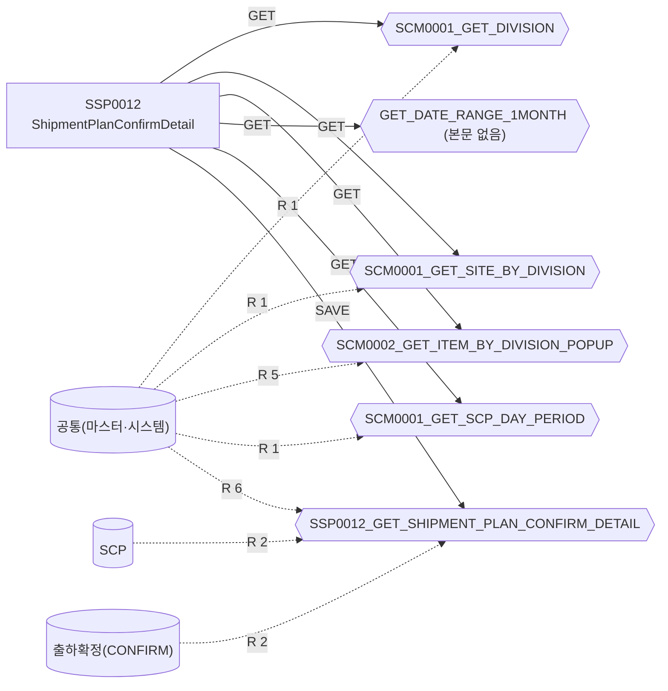

| SP | 출처 | 본문 | 쓰기(W) | 읽기(R) | 중첩 호출 |
|---|---|---|---|---|---|
| SCM0001_GET_DIVISION | matrix | Y | - | SCM_MST_DIVISION | - |
| SCM0001_GET_SITE_BY_DIVISION | matrix | Y | - | SCM_MST_SITE | - |
| SCM0002_GET_ITEM_BY_DIVISION_POPUP | matrix | Y | - | SCM_MST_DIVISION, SCM_MST_ITEM_SN, SCM_MST_PROJECT, SCM_MST_SITE, SCM_MST_SITE_ITEM | - |
| GET_DATE_RANGE_1MONTH | matrix | N | - | - | - |
| SCM0001_GET_SCP_DAY_PERIOD | matrix+endpoints | Y | - | SCM_SYS_CALENDAR_M | - |
| SSP0012_GET_SHIPMENT_PLAN_CONFIRM_DETAIL | matrix+endpoints | Y | - | SCM_ADM_LOOKUP_MASTER_DETAIL, SCM_MST_ITEM_SN, SCM_MST_PROJECT, SCM_MST_SITE, SCM_MST_SITE_ITEM, SCP_MST_BOD_N_V, SCP_MST_DISTRIBUTION_ROUTE, SSP_ANL_SHIP_CONFIRM, SSP_ANL_SHIP_CONFIRM_H, TB_FX_USER | - |

## SSP0060 ShipmentPlan / ShipmentPlanConfirmDetailPopup / ShipmentPlanRequestPopup (Main) · TO-BE SSP0060 Shipment Plan(Auto & ESS)-WA_UC

- SP 36개 · TO-BE PKG 배선 25건 · CHECK_CONFIRM_CHANGETIME:SCM_SSP_CHECK_CONFIRM_CHANGETIME, CHECK_CONFIRM_CHANGETIME_DE:PKG_SSP0060.P_SCM_SSP_CHECK_CONFIRM_CHANGETIME_DE, DELETE_SHIPMENT_REQUEST_DRAFTING_BY_CONFIRM:PKG_SSP0060.P_SCM_SSP_DELETE_SHIPMENT_REQUEST_DRAFTING_BY_CONFIRM, ERP_ERROR_CONFIRM:PKG_SSP0060.P_SCM_SSP_ANL_SHIP_ERP_ERROR_CONFIRM, GET_ERP_SO_NO_CNT:PKG_SSP0060.P_SSP0060_GET_ERP_SO_NO_CNT, GET_ORDER_DETAIL:P_SSP0300_GET_ORDER_DETAIL · 팝업 SCM0002_ItembyDivisionPopup
SCM0002_ProjectbyDivisionPopup
SCM0002_ShipmentPlanRequestPopup
SCM0002_TitleSetForm_Popup
SSP0060_ShipmentPlanConfirmDetailPopup
SSP0060_ShipmentPlanRequestPopup
SSP0300_OrderDetailPopup
UserInfoPopup

```mermaid
flowchart LR
  S["SSP0060<br/>ShipmentPlan / ShipmentPlanCon"]
  P_DM0003_GET_BUCKET_TYPE_CODE{{"DM0003_GET_BUCKET_TYPE_CODE"}}
  S --GET--> P_DM0003_GET_BUCKET_TYPE_CODE
  E____________[("공통(마스터·시스템)")] -."R 1".-> P_DM0003_GET_BUCKET_TYPE_CODE
  P_SCM0001_GET_DIVISION{{"SCM0001_GET_DIVISION"}}
  S --GET--> P_SCM0001_GET_DIVISION
  E____________[("공통(마스터·시스템)")] -."R 1".-> P_SCM0001_GET_DIVISION
  P_SCM0001_GET_SITE_BY_DIVISION{{"SCM0001_GET_SITE_BY_DIVISION"}}
  S --GET--> P_SCM0001_GET_SITE_BY_DIVISION
  E____________[("공통(마스터·시스템)")] -."R 1".-> P_SCM0001_GET_SITE_BY_DIVISION
  P_SCM0002_GET_ITEM_BY_DIVISION_POPUP{{"SCM0002_GET_ITEM_BY_DIVISION_POPUP"}}
  S --GET--> P_SCM0002_GET_ITEM_BY_DIVISION_POPUP
  E____________[("공통(마스터·시스템)")] -."R 5".-> P_SCM0002_GET_ITEM_BY_DIVISION_POPUP
  P_SCP0009_GET_SHEET_CALENDAR_3SPAN{{"SCP0009_GET_SHEET_CALENDAR_3SPAN"}}
  S --GET--> P_SCP0009_GET_SHEET_CALENDAR_3SPAN
  E____________[("공통(마스터·시스템)")] -."R 1".-> P_SCP0009_GET_SHEET_CALENDAR_3SPAN
  P_PR_SSP_ANL_SHIP_CONFIRM_CHG_BATCH{{"PR_SSP_ANL_SHIP_CONFIRM_CHG_BATCH"}}
  S --SAVE--> P_PR_SSP_ANL_SHIP_CONFIRM_CHG_BATCH
  P_PR_SSP_ANL_SHIP_CONFIRM_CHG_BATCH =="W 1"==> E______[("인터페이스")]
  P_PR_SSP_ANL_SHIP_CONFIRM_CHG_BATCH =="W 1"==> E___________CHG_REQ_[("출하확정 변경요청(CHG_REQ)")]
  E____________[("공통(마스터·시스템)")] -."R 3".-> P_PR_SSP_ANL_SHIP_CONFIRM_CHG_BATCH
  E______[("인터페이스")] -."R 1".-> P_PR_SSP_ANL_SHIP_CONFIRM_CHG_BATCH
  E___________CHG_REQ_[("출하확정 변경요청(CHG_REQ)")] -."R 1".-> P_PR_SSP_ANL_SHIP_CONFIRM_CHG_BATCH
  P_PR_SSP_ANL_SHIP_CONFIRM_CHG_BATCH_NEW_C{{"PR_SSP_ANL_SHIP_CONFIRM_CHG_BATCH_NEW_C"}}
  S --SAVE--> P_PR_SSP_ANL_SHIP_CONFIRM_CHG_BATCH_NEW_C
  P_PR_SSP_ANL_SHIP_CONFIRM_CHG_BATCH_NEW_C =="W 1"==> E______[("인터페이스")]
  P_PR_SSP_ANL_SHIP_CONFIRM_CHG_BATCH_NEW_C =="W 1"==> E___________CHG_REQ_[("출하확정 변경요청(CHG_REQ)")]
  E____________[("공통(마스터·시스템)")] -."R 3".-> P_PR_SSP_ANL_SHIP_CONFIRM_CHG_BATCH_NEW_C
  E______[("인터페이스")] -."R 1".-> P_PR_SSP_ANL_SHIP_CONFIRM_CHG_BATCH_NEW_C
  E___________CHG_REQ_[("출하확정 변경요청(CHG_REQ)")] -."R 1".-> P_PR_SSP_ANL_SHIP_CONFIRM_CHG_BATCH_NEW_C
  P_SCM_SSP_ANL_SHIP_ERP_ERROR_CONFIRM{{"SCM_SSP_ANL_SHIP_ERP_ERROR_CONFIRM"}}
  S --SAVE--> P_SCM_SSP_ANL_SHIP_ERP_ERROR_CONFIRM
  P_SCM_SSP_ANL_SHIP_ERP_ERROR_CONFIRM =="W 1"==> E_ERP____I_F_DO_SO_[("ERP 출하 I/F(DO·SO)")]
  P_SCM_SSP_ANL_SHIP_ERP_ERROR_CONFIRM =="W 2"==> E___________CHG_REQ_[("출하확정 변경요청(CHG_REQ)")]
  E____________[("공통(마스터·시스템)")] -."R? 1".-> P_SCM_SSP_ANL_SHIP_ERP_ERROR_CONFIRM
  P_SCM_SSP_CHECK_CONFIRM_CHANGETIME{{"SCM_SSP_CHECK_CONFIRM_CHANGETIME"}}
  S --SAVE--> P_SCM_SSP_CHECK_CONFIRM_CHANGETIME
  E___________CHG_REQ_[("출하확정 변경요청(CHG_REQ)")] -."R 1".-> P_SCM_SSP_CHECK_CONFIRM_CHANGETIME
  E____________[("공통(마스터·시스템)")] -."R? 1".-> P_SCM_SSP_CHECK_CONFIRM_CHANGETIME
  P_SCM_SSP_CHECK_CONFIRM_CHANGETIME_DE{{"SCM_SSP_CHECK_CONFIRM_CHANGETIME_DE"}}
  S --SAVE--> P_SCM_SSP_CHECK_CONFIRM_CHANGETIME_DE
  E______CONFIRM_[("출하확정(CONFIRM)")] -."R 1".-> P_SCM_SSP_CHECK_CONFIRM_CHANGETIME_DE
  E____________[("공통(마스터·시스템)")] -."R? 1".-> P_SCM_SSP_CHECK_CONFIRM_CHANGETIME_DE
  P_SCM_SSP_DELETE_SHIPMENT_REQUEST_DRAFTING_BY_CONFIRM{{"SCM_SSP_DELETE_SHIPMENT_REQUEST_DRAFTING_BY_CONFIRM"}}
  S --SAVE--> P_SCM_SSP_DELETE_SHIPMENT_REQUEST_DRAFTING_BY_CONFIRM
  P_SCM_SSP_DELETE_SHIPMENT_REQUEST_DRAFTING_BY_CONFIRM =="W 1"==> E______[("인터페이스")]
  P_SCM_SSP_DELETE_SHIPMENT_REQUEST_DRAFTING_BY_CONFIRM =="W 1"==> E___________CHG_REQ_[("출하확정 변경요청(CHG_REQ)")]
  P_SCM_SSP_DELETE_SHIPMENT_REQUEST_DRAFTING_BY_CONFIRM =="W 1"==> E______CONFIRM_[("출하확정(CONFIRM)")]
  E____________[("공통(마스터·시스템)")] -."R 3".-> P_SCM_SSP_DELETE_SHIPMENT_REQUEST_DRAFTING_BY_CONFIRM
  E___________CHG_REQ_[("출하확정 변경요청(CHG_REQ)")] -."R 1".-> P_SCM_SSP_DELETE_SHIPMENT_REQUEST_DRAFTING_BY_CONFIRM
  P_SSP0002_GET_NERP_CODE{{"SSP0002_GET_NERP_CODE"}}
  S --GET--> P_SSP0002_GET_NERP_CODE
  E____________[("공통(마스터·시스템)")] -."R 1".-> P_SSP0002_GET_NERP_CODE
  P_SSP0002_GET_USER_INFO_LIST{{"SSP0002_GET_USER_INFO_LIST"}}
  S --GET--> P_SSP0002_GET_USER_INFO_LIST
  E____________[("공통(마스터·시스템)")] -."R 4".-> P_SSP0002_GET_USER_INFO_LIST
  P_SSP0003_GET_SSP_PLAN_PROCESSING_CHECK{{"SSP0003_GET_SSP_PLAN_PROCESSING_CHECK"}}
  S --GET--> P_SSP0003_GET_SSP_PLAN_PROCESSING_CHECK
  E____________[("공통(마스터·시스템)")] -."R 3".-> P_SSP0003_GET_SSP_PLAN_PROCESSING_CHECK
  P_SSP0046_GET_BUCKET_TYPE_CODE{{"SSP0046_GET_BUCKET_TYPE_CODE"}}
  S --GET--> P_SSP0046_GET_BUCKET_TYPE_CODE
  E____________[("공통(마스터·시스템)")] -."R 1".-> P_SSP0046_GET_BUCKET_TYPE_CODE
  P_SSP0060_DELETE_SHIPMENT_REQUEST_DRAFTING{{"SSP0060_DELETE_SHIPMENT_REQUEST_DRAFTING"}}
  S --SAVE--> P_SSP0060_DELETE_SHIPMENT_REQUEST_DRAFTING
  P_SSP0060_DELETE_SHIPMENT_REQUEST_DRAFTING =="W 2"==> E___________CHG_REQ_[("출하확정 변경요청(CHG_REQ)")]
  E____________[("공통(마스터·시스템)")] -."R? 1".-> P_SSP0060_DELETE_SHIPMENT_REQUEST_DRAFTING
  P_SSP0060_GET_ERP_SO_NO_CNT{{"SSP0060_GET_ERP_SO_NO_CNT"}}
  S --GET--> P_SSP0060_GET_ERP_SO_NO_CNT
  E______CONFIRM_[("출하확정(CONFIRM)")] -."R 1".-> P_SSP0060_GET_ERP_SO_NO_CNT
  P_SSP0060_GET_HOLD_STOCK{{"SSP0060_GET_HOLD_STOCK"}}
  S --GET--> P_SSP0060_GET_HOLD_STOCK
  E_SCP[("SCP")] -."R 1".-> P_SSP0060_GET_HOLD_STOCK
  E____________[("공통(마스터·시스템)")] -."R 1".-> P_SSP0060_GET_HOLD_STOCK
  E______________________[("마스터(모델·담당·사이트·캘린더·버전)")] -."R 1".-> P_SSP0060_GET_HOLD_STOCK
  E____STOCK_ONHAND_[("재고(STOCK·ONHAND)")] -."R 1".-> P_SSP0060_GET_HOLD_STOCK
  P_SSP0060_GET_MES_STOCK{{"SSP0060_GET_MES_STOCK"}}
  S --GET--> P_SSP0060_GET_MES_STOCK
  E_SCP[("SCP")] -."R 1".-> P_SSP0060_GET_MES_STOCK
  E____STOCK_ONHAND_[("재고(STOCK·ONHAND)")] -."R 1".-> P_SSP0060_GET_MES_STOCK
  P_SSP0060_GET_MES_STOCK_DETAIL{{"SSP0060_GET_MES_STOCK_DETAIL"}}
  S --GET--> P_SSP0060_GET_MES_STOCK_DETAIL
  E_SCP[("SCP")] -."R 1".-> P_SSP0060_GET_MES_STOCK_DETAIL
  E____STOCK_ONHAND_[("재고(STOCK·ONHAND)")] -."R 1".-> P_SSP0060_GET_MES_STOCK_DETAIL
  P_SSP0060_GET_OWMS_DETAIL{{"SSP0060_GET_OWMS_DETAIL"}}
  S --GET--> P_SSP0060_GET_OWMS_DETAIL
  E_SCP[("SCP")] -."R 1".-> P_SSP0060_GET_OWMS_DETAIL
  E____________[("공통(마스터·시스템)")] -."R 2".-> P_SSP0060_GET_OWMS_DETAIL
  E______________________[("마스터(모델·담당·사이트·캘린더·버전)")] -."R 1".-> P_SSP0060_GET_OWMS_DETAIL
  E____STOCK_ONHAND_[("재고(STOCK·ONHAND)")] -."R 1".-> P_SSP0060_GET_OWMS_DETAIL
  P_SSP0060_GET_SHIPMENT_DIVISION{{"SSP0060_GET_SHIPMENT_DIVISION"}}
  S --GET--> P_SSP0060_GET_SHIPMENT_DIVISION
  E____________[("공통(마스터·시스템)")] -."R 4".-> P_SSP0060_GET_SHIPMENT_DIVISION
  P_SSP0060_GET_SHIPMENT_PLAN{{"SSP0060_GET_SHIPMENT_PLAN"}}
  S --GET--> P_SSP0060_GET_SHIPMENT_PLAN
  E_DM[("DM")] -."R 1".-> P_SSP0060_GET_SHIPMENT_PLAN
  E_ESS[("ESS")] -."R 1".-> P_SSP0060_GET_SHIPMENT_PLAN
  E_FP_I_F[("FP I/F")] -."R 2".-> P_SSP0060_GET_SHIPMENT_PLAN
  E_SCP[("SCP")] -."R 4".-> P_SSP0060_GET_SHIPMENT_PLAN
  E____________[("공통(마스터·시스템)")] -."R 6".-> P_SSP0060_GET_SHIPMENT_PLAN
  E______________________[("마스터(모델·담당·사이트·캘린더·버전)")] -."R 1".-> P_SSP0060_GET_SHIPMENT_PLAN
  E_______________[("외부 연계 실적·재고·계획")] -."R 2".-> P_SSP0060_GET_SHIPMENT_PLAN
  E____STOCK_ONHAND_[("재고(STOCK·ONHAND)")] -."R 3".-> P_SSP0060_GET_SHIPMENT_PLAN
  E______SHIP_PLAN_[("출하계획(SHIP_PLAN)")] -."R 1".-> P_SSP0060_GET_SHIPMENT_PLAN
  E______CONFIRM_[("출하확정(CONFIRM)")] -."R 1".-> P_SSP0060_GET_SHIPMENT_PLAN
  P_SSP0060_GET_SHIPMENT_PLAN_DETAIL{{"SSP0060_GET_SHIPMENT_PLAN_DETAIL"}}
  S --GET--> P_SSP0060_GET_SHIPMENT_PLAN_DETAIL
  E_DM[("DM")] -."R 1".-> P_SSP0060_GET_SHIPMENT_PLAN_DETAIL
  E_SCP[("SCP")] -."R 3".-> P_SSP0060_GET_SHIPMENT_PLAN_DETAIL
  E____________[("공통(마스터·시스템)")] -."R 11".-> P_SSP0060_GET_SHIPMENT_PLAN_DETAIL
  E______________________[("마스터(모델·담당·사이트·캘린더·버전)")] -."R 1".-> P_SSP0060_GET_SHIPMENT_PLAN_DETAIL
  E______SHIP_PLAN_[("출하계획(SHIP_PLAN)")] -."R 1".-> P_SSP0060_GET_SHIPMENT_PLAN_DETAIL
  E___________CHG_REQ_[("출하확정 변경요청(CHG_REQ)")] -."R 2".-> P_SSP0060_GET_SHIPMENT_PLAN_DETAIL
  E______CONFIRM_[("출하확정(CONFIRM)")] -."R 1".-> P_SSP0060_GET_SHIPMENT_PLAN_DETAIL
  P_SSP0060_GET_SHIPMENT_REQUEST_CONFIRM_DRAFTING{{"SSP0060_GET_SHIPMENT_REQUEST_CONFIRM_DRAFTING"}}
  S --SAVE--> P_SSP0060_GET_SHIPMENT_REQUEST_CONFIRM_DRAFTING
  E_SCP[("SCP")] -."R 2".-> P_SSP0060_GET_SHIPMENT_REQUEST_CONFIRM_DRAFTING
  E____________[("공통(마스터·시스템)")] -."R 3".-> P_SSP0060_GET_SHIPMENT_REQUEST_CONFIRM_DRAFTING
  E___________CHG_REQ_[("출하확정 변경요청(CHG_REQ)")] -."R 2".-> P_SSP0060_GET_SHIPMENT_REQUEST_CONFIRM_DRAFTING
  E______CONFIRM_[("출하확정(CONFIRM)")] -."R 1".-> P_SSP0060_GET_SHIPMENT_REQUEST_CONFIRM_DRAFTING
  P_SSP0060_GET_SHIPMENT_RESULT{{"SSP0060_GET_SHIPMENT_RESULT"}}
  S --GET--> P_SSP0060_GET_SHIPMENT_RESULT
  E_SCP[("SCP")] -."R 1".-> P_SSP0060_GET_SHIPMENT_RESULT
  E____________[("공통(마스터·시스템)")] -."R 4".-> P_SSP0060_GET_SHIPMENT_RESULT
  E______________________[("마스터(모델·담당·사이트·캘린더·버전)")] -."R 2".-> P_SSP0060_GET_SHIPMENT_RESULT
  E_______________[("외부 연계 실적·재고·계획")] -."R 1".-> P_SSP0060_GET_SHIPMENT_RESULT
  E______SHIP_PLAN_[("출하계획(SHIP_PLAN)")] -."R 1".-> P_SSP0060_GET_SHIPMENT_RESULT
  E_________OWMS_[("출하실적·반품(OWMS)")] -."R 2".-> P_SSP0060_GET_SHIPMENT_RESULT
  E______CONFIRM_[("출하확정(CONFIRM)")] -."R 1".-> P_SSP0060_GET_SHIPMENT_RESULT
  P_SSP0060_GET_SHIPMENT_STATUS{{"SSP0060_GET_SHIPMENT_STATUS"}}
  S --GET--> P_SSP0060_GET_SHIPMENT_STATUS
  E______CONFIRM_[("출하확정(CONFIRM)")] -."R 1".-> P_SSP0060_GET_SHIPMENT_STATUS
  P_SSP0060_GET_STOCK_LOCATION_DETAIL{{"SSP0060_GET_STOCK_LOCATION_DETAIL"}}
  S --GET--> P_SSP0060_GET_STOCK_LOCATION_DETAIL
  E_ESS[("ESS")] -."R 1".-> P_SSP0060_GET_STOCK_LOCATION_DETAIL
  E_SCP[("SCP")] -."R 1".-> P_SSP0060_GET_STOCK_LOCATION_DETAIL
  E____________[("공통(마스터·시스템)")] -."R 3".-> P_SSP0060_GET_STOCK_LOCATION_DETAIL
  E______________________[("마스터(모델·담당·사이트·캘린더·버전)")] -."R 1".-> P_SSP0060_GET_STOCK_LOCATION_DETAIL
  E____STOCK_ONHAND_[("재고(STOCK·ONHAND)")] -."R 1".-> P_SSP0060_GET_STOCK_LOCATION_DETAIL
  P_SSP0060_SAVE_HOLD_STOCK_DATA{{"SSP0060_SAVE_HOLD_STOCK_DATA (본문 없음)"}}
  S --SAVE--> P_SSP0060_SAVE_HOLD_STOCK_DATA
  P_SSP0060_SAVE_SHIPMENT_PLAN{{"SSP0060_SAVE_SHIPMENT_PLAN"}}
  S --SAVE--> P_SSP0060_SAVE_SHIPMENT_PLAN
  P_SSP0060_SAVE_SHIPMENT_PLAN =="W 2"==> E___________CHG_REQ_[("출하확정 변경요청(CHG_REQ)")]
  E_SCP[("SCP")] -."R 3".-> P_SSP0060_SAVE_SHIPMENT_PLAN
  E____________[("공통(마스터·시스템)")] -."R 2".-> P_SSP0060_SAVE_SHIPMENT_PLAN
  E______________________[("마스터(모델·담당·사이트·캘린더·버전)")] -."R 2".-> P_SSP0060_SAVE_SHIPMENT_PLAN
  E______CONFIRM_[("출하확정(CONFIRM)")] -."R 1".-> P_SSP0060_SAVE_SHIPMENT_PLAN
  E____________[("공통(마스터·시스템)")] -."R? 1".-> P_SSP0060_SAVE_SHIPMENT_PLAN
  P_SSP0060_SAVE_SHIPMENT_REQUEST_CONFIRM{{"SSP0060_SAVE_SHIPMENT_REQUEST_CONFIRM"}}
  S --SAVE--> P_SSP0060_SAVE_SHIPMENT_REQUEST_CONFIRM
  P_SSP0060_SAVE_SHIPMENT_REQUEST_CONFIRM =="W 2"==> E_DM[("DM")]
  P_SSP0060_SAVE_SHIPMENT_REQUEST_CONFIRM =="W 1"==> E_SCP[("SCP")]
  P_SSP0060_SAVE_SHIPMENT_REQUEST_CONFIRM =="W 1"==> E____________[("공통(마스터·시스템)")]
  P_SSP0060_SAVE_SHIPMENT_REQUEST_CONFIRM =="W 1"==> E______[("메일 발송")]
  P_SSP0060_SAVE_SHIPMENT_REQUEST_CONFIRM =="W 3"==> E______[("인터페이스")]
  P_SSP0060_SAVE_SHIPMENT_REQUEST_CONFIRM =="W 1"==> E___________CHG_REQ_[("출하확정 변경요청(CHG_REQ)")]
  P_SSP0060_SAVE_SHIPMENT_REQUEST_CONFIRM =="W 3"==> E______CONFIRM_[("출하확정(CONFIRM)")]
  E_DM[("DM")] -."R 3".-> P_SSP0060_SAVE_SHIPMENT_REQUEST_CONFIRM
  E_SCP[("SCP")] -."R 5".-> P_SSP0060_SAVE_SHIPMENT_REQUEST_CONFIRM
  E____________[("공통(마스터·시스템)")] -."R 5".-> P_SSP0060_SAVE_SHIPMENT_REQUEST_CONFIRM
  E______________________[("마스터(모델·담당·사이트·캘린더·버전)")] -."R 3".-> P_SSP0060_SAVE_SHIPMENT_REQUEST_CONFIRM
  E_______________[("외부 연계 실적·재고·계획")] -."R 1".-> P_SSP0060_SAVE_SHIPMENT_REQUEST_CONFIRM
  E______[("인터페이스")] -."R 2".-> P_SSP0060_SAVE_SHIPMENT_REQUEST_CONFIRM
  E______SHIP_REQ_[("출하요청(SHIP_REQ)")] -."R 1".-> P_SSP0060_SAVE_SHIPMENT_REQUEST_CONFIRM
  E___________CHG_REQ_[("출하확정 변경요청(CHG_REQ)")] -."R 1".-> P_SSP0060_SAVE_SHIPMENT_REQUEST_CONFIRM
  P_SSP0060_SAVE_SHIPMENT_REQUEST_DRAFTING{{"SSP0060_SAVE_SHIPMENT_REQUEST_DRAFTING"}}
  S --SAVE--> P_SSP0060_SAVE_SHIPMENT_REQUEST_DRAFTING
  P_SSP0060_SAVE_SHIPMENT_REQUEST_DRAFTING =="W 1"==> E______[("인터페이스")]
  P_SSP0060_SAVE_SHIPMENT_REQUEST_DRAFTING =="W 2"==> E___________CHG_REQ_[("출하확정 변경요청(CHG_REQ)")]
  E_SCP[("SCP")] -."R 2".-> P_SSP0060_SAVE_SHIPMENT_REQUEST_DRAFTING
  E____________[("공통(마스터·시스템)")] -."R 3".-> P_SSP0060_SAVE_SHIPMENT_REQUEST_DRAFTING
  E______[("인터페이스")] -."R 1".-> P_SSP0060_SAVE_SHIPMENT_REQUEST_DRAFTING
  E______CONFIRM_[("출하확정(CONFIRM)")] -."R 1".-> P_SSP0060_SAVE_SHIPMENT_REQUEST_DRAFTING
  E____________[("공통(마스터·시스템)")] -."R? 1".-> P_SSP0060_SAVE_SHIPMENT_REQUEST_DRAFTING
  P_SSP0060_SAVE_SHIPMENT_REQUEST_DRAFTING_MAIN{{"SSP0060_SAVE_SHIPMENT_REQUEST_DRAFTING_MAIN"}}
  S --SAVE--> P_SSP0060_SAVE_SHIPMENT_REQUEST_DRAFTING_MAIN
  P_SSP0060_SAVE_SHIPMENT_REQUEST_DRAFTING_MAIN =="W 2"==> E___________CHG_REQ_[("출하확정 변경요청(CHG_REQ)")]
  E____________[("공통(마스터·시스템)")] -."R? 1".-> P_SSP0060_SAVE_SHIPMENT_REQUEST_DRAFTING_MAIN
  P_SSP0202_SAVE_SHIPMENT_REQUEST_CONFIRM_IF_CHECK{{"SSP0202_SAVE_SHIPMENT_REQUEST_CONFIRM_IF_CHECK"}}
  S --SAVE--> P_SSP0202_SAVE_SHIPMENT_REQUEST_CONFIRM_IF_CHECK
  P_SSP0202_SAVE_SHIPMENT_REQUEST_CONFIRM_IF_CHECK =="W 2"==> E______[("인터페이스")]
  P_SSP0202_SAVE_SHIPMENT_REQUEST_CONFIRM_IF_CHECK =="W 1"==> E___________CHG_REQ_[("출하확정 변경요청(CHG_REQ)")]
  E____________[("공통(마스터·시스템)")] -."R 4".-> P_SSP0202_SAVE_SHIPMENT_REQUEST_CONFIRM_IF_CHECK
  E______________________[("마스터(모델·담당·사이트·캘린더·버전)")] -."R 1".-> P_SSP0202_SAVE_SHIPMENT_REQUEST_CONFIRM_IF_CHECK
  E______[("인터페이스")] -."R 1".-> P_SSP0202_SAVE_SHIPMENT_REQUEST_CONFIRM_IF_CHECK
  E___________CHG_REQ_[("출하확정 변경요청(CHG_REQ)")] -."R 1".-> P_SSP0202_SAVE_SHIPMENT_REQUEST_CONFIRM_IF_CHECK
  E____________[("공통(마스터·시스템)")] -."R? 1".-> P_SSP0202_SAVE_SHIPMENT_REQUEST_CONFIRM_IF_CHECK
  P_SSP0300_GET_ORDER_DETAIL{{"SSP0300_GET_ORDER_DETAIL"}}
  S --GET--> P_SSP0300_GET_ORDER_DETAIL
  E_ERP____I_F_DO_SO_[("ERP 출하 I/F(DO·SO)")] -."R 2".-> P_SSP0300_GET_ORDER_DETAIL
  P_UP_FX_GETUSERINFOLIST{{"UP_FX_GETUSERINFOLIST"}}
  S --GET--> P_UP_FX_GETUSERINFOLIST
  E____________[("공통(마스터·시스템)")] -."R 4".-> P_UP_FX_GETUSERINFOLIST
```

| SP | 출처 | 본문 | 쓰기(W) | 읽기(R) | 중첩 호출 |
|---|---|---|---|---|---|
| DM0003_GET_BUCKET_TYPE_CODE | matrix+endpoints | Y | - | SCM_ADM_LOOKUP_MASTER_DETAIL | - |
| SCM0001_GET_DIVISION | matrix | Y | - | SCM_MST_DIVISION | - |
| SCM0001_GET_SITE_BY_DIVISION | matrix | Y | - | SCM_MST_SITE | - |
| SCM0002_GET_ITEM_BY_DIVISION_POPUP | matrix | Y | - | SCM_MST_DIVISION, SCM_MST_ITEM_SN, SCM_MST_PROJECT, SCM_MST_SITE, SCM_MST_SITE_ITEM | - |
| SCP0009_GET_SHEET_CALENDAR_3SPAN | matrix+endpoints | Y | - | SCM_SYS_CALENDAR_M | - |
| PR_SSP_ANL_SHIP_CONFIRM_CHG_BATCH | matrix+endpoints | Y | SSP_ANL_SHIP_CONFIRM_CHG_REQ_DE, XIF_ERP_SHIP_PLAN_CONFIRM_S_SN | NERP_CONV_MASTER, SCM_ADM_LOOKUP_MASTER_DETAIL, SCM_MST_DIVISION, SCM_MST_SITE, SSP_ANL_SHIP_CONFIRM_CHG_REQ | PR_SCP_SYS_LOG_BATCH |
| PR_SSP_ANL_SHIP_CONFIRM_CHG_BATCH_NEW_C | matrix+endpoints | Y | SSP_ANL_SHIP_CONFIRM_CHG_REQ_DE, XIF_ERP_SHIP_PLAN_CONFIRM_S_SN | NERP_CONV_MASTER, SCM_ADM_LOOKUP_MASTER_DETAIL, SCM_MST_DIVISION, SCM_MST_SITE, SSP_ANL_SHIP_CONFIRM_CHG_REQ | PR_SCP_SYS_LOG_BATCH |
| SCM_SSP_ANL_SHIP_ERP_ERROR_CONFIRM | matrix+endpoints | Y | SSP_ANL_SHIP_CONFIRM_CHG_REQ, SSP_ANL_SHIP_CONFIRM_CHG_REQ_DE, SSP_ANL_SHIP_ERP_ERROR_CONFIRM | SCM_SYS_LOG_BATCH | PR_SCM_SYS_LOG_BATCH_CALL_TRAN |
| SCM_SSP_CHECK_CONFIRM_CHANGETIME | matrix+endpoints | Y | - | SCM_SYS_LOG_BATCH, SSP_ANL_SHIP_CONFIRM_CHG_REQ_DE | PR_SCM_SYS_LOG_BATCH |
| SCM_SSP_CHECK_CONFIRM_CHANGETIME_DE | matrix+endpoints | Y | - | SCM_SYS_LOG_BATCH, SSP_ANL_SHIP_CONFIRM | PR_SCM_SYS_LOG_BATCH |
| SCM_SSP_DELETE_SHIPMENT_REQUEST_DRAFTING_BY_CONFIRM | matrix+endpoints | Y | SSP_ANL_SHIP_CONFIRM, SSP_ANL_SHIP_CONFIRM_CHG_REQ_DE, XIF_ERP_SHIP_PLAN_CONFIRM_S_SN | SCM_ADM_LOOKUP_MASTER_DETAIL, SCM_MST_DIVISION, SCM_MST_SITE, SSP_ANL_SHIP_CONFIRM_CHG_REQ | PR_SCM_SYS_LOG_BATCH_CALL_TRAN |
| SSP0002_GET_NERP_CODE | matrix+endpoints | Y | - | SCM_CODE_LOOKUP_VALUE | - |
| SSP0002_GET_USER_INFO_LIST | matrix+endpoints | Y | - | SCM_MST_SSO_DEPT_INFO, TB_FX_GROUPINFO, TB_FX_USER, TB_FX_USERGROUPAUTHEXTENTION | - |
| SSP0003_GET_SSP_PLAN_PROCESSING_CHECK | matrix+endpoints | Y | - | SCM_MST_DIVISION, SCM_MST_PLAN, SCM_MST_PLAN_DETAIL | - |
| SSP0046_GET_BUCKET_TYPE_CODE | matrix | Y | - | SCM_ADM_LOOKUP_MASTER_DETAIL | - |
| SSP0060_DELETE_SHIPMENT_REQUEST_DRAFTING | matrix+endpoints | Y | SSP_ANL_SHIP_CONFIRM_CHG_REQ, SSP_ANL_SHIP_CONFIRM_CHG_REQ_DE | SCM_SYS_LOG_BATCH | PR_SCM_SYS_LOG_BATCH_CALL_TRAN |
| SSP0060_GET_ERP_SO_NO_CNT | matrix+endpoints | Y | - | SSP_ANL_SHIP_CONFIRM | - |
| SSP0060_GET_HOLD_STOCK | matrix+endpoints | Y | - | SCP_MST_FINAL_ITEM, SSP_ANL_HOLD_STOCK, SSP_MST_MODEL_USER, TB_FX_USER | - |
| SSP0060_GET_MES_STOCK | matrix+endpoints | Y | - | SCP_MST_FINAL_ITEM, SSP_DNM_GMES_STOCK_81_82 | - |
| SSP0060_GET_MES_STOCK_DETAIL | matrix+endpoints | Y | - | SCP_MST_FINAL_ITEM, SSP_DNM_GMES_STOCK_81_82 | - |
| SSP0060_GET_OWMS_DETAIL | matrix+endpoints | Y | - | SCM_ADM_LOOKUP_MASTER_DETAIL, SCM_MST_SLOC, SCP_MST_FINAL_ITEM, SSP_ANL_OWMS_STOCK_C2, SSP_MST_MODEL_USER | - |
| SSP0060_GET_SHIPMENT_DIVISION | matrix+endpoints | Y | - | SCM_ADM_LOOKUP_MASTER_DETAIL, SCM_MST_DIVISION, SCM_MST_SITE, TB_FX_USERGROUPAUTHEXTENTION | - |
| SSP0060_GET_SHIPMENT_PLAN | matrix+endpoints | Y | - | DM_PLN_SHIPMENT_REQ, SCM_ADM_LOOKUP_MASTER_DETAIL, SCM_DNM_CELL_INHOUSE_PLAN_SN, SCM_DNM_EXFACTORY_RESULT, SCM_MST_ITEM_SN, SCM_MST_SHEET_MEASURE, SCM_MST_SITE, SCM_MST_TITLESET_USER, SCM_SYS_CALENDAR_M, SCP_ANL_PRODUCTION_PLAN, SCP_MST_FINAL_ITEM, SCP_MST_SHIPMENT_LOT_SIZE, SCP_PLAN_VERSION_V, SSP_ANL_OWMS_STOCK_C2, SSP_ANL_SHIP_CONFIRM, SSP_ANL_SHIP_PLAN_C, SSP_DNM_ESS_PACKER_STOCK_V, SSP_DNM_FP_AMEND_SHIPAVAL, SSP_DNM_FP_PLAN_FROZEN, SSP_DNM_GMES_STOCK_81_82, SSP_DNM_STOCK_C, SSP_MST_LOCATION_V | SSP0060_GET_SHIPMENT_PSI_COMMENTS |
| SSP0060_GET_SHIPMENT_PLAN_DETAIL | matrix+endpoints | Y | - | DM_PLN_SHIPMENT_REQ, SCM_ADM_LOOKUP_MASTER_DETAIL, SCM_MST_CITY, SCM_MST_COUNTRY, SCM_MST_CUSTOMER, SCM_MST_ITEM_SN, SCM_MST_SITE, SCM_MST_SITE_CUSTOMER, SCM_MST_SITE_ITEM, SCM_MST_SSO_DEPT_INFO, SCM_MST_SSO_USER_INFO, SCP_MST_BOD_N_V, SCP_MST_DISTRIBUTION_ROUTE, SCP_MST_FINAL_ITEM, SSP_ANL_SHIP_CONFIRM, SSP_ANL_SHIP_CONFIRM_CHG_REQ, SSP_ANL_SHIP_CONFIRM_CHG_REQ_DE, SSP_ANL_SHIP_PLAN_ALL, SSP_MST_MODEL_USER, TB_FX_USER | - |
| SSP0060_GET_SHIPMENT_REQUEST_CONFIRM_DRAFTING | matrix+endpoints | Y | - | SCM_ADM_LOOKUP_MASTER_DETAIL, SCM_MST_SSO_DEPT_INFO, SCP_MST_BOD_N_V, SCP_MST_FINAL_ITEM, SSP_ANL_SHIP_CONFIRM, SSP_ANL_SHIP_CONFIRM_CHG_REQ, SSP_ANL_SHIP_CONFIRM_CHG_REQ_DE, TB_FX_USER | - |
| SSP0060_GET_SHIPMENT_RESULT | matrix+endpoints | Y | - | SCM_ADM_LOOKUP_MASTER_DETAIL, SCM_DNM_EXFACTORY_RESULT, SCM_MST_ITEM_SN, SCM_MST_SITE, SCM_MST_SITE_ITEM, SCP_MST_FINAL_ITEM, SSP_ANL_SHIP_CONFIRM, SSP_ANL_SHIP_PLAN_ALL, SSP_DNM_SHIP_RESULT_OWMS, SSP_DNM_SHIP_RETURN_OWMS, SSP_MST_DELEGATE, SSP_MST_MODEL_USER | - |
| SSP0060_GET_SHIPMENT_STATUS | matrix+endpoints | Y | - | SSP_ANL_SHIP_CONFIRM | - |
| SSP0060_GET_STOCK_LOCATION_DETAIL | matrix+endpoints | Y | - | SCM_ADM_LOOKUP_MASTER_DETAIL, SCM_MST_SITE, SCM_MST_SLOC, SCP_MST_FINAL_ITEM, SSP_DNM_ESS_PACKER_STOCK_V, SSP_DNM_STOCK_C, SSP_MST_LOCATION_V | - |
| SSP0060_SAVE_HOLD_STOCK_DATA | matrix | N | - | - | - |
| SSP0060_SAVE_SHIPMENT_PLAN | matrix+endpoints | Y | SSP_ANL_SHIP_CONFIRM_CHG_REQ, SSP_ANL_SHIP_CONFIRM_CHG_REQ_DE | SCM_MST_SITE, SCM_MST_SITE_ITEM, SCM_SYS_LOG_BATCH, SCP_MST_BOD_ITEM, SCP_MST_BOD_N_V, SCP_MST_SHIPMENT_LOT_SIZE, SSP_ANL_SHIP_CONFIRM, SSP_MST_PARTIAL_SEQ, SSP_MST_SITE_ITEM_EE_V | PR_SCM_SYS_LOG_BATCH |
| SSP0060_SAVE_SHIPMENT_REQUEST_CONFIRM | matrix+endpoints | Y | DM_PLN_MKT_FCST, DM_PLN_MKT_FCST_CONFIRM, SCM_ADM_SMS_MAIL_SEND_LOG, SCP_PLN_INTERFACE_SEND_H, SSP_ANL_SHIP_CONFIRM, SSP_ANL_SHIP_CONFIRM_CHG_REQ_DE, SSP_ANL_SHIP_CONFIRM_H, SSP_ANL_SHIP_CONFIRM_ROUTE, SSP_MST_SEND_MAIL_REQ, XIF_ERP_SHIP_PLAN_CONFIRM_S_SN, XIF_FP_SSP_SALES_EXFACTORY_S_SN, XIF_SCS_PACK_SHIP_PLAN_S_SN | DM_MST_ITEM_SINGLE_V, DM_PLN_MKT_FCST_RESULT, DM_PLN_SHIPMENT_REQ, NERP_CONV_MASTER, SCM_ADM_LOOKUP_MASTER_DETAIL, SCM_DNM_EXFACTORY_RESULT, SCM_MST_DIVISION, SCM_MST_PROJECT, SCM_MST_SITE, SCM_MST_SITE_ITEM, SCP_MST_BOD, SCP_MST_BOD_ITEM, SCP_MST_BOD_N_V, SCP_MST_DISTRIBUTION_ROUTE, SCP_MST_FINAL_ITEM, SSP_ANL_SHIP_CONFIRM_CHG_REQ, SSP_ANL_SHIP_REQ_EE, SSP_MST_MODEL_USER_EE, SSP_MST_SITE_ITEM_EE_V, SSP_PLAN_VERSION_V, XIF_ERP_SHIP_DOC_R_SN | PR_DM_SSP_CONFIRM_SYNC, PR_SCM_SYS_LOG_BATCH, PR_SCP_SYS_LOG_BATCH, PR_SSP_ANL_SHIP_CONFIRM_CHG_BATCH_SCS, PR_SSP_ANL_SHIP_CONFIRM_HIST, PR_SSP_ANL_SHIP_CONFIRM_ROUTE, PR_SSP_MAIL_SEND_ADJUST_MST, PR_SSP_MAIL_SEND_ADJUST_SUB, PR_SSP_PLN_FP_SHIP_TARGET_WA, SCM_ADM_SAVE_MAIL_SEND_BATCH_LOG, SP_SEND_DBMAIL |
| SSP0060_SAVE_SHIPMENT_REQUEST_DRAFTING | matrix+endpoints | Y | SSP_ANL_SHIP_CONFIRM_CHG_REQ, SSP_ANL_SHIP_CONFIRM_CHG_REQ_DE, XIF_ERP_SHIP_PLAN_CONFIRM_S_SN | NERP_CONV_MASTER, SCM_ADM_LOOKUP_MASTER_DETAIL, SCM_MST_DIVISION, SCM_MST_SITE, SCM_SYS_LOG_BATCH, SCP_MST_BOD_ITEM, SCP_MST_BOD_N_V, SSP_ANL_SHIP_CONFIRM | PR_SCM_SYS_LOG_BATCH, PR_SCP_SYS_LOG_BATCH, PR_SSP_ANL_SHIP_CONFIRM_CHG_BATCH |
| SSP0060_SAVE_SHIPMENT_REQUEST_DRAFTING_MAIN | matrix+endpoints | Y | SSP_ANL_SHIP_CONFIRM_CHG_REQ, SSP_ANL_SHIP_CONFIRM_CHG_REQ_DE | SCM_SYS_LOG_BATCH | PR_SCM_SYS_LOG_BATCH |
| SSP0202_SAVE_SHIPMENT_REQUEST_CONFIRM_IF_CHECK | matrix+endpoints | Y | SSP_ANL_SHIP_CONFIRM_CHG_REQ_DE, XIF_ERP_PACK_SHIP_PLAN_S_SN, XIF_SCS_PACK_SHIP_PLAN_S_SN | NERP_CONV_MASTER, SCM_ADM_LOOKUP_MASTER_DETAIL, SCM_MST_SITE, SCM_MST_SITE_ITEM, SCM_SYS_LOG_BATCH, SSP_ANL_SHIP_CONFIRM_CHG_REQ, SSP_MST_MODEL_USER, TB_FX_USER | PR_SCM_SYS_LOG_BATCH_CALL_TRAN, PR_SCP_SYS_LOG_BATCH, PR_SSP_ANL_SHIP_CONFIRM_CHG_BATCH_PACKER |
| SSP0300_GET_ORDER_DETAIL | matrix | Y | - | SSP_ANL_SHIP_ERP_DO, SSP_ANL_SHIP_ERP_SO | - |
| UP_FX_GETUSERINFOLIST | matrix | Y | - | SCM_MST_SSO_DEPT_INFO, SCM_MST_SSO_USER_INFO, TB_FX_GROUPINFO, TB_FX_USER | - |

## SSP0014 ShipmentModelPIC (Main) · TO-BE SSP0014 Shipment Model PIC

- SP 7개 · TO-BE PKG 배선 3건 · SAVE:PKG_SSP0014.P_SSP0014_SAVE_MODEL_PIC, SEARCH:PKG_SSP0014.P_SSP0014_GET_MODEL_PIC, USER_CHECK:PKG_SSP0014.P_SSP0014_GET_USER_ID_CHECK · 팝업 SCM0002_ItembyDivisionPopup
UserInfoPopup

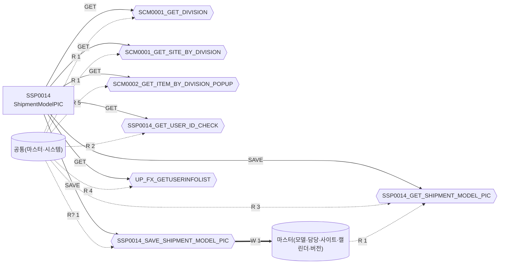

| SP | 출처 | 본문 | 쓰기(W) | 읽기(R) | 중첩 호출 |
|---|---|---|---|---|---|
| SCM0001_GET_DIVISION | matrix | Y | - | SCM_MST_DIVISION | - |
| SCM0001_GET_SITE_BY_DIVISION | matrix | Y | - | SCM_MST_SITE | - |
| SCM0002_GET_ITEM_BY_DIVISION_POPUP | matrix | Y | - | SCM_MST_DIVISION, SCM_MST_ITEM_SN, SCM_MST_PROJECT, SCM_MST_SITE, SCM_MST_SITE_ITEM | - |
| SSP0014_GET_SHIPMENT_MODEL_PIC | matrix+endpoints | Y | - | SCM_MST_SITE, SCM_MST_SITE_ITEM, SSP_MST_MODEL_USER, TB_FX_USER | - |
| SSP0014_GET_USER_ID_CHECK | matrix+endpoints | Y | - | TB_FX_USER, TB_FX_USERGROUPAUTHEXTENTION | - |
| SSP0014_SAVE_SHIPMENT_MODEL_PIC | matrix+endpoints | Y | SSP_MST_MODEL_USER | SCM_SYS_LOG_BATCH | PR_SCM_SYS_LOG_BATCH |
| UP_FX_GETUSERINFOLIST | matrix | Y | - | SCM_MST_SSO_DEPT_INFO, SCM_MST_SSO_USER_INFO, TB_FX_GROUPINFO, TB_FX_USER | - |

## SSP0019 ShipmentChangeHistory (Main) · TO-BE SSP0019 Shipment Change History

- SP 6개 · TO-BE PKG 배선 3건 · GET_REQ_DRAFTING:PKG_SSP0003.P_SSP0003_GET_REQ_DRAFTING, SEARCH:PKG_SCM0002.P_SCM0002_GET_ITEM_BY_DIVISION_POPUP, SEARCH:PKG_SSP0019.P_SSP0019_GET_SHIPMENT_CHANGE_HISTORY · 팝업 SCM0002_ItembyDivisionPopup
SCM0002_ShipmentPlanRequestPopup

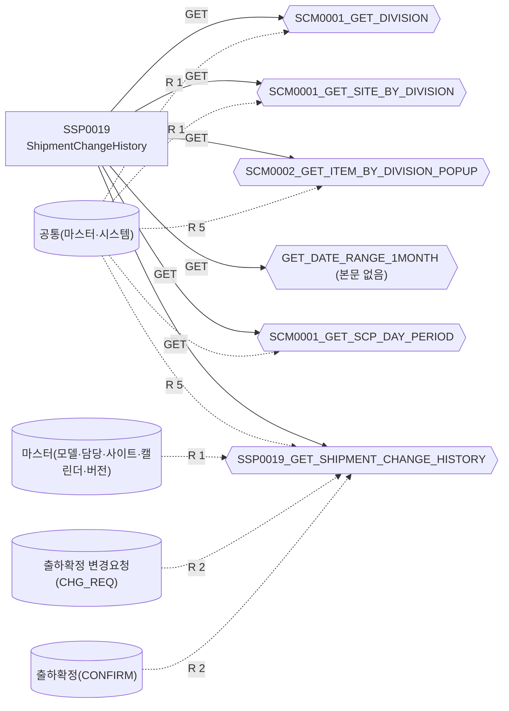

| SP | 출처 | 본문 | 쓰기(W) | 읽기(R) | 중첩 호출 |
|---|---|---|---|---|---|
| SCM0001_GET_DIVISION | matrix | Y | - | SCM_MST_DIVISION | - |
| SCM0001_GET_SITE_BY_DIVISION | matrix | Y | - | SCM_MST_SITE | - |
| SCM0002_GET_ITEM_BY_DIVISION_POPUP | matrix | Y | - | SCM_MST_DIVISION, SCM_MST_ITEM_SN, SCM_MST_PROJECT, SCM_MST_SITE, SCM_MST_SITE_ITEM | - |
| GET_DATE_RANGE_1MONTH | matrix | N | - | - | - |
| SCM0001_GET_SCP_DAY_PERIOD | matrix | Y | - | SCM_SYS_CALENDAR_M | - |
| SSP0019_GET_SHIPMENT_CHANGE_HISTORY | matrix+endpoints | Y | - | SCM_MST_CUSTOMER, SCM_MST_SITE, SCM_MST_SITE_ITEM, SCM_MST_SSO_DEPT_INFO, SSP_ANL_SHIP_CONFIRM, SSP_ANL_SHIP_CONFIRM_CHG_REQ, SSP_ANL_SHIP_CONFIRM_CHG_REQ_DE, SSP_ANL_SHIP_CONFIRM_H, SSP_MST_MODEL_USER, TB_FX_USER | - |

## SSP0021 ShipmentPlan (Main) · TO-BE SSP0021 Shipment Plan(Auto & ESS)

- SP 28개 · TO-BE PKG 배선 23건 · CHECK_CONFIRM_CHANGETIME:SCM_SSP_CHECK_CONFIRM_CHANGETIME, DELETE_SHIPMENT_REQUEST_DRAFTING_BY_CONFIRM:PKG_SSP0021.P_SCM_SSP_DELETE_SHIPMENT_REQUEST_DRAFTING_BY_CONFIRM, ERP_ERROR_CONFIRM:PKG_SSP0021.P_SCM_SSP_ANL_SHIP_ERP_ERROR_CONFIRM, GET_ERP_SO_NO_CNT:PKG_SSP0021.P_SSP0021_GET_ERP_SO_NO_CNT, GET_ORDER_DETAIL:P_SSP0300_GET_ORDER_DETAIL, GET_REQ_DRAFTING:PKG_SSP0003.P_SSP0003_GET_REQ_DRAFTING · 팝업 SCM0002_ItembyDivisionPopup
SCM0002_ShipmentPlanRequestPopup
SCM0002_TitleSetForm_Popup
SSP0300_OrderDetailPopup
UserInfoPopup

```mermaid
flowchart LR
  S["SSP0021<br/>ShipmentPlan"]
  P_DM0003_GET_BUCKET_TYPE_CODE{{"DM0003_GET_BUCKET_TYPE_CODE"}}
  S --GET--> P_DM0003_GET_BUCKET_TYPE_CODE
  E____________[("공통(마스터·시스템)")] -."R 1".-> P_DM0003_GET_BUCKET_TYPE_CODE
  P_SCM0001_GET_DIVISION{{"SCM0001_GET_DIVISION"}}
  S --GET--> P_SCM0001_GET_DIVISION
  E____________[("공통(마스터·시스템)")] -."R 1".-> P_SCM0001_GET_DIVISION
  P_SCM0001_GET_SITE_BY_DIVISION{{"SCM0001_GET_SITE_BY_DIVISION"}}
  S --GET--> P_SCM0001_GET_SITE_BY_DIVISION
  E____________[("공통(마스터·시스템)")] -."R 1".-> P_SCM0001_GET_SITE_BY_DIVISION
  P_SCM0002_GET_ITEM_BY_DIVISION_POPUP{{"SCM0002_GET_ITEM_BY_DIVISION_POPUP"}}
  S --GET--> P_SCM0002_GET_ITEM_BY_DIVISION_POPUP
  E____________[("공통(마스터·시스템)")] -."R 5".-> P_SCM0002_GET_ITEM_BY_DIVISION_POPUP
  P_SCP0009_GET_SHEET_CALENDAR_3SPAN{{"SCP0009_GET_SHEET_CALENDAR_3SPAN"}}
  S --GET--> P_SCP0009_GET_SHEET_CALENDAR_3SPAN
  E____________[("공통(마스터·시스템)")] -."R 1".-> P_SCP0009_GET_SHEET_CALENDAR_3SPAN
  P_PR_SSP_ANL_SHIP_CONFIRM_CHG_BATCH{{"PR_SSP_ANL_SHIP_CONFIRM_CHG_BATCH"}}
  S --SAVE--> P_PR_SSP_ANL_SHIP_CONFIRM_CHG_BATCH
  P_PR_SSP_ANL_SHIP_CONFIRM_CHG_BATCH =="W 1"==> E______[("인터페이스")]
  P_PR_SSP_ANL_SHIP_CONFIRM_CHG_BATCH =="W 1"==> E___________CHG_REQ_[("출하확정 변경요청(CHG_REQ)")]
  E____________[("공통(마스터·시스템)")] -."R 3".-> P_PR_SSP_ANL_SHIP_CONFIRM_CHG_BATCH
  E______[("인터페이스")] -."R 1".-> P_PR_SSP_ANL_SHIP_CONFIRM_CHG_BATCH
  E___________CHG_REQ_[("출하확정 변경요청(CHG_REQ)")] -."R 1".-> P_PR_SSP_ANL_SHIP_CONFIRM_CHG_BATCH
  P_SCM_SSP_ANL_SHIP_ERP_ERROR_CONFIRM{{"SCM_SSP_ANL_SHIP_ERP_ERROR_CONFIRM"}}
  S --SAVE--> P_SCM_SSP_ANL_SHIP_ERP_ERROR_CONFIRM
  P_SCM_SSP_ANL_SHIP_ERP_ERROR_CONFIRM =="W 1"==> E_ERP____I_F_DO_SO_[("ERP 출하 I/F(DO·SO)")]
  P_SCM_SSP_ANL_SHIP_ERP_ERROR_CONFIRM =="W 2"==> E___________CHG_REQ_[("출하확정 변경요청(CHG_REQ)")]
  E____________[("공통(마스터·시스템)")] -."R? 1".-> P_SCM_SSP_ANL_SHIP_ERP_ERROR_CONFIRM
  P_SCM_SSP_CHECK_CONFIRM_CHANGETIME{{"SCM_SSP_CHECK_CONFIRM_CHANGETIME"}}
  S --SAVE--> P_SCM_SSP_CHECK_CONFIRM_CHANGETIME
  E___________CHG_REQ_[("출하확정 변경요청(CHG_REQ)")] -."R 1".-> P_SCM_SSP_CHECK_CONFIRM_CHANGETIME
  E____________[("공통(마스터·시스템)")] -."R? 1".-> P_SCM_SSP_CHECK_CONFIRM_CHANGETIME
  P_SCM_SSP_DELETE_SHIPMENT_REQUEST_DRAFTING_BY_CONFIRM{{"SCM_SSP_DELETE_SHIPMENT_REQUEST_DRAFTING_BY_CONFIRM"}}
  S --SAVE--> P_SCM_SSP_DELETE_SHIPMENT_REQUEST_DRAFTING_BY_CONFIRM
  P_SCM_SSP_DELETE_SHIPMENT_REQUEST_DRAFTING_BY_CONFIRM =="W 1"==> E______[("인터페이스")]
  P_SCM_SSP_DELETE_SHIPMENT_REQUEST_DRAFTING_BY_CONFIRM =="W 1"==> E___________CHG_REQ_[("출하확정 변경요청(CHG_REQ)")]
  P_SCM_SSP_DELETE_SHIPMENT_REQUEST_DRAFTING_BY_CONFIRM =="W 1"==> E______CONFIRM_[("출하확정(CONFIRM)")]
  E____________[("공통(마스터·시스템)")] -."R 3".-> P_SCM_SSP_DELETE_SHIPMENT_REQUEST_DRAFTING_BY_CONFIRM
  E___________CHG_REQ_[("출하확정 변경요청(CHG_REQ)")] -."R 1".-> P_SCM_SSP_DELETE_SHIPMENT_REQUEST_DRAFTING_BY_CONFIRM
  P_SSP0002_GET_USER_INFO_LIST{{"SSP0002_GET_USER_INFO_LIST"}}
  S --GET--> P_SSP0002_GET_USER_INFO_LIST
  E____________[("공통(마스터·시스템)")] -."R 4".-> P_SSP0002_GET_USER_INFO_LIST
  P_SSP0021_DELETE_SHIPMENT_REQUEST_DRAFTING{{"SSP0021_DELETE_SHIPMENT_REQUEST_DRAFTING"}}
  S --SAVE--> P_SSP0021_DELETE_SHIPMENT_REQUEST_DRAFTING
  P_SSP0021_DELETE_SHIPMENT_REQUEST_DRAFTING =="W 2"==> E___________CHG_REQ_[("출하확정 변경요청(CHG_REQ)")]
  E____________[("공통(마스터·시스템)")] -."R? 1".-> P_SSP0021_DELETE_SHIPMENT_REQUEST_DRAFTING
  P_SSP0021_GET_ERP_SO_NO_CNT{{"SSP0021_GET_ERP_SO_NO_CNT"}}
  S --GET--> P_SSP0021_GET_ERP_SO_NO_CNT
  E______CONFIRM_[("출하확정(CONFIRM)")] -."R 1".-> P_SSP0021_GET_ERP_SO_NO_CNT
  P_SSP0021_GET_HOLD_STOCK{{"SSP0021_GET_HOLD_STOCK"}}
  S --GET--> P_SSP0021_GET_HOLD_STOCK
  E____________[("공통(마스터·시스템)")] -."R 1".-> P_SSP0021_GET_HOLD_STOCK
  E______________________[("마스터(모델·담당·사이트·캘린더·버전)")] -."R 1".-> P_SSP0021_GET_HOLD_STOCK
  E____STOCK_ONHAND_[("재고(STOCK·ONHAND)")] -."R 1".-> P_SSP0021_GET_HOLD_STOCK
  P_SSP0021_GET_MES_STOCK{{"SSP0021_GET_MES_STOCK"}}
  S --GET--> P_SSP0021_GET_MES_STOCK
  E____STOCK_ONHAND_[("재고(STOCK·ONHAND)")] -."R 1".-> P_SSP0021_GET_MES_STOCK
  P_SSP0021_GET_MES_STOCK_DETAIL{{"SSP0021_GET_MES_STOCK_DETAIL"}}
  S --GET--> P_SSP0021_GET_MES_STOCK_DETAIL
  E____STOCK_ONHAND_[("재고(STOCK·ONHAND)")] -."R 1".-> P_SSP0021_GET_MES_STOCK_DETAIL
  P_SSP0021_GET_OWMS_DETAIL{{"SSP0021_GET_OWMS_DETAIL"}}
  S --GET--> P_SSP0021_GET_OWMS_DETAIL
  E____________[("공통(마스터·시스템)")] -."R 2".-> P_SSP0021_GET_OWMS_DETAIL
  E______________________[("마스터(모델·담당·사이트·캘린더·버전)")] -."R 1".-> P_SSP0021_GET_OWMS_DETAIL
  E____STOCK_ONHAND_[("재고(STOCK·ONHAND)")] -."R 1".-> P_SSP0021_GET_OWMS_DETAIL
  P_SSP0021_GET_SHIPMENT_DIVISION{{"SSP0021_GET_SHIPMENT_DIVISION"}}
  S --GET--> P_SSP0021_GET_SHIPMENT_DIVISION
  E____________[("공통(마스터·시스템)")] -."R 4".-> P_SSP0021_GET_SHIPMENT_DIVISION
  P_SSP0021_GET_SHIPMENT_PLAN{{"SSP0021_GET_SHIPMENT_PLAN"}}
  S --GET--> P_SSP0021_GET_SHIPMENT_PLAN
  E_DM[("DM")] -."R 1".-> P_SSP0021_GET_SHIPMENT_PLAN
  E_ESS[("ESS")] -."R 1".-> P_SSP0021_GET_SHIPMENT_PLAN
  E_FP_I_F[("FP I/F")] -."R 2".-> P_SSP0021_GET_SHIPMENT_PLAN
  E_SCP[("SCP")] -."R 4".-> P_SSP0021_GET_SHIPMENT_PLAN
  E____________[("공통(마스터·시스템)")] -."R 6".-> P_SSP0021_GET_SHIPMENT_PLAN
  E______________________[("마스터(모델·담당·사이트·캘린더·버전)")] -."R 1".-> P_SSP0021_GET_SHIPMENT_PLAN
  E_______________[("외부 연계 실적·재고·계획")] -."R 1".-> P_SSP0021_GET_SHIPMENT_PLAN
  E____STOCK_ONHAND_[("재고(STOCK·ONHAND)")] -."R 3".-> P_SSP0021_GET_SHIPMENT_PLAN
  E______SHIP_PLAN_[("출하계획(SHIP_PLAN)")] -."R 1".-> P_SSP0021_GET_SHIPMENT_PLAN
  E______CONFIRM_[("출하확정(CONFIRM)")] -."R 1".-> P_SSP0021_GET_SHIPMENT_PLAN
  P_SSP0021_GET_SHIPMENT_PLAN_DETAIL{{"SSP0021_GET_SHIPMENT_PLAN_DETAIL"}}
  S --GET--> P_SSP0021_GET_SHIPMENT_PLAN_DETAIL
  E_DM[("DM")] -."R 1".-> P_SSP0021_GET_SHIPMENT_PLAN_DETAIL
  E_SCP[("SCP")] -."R 2".-> P_SSP0021_GET_SHIPMENT_PLAN_DETAIL
  E____________[("공통(마스터·시스템)")] -."R 11".-> P_SSP0021_GET_SHIPMENT_PLAN_DETAIL
  E______________________[("마스터(모델·담당·사이트·캘린더·버전)")] -."R 1".-> P_SSP0021_GET_SHIPMENT_PLAN_DETAIL
  E______SHIP_PLAN_[("출하계획(SHIP_PLAN)")] -."R 1".-> P_SSP0021_GET_SHIPMENT_PLAN_DETAIL
  E___________CHG_REQ_[("출하확정 변경요청(CHG_REQ)")] -."R 2".-> P_SSP0021_GET_SHIPMENT_PLAN_DETAIL
  E______CONFIRM_[("출하확정(CONFIRM)")] -."R 1".-> P_SSP0021_GET_SHIPMENT_PLAN_DETAIL
  P_SSP0021_GET_SHIPMENT_RESULT{{"SSP0021_GET_SHIPMENT_RESULT"}}
  S --GET--> P_SSP0021_GET_SHIPMENT_RESULT
  E_SCP[("SCP")] -."R 1".-> P_SSP0021_GET_SHIPMENT_RESULT
  E____________[("공통(마스터·시스템)")] -."R 7".-> P_SSP0021_GET_SHIPMENT_RESULT
  E______________________[("마스터(모델·담당·사이트·캘린더·버전)")] -."R 2".-> P_SSP0021_GET_SHIPMENT_RESULT
  E_______________[("외부 연계 실적·재고·계획")] -."R 1".-> P_SSP0021_GET_SHIPMENT_RESULT
  E______SHIP_PLAN_[("출하계획(SHIP_PLAN)")] -."R 1".-> P_SSP0021_GET_SHIPMENT_RESULT
  E_________OWMS_[("출하실적·반품(OWMS)")] -."R 2".-> P_SSP0021_GET_SHIPMENT_RESULT
  E______CONFIRM_[("출하확정(CONFIRM)")] -."R 1".-> P_SSP0021_GET_SHIPMENT_RESULT
  P_SSP0021_GET_SHIPMENT_STATUS{{"SSP0021_GET_SHIPMENT_STATUS"}}
  S --GET--> P_SSP0021_GET_SHIPMENT_STATUS
  E______CONFIRM_[("출하확정(CONFIRM)")] -."R 1".-> P_SSP0021_GET_SHIPMENT_STATUS
  P_SSP0021_GET_STOCK_LOCATION_DETAIL{{"SSP0021_GET_STOCK_LOCATION_DETAIL"}}
  S --GET--> P_SSP0021_GET_STOCK_LOCATION_DETAIL
  E_ESS[("ESS")] -."R 1".-> P_SSP0021_GET_STOCK_LOCATION_DETAIL
  E____________[("공통(마스터·시스템)")] -."R 3".-> P_SSP0021_GET_STOCK_LOCATION_DETAIL
  E______________________[("마스터(모델·담당·사이트·캘린더·버전)")] -."R 1".-> P_SSP0021_GET_STOCK_LOCATION_DETAIL
  E____STOCK_ONHAND_[("재고(STOCK·ONHAND)")] -."R 1".-> P_SSP0021_GET_STOCK_LOCATION_DETAIL
  P_SSP0021_SAVE_HOLD_STOCK_DATA{{"SSP0021_SAVE_HOLD_STOCK_DATA (본문 없음)"}}
  S --SAVE--> P_SSP0021_SAVE_HOLD_STOCK_DATA
  P_SSP0021_SAVE_SHIPMENT_REQUEST_CONFIRM{{"SSP0021_SAVE_SHIPMENT_REQUEST_CONFIRM"}}
  S --SAVE--> P_SSP0021_SAVE_SHIPMENT_REQUEST_CONFIRM
  P_SSP0021_SAVE_SHIPMENT_REQUEST_CONFIRM =="W 2"==> E_DM[("DM")]
  P_SSP0021_SAVE_SHIPMENT_REQUEST_CONFIRM =="W 1"==> E_SCP[("SCP")]
  P_SSP0021_SAVE_SHIPMENT_REQUEST_CONFIRM =="W 1"==> E____________[("공통(마스터·시스템)")]
  P_SSP0021_SAVE_SHIPMENT_REQUEST_CONFIRM =="W 1"==> E______[("메일 발송")]
  P_SSP0021_SAVE_SHIPMENT_REQUEST_CONFIRM =="W 3"==> E______[("인터페이스")]
  P_SSP0021_SAVE_SHIPMENT_REQUEST_CONFIRM =="W 2"==> E___________CHG_REQ_[("출하확정 변경요청(CHG_REQ)")]
  P_SSP0021_SAVE_SHIPMENT_REQUEST_CONFIRM =="W 3"==> E______CONFIRM_[("출하확정(CONFIRM)")]
  E_DM[("DM")] -."R 3".-> P_SSP0021_SAVE_SHIPMENT_REQUEST_CONFIRM
  E_SCP[("SCP")] -."R 5".-> P_SSP0021_SAVE_SHIPMENT_REQUEST_CONFIRM
  E____________[("공통(마스터·시스템)")] -."R 6".-> P_SSP0021_SAVE_SHIPMENT_REQUEST_CONFIRM
  E______________________[("마스터(모델·담당·사이트·캘린더·버전)")] -."R 3".-> P_SSP0021_SAVE_SHIPMENT_REQUEST_CONFIRM
  E_______________[("외부 연계 실적·재고·계획")] -."R 1".-> P_SSP0021_SAVE_SHIPMENT_REQUEST_CONFIRM
  E______[("인터페이스")] -."R 2".-> P_SSP0021_SAVE_SHIPMENT_REQUEST_CONFIRM
  E______SHIP_REQ_[("출하요청(SHIP_REQ)")] -."R 1".-> P_SSP0021_SAVE_SHIPMENT_REQUEST_CONFIRM
  E____________[("공통(마스터·시스템)")] -."R? 1".-> P_SSP0021_SAVE_SHIPMENT_REQUEST_CONFIRM
  P_SSP0021_SAVE_SHIPMENT_REQUEST_DRAFTING{{"SSP0021_SAVE_SHIPMENT_REQUEST_DRAFTING"}}
  S --SAVE--> P_SSP0021_SAVE_SHIPMENT_REQUEST_DRAFTING
  P_SSP0021_SAVE_SHIPMENT_REQUEST_DRAFTING =="W 1"==> E______[("인터페이스")]
  P_SSP0021_SAVE_SHIPMENT_REQUEST_DRAFTING =="W 2"==> E___________CHG_REQ_[("출하확정 변경요청(CHG_REQ)")]
  E_SCP[("SCP")] -."R 2".-> P_SSP0021_SAVE_SHIPMENT_REQUEST_DRAFTING
  E____________[("공통(마스터·시스템)")] -."R 3".-> P_SSP0021_SAVE_SHIPMENT_REQUEST_DRAFTING
  E______[("인터페이스")] -."R 1".-> P_SSP0021_SAVE_SHIPMENT_REQUEST_DRAFTING
  E______CONFIRM_[("출하확정(CONFIRM)")] -."R 1".-> P_SSP0021_SAVE_SHIPMENT_REQUEST_DRAFTING
  E____________[("공통(마스터·시스템)")] -."R? 1".-> P_SSP0021_SAVE_SHIPMENT_REQUEST_DRAFTING
  P_SSP0046_GET_BUCKET_TYPE_CODE{{"SSP0046_GET_BUCKET_TYPE_CODE"}}
  S --GET--> P_SSP0046_GET_BUCKET_TYPE_CODE
  E____________[("공통(마스터·시스템)")] -."R 1".-> P_SSP0046_GET_BUCKET_TYPE_CODE
  P_SSP0300_GET_ORDER_DETAIL{{"SSP0300_GET_ORDER_DETAIL"}}
  S --GET--> P_SSP0300_GET_ORDER_DETAIL
  E_ERP____I_F_DO_SO_[("ERP 출하 I/F(DO·SO)")] -."R 2".-> P_SSP0300_GET_ORDER_DETAIL
  P_UP_FX_GETUSERINFOLIST{{"UP_FX_GETUSERINFOLIST"}}
  S --GET--> P_UP_FX_GETUSERINFOLIST
  E____________[("공통(마스터·시스템)")] -."R 4".-> P_UP_FX_GETUSERINFOLIST
```

| SP | 출처 | 본문 | 쓰기(W) | 읽기(R) | 중첩 호출 |
|---|---|---|---|---|---|
| DM0003_GET_BUCKET_TYPE_CODE | matrix+endpoints | Y | - | SCM_ADM_LOOKUP_MASTER_DETAIL | - |
| SCM0001_GET_DIVISION | matrix | Y | - | SCM_MST_DIVISION | - |
| SCM0001_GET_SITE_BY_DIVISION | matrix | Y | - | SCM_MST_SITE | - |
| SCM0002_GET_ITEM_BY_DIVISION_POPUP | matrix | Y | - | SCM_MST_DIVISION, SCM_MST_ITEM_SN, SCM_MST_PROJECT, SCM_MST_SITE, SCM_MST_SITE_ITEM | - |
| SCP0009_GET_SHEET_CALENDAR_3SPAN | matrix+endpoints | Y | - | SCM_SYS_CALENDAR_M | - |
| PR_SSP_ANL_SHIP_CONFIRM_CHG_BATCH | matrix+endpoints | Y | SSP_ANL_SHIP_CONFIRM_CHG_REQ_DE, XIF_ERP_SHIP_PLAN_CONFIRM_S_SN | NERP_CONV_MASTER, SCM_ADM_LOOKUP_MASTER_DETAIL, SCM_MST_DIVISION, SCM_MST_SITE, SSP_ANL_SHIP_CONFIRM_CHG_REQ | PR_SCP_SYS_LOG_BATCH |
| SCM_SSP_ANL_SHIP_ERP_ERROR_CONFIRM | matrix+endpoints | Y | SSP_ANL_SHIP_CONFIRM_CHG_REQ, SSP_ANL_SHIP_CONFIRM_CHG_REQ_DE, SSP_ANL_SHIP_ERP_ERROR_CONFIRM | SCM_SYS_LOG_BATCH | PR_SCM_SYS_LOG_BATCH_CALL_TRAN |
| SCM_SSP_CHECK_CONFIRM_CHANGETIME | matrix+endpoints | Y | - | SCM_SYS_LOG_BATCH, SSP_ANL_SHIP_CONFIRM_CHG_REQ_DE | PR_SCM_SYS_LOG_BATCH |
| SCM_SSP_DELETE_SHIPMENT_REQUEST_DRAFTING_BY_CONFIRM | matrix+endpoints | Y | SSP_ANL_SHIP_CONFIRM, SSP_ANL_SHIP_CONFIRM_CHG_REQ_DE, XIF_ERP_SHIP_PLAN_CONFIRM_S_SN | SCM_ADM_LOOKUP_MASTER_DETAIL, SCM_MST_DIVISION, SCM_MST_SITE, SSP_ANL_SHIP_CONFIRM_CHG_REQ | PR_SCM_SYS_LOG_BATCH_CALL_TRAN |
| SSP0002_GET_USER_INFO_LIST | matrix+endpoints | Y | - | SCM_MST_SSO_DEPT_INFO, TB_FX_GROUPINFO, TB_FX_USER, TB_FX_USERGROUPAUTHEXTENTION | - |
| SSP0021_DELETE_SHIPMENT_REQUEST_DRAFTING | matrix+endpoints | Y | SSP_ANL_SHIP_CONFIRM_CHG_REQ, SSP_ANL_SHIP_CONFIRM_CHG_REQ_DE | SCM_SYS_LOG_BATCH | PR_SCM_SYS_LOG_BATCH_CALL_TRAN |
| SSP0021_GET_ERP_SO_NO_CNT | matrix+endpoints | Y | - | SSP_ANL_SHIP_CONFIRM | - |
| SSP0021_GET_HOLD_STOCK | matrix+endpoints | Y | - | SSP_ANL_HOLD_STOCK, SSP_MST_MODEL_USER, TB_FX_USER | - |
| SSP0021_GET_MES_STOCK | matrix+endpoints | Y | - | SSP_DNM_GMES_STOCK_81_82 | - |
| SSP0021_GET_MES_STOCK_DETAIL | matrix+endpoints | Y | - | SSP_DNM_GMES_STOCK_81_82 | - |
| SSP0021_GET_OWMS_DETAIL | matrix+endpoints | Y | - | SCM_ADM_LOOKUP_MASTER_DETAIL, SCM_MST_SLOC, SSP_ANL_OWMS_STOCK_C2, SSP_MST_MODEL_USER | - |
| SSP0021_GET_SHIPMENT_DIVISION | matrix+endpoints | Y | - | SCM_ADM_LOOKUP_MASTER_DETAIL, SCM_MST_DIVISION, SCM_MST_SITE, TB_FX_USERGROUPAUTHEXTENTION | - |
| SSP0021_GET_SHIPMENT_PLAN | matrix+endpoints | Y | - | DM_PLN_SHIPMENT_REQ, SCM_ADM_LOOKUP_MASTER_DETAIL, SCM_DNM_CELL_INHOUSE_PLAN_SN, SCM_MST_ITEM_SN, SCM_MST_SHEET_MEASURE, SCM_MST_SITE, SCM_MST_TITLESET_USER, SCM_SYS_CALENDAR_M, SCP_ANL_PRODUCTION_PLAN, SCP_MST_BOD_N_V, SCP_MST_SHIPMENT_LOT_SIZE, SCP_PLAN_VERSION_V, SSP_ANL_OWMS_STOCK_C2, SSP_ANL_SHIP_CONFIRM, SSP_ANL_SHIP_PLAN_C, SSP_DNM_ESS_PACKER_STOCK_V, SSP_DNM_FP_AMEND_SHIPAVAL, SSP_DNM_FP_PLAN_FROZEN, SSP_DNM_GMES_STOCK_81_82, SSP_DNM_STOCK_C, SSP_MST_LOCATION_V | - |
| SSP0021_GET_SHIPMENT_PLAN_DETAIL | matrix+endpoints | Y | - | DM_PLN_SHIPMENT_REQ, SCM_ADM_LOOKUP_MASTER_DETAIL, SCM_MST_CITY, SCM_MST_COUNTRY, SCM_MST_CUSTOMER, SCM_MST_ITEM_SN, SCM_MST_SITE, SCM_MST_SITE_CUSTOMER, SCM_MST_SITE_ITEM, SCM_MST_SSO_DEPT_INFO, SCM_MST_SSO_USER_INFO, SCP_MST_BOD_N_V, SCP_MST_DISTRIBUTION_ROUTE, SSP_ANL_SHIP_CONFIRM, SSP_ANL_SHIP_CONFIRM_CHG_REQ, SSP_ANL_SHIP_CONFIRM_CHG_REQ_DE, SSP_ANL_SHIP_PLAN_ALL, SSP_MST_MODEL_USER, TB_FX_USER | - |
| SSP0021_GET_SHIPMENT_RESULT | matrix+endpoints | Y | - | SCM_ADM_LOOKUP_MASTER_DETAIL, SCM_DNM_EXFACTORY_RESULT, SCM_ITEM_CLASS_M_SN, SCM_ITEM_M_SN, SCM_MODEL_COMP_TEMP_SN, SCM_MST_ITEM_SN, SCM_MST_SITE, SCM_MST_SITE_ITEM, SCP_MST_FINAL_ITEM, SSP_ANL_SHIP_CONFIRM, SSP_ANL_SHIP_PLAN_ALL, SSP_DNM_SHIP_RESULT_OWMS, SSP_DNM_SHIP_RETURN_OWMS, SSP_MST_DELEGATE, SSP_MST_MODEL_USER | - |
| SSP0021_GET_SHIPMENT_STATUS | matrix+endpoints | Y | - | SSP_ANL_SHIP_CONFIRM | - |
| SSP0021_GET_STOCK_LOCATION_DETAIL | matrix+endpoints | Y | - | SCM_ADM_LOOKUP_MASTER_DETAIL, SCM_MST_SITE, SCM_MST_SLOC, SSP_DNM_ESS_PACKER_STOCK_V, SSP_DNM_STOCK_C, SSP_MST_LOCATION_V | - |
| SSP0021_SAVE_HOLD_STOCK_DATA | matrix+endpoints | N | - | - | - |
| SSP0021_SAVE_SHIPMENT_REQUEST_CONFIRM | matrix+endpoints | Y | DM_PLN_MKT_FCST, DM_PLN_MKT_FCST_CONFIRM, SCM_ADM_SMS_MAIL_SEND_LOG, SCP_PLN_INTERFACE_SEND_H, SSP_ANL_SHIP_CONFIRM, SSP_ANL_SHIP_CONFIRM_CHG_REQ, SSP_ANL_SHIP_CONFIRM_CHG_REQ_DE, SSP_ANL_SHIP_CONFIRM_H, SSP_ANL_SHIP_CONFIRM_ROUTE, SSP_MST_SEND_MAIL_REQ, XIF_ERP_SHIP_PLAN_CONFIRM_S_SN, XIF_FP_SSP_SALES_EXFACTORY_S_SN, XIF_SCS_PACK_SHIP_PLAN_S_SN | DM_MST_ITEM_SINGLE_V, DM_PLN_MKT_FCST_RESULT, DM_PLN_SHIPMENT_REQ, NERP_CONV_MASTER, SCM_ADM_LOOKUP_MASTER_DETAIL, SCM_DNM_EXFACTORY_RESULT, SCM_MST_DIVISION, SCM_MST_PROJECT, SCM_MST_SITE, SCM_MST_SITE_ITEM, SCM_SYS_LOG_BATCH, SCP_MST_BOD, SCP_MST_BOD_ITEM, SCP_MST_BOD_N_V, SCP_MST_DISTRIBUTION_ROUTE, SCP_MST_FINAL_ITEM, SSP_ANL_SHIP_REQ_EE, SSP_MST_MODEL_USER_EE, SSP_MST_SITE_ITEM_EE_V, SSP_PLAN_VERSION_V, TB_FX_USER, XIF_ERP_SHIP_DOC_R_SN | PR_DM_SSP_CONFIRM_SYNC, PR_SCM_SYS_LOG_BATCH, PR_SCM_SYS_LOG_BATCH_CALL_TRAN, PR_SCP_SYS_LOG_BATCH, PR_SSP_ANL_SHIP_CONFIRM_CHG_BATCH_SCS, PR_SSP_ANL_SHIP_CONFIRM_HIST, PR_SSP_ANL_SHIP_CONFIRM_ROUTE, PR_SSP_MAIL_SEND_ADJUST_MST, PR_SSP_MAIL_SEND_ADJUST_SUB, PR_SSP_PLN_FP_SHIP_TARGET_WA, SCM_ADM_SAVE_MAIL_SEND_BATCH_LOG, SP_SEND_DBMAIL |
| SSP0021_SAVE_SHIPMENT_REQUEST_DRAFTING | matrix+endpoints | Y | SSP_ANL_SHIP_CONFIRM_CHG_REQ, SSP_ANL_SHIP_CONFIRM_CHG_REQ_DE, XIF_ERP_SHIP_PLAN_CONFIRM_S_SN | NERP_CONV_MASTER, SCM_ADM_LOOKUP_MASTER_DETAIL, SCM_MST_DIVISION, SCM_MST_SITE, SCM_SYS_LOG_BATCH, SCP_MST_BOD_ITEM, SCP_MST_BOD_N_V, SSP_ANL_SHIP_CONFIRM | PR_SCM_SYS_LOG_BATCH, PR_SCP_SYS_LOG_BATCH, PR_SSP_ANL_SHIP_CONFIRM_CHG_BATCH |
| SSP0046_GET_BUCKET_TYPE_CODE | matrix | Y | - | SCM_ADM_LOOKUP_MASTER_DETAIL | - |
| SSP0300_GET_ORDER_DETAIL | matrix | Y | - | SSP_ANL_SHIP_ERP_DO, SSP_ANL_SHIP_ERP_SO | - |
| UP_FX_GETUSERINFOLIST | matrix | Y | - | SCM_MST_SSO_DEPT_INFO, SCM_MST_SSO_USER_INFO, TB_FX_GROUPINFO, TB_FX_USER | - |

## SSP0026 BodItemPopup / ItembyDivisionPopup / ShipmentRequestPack (Main) · TO-BE SSP0026 Shipment Request(Mobility & IT)

- SP 19개 · TO-BE PKG 배선 13건 · SAVE:PKG_SSP0026.P_SSP0026_SAVE_SHIP_REQ_CELL, SAVE:PKG_SSP0026.P_SSP0026_SAVE_SHIP_REQ_DETAIL_PACK, SAVE:PKG_SSP0026.P_SSP0026_SAVE_SHIP_REQ_PACK, SEARCH:PKG_SSP0026.P_SSP0026_GET_BOD_ITEM, SEARCH:PKG_SSP0026.P_SSP0026_GET_ITEM_BY_DIVISION_POPUP, SEARCH:PKG_SSP0026.P_SSP0026_GET_REQUEST_DETAIL_PACK · 팝업 -

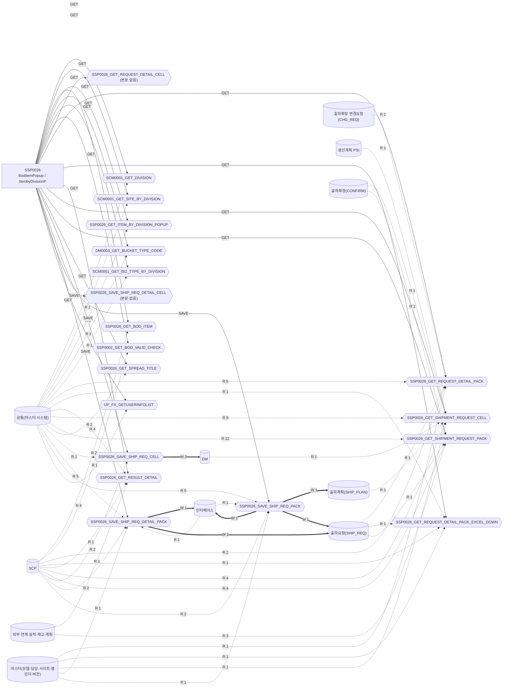

| SP | 출처 | 본문 | 쓰기(W) | 읽기(R) | 중첩 호출 |
|---|---|---|---|---|---|
| SCM0001_GET_DIVISION | matrix+endpoints | Y | - | SCM_MST_DIVISION | - |
| SCM0001_GET_SITE_BY_DIVISION | matrix+endpoints | Y | - | SCM_MST_SITE | - |
| SSP0026_GET_BOD_ITEM | matrix+endpoints | Y | - | SCP_MST_BOD_ITEM, SCP_MST_BOD_N_V | - |
| SSP0026_GET_ITEM_BY_DIVISION_POPUP | matrix+endpoints | Y | - | SCM_MST_DIVISION, SCM_MST_ITEM_SN, SCM_MST_PROJECT, SCM_MST_SITE, SCM_MST_SITE_ITEM | - |
| DM0003_GET_BUCKET_TYPE_CODE | matrix+endpoints | Y | - | SCM_ADM_LOOKUP_MASTER_DETAIL | - |
| SCM0001_GET_BIZ_TYPE_BY_DIVISION | matrix+endpoints | Y | - | SCM_MST_PROJECT | - |
| SSP0002_GET_BOD_VALID_CHECK | matrix+endpoints | Y | - | SCP_MST_BOD_N_V | - |
| SSP0026_GET_REQUEST_DETAIL_CELL | matrix+endpoints | N | - | - | - |
| SSP0026_GET_REQUEST_DETAIL_PACK | matrix+endpoints | Y | - | SCM_MST_CUSTOMER, SCM_MST_SITE, SCM_MST_SITE_CUSTOMER, SCM_MST_SITE_ITEM, SCP_MST_BOD_N_V, SCP_MST_FINAL_ITEM, SSP_ANL_SHIP_CONFIRM_CHG_REQ_DE, SSP_ANL_SHIP_REQ_P, SSP_MST_MODEL_USER, TB_FX_USER | - |
| SSP0026_GET_REQUEST_DETAIL_PACK_EXCEL_DOWN | matrix+endpoints | Y | - | SCM_MST_SITE, SCP_MST_BOD_N_V, SSP_ANL_SHIP_REQ_P, SSP_MST_SHIP_CALENDAR | - |
| SSP0026_GET_RESULT_DETAIL | matrix+endpoints | Y | - | SCM_DNM_SCS_SHIP_RESULT, SCM_MST_CUSTOMER, SCM_MST_SITE, SCM_SYS_CALENDAR_M, SCP_MST_FINAL_ITEM, TB_FX_USER | - |
| SSP0026_GET_SHIPMENT_REQUEST_CELL | matrix+endpoints | Y | - | DM_PLN_SHIPMENT_REQ, SCM_MST_ITEM_SN, SCM_MST_SHEET_MEASURE, SCM_MST_SITE, SCM_MST_SITE_ITEM, SCM_MST_SSO_DEPT_INFO, SCM_MST_SSO_USER_INFO, SCM_MST_TITLESET_USER, SCM_SYS_CALENDAR_M, SCP_MST_BOD_N_V, SCP_PLAN_VERSION_V, SCP_PLN_SHIPMENT_PLAN, SCP_PLN_SHIPMENT_PLAN_PEGGING, SSP_ANL_SHIP_CONFIRM, SSP_ANL_SHIP_PLAN_40, SSP_DNM_FORMATION_POST_CELL, SSP_PLAN_VERSION_V, TB_FX_USER | - |
| SSP0026_GET_SHIPMENT_REQUEST_PACK | matrix+endpoints | Y | - | SCM_ADM_LOOKUP_MASTER_DETAIL, SCM_DNM_SCS_PROD_PLAN, SCM_DNM_SCS_SHIP_RESULT, SCM_DNM_SCS_STOCK, SCM_MST_ITEM_SN, SCM_MST_PROJECT, SCM_MST_SHEET_MEASURE, SCM_MST_SITE, SCM_MST_SITE_CUSTOMER, SCM_MST_SITE_ITEM, SCM_MST_SSO_DEPT_INFO, SCM_MST_SSO_USER_INFO, SCM_MST_TITLESET_USER, SCM_SYS_CALENDAR_M, SCP_MST_BOD_N_V, SCP_PLAN_VERSION_V, SCP_PLN_SHIPMENT_PLAN, SCP_PLN_SHIPMENT_PLAN_PEGGING, SSP_ANL_SHIP_CONFIRM, SSP_ANL_SHIP_REQ_P, TB_FX_USER | - |
| SSP0026_GET_SPREAD_TITLE | matrix+endpoints | Y | - | SCM_MST_SHEET_COLUMNS, SCM_SYS_CALENDAR_M | - |
| SSP0026_SAVE_SHIP_REQ_CELL | matrix+endpoints | Y | DM_PLN_SHIPMENT_REQ, DM_PLN_SHIPMENT_REQ_H | SCM_SYS_CALENDAR_M, SCP_MST_BOD_ITEM, SCP_MST_BOD_N_V | PR_SCM_SYS_LOG_BATCH, PR_SCP_SYS_LOG_BATCH |
| SSP0026_SAVE_SHIP_REQ_DETAIL_CELL | matrix+endpoints | N | - | - | - |
| SSP0026_SAVE_SHIP_REQ_DETAIL_PACK | matrix+endpoints | Y | SSP_ANL_SHIP_REQ_P, SSP_ANL_SHIP_REQ_P_H, XIF_SCS_PACK_SHIP_PLAN_S_SN | NERP_CONV_MASTER, SCM_ADM_LOOKUP_MASTER_DETAIL, SCM_MST_SITE, SCM_MST_SITE_ITEM, SCM_SYS_CALENDAR_M, SCP_MST_BOD_ITEM, SCP_MST_BOD_N_V, SSP_MST_MODEL_USER, TB_FX_USER | PR_SCM_SYS_LOG_BATCH, PR_SCP_SYS_LOG_BATCH |
| SSP0026_SAVE_SHIP_REQ_PACK | matrix+endpoints | Y | SSP_ANL_SHIP_PLAN_PACK_REQ, SSP_ANL_SHIP_REQ_P_H, XIF_SCS_PACK_SHIP_PLAN_S_SN | NERP_CONV_MASTER, SCM_ADM_LOOKUP_MASTER_DETAIL, SCM_MST_SITE_CUSTOMER, SCM_MST_SITE_ITEM, SCM_SYS_CALENDAR_M, SCP_MST_BOD_ITEM, SCP_MST_BOD_N_V, SSP_MST_MODEL_USER, TB_FX_USER | PR_SCM_SYS_LOG_BATCH, PR_SCP_SYS_LOG_BATCH |
| UP_FX_GETUSERINFOLIST | matrix | Y | - | SCM_MST_SSO_DEPT_INFO, SCM_MST_SSO_USER_INFO, TB_FX_GROUPINFO, TB_FX_USER | - |

## SSP0022 BodItemPopup / ShipmentRequestElectrode / ShipmentRequestPopup (Main) · TO-BE SSP0022 Shipment Request(Electrode)

- SP 17개 · TO-BE PKG 배선 10건 · BOD_CHECK:PKG_SSP0022.P_SSP0022_GET_BOD_ITEM_VALID_CHECK, EXCEL:PKG_SSP0022.P_SSP0022_SHIPMENT_REQUEST_EXCEL_UPLOAD, SAVE:PKG_SSP0022.P_SSP0022_SAVE_SHIPMENT_REQUEST, SEARCH:PKG_SSP0022.P_SSP0022_GET_ITEM_POPUP, SEARCH:PKG_SSP0022.P_SSP0022_GET_REQUEST_DETAIL, SEARCH:PKG_SSP0022.P_SSP0022_GET_REQUEST_DETAIL_EXCEL_DOWN · 팝업 -

```mermaid
flowchart LR
  S["SSP0022<br/>BodItemPopup / ShipmentRequest"]
  P_SCM0001_GET_DIVISION{{"SCM0001_GET_DIVISION"}}
  S --GET--> P_SCM0001_GET_DIVISION
  E____________[("공통(마스터·시스템)")] -."R 1".-> P_SCM0001_GET_DIVISION
  P_SCM0001_GET_SITE_BY_DIVISION{{"SCM0001_GET_SITE_BY_DIVISION"}}
  S --GET--> P_SCM0001_GET_SITE_BY_DIVISION
  E____________[("공통(마스터·시스템)")] -."R 1".-> P_SCM0001_GET_SITE_BY_DIVISION
  P_SSP0022_GET_ITEM_POPUP{{"SSP0022_GET_ITEM_POPUP"}}
  S --GET--> P_SSP0022_GET_ITEM_POPUP
  E_SCP[("SCP")] -."R 3".-> P_SSP0022_GET_ITEM_POPUP
  E____________[("공통(마스터·시스템)")] -."R 3".-> P_SSP0022_GET_ITEM_POPUP
  E______________________[("마스터(모델·담당·사이트·캘린더·버전)")] -."R 2".-> P_SSP0022_GET_ITEM_POPUP
  P_DM0003_GET_BUCKET_TYPE_CODE{{"DM0003_GET_BUCKET_TYPE_CODE"}}
  S --GET--> P_DM0003_GET_BUCKET_TYPE_CODE
  E____________[("공통(마스터·시스템)")] -."R 1".-> P_DM0003_GET_BUCKET_TYPE_CODE
  P_SCM0002_GET_ITEM_BY_DIVISION_POPUP{{"SCM0002_GET_ITEM_BY_DIVISION_POPUP"}}
  S --GET--> P_SCM0002_GET_ITEM_BY_DIVISION_POPUP
  E____________[("공통(마스터·시스템)")] -."R 5".-> P_SCM0002_GET_ITEM_BY_DIVISION_POPUP
  P_GET_DATE_RANGE_1MONTH{{"GET_DATE_RANGE_1MONTH (본문 없음)"}}
  S --GET--> P_GET_DATE_RANGE_1MONTH
  P_SCM0001_GET_SCP_DAY_PERIOD{{"SCM0001_GET_SCP_DAY_PERIOD"}}
  S --GET--> P_SCM0001_GET_SCP_DAY_PERIOD
  E____________[("공통(마스터·시스템)")] -."R 1".-> P_SCM0001_GET_SCP_DAY_PERIOD
  P_SSP0002_GET_BOD_VALID_CHECK{{"SSP0002_GET_BOD_VALID_CHECK"}}
  S --GET--> P_SSP0002_GET_BOD_VALID_CHECK
  E_SCP[("SCP")] -."R 1".-> P_SSP0002_GET_BOD_VALID_CHECK
  P_SSP0002_GET_USER_INFO_LIST{{"SSP0002_GET_USER_INFO_LIST"}}
  S --GET--> P_SSP0002_GET_USER_INFO_LIST
  E____________[("공통(마스터·시스템)")] -."R 4".-> P_SSP0002_GET_USER_INFO_LIST
  P_SSP0022_GET_BOD_ITEM_VALID_CHECK{{"SSP0022_GET_BOD_ITEM_VALID_CHECK"}}
  S --GET--> P_SSP0022_GET_BOD_ITEM_VALID_CHECK
  E_SCP[("SCP")] -."R 2".-> P_SSP0022_GET_BOD_ITEM_VALID_CHECK
  E____________[("공통(마스터·시스템)")] -."R 1".-> P_SSP0022_GET_BOD_ITEM_VALID_CHECK
  P_SSP0022_GET_REQUEST_DETAIL{{"SSP0022_GET_REQUEST_DETAIL"}}
  S --GET--> P_SSP0022_GET_REQUEST_DETAIL
  E_SCP[("SCP")] -."R 1".-> P_SSP0022_GET_REQUEST_DETAIL
  E____________[("공통(마스터·시스템)")] -."R 2".-> P_SSP0022_GET_REQUEST_DETAIL
  E______________________[("마스터(모델·담당·사이트·캘린더·버전)")] -."R 3".-> P_SSP0022_GET_REQUEST_DETAIL
  E______SHIP_REQ_[("출하요청(SHIP_REQ)")] -."R 1".-> P_SSP0022_GET_REQUEST_DETAIL
  P_SSP0022_GET_REQUEST_DETAIL_EXCEL_DOWN{{"SSP0022_GET_REQUEST_DETAIL_EXCEL_DOWN"}}
  S --GET--> P_SSP0022_GET_REQUEST_DETAIL_EXCEL_DOWN
  E_SCP[("SCP")] -."R 1".-> P_SSP0022_GET_REQUEST_DETAIL_EXCEL_DOWN
  E____________[("공통(마스터·시스템)")] -."R 1".-> P_SSP0022_GET_REQUEST_DETAIL_EXCEL_DOWN
  E______________________[("마스터(모델·담당·사이트·캘린더·버전)")] -."R 2".-> P_SSP0022_GET_REQUEST_DETAIL_EXCEL_DOWN
  E______SHIP_REQ_[("출하요청(SHIP_REQ)")] -."R 1".-> P_SSP0022_GET_REQUEST_DETAIL_EXCEL_DOWN
  P_SSP0022_GET_SHEET_CALENDAR_3SPAN{{"SSP0022_GET_SHEET_CALENDAR_3SPAN"}}
  S --GET--> P_SSP0022_GET_SHEET_CALENDAR_3SPAN
  E____________[("공통(마스터·시스템)")] -."R 1".-> P_SSP0022_GET_SHEET_CALENDAR_3SPAN
  P_SSP0022_GET_SHIPMENT_PSI{{"SSP0022_GET_SHIPMENT_PSI"}}
  S --GET--> P_SSP0022_GET_SHIPMENT_PSI
  E_FP_I_F[("FP I/F")] -."R 1".-> P_SSP0022_GET_SHIPMENT_PSI
  E_SCP[("SCP")] -."R 2".-> P_SSP0022_GET_SHIPMENT_PSI
  E____________[("공통(마스터·시스템)")] -."R 7".-> P_SSP0022_GET_SHIPMENT_PSI
  E______________________[("마스터(모델·담당·사이트·캘린더·버전)")] -."R 4".-> P_SSP0022_GET_SHIPMENT_PSI
  E____STOCK_ONHAND_[("재고(STOCK·ONHAND)")] -."R 1".-> P_SSP0022_GET_SHIPMENT_PSI
  E______SHIP_PLAN_[("출하계획(SHIP_PLAN)")] -."R 1".-> P_SSP0022_GET_SHIPMENT_PSI
  E_________OWMS_[("출하실적·반품(OWMS)")] -."R 1".-> P_SSP0022_GET_SHIPMENT_PSI
  E______SHIP_REQ_[("출하요청(SHIP_REQ)")] -."R 1".-> P_SSP0022_GET_SHIPMENT_PSI
  E______CONFIRM_[("출하확정(CONFIRM)")] -."R 1".-> P_SSP0022_GET_SHIPMENT_PSI
  P_SSP0022_GET_STOCK_DETAIL{{"SSP0022_GET_STOCK_DETAIL"}}
  S --GET--> P_SSP0022_GET_STOCK_DETAIL
  E____________[("공통(마스터·시스템)")] -."R 2".-> P_SSP0022_GET_STOCK_DETAIL
  E______________________[("마스터(모델·담당·사이트·캘린더·버전)")] -."R 3".-> P_SSP0022_GET_STOCK_DETAIL
  E____STOCK_ONHAND_[("재고(STOCK·ONHAND)")] -."R 1".-> P_SSP0022_GET_STOCK_DETAIL
  P_SSP0022_SAVE_SHIPMENT_REQUEST{{"SSP0022_SAVE_SHIPMENT_REQUEST"}}
  S --SAVE--> P_SSP0022_SAVE_SHIPMENT_REQUEST
  P_SSP0022_SAVE_SHIPMENT_REQUEST =="W 2"==> E______SHIP_REQ_[("출하요청(SHIP_REQ)")]
  E_SCP[("SCP")] -."R 2".-> P_SSP0022_SAVE_SHIPMENT_REQUEST
  E____________[("공통(마스터·시스템)")] -."R 2".-> P_SSP0022_SAVE_SHIPMENT_REQUEST
  E______________________[("마스터(모델·담당·사이트·캘린더·버전)")] -."R 1".-> P_SSP0022_SAVE_SHIPMENT_REQUEST
  E____________[("공통(마스터·시스템)")] -."R? 1".-> P_SSP0022_SAVE_SHIPMENT_REQUEST
  P_UP_FX_GETUSERINFOLIST{{"UP_FX_GETUSERINFOLIST"}}
  S --GET--> P_UP_FX_GETUSERINFOLIST
  E____________[("공통(마스터·시스템)")] -."R 4".-> P_UP_FX_GETUSERINFOLIST
```

| SP | 출처 | 본문 | 쓰기(W) | 읽기(R) | 중첩 호출 |
|---|---|---|---|---|---|
| SCM0001_GET_DIVISION | matrix+endpoints | Y | - | SCM_MST_DIVISION | - |
| SCM0001_GET_SITE_BY_DIVISION | matrix+endpoints | Y | - | SCM_MST_SITE | - |
| SSP0022_GET_ITEM_POPUP | matrix+endpoints | Y | - | SCM_ADM_LOOKUP_MASTER_DETAIL, SCM_MST_SITE, SCM_SYS_CALENDAR_M, SCP_MST_BOD_ITEM, SCP_MST_BOD_N_V, SCP_MST_FINAL_ITEM, SSP_MST_SHIP_MASTER_EE, SSP_MST_SITE_ITEM_EE_V | - |
| DM0003_GET_BUCKET_TYPE_CODE | matrix+endpoints | Y | - | SCM_ADM_LOOKUP_MASTER_DETAIL | - |
| SCM0002_GET_ITEM_BY_DIVISION_POPUP | matrix | Y | - | SCM_MST_DIVISION, SCM_MST_ITEM_SN, SCM_MST_PROJECT, SCM_MST_SITE, SCM_MST_SITE_ITEM | - |
| GET_DATE_RANGE_1MONTH | matrix | N | - | - | - |
| SCM0001_GET_SCP_DAY_PERIOD | matrix | Y | - | SCM_SYS_CALENDAR_M | - |
| SSP0002_GET_BOD_VALID_CHECK | matrix+endpoints | Y | - | SCP_MST_BOD_N_V | - |
| SSP0002_GET_USER_INFO_LIST | matrix+endpoints | Y | - | SCM_MST_SSO_DEPT_INFO, TB_FX_GROUPINFO, TB_FX_USER, TB_FX_USERGROUPAUTHEXTENTION | - |
| SSP0022_GET_BOD_ITEM_VALID_CHECK | matrix+endpoints | Y | - | SCM_ADM_LOOKUP_MASTER_DETAIL, SCP_MST_BOD_ITEM, SCP_MST_BOD_N_V | - |
| SSP0022_GET_REQUEST_DETAIL | matrix+endpoints | Y | - | SCM_MST_SITE, SCP_MST_BOD_N_V, SSP_ANL_SHIP_REQ_EE, SSP_MST_DELEGATE, SSP_MST_MODEL_USER_EE, SSP_MST_SITE_ITEM_EE_V, TB_FX_USER | - |
| SSP0022_GET_REQUEST_DETAIL_EXCEL_DOWN | matrix+endpoints | Y | - | SCM_MST_SITE, SCP_MST_BOD_N_V, SSP_ANL_SHIP_REQ_EE, SSP_MST_SHIP_CALENDAR, SSP_MST_SITE_ITEM_EE_V | - |
| SSP0022_GET_SHEET_CALENDAR_3SPAN | matrix+endpoints | Y | - | SCM_SYS_CALENDAR_M | - |
| SSP0022_GET_SHIPMENT_PSI | matrix+endpoints | Y | - | SCM_ADM_LOOKUP_MASTER_DETAIL, SCM_MST_ITEM_SN, SCM_MST_SHEET_MEASURE, SCM_MST_SITE, SCM_MST_TITLESET_USER, SCM_SYS_CALENDAR_M, SCP_MST_BOD_N_V, SCP_MST_FINAL_ITEM, SSP_ANL_BOH_CUTOFF_EE, SSP_ANL_SHIP_CONFIRM, SSP_ANL_SHIP_PLAN_EE, SSP_ANL_SHIP_REQ_EE, SSP_DNM_FP_MRP_INTRANSIT_SN, SSP_DNM_SHIP_RESULT_OWMS_V, SSP_MST_DELEGATE, SSP_MST_MODEL_USER_EE, SSP_MST_SHIP_MASTER_EE, SSP_MST_SITE_ITEM_EE_V, TB_FX_USER | - |
| SSP0022_GET_STOCK_DETAIL | matrix+endpoints | Y | - | SCM_ADM_LOOKUP_MASTER_DETAIL, SCM_MST_SLOC, SSP_ANL_STOCK_EE_C, SSP_MST_DELEGATE, SSP_MST_MODEL_USER_EE, SSP_MST_SITE_ITEM_EE_V | - |
| SSP0022_SAVE_SHIPMENT_REQUEST | matrix+endpoints | Y | SSP_ANL_SHIP_REQ_EE, SSP_ANL_SHIP_REQ_EE_H | SCM_ADM_LOOKUP_MASTER_DETAIL, SCM_MST_SITE, SCM_SYS_LOG_BATCH, SCP_MST_BOD_ITEM, SCP_MST_BOD_N_V, SSP_MST_SITE_ITEM_EE_V | PR_SCM_SYS_LOG_BATCH |
| UP_FX_GETUSERINFOLIST | matrix | Y | - | SCM_MST_SSO_DEPT_INFO, SCM_MST_SSO_USER_INFO, TB_FX_GROUPINFO, TB_FX_USER | - |

## SSP0020 Delegate (Main) · TO-BE SSP0020 Delegate

- SP 5개 · TO-BE PKG 배선 4건 · SAVE:PKG_SSP0020.P_SAVE_DELEGATE, SEARCH:PKG_SSP0020.P_GET_DELEGATE, UNSET:PKG_SSP0020.P_SAVE_UNSET, USER_CHECK:PKG_SSP0020.P_USER_CHECK · 팝업 UserInfoPopup

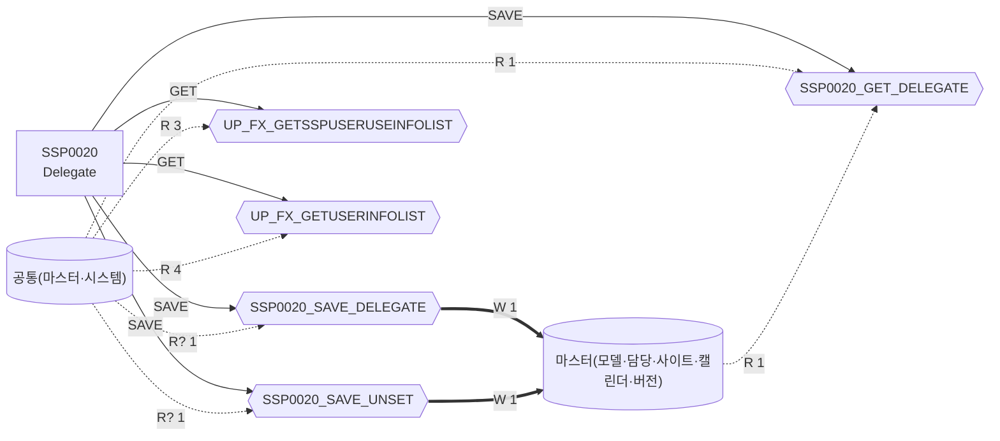

| SP | 출처 | 본문 | 쓰기(W) | 읽기(R) | 중첩 호출 |
|---|---|---|---|---|---|
| SSP0020_GET_DELEGATE | matrix+endpoints | Y | - | SSP_MST_DELEGATE, TB_FX_USER | - |
| SSP0020_SAVE_DELEGATE | matrix+endpoints | Y | SSP_MST_DELEGATE | SCM_SYS_LOG_BATCH | PR_SCM_SYS_LOG_BATCH_CALL_TRAN |
| SSP0020_SAVE_UNSET | matrix+endpoints | Y | SSP_MST_DELEGATE | SCM_SYS_LOG_BATCH | PR_SCM_SYS_LOG_BATCH_CALL_TRAN |
| UP_FX_GETSSPUSERUSEINFOLIST | matrix+endpoints | Y | - | SCM_MST_SSO_DEPT_INFO, TB_FX_GROUPINFO, TB_FX_USER | - |
| UP_FX_GETUSERINFOLIST | matrix | Y | - | SCM_MST_SSO_DEPT_INFO, SCM_MST_SSO_USER_INFO, TB_FX_GROUPINFO, TB_FX_USER | - |

## SSP0024 ItembyDivisionPopup / ShipmentMasterElectrode (Main) · TO-BE SSP0024 Shipment Master Electrode

- SP 5개 · TO-BE PKG 배선 4건 · SAVE:PKG_SSP0024.P_SSP0024_SAVE_SHIP_MASTER, SEARCH:PKG_SSP0024.P_SSP0024_GET_ITEM_BY_DIVISION_POPUP, SEARCH:PKG_SSP0024.P_SSP0024_GET_SHIP_MASTER, USER_CHECK:PKG_SSP0002.P_SSP0002_GET_USER_INFO_LIST · 팝업 -

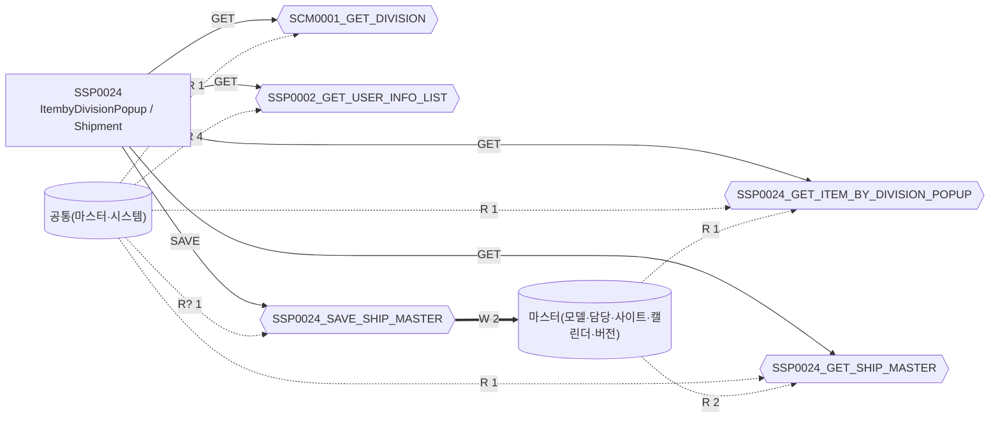

| SP | 출처 | 본문 | 쓰기(W) | 읽기(R) | 중첩 호출 |
|---|---|---|---|---|---|
| SCM0001_GET_DIVISION | matrix+endpoints | Y | - | SCM_MST_DIVISION | - |
| SSP0024_GET_ITEM_BY_DIVISION_POPUP | matrix+endpoints | Y | - | SCM_MST_SITE, SSP_MST_SITE_ITEM_EE_V | - |
| SSP0002_GET_USER_INFO_LIST | matrix+endpoints | Y | - | SCM_MST_SSO_DEPT_INFO, TB_FX_GROUPINFO, TB_FX_USER, TB_FX_USERGROUPAUTHEXTENTION | - |
| SSP0024_GET_SHIP_MASTER | matrix+endpoints | Y | - | SCM_MST_SITE, SSP_MST_SHIP_MASTER_EE, SSP_MST_SITE_ITEM_EE_V | - |
| SSP0024_SAVE_SHIP_MASTER | matrix+endpoints | Y | SSP_MST_SHIP_MASTER_EE, SSP_MST_SHIP_MASTER_EE_H | SCM_SYS_LOG_BATCH | PR_SCM_SYS_LOG_BATCH |

## SSP0025 ItembyDivisionPopup / ShipmentRequestorPIC (Main) · TO-BE SSP0025 Shipment Requestor PIC

- SP 6개 · TO-BE PKG 배선 4건 · SAVE:PKG_SSP0025.P_SSP0025_SAVE_SHIPMENT_REQUESTOR_PIC, SEARCH:PKG_SSP0025.P_SSP0025_GET_ITEM_BY_DIVISION_POPUP, SEARCH:PKG_SSP0025.P_SSP0025_GET_SHIPMENT_REQUESTOR_PIC, USER_CHECK:PKG_SSP0025.P_SSP0025_GET_USER_ID_CHECK · 팝업 -

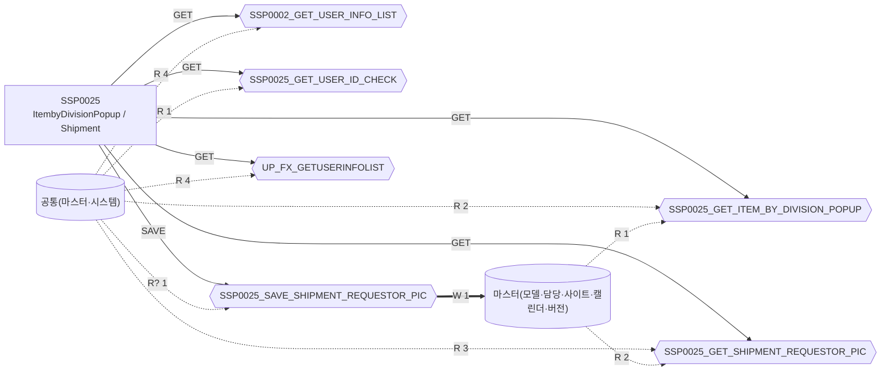

| SP | 출처 | 본문 | 쓰기(W) | 읽기(R) | 중첩 호출 |
|---|---|---|---|---|---|
| SSP0025_GET_ITEM_BY_DIVISION_POPUP | matrix+endpoints | Y | - | SCM_ADM_LOOKUP_MASTER_DETAIL, SCM_MST_SITE, SSP_MST_SITE_ITEM_EE_V | - |
| SSP0002_GET_USER_INFO_LIST | matrix+endpoints | Y | - | SCM_MST_SSO_DEPT_INFO, TB_FX_GROUPINFO, TB_FX_USER, TB_FX_USERGROUPAUTHEXTENTION | - |
| SSP0025_GET_SHIPMENT_REQUESTOR_PIC | matrix+endpoints | Y | - | SCM_ADM_LOOKUP_MASTER_DETAIL, SCM_MST_SITE, SSP_MST_MODEL_USER_EE, SSP_MST_SITE_ITEM_EE_V, TB_FX_USER | - |
| SSP0025_GET_USER_ID_CHECK | matrix+endpoints | Y | - | TB_FX_USER | - |
| SSP0025_SAVE_SHIPMENT_REQUESTOR_PIC | matrix+endpoints | Y | SSP_MST_MODEL_USER_EE | SCM_SYS_LOG_BATCH | PR_SCM_SYS_LOG_BATCH |
| UP_FX_GETUSERINFOLIST | matrix | Y | - | SCM_MST_SSO_DEPT_INFO, SCM_MST_SSO_USER_INFO, TB_FX_GROUPINFO, TB_FX_USER | - |

## SSP0200 ShipmentChangeRequest / ShipmentChangeRequestInsertPopup (Main) · TO-BE SSP0200 Shipment Change Request

- SP 25개 · TO-BE PKG 배선 16건 · DELETE_SHIPMENT_REQUEST_DRAFTING:PKG_SSP0200.P_SSP0200_DELETE_SHIPMENT_REQUEST_DRAFTING, DELETE_SHIPMENT_REQUEST_DRAFTING_BY_CONFIRM:PKG_SSP0200.P_SCM_SSP_DELETE_SHIPMENT_REQUEST_DRAFTING_BY_CONFIRM, ERP_ERROR_CONFIRM:PKG_SSP0200.P_SCM_SSP_ANL_SHIP_ERP_ERROR_CONFIRM, ERP_IFSEQ_MERGE:PKG_SSP0200.P_SSP0200_ERP_IFSEQ_MERGE, GET_CHANGE_REQ_NO:PKG_SSP0200.P_SSP0200_GET_CHANGE_REQ_NO, GET_ERP_SO_NO_CNT:PKG_SSP0200.P_SSP0200_GET_ERP_SO_NO_CNT · 팝업 SCM0002_ItembyDivisionPopup
SCM0002_ProjectbyDivisionPopup
SCM0002_ShipmentPlanRequestPopup
SSP0002_UserInfoPopup
SSP0200_ShipmentChangeRequestInsertPopup
SSP0300_OrderDetailPopup
SSP0301_SqlPopup

```mermaid
flowchart LR
  S["SSP0200<br/>ShipmentChangeRequest / Shipme"]
  P_SCM0001_GET_DIVISION{{"SCM0001_GET_DIVISION"}}
  S --GET--> P_SCM0001_GET_DIVISION
  E____________[("공통(마스터·시스템)")] -."R 1".-> P_SCM0001_GET_DIVISION
  P_SCM0001_GET_SITE_BY_DIVISION{{"SCM0001_GET_SITE_BY_DIVISION"}}
  S --GET--> P_SCM0001_GET_SITE_BY_DIVISION
  E____________[("공통(마스터·시스템)")] -."R 1".-> P_SCM0001_GET_SITE_BY_DIVISION
  P_SCM0002_GET_ITEM_BY_DIVISION_POPUP{{"SCM0002_GET_ITEM_BY_DIVISION_POPUP"}}
  S --GET--> P_SCM0002_GET_ITEM_BY_DIVISION_POPUP
  E____________[("공통(마스터·시스템)")] -."R 5".-> P_SCM0002_GET_ITEM_BY_DIVISION_POPUP
  P_GET_DATE_RANGE_1MONTH{{"GET_DATE_RANGE_1MONTH (본문 없음)"}}
  S --GET--> P_GET_DATE_RANGE_1MONTH
  P_SCM0001_GET_SCP_DAY_PERIOD{{"SCM0001_GET_SCP_DAY_PERIOD"}}
  S --GET--> P_SCM0001_GET_SCP_DAY_PERIOD
  E____________[("공통(마스터·시스템)")] -."R 1".-> P_SCM0001_GET_SCP_DAY_PERIOD
  P_PR_SSP_XIF_ERP_UI_SHIP_PLAN_IFSEQ_MERGE{{"PR_SSP_XIF_ERP_UI_SHIP_PLAN_IFSEQ_MERGE"}}
  S --GET--> P_PR_SSP_XIF_ERP_UI_SHIP_PLAN_IFSEQ_MERGE
  P_PR_SSP_XIF_ERP_UI_SHIP_PLAN_IFSEQ_MERGE =="W 1"==> E______[("인터페이스")]
  P_SCM_SSP_ANL_SHIP_ERP_ERROR_CONFIRM{{"SCM_SSP_ANL_SHIP_ERP_ERROR_CONFIRM"}}
  S --SAVE--> P_SCM_SSP_ANL_SHIP_ERP_ERROR_CONFIRM
  P_SCM_SSP_ANL_SHIP_ERP_ERROR_CONFIRM =="W 1"==> E_ERP____I_F_DO_SO_[("ERP 출하 I/F(DO·SO)")]
  P_SCM_SSP_ANL_SHIP_ERP_ERROR_CONFIRM =="W 2"==> E___________CHG_REQ_[("출하확정 변경요청(CHG_REQ)")]
  E____________[("공통(마스터·시스템)")] -."R? 1".-> P_SCM_SSP_ANL_SHIP_ERP_ERROR_CONFIRM
  P_SCM_SSP_DELETE_SHIPMENT_REQUEST_DRAFTING_BY_CONFIRM{{"SCM_SSP_DELETE_SHIPMENT_REQUEST_DRAFTING_BY_CONFIRM"}}
  S --SAVE--> P_SCM_SSP_DELETE_SHIPMENT_REQUEST_DRAFTING_BY_CONFIRM
  P_SCM_SSP_DELETE_SHIPMENT_REQUEST_DRAFTING_BY_CONFIRM =="W 1"==> E______[("인터페이스")]
  P_SCM_SSP_DELETE_SHIPMENT_REQUEST_DRAFTING_BY_CONFIRM =="W 1"==> E___________CHG_REQ_[("출하확정 변경요청(CHG_REQ)")]
  P_SCM_SSP_DELETE_SHIPMENT_REQUEST_DRAFTING_BY_CONFIRM =="W 1"==> E______CONFIRM_[("출하확정(CONFIRM)")]
  E____________[("공통(마스터·시스템)")] -."R 3".-> P_SCM_SSP_DELETE_SHIPMENT_REQUEST_DRAFTING_BY_CONFIRM
  E___________CHG_REQ_[("출하확정 변경요청(CHG_REQ)")] -."R 1".-> P_SCM_SSP_DELETE_SHIPMENT_REQUEST_DRAFTING_BY_CONFIRM
  P_SSP0002_DELETE_SHIPMENT_REQUEST_DRAFTING{{"SSP0002_DELETE_SHIPMENT_REQUEST_DRAFTING"}}
  S --SAVE--> P_SSP0002_DELETE_SHIPMENT_REQUEST_DRAFTING
  P_SSP0002_DELETE_SHIPMENT_REQUEST_DRAFTING =="W 1"==> E______[("인터페이스")]
  P_SSP0002_DELETE_SHIPMENT_REQUEST_DRAFTING =="W 2"==> E___________CHG_REQ_[("출하확정 변경요청(CHG_REQ)")]
  P_SSP0002_DELETE_SHIPMENT_REQUEST_DRAFTING =="W 1"==> E______CONFIRM_[("출하확정(CONFIRM)")]
  E____________[("공통(마스터·시스템)")] -."R 3".-> P_SSP0002_DELETE_SHIPMENT_REQUEST_DRAFTING
  E______[("인터페이스")] -."R 1".-> P_SSP0002_DELETE_SHIPMENT_REQUEST_DRAFTING
  E____________[("공통(마스터·시스템)")] -."R? 1".-> P_SSP0002_DELETE_SHIPMENT_REQUEST_DRAFTING
  P_SSP0002_GET_SHIPMENT_REQUEST_DRAFTING{{"SSP0002_GET_SHIPMENT_REQUEST_DRAFTING"}}
  S --GET--> P_SSP0002_GET_SHIPMENT_REQUEST_DRAFTING
  E_SCP[("SCP")] -."R 1".-> P_SSP0002_GET_SHIPMENT_REQUEST_DRAFTING
  E____________[("공통(마스터·시스템)")] -."R 3".-> P_SSP0002_GET_SHIPMENT_REQUEST_DRAFTING
  E______________________[("마스터(모델·담당·사이트·캘린더·버전)")] -."R 1".-> P_SSP0002_GET_SHIPMENT_REQUEST_DRAFTING
  E___________CHG_REQ_[("출하확정 변경요청(CHG_REQ)")] -."R 2".-> P_SSP0002_GET_SHIPMENT_REQUEST_DRAFTING
  E______CONFIRM_[("출하확정(CONFIRM)")] -."R 1".-> P_SSP0002_GET_SHIPMENT_REQUEST_DRAFTING
  P_SSP0002_GET_USER_INFO_LIST{{"SSP0002_GET_USER_INFO_LIST"}}
  S --GET--> P_SSP0002_GET_USER_INFO_LIST
  E____________[("공통(마스터·시스템)")] -."R 4".-> P_SSP0002_GET_USER_INFO_LIST
  P_SSP0026_GET_BOD_ITEM{{"SSP0026_GET_BOD_ITEM"}}
  S --GET--> P_SSP0026_GET_BOD_ITEM
  E_SCP[("SCP")] -."R 2".-> P_SSP0026_GET_BOD_ITEM
  P_SSP0200_DELETE_SHIPMENT_REQUEST_DRAFTING{{"SSP0200_DELETE_SHIPMENT_REQUEST_DRAFTING"}}
  S --SAVE--> P_SSP0200_DELETE_SHIPMENT_REQUEST_DRAFTING
  P_SSP0200_DELETE_SHIPMENT_REQUEST_DRAFTING =="W 1"==> E______[("인터페이스")]
  P_SSP0200_DELETE_SHIPMENT_REQUEST_DRAFTING =="W 2"==> E___________CHG_REQ_[("출하확정 변경요청(CHG_REQ)")]
  P_SSP0200_DELETE_SHIPMENT_REQUEST_DRAFTING =="W 1"==> E______CONFIRM_[("출하확정(CONFIRM)")]
  E____________[("공통(마스터·시스템)")] -."R 3".-> P_SSP0200_DELETE_SHIPMENT_REQUEST_DRAFTING
  E______[("인터페이스")] -."R 1".-> P_SSP0200_DELETE_SHIPMENT_REQUEST_DRAFTING
  E____________[("공통(마스터·시스템)")] -."R? 1".-> P_SSP0200_DELETE_SHIPMENT_REQUEST_DRAFTING
  P_SSP0200_GET_CHANGE_REQ_NO{{"SSP0200_GET_CHANGE_REQ_NO"}}
  S --GET--> P_SSP0200_GET_CHANGE_REQ_NO
  P_SSP0200_GET_ERP_SO_NO_CNT{{"SSP0200_GET_ERP_SO_NO_CNT"}}
  S --GET--> P_SSP0200_GET_ERP_SO_NO_CNT
  E______CONFIRM_[("출하확정(CONFIRM)")] -."R 1".-> P_SSP0200_GET_ERP_SO_NO_CNT
  P_SSP0200_GET_SHIPMENT_CHANGE_REQUEST{{"SSP0200_GET_SHIPMENT_CHANGE_REQUEST"}}
  S --GET--> P_SSP0200_GET_SHIPMENT_CHANGE_REQUEST
  E_SCP[("SCP")] -."R 2".-> P_SSP0200_GET_SHIPMENT_CHANGE_REQUEST
  E____________[("공통(마스터·시스템)")] -."R 4".-> P_SSP0200_GET_SHIPMENT_CHANGE_REQUEST
  E______________________[("마스터(모델·담당·사이트·캘린더·버전)")] -."R 1".-> P_SSP0200_GET_SHIPMENT_CHANGE_REQUEST
  E___________CHG_REQ_[("출하확정 변경요청(CHG_REQ)")] -."R 2".-> P_SSP0200_GET_SHIPMENT_CHANGE_REQUEST
  E______CONFIRM_[("출하확정(CONFIRM)")] -."R 1".-> P_SSP0200_GET_SHIPMENT_CHANGE_REQUEST
  P_SSP0200_GET_SHIPMENT_CHANGE_REQUEST_N{{"SSP0200_GET_SHIPMENT_CHANGE_REQUEST_N"}}
  S --GET--> P_SSP0200_GET_SHIPMENT_CHANGE_REQUEST_N
  E_SCP[("SCP")] -."R 1".-> P_SSP0200_GET_SHIPMENT_CHANGE_REQUEST_N
  E____________[("공통(마스터·시스템)")] -."R 3".-> P_SSP0200_GET_SHIPMENT_CHANGE_REQUEST_N
  E______________________[("마스터(모델·담당·사이트·캘린더·버전)")] -."R 1".-> P_SSP0200_GET_SHIPMENT_CHANGE_REQUEST_N
  E___________CHG_REQ_[("출하확정 변경요청(CHG_REQ)")] -."R 2".-> P_SSP0200_GET_SHIPMENT_CHANGE_REQUEST_N
  E______CONFIRM_[("출하확정(CONFIRM)")] -."R 1".-> P_SSP0200_GET_SHIPMENT_CHANGE_REQUEST_N
  P_SSP0200_GET_SHIPMENT_REQUEST_DRAFTING{{"SSP0200_GET_SHIPMENT_REQUEST_DRAFTING"}}
  S --GET--> P_SSP0200_GET_SHIPMENT_REQUEST_DRAFTING
  E_SCP[("SCP")] -."R 1".-> P_SSP0200_GET_SHIPMENT_REQUEST_DRAFTING
  E____________[("공통(마스터·시스템)")] -."R 2".-> P_SSP0200_GET_SHIPMENT_REQUEST_DRAFTING
  E______________________[("마스터(모델·담당·사이트·캘린더·버전)")] -."R 1".-> P_SSP0200_GET_SHIPMENT_REQUEST_DRAFTING
  E___________CHG_REQ_[("출하확정 변경요청(CHG_REQ)")] -."R 1".-> P_SSP0200_GET_SHIPMENT_REQUEST_DRAFTING
  E______CONFIRM_[("출하확정(CONFIRM)")] -."R 1".-> P_SSP0200_GET_SHIPMENT_REQUEST_DRAFTING
  P_SSP0200_GET_SHIPMENT_STATUS{{"SSP0200_GET_SHIPMENT_STATUS"}}
  S --GET--> P_SSP0200_GET_SHIPMENT_STATUS
  E______CONFIRM_[("출하확정(CONFIRM)")] -."R 1".-> P_SSP0200_GET_SHIPMENT_STATUS
  P_SSP0200_SAVE_SHIPMENT_CONFIRM_NEW{{"SSP0200_SAVE_SHIPMENT_CONFIRM_NEW"}}
  S --SAVE--> P_SSP0200_SAVE_SHIPMENT_CONFIRM_NEW
  P_SSP0200_SAVE_SHIPMENT_CONFIRM_NEW =="W 2"==> E_DM[("DM")]
  P_SSP0200_SAVE_SHIPMENT_CONFIRM_NEW =="W 2"==> E______CONFIRM_[("출하확정(CONFIRM)")]
  E_DM[("DM")] -."R 2".-> P_SSP0200_SAVE_SHIPMENT_CONFIRM_NEW
  E_SCP[("SCP")] -."R 4".-> P_SSP0200_SAVE_SHIPMENT_CONFIRM_NEW
  E____________[("공통(마스터·시스템)")] -."R 8".-> P_SSP0200_SAVE_SHIPMENT_CONFIRM_NEW
  E______________________[("마스터(모델·담당·사이트·캘린더·버전)")] -."R 1".-> P_SSP0200_SAVE_SHIPMENT_CONFIRM_NEW
  E_______________[("외부 연계 실적·재고·계획")] -."R 1".-> P_SSP0200_SAVE_SHIPMENT_CONFIRM_NEW
  E______[("인터페이스")] -."R 1".-> P_SSP0200_SAVE_SHIPMENT_CONFIRM_NEW
  E____________[("공통(마스터·시스템)")] -."R? 1".-> P_SSP0200_SAVE_SHIPMENT_CONFIRM_NEW
  P_SSP0200_SAVE_SHIPMENT_REQUEST_COMPLETE{{"SSP0200_SAVE_SHIPMENT_REQUEST_COMPLETE"}}
  S --SAVE--> P_SSP0200_SAVE_SHIPMENT_REQUEST_COMPLETE
  P_SSP0200_SAVE_SHIPMENT_REQUEST_COMPLETE =="W 1"==> E____________[("공통(마스터·시스템)")]
  P_SSP0200_SAVE_SHIPMENT_REQUEST_COMPLETE =="W 2"==> E___________CHG_REQ_[("출하확정 변경요청(CHG_REQ)")]
  P_SSP0200_SAVE_SHIPMENT_REQUEST_COMPLETE =="W 1"==> E______CONFIRM_[("출하확정(CONFIRM)")]
  E____________[("공통(마스터·시스템)")] -."R 8".-> P_SSP0200_SAVE_SHIPMENT_REQUEST_COMPLETE
  E______________________[("마스터(모델·담당·사이트·캘린더·버전)")] -."R 2".-> P_SSP0200_SAVE_SHIPMENT_REQUEST_COMPLETE
  E____________[("공통(마스터·시스템)")] -."R? 1".-> P_SSP0200_SAVE_SHIPMENT_REQUEST_COMPLETE
  P_SSP0200_SAVE_SHIPMENT_REQUEST_DRAFTING{{"SSP0200_SAVE_SHIPMENT_REQUEST_DRAFTING"}}
  S --SAVE--> P_SSP0200_SAVE_SHIPMENT_REQUEST_DRAFTING
  P_SSP0200_SAVE_SHIPMENT_REQUEST_DRAFTING =="W 2"==> E_DM[("DM")]
  P_SSP0200_SAVE_SHIPMENT_REQUEST_DRAFTING =="W 1"==> E______[("인터페이스")]
  P_SSP0200_SAVE_SHIPMENT_REQUEST_DRAFTING =="W 2"==> E___________CHG_REQ_[("출하확정 변경요청(CHG_REQ)")]
  P_SSP0200_SAVE_SHIPMENT_REQUEST_DRAFTING =="W 2"==> E______CONFIRM_[("출하확정(CONFIRM)")]
  E_DM[("DM")] -."R 2".-> P_SSP0200_SAVE_SHIPMENT_REQUEST_DRAFTING
  E_SCP[("SCP")] -."R 4".-> P_SSP0200_SAVE_SHIPMENT_REQUEST_DRAFTING
  E____________[("공통(마스터·시스템)")] -."R 3".-> P_SSP0200_SAVE_SHIPMENT_REQUEST_DRAFTING
  E______________________[("마스터(모델·담당·사이트·캘린더·버전)")] -."R 1".-> P_SSP0200_SAVE_SHIPMENT_REQUEST_DRAFTING
  E_______________[("외부 연계 실적·재고·계획")] -."R 1".-> P_SSP0200_SAVE_SHIPMENT_REQUEST_DRAFTING
  E______[("인터페이스")] -."R 2".-> P_SSP0200_SAVE_SHIPMENT_REQUEST_DRAFTING
  E____________[("공통(마스터·시스템)")] -."R? 1".-> P_SSP0200_SAVE_SHIPMENT_REQUEST_DRAFTING
  P_SSP0300_GET_ORDER_DETAIL{{"SSP0300_GET_ORDER_DETAIL"}}
  S --GET--> P_SSP0300_GET_ORDER_DETAIL
  E_ERP____I_F_DO_SO_[("ERP 출하 I/F(DO·SO)")] -."R 2".-> P_SSP0300_GET_ORDER_DETAIL
  P_SSP0200_GET_SHIPMENT_DIVISION{{"SSP0200_GET_SHIPMENT_DIVISION"}}
  S --GET--> P_SSP0200_GET_SHIPMENT_DIVISION
  E____________[("공통(마스터·시스템)")] -."R 3".-> P_SSP0200_GET_SHIPMENT_DIVISION
  P_SSP0200_GET_ITEM_FROM_BOD{{"SSP0200_GET_ITEM_FROM_BOD"}}
  S --GET--> P_SSP0200_GET_ITEM_FROM_BOD
  E_SCP[("SCP")] -."R 3".-> P_SSP0200_GET_ITEM_FROM_BOD
```

| SP | 출처 | 본문 | 쓰기(W) | 읽기(R) | 중첩 호출 |
|---|---|---|---|---|---|
| SCM0001_GET_DIVISION | matrix | Y | - | SCM_MST_DIVISION | - |
| SCM0001_GET_SITE_BY_DIVISION | matrix | Y | - | SCM_MST_SITE | - |
| SCM0002_GET_ITEM_BY_DIVISION_POPUP | matrix | Y | - | SCM_MST_DIVISION, SCM_MST_ITEM_SN, SCM_MST_PROJECT, SCM_MST_SITE, SCM_MST_SITE_ITEM | - |
| GET_DATE_RANGE_1MONTH | matrix | N | - | - | - |
| SCM0001_GET_SCP_DAY_PERIOD | matrix+endpoints | Y | - | SCM_SYS_CALENDAR_M | - |
| PR_SSP_XIF_ERP_UI_SHIP_PLAN_IFSEQ_MERGE | matrix+endpoints | Y | XIF_ERP_SHIP_PLAN_CONFIRM_S_SN | - | - |
| SCM_SSP_ANL_SHIP_ERP_ERROR_CONFIRM | matrix+endpoints | Y | SSP_ANL_SHIP_CONFIRM_CHG_REQ, SSP_ANL_SHIP_CONFIRM_CHG_REQ_DE, SSP_ANL_SHIP_ERP_ERROR_CONFIRM | SCM_SYS_LOG_BATCH | PR_SCM_SYS_LOG_BATCH_CALL_TRAN |
| SCM_SSP_DELETE_SHIPMENT_REQUEST_DRAFTING_BY_CONFIRM | matrix+endpoints | Y | SSP_ANL_SHIP_CONFIRM, SSP_ANL_SHIP_CONFIRM_CHG_REQ_DE, XIF_ERP_SHIP_PLAN_CONFIRM_S_SN | SCM_ADM_LOOKUP_MASTER_DETAIL, SCM_MST_DIVISION, SCM_MST_SITE, SSP_ANL_SHIP_CONFIRM_CHG_REQ | PR_SCM_SYS_LOG_BATCH_CALL_TRAN |
| SSP0002_DELETE_SHIPMENT_REQUEST_DRAFTING | matrix | Y | SSP_ANL_SHIP_CONFIRM, SSP_ANL_SHIP_CONFIRM_CHG_REQ, SSP_ANL_SHIP_CONFIRM_CHG_REQ_DE, XIF_ERP_SHIP_PLAN_CONFIRM_S_SN | NERP_CONV_MASTER, SCM_ADM_LOOKUP_MASTER_DETAIL, SCM_MST_DIVISION, SCM_MST_SITE, SCM_SYS_LOG_BATCH | PR_SCM_SYS_LOG_BATCH_CALL_TRAN, PR_SCP_SYS_LOG_BATCH, PR_SSP_ANL_SHIP_CONFIRM_CHG_BATCH |
| SSP0002_GET_SHIPMENT_REQUEST_DRAFTING | matrix | Y | - | SCM_MST_SSO_DEPT_INFO, SCM_MST_SSO_USER_INFO, SCP_MST_BOD_N_V, SSP_ANL_SHIP_CONFIRM, SSP_ANL_SHIP_CONFIRM_CHG_REQ, SSP_ANL_SHIP_CONFIRM_CHG_REQ_DE, SSP_MST_MODEL_USER, TB_FX_USER | - |
| SSP0002_GET_USER_INFO_LIST | matrix | Y | - | SCM_MST_SSO_DEPT_INFO, TB_FX_GROUPINFO, TB_FX_USER, TB_FX_USERGROUPAUTHEXTENTION | - |
| SSP0026_GET_BOD_ITEM | matrix+endpoints | Y | - | SCP_MST_BOD_ITEM, SCP_MST_BOD_N_V | - |
| SSP0200_DELETE_SHIPMENT_REQUEST_DRAFTING | matrix+endpoints | Y | SSP_ANL_SHIP_CONFIRM, SSP_ANL_SHIP_CONFIRM_CHG_REQ, SSP_ANL_SHIP_CONFIRM_CHG_REQ_DE, XIF_ERP_SHIP_PLAN_CONFIRM_S_SN | NERP_CONV_MASTER, SCM_ADM_LOOKUP_MASTER_DETAIL, SCM_MST_DIVISION, SCM_MST_SITE, SCM_SYS_LOG_BATCH | PR_SCM_SYS_LOG_BATCH_CALL_TRAN, PR_SCP_SYS_LOG_BATCH, PR_SSP_ANL_SHIP_CONFIRM_CHG_BATCH_NEW |
| SSP0200_GET_CHANGE_REQ_NO | matrix+endpoints | Y | - | - | - |
| SSP0200_GET_ERP_SO_NO_CNT | matrix+endpoints | Y | - | SSP_ANL_SHIP_CONFIRM | - |
| SSP0200_GET_SHIPMENT_CHANGE_REQUEST | matrix+endpoints | Y | - | SCM_ITEM_M_SN, SCM_MST_SITE, SCM_MST_SITE_ITEM, SCP_MST_BOD_N_V, SCP_MST_FINAL_ITEM_V, SSP_ANL_SHIP_CONFIRM, SSP_ANL_SHIP_CONFIRM_CHG_REQ, SSP_ANL_SHIP_CONFIRM_CHG_REQ_DE, SSP_MST_MODEL_USER, TB_FX_USER | - |
| SSP0200_GET_SHIPMENT_CHANGE_REQUEST_N | matrix+endpoints | Y | - | SCM_MST_SITE, SCM_MST_SITE_ITEM, SCP_MST_BOD_N_V, SSP_ANL_SHIP_CONFIRM, SSP_ANL_SHIP_CONFIRM_CHG_REQ, SSP_ANL_SHIP_CONFIRM_CHG_REQ_DE, SSP_MST_MODEL_USER, TB_FX_USER | - |
| SSP0200_GET_SHIPMENT_REQUEST_DRAFTING | matrix+endpoints | Y | - | SCM_MST_SSO_DEPT_INFO, SCM_MST_SSO_USER_INFO, SCP_MST_BOD_N_V, SSP_ANL_SHIP_CONFIRM, SSP_ANL_SHIP_CONFIRM_CHG_REQ_DE, SSP_MST_MODEL_USER | - |
| SSP0200_GET_SHIPMENT_STATUS | matrix+endpoints | Y | - | SSP_ANL_SHIP_CONFIRM | - |
| SSP0200_SAVE_SHIPMENT_CONFIRM_NEW | matrix+endpoints | Y | DM_PLN_MKT_FCST, DM_PLN_MKT_FCST_CONFIRM, SSP_ANL_SHIP_CONFIRM, SSP_ANL_SHIP_CONFIRM_ROUTE | DM_MST_ITEM_SINGLE_V, DM_PLN_MKT_FCST_RESULT, SCM_ADM_LOOKUP_MASTER_DETAIL, SCM_DNM_EXFACTORY_RESULT, SCM_MST_DIVISION, SCM_MST_FUTURE_PRICE, SCM_MST_ITEM_SN, SCM_MST_PROJECT, SCM_MST_SITE, SCM_MST_SITE_ITEM, SCM_SYS_CALENDAR_M, SCM_SYS_LOG_BATCH, SCP_MST_BOD, SCP_MST_BOD_ITEM, SCP_MST_BOD_N_V, SCP_MST_DISTRIBUTION_ROUTE, SSP_PLAN_VERSION_V, XIF_ERP_SHIP_DOC_R_SN | PR_DM_SSP_CONFIRM_SYNC, PR_SCM_SYS_LOG_BATCH, PR_SSP_ANL_SHIP_CONFIRM_ROUTE |
| SSP0200_SAVE_SHIPMENT_REQUEST_COMPLETE | matrix+endpoints | Y | SCM_ADM_SMS_MAIL_SEND_LOG, SSP_ANL_SHIP_CONFIRM, SSP_ANL_SHIP_CONFIRM_CHG_REQ, SSP_ANL_SHIP_CONFIRM_CHG_REQ_DE | SCM_ADM_LOOKUP_MASTER_DETAIL, SCM_ADM_RECIPIENT_ASSIGN, SCM_ADM_RECIPIENT_LIST, SCM_ADM_RECIPIENT_MESSAGE, SCM_MST_SITE_ITEM, SCM_MST_SSO_DEPT_INFO, SCM_MST_SSO_USER_INFO, SCM_SYS_LOG_BATCH, SSP_MST_DELEGATE, SSP_MST_MODEL_USER, TB_FX_USER | PR_SCM_SYS_LOG_BATCH, PR_SCM_SYS_LOG_BATCH_CALL_TRAN, SCM_ADM_MAIL_SEND, SCM_ADM_SAVE_MAIL_SEND_BATCH_LOG, SCM_SSP_MAIL_SEND, SP_SEND_DBMAIL |
| SSP0200_SAVE_SHIPMENT_REQUEST_DRAFTING | matrix+endpoints | Y | DM_PLN_MKT_FCST, DM_PLN_MKT_FCST_CONFIRM, SSP_ANL_SHIP_CONFIRM, SSP_ANL_SHIP_CONFIRM_CHG_REQ, SSP_ANL_SHIP_CONFIRM_CHG_REQ_DE, SSP_ANL_SHIP_CONFIRM_ROUTE, XIF_ERP_SHIP_PLAN_CONFIRM_S_SN | DM_MST_ITEM_SINGLE_V, DM_PLN_MKT_FCST_RESULT, NERP_CONV_MASTER, SCM_ADM_LOOKUP_MASTER_DETAIL, SCM_DNM_EXFACTORY_RESULT, SCM_MST_DIVISION, SCM_MST_SITE, SCM_SYS_LOG_BATCH, SCP_MST_BOD, SCP_MST_BOD_ITEM, SCP_MST_BOD_N_V, SCP_MST_DISTRIBUTION_ROUTE, SSP_MST_SITE_ITEM_EE_V, XIF_ERP_SHIP_DOC_R_SN | PR_DM_SSP_CONFIRM_SYNC, PR_SCM_SYS_LOG_BATCH, PR_SCP_SYS_LOG_BATCH, PR_SSP_ANL_SHIP_CONFIRM_CHG_BATCH_NEW, PR_SSP_ANL_SHIP_CONFIRM_ROUTE |
| SSP0300_GET_ORDER_DETAIL | matrix | Y | - | SSP_ANL_SHIP_ERP_DO, SSP_ANL_SHIP_ERP_SO | - |
| SSP0200_GET_SHIPMENT_DIVISION | endpoints | Y | - | SCM_MST_DIVISION, SCM_MST_SITE, TB_FX_USERGROUPAUTHEXTENTION | - |
| SSP0200_GET_ITEM_FROM_BOD | endpoints | Y | - | SCP_MST_BOD_ITEM, SCP_MST_BOD_N_V, SCP_MST_FINAL_ITEM | - |

## SSP0003 ShipmentChangeRequestConfirm (Main) · TO-BE SSP0003 Shipment Change Request Confirm

- SP 18개 · TO-BE PKG 배선 11건 · DELETE_SHIPMENT_REQUEST_DRAFTING_BY_CONFIRM:PKG_SSP0003.P_SCM_SSP_DELETE_SHIPMENT_REQUEST_DRAFTING_BY_CONFIRM, ERP_ERROR_CONFIRM:PKG_SSP0003.P_SCM_SSP_ANL_SHIP_ERP_ERROR_CONFIRM, IF_CHECK:PKG_SSP0003.P_SSP0003_SAVE_REQ_IF_CHECK, PLAN_CHECK:PKG_SSP0003.P_SSP0003_GET_PLAN_PROC_CHECK, SAVE:PKG_SSP0003.P_SSP0003_SAVE_REQ_CONFIRM, SAVE_40:PKG_SSP0003.P_SSP0003_SAVE_REQ_CONFIRM_40 · 팝업 SCM0002_ItembyDivisionPopup
UserInfoPopup

```mermaid
flowchart LR
  S["SSP0003<br/>ShipmentChangeRequestConfirm"]
  P_SCM0001_GET_DIVISION{{"SCM0001_GET_DIVISION"}}
  S --GET--> P_SCM0001_GET_DIVISION
  E____________[("공통(마스터·시스템)")] -."R 1".-> P_SCM0001_GET_DIVISION
  P_SCM0001_GET_SITE_BY_DIVISION{{"SCM0001_GET_SITE_BY_DIVISION"}}
  S --GET--> P_SCM0001_GET_SITE_BY_DIVISION
  E____________[("공통(마스터·시스템)")] -."R 1".-> P_SCM0001_GET_SITE_BY_DIVISION
  P_SCM0002_GET_ITEM_BY_DIVISION_POPUP{{"SCM0002_GET_ITEM_BY_DIVISION_POPUP"}}
  S --GET--> P_SCM0002_GET_ITEM_BY_DIVISION_POPUP
  E____________[("공통(마스터·시스템)")] -."R 5".-> P_SCM0002_GET_ITEM_BY_DIVISION_POPUP
  P_GET_DATE_RANGE_1MONTH{{"GET_DATE_RANGE_1MONTH (본문 없음)"}}
  S --GET--> P_GET_DATE_RANGE_1MONTH
  P_SCM0001_GET_SCP_DAY_PERIOD{{"SCM0001_GET_SCP_DAY_PERIOD"}}
  S --GET--> P_SCM0001_GET_SCP_DAY_PERIOD
  E____________[("공통(마스터·시스템)")] -."R 1".-> P_SCM0001_GET_SCP_DAY_PERIOD
  P_SCM_SSP_ANL_SHIP_ERP_ERROR_CONFIRM{{"SCM_SSP_ANL_SHIP_ERP_ERROR_CONFIRM"}}
  S --SAVE--> P_SCM_SSP_ANL_SHIP_ERP_ERROR_CONFIRM
  P_SCM_SSP_ANL_SHIP_ERP_ERROR_CONFIRM =="W 1"==> E_ERP____I_F_DO_SO_[("ERP 출하 I/F(DO·SO)")]
  P_SCM_SSP_ANL_SHIP_ERP_ERROR_CONFIRM =="W 2"==> E___________CHG_REQ_[("출하확정 변경요청(CHG_REQ)")]
  E____________[("공통(마스터·시스템)")] -."R? 1".-> P_SCM_SSP_ANL_SHIP_ERP_ERROR_CONFIRM
  P_SCM_SSP_DELETE_SHIPMENT_REQUEST_DRAFTING_BY_CONFIRM{{"SCM_SSP_DELETE_SHIPMENT_REQUEST_DRAFTING_BY_CONFIRM"}}
  S --SAVE--> P_SCM_SSP_DELETE_SHIPMENT_REQUEST_DRAFTING_BY_CONFIRM
  P_SCM_SSP_DELETE_SHIPMENT_REQUEST_DRAFTING_BY_CONFIRM =="W 1"==> E______[("인터페이스")]
  P_SCM_SSP_DELETE_SHIPMENT_REQUEST_DRAFTING_BY_CONFIRM =="W 1"==> E___________CHG_REQ_[("출하확정 변경요청(CHG_REQ)")]
  P_SCM_SSP_DELETE_SHIPMENT_REQUEST_DRAFTING_BY_CONFIRM =="W 1"==> E______CONFIRM_[("출하확정(CONFIRM)")]
  E____________[("공통(마스터·시스템)")] -."R 3".-> P_SCM_SSP_DELETE_SHIPMENT_REQUEST_DRAFTING_BY_CONFIRM
  E___________CHG_REQ_[("출하확정 변경요청(CHG_REQ)")] -."R 1".-> P_SCM_SSP_DELETE_SHIPMENT_REQUEST_DRAFTING_BY_CONFIRM
  P_SSP0003_GET_DELEGATEE_LOAD{{"SSP0003_GET_DELEGATEE_LOAD"}}
  S --SAVE--> P_SSP0003_GET_DELEGATEE_LOAD
  E____________[("공통(마스터·시스템)")] -."R 1".-> P_SSP0003_GET_DELEGATEE_LOAD
  E______________________[("마스터(모델·담당·사이트·캘린더·버전)")] -."R 1".-> P_SSP0003_GET_DELEGATEE_LOAD
  P_SSP0003_GET_SHIPMENT_CHANGE_REQUEST_CONFIRM{{"SSP0003_GET_SHIPMENT_CHANGE_REQUEST_CONFIRM"}}
  S --SAVE--> P_SSP0003_GET_SHIPMENT_CHANGE_REQUEST_CONFIRM
  E____________[("공통(마스터·시스템)")] -."R 2".-> P_SSP0003_GET_SHIPMENT_CHANGE_REQUEST_CONFIRM
  E______________________[("마스터(모델·담당·사이트·캘린더·버전)")] -."R 1".-> P_SSP0003_GET_SHIPMENT_CHANGE_REQUEST_CONFIRM
  E___________CHG_REQ_[("출하확정 변경요청(CHG_REQ)")] -."R 2".-> P_SSP0003_GET_SHIPMENT_CHANGE_REQUEST_CONFIRM
  P_SSP0003_GET_SHIPMENT_REQUEST_CONFIRM_DRAFTING{{"SSP0003_GET_SHIPMENT_REQUEST_CONFIRM_DRAFTING"}}
  S --SAVE--> P_SSP0003_GET_SHIPMENT_REQUEST_CONFIRM_DRAFTING
  E_SCP[("SCP")] -."R 1".-> P_SSP0003_GET_SHIPMENT_REQUEST_CONFIRM_DRAFTING
  E____________[("공통(마스터·시스템)")] -."R 3".-> P_SSP0003_GET_SHIPMENT_REQUEST_CONFIRM_DRAFTING
  E___________CHG_REQ_[("출하확정 변경요청(CHG_REQ)")] -."R 2".-> P_SSP0003_GET_SHIPMENT_REQUEST_CONFIRM_DRAFTING
  E______CONFIRM_[("출하확정(CONFIRM)")] -."R 1".-> P_SSP0003_GET_SHIPMENT_REQUEST_CONFIRM_DRAFTING
  P_SSP0003_GET_SSP_PLAN_PROCESSING_CHECK{{"SSP0003_GET_SSP_PLAN_PROCESSING_CHECK"}}
  S --GET--> P_SSP0003_GET_SSP_PLAN_PROCESSING_CHECK
  E____________[("공통(마스터·시스템)")] -."R 3".-> P_SSP0003_GET_SSP_PLAN_PROCESSING_CHECK
  P_SSP0003_SAVE_SHIPMENT_REQUEST_CONFIRM{{"SSP0003_SAVE_SHIPMENT_REQUEST_CONFIRM"}}
  S --SAVE--> P_SSP0003_SAVE_SHIPMENT_REQUEST_CONFIRM
  P_SSP0003_SAVE_SHIPMENT_REQUEST_CONFIRM =="W 2"==> E_DM[("DM")]
  P_SSP0003_SAVE_SHIPMENT_REQUEST_CONFIRM =="W 1"==> E_SCP[("SCP")]
  P_SSP0003_SAVE_SHIPMENT_REQUEST_CONFIRM =="W 1"==> E____________[("공통(마스터·시스템)")]
  P_SSP0003_SAVE_SHIPMENT_REQUEST_CONFIRM =="W 2"==> E______[("인터페이스")]
  P_SSP0003_SAVE_SHIPMENT_REQUEST_CONFIRM =="W 1"==> E______SHIP_PLAN_[("출하계획(SHIP_PLAN)")]
  P_SSP0003_SAVE_SHIPMENT_REQUEST_CONFIRM =="W 1"==> E___________CHG_REQ_[("출하확정 변경요청(CHG_REQ)")]
  P_SSP0003_SAVE_SHIPMENT_REQUEST_CONFIRM =="W 3"==> E______CONFIRM_[("출하확정(CONFIRM)")]
  E_DM[("DM")] -."R 3".-> P_SSP0003_SAVE_SHIPMENT_REQUEST_CONFIRM
  E_SCP[("SCP")] -."R 4".-> P_SSP0003_SAVE_SHIPMENT_REQUEST_CONFIRM
  E____________[("공통(마스터·시스템)")] -."R 8".-> P_SSP0003_SAVE_SHIPMENT_REQUEST_CONFIRM
  E______________________[("마스터(모델·담당·사이트·캘린더·버전)")] -."R 3".-> P_SSP0003_SAVE_SHIPMENT_REQUEST_CONFIRM
  E_______________[("외부 연계 실적·재고·계획")] -."R 1".-> P_SSP0003_SAVE_SHIPMENT_REQUEST_CONFIRM
  E______[("인터페이스")] -."R 2".-> P_SSP0003_SAVE_SHIPMENT_REQUEST_CONFIRM
  E______SHIP_REQ_[("출하요청(SHIP_REQ)")] -."R 1".-> P_SSP0003_SAVE_SHIPMENT_REQUEST_CONFIRM
  E___________CHG_REQ_[("출하확정 변경요청(CHG_REQ)")] -."R 1".-> P_SSP0003_SAVE_SHIPMENT_REQUEST_CONFIRM
  E____________[("공통(마스터·시스템)")] -."R? 1".-> P_SSP0003_SAVE_SHIPMENT_REQUEST_CONFIRM
  P_SSP0003_SAVE_SHIPMENT_REQUEST_CONFIRM_IF_CHECK{{"SSP0003_SAVE_SHIPMENT_REQUEST_CONFIRM_IF_CHECK"}}
  S --SAVE--> P_SSP0003_SAVE_SHIPMENT_REQUEST_CONFIRM_IF_CHECK
  P_SSP0003_SAVE_SHIPMENT_REQUEST_CONFIRM_IF_CHECK =="W 1"==> E______[("인터페이스")]
  P_SSP0003_SAVE_SHIPMENT_REQUEST_CONFIRM_IF_CHECK =="W 1"==> E___________CHG_REQ_[("출하확정 변경요청(CHG_REQ)")]
  E____________[("공통(마스터·시스템)")] -."R 3".-> P_SSP0003_SAVE_SHIPMENT_REQUEST_CONFIRM_IF_CHECK
  E______[("인터페이스")] -."R 1".-> P_SSP0003_SAVE_SHIPMENT_REQUEST_CONFIRM_IF_CHECK
  E___________CHG_REQ_[("출하확정 변경요청(CHG_REQ)")] -."R 1".-> P_SSP0003_SAVE_SHIPMENT_REQUEST_CONFIRM_IF_CHECK
  E____________[("공통(마스터·시스템)")] -."R? 1".-> P_SSP0003_SAVE_SHIPMENT_REQUEST_CONFIRM_IF_CHECK
  P_SSP0003_SAVE_SHIPMENT_REQUEST_DE_CONFIRM{{"SSP0003_SAVE_SHIPMENT_REQUEST_DE_CONFIRM"}}
  S --SAVE--> P_SSP0003_SAVE_SHIPMENT_REQUEST_DE_CONFIRM
  P_SSP0003_SAVE_SHIPMENT_REQUEST_DE_CONFIRM =="W 1"==> E______[("인터페이스")]
  P_SSP0003_SAVE_SHIPMENT_REQUEST_DE_CONFIRM =="W 1"==> E___________CHG_REQ_[("출하확정 변경요청(CHG_REQ)")]
  P_SSP0003_SAVE_SHIPMENT_REQUEST_DE_CONFIRM =="W 1"==> E______CONFIRM_[("출하확정(CONFIRM)")]
  E____________[("공통(마스터·시스템)")] -."R 3".-> P_SSP0003_SAVE_SHIPMENT_REQUEST_DE_CONFIRM
  E______[("인터페이스")] -."R 1".-> P_SSP0003_SAVE_SHIPMENT_REQUEST_DE_CONFIRM
  E___________CHG_REQ_[("출하확정 변경요청(CHG_REQ)")] -."R 1".-> P_SSP0003_SAVE_SHIPMENT_REQUEST_DE_CONFIRM
  P_SSP0200_GET_SHIPMENT_STATUS{{"SSP0200_GET_SHIPMENT_STATUS"}}
  S --GET--> P_SSP0200_GET_SHIPMENT_STATUS
  E______CONFIRM_[("출하확정(CONFIRM)")] -."R 1".-> P_SSP0200_GET_SHIPMENT_STATUS
  P_UP_FX_GETUSERINFOLIST{{"UP_FX_GETUSERINFOLIST"}}
  S --GET--> P_UP_FX_GETUSERINFOLIST
  E____________[("공통(마스터·시스템)")] -."R 4".-> P_UP_FX_GETUSERINFOLIST
  P_SSP0003_SAVE_SHIPMENT_REQUEST_CONFIRM_40{{"SSP0003_SAVE_SHIPMENT_REQUEST_CONFIRM_40"}}
  S --SAVE--> P_SSP0003_SAVE_SHIPMENT_REQUEST_CONFIRM_40
  P_SSP0003_SAVE_SHIPMENT_REQUEST_CONFIRM_40 =="W 2"==> E_DM[("DM")]
  P_SSP0003_SAVE_SHIPMENT_REQUEST_CONFIRM_40 =="W 1"==> E____________[("공통(마스터·시스템)")]
  P_SSP0003_SAVE_SHIPMENT_REQUEST_CONFIRM_40 =="W 1"==> E______SHIP_PLAN_[("출하계획(SHIP_PLAN)")]
  P_SSP0003_SAVE_SHIPMENT_REQUEST_CONFIRM_40 =="W 1"==> E___________CHG_REQ_[("출하확정 변경요청(CHG_REQ)")]
  P_SSP0003_SAVE_SHIPMENT_REQUEST_CONFIRM_40 =="W 3"==> E______CONFIRM_[("출하확정(CONFIRM)")]
  E_DM[("DM")] -."R 2".-> P_SSP0003_SAVE_SHIPMENT_REQUEST_CONFIRM_40
  E_SCP[("SCP")] -."R 3".-> P_SSP0003_SAVE_SHIPMENT_REQUEST_CONFIRM_40
  E____________[("공통(마스터·시스템)")] -."R 7".-> P_SSP0003_SAVE_SHIPMENT_REQUEST_CONFIRM_40
  E______________________[("마스터(모델·담당·사이트·캘린더·버전)")] -."R 2".-> P_SSP0003_SAVE_SHIPMENT_REQUEST_CONFIRM_40
  E_______________[("외부 연계 실적·재고·계획")] -."R 1".-> P_SSP0003_SAVE_SHIPMENT_REQUEST_CONFIRM_40
  E______[("인터페이스")] -."R 1".-> P_SSP0003_SAVE_SHIPMENT_REQUEST_CONFIRM_40
  E___________CHG_REQ_[("출하확정 변경요청(CHG_REQ)")] -."R 1".-> P_SSP0003_SAVE_SHIPMENT_REQUEST_CONFIRM_40
  P_SSP0200_GET_SHIPMENT_DIVISION{{"SSP0200_GET_SHIPMENT_DIVISION"}}
  S --GET--> P_SSP0200_GET_SHIPMENT_DIVISION
  E____________[("공통(마스터·시스템)")] -."R 3".-> P_SSP0200_GET_SHIPMENT_DIVISION
```

| SP | 출처 | 본문 | 쓰기(W) | 읽기(R) | 중첩 호출 |
|---|---|---|---|---|---|
| SCM0001_GET_DIVISION | matrix | Y | - | SCM_MST_DIVISION | - |
| SCM0001_GET_SITE_BY_DIVISION | matrix | Y | - | SCM_MST_SITE | - |
| SCM0002_GET_ITEM_BY_DIVISION_POPUP | matrix | Y | - | SCM_MST_DIVISION, SCM_MST_ITEM_SN, SCM_MST_PROJECT, SCM_MST_SITE, SCM_MST_SITE_ITEM | - |
| GET_DATE_RANGE_1MONTH | matrix | N | - | - | - |
| SCM0001_GET_SCP_DAY_PERIOD | matrix+endpoints | Y | - | SCM_SYS_CALENDAR_M | - |
| SCM_SSP_ANL_SHIP_ERP_ERROR_CONFIRM | matrix+endpoints | Y | SSP_ANL_SHIP_CONFIRM_CHG_REQ, SSP_ANL_SHIP_CONFIRM_CHG_REQ_DE, SSP_ANL_SHIP_ERP_ERROR_CONFIRM | SCM_SYS_LOG_BATCH | PR_SCM_SYS_LOG_BATCH_CALL_TRAN |
| SCM_SSP_DELETE_SHIPMENT_REQUEST_DRAFTING_BY_CONFIRM | matrix+endpoints | Y | SSP_ANL_SHIP_CONFIRM, SSP_ANL_SHIP_CONFIRM_CHG_REQ_DE, XIF_ERP_SHIP_PLAN_CONFIRM_S_SN | SCM_ADM_LOOKUP_MASTER_DETAIL, SCM_MST_DIVISION, SCM_MST_SITE, SSP_ANL_SHIP_CONFIRM_CHG_REQ | PR_SCM_SYS_LOG_BATCH_CALL_TRAN |
| SSP0003_GET_DELEGATEE_LOAD | matrix+endpoints | Y | - | SSP_MST_DELEGATE, TB_FX_USER | - |
| SSP0003_GET_SHIPMENT_CHANGE_REQUEST_CONFIRM | matrix+endpoints | Y | - | SCM_MST_SITE, SSP_ANL_SHIP_CONFIRM_CHG_REQ, SSP_ANL_SHIP_CONFIRM_CHG_REQ_DE, SSP_MST_DELEGATE, TB_FX_USER | - |
| SSP0003_GET_SHIPMENT_REQUEST_CONFIRM_DRAFTING | matrix+endpoints | Y | - | SCM_ADM_LOOKUP_MASTER_DETAIL, SCM_MST_SSO_DEPT_INFO, SCP_MST_BOD_N_V, SSP_ANL_SHIP_CONFIRM, SSP_ANL_SHIP_CONFIRM_CHG_REQ, SSP_ANL_SHIP_CONFIRM_CHG_REQ_DE, TB_FX_USER | - |
| SSP0003_GET_SSP_PLAN_PROCESSING_CHECK | matrix+endpoints | Y | - | SCM_MST_DIVISION, SCM_MST_PLAN, SCM_MST_PLAN_DETAIL | - |
| SSP0003_SAVE_SHIPMENT_REQUEST_CONFIRM | matrix+endpoints | Y | DM_PLN_MKT_FCST, DM_PLN_MKT_FCST_CONFIRM, SCM_ADM_SMS_MAIL_SEND_LOG, SCP_PLN_INTERFACE_SEND_H, SSP_ANL_SHIP_CONFIRM, SSP_ANL_SHIP_CONFIRM_CHG_REQ, SSP_ANL_SHIP_CONFIRM_H, SSP_ANL_SHIP_CONFIRM_ROUTE, SSP_ANL_SHIP_PLAN, XIF_FP_SSP_SALES_EXFACTORY_S_SN, XIF_SCS_PACK_SHIP_PLAN_S_SN | DM_MST_ITEM_SINGLE_V, DM_PLN_MKT_FCST_RESULT, DM_PLN_SHIPMENT_REQ, NERP_CONV_MASTER, SCM_ADM_LOOKUP_MASTER_DETAIL, SCM_ADM_RECIPIENT_ASSIGN, SCM_ADM_RECIPIENT_LIST, SCM_ADM_RECIPIENT_MESSAGE, SCM_DNM_EXFACTORY_RESULT, SCM_MST_PROJECT, SCM_MST_SITE, SCM_MST_SITE_ITEM, SCM_SYS_LOG_BATCH, SCP_MST_BOD, SCP_MST_BOD_N_V, SCP_MST_DISTRIBUTION_ROUTE, SCP_MST_FINAL_ITEM, SSP_ANL_SHIP_CONFIRM_CHG_REQ_DE, SSP_ANL_SHIP_REQ_EE, SSP_MST_DELEGATE, SSP_MST_MODEL_USER, SSP_MST_SITE_ITEM_EE_V, TB_FX_USER, XIF_ERP_SHIP_DOC_R_SN | PR_DM_SSP_CONFIRM_SYNC, PR_SCM_SYS_LOG_BATCH, PR_SCM_SYS_LOG_BATCH_CALL_TRAN, PR_SCP_SYS_LOG_BATCH, PR_SSP_ANL_SHIP_CONFIRM_CHG_BATCH_SCS, PR_SSP_ANL_SHIP_CONFIRM_HIST, PR_SSP_ANL_SHIP_CONFIRM_ROUTE, PR_SSP_PLN_FP_SHIP_TARGET_WA, SCM_ADM_MAIL_SEND, SCM_ADM_SAVE_MAIL_SEND_BATCH_LOG, SCM_SSP_MAIL_SEND, SCM_SSP_MODEL_USER_MAIL_SEND, SP_SEND_DBMAIL |
| SSP0003_SAVE_SHIPMENT_REQUEST_CONFIRM_IF_CHECK | matrix+endpoints | Y | SSP_ANL_SHIP_CONFIRM_CHG_REQ_DE, XIF_ERP_SHIP_PLAN_CONFIRM_S_SN | NERP_CONV_MASTER, SCM_ADM_LOOKUP_MASTER_DETAIL, SCM_MST_DIVISION, SCM_MST_SITE, SCM_SYS_LOG_BATCH, SSP_ANL_SHIP_CONFIRM_CHG_REQ | PR_SCM_SYS_LOG_BATCH_CALL_TRAN, PR_SCP_SYS_LOG_BATCH, PR_SSP_ANL_SHIP_CONFIRM_CHG_BATCH, PR_SSP_XIF_ERP_UI_SHIP_PLAN_IFSEQ_MERGE |
| SSP0003_SAVE_SHIPMENT_REQUEST_DE_CONFIRM | matrix+endpoints | Y | SSP_ANL_SHIP_CONFIRM, SSP_ANL_SHIP_CONFIRM_CHG_REQ_DE, XIF_ERP_SHIP_PLAN_CONFIRM_S_SN | NERP_CONV_MASTER, SCM_ADM_LOOKUP_MASTER_DETAIL, SCM_MST_DIVISION, SCM_MST_SITE, SSP_ANL_SHIP_CONFIRM_CHG_REQ | PR_SCM_SYS_LOG_BATCH_CALL_TRAN |
| SSP0200_GET_SHIPMENT_STATUS | matrix+endpoints | Y | - | SSP_ANL_SHIP_CONFIRM | - |
| UP_FX_GETUSERINFOLIST | matrix | Y | - | SCM_MST_SSO_DEPT_INFO, SCM_MST_SSO_USER_INFO, TB_FX_GROUPINFO, TB_FX_USER | - |
| SSP0003_SAVE_SHIPMENT_REQUEST_CONFIRM_40 | endpoints | Y | DM_PLN_MKT_FCST, DM_PLN_MKT_FCST_CONFIRM, SCM_ADM_SMS_MAIL_SEND_LOG, SSP_ANL_SHIP_CONFIRM, SSP_ANL_SHIP_CONFIRM_CHG_REQ, SSP_ANL_SHIP_CONFIRM_H, SSP_ANL_SHIP_CONFIRM_ROUTE, SSP_ANL_SHIP_PLAN_40 | DM_MST_ITEM_SINGLE_V, DM_PLN_MKT_FCST_RESULT, SCM_ADM_LOOKUP_MASTER_DETAIL, SCM_ADM_RECIPIENT_ASSIGN, SCM_ADM_RECIPIENT_LIST, SCM_ADM_RECIPIENT_MESSAGE, SCM_DNM_EXFACTORY_RESULT, SCM_MST_SITE, SCM_MST_SITE_ITEM, SCP_MST_BOD, SCP_MST_BOD_N_V, SCP_MST_DISTRIBUTION_ROUTE, SSP_ANL_SHIP_CONFIRM_CHG_REQ_DE, SSP_MST_DELEGATE, SSP_MST_SITE_ITEM_EE_V, TB_FX_USER, XIF_ERP_SHIP_DOC_R_SN | PR_DM_SSP_CONFIRM_SYNC, PR_SCM_SYS_LOG_BATCH, PR_SCM_SYS_LOG_BATCH_CALL_TRAN, PR_SSP_ANL_SHIP_CONFIRM_HIST, PR_SSP_ANL_SHIP_CONFIRM_ROUTE, SCM_ADM_MAIL_SEND, SCM_ADM_SAVE_MAIL_SEND_BATCH_LOG, SCM_SSP_MAIL_SEND, SP_SEND_DBMAIL |
| SSP0200_GET_SHIPMENT_DIVISION | endpoints | Y | - | SCM_MST_DIVISION, SCM_MST_SITE, TB_FX_USERGROUPAUTHEXTENTION | - |

## SSP0005 ShipmentWorkingDay (Main) · TO-BE SSP0005 Shipment Working Day

- SP 5개 · TO-BE PKG 배선 4건 · GET_SCP_PERIOD:PKG_COM0000.P_SCM0001_GET_SCP_PERIOD, SAVE:PKG_SSP0005.P_SSP0005_SAVE_SHIPMENT_WORKING_DAY, SEARCH:PKG_COM0000.P_SCP0009_GET_SHEET_CALENDAR_3SPAN, SEARCH:PKG_SSP0005.P_SSP0005_GET_SHIPMENT_WORKING_DAY · 팝업 -

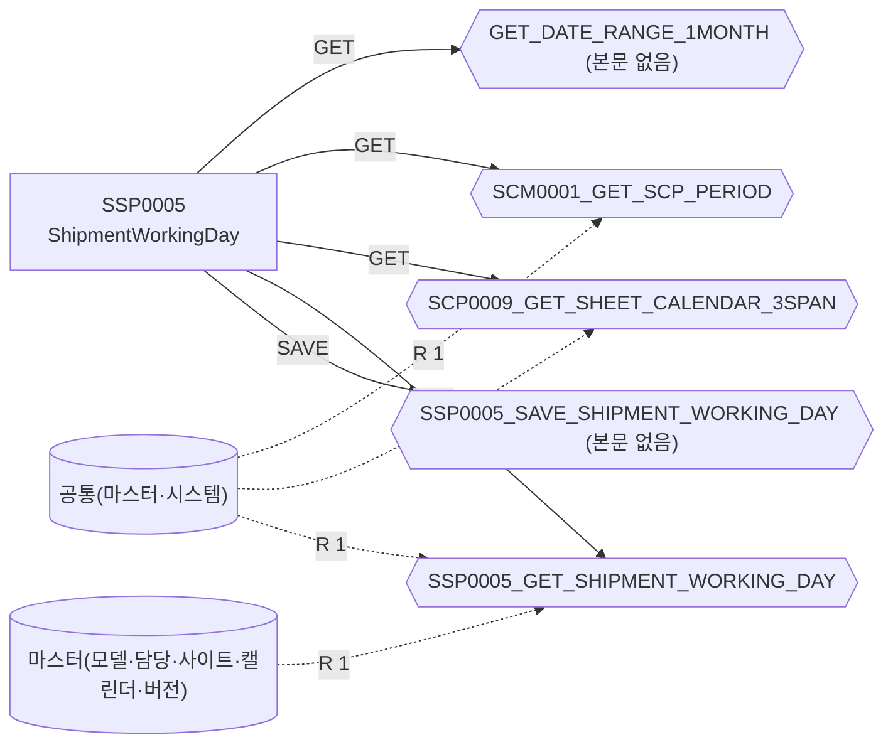

| SP | 출처 | 본문 | 쓰기(W) | 읽기(R) | 중첩 호출 |
|---|---|---|---|---|---|
| GET_DATE_RANGE_1MONTH | matrix | N | - | - | - |
| SCM0001_GET_SCP_PERIOD | matrix+endpoints | Y | - | SCM_SYS_CALENDAR_M | - |
| SCP0009_GET_SHEET_CALENDAR_3SPAN | matrix+endpoints | Y | - | SCM_SYS_CALENDAR_M | - |
| SSP0005_GET_SHIPMENT_WORKING_DAY | matrix+endpoints | Y | - | SCM_SYS_CALENDAR_M, SSP_MST_SHIP_CALENDAR | - |
| SSP0005_SAVE_SHIPMENT_WORKING_DAY | matrix | N | - | - | - |

## SSP0017 InventoryRaw (Main) · TO-BE SSP0017 Inventory Raw(Mobility & IT)

- SP 7개 · TO-BE PKG 배선 1건 · SEARCH:PKG_SSP0017.P_SSP0017_GET_INVENTORY_RAW · 팝업 SCM0002_ItembyDivisionPopup
SCM0002_TitleSetForm_Popup

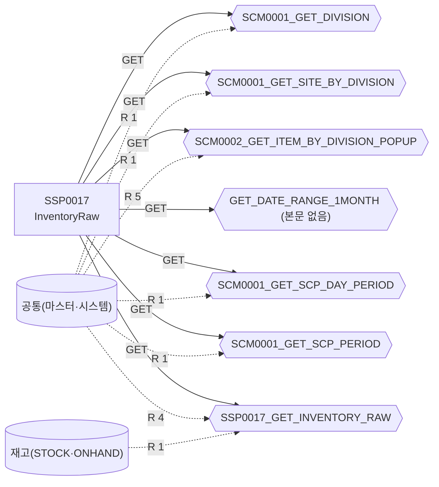

| SP | 출처 | 본문 | 쓰기(W) | 읽기(R) | 중첩 호출 |
|---|---|---|---|---|---|
| SCM0001_GET_DIVISION | matrix+endpoints | Y | - | SCM_MST_DIVISION | - |
| SCM0001_GET_SITE_BY_DIVISION | matrix | Y | - | SCM_MST_SITE | - |
| SCM0002_GET_ITEM_BY_DIVISION_POPUP | matrix | Y | - | SCM_MST_DIVISION, SCM_MST_ITEM_SN, SCM_MST_PROJECT, SCM_MST_SITE, SCM_MST_SITE_ITEM | - |
| GET_DATE_RANGE_1MONTH | matrix | N | - | - | - |
| SCM0001_GET_SCP_DAY_PERIOD | matrix+endpoints | Y | - | SCM_SYS_CALENDAR_M | - |
| SCM0001_GET_SCP_PERIOD | matrix | Y | - | SCM_SYS_CALENDAR_M | - |
| SSP0017_GET_INVENTORY_RAW | matrix+endpoints | Y | - | SCM_MST_FACTORY_SN, SCM_MST_ITEM_SN, SCM_MST_SITE, SCM_MST_SLOC, SSP_ANL_INVENTORY_RAW | - |

## SSP0201 ShipmentChangeRequest (Main) · TO-BE SSP0201 Shipment Change Request(Packer)

- SP 20개 · TO-BE PKG 배선 10건 · CANCEL:PKG_SSP0201.P_SSP0201_DELETE_SHIPMENT_REQUEST_DRAFTING, COMPLETE:PKG_SSP0201.P_SSP0201_SAVE_SHIPMENT_REQUEST_COMPLETE, GET_SCP_DAY_PERIOD:PKG_COM0000.P_SCM0001_GET_SCP_DAY_PERIOD, REQ_NO:PKG_SSP0201.P_SSP0201_GET_CHANGE_REQ_NO, SAVE:PKG_SSP0201.P_SSP0201_SAVE_SHIPMENT_REQUEST_DRAFTING, SAVE_NEW:PKG_SSP0201.P_SSP0201_SAVE_SHIPMENT_CONFIRM_NEW · 팝업 SCM0002_ItembyDivisionPopup
SCM0002_ProjectbyDivisionPopup
SCM0002_ShipmentPlanRequestPopup
SSP0002_UserInfoPopup
SSP0026_ItembyDivisionPopup

```mermaid
flowchart LR
  S["SSP0201<br/>ShipmentChangeRequest"]
  P_SCM0001_GET_DIVISION{{"SCM0001_GET_DIVISION"}}
  S --GET--> P_SCM0001_GET_DIVISION
  E____________[("공통(마스터·시스템)")] -."R 1".-> P_SCM0001_GET_DIVISION
  P_SCM0001_GET_SITE_BY_DIVISION{{"SCM0001_GET_SITE_BY_DIVISION"}}
  S --GET--> P_SCM0001_GET_SITE_BY_DIVISION
  E____________[("공통(마스터·시스템)")] -."R 1".-> P_SCM0001_GET_SITE_BY_DIVISION
  P_SCM0002_GET_ITEM_BY_DIVISION_POPUP{{"SCM0002_GET_ITEM_BY_DIVISION_POPUP"}}
  S --GET--> P_SCM0002_GET_ITEM_BY_DIVISION_POPUP
  E____________[("공통(마스터·시스템)")] -."R 5".-> P_SCM0002_GET_ITEM_BY_DIVISION_POPUP
  P_GET_DATE_RANGE_1MONTH{{"GET_DATE_RANGE_1MONTH (본문 없음)"}}
  S --GET--> P_GET_DATE_RANGE_1MONTH
  P_SCM0001_GET_SCP_DAY_PERIOD{{"SCM0001_GET_SCP_DAY_PERIOD"}}
  S --GET--> P_SCM0001_GET_SCP_DAY_PERIOD
  E____________[("공통(마스터·시스템)")] -."R 1".-> P_SCM0001_GET_SCP_DAY_PERIOD
  P_SSP0002_DELETE_SHIPMENT_REQUEST_DRAFTING{{"SSP0002_DELETE_SHIPMENT_REQUEST_DRAFTING"}}
  S --SAVE--> P_SSP0002_DELETE_SHIPMENT_REQUEST_DRAFTING
  P_SSP0002_DELETE_SHIPMENT_REQUEST_DRAFTING =="W 1"==> E______[("인터페이스")]
  P_SSP0002_DELETE_SHIPMENT_REQUEST_DRAFTING =="W 2"==> E___________CHG_REQ_[("출하확정 변경요청(CHG_REQ)")]
  P_SSP0002_DELETE_SHIPMENT_REQUEST_DRAFTING =="W 1"==> E______CONFIRM_[("출하확정(CONFIRM)")]
  E____________[("공통(마스터·시스템)")] -."R 3".-> P_SSP0002_DELETE_SHIPMENT_REQUEST_DRAFTING
  E______[("인터페이스")] -."R 1".-> P_SSP0002_DELETE_SHIPMENT_REQUEST_DRAFTING
  E____________[("공통(마스터·시스템)")] -."R? 1".-> P_SSP0002_DELETE_SHIPMENT_REQUEST_DRAFTING
  P_SSP0002_GET_SHIPMENT_REQUEST_DRAFTING{{"SSP0002_GET_SHIPMENT_REQUEST_DRAFTING"}}
  S --GET--> P_SSP0002_GET_SHIPMENT_REQUEST_DRAFTING
  E_SCP[("SCP")] -."R 1".-> P_SSP0002_GET_SHIPMENT_REQUEST_DRAFTING
  E____________[("공통(마스터·시스템)")] -."R 3".-> P_SSP0002_GET_SHIPMENT_REQUEST_DRAFTING
  E______________________[("마스터(모델·담당·사이트·캘린더·버전)")] -."R 1".-> P_SSP0002_GET_SHIPMENT_REQUEST_DRAFTING
  E___________CHG_REQ_[("출하확정 변경요청(CHG_REQ)")] -."R 2".-> P_SSP0002_GET_SHIPMENT_REQUEST_DRAFTING
  E______CONFIRM_[("출하확정(CONFIRM)")] -."R 1".-> P_SSP0002_GET_SHIPMENT_REQUEST_DRAFTING
  P_SSP0002_GET_USER_INFO_LIST{{"SSP0002_GET_USER_INFO_LIST"}}
  S --GET--> P_SSP0002_GET_USER_INFO_LIST
  E____________[("공통(마스터·시스템)")] -."R 4".-> P_SSP0002_GET_USER_INFO_LIST
  P_SSP0026_GET_BOD_ITEM{{"SSP0026_GET_BOD_ITEM"}}
  S --GET--> P_SSP0026_GET_BOD_ITEM
  E_SCP[("SCP")] -."R 2".-> P_SSP0026_GET_BOD_ITEM
  P_SSP0026_GET_ITEM_BY_DIVISION_POPUP{{"SSP0026_GET_ITEM_BY_DIVISION_POPUP"}}
  S --GET--> P_SSP0026_GET_ITEM_BY_DIVISION_POPUP
  E____________[("공통(마스터·시스템)")] -."R 5".-> P_SSP0026_GET_ITEM_BY_DIVISION_POPUP
  P_SSP0201_DELETE_SHIPMENT_REQUEST_DRAFTING{{"SSP0201_DELETE_SHIPMENT_REQUEST_DRAFTING"}}
  S --SAVE--> P_SSP0201_DELETE_SHIPMENT_REQUEST_DRAFTING
  P_SSP0201_DELETE_SHIPMENT_REQUEST_DRAFTING =="W 2"==> E______[("인터페이스")]
  P_SSP0201_DELETE_SHIPMENT_REQUEST_DRAFTING =="W 2"==> E___________CHG_REQ_[("출하확정 변경요청(CHG_REQ)")]
  P_SSP0201_DELETE_SHIPMENT_REQUEST_DRAFTING =="W 1"==> E______CONFIRM_[("출하확정(CONFIRM)")]
  E____________[("공통(마스터·시스템)")] -."R 4".-> P_SSP0201_DELETE_SHIPMENT_REQUEST_DRAFTING
  E______________________[("마스터(모델·담당·사이트·캘린더·버전)")] -."R 1".-> P_SSP0201_DELETE_SHIPMENT_REQUEST_DRAFTING
  E______[("인터페이스")] -."R 1".-> P_SSP0201_DELETE_SHIPMENT_REQUEST_DRAFTING
  E____________[("공통(마스터·시스템)")] -."R? 1".-> P_SSP0201_DELETE_SHIPMENT_REQUEST_DRAFTING
  P_SSP0201_GET_CHANGE_REQ_NO{{"SSP0201_GET_CHANGE_REQ_NO"}}
  S --GET--> P_SSP0201_GET_CHANGE_REQ_NO
  P_SSP0201_GET_ERP_SO_NO_CNT{{"SSP0201_GET_ERP_SO_NO_CNT"}}
  S --GET--> P_SSP0201_GET_ERP_SO_NO_CNT
  E______CONFIRM_[("출하확정(CONFIRM)")] -."R 1".-> P_SSP0201_GET_ERP_SO_NO_CNT
  P_SSP0201_GET_SHIPMENT_CHANGE_REQUEST{{"SSP0201_GET_SHIPMENT_CHANGE_REQUEST"}}
  S --GET--> P_SSP0201_GET_SHIPMENT_CHANGE_REQUEST
  E_SCP[("SCP")] -."R 1".-> P_SSP0201_GET_SHIPMENT_CHANGE_REQUEST
  E____________[("공통(마스터·시스템)")] -."R 3".-> P_SSP0201_GET_SHIPMENT_CHANGE_REQUEST
  E______________________[("마스터(모델·담당·사이트·캘린더·버전)")] -."R 1".-> P_SSP0201_GET_SHIPMENT_CHANGE_REQUEST
  E_______________[("외부 연계 실적·재고·계획")] -."R 1".-> P_SSP0201_GET_SHIPMENT_CHANGE_REQUEST
  E___________CHG_REQ_[("출하확정 변경요청(CHG_REQ)")] -."R 2".-> P_SSP0201_GET_SHIPMENT_CHANGE_REQUEST
  E______CONFIRM_[("출하확정(CONFIRM)")] -."R 1".-> P_SSP0201_GET_SHIPMENT_CHANGE_REQUEST
  P_SSP0201_GET_SHIPMENT_CHANGE_REQUEST_N{{"SSP0201_GET_SHIPMENT_CHANGE_REQUEST_N"}}
  S --GET--> P_SSP0201_GET_SHIPMENT_CHANGE_REQUEST_N
  E_SCP[("SCP")] -."R 1".-> P_SSP0201_GET_SHIPMENT_CHANGE_REQUEST_N
  E____________[("공통(마스터·시스템)")] -."R 3".-> P_SSP0201_GET_SHIPMENT_CHANGE_REQUEST_N
  E______________________[("마스터(모델·담당·사이트·캘린더·버전)")] -."R 1".-> P_SSP0201_GET_SHIPMENT_CHANGE_REQUEST_N
  E___________CHG_REQ_[("출하확정 변경요청(CHG_REQ)")] -."R 2".-> P_SSP0201_GET_SHIPMENT_CHANGE_REQUEST_N
  E______CONFIRM_[("출하확정(CONFIRM)")] -."R 1".-> P_SSP0201_GET_SHIPMENT_CHANGE_REQUEST_N
  P_SSP0201_GET_SHIPMENT_REQUEST_DRAFTING{{"SSP0201_GET_SHIPMENT_REQUEST_DRAFTING"}}
  S --GET--> P_SSP0201_GET_SHIPMENT_REQUEST_DRAFTING
  E_SCP[("SCP")] -."R 1".-> P_SSP0201_GET_SHIPMENT_REQUEST_DRAFTING
  E____________[("공통(마스터·시스템)")] -."R 3".-> P_SSP0201_GET_SHIPMENT_REQUEST_DRAFTING
  E______________________[("마스터(모델·담당·사이트·캘린더·버전)")] -."R 1".-> P_SSP0201_GET_SHIPMENT_REQUEST_DRAFTING
  E___________CHG_REQ_[("출하확정 변경요청(CHG_REQ)")] -."R 1".-> P_SSP0201_GET_SHIPMENT_REQUEST_DRAFTING
  E______CONFIRM_[("출하확정(CONFIRM)")] -."R 1".-> P_SSP0201_GET_SHIPMENT_REQUEST_DRAFTING
  P_SSP0201_GET_SHIPMENT_STATUS{{"SSP0201_GET_SHIPMENT_STATUS"}}
  S --GET--> P_SSP0201_GET_SHIPMENT_STATUS
  E______CONFIRM_[("출하확정(CONFIRM)")] -."R 1".-> P_SSP0201_GET_SHIPMENT_STATUS
  P_SSP0201_SAVE_SHIPMENT_CONFIRM_NEW{{"SSP0201_SAVE_SHIPMENT_CONFIRM_NEW"}}
  S --SAVE--> P_SSP0201_SAVE_SHIPMENT_CONFIRM_NEW
  P_SSP0201_SAVE_SHIPMENT_CONFIRM_NEW =="W 1"==> E______CONFIRM_[("출하확정(CONFIRM)")]
  E_SCP[("SCP")] -."R 2".-> P_SSP0201_SAVE_SHIPMENT_CONFIRM_NEW
  E____________[("공통(마스터·시스템)")] -."R 8".-> P_SSP0201_SAVE_SHIPMENT_CONFIRM_NEW
  E______________________[("마스터(모델·담당·사이트·캘린더·버전)")] -."R 1".-> P_SSP0201_SAVE_SHIPMENT_CONFIRM_NEW
  E____________[("공통(마스터·시스템)")] -."R? 1".-> P_SSP0201_SAVE_SHIPMENT_CONFIRM_NEW
  P_SSP0201_SAVE_SHIPMENT_REQUEST_COMPLETE{{"SSP0201_SAVE_SHIPMENT_REQUEST_COMPLETE"}}
  S --SAVE--> P_SSP0201_SAVE_SHIPMENT_REQUEST_COMPLETE
  P_SSP0201_SAVE_SHIPMENT_REQUEST_COMPLETE =="W 1"==> E____________[("공통(마스터·시스템)")]
  P_SSP0201_SAVE_SHIPMENT_REQUEST_COMPLETE =="W 1"==> E___________CHG_REQ_[("출하확정 변경요청(CHG_REQ)")]
  P_SSP0201_SAVE_SHIPMENT_REQUEST_COMPLETE =="W 1"==> E______CONFIRM_[("출하확정(CONFIRM)")]
  E____________[("공통(마스터·시스템)")] -."R 9".-> P_SSP0201_SAVE_SHIPMENT_REQUEST_COMPLETE
  E______________________[("마스터(모델·담당·사이트·캘린더·버전)")] -."R 2".-> P_SSP0201_SAVE_SHIPMENT_REQUEST_COMPLETE
  E___________CHG_REQ_[("출하확정 변경요청(CHG_REQ)")] -."R 1".-> P_SSP0201_SAVE_SHIPMENT_REQUEST_COMPLETE
  E____________[("공통(마스터·시스템)")] -."R? 1".-> P_SSP0201_SAVE_SHIPMENT_REQUEST_COMPLETE
  P_SSP0201_SAVE_SHIPMENT_REQUEST_DRAFTING{{"SSP0201_SAVE_SHIPMENT_REQUEST_DRAFTING"}}
  S --SAVE--> P_SSP0201_SAVE_SHIPMENT_REQUEST_DRAFTING
  P_SSP0201_SAVE_SHIPMENT_REQUEST_DRAFTING =="W 2"==> E___________CHG_REQ_[("출하확정 변경요청(CHG_REQ)")]
  P_SSP0201_SAVE_SHIPMENT_REQUEST_DRAFTING =="W 1"==> E______CONFIRM_[("출하확정(CONFIRM)")]
  E_SCP[("SCP")] -."R 2".-> P_SSP0201_SAVE_SHIPMENT_REQUEST_DRAFTING
  E____________[("공통(마스터·시스템)")] -."R 1".-> P_SSP0201_SAVE_SHIPMENT_REQUEST_DRAFTING
  E______________________[("마스터(모델·담당·사이트·캘린더·버전)")] -."R 1".-> P_SSP0201_SAVE_SHIPMENT_REQUEST_DRAFTING
```

| SP | 출처 | 본문 | 쓰기(W) | 읽기(R) | 중첩 호출 |
|---|---|---|---|---|---|
| SCM0001_GET_DIVISION | matrix | Y | - | SCM_MST_DIVISION | - |
| SCM0001_GET_SITE_BY_DIVISION | matrix | Y | - | SCM_MST_SITE | - |
| SCM0002_GET_ITEM_BY_DIVISION_POPUP | matrix | Y | - | SCM_MST_DIVISION, SCM_MST_ITEM_SN, SCM_MST_PROJECT, SCM_MST_SITE, SCM_MST_SITE_ITEM | - |
| GET_DATE_RANGE_1MONTH | matrix | N | - | - | - |
| SCM0001_GET_SCP_DAY_PERIOD | matrix+endpoints | Y | - | SCM_SYS_CALENDAR_M | - |
| SSP0002_DELETE_SHIPMENT_REQUEST_DRAFTING | matrix | Y | SSP_ANL_SHIP_CONFIRM, SSP_ANL_SHIP_CONFIRM_CHG_REQ, SSP_ANL_SHIP_CONFIRM_CHG_REQ_DE, XIF_ERP_SHIP_PLAN_CONFIRM_S_SN | NERP_CONV_MASTER, SCM_ADM_LOOKUP_MASTER_DETAIL, SCM_MST_DIVISION, SCM_MST_SITE, SCM_SYS_LOG_BATCH | PR_SCM_SYS_LOG_BATCH_CALL_TRAN, PR_SCP_SYS_LOG_BATCH, PR_SSP_ANL_SHIP_CONFIRM_CHG_BATCH |
| SSP0002_GET_SHIPMENT_REQUEST_DRAFTING | matrix | Y | - | SCM_MST_SSO_DEPT_INFO, SCM_MST_SSO_USER_INFO, SCP_MST_BOD_N_V, SSP_ANL_SHIP_CONFIRM, SSP_ANL_SHIP_CONFIRM_CHG_REQ, SSP_ANL_SHIP_CONFIRM_CHG_REQ_DE, SSP_MST_MODEL_USER, TB_FX_USER | - |
| SSP0002_GET_USER_INFO_LIST | matrix | Y | - | SCM_MST_SSO_DEPT_INFO, TB_FX_GROUPINFO, TB_FX_USER, TB_FX_USERGROUPAUTHEXTENTION | - |
| SSP0026_GET_BOD_ITEM | matrix+endpoints | Y | - | SCP_MST_BOD_ITEM, SCP_MST_BOD_N_V | - |
| SSP0026_GET_ITEM_BY_DIVISION_POPUP | matrix | Y | - | SCM_MST_DIVISION, SCM_MST_ITEM_SN, SCM_MST_PROJECT, SCM_MST_SITE, SCM_MST_SITE_ITEM | - |
| SSP0201_DELETE_SHIPMENT_REQUEST_DRAFTING | matrix+endpoints | Y | SSP_ANL_SHIP_CONFIRM, SSP_ANL_SHIP_CONFIRM_CHG_REQ, SSP_ANL_SHIP_CONFIRM_CHG_REQ_DE, XIF_ERP_PACK_SHIP_PLAN_S_SN, XIF_SCS_PACK_SHIP_PLAN_S_SN | NERP_CONV_MASTER, SCM_ADM_LOOKUP_MASTER_DETAIL, SCM_MST_SITE, SCM_MST_SITE_ITEM, SCM_SYS_LOG_BATCH, SSP_MST_MODEL_USER, TB_FX_USER | PR_SCM_SYS_LOG_BATCH_CALL_TRAN, PR_SCP_SYS_LOG_BATCH, PR_SSP_ANL_SHIP_CONFIRM_CHG_BATCH_PACKER |
| SSP0201_GET_CHANGE_REQ_NO | matrix+endpoints | Y | - | - | - |
| SSP0201_GET_ERP_SO_NO_CNT | matrix+endpoints | Y | - | SSP_ANL_SHIP_CONFIRM | - |
| SSP0201_GET_SHIPMENT_CHANGE_REQUEST | matrix+endpoints | Y | - | SCM_DNM_SCS_SHIP_RESULT, SCM_MST_SITE, SCM_MST_SITE_ITEM, SCP_MST_BOD_N_V, SSP_ANL_SHIP_CONFIRM, SSP_ANL_SHIP_CONFIRM_CHG_REQ, SSP_ANL_SHIP_CONFIRM_CHG_REQ_DE, SSP_MST_MODEL_USER, TB_FX_USER | - |
| SSP0201_GET_SHIPMENT_CHANGE_REQUEST_N | matrix+endpoints | Y | - | SCM_MST_SITE, SCM_MST_SITE_ITEM, SCP_MST_BOD_N_V, SSP_ANL_SHIP_CONFIRM, SSP_ANL_SHIP_CONFIRM_CHG_REQ, SSP_ANL_SHIP_CONFIRM_CHG_REQ_DE, SSP_MST_MODEL_USER, TB_FX_USER | - |
| SSP0201_GET_SHIPMENT_REQUEST_DRAFTING | matrix+endpoints | Y | - | SCM_MST_SITE, SCM_MST_SSO_DEPT_INFO, SCM_MST_SSO_USER_INFO, SCP_MST_BOD_N_V, SSP_ANL_SHIP_CONFIRM, SSP_ANL_SHIP_CONFIRM_CHG_REQ_DE, SSP_MST_MODEL_USER | - |
| SSP0201_GET_SHIPMENT_STATUS | matrix+endpoints | Y | - | SSP_ANL_SHIP_CONFIRM | - |
| SSP0201_SAVE_SHIPMENT_CONFIRM_NEW | matrix+endpoints | Y | SSP_ANL_SHIP_CONFIRM | SCM_ADM_LOOKUP_MASTER_DETAIL, SCM_MST_DIVISION, SCM_MST_FUTURE_PRICE, SCM_MST_ITEM_SN, SCM_MST_PROJECT, SCM_MST_SITE, SCM_MST_SITE_ITEM, SCM_SYS_CALENDAR_M, SCM_SYS_LOG_BATCH, SCP_MST_BOD_ITEM, SCP_MST_BOD_N_V, SSP_PLAN_VERSION_V | PR_SCM_SYS_LOG_BATCH |
| SSP0201_SAVE_SHIPMENT_REQUEST_COMPLETE | matrix+endpoints | Y | SCM_ADM_SMS_MAIL_SEND_LOG, SSP_ANL_SHIP_CONFIRM, SSP_ANL_SHIP_CONFIRM_CHG_REQ | SCM_ADM_LOOKUP_MASTER_DETAIL, SCM_ADM_RECIPIENT_ASSIGN, SCM_ADM_RECIPIENT_LIST, SCM_ADM_RECIPIENT_MESSAGE, SCM_MST_SITE, SCM_MST_SITE_ITEM, SCM_MST_SSO_DEPT_INFO, SCM_MST_SSO_USER_INFO, SCM_SYS_LOG_BATCH, SSP_ANL_SHIP_CONFIRM_CHG_REQ_DE, SSP_MST_DELEGATE, SSP_MST_MODEL_USER, TB_FX_USER | PR_SCM_SYS_LOG_BATCH, PR_SCM_SYS_LOG_BATCH_CALL_TRAN, SCM_ADM_MAIL_SEND, SCM_ADM_SAVE_MAIL_SEND_BATCH_LOG, SCM_SSP_MAIL_SEND, SP_SEND_DBMAIL |
| SSP0201_SAVE_SHIPMENT_REQUEST_DRAFTING | matrix+endpoints | Y | SSP_ANL_SHIP_CONFIRM, SSP_ANL_SHIP_CONFIRM_CHG_REQ, SSP_ANL_SHIP_CONFIRM_CHG_REQ_DE | SCM_MST_SITE, SCP_MST_BOD_ITEM, SCP_MST_BOD_N_V, SSP_MST_SITE_ITEM_EE_V | PR_SCM_SYS_LOG_BATCH |

## SSP0202 ShipmentChangeRequestConfirm (Main) · TO-BE SSP0202 Shipment Change Request Confirm(Packer)

- SP 14개 · TO-BE PKG 배선 8건 · IF_CHECK:PKG_SSP0202.P_SSP0202_SAVE_SHIPMENT_REQUEST_CONFIRM_IF_CHECK, PLAN_CHECK:PKG_SSP0202.P_SSP0202_GET_SSP_PLAN_PROCESSING_CHECK, SAVE:PKG_SSP0202.P_SSP0202_SAVE_SHIPMENT_REQUEST_CONFIRM, SAVE_40:PKG_SSP0202.P_SSP0202_SAVE_SHIPMENT_REQUEST_CONFIRM_40, SCS_CHECK:PKG_SSP0202.P_SSP0202_GET_SCS_CONFIRM_ID_CHECK, SEARCH:PKG_SSP0202.P_SSP0202_GET_DELEGATEE_LOAD · 팝업 SCM0002_ItembyDivisionPopup
UserInfoPopup

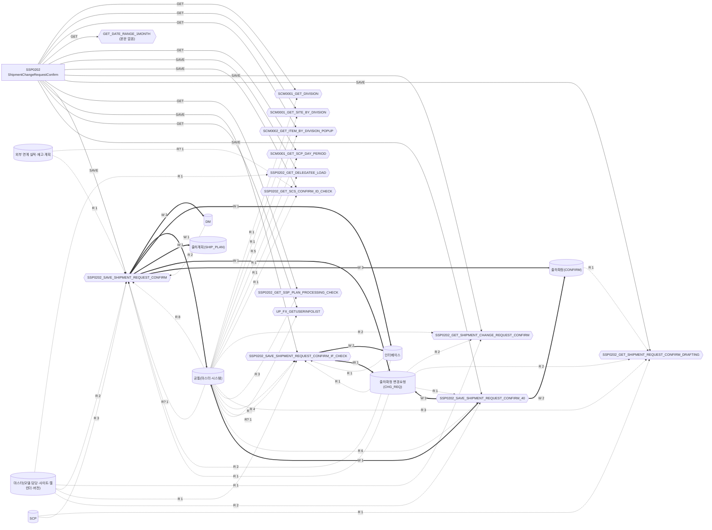

| SP | 출처 | 본문 | 쓰기(W) | 읽기(R) | 중첩 호출 |
|---|---|---|---|---|---|
| SCM0001_GET_DIVISION | matrix | Y | - | SCM_MST_DIVISION | - |
| SCM0001_GET_SITE_BY_DIVISION | matrix | Y | - | SCM_MST_SITE | - |
| SCM0002_GET_ITEM_BY_DIVISION_POPUP | matrix | Y | - | SCM_MST_DIVISION, SCM_MST_ITEM_SN, SCM_MST_PROJECT, SCM_MST_SITE, SCM_MST_SITE_ITEM | - |
| GET_DATE_RANGE_1MONTH | matrix | N | - | - | - |
| SCM0001_GET_SCP_DAY_PERIOD | matrix+endpoints | Y | - | SCM_SYS_CALENDAR_M | - |
| SSP0202_GET_DELEGATEE_LOAD | matrix+endpoints | Y | - | SSP_MST_DELEGATE, TB_FX_USER | - |
| SSP0202_GET_SCS_CONFIRM_ID_CHECK | matrix+endpoints | Y | - | SCM_ADM_LOOKUP_MASTER_DETAIL, SCM_DNM_SCS_SHIP_RESULT | - |
| SSP0202_GET_SHIPMENT_CHANGE_REQUEST_CONFIRM | matrix+endpoints | Y | - | SCM_MST_SITE, SSP_ANL_SHIP_CONFIRM_CHG_REQ, SSP_ANL_SHIP_CONFIRM_CHG_REQ_DE, SSP_MST_DELEGATE, TB_FX_USER | - |
| SSP0202_GET_SHIPMENT_REQUEST_CONFIRM_DRAFTING | matrix+endpoints | Y | - | SCM_ADM_LOOKUP_MASTER_DETAIL, SCM_MST_SSO_DEPT_INFO, SCP_MST_BOD_N_V, SSP_ANL_SHIP_CONFIRM, SSP_ANL_SHIP_CONFIRM_CHG_REQ, SSP_ANL_SHIP_CONFIRM_CHG_REQ_DE, TB_FX_USER | - |
| SSP0202_GET_SSP_PLAN_PROCESSING_CHECK | matrix+endpoints | Y | - | SCM_MST_DIVISION, SCM_MST_PLAN, SCM_MST_PLAN_DETAIL | - |
| SSP0202_SAVE_SHIPMENT_REQUEST_CONFIRM | matrix+endpoints | Y | DM_PLN_MKT_FCST, DM_PLN_MKT_FCST_CONFIRM, SCM_ADM_SMS_MAIL_SEND_LOG, SSP_ANL_SHIP_CONFIRM, SSP_ANL_SHIP_CONFIRM_CHG_REQ, SSP_ANL_SHIP_CONFIRM_H, SSP_ANL_SHIP_CONFIRM_ROUTE, SSP_ANL_SHIP_PLAN, XIF_SCS_PACK_SHIP_PLAN_S_SN | DM_MST_ITEM_SINGLE_V, DM_PLN_MKT_FCST_RESULT, NERP_CONV_MASTER, SCM_ADM_LOOKUP_MASTER_DETAIL, SCM_ADM_RECIPIENT_ASSIGN, SCM_ADM_RECIPIENT_LIST, SCM_ADM_RECIPIENT_MESSAGE, SCM_DNM_EXFACTORY_RESULT, SCM_MST_PROJECT, SCM_MST_SITE, SCM_MST_SITE_ITEM, SCM_SYS_LOG_BATCH, SCP_MST_BOD, SCP_MST_BOD_N_V, SCP_MST_DISTRIBUTION_ROUTE, SSP_ANL_SHIP_CONFIRM_CHG_REQ_DE, SSP_MST_DELEGATE, SSP_MST_SITE_ITEM_EE_V, TB_FX_USER, XIF_ERP_SHIP_DOC_R_SN | PR_DM_SSP_CONFIRM_SYNC, PR_SCM_SYS_LOG_BATCH, PR_SCM_SYS_LOG_BATCH_CALL_TRAN, PR_SCP_SYS_LOG_BATCH, PR_SSP_ANL_SHIP_CONFIRM_CHG_BATCH_SCS, PR_SSP_ANL_SHIP_CONFIRM_HIST, PR_SSP_ANL_SHIP_CONFIRM_ROUTE, SCM_ADM_MAIL_SEND, SCM_ADM_SAVE_MAIL_SEND_BATCH_LOG, SCM_SSP_MAIL_SEND, SP_SEND_DBMAIL |
| SSP0202_SAVE_SHIPMENT_REQUEST_CONFIRM_IF_CHECK | matrix+endpoints | Y | SSP_ANL_SHIP_CONFIRM_CHG_REQ_DE, XIF_ERP_PACK_SHIP_PLAN_S_SN, XIF_SCS_PACK_SHIP_PLAN_S_SN | NERP_CONV_MASTER, SCM_ADM_LOOKUP_MASTER_DETAIL, SCM_MST_SITE, SCM_MST_SITE_ITEM, SCM_SYS_LOG_BATCH, SSP_ANL_SHIP_CONFIRM_CHG_REQ, SSP_MST_MODEL_USER, TB_FX_USER | PR_SCM_SYS_LOG_BATCH_CALL_TRAN, PR_SCP_SYS_LOG_BATCH, PR_SSP_ANL_SHIP_CONFIRM_CHG_BATCH_PACKER |
| UP_FX_GETUSERINFOLIST | matrix | Y | - | SCM_MST_SSO_DEPT_INFO, SCM_MST_SSO_USER_INFO, TB_FX_GROUPINFO, TB_FX_USER | - |
| SSP0202_SAVE_SHIPMENT_REQUEST_CONFIRM_40 | endpoints | Y | SCM_ADM_SMS_MAIL_SEND_LOG, SSP_ANL_SHIP_CONFIRM, SSP_ANL_SHIP_CONFIRM_CHG_REQ, SSP_ANL_SHIP_CONFIRM_H | SCM_ADM_LOOKUP_MASTER_DETAIL, SCM_ADM_RECIPIENT_ASSIGN, SCM_ADM_RECIPIENT_LIST, SCM_ADM_RECIPIENT_MESSAGE, SCM_MST_SITE_ITEM, SSP_ANL_SHIP_CONFIRM_CHG_REQ_DE, SSP_MST_DELEGATE, SSP_MST_SITE_ITEM_EE_V, TB_FX_USER | PR_SCM_SYS_LOG_BATCH, PR_SCM_SYS_LOG_BATCH_CALL_TRAN, PR_SSP_ANL_SHIP_CONFIRM_HIST, SCM_ADM_MAIL_SEND, SCM_ADM_SAVE_MAIL_SEND_BATCH_LOG, SCM_SSP_MAIL_SEND, SP_SEND_DBMAIL |

## SSP0045 ShipmentRequest (Main) · TO-BE SSP0045 Shipment Request SEMI

- SP 9개 · TO-BE PKG 배선 4건 · SAVE:PKG_SSP0045.P_SSP0045_SAVE_SHIPMENT_REQUEST, SEARCH:PKG_SSP0045.P_SSP0045_GET_BOD_ITEM_PRJ_ROUTE, SEARCH:PKG_SSP0045.P_SSP0045_GET_SHEET_CALENDAR_3SPAN, SEARCH:PKG_SSP0045.P_SSP0045_GET_SHIPMENT_REQUEST · 팝업 SCM0002_GetBODItemPrjRoutePopup
SCM0002_ItembyDivisionPopup

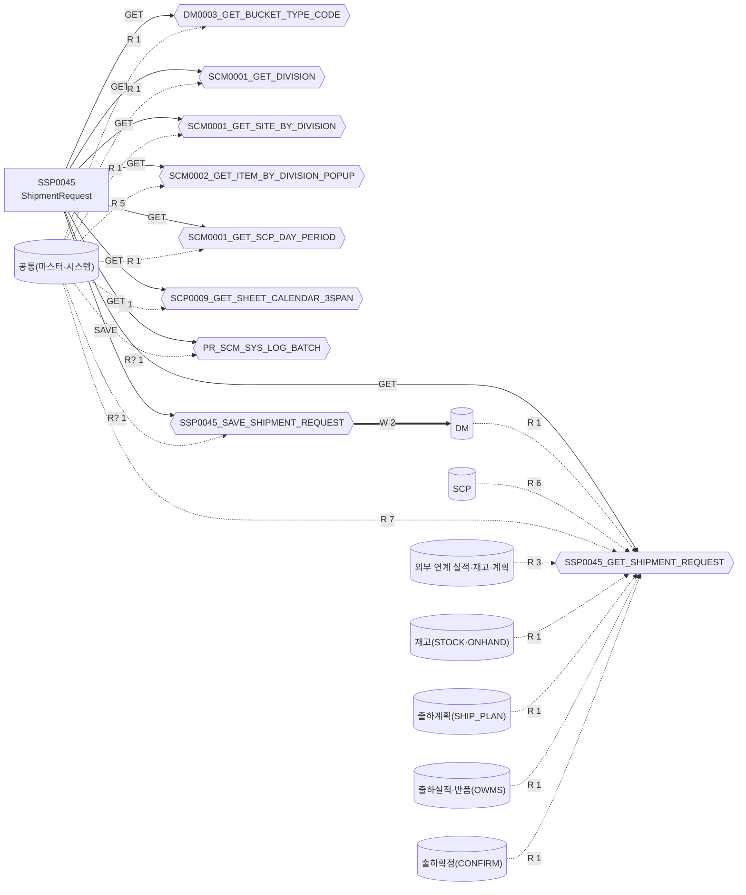

| SP | 출처 | 본문 | 쓰기(W) | 읽기(R) | 중첩 호출 |
|---|---|---|---|---|---|
| DM0003_GET_BUCKET_TYPE_CODE | matrix+endpoints | Y | - | SCM_ADM_LOOKUP_MASTER_DETAIL | - |
| SCM0001_GET_DIVISION | matrix | Y | - | SCM_MST_DIVISION | - |
| SCM0001_GET_SITE_BY_DIVISION | matrix | Y | - | SCM_MST_SITE | - |
| SCM0002_GET_ITEM_BY_DIVISION_POPUP | matrix | Y | - | SCM_MST_DIVISION, SCM_MST_ITEM_SN, SCM_MST_PROJECT, SCM_MST_SITE, SCM_MST_SITE_ITEM | - |
| SCM0001_GET_SCP_DAY_PERIOD | matrix+endpoints | Y | - | SCM_SYS_CALENDAR_M | - |
| SCP0009_GET_SHEET_CALENDAR_3SPAN | matrix+endpoints | Y | - | SCM_SYS_CALENDAR_M | - |
| PR_SCM_SYS_LOG_BATCH | matrix | Y | - | SCM_SYS_LOG_BATCH | - |
| SSP0045_GET_SHIPMENT_REQUEST | matrix+endpoints | Y | - | DM_PLN_SHIPMENT_REQ, SCM_ADM_LOOKUP_MASTER_DETAIL, SCM_DNM_CELL_INHOUSE_PLAN_SN, SCM_DNM_EXFACTORY_RESULT, SCM_DNM_PLAN_FROZEN_V, SCM_MST_ITEM_SN, SCM_MST_LOCATION, SCM_MST_SHEET_MEASURE, SCM_MST_SITE, SCM_SYS_CALENDAR_M, SCP_ANL_SHIPMENT_PLAN_SEMI, SCP_MST_BOD_N_V, SCP_MST_FINAL_ITEM, SCP_PLAN_VERSION_V, SCP_PLN_SHIPMENT_PLAN, SCP_PLN_SHIPMENT_PLAN_PEGGING, SSP_ANL_SHIP_CONFIRM, SSP_ANL_SHIP_PLAN_40, SSP_DNM_SHIP_RESULT_OWMS_V, SSP_DNM_STOCK_C, TB_FX_USER | - |
| SSP0045_SAVE_SHIPMENT_REQUEST | matrix+endpoints | Y | DM_PLN_SHIPMENT_REQ, DM_PLN_SHIPMENT_REQ_H | SCM_SYS_LOG_BATCH | PR_SCM_SYS_LOG_BATCH |

## SSP0001 ShipmentPlanConfirm (Main) · AS-IS 전용(TO-BE 메뉴 없음)

- SP 11개 · TO-BE PKG 배선 0건 · 팝업 SCM0002_ItembyDivisionPopup
SCM0002_ShipmentPlanConfirmBODPopup
SCM0002_ShipmentPlanRequestPopup
SCM0002_TitleSetForm_Popup

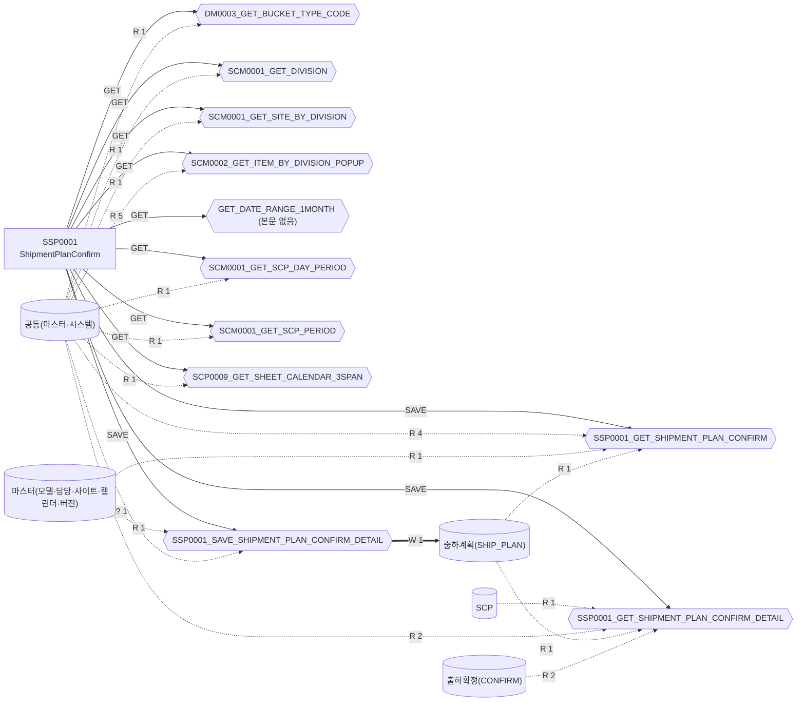

| SP | 출처 | 본문 | 쓰기(W) | 읽기(R) | 중첩 호출 |
|---|---|---|---|---|---|
| DM0003_GET_BUCKET_TYPE_CODE | matrix+endpoints | Y | - | SCM_ADM_LOOKUP_MASTER_DETAIL | - |
| SCM0001_GET_DIVISION | matrix+endpoints | Y | - | SCM_MST_DIVISION | - |
| SCM0001_GET_SITE_BY_DIVISION | matrix | Y | - | SCM_MST_SITE | - |
| SCM0002_GET_ITEM_BY_DIVISION_POPUP | matrix | Y | - | SCM_MST_DIVISION, SCM_MST_ITEM_SN, SCM_MST_PROJECT, SCM_MST_SITE, SCM_MST_SITE_ITEM | - |
| GET_DATE_RANGE_1MONTH | matrix | N | - | - | - |
| SCM0001_GET_SCP_DAY_PERIOD | matrix+endpoints | Y | - | SCM_SYS_CALENDAR_M | - |
| SCM0001_GET_SCP_PERIOD | matrix | Y | - | SCM_SYS_CALENDAR_M | - |
| SCP0009_GET_SHEET_CALENDAR_3SPAN | matrix+endpoints | Y | - | SCM_SYS_CALENDAR_M | - |
| SSP0001_GET_SHIPMENT_PLAN_CONFIRM | matrix+endpoints | Y | - | SCM_MST_SHEET_MEASURE, SCM_MST_SITE, SCM_MST_TITLESET_USER, SCM_SYS_CALENDAR_M, SSP_ANL_SHIP_PLAN, SSP_PLAN_VERSION_V | - |
| SSP0001_GET_SHIPMENT_PLAN_CONFIRM_DETAIL | matrix+endpoints | Y | - | SCM_ADM_LOOKUP_MASTER_DETAIL, SCP_MST_BOD_N_V, SSP_ANL_SHIP_CONFIRM, SSP_ANL_SHIP_CONFIRM_H, SSP_ANL_SHIP_PLAN, TB_FX_USER | - |
| SSP0001_SAVE_SHIPMENT_PLAN_CONFIRM_DETAIL | matrix+endpoints | Y | SSP_ANL_SHIP_PLAN | SCM_SYS_LOG_BATCH, SSP_PLAN_VERSION_V | PR_SCM_SYS_LOG_BATCH_CALL_TRAN, PR_SCP_SYS_LOG_BATCH, PR_SSP_ANL_SHIP_UPDATE_BOH_VAL |

## SSP0002 ShipmentChangeRequest / ShipmentChangeRequest_Backup / ShipmentConfirmInsertPopup / UserInfoPopup (Main) · AS-IS 전용(TO-BE 메뉴 없음)

- SP 15개 · TO-BE PKG 배선 0건 · 팝업 SCM0002_ItembyDivisionPopup
SSP0002_ShipmentConfirmInsertPopup
SSP0002_UserInfoPopup

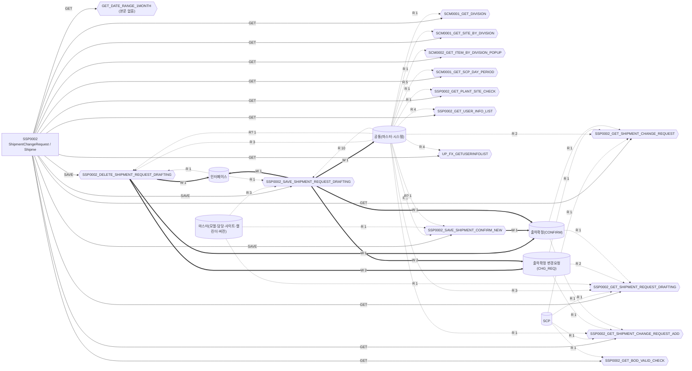

| SP | 출처 | 본문 | 쓰기(W) | 읽기(R) | 중첩 호출 |
|---|---|---|---|---|---|
| SCM0001_GET_DIVISION | matrix | Y | - | SCM_MST_DIVISION | - |
| SCM0001_GET_SITE_BY_DIVISION | matrix | Y | - | SCM_MST_SITE | - |
| SCM0002_GET_ITEM_BY_DIVISION_POPUP | matrix | Y | - | SCM_MST_DIVISION, SCM_MST_ITEM_SN, SCM_MST_PROJECT, SCM_MST_SITE, SCM_MST_SITE_ITEM | - |
| GET_DATE_RANGE_1MONTH | matrix | N | - | - | - |
| SCM0001_GET_SCP_DAY_PERIOD | matrix+endpoints | Y | - | SCM_SYS_CALENDAR_M | - |
| SSP0002_DELETE_SHIPMENT_REQUEST_DRAFTING | matrix+endpoints | Y | SSP_ANL_SHIP_CONFIRM, SSP_ANL_SHIP_CONFIRM_CHG_REQ, SSP_ANL_SHIP_CONFIRM_CHG_REQ_DE, XIF_ERP_SHIP_PLAN_CONFIRM_S_SN | NERP_CONV_MASTER, SCM_ADM_LOOKUP_MASTER_DETAIL, SCM_MST_DIVISION, SCM_MST_SITE, SCM_SYS_LOG_BATCH | PR_SCM_SYS_LOG_BATCH_CALL_TRAN, PR_SCP_SYS_LOG_BATCH, PR_SSP_ANL_SHIP_CONFIRM_CHG_BATCH |
| SSP0002_GET_BOD_VALID_CHECK | matrix+endpoints | Y | - | SCP_MST_BOD_N_V | - |
| SSP0002_GET_PLANT_SITE_CHECK | matrix+endpoints | Y | - | SCM_MST_SITE | - |
| SSP0002_GET_SHIPMENT_CHANGE_REQUEST | matrix+endpoints | Y | - | SCM_MST_SITE_ITEM, SCP_MST_BOD_N_V, SSP_ANL_SHIP_CONFIRM, SSP_ANL_SHIP_CONFIRM_CHG_REQ, TB_FX_USER | - |
| SSP0002_GET_SHIPMENT_CHANGE_REQUEST_ADD | matrix+endpoints | Y | - | SCP_MST_BOD_N_V, SSP_ANL_SHIP_CONFIRM, SSP_ANL_SHIP_CONFIRM_CHG_REQ, TB_FX_USER | - |
| SSP0002_GET_SHIPMENT_REQUEST_DRAFTING | matrix+endpoints | Y | - | SCM_MST_SSO_DEPT_INFO, SCM_MST_SSO_USER_INFO, SCP_MST_BOD_N_V, SSP_ANL_SHIP_CONFIRM, SSP_ANL_SHIP_CONFIRM_CHG_REQ, SSP_ANL_SHIP_CONFIRM_CHG_REQ_DE, SSP_MST_MODEL_USER, TB_FX_USER | - |
| SSP0002_GET_USER_INFO_LIST | matrix+endpoints | Y | - | SCM_MST_SSO_DEPT_INFO, TB_FX_GROUPINFO, TB_FX_USER, TB_FX_USERGROUPAUTHEXTENTION | - |
| SSP0002_SAVE_SHIPMENT_CONFIRM_NEW | matrix+endpoints | Y | SSP_ANL_SHIP_CONFIRM | SCM_ADM_LOOKUP_MASTER_DETAIL, SCM_MST_DIVISION, SCM_MST_FUTURE_PRICE, SCM_MST_ITEM_SN, SCM_MST_PROJECT, SCM_MST_SITE, SCM_MST_SITE_ITEM, SCM_SYS_CALENDAR_M, SCM_SYS_LOG_BATCH, SSP_PLAN_VERSION_V | - |
| SSP0002_SAVE_SHIPMENT_REQUEST_DRAFTING | matrix+endpoints | Y | SCM_ADM_SMS_MAIL_SEND_LOG, SSP_ANL_SHIP_CONFIRM, SSP_ANL_SHIP_CONFIRM_CHG_REQ, SSP_ANL_SHIP_CONFIRM_CHG_REQ_DE, XIF_ERP_SHIP_PLAN_CONFIRM_S_SN | NERP_CONV_MASTER, SCM_ADM_LOOKUP_MASTER_DETAIL, SCM_ADM_RECIPIENT_ASSIGN, SCM_ADM_RECIPIENT_LIST, SCM_ADM_RECIPIENT_MESSAGE, SCM_MST_DIVISION, SCM_MST_SITE, SCM_MST_SITE_ITEM, SCM_MST_SSO_DEPT_INFO, SCM_MST_SSO_USER_INFO, SSP_MST_DELEGATE, SSP_MST_MODEL_USER, SSP_MST_SITE_ITEM_EE_V, TB_FX_USER | PR_SCM_SYS_LOG_BATCH, PR_SCM_SYS_LOG_BATCH_CALL_TRAN, PR_SCP_SYS_LOG_BATCH, PR_SSP_ANL_SHIP_CONFIRM_CHG_BATCH, SCM_ADM_MAIL_SEND, SCM_ADM_SAVE_MAIL_SEND_BATCH_LOG, SCM_SSP_MAIL_SEND, SP_SEND_DBMAIL |
| UP_FX_GETUSERINFOLIST | matrix | Y | - | SCM_MST_SSO_DEPT_INFO, SCM_MST_SSO_USER_INFO, TB_FX_GROUPINFO, TB_FX_USER | - |

## SSP0006 Plan_Problem (Main) · AS-IS 전용(TO-BE 메뉴 없음)

- SP 12개 · TO-BE PKG 배선 0건 · 팝업 SCM0002_ItembyDivisionPopup
SCM0002_ProjectbyDivisionPopup
SCM0002_TitleSetForm_Popup

```mermaid
flowchart LR
  S["SSP0006<br/>Plan_Problem"]
  P_DM0003_GET_BUCKET_TYPE_CODE{{"DM0003_GET_BUCKET_TYPE_CODE"}}
  S --GET--> P_DM0003_GET_BUCKET_TYPE_CODE
  E____________[("공통(마스터·시스템)")] -."R 1".-> P_DM0003_GET_BUCKET_TYPE_CODE
  P_SCM0001_GET_DIVISION{{"SCM0001_GET_DIVISION"}}
  S --GET--> P_SCM0001_GET_DIVISION
  E____________[("공통(마스터·시스템)")] -."R 1".-> P_SCM0001_GET_DIVISION
  P_SCM0001_GET_SITE_BY_DIVISION{{"SCM0001_GET_SITE_BY_DIVISION"}}
  S --GET--> P_SCM0001_GET_SITE_BY_DIVISION
  E____________[("공통(마스터·시스템)")] -."R 1".-> P_SCM0001_GET_SITE_BY_DIVISION
  P_SCM0002_GET_ITEM_BY_DIVISION_POPUP{{"SCM0002_GET_ITEM_BY_DIVISION_POPUP"}}
  S --GET--> P_SCM0002_GET_ITEM_BY_DIVISION_POPUP
  E____________[("공통(마스터·시스템)")] -."R 5".-> P_SCM0002_GET_ITEM_BY_DIVISION_POPUP
  P_SCM_SYS_GET_SITE_BY_DIVISION{{"SCM_SYS_GET_SITE_BY_DIVISION (본문 없음)"}}
  S --GET--> P_SCM_SYS_GET_SITE_BY_DIVISION
  P_GET_DATE_RANGE_1MONTH{{"GET_DATE_RANGE_1MONTH (본문 없음)"}}
  S --GET--> P_GET_DATE_RANGE_1MONTH
  P_SCM0001_GET_SCP_DAY_PERIOD{{"SCM0001_GET_SCP_DAY_PERIOD"}}
  S --GET--> P_SCM0001_GET_SCP_DAY_PERIOD
  E____________[("공통(마스터·시스템)")] -."R 1".-> P_SCM0001_GET_SCP_DAY_PERIOD
  P_SCP0009_GET_SHEET_CALENDAR_3SPAN{{"SCP0009_GET_SHEET_CALENDAR_3SPAN"}}
  S --GET--> P_SCP0009_GET_SHEET_CALENDAR_3SPAN
  E____________[("공통(마스터·시스템)")] -."R 1".-> P_SCP0009_GET_SHEET_CALENDAR_3SPAN
  P_SSP0006_GET_PEGGING_INFO{{"SSP0006_GET_PEGGING_INFO"}}
  S --GET--> P_SSP0006_GET_PEGGING_INFO
  E____________[("공통(마스터·시스템)")] -."R? 1".-> P_SSP0006_GET_PEGGING_INFO
  E________PROBLEM_[("문제 리포트(PROBLEM)")] -."R? 1".-> P_SSP0006_GET_PEGGING_INFO
  P_SSP0006_GET_PLAN_PROBLEM{{"SSP0006_GET_PLAN_PROBLEM"}}
  S --GET--> P_SSP0006_GET_PLAN_PROBLEM
  E________PROBLEM_[("문제 리포트(PROBLEM)")] -."R? 1".-> P_SSP0006_GET_PLAN_PROBLEM
  P_SSP0006_GET_PROBLEM_REPORT{{"SSP0006_GET_PROBLEM_REPORT"}}
  S --GET--> P_SSP0006_GET_PROBLEM_REPORT
  E____________[("공통(마스터·시스템)")] -."R 1".-> P_SSP0006_GET_PROBLEM_REPORT
  E________PROBLEM_[("문제 리포트(PROBLEM)")] -."R 1".-> P_SSP0006_GET_PROBLEM_REPORT
  P_SSP_GET_LAST_PLAN_VERSION{{"SSP_GET_LAST_PLAN_VERSION"}}
  S --GET--> P_SSP_GET_LAST_PLAN_VERSION
```

| SP | 출처 | 본문 | 쓰기(W) | 읽기(R) | 중첩 호출 |
|---|---|---|---|---|---|
| DM0003_GET_BUCKET_TYPE_CODE | matrix+endpoints | Y | - | SCM_ADM_LOOKUP_MASTER_DETAIL | - |
| SCM0001_GET_DIVISION | matrix+endpoints | Y | - | SCM_MST_DIVISION | - |
| SCM0001_GET_SITE_BY_DIVISION | matrix | Y | - | SCM_MST_SITE | - |
| SCM0002_GET_ITEM_BY_DIVISION_POPUP | matrix | Y | - | SCM_MST_DIVISION, SCM_MST_ITEM_SN, SCM_MST_PROJECT, SCM_MST_SITE, SCM_MST_SITE_ITEM | - |
| SCM_SYS_GET_SITE_BY_DIVISION | matrix+endpoints | N | - | - | - |
| GET_DATE_RANGE_1MONTH | matrix | N | - | - | - |
| SCM0001_GET_SCP_DAY_PERIOD | matrix+endpoints | Y | - | SCM_SYS_CALENDAR_M | - |
| SCP0009_GET_SHEET_CALENDAR_3SPAN | matrix+endpoints | Y | - | SCM_SYS_CALENDAR_M | - |
| SSP0006_GET_PEGGING_INFO | matrix+endpoints | Y | - | SCM_ADM_LOOKUP_MASTER_DETAIL, SSP_ANL_PROBLEM_REPORT_PEGGING | - |
| SSP0006_GET_PLAN_PROBLEM | matrix+endpoints | Y | - | SSP_ANL_PROBLEM_REPORT_DESC | - |
| SSP0006_GET_PROBLEM_REPORT | matrix+endpoints | Y | - | SCM_SYS_CALENDAR_M, SSP_ANL_PROBLEM_REPORT_DEMAND | - |
| SSP_GET_LAST_PLAN_VERSION | matrix+endpoints | Y | - | - | - |

## SSP0007 ProductionPlan (Main) · AS-IS 전용(TO-BE 메뉴 없음)

- SP 15개 · TO-BE PKG 배선 0건 · 팝업 SCM0002_ItembyDivisionPopup
SCM0002_TitleSetForm_Popup

```mermaid
flowchart LR
  S["SSP0007<br/>ProductionPlan"]
  P_DM0003_GET_BUCKET_TYPE_CODE{{"DM0003_GET_BUCKET_TYPE_CODE"}}
  S --GET--> P_DM0003_GET_BUCKET_TYPE_CODE
  E____________[("공통(마스터·시스템)")] -."R 1".-> P_DM0003_GET_BUCKET_TYPE_CODE
  P_SCM0001_GET_DIVISION{{"SCM0001_GET_DIVISION"}}
  S --GET--> P_SCM0001_GET_DIVISION
  E____________[("공통(마스터·시스템)")] -."R 1".-> P_SCM0001_GET_DIVISION
  P_SCM0001_GET_SITE_BY_DIVISION{{"SCM0001_GET_SITE_BY_DIVISION"}}
  S --GET--> P_SCM0001_GET_SITE_BY_DIVISION
  E____________[("공통(마스터·시스템)")] -."R 1".-> P_SCM0001_GET_SITE_BY_DIVISION
  P_SCM0002_GET_ITEM_BY_DIVISION_POPUP{{"SCM0002_GET_ITEM_BY_DIVISION_POPUP"}}
  S --GET--> P_SCM0002_GET_ITEM_BY_DIVISION_POPUP
  E____________[("공통(마스터·시스템)")] -."R 5".-> P_SCM0002_GET_ITEM_BY_DIVISION_POPUP
  P_GET_DATE_RANGE_1MONTH{{"GET_DATE_RANGE_1MONTH (본문 없음)"}}
  S --GET--> P_GET_DATE_RANGE_1MONTH
  P_PR_SCP_ANL_PRODUCTION_PLAN_I_AMEND{{"PR_SCP_ANL_PRODUCTION_PLAN_I_AMEND"}}
  S --GET--> P_PR_SCP_ANL_PRODUCTION_PLAN_I_AMEND
  P_PR_SCP_ANL_PRODUCTION_PLAN_I_AMEND =="W 1"==> E_SCP[("SCP")]
  P_SCM0001_GET_SCP_DAY_PERIOD{{"SCM0001_GET_SCP_DAY_PERIOD"}}
  S --GET--> P_SCM0001_GET_SCP_DAY_PERIOD
  E____________[("공통(마스터·시스템)")] -."R 1".-> P_SCM0001_GET_SCP_DAY_PERIOD
  P_SCP0009_GET_SHEET_CALENDAR_3SPAN{{"SCP0009_GET_SHEET_CALENDAR_3SPAN"}}
  S --GET--> P_SCP0009_GET_SHEET_CALENDAR_3SPAN
  E____________[("공통(마스터·시스템)")] -."R 1".-> P_SCP0009_GET_SHEET_CALENDAR_3SPAN
  P_SSP0007_GET_PRODUCTION_PLAN_MODEL_TUNING3{{"SSP0007_GET_PRODUCTION_PLAN_MODEL_TUNING3 (본문 없음)"}}
  S --SAVE--> P_SSP0007_GET_PRODUCTION_PLAN_MODEL_TUNING3
  P_SSP0007_SAVE_PRODUCTION_PLAN_LINE{{"SSP0007_SAVE_PRODUCTION_PLAN_LINE (본문 없음)"}}
  S --SAVE--> P_SSP0007_SAVE_PRODUCTION_PLAN_LINE
  P_SSP0007_GET_PLAN_EDIT_INFO{{"SSP0007_GET_PLAN_EDIT_INFO"}}
  S --GET--> P_SSP0007_GET_PLAN_EDIT_INFO
  E____________[("공통(마스터·시스템)")] -."R 3".-> P_SSP0007_GET_PLAN_EDIT_INFO
  P_SSP0007_GET_PRODUCTION_PLAN_LINE{{"SSP0007_GET_PRODUCTION_PLAN_LINE"}}
  S --GET--> P_SSP0007_GET_PRODUCTION_PLAN_LINE
  E____________[("공통(마스터·시스템)")] -."R 3".-> P_SSP0007_GET_PRODUCTION_PLAN_LINE
  E______PSI[("생산계획·PSI")] -."R 1".-> P_SSP0007_GET_PRODUCTION_PLAN_LINE
  E_______________[("외부 연계 실적·재고·계획")] -."R 1".-> P_SSP0007_GET_PRODUCTION_PLAN_LINE
  P_SSP0007_GET_PRODUCTION_PLAN_MODEL{{"SSP0007_GET_PRODUCTION_PLAN_MODEL"}}
  S --SAVE--> P_SSP0007_GET_PRODUCTION_PLAN_MODEL
  E____________[("공통(마스터·시스템)")] -."R 4".-> P_SSP0007_GET_PRODUCTION_PLAN_MODEL
  E______PSI[("생산계획·PSI")] -."R 1".-> P_SSP0007_GET_PRODUCTION_PLAN_MODEL
  E_______________[("외부 연계 실적·재고·계획")] -."R 1".-> P_SSP0007_GET_PRODUCTION_PLAN_MODEL
  P_SSP0007_GET_PRODUCTION_PLAN_MODEL_TITLE_PARAL{{"SSP0007_GET_PRODUCTION_PLAN_MODEL_TITLE_PARAL"}}
  S --SAVE--> P_SSP0007_GET_PRODUCTION_PLAN_MODEL_TITLE_PARAL
  E____________[("공통(마스터·시스템)")] -."R 4".-> P_SSP0007_GET_PRODUCTION_PLAN_MODEL_TITLE_PARAL
  E______PSI[("생산계획·PSI")] -."R 1".-> P_SSP0007_GET_PRODUCTION_PLAN_MODEL_TITLE_PARAL
  E_______________[("외부 연계 실적·재고·계획")] -."R 1".-> P_SSP0007_GET_PRODUCTION_PLAN_MODEL_TITLE_PARAL
  P_SSP_GET_LAST_PLAN_VERSION{{"SSP_GET_LAST_PLAN_VERSION"}}
  S --GET--> P_SSP_GET_LAST_PLAN_VERSION
```

| SP | 출처 | 본문 | 쓰기(W) | 읽기(R) | 중첩 호출 |
|---|---|---|---|---|---|
| DM0003_GET_BUCKET_TYPE_CODE | matrix+endpoints | Y | - | SCM_ADM_LOOKUP_MASTER_DETAIL | - |
| SCM0001_GET_DIVISION | matrix+endpoints | Y | - | SCM_MST_DIVISION | - |
| SCM0001_GET_SITE_BY_DIVISION | matrix | Y | - | SCM_MST_SITE | - |
| SCM0002_GET_ITEM_BY_DIVISION_POPUP | matrix | Y | - | SCM_MST_DIVISION, SCM_MST_ITEM_SN, SCM_MST_PROJECT, SCM_MST_SITE, SCM_MST_SITE_ITEM | - |
| GET_DATE_RANGE_1MONTH | matrix | N | - | - | - |
| PR_SCP_ANL_PRODUCTION_PLAN_I_AMEND | matrix+endpoints | Y | SCP_ANL_PRODUCTION_PLAN | - | PR_SCP_SYS_LOG_BATCH |
| SCM0001_GET_SCP_DAY_PERIOD | matrix+endpoints | Y | - | SCM_SYS_CALENDAR_M | - |
| SCP0009_GET_SHEET_CALENDAR_3SPAN | matrix+endpoints | Y | - | SCM_SYS_CALENDAR_M | - |
| SSP0007_GET_PRODUCTION_PLAN_MODEL_TUNING3 | matrix | N | - | - | - |
| SSP0007_SAVE_PRODUCTION_PLAN_LINE | matrix | N | - | - | - |
| SSP0007_GET_PLAN_EDIT_INFO | matrix+endpoints | Y | - | SCM_MST_PLAN_DETAIL, SCM_MST_SITE, SCM_SYS_CALENDAR_M | - |
| SSP0007_GET_PRODUCTION_PLAN_LINE | matrix+endpoints | Y | - | SCM_DNM_PRODUCT_RESULT_V, SCM_MST_SHEET_MEASURE, SCM_MST_TITLESET_USER, SCM_SYS_CALENDAR_M, SSP_ANL_PRODUCTION_PLAN | - |
| SSP0007_GET_PRODUCTION_PLAN_MODEL | matrix+endpoints | Y | - | SCM_DNM_PRODUCT_RESULT_V, SCM_MST_ITEM_SN, SCM_MST_SHEET_MEASURE, SCM_MST_TITLESET_USER, SCM_SYS_CALENDAR_M, SSP_ANL_PRODUCTION_PLAN | - |
| SSP0007_GET_PRODUCTION_PLAN_MODEL_TITLE_PARAL | matrix+endpoints | Y | - | SCM_DNM_PRODUCT_RESULT_V, SCM_MST_ITEM_SN, SCM_MST_SHEET_MEASURE, SCM_MST_TITLESET_USER, SCM_SYS_CALENDAR_M, SSP_ANL_PRODUCTION_PLAN | - |
| SSP_GET_LAST_PLAN_VERSION | matrix+endpoints | Y | - | - | - |

## SSP0008 ProductionPlanLine (Main) · AS-IS 전용(TO-BE 메뉴 없음)

- SP 12개 · TO-BE PKG 배선 0건 · 팝업 SCM0002_ItembyDivisionPopup
SCM0002_RejectReasonPopup
SCM0002_TitleSetForm_Popup

```mermaid
flowchart LR
  S["SSP0008<br/>ProductionPlanLine"]
  P_DM0003_GET_BUCKET_TYPE_CODE{{"DM0003_GET_BUCKET_TYPE_CODE"}}
  S --GET--> P_DM0003_GET_BUCKET_TYPE_CODE
  E____________[("공통(마스터·시스템)")] -."R 1".-> P_DM0003_GET_BUCKET_TYPE_CODE
  P_SCM0001_GET_DIVISION{{"SCM0001_GET_DIVISION"}}
  S --GET--> P_SCM0001_GET_DIVISION
  E____________[("공통(마스터·시스템)")] -."R 1".-> P_SCM0001_GET_DIVISION
  P_SCM0001_GET_SITE_BY_DIVISION{{"SCM0001_GET_SITE_BY_DIVISION"}}
  S --GET--> P_SCM0001_GET_SITE_BY_DIVISION
  E____________[("공통(마스터·시스템)")] -."R 1".-> P_SCM0001_GET_SITE_BY_DIVISION
  P_SCM0002_GET_ITEM_BY_DIVISION_POPUP{{"SCM0002_GET_ITEM_BY_DIVISION_POPUP"}}
  S --GET--> P_SCM0002_GET_ITEM_BY_DIVISION_POPUP
  E____________[("공통(마스터·시스템)")] -."R 5".-> P_SCM0002_GET_ITEM_BY_DIVISION_POPUP
  P_GET_DATE_RANGE_1MONTH{{"GET_DATE_RANGE_1MONTH (본문 없음)"}}
  S --GET--> P_GET_DATE_RANGE_1MONTH
  P_SCM0001_GET_SCP_DAY_PERIOD{{"SCM0001_GET_SCP_DAY_PERIOD"}}
  S --GET--> P_SCM0001_GET_SCP_DAY_PERIOD
  E____________[("공통(마스터·시스템)")] -."R 1".-> P_SCM0001_GET_SCP_DAY_PERIOD
  P_SCP0009_GET_SHEET_CALENDAR_3SPAN{{"SCP0009_GET_SHEET_CALENDAR_3SPAN"}}
  S --GET--> P_SCP0009_GET_SHEET_CALENDAR_3SPAN
  E____________[("공통(마스터·시스템)")] -."R 1".-> P_SCP0009_GET_SHEET_CALENDAR_3SPAN
  P_SCP0024_SAVE_PRODUCTION_PLAN_FIX{{"SCP0024_SAVE_PRODUCTION_PLAN_FIX"}}
  S --SAVE--> P_SCP0024_SAVE_PRODUCTION_PLAN_FIX
  P_SCP0024_SAVE_PRODUCTION_PLAN_FIX =="W 2"==> E_SCP[("SCP")]
  E____________[("공통(마스터·시스템)")] -."R? 1".-> P_SCP0024_SAVE_PRODUCTION_PLAN_FIX
  P_SSP0007_SAVE_PRODUCTION_PLAN_LINE{{"SSP0007_SAVE_PRODUCTION_PLAN_LINE (본문 없음)"}}
  S --SAVE--> P_SSP0007_SAVE_PRODUCTION_PLAN_LINE
  P_SSP0008_GET_PLAN_EDIT_INFO{{"SSP0008_GET_PLAN_EDIT_INFO"}}
  S --GET--> P_SSP0008_GET_PLAN_EDIT_INFO
  E____________[("공통(마스터·시스템)")] -."R 3".-> P_SSP0008_GET_PLAN_EDIT_INFO
  E______PSI[("생산계획·PSI")] -."R 1".-> P_SSP0008_GET_PLAN_EDIT_INFO
  P_SSP0008_GET_PRODUCTION_PLAN_LINEBY{{"SSP0008_GET_PRODUCTION_PLAN_LINEBY"}}
  S --GET--> P_SSP0008_GET_PRODUCTION_PLAN_LINEBY
  E_SCP[("SCP")] -."R 3".-> P_SSP0008_GET_PRODUCTION_PLAN_LINEBY
  E____________[("공통(마스터·시스템)")] -."R 4".-> P_SSP0008_GET_PRODUCTION_PLAN_LINEBY
  E______PSI[("생산계획·PSI")] -."R 1".-> P_SSP0008_GET_PRODUCTION_PLAN_LINEBY
  E_______________[("외부 연계 실적·재고·계획")] -."R 1".-> P_SSP0008_GET_PRODUCTION_PLAN_LINEBY
  P_SSP_GET_LAST_PLAN_VERSION{{"SSP_GET_LAST_PLAN_VERSION"}}
  S --GET--> P_SSP_GET_LAST_PLAN_VERSION
```

| SP | 출처 | 본문 | 쓰기(W) | 읽기(R) | 중첩 호출 |
|---|---|---|---|---|---|
| DM0003_GET_BUCKET_TYPE_CODE | matrix+endpoints | Y | - | SCM_ADM_LOOKUP_MASTER_DETAIL | - |
| SCM0001_GET_DIVISION | matrix | Y | - | SCM_MST_DIVISION | - |
| SCM0001_GET_SITE_BY_DIVISION | matrix | Y | - | SCM_MST_SITE | - |
| SCM0002_GET_ITEM_BY_DIVISION_POPUP | matrix | Y | - | SCM_MST_DIVISION, SCM_MST_ITEM_SN, SCM_MST_PROJECT, SCM_MST_SITE, SCM_MST_SITE_ITEM | - |
| GET_DATE_RANGE_1MONTH | matrix | N | - | - | - |
| SCM0001_GET_SCP_DAY_PERIOD | matrix+endpoints | Y | - | SCM_SYS_CALENDAR_M | - |
| SCP0009_GET_SHEET_CALENDAR_3SPAN | matrix+endpoints | Y | - | SCM_SYS_CALENDAR_M | - |
| SCP0024_SAVE_PRODUCTION_PLAN_FIX | matrix+endpoints | Y | SCP_ANL_PRODUCTION_PLAN_FIX, SCP_ANL_PRODUCTION_PLAN_FIX_H | SCM_SYS_LOG_BATCH | PR_SCM_SYS_LOG_BATCH, PR_SCP_ANL_PRODUCTION_PLAN_FIX_HIST |
| SSP0007_SAVE_PRODUCTION_PLAN_LINE | matrix+endpoints | N | - | - | - |
| SSP0008_GET_PLAN_EDIT_INFO | matrix+endpoints | Y | - | SCM_MST_PLAN_DETAIL, SCM_MST_SITE, SCM_SYS_CALENDAR_M, SSP_ANL_PRODUCTION_PLAN | - |
| SSP0008_GET_PRODUCTION_PLAN_LINEBY | matrix+endpoints | Y | - | SCM_DNM_PRODUCT_RESULT_V, SCM_MST_ITEM_SN, SCM_MST_SHEET_MEASURE, SCM_MST_TITLESET_USER, SCM_SYS_CALENDAR_M, SCP_ANL_PRODUCTION_PLAN_FIX, SCP_ANL_TACT_TIME, SCP_ANL_WORKING_TIME, SSP_ANL_PRODUCTION_PLAN | - |
| SSP_GET_LAST_PLAN_VERSION | matrix+endpoints | Y | - | - | - |

## SSP0009 Shipment_Plan_FG (Main) · AS-IS 전용(TO-BE 메뉴 없음)

- SP 14개 · TO-BE PKG 배선 0건 · 팝업 SCM0002_GetBODPopup
SCM0002_ItembyDivisionPopup
SCM0002_ProjectbyDivisionPopup
SCM0002_RejectReasonPopup
SCM0002_TitleSetForm_Popup

```mermaid
flowchart LR
  S["SSP0009<br/>Shipment_Plan_FG"]
  P_DM0003_GET_BUCKET_TYPE_CODE{{"DM0003_GET_BUCKET_TYPE_CODE"}}
  S --GET--> P_DM0003_GET_BUCKET_TYPE_CODE
  E____________[("공통(마스터·시스템)")] -."R 1".-> P_DM0003_GET_BUCKET_TYPE_CODE
  P_SCM0001_GET_DIVISION{{"SCM0001_GET_DIVISION"}}
  S --GET--> P_SCM0001_GET_DIVISION
  E____________[("공통(마스터·시스템)")] -."R 1".-> P_SCM0001_GET_DIVISION
  P_SCM0001_GET_SITE_BY_DIVISION{{"SCM0001_GET_SITE_BY_DIVISION"}}
  S --GET--> P_SCM0001_GET_SITE_BY_DIVISION
  E____________[("공통(마스터·시스템)")] -."R 1".-> P_SCM0001_GET_SITE_BY_DIVISION
  P_SCM0002_GET_ITEM_BY_DIVISION_POPUP{{"SCM0002_GET_ITEM_BY_DIVISION_POPUP"}}
  S --GET--> P_SCM0002_GET_ITEM_BY_DIVISION_POPUP
  E____________[("공통(마스터·시스템)")] -."R 5".-> P_SCM0002_GET_ITEM_BY_DIVISION_POPUP
  P_GET_DATE_RANGE_1MONTH{{"GET_DATE_RANGE_1MONTH (본문 없음)"}}
  S --GET--> P_GET_DATE_RANGE_1MONTH
  P_SCM0001_GET_SCP_DAY_PERIOD{{"SCM0001_GET_SCP_DAY_PERIOD"}}
  S --GET--> P_SCM0001_GET_SCP_DAY_PERIOD
  E____________[("공통(마스터·시스템)")] -."R 1".-> P_SCM0001_GET_SCP_DAY_PERIOD
  P_SCM0001_GET_SCP_PERIOD{{"SCM0001_GET_SCP_PERIOD"}}
  S --GET--> P_SCM0001_GET_SCP_PERIOD
  E____________[("공통(마스터·시스템)")] -."R 1".-> P_SCM0001_GET_SCP_PERIOD
  P_SCP0009_GET_SHEET_CALENDAR_3SPAN{{"SCP0009_GET_SHEET_CALENDAR_3SPAN"}}
  S --GET--> P_SCP0009_GET_SHEET_CALENDAR_3SPAN
  E____________[("공통(마스터·시스템)")] -."R 1".-> P_SCP0009_GET_SHEET_CALENDAR_3SPAN
  P_SCP0009_SAVE_ANL_SHIPMENT_PLAN_FG_FIX{{"SCP0009_SAVE_ANL_SHIPMENT_PLAN_FG_FIX"}}
  S --SAVE--> P_SCP0009_SAVE_ANL_SHIPMENT_PLAN_FG_FIX
  P_SCP0009_SAVE_ANL_SHIPMENT_PLAN_FG_FIX =="W 2"==> E_SCP[("SCP")]
  E____________[("공통(마스터·시스템)")] -."R? 1".-> P_SCP0009_SAVE_ANL_SHIPMENT_PLAN_FG_FIX
  P_SSP0009_GET_SHIPMENT_PLAN_FG{{"SSP0009_GET_SHIPMENT_PLAN_FG"}}
  S --GET--> P_SSP0009_GET_SHIPMENT_PLAN_FG
  E_SCP[("SCP")] -."R 1".-> P_SSP0009_GET_SHIPMENT_PLAN_FG
  E____________[("공통(마스터·시스템)")] -."R 9".-> P_SSP0009_GET_SHIPMENT_PLAN_FG
  E_______________[("외부 연계 실적·재고·계획")] -."R 1".-> P_SSP0009_GET_SHIPMENT_PLAN_FG
  E______SHIP_PLAN_[("출하계획(SHIP_PLAN)")] -."R 1".-> P_SSP0009_GET_SHIPMENT_PLAN_FG
  P_SSP0009_GET_SHIPMENT_PLAN_FG_PEGGING{{"SSP0009_GET_SHIPMENT_PLAN_FG_PEGGING"}}
  S --GET--> P_SSP0009_GET_SHIPMENT_PLAN_FG_PEGGING
  E____________[("공통(마스터·시스템)")] -."R? 1".-> P_SSP0009_GET_SHIPMENT_PLAN_FG_PEGGING
  E________PROBLEM_[("문제 리포트(PROBLEM)")] -."R? 1".-> P_SSP0009_GET_SHIPMENT_PLAN_FG_PEGGING
  P_SSP0009_GET_SHIPMENT_PLAN_FG_PROBLEM{{"SSP0009_GET_SHIPMENT_PLAN_FG_PROBLEM"}}
  S --GET--> P_SSP0009_GET_SHIPMENT_PLAN_FG_PROBLEM
  E________PROBLEM_[("문제 리포트(PROBLEM)")] -."R? 1".-> P_SSP0009_GET_SHIPMENT_PLAN_FG_PROBLEM
  P_SSP0009_GET_SHIPMENT_PLAN_FG_TITLE_PARAL{{"SSP0009_GET_SHIPMENT_PLAN_FG_TITLE_PARAL"}}
  S --GET--> P_SSP0009_GET_SHIPMENT_PLAN_FG_TITLE_PARAL
  E_SCP[("SCP")] -."R 1".-> P_SSP0009_GET_SHIPMENT_PLAN_FG_TITLE_PARAL
  E____________[("공통(마스터·시스템)")] -."R 9".-> P_SSP0009_GET_SHIPMENT_PLAN_FG_TITLE_PARAL
  E_______________[("외부 연계 실적·재고·계획")] -."R 1".-> P_SSP0009_GET_SHIPMENT_PLAN_FG_TITLE_PARAL
  E______SHIP_PLAN_[("출하계획(SHIP_PLAN)")] -."R 1".-> P_SSP0009_GET_SHIPMENT_PLAN_FG_TITLE_PARAL
  P_SSP_GET_LAST_PLAN_VERSION{{"SSP_GET_LAST_PLAN_VERSION"}}
  S --GET--> P_SSP_GET_LAST_PLAN_VERSION
```

| SP | 출처 | 본문 | 쓰기(W) | 읽기(R) | 중첩 호출 |
|---|---|---|---|---|---|
| DM0003_GET_BUCKET_TYPE_CODE | matrix+endpoints | Y | - | SCM_ADM_LOOKUP_MASTER_DETAIL | - |
| SCM0001_GET_DIVISION | matrix | Y | - | SCM_MST_DIVISION | - |
| SCM0001_GET_SITE_BY_DIVISION | matrix | Y | - | SCM_MST_SITE | - |
| SCM0002_GET_ITEM_BY_DIVISION_POPUP | matrix | Y | - | SCM_MST_DIVISION, SCM_MST_ITEM_SN, SCM_MST_PROJECT, SCM_MST_SITE, SCM_MST_SITE_ITEM | - |
| GET_DATE_RANGE_1MONTH | matrix | N | - | - | - |
| SCM0001_GET_SCP_DAY_PERIOD | matrix+endpoints | Y | - | SCM_SYS_CALENDAR_M | - |
| SCM0001_GET_SCP_PERIOD | matrix | Y | - | SCM_SYS_CALENDAR_M | - |
| SCP0009_GET_SHEET_CALENDAR_3SPAN | matrix+endpoints | Y | - | SCM_SYS_CALENDAR_M | - |
| SCP0009_SAVE_ANL_SHIPMENT_PLAN_FG_FIX | matrix | Y | SCP_ANL_SHIPMENT_PLAN_FIX, SCP_ANL_SHIPMENT_PLAN_FIX_H | SCM_SYS_LOG_BATCH | PR_SCM_SYS_LOG_BATCH, PR_SCP_ANL_SHIPMENT_PLAN_FG_FIX_HIST |
| SSP0009_GET_SHIPMENT_PLAN_FG | matrix+endpoints | Y | - | SCM_DNM_EXFACTORY_RESULT, SCM_MST_ITEM_SN, SCM_MST_PROJECT, SCM_MST_SHEET_MEASURE, SCM_MST_SITE, SCM_MST_SITE_ITEM, SCM_MST_SSO_DEPT_INFO, SCM_MST_SSO_USER_INFO, SCM_MST_TITLESET_USER, SCM_SYS_CALENDAR_M, SCP_MST_BOD_N_V, SSP_ANL_SHIPMENT_PLAN_FG | - |
| SSP0009_GET_SHIPMENT_PLAN_FG_PEGGING | matrix+endpoints | Y | - | SCM_ADM_LOOKUP_MASTER_DETAIL, SSP_ANL_PROBLEM_REPORT_PEGGING | - |
| SSP0009_GET_SHIPMENT_PLAN_FG_PROBLEM | matrix+endpoints | Y | - | SSP_ANL_PROBLEM_REPORT_DESC | - |
| SSP0009_GET_SHIPMENT_PLAN_FG_TITLE_PARAL | matrix+endpoints | Y | - | SCM_DNM_EXFACTORY_RESULT, SCM_MST_ITEM_SN, SCM_MST_PROJECT, SCM_MST_SHEET_MEASURE, SCM_MST_SITE, SCM_MST_SITE_ITEM, SCM_MST_SSO_DEPT_INFO, SCM_MST_SSO_USER_INFO, SCM_MST_TITLESET_USER, SCM_SYS_CALENDAR_M, SCP_MST_BOD_N_V, SSP_ANL_SHIPMENT_PLAN_FG | - |
| SSP_GET_LAST_PLAN_VERSION | matrix | Y | - | - | - |

## SSP0010 Shipment_Plan_SEMI (Main) · AS-IS 전용(TO-BE 메뉴 없음)

- SP 10개 · TO-BE PKG 배선 0건 · 팝업 SCM0002_GetBODPopup
SCM0002_ItembyDivisionPopup
SCM0002_RejectReasonPopup
SCM0002_TitleSetForm_Popup

```mermaid
flowchart LR
  S["SSP0010<br/>Shipment_Plan_SEMI"]
  P_DM0003_GET_BUCKET_TYPE_CODE{{"DM0003_GET_BUCKET_TYPE_CODE"}}
  S --GET--> P_DM0003_GET_BUCKET_TYPE_CODE
  E____________[("공통(마스터·시스템)")] -."R 1".-> P_DM0003_GET_BUCKET_TYPE_CODE
  P_SCM0001_GET_DIVISION{{"SCM0001_GET_DIVISION"}}
  S --GET--> P_SCM0001_GET_DIVISION
  E____________[("공통(마스터·시스템)")] -."R 1".-> P_SCM0001_GET_DIVISION
  P_SCM0001_GET_SITE_BY_DIVISION{{"SCM0001_GET_SITE_BY_DIVISION"}}
  S --GET--> P_SCM0001_GET_SITE_BY_DIVISION
  E____________[("공통(마스터·시스템)")] -."R 1".-> P_SCM0001_GET_SITE_BY_DIVISION
  P_SCM0002_GET_ITEM_BY_DIVISION_POPUP{{"SCM0002_GET_ITEM_BY_DIVISION_POPUP"}}
  S --GET--> P_SCM0002_GET_ITEM_BY_DIVISION_POPUP
  E____________[("공통(마스터·시스템)")] -."R 5".-> P_SCM0002_GET_ITEM_BY_DIVISION_POPUP
  P_GET_DATE_RANGE_1MONTH{{"GET_DATE_RANGE_1MONTH (본문 없음)"}}
  S --GET--> P_GET_DATE_RANGE_1MONTH
  P_SCM0001_GET_SCP_DAY_PERIOD{{"SCM0001_GET_SCP_DAY_PERIOD"}}
  S --GET--> P_SCM0001_GET_SCP_DAY_PERIOD
  E____________[("공통(마스터·시스템)")] -."R 1".-> P_SCM0001_GET_SCP_DAY_PERIOD
  P_SCP0009_GET_SHEET_CALENDAR_3SPAN{{"SCP0009_GET_SHEET_CALENDAR_3SPAN"}}
  S --GET--> P_SCP0009_GET_SHEET_CALENDAR_3SPAN
  E____________[("공통(마스터·시스템)")] -."R 1".-> P_SCP0009_GET_SHEET_CALENDAR_3SPAN
  P_SCP0010_SAVE_ANL_SHIPMENT_PLAN_SEMI_FIX{{"SCP0010_SAVE_ANL_SHIPMENT_PLAN_SEMI_FIX"}}
  S --SAVE--> P_SCP0010_SAVE_ANL_SHIPMENT_PLAN_SEMI_FIX
  P_SCP0010_SAVE_ANL_SHIPMENT_PLAN_SEMI_FIX =="W 2"==> E_SCP[("SCP")]
  E____________[("공통(마스터·시스템)")] -."R? 1".-> P_SCP0010_SAVE_ANL_SHIPMENT_PLAN_SEMI_FIX
  P_SSP0010_GET_SHIPMENT_PLAN_SEMI_SSP{{"SSP0010_GET_SHIPMENT_PLAN_SEMI_SSP"}}
  S --GET--> P_SSP0010_GET_SHIPMENT_PLAN_SEMI_SSP
  E_SCP[("SCP")] -."R 1".-> P_SSP0010_GET_SHIPMENT_PLAN_SEMI_SSP
  E____________[("공통(마스터·시스템)")] -."R 6".-> P_SSP0010_GET_SHIPMENT_PLAN_SEMI_SSP
  E_______________[("외부 연계 실적·재고·계획")] -."R 1".-> P_SSP0010_GET_SHIPMENT_PLAN_SEMI_SSP
  E____STOCK_ONHAND_[("재고(STOCK·ONHAND)")] -."R 1".-> P_SSP0010_GET_SHIPMENT_PLAN_SEMI_SSP
  E______SHIP_PLAN_[("출하계획(SHIP_PLAN)")] -."R 1".-> P_SSP0010_GET_SHIPMENT_PLAN_SEMI_SSP
  P_SSP_GET_LAST_PLAN_VERSION{{"SSP_GET_LAST_PLAN_VERSION"}}
  S --GET--> P_SSP_GET_LAST_PLAN_VERSION
```

| SP | 출처 | 본문 | 쓰기(W) | 읽기(R) | 중첩 호출 |
|---|---|---|---|---|---|
| DM0003_GET_BUCKET_TYPE_CODE | matrix+endpoints | Y | - | SCM_ADM_LOOKUP_MASTER_DETAIL | - |
| SCM0001_GET_DIVISION | matrix | Y | - | SCM_MST_DIVISION | - |
| SCM0001_GET_SITE_BY_DIVISION | matrix | Y | - | SCM_MST_SITE | - |
| SCM0002_GET_ITEM_BY_DIVISION_POPUP | matrix | Y | - | SCM_MST_DIVISION, SCM_MST_ITEM_SN, SCM_MST_PROJECT, SCM_MST_SITE, SCM_MST_SITE_ITEM | - |
| GET_DATE_RANGE_1MONTH | matrix | N | - | - | - |
| SCM0001_GET_SCP_DAY_PERIOD | matrix+endpoints | Y | - | SCM_SYS_CALENDAR_M | - |
| SCP0009_GET_SHEET_CALENDAR_3SPAN | matrix+endpoints | Y | - | SCM_SYS_CALENDAR_M | - |
| SCP0010_SAVE_ANL_SHIPMENT_PLAN_SEMI_FIX | matrix+endpoints | Y | SCP_ANL_SHIPMENT_PLAN_FIX, SCP_ANL_SHIPMENT_PLAN_FIX_H | SCM_SYS_LOG_BATCH | PR_SCM_SYS_LOG_BATCH, PR_SCP_ANL_SHIPMENT_PLAN_FG_FIX_HIST |
| SSP0010_GET_SHIPMENT_PLAN_SEMI_SSP | matrix+endpoints | Y | - | SCM_DNM_EXFACTORY_RESULT, SCM_MST_DIVISION, SCM_MST_ITEM_SN, SCM_MST_SHEET_MEASURE, SCM_MST_SITE, SCM_MST_TITLESET_USER, SCM_SYS_CALENDAR_M, SCP_MST_BOD_N_V, SSP_ANL_SHIPMENT_PLAN_SEMI, SSP_PLN_PLANT_ONHAND | - |
| SSP_GET_LAST_PLAN_VERSION | matrix+endpoints | Y | - | - | - |

## SSP0011 PSI (Main) · AS-IS 전용(TO-BE 메뉴 없음)

- SP 10개 · TO-BE PKG 배선 0건 · 팝업 SCM0002_ItembyDivisionPopup

```mermaid
flowchart LR
  S["SSP0011<br/>PSI"]
  P_DM0003_GET_BUCKET_TYPE_CODE{{"DM0003_GET_BUCKET_TYPE_CODE"}}
  S --GET--> P_DM0003_GET_BUCKET_TYPE_CODE
  E____________[("공통(마스터·시스템)")] -."R 1".-> P_DM0003_GET_BUCKET_TYPE_CODE
  P_SCM0001_GET_DIVISION{{"SCM0001_GET_DIVISION"}}
  S --GET--> P_SCM0001_GET_DIVISION
  E____________[("공통(마스터·시스템)")] -."R 1".-> P_SCM0001_GET_DIVISION
  P_SCM0001_GET_FROM_SITE{{"SCM0001_GET_FROM_SITE"}}
  S --GET--> P_SCM0001_GET_FROM_SITE
  E____________[("공통(마스터·시스템)")] -."R 1".-> P_SCM0001_GET_FROM_SITE
  P_SCM0001_GET_SITE_BY_DIVISION{{"SCM0001_GET_SITE_BY_DIVISION"}}
  S --GET--> P_SCM0001_GET_SITE_BY_DIVISION
  E____________[("공통(마스터·시스템)")] -."R 1".-> P_SCM0001_GET_SITE_BY_DIVISION
  P_SCM0002_GET_ITEM_BY_DIVISION_POPUP{{"SCM0002_GET_ITEM_BY_DIVISION_POPUP"}}
  S --GET--> P_SCM0002_GET_ITEM_BY_DIVISION_POPUP
  E____________[("공통(마스터·시스템)")] -."R 5".-> P_SCM0002_GET_ITEM_BY_DIVISION_POPUP
  P_GET_DATE_RANGE_1MONTH{{"GET_DATE_RANGE_1MONTH (본문 없음)"}}
  S --GET--> P_GET_DATE_RANGE_1MONTH
  P_SCM0001_GET_SCP_DAY_PERIOD{{"SCM0001_GET_SCP_DAY_PERIOD"}}
  S --GET--> P_SCM0001_GET_SCP_DAY_PERIOD
  E____________[("공통(마스터·시스템)")] -."R 1".-> P_SCM0001_GET_SCP_DAY_PERIOD
  P_SCP0009_GET_SHEET_CALENDAR_3SPAN{{"SCP0009_GET_SHEET_CALENDAR_3SPAN"}}
  S --GET--> P_SCP0009_GET_SHEET_CALENDAR_3SPAN
  E____________[("공통(마스터·시스템)")] -."R 1".-> P_SCP0009_GET_SHEET_CALENDAR_3SPAN
  P_SSP0011_GET_PSI{{"SSP0011_GET_PSI"}}
  S --GET--> P_SSP0011_GET_PSI
  E____________[("공통(마스터·시스템)")] -."R 3".-> P_SSP0011_GET_PSI
  E____STOCK_ONHAND_[("재고(STOCK·ONHAND)")] -."R 1".-> P_SSP0011_GET_PSI
  E____________[("공통(마스터·시스템)")] -."R? 1".-> P_SSP0011_GET_PSI
  E______PSI[("생산계획·PSI")] -."R? 1".-> P_SSP0011_GET_PSI
  P_SSP_GET_LAST_PLAN_VERSION{{"SSP_GET_LAST_PLAN_VERSION"}}
  S --GET--> P_SSP_GET_LAST_PLAN_VERSION
```

| SP | 출처 | 본문 | 쓰기(W) | 읽기(R) | 중첩 호출 |
|---|---|---|---|---|---|
| DM0003_GET_BUCKET_TYPE_CODE | matrix+endpoints | Y | - | SCM_ADM_LOOKUP_MASTER_DETAIL | - |
| SCM0001_GET_DIVISION | matrix | Y | - | SCM_MST_DIVISION | - |
| SCM0001_GET_FROM_SITE | matrix+endpoints | Y | - | SCM_MST_SITE | - |
| SCM0001_GET_SITE_BY_DIVISION | matrix | Y | - | SCM_MST_SITE | - |
| SCM0002_GET_ITEM_BY_DIVISION_POPUP | matrix | Y | - | SCM_MST_DIVISION, SCM_MST_ITEM_SN, SCM_MST_PROJECT, SCM_MST_SITE, SCM_MST_SITE_ITEM | - |
| GET_DATE_RANGE_1MONTH | matrix | N | - | - | - |
| SCM0001_GET_SCP_DAY_PERIOD | matrix+endpoints | Y | - | SCM_SYS_CALENDAR_M | - |
| SCP0009_GET_SHEET_CALENDAR_3SPAN | matrix+endpoints | Y | - | SCM_SYS_CALENDAR_M | - |
| SSP0011_GET_PSI | matrix+endpoints | Y | - | SCM_ADM_LOOKUP_MASTER_DETAIL, SCM_MST_ITEM_SN, SCM_MST_SITE, SCM_SYS_CALENDAR_M, SSP_ANL_PSI_PRODUCTION, SSP_PLN_PLANT_ONHAND | - |
| SSP_GET_LAST_PLAN_VERSION | matrix+endpoints | Y | - | - | - |

## SSP0013 ShipmentPlanAdjustment (Main) · AS-IS 전용(TO-BE 메뉴 없음)

- SP 16개 · TO-BE PKG 배선 0건 · 팝업 SCM0002_ItembyDivisionPopup
SCM0002_ShipmentPlanRequestPopup

```mermaid
flowchart LR
  S["SSP0013<br/>ShipmentPlanAdjustment"]
  P_SCM0001_GET_DIVISION{{"SCM0001_GET_DIVISION"}}
  S --GET--> P_SCM0001_GET_DIVISION
  E____________[("공통(마스터·시스템)")] -."R 1".-> P_SCM0001_GET_DIVISION
  P_SCM0001_GET_SITE_BY_DIVISION{{"SCM0001_GET_SITE_BY_DIVISION"}}
  S --GET--> P_SCM0001_GET_SITE_BY_DIVISION
  E____________[("공통(마스터·시스템)")] -."R 1".-> P_SCM0001_GET_SITE_BY_DIVISION
  P_SCM0002_GET_ITEM_BY_DIVISION_POPUP{{"SCM0002_GET_ITEM_BY_DIVISION_POPUP"}}
  S --GET--> P_SCM0002_GET_ITEM_BY_DIVISION_POPUP
  E____________[("공통(마스터·시스템)")] -."R 5".-> P_SCM0002_GET_ITEM_BY_DIVISION_POPUP
  P_GET_DATE_RANGE_1MONTH{{"GET_DATE_RANGE_1MONTH (본문 없음)"}}
  S --GET--> P_GET_DATE_RANGE_1MONTH
  P_SCM0001_GET_SCP_DAY_PERIOD{{"SCM0001_GET_SCP_DAY_PERIOD"}}
  S --GET--> P_SCM0001_GET_SCP_DAY_PERIOD
  E____________[("공통(마스터·시스템)")] -."R 1".-> P_SCM0001_GET_SCP_DAY_PERIOD
  P_PR_SSP_ADJUST_MAIL_SEND{{"PR_SSP_ADJUST_MAIL_SEND"}}
  S --SAVE--> P_PR_SSP_ADJUST_MAIL_SEND
  P_PR_SSP_ADJUST_MAIL_SEND =="W 1"==> E____________[("공통(마스터·시스템)")]
  E____________[("공통(마스터·시스템)")] -."R 3".-> P_PR_SSP_ADJUST_MAIL_SEND
  E______[("메일 발송")] -."R 1".-> P_PR_SSP_ADJUST_MAIL_SEND
  E___________CHG_REQ_[("출하확정 변경요청(CHG_REQ)")] -."R 2".-> P_PR_SSP_ADJUST_MAIL_SEND
  E____________[("공통(마스터·시스템)")] -."R? 1".-> P_PR_SSP_ADJUST_MAIL_SEND
  P_SSP0003_GET_SSP_PLAN_PROCESSING_CHECK{{"SSP0003_GET_SSP_PLAN_PROCESSING_CHECK"}}
  S --GET--> P_SSP0003_GET_SSP_PLAN_PROCESSING_CHECK
  E____________[("공통(마스터·시스템)")] -."R 3".-> P_SSP0003_GET_SSP_PLAN_PROCESSING_CHECK
  P_SSP0013_DELETE_SHIPMENT_REQUEST_DRAFTING{{"SSP0013_DELETE_SHIPMENT_REQUEST_DRAFTING"}}
  S --SAVE--> P_SSP0013_DELETE_SHIPMENT_REQUEST_DRAFTING
  P_SSP0013_DELETE_SHIPMENT_REQUEST_DRAFTING =="W 2"==> E___________CHG_REQ_[("출하확정 변경요청(CHG_REQ)")]
  E____________[("공통(마스터·시스템)")] -."R? 1".-> P_SSP0013_DELETE_SHIPMENT_REQUEST_DRAFTING
  P_SSP0013_GET_ERP_SO_NO_CNT{{"SSP0013_GET_ERP_SO_NO_CNT"}}
  S --GET--> P_SSP0013_GET_ERP_SO_NO_CNT
  E______CONFIRM_[("출하확정(CONFIRM)")] -."R 1".-> P_SSP0013_GET_ERP_SO_NO_CNT
  P_SSP0013_GET_SHIPMENT_PLAN_CHANGE{{"SSP0013_GET_SHIPMENT_PLAN_CHANGE"}}
  S --GET--> P_SSP0013_GET_SHIPMENT_PLAN_CHANGE
  E_SCP[("SCP")] -."R 1".-> P_SSP0013_GET_SHIPMENT_PLAN_CHANGE
  E____________[("공통(마스터·시스템)")] -."R 3".-> P_SSP0013_GET_SHIPMENT_PLAN_CHANGE
  E______________________[("마스터(모델·담당·사이트·캘린더·버전)")] -."R 1".-> P_SSP0013_GET_SHIPMENT_PLAN_CHANGE
  E___________CHG_REQ_[("출하확정 변경요청(CHG_REQ)")] -."R 2".-> P_SSP0013_GET_SHIPMENT_PLAN_CHANGE
  E______CONFIRM_[("출하확정(CONFIRM)")] -."R 1".-> P_SSP0013_GET_SHIPMENT_PLAN_CHANGE
  P_SSP0013_GET_SHIPMENT_STATUS{{"SSP0013_GET_SHIPMENT_STATUS"}}
  S --GET--> P_SSP0013_GET_SHIPMENT_STATUS
  E______CONFIRM_[("출하확정(CONFIRM)")] -."R 1".-> P_SSP0013_GET_SHIPMENT_STATUS
  P_SSP0013_GET_STOCK_INFOMATION{{"SSP0013_GET_STOCK_INFOMATION"}}
  S --GET--> P_SSP0013_GET_STOCK_INFOMATION
  E____________[("공통(마스터·시스템)")] -."R 1".-> P_SSP0013_GET_STOCK_INFOMATION
  E____STOCK_ONHAND_[("재고(STOCK·ONHAND)")] -."R 1".-> P_SSP0013_GET_STOCK_INFOMATION
  P_SSP0013_SAVE_SHIPMENT_REQUEST_CONFIRM{{"SSP0013_SAVE_SHIPMENT_REQUEST_CONFIRM"}}
  S --SAVE--> P_SSP0013_SAVE_SHIPMENT_REQUEST_CONFIRM
  P_SSP0013_SAVE_SHIPMENT_REQUEST_CONFIRM =="W 1"==> E____________[("공통(마스터·시스템)")]
  P_SSP0013_SAVE_SHIPMENT_REQUEST_CONFIRM =="W 1"==> E______[("메일 발송")]
  P_SSP0013_SAVE_SHIPMENT_REQUEST_CONFIRM =="W 1"==> E______SHIP_PLAN_[("출하계획(SHIP_PLAN)")]
  P_SSP0013_SAVE_SHIPMENT_REQUEST_CONFIRM =="W 2"==> E______CONFIRM_[("출하확정(CONFIRM)")]
  E____________[("공통(마스터·시스템)")] -."R 3".-> P_SSP0013_SAVE_SHIPMENT_REQUEST_CONFIRM
  E______________________[("마스터(모델·담당·사이트·캘린더·버전)")] -."R 2".-> P_SSP0013_SAVE_SHIPMENT_REQUEST_CONFIRM
  E___________CHG_REQ_[("출하확정 변경요청(CHG_REQ)")] -."R 2".-> P_SSP0013_SAVE_SHIPMENT_REQUEST_CONFIRM
  E____________[("공통(마스터·시스템)")] -."R? 1".-> P_SSP0013_SAVE_SHIPMENT_REQUEST_CONFIRM
  P_SSP0013_SAVE_SHIPMENT_REQUEST_CONFIRM_CHECK{{"SSP0013_SAVE_SHIPMENT_REQUEST_CONFIRM_CHECK"}}
  S --SAVE--> P_SSP0013_SAVE_SHIPMENT_REQUEST_CONFIRM_CHECK
  P_SSP0013_SAVE_SHIPMENT_REQUEST_CONFIRM_CHECK =="W 1"==> E______CONFIRM_[("출하확정(CONFIRM)")]
  E____________[("공통(마스터·시스템)")] -."R? 1".-> P_SSP0013_SAVE_SHIPMENT_REQUEST_CONFIRM_CHECK
  P_SSP0013_SAVE_SHIPMENT_REQUEST_DRAFTING{{"SSP0013_SAVE_SHIPMENT_REQUEST_DRAFTING"}}
  S --SAVE--> P_SSP0013_SAVE_SHIPMENT_REQUEST_DRAFTING
  P_SSP0013_SAVE_SHIPMENT_REQUEST_DRAFTING =="W 1"==> E______[("인터페이스")]
  P_SSP0013_SAVE_SHIPMENT_REQUEST_DRAFTING =="W 2"==> E___________CHG_REQ_[("출하확정 변경요청(CHG_REQ)")]
  E____________[("공통(마스터·시스템)")] -."R 3".-> P_SSP0013_SAVE_SHIPMENT_REQUEST_DRAFTING
  E______[("인터페이스")] -."R 1".-> P_SSP0013_SAVE_SHIPMENT_REQUEST_DRAFTING
  E______CONFIRM_[("출하확정(CONFIRM)")] -."R 1".-> P_SSP0013_SAVE_SHIPMENT_REQUEST_DRAFTING
  E____________[("공통(마스터·시스템)")] -."R? 1".-> P_SSP0013_SAVE_SHIPMENT_REQUEST_DRAFTING
  P_SSP0015_SAVE_SHIPMENT_REQUEST_CONFIRM_40{{"SSP0015_SAVE_SHIPMENT_REQUEST_CONFIRM_40"}}
  S --SAVE--> P_SSP0015_SAVE_SHIPMENT_REQUEST_CONFIRM_40
  P_SSP0015_SAVE_SHIPMENT_REQUEST_CONFIRM_40 =="W 2"==> E_DM[("DM")]
  P_SSP0015_SAVE_SHIPMENT_REQUEST_CONFIRM_40 =="W 1"==> E____________[("공통(마스터·시스템)")]
  P_SSP0015_SAVE_SHIPMENT_REQUEST_CONFIRM_40 =="W 1"==> E______[("메일 발송")]
  P_SSP0015_SAVE_SHIPMENT_REQUEST_CONFIRM_40 =="W 1"==> E______[("인터페이스")]
  P_SSP0015_SAVE_SHIPMENT_REQUEST_CONFIRM_40 =="W 1"==> E______SHIP_PLAN_[("출하계획(SHIP_PLAN)")]
  P_SSP0015_SAVE_SHIPMENT_REQUEST_CONFIRM_40 =="W 2"==> E___________CHG_REQ_[("출하확정 변경요청(CHG_REQ)")]
  P_SSP0015_SAVE_SHIPMENT_REQUEST_CONFIRM_40 =="W 3"==> E______CONFIRM_[("출하확정(CONFIRM)")]
  E_DM[("DM")] -."R 2".-> P_SSP0015_SAVE_SHIPMENT_REQUEST_CONFIRM_40
  E_SCP[("SCP")] -."R 4".-> P_SSP0015_SAVE_SHIPMENT_REQUEST_CONFIRM_40
  E____________[("공통(마스터·시스템)")] -."R 4".-> P_SSP0015_SAVE_SHIPMENT_REQUEST_CONFIRM_40
  E______________________[("마스터(모델·담당·사이트·캘린더·버전)")] -."R 3".-> P_SSP0015_SAVE_SHIPMENT_REQUEST_CONFIRM_40
  E_______________[("외부 연계 실적·재고·계획")] -."R 1".-> P_SSP0015_SAVE_SHIPMENT_REQUEST_CONFIRM_40
  E______[("인터페이스")] -."R 2".-> P_SSP0015_SAVE_SHIPMENT_REQUEST_CONFIRM_40
```

| SP | 출처 | 본문 | 쓰기(W) | 읽기(R) | 중첩 호출 |
|---|---|---|---|---|---|
| SCM0001_GET_DIVISION | matrix | Y | - | SCM_MST_DIVISION | - |
| SCM0001_GET_SITE_BY_DIVISION | matrix | Y | - | SCM_MST_SITE | - |
| SCM0002_GET_ITEM_BY_DIVISION_POPUP | matrix | Y | - | SCM_MST_DIVISION, SCM_MST_ITEM_SN, SCM_MST_PROJECT, SCM_MST_SITE, SCM_MST_SITE_ITEM | - |
| GET_DATE_RANGE_1MONTH | matrix | N | - | - | - |
| SCM0001_GET_SCP_DAY_PERIOD | matrix | Y | - | SCM_SYS_CALENDAR_M | - |
| PR_SSP_ADJUST_MAIL_SEND | matrix | Y | SCM_ADM_SMS_MAIL_SEND_LOG | SCM_ADM_LOOKUP_MASTER_DETAIL, SCM_MST_SITE, SCM_MST_SITE_ITEM, SCM_SYS_LOG_BATCH, SSP_ANL_SHIP_CONFIRM_CHG_REQ, SSP_ANL_SHIP_CONFIRM_CHG_REQ_DE, SSP_MST_SEND_MAIL_REQ | PR_SCM_SYS_LOG_BATCH, SCM_ADM_MAIL_SEND, SCM_ADM_SAVE_MAIL_SEND_BATCH_LOG, SP_SEND_DBMAIL |
| SSP0003_GET_SSP_PLAN_PROCESSING_CHECK | matrix+endpoints | Y | - | SCM_MST_DIVISION, SCM_MST_PLAN, SCM_MST_PLAN_DETAIL | - |
| SSP0013_DELETE_SHIPMENT_REQUEST_DRAFTING | matrix+endpoints | Y | SSP_ANL_SHIP_CONFIRM_CHG_REQ, SSP_ANL_SHIP_CONFIRM_CHG_REQ_DE | SCM_SYS_LOG_BATCH | PR_SCM_SYS_LOG_BATCH_CALL_TRAN |
| SSP0013_GET_ERP_SO_NO_CNT | matrix+endpoints | Y | - | SSP_ANL_SHIP_CONFIRM | - |
| SSP0013_GET_SHIPMENT_PLAN_CHANGE | matrix+endpoints | Y | - | SCM_MST_SITE, SCM_MST_SITE_ITEM, SCP_MST_BOD_N_V, SSP_ANL_SHIP_CONFIRM, SSP_ANL_SHIP_CONFIRM_CHG_REQ, SSP_ANL_SHIP_CONFIRM_CHG_REQ_DE, SSP_MST_MODEL_USER, TB_FX_USER | - |
| SSP0013_GET_SHIPMENT_STATUS | matrix+endpoints | Y | - | SSP_ANL_SHIP_CONFIRM | - |
| SSP0013_GET_STOCK_INFOMATION | matrix+endpoints | Y | - | SCM_MST_SLOC, SSP_DNM_OWMS_STOCK | - |
| SSP0013_SAVE_SHIPMENT_REQUEST_CONFIRM | matrix+endpoints | Y | SCM_ADM_SMS_MAIL_SEND_LOG, SSP_ANL_SHIP_CONFIRM, SSP_ANL_SHIP_CONFIRM_H, SSP_ANL_SHIP_PLAN, SSP_MST_SEND_MAIL_REQ | SCM_ADM_LOOKUP_MASTER_DETAIL, SCM_MST_SITE, SCM_MST_SITE_ITEM, SCM_SYS_LOG_BATCH, SSP_ANL_SHIP_CONFIRM_CHG_REQ, SSP_ANL_SHIP_CONFIRM_CHG_REQ_DE, SSP_MST_MODEL_USER_EE, SSP_PLAN_VERSION_V | PR_SCM_SYS_LOG_BATCH, PR_SCP_SYS_LOG_BATCH, PR_SSP_ANL_SHIP_CONFIRM_HIST, PR_SSP_ANL_SHIP_UPDATE_BOH_VAL, PR_SSP_MAIL_SEND_ADJUST_MST, PR_SSP_MAIL_SEND_ADJUST_SUB, SCM_ADM_SAVE_MAIL_SEND_BATCH_LOG, SP_SEND_DBMAIL |
| SSP0013_SAVE_SHIPMENT_REQUEST_CONFIRM_CHECK | matrix+endpoints | Y | SSP_ANL_SHIP_CONFIRM | SCM_SYS_LOG_BATCH | PR_SCM_SYS_LOG_BATCH |
| SSP0013_SAVE_SHIPMENT_REQUEST_DRAFTING | matrix+endpoints | Y | SSP_ANL_SHIP_CONFIRM_CHG_REQ, SSP_ANL_SHIP_CONFIRM_CHG_REQ_DE, XIF_ERP_SHIP_PLAN_CONFIRM_S_SN | NERP_CONV_MASTER, SCM_ADM_LOOKUP_MASTER_DETAIL, SCM_MST_DIVISION, SCM_MST_SITE, SCM_SYS_LOG_BATCH, SSP_ANL_SHIP_CONFIRM | PR_SCM_SYS_LOG_BATCH, PR_SCP_SYS_LOG_BATCH, PR_SSP_ANL_SHIP_CONFIRM_CHG_BATCH |
| SSP0015_SAVE_SHIPMENT_REQUEST_CONFIRM_40 | endpoints | Y | DM_PLN_MKT_FCST, DM_PLN_MKT_FCST_CONFIRM, SCM_ADM_SMS_MAIL_SEND_LOG, SSP_ANL_SHIP_CONFIRM, SSP_ANL_SHIP_CONFIRM_CHG_REQ, SSP_ANL_SHIP_CONFIRM_CHG_REQ_DE, SSP_ANL_SHIP_CONFIRM_H, SSP_ANL_SHIP_CONFIRM_ROUTE, SSP_ANL_SHIP_PLAN_40, SSP_MST_SEND_MAIL_REQ, XIF_ERP_SHIP_PLAN_CONFIRM_S_SN | DM_MST_ITEM_SINGLE_V, DM_PLN_MKT_FCST_RESULT, NERP_CONV_MASTER, SCM_ADM_LOOKUP_MASTER_DETAIL, SCM_DNM_EXFACTORY_RESULT, SCM_MST_SITE, SCM_MST_SITE_ITEM, SCP_MST_BOD, SCP_MST_BOD_ITEM, SCP_MST_BOD_N_V, SCP_MST_DISTRIBUTION_ROUTE, SSP_MST_MODEL_USER_EE, SSP_MST_SITE_ITEM_EE_V, SSP_PLAN_VERSION_V, TB_FX_USER, XIF_ERP_SHIP_DOC_R_SN | PR_DM_SSP_CONFIRM_SYNC, PR_SCM_SYS_LOG_BATCH, PR_SCM_SYS_LOG_BATCH_CALL_TRAN, PR_SSP_ANL_SHIP_CONFIRM_HIST, PR_SSP_ANL_SHIP_CONFIRM_ROUTE, PR_SSP_MAIL_SEND_ADJUST_MST, PR_SSP_MAIL_SEND_ADJUST_SUB, SCM_ADM_SAVE_MAIL_SEND_BATCH_LOG, SP_SEND_DBMAIL |

## SSP0016 ShipmentRequest (Main) · AS-IS 전용(TO-BE 메뉴 없음)

- SP 12개 · TO-BE PKG 배선 0건 · 팝업 SCM0002_ItembyDivisionPopup
SCM0002_TitleSetForm_Popup
UserInfoPopup

```mermaid
flowchart LR
  S["SSP0016<br/>ShipmentRequest"]
  P_DM0003_GET_BUCKET_TYPE_CODE{{"DM0003_GET_BUCKET_TYPE_CODE"}}
  S --GET--> P_DM0003_GET_BUCKET_TYPE_CODE
  E____________[("공통(마스터·시스템)")] -."R 1".-> P_DM0003_GET_BUCKET_TYPE_CODE
  P_SCM0001_GET_DIVISION{{"SCM0001_GET_DIVISION"}}
  S --GET--> P_SCM0001_GET_DIVISION
  E____________[("공통(마스터·시스템)")] -."R 1".-> P_SCM0001_GET_DIVISION
  P_SCM0001_GET_SITE_BY_DIVISION{{"SCM0001_GET_SITE_BY_DIVISION"}}
  S --GET--> P_SCM0001_GET_SITE_BY_DIVISION
  E____________[("공통(마스터·시스템)")] -."R 1".-> P_SCM0001_GET_SITE_BY_DIVISION
  P_SCM0002_GET_ITEM_BY_DIVISION_POPUP{{"SCM0002_GET_ITEM_BY_DIVISION_POPUP"}}
  S --GET--> P_SCM0002_GET_ITEM_BY_DIVISION_POPUP
  E____________[("공통(마스터·시스템)")] -."R 5".-> P_SCM0002_GET_ITEM_BY_DIVISION_POPUP
  P_SCP0009_GET_SHEET_CALENDAR_3SPAN{{"SCP0009_GET_SHEET_CALENDAR_3SPAN"}}
  S --GET--> P_SCP0009_GET_SHEET_CALENDAR_3SPAN
  E____________[("공통(마스터·시스템)")] -."R 1".-> P_SCP0009_GET_SHEET_CALENDAR_3SPAN
  P_SSP0001_SAVE_SHIPMENT_PLAN_CONFIRM_DETAIL{{"SSP0001_SAVE_SHIPMENT_PLAN_CONFIRM_DETAIL"}}
  S --SAVE--> P_SSP0001_SAVE_SHIPMENT_PLAN_CONFIRM_DETAIL
  P_SSP0001_SAVE_SHIPMENT_PLAN_CONFIRM_DETAIL =="W 1"==> E______SHIP_PLAN_[("출하계획(SHIP_PLAN)")]
  E______________________[("마스터(모델·담당·사이트·캘린더·버전)")] -."R 1".-> P_SSP0001_SAVE_SHIPMENT_PLAN_CONFIRM_DETAIL
  E____________[("공통(마스터·시스템)")] -."R? 1".-> P_SSP0001_SAVE_SHIPMENT_PLAN_CONFIRM_DETAIL
  P_SSP0016_GET_SHEET_HOLIDAY_CALENDAR{{"SSP0016_GET_SHEET_HOLIDAY_CALENDAR"}}
  S --GET--> P_SSP0016_GET_SHEET_HOLIDAY_CALENDAR
  E____________[("공통(마스터·시스템)")] -."R 1".-> P_SSP0016_GET_SHEET_HOLIDAY_CALENDAR
  E______________________[("마스터(모델·담당·사이트·캘린더·버전)")] -."R 1".-> P_SSP0016_GET_SHEET_HOLIDAY_CALENDAR
  P_SSP0016_GET_SHIPMENT_REQUEST_PLAN_SMALL{{"SSP0016_GET_SHIPMENT_REQUEST_PLAN_SMALL"}}
  S --GET--> P_SSP0016_GET_SHIPMENT_REQUEST_PLAN_SMALL
  E____________[("공통(마스터·시스템)")] -."R 5".-> P_SSP0016_GET_SHIPMENT_REQUEST_PLAN_SMALL
  E______SHIP_REQ_[("출하요청(SHIP_REQ)")] -."R 2".-> P_SSP0016_GET_SHIPMENT_REQUEST_PLAN_SMALL
  P_SSP0016_GET_SHIPMENT_REQUEST_PLAN_SMALL_DETAIL{{"SSP0016_GET_SHIPMENT_REQUEST_PLAN_SMALL_DETAIL"}}
  S --GET--> P_SSP0016_GET_SHIPMENT_REQUEST_PLAN_SMALL_DETAIL
  E_SCP[("SCP")] -."R 1".-> P_SSP0016_GET_SHIPMENT_REQUEST_PLAN_SMALL_DETAIL
  E____________[("공통(마스터·시스템)")] -."R 4".-> P_SSP0016_GET_SHIPMENT_REQUEST_PLAN_SMALL_DETAIL
  E______SHIP_REQ_[("출하요청(SHIP_REQ)")] -."R 3".-> P_SSP0016_GET_SHIPMENT_REQUEST_PLAN_SMALL_DETAIL
  P_SSP0016_GET_SHIPMENT_REQUEST_PLAN_SMALL_DETAIL_ALL{{"SSP0016_GET_SHIPMENT_REQUEST_PLAN_SMALL_DETAIL_ALL"}}
  S --GET--> P_SSP0016_GET_SHIPMENT_REQUEST_PLAN_SMALL_DETAIL_ALL
  E_SCP[("SCP")] -."R 1".-> P_SSP0016_GET_SHIPMENT_REQUEST_PLAN_SMALL_DETAIL_ALL
  E____________[("공통(마스터·시스템)")] -."R 4".-> P_SSP0016_GET_SHIPMENT_REQUEST_PLAN_SMALL_DETAIL_ALL
  E______SHIP_REQ_[("출하요청(SHIP_REQ)")] -."R 3".-> P_SSP0016_GET_SHIPMENT_REQUEST_PLAN_SMALL_DETAIL_ALL
  P_SSP0016_SAVE_SHIPMENT_REQUEST_PLAN_SMALL_DETAIL{{"SSP0016_SAVE_SHIPMENT_REQUEST_PLAN_SMALL_DETAIL"}}
  S --SAVE--> P_SSP0016_SAVE_SHIPMENT_REQUEST_PLAN_SMALL_DETAIL
  P_SSP0016_SAVE_SHIPMENT_REQUEST_PLAN_SMALL_DETAIL =="W 2"==> E______SHIP_REQ_[("출하요청(SHIP_REQ)")]
  E____STOCK_ONHAND_[("재고(STOCK·ONHAND)")] -."R 1".-> P_SSP0016_SAVE_SHIPMENT_REQUEST_PLAN_SMALL_DETAIL
  E______SHIP_REQ_[("출하요청(SHIP_REQ)")] -."R 1".-> P_SSP0016_SAVE_SHIPMENT_REQUEST_PLAN_SMALL_DETAIL
  E____________[("공통(마스터·시스템)")] -."R? 1".-> P_SSP0016_SAVE_SHIPMENT_REQUEST_PLAN_SMALL_DETAIL
  P_UP_FX_GETUSERINFOLIST{{"UP_FX_GETUSERINFOLIST"}}
  S --GET--> P_UP_FX_GETUSERINFOLIST
  E____________[("공통(마스터·시스템)")] -."R 4".-> P_UP_FX_GETUSERINFOLIST
```

| SP | 출처 | 본문 | 쓰기(W) | 읽기(R) | 중첩 호출 |
|---|---|---|---|---|---|
| DM0003_GET_BUCKET_TYPE_CODE | matrix+endpoints | Y | - | SCM_ADM_LOOKUP_MASTER_DETAIL | - |
| SCM0001_GET_DIVISION | matrix | Y | - | SCM_MST_DIVISION | - |
| SCM0001_GET_SITE_BY_DIVISION | matrix | Y | - | SCM_MST_SITE | - |
| SCM0002_GET_ITEM_BY_DIVISION_POPUP | matrix | Y | - | SCM_MST_DIVISION, SCM_MST_ITEM_SN, SCM_MST_PROJECT, SCM_MST_SITE, SCM_MST_SITE_ITEM | - |
| SCP0009_GET_SHEET_CALENDAR_3SPAN | matrix+endpoints | Y | - | SCM_SYS_CALENDAR_M | - |
| SSP0001_SAVE_SHIPMENT_PLAN_CONFIRM_DETAIL | matrix | Y | SSP_ANL_SHIP_PLAN | SCM_SYS_LOG_BATCH, SSP_PLAN_VERSION_V | PR_SCM_SYS_LOG_BATCH_CALL_TRAN, PR_SCP_SYS_LOG_BATCH, PR_SSP_ANL_SHIP_UPDATE_BOH_VAL |
| SSP0016_GET_SHEET_HOLIDAY_CALENDAR | matrix+endpoints | Y | - | SCM_MST_SITE, SSP_MST_SHIP_CALENDAR | - |
| SSP0016_GET_SHIPMENT_REQUEST_PLAN_SMALL | matrix+endpoints | Y | - | SCM_MST_ITEM_SN, SCM_MST_SHEET_MEASURE, SCM_MST_SITE, SCM_MST_TITLESET_USER, SCM_SYS_CALENDAR_M, SSP_ANL_SHIP_REQ, SSP_ANL_SHIP_REQ_D | - |
| SSP0016_GET_SHIPMENT_REQUEST_PLAN_SMALL_DETAIL | matrix+endpoints | Y | - | SCM_MST_ITEM_SN, SCM_MST_SHEET_MEASURE, SCM_SYS_CALENDAR_M, SCP_MST_BOD_N_V, SSP_ANL_SHIP_REQ, SSP_ANL_SHIP_REQ_D, SSP_MST_SHIP_REQ, TB_FX_USER | - |
| SSP0016_GET_SHIPMENT_REQUEST_PLAN_SMALL_DETAIL_ALL | matrix+endpoints | Y | - | SCM_MST_ITEM_SN, SCM_MST_SHEET_MEASURE, SCM_SYS_CALENDAR_M, SCP_MST_BOD_N_V, SSP_ANL_SHIP_REQ, SSP_ANL_SHIP_REQ_D, SSP_MST_SHIP_REQ, TB_FX_USER | - |
| SSP0016_SAVE_SHIPMENT_REQUEST_PLAN_SMALL_DETAIL | matrix+endpoints | Y | SSP_ANL_SHIP_REQ, SSP_ANL_SHIP_REQ_H | SCM_SYS_LOG_BATCH, SSP_ANL_HOLD_STOCK, SSP_MST_SHIP_REQ | PR_SCM_SYS_LOG_BATCH_CALL_TRAN |
| UP_FX_GETUSERINFOLIST | matrix | Y | - | SCM_MST_SSO_DEPT_INFO, SCM_MST_SSO_USER_INFO, TB_FX_GROUPINFO, TB_FX_USER | - |

## SSP0018 ProductionPlanOSP (Main) · AS-IS 전용(TO-BE 메뉴 없음)

- SP 10개 · TO-BE PKG 배선 0건 · 팝업 SCM0002_ElectrodeItembyDivisionPopup
SCM0002_ItembyDivisionPopup
SCM0002_TitleSetForm_Popup

```mermaid
flowchart LR
  S["SSP0018<br/>ProductionPlanOSP"]
  P_DM0003_GET_BUCKET_TYPE_CODE{{"DM0003_GET_BUCKET_TYPE_CODE"}}
  S --GET--> P_DM0003_GET_BUCKET_TYPE_CODE
  E____________[("공통(마스터·시스템)")] -."R 1".-> P_DM0003_GET_BUCKET_TYPE_CODE
  P_SCM0001_GET_DIVISION{{"SCM0001_GET_DIVISION"}}
  S --GET--> P_SCM0001_GET_DIVISION
  E____________[("공통(마스터·시스템)")] -."R 1".-> P_SCM0001_GET_DIVISION
  P_SCM0001_GET_SITE_BY_DIVISION{{"SCM0001_GET_SITE_BY_DIVISION"}}
  S --GET--> P_SCM0001_GET_SITE_BY_DIVISION
  E____________[("공통(마스터·시스템)")] -."R 1".-> P_SCM0001_GET_SITE_BY_DIVISION
  P_SCM0002_GET_ELECTRODE_ITEM_BY_DIVISION_POPUP{{"SCM0002_GET_ELECTRODE_ITEM_BY_DIVISION_POPUP"}}
  S --GET--> P_SCM0002_GET_ELECTRODE_ITEM_BY_DIVISION_POPUP
  E_SCP[("SCP")] -."R 1".-> P_SCM0002_GET_ELECTRODE_ITEM_BY_DIVISION_POPUP
  E____________[("공통(마스터·시스템)")] -."R 2".-> P_SCM0002_GET_ELECTRODE_ITEM_BY_DIVISION_POPUP
  P_SCM0002_GET_ITEM_BY_DIVISION_POPUP{{"SCM0002_GET_ITEM_BY_DIVISION_POPUP"}}
  S --GET--> P_SCM0002_GET_ITEM_BY_DIVISION_POPUP
  E____________[("공통(마스터·시스템)")] -."R 5".-> P_SCM0002_GET_ITEM_BY_DIVISION_POPUP
  P_GET_DATE_RANGE_1MONTH{{"GET_DATE_RANGE_1MONTH (본문 없음)"}}
  S --GET--> P_GET_DATE_RANGE_1MONTH
  P_SCM0001_GET_SCP_DAY_PERIOD{{"SCM0001_GET_SCP_DAY_PERIOD"}}
  S --GET--> P_SCM0001_GET_SCP_DAY_PERIOD
  E____________[("공통(마스터·시스템)")] -."R 1".-> P_SCM0001_GET_SCP_DAY_PERIOD
  P_SCP0009_GET_SHEET_CALENDAR_3SPAN{{"SCP0009_GET_SHEET_CALENDAR_3SPAN"}}
  S --GET--> P_SCP0009_GET_SHEET_CALENDAR_3SPAN
  E____________[("공통(마스터·시스템)")] -."R 1".-> P_SCP0009_GET_SHEET_CALENDAR_3SPAN
  P_SSP0018_GET_PRODUCTION_PLAN_OSP{{"SSP0018_GET_PRODUCTION_PLAN_OSP"}}
  S --GET--> P_SSP0018_GET_PRODUCTION_PLAN_OSP
  E____________[("공통(마스터·시스템)")] -."R 2".-> P_SSP0018_GET_PRODUCTION_PLAN_OSP
  E______PSI[("생산계획·PSI")] -."R 1".-> P_SSP0018_GET_PRODUCTION_PLAN_OSP
  P_SSP0018_SAVE_PRODUCTION_PLAN_OSP{{"SSP0018_SAVE_PRODUCTION_PLAN_OSP"}}
  S --SAVE--> P_SSP0018_SAVE_PRODUCTION_PLAN_OSP
  P_SSP0018_SAVE_PRODUCTION_PLAN_OSP =="W 2"==> E______PSI[("생산계획·PSI")]
  E____________[("공통(마스터·시스템)")] -."R? 1".-> P_SSP0018_SAVE_PRODUCTION_PLAN_OSP
```

| SP | 출처 | 본문 | 쓰기(W) | 읽기(R) | 중첩 호출 |
|---|---|---|---|---|---|
| DM0003_GET_BUCKET_TYPE_CODE | matrix+endpoints | Y | - | SCM_ADM_LOOKUP_MASTER_DETAIL | - |
| SCM0001_GET_DIVISION | matrix+endpoints | Y | - | SCM_MST_DIVISION | - |
| SCM0001_GET_SITE_BY_DIVISION | matrix | Y | - | SCM_MST_SITE | - |
| SCM0002_GET_ELECTRODE_ITEM_BY_DIVISION_POPUP | matrix | Y | - | SCM_MST_DIVISION, SCM_MST_ITEM_SN, SCP_MST_FINAL_ITEM | - |
| SCM0002_GET_ITEM_BY_DIVISION_POPUP | matrix | Y | - | SCM_MST_DIVISION, SCM_MST_ITEM_SN, SCM_MST_PROJECT, SCM_MST_SITE, SCM_MST_SITE_ITEM | - |
| GET_DATE_RANGE_1MONTH | matrix | N | - | - | - |
| SCM0001_GET_SCP_DAY_PERIOD | matrix+endpoints | Y | - | SCM_SYS_CALENDAR_M | - |
| SCP0009_GET_SHEET_CALENDAR_3SPAN | matrix+endpoints | Y | - | SCM_SYS_CALENDAR_M | - |
| SSP0018_GET_PRODUCTION_PLAN_OSP | matrix+endpoints | Y | - | SCM_MST_ITEM_SN, SCM_SYS_CALENDAR_M, SSP_ANL_PROD_PLAN_OSP | - |
| SSP0018_SAVE_PRODUCTION_PLAN_OSP | matrix+endpoints | Y | SSP_ANL_PROD_PLAN_OSP, SSP_ANL_PROD_PLAN_OSP_H | SCM_SYS_LOG_BATCH | PR_SCM_SYS_LOG_BATCH_CALL_TRAN |

## SSP0027 ShipmentPlanEss (Main) · AS-IS 전용(TO-BE 메뉴 없음)

- SP 27개 · TO-BE PKG 배선 0건 · 팝업 SCM0002_ItembyDivisionPopup
SCM0002_ShipmentPlanRequestPopup
SCM0002_TitleSetForm_Popup
SSP0300_OrderDetailPopup
UserInfoPopup

```mermaid
flowchart LR
  S["SSP0027<br/>ShipmentPlanEss"]
  P_DM0003_GET_BUCKET_TYPE_CODE{{"DM0003_GET_BUCKET_TYPE_CODE"}}
  S --GET--> P_DM0003_GET_BUCKET_TYPE_CODE
  E____________[("공통(마스터·시스템)")] -."R 1".-> P_DM0003_GET_BUCKET_TYPE_CODE
  P_SCM0001_GET_DIVISION{{"SCM0001_GET_DIVISION"}}
  S --GET--> P_SCM0001_GET_DIVISION
  E____________[("공통(마스터·시스템)")] -."R 1".-> P_SCM0001_GET_DIVISION
  P_SCM0001_GET_SITE_BY_DIVISION{{"SCM0001_GET_SITE_BY_DIVISION"}}
  S --GET--> P_SCM0001_GET_SITE_BY_DIVISION
  E____________[("공통(마스터·시스템)")] -."R 1".-> P_SCM0001_GET_SITE_BY_DIVISION
  P_SCM0002_GET_ITEM_BY_DIVISION_POPUP{{"SCM0002_GET_ITEM_BY_DIVISION_POPUP"}}
  S --GET--> P_SCM0002_GET_ITEM_BY_DIVISION_POPUP
  E____________[("공통(마스터·시스템)")] -."R 5".-> P_SCM0002_GET_ITEM_BY_DIVISION_POPUP
  P_SCP0009_GET_SHEET_CALENDAR_3SPAN{{"SCP0009_GET_SHEET_CALENDAR_3SPAN"}}
  S --GET--> P_SCP0009_GET_SHEET_CALENDAR_3SPAN
  E____________[("공통(마스터·시스템)")] -."R 1".-> P_SCP0009_GET_SHEET_CALENDAR_3SPAN
  P_PR_SSP_ANL_ESS_PLAN_CUTOFF{{"PR_SSP_ANL_ESS_PLAN_CUTOFF"}}
  S --GET--> P_PR_SSP_ANL_ESS_PLAN_CUTOFF
  P_PR_SSP_ANL_ESS_PLAN_CUTOFF =="W 2"==> E_ESS[("ESS")]
  P_PR_SSP_ANL_ESS_PLAN_CUTOFF =="W 1"==> E____________[("공통(마스터·시스템)")]
  E_DM[("DM")] -."R 2".-> P_PR_SSP_ANL_ESS_PLAN_CUTOFF
  E_ESS[("ESS")] -."R 3".-> P_PR_SSP_ANL_ESS_PLAN_CUTOFF
  E_SCP[("SCP")] -."R 1".-> P_PR_SSP_ANL_ESS_PLAN_CUTOFF
  E____________[("공통(마스터·시스템)")] -."R 3".-> P_PR_SSP_ANL_ESS_PLAN_CUTOFF
  E_______________[("외부 연계 실적·재고·계획")] -."R 1".-> P_PR_SSP_ANL_ESS_PLAN_CUTOFF
  E______CONFIRM_[("출하확정(CONFIRM)")] -."R 1".-> P_PR_SSP_ANL_ESS_PLAN_CUTOFF
  P_PR_SSP_ANL_ESS_SHIP_CONFIRM{{"PR_SSP_ANL_ESS_SHIP_CONFIRM"}}
  S --SAVE--> P_PR_SSP_ANL_ESS_SHIP_CONFIRM
  P_PR_SSP_ANL_ESS_SHIP_CONFIRM =="W 1"==> E_DM[("DM")]
  P_PR_SSP_ANL_ESS_SHIP_CONFIRM =="W 1"==> E____________[("공통(마스터·시스템)")]
  P_PR_SSP_ANL_ESS_SHIP_CONFIRM =="W 2"==> E______[("인터페이스")]
  P_PR_SSP_ANL_ESS_SHIP_CONFIRM =="W 3"==> E______CONFIRM_[("출하확정(CONFIRM)")]
  E_SCP[("SCP")] -."R 5".-> P_PR_SSP_ANL_ESS_SHIP_CONFIRM
  E____________[("공통(마스터·시스템)")] -."R 7".-> P_PR_SSP_ANL_ESS_SHIP_CONFIRM
  E______________________[("마스터(모델·담당·사이트·캘린더·버전)")] -."R 1".-> P_PR_SSP_ANL_ESS_SHIP_CONFIRM
  E______[("인터페이스")] -."R 1".-> P_PR_SSP_ANL_ESS_SHIP_CONFIRM
  P_PR_SSP_ANL_SHIP_CONFIRM_CHG_BATCH{{"PR_SSP_ANL_SHIP_CONFIRM_CHG_BATCH"}}
  S --SAVE--> P_PR_SSP_ANL_SHIP_CONFIRM_CHG_BATCH
  P_PR_SSP_ANL_SHIP_CONFIRM_CHG_BATCH =="W 1"==> E______[("인터페이스")]
  P_PR_SSP_ANL_SHIP_CONFIRM_CHG_BATCH =="W 1"==> E___________CHG_REQ_[("출하확정 변경요청(CHG_REQ)")]
  E____________[("공통(마스터·시스템)")] -."R 3".-> P_PR_SSP_ANL_SHIP_CONFIRM_CHG_BATCH
  E______[("인터페이스")] -."R 1".-> P_PR_SSP_ANL_SHIP_CONFIRM_CHG_BATCH
  E___________CHG_REQ_[("출하확정 변경요청(CHG_REQ)")] -."R 1".-> P_PR_SSP_ANL_SHIP_CONFIRM_CHG_BATCH
  P_SCM_SSP_ANL_SHIP_ERP_ERROR_CONFIRM{{"SCM_SSP_ANL_SHIP_ERP_ERROR_CONFIRM"}}
  S --SAVE--> P_SCM_SSP_ANL_SHIP_ERP_ERROR_CONFIRM
  P_SCM_SSP_ANL_SHIP_ERP_ERROR_CONFIRM =="W 1"==> E_ERP____I_F_DO_SO_[("ERP 출하 I/F(DO·SO)")]
  P_SCM_SSP_ANL_SHIP_ERP_ERROR_CONFIRM =="W 2"==> E___________CHG_REQ_[("출하확정 변경요청(CHG_REQ)")]
  E____________[("공통(마스터·시스템)")] -."R? 1".-> P_SCM_SSP_ANL_SHIP_ERP_ERROR_CONFIRM
  P_SCM_SSP_DELETE_SHIPMENT_REQUEST_DRAFTING_BY_CONFIRM{{"SCM_SSP_DELETE_SHIPMENT_REQUEST_DRAFTING_BY_CONFIRM"}}
  S --SAVE--> P_SCM_SSP_DELETE_SHIPMENT_REQUEST_DRAFTING_BY_CONFIRM
  P_SCM_SSP_DELETE_SHIPMENT_REQUEST_DRAFTING_BY_CONFIRM =="W 1"==> E______[("인터페이스")]
  P_SCM_SSP_DELETE_SHIPMENT_REQUEST_DRAFTING_BY_CONFIRM =="W 1"==> E___________CHG_REQ_[("출하확정 변경요청(CHG_REQ)")]
  P_SCM_SSP_DELETE_SHIPMENT_REQUEST_DRAFTING_BY_CONFIRM =="W 1"==> E______CONFIRM_[("출하확정(CONFIRM)")]
  E____________[("공통(마스터·시스템)")] -."R 3".-> P_SCM_SSP_DELETE_SHIPMENT_REQUEST_DRAFTING_BY_CONFIRM
  E___________CHG_REQ_[("출하확정 변경요청(CHG_REQ)")] -."R 1".-> P_SCM_SSP_DELETE_SHIPMENT_REQUEST_DRAFTING_BY_CONFIRM
  P_SSP0002_GET_NERP_CODE{{"SSP0002_GET_NERP_CODE"}}
  S --GET--> P_SSP0002_GET_NERP_CODE
  E____________[("공통(마스터·시스템)")] -."R 1".-> P_SSP0002_GET_NERP_CODE
  P_SSP0027_DELETE_SHIPMENT_REQUEST_DRAFTING{{"SSP0027_DELETE_SHIPMENT_REQUEST_DRAFTING"}}
  S --SAVE--> P_SSP0027_DELETE_SHIPMENT_REQUEST_DRAFTING
  P_SSP0027_DELETE_SHIPMENT_REQUEST_DRAFTING =="W 2"==> E___________CHG_REQ_[("출하확정 변경요청(CHG_REQ)")]
  E____________[("공통(마스터·시스템)")] -."R? 1".-> P_SSP0027_DELETE_SHIPMENT_REQUEST_DRAFTING
  P_SSP0027_GET_ERP_SO_NO_CNT{{"SSP0027_GET_ERP_SO_NO_CNT"}}
  S --GET--> P_SSP0027_GET_ERP_SO_NO_CNT
  E______CONFIRM_[("출하확정(CONFIRM)")] -."R 1".-> P_SSP0027_GET_ERP_SO_NO_CNT
  P_SSP0027_GET_NETTING_HISTORY{{"SSP0027_GET_NETTING_HISTORY"}}
  S --GET--> P_SSP0027_GET_NETTING_HISTORY
  E_ESS[("ESS")] -."R 3".-> P_SSP0027_GET_NETTING_HISTORY
  E____________[("공통(마스터·시스템)")] -."R 1".-> P_SSP0027_GET_NETTING_HISTORY
  P_SSP0027_GET_SHIPMENT_BOH_DAILY{{"SSP0027_GET_SHIPMENT_BOH_DAILY"}}
  S --GET--> P_SSP0027_GET_SHIPMENT_BOH_DAILY
  E____________[("공통(마스터·시스템)")] -."R 3".-> P_SSP0027_GET_SHIPMENT_BOH_DAILY
  E_______________[("외부 연계 실적·재고·계획")] -."R 1".-> P_SSP0027_GET_SHIPMENT_BOH_DAILY
  P_SSP0027_GET_SHIPMENT_BOH_MONTHLY{{"SSP0027_GET_SHIPMENT_BOH_MONTHLY"}}
  S --GET--> P_SSP0027_GET_SHIPMENT_BOH_MONTHLY
  E_ESS[("ESS")] -."R 1".-> P_SSP0027_GET_SHIPMENT_BOH_MONTHLY
  E____________[("공통(마스터·시스템)")] -."R 3".-> P_SSP0027_GET_SHIPMENT_BOH_MONTHLY
  E_______________[("외부 연계 실적·재고·계획")] -."R 1".-> P_SSP0027_GET_SHIPMENT_BOH_MONTHLY
  P_SSP0027_GET_SHIPMENT_PLAN{{"SSP0027_GET_SHIPMENT_PLAN"}}
  S --GET--> P_SSP0027_GET_SHIPMENT_PLAN
  E_DM[("DM")] -."R 2".-> P_SSP0027_GET_SHIPMENT_PLAN
  E_ESS[("ESS")] -."R 6".-> P_SSP0027_GET_SHIPMENT_PLAN
  E____________[("공통(마스터·시스템)")] -."R 6".-> P_SSP0027_GET_SHIPMENT_PLAN
  E______CONFIRM_[("출하확정(CONFIRM)")] -."R 1".-> P_SSP0027_GET_SHIPMENT_PLAN
  P_SSP0027_GET_SHIPMENT_PLAN_DETAIL{{"SSP0027_GET_SHIPMENT_PLAN_DETAIL"}}
  S --GET--> P_SSP0027_GET_SHIPMENT_PLAN_DETAIL
  E_DM[("DM")] -."R 2".-> P_SSP0027_GET_SHIPMENT_PLAN_DETAIL
  E_ESS[("ESS")] -."R 3".-> P_SSP0027_GET_SHIPMENT_PLAN_DETAIL
  E_SCP[("SCP")] -."R 1".-> P_SSP0027_GET_SHIPMENT_PLAN_DETAIL
  E____________[("공통(마스터·시스템)")] -."R 6".-> P_SSP0027_GET_SHIPMENT_PLAN_DETAIL
  E______________________[("마스터(모델·담당·사이트·캘린더·버전)")] -."R 1".-> P_SSP0027_GET_SHIPMENT_PLAN_DETAIL
  E___________CHG_REQ_[("출하확정 변경요청(CHG_REQ)")] -."R 2".-> P_SSP0027_GET_SHIPMENT_PLAN_DETAIL
  E______CONFIRM_[("출하확정(CONFIRM)")] -."R 1".-> P_SSP0027_GET_SHIPMENT_PLAN_DETAIL
  P_SSP0027_GET_SHIPMENT_PR_PO_DETAIL{{"SSP0027_GET_SHIPMENT_PR_PO_DETAIL"}}
  S --GET--> P_SSP0027_GET_SHIPMENT_PR_PO_DETAIL
  E_DM[("DM")] -."R 1".-> P_SSP0027_GET_SHIPMENT_PR_PO_DETAIL
  E_ESS[("ESS")] -."R 5".-> P_SSP0027_GET_SHIPMENT_PR_PO_DETAIL
  E____________[("공통(마스터·시스템)")] -."R 6".-> P_SSP0027_GET_SHIPMENT_PR_PO_DETAIL
  P_SSP0027_GET_SHIPMENT_REQUEST_DRAFTING{{"SSP0027_GET_SHIPMENT_REQUEST_DRAFTING (본문 없음)"}}
  S --GET--> P_SSP0027_GET_SHIPMENT_REQUEST_DRAFTING
  P_SSP0027_GET_SHIPMENT_RESULT{{"SSP0027_GET_SHIPMENT_RESULT"}}
  S --GET--> P_SSP0027_GET_SHIPMENT_RESULT
  E_ESS[("ESS")] -."R 1".-> P_SSP0027_GET_SHIPMENT_RESULT
  E_SCP[("SCP")] -."R 2".-> P_SSP0027_GET_SHIPMENT_RESULT
  E____________[("공통(마스터·시스템)")] -."R 4".-> P_SSP0027_GET_SHIPMENT_RESULT
  E______________________[("마스터(모델·담당·사이트·캘린더·버전)")] -."R 2".-> P_SSP0027_GET_SHIPMENT_RESULT
  E_______________[("외부 연계 실적·재고·계획")] -."R 1".-> P_SSP0027_GET_SHIPMENT_RESULT
  E_________OWMS_[("출하실적·반품(OWMS)")] -."R 2".-> P_SSP0027_GET_SHIPMENT_RESULT
  E______CONFIRM_[("출하확정(CONFIRM)")] -."R 1".-> P_SSP0027_GET_SHIPMENT_RESULT
  P_SSP0027_GET_SHIPMENT_STATUS{{"SSP0027_GET_SHIPMENT_STATUS"}}
  S --GET--> P_SSP0027_GET_SHIPMENT_STATUS
  E______CONFIRM_[("출하확정(CONFIRM)")] -."R 1".-> P_SSP0027_GET_SHIPMENT_STATUS
  P_SSP0027_SAVE_SHIPMENT_REQUEST_ALLO{{"SSP0027_SAVE_SHIPMENT_REQUEST_ALLO"}}
  S --SAVE--> P_SSP0027_SAVE_SHIPMENT_REQUEST_ALLO
  P_SSP0027_SAVE_SHIPMENT_REQUEST_ALLO =="W 3"==> E_ESS[("ESS")]
  P_SSP0027_SAVE_SHIPMENT_REQUEST_ALLO =="W 1"==> E____________[("공통(마스터·시스템)")]
  P_SSP0027_SAVE_SHIPMENT_REQUEST_ALLO =="W 1"==> E______[("인터페이스")]
  E_DM[("DM")] -."R 1".-> P_SSP0027_SAVE_SHIPMENT_REQUEST_ALLO
  E_ESS[("ESS")] -."R 4".-> P_SSP0027_SAVE_SHIPMENT_REQUEST_ALLO
  E____________[("공통(마스터·시스템)")] -."R 10".-> P_SSP0027_SAVE_SHIPMENT_REQUEST_ALLO
  E______[("인터페이스")] -."R 1".-> P_SSP0027_SAVE_SHIPMENT_REQUEST_ALLO
  E____________[("공통(마스터·시스템)")] -."R? 1".-> P_SSP0027_SAVE_SHIPMENT_REQUEST_ALLO
  P_SSP0027_SAVE_SHIPMENT_REQUEST_CONFIRM{{"SSP0027_SAVE_SHIPMENT_REQUEST_CONFIRM"}}
  S --SAVE--> P_SSP0027_SAVE_SHIPMENT_REQUEST_CONFIRM
  P_SSP0027_SAVE_SHIPMENT_REQUEST_CONFIRM =="W 2"==> E_DM[("DM")]
  P_SSP0027_SAVE_SHIPMENT_REQUEST_CONFIRM =="W 1"==> E____________[("공통(마스터·시스템)")]
  P_SSP0027_SAVE_SHIPMENT_REQUEST_CONFIRM =="W 1"==> E______[("메일 발송")]
  P_SSP0027_SAVE_SHIPMENT_REQUEST_CONFIRM =="W 1"==> E______[("인터페이스")]
  P_SSP0027_SAVE_SHIPMENT_REQUEST_CONFIRM =="W 2"==> E___________CHG_REQ_[("출하확정 변경요청(CHG_REQ)")]
  P_SSP0027_SAVE_SHIPMENT_REQUEST_CONFIRM =="W 3"==> E______CONFIRM_[("출하확정(CONFIRM)")]
  E_DM[("DM")] -."R 2".-> P_SSP0027_SAVE_SHIPMENT_REQUEST_CONFIRM
  E_SCP[("SCP")] -."R 3".-> P_SSP0027_SAVE_SHIPMENT_REQUEST_CONFIRM
  E____________[("공통(마스터·시스템)")] -."R 4".-> P_SSP0027_SAVE_SHIPMENT_REQUEST_CONFIRM
  E______________________[("마스터(모델·담당·사이트·캘린더·버전)")] -."R 3".-> P_SSP0027_SAVE_SHIPMENT_REQUEST_CONFIRM
  E_______________[("외부 연계 실적·재고·계획")] -."R 1".-> P_SSP0027_SAVE_SHIPMENT_REQUEST_CONFIRM
  E______[("인터페이스")] -."R 2".-> P_SSP0027_SAVE_SHIPMENT_REQUEST_CONFIRM
  E____________[("공통(마스터·시스템)")] -."R? 1".-> P_SSP0027_SAVE_SHIPMENT_REQUEST_CONFIRM
  P_SSP0027_SAVE_SHIPMENT_REQUEST_DRAFTING{{"SSP0027_SAVE_SHIPMENT_REQUEST_DRAFTING"}}
  S --SAVE--> P_SSP0027_SAVE_SHIPMENT_REQUEST_DRAFTING
  P_SSP0027_SAVE_SHIPMENT_REQUEST_DRAFTING =="W 1"==> E______[("인터페이스")]
  P_SSP0027_SAVE_SHIPMENT_REQUEST_DRAFTING =="W 2"==> E___________CHG_REQ_[("출하확정 변경요청(CHG_REQ)")]
  E_SCP[("SCP")] -."R 1".-> P_SSP0027_SAVE_SHIPMENT_REQUEST_DRAFTING
  E____________[("공통(마스터·시스템)")] -."R 3".-> P_SSP0027_SAVE_SHIPMENT_REQUEST_DRAFTING
  E______[("인터페이스")] -."R 1".-> P_SSP0027_SAVE_SHIPMENT_REQUEST_DRAFTING
  E______CONFIRM_[("출하확정(CONFIRM)")] -."R 1".-> P_SSP0027_SAVE_SHIPMENT_REQUEST_DRAFTING
  E____________[("공통(마스터·시스템)")] -."R? 1".-> P_SSP0027_SAVE_SHIPMENT_REQUEST_DRAFTING
  P_SSP0300_GET_ORDER_DETAIL{{"SSP0300_GET_ORDER_DETAIL"}}
  S --GET--> P_SSP0300_GET_ORDER_DETAIL
  E_ERP____I_F_DO_SO_[("ERP 출하 I/F(DO·SO)")] -."R 2".-> P_SSP0300_GET_ORDER_DETAIL
  P_UP_FX_GETUSERINFOLIST{{"UP_FX_GETUSERINFOLIST"}}
  S --GET--> P_UP_FX_GETUSERINFOLIST
  E____________[("공통(마스터·시스템)")] -."R 4".-> P_UP_FX_GETUSERINFOLIST
```

| SP | 출처 | 본문 | 쓰기(W) | 읽기(R) | 중첩 호출 |
|---|---|---|---|---|---|
| DM0003_GET_BUCKET_TYPE_CODE | matrix+endpoints | Y | - | SCM_ADM_LOOKUP_MASTER_DETAIL | - |
| SCM0001_GET_DIVISION | matrix | Y | - | SCM_MST_DIVISION | - |
| SCM0001_GET_SITE_BY_DIVISION | matrix | Y | - | SCM_MST_SITE | - |
| SCM0002_GET_ITEM_BY_DIVISION_POPUP | matrix | Y | - | SCM_MST_DIVISION, SCM_MST_ITEM_SN, SCM_MST_PROJECT, SCM_MST_SITE, SCM_MST_SITE_ITEM | - |
| SCP0009_GET_SHEET_CALENDAR_3SPAN | matrix+endpoints | Y | - | SCM_SYS_CALENDAR_M | - |
| PR_SSP_ANL_ESS_PLAN_CUTOFF | matrix+endpoints | Y | SCM_ADM_LOOKUP_MASTER_DETAIL, SSP_ANL_ESS_PLAN, SSP_ANL_ESS_STOCK | DM_MST_ITEM_SINGLE_V, DM_PLN_MKT_FCST, SCM_DNM_STOCK_SN, SCM_MST_ITEM_SN, SCM_MST_SITE, SCM_SYS_CALENDAR_M, SCP_MST_BOD_N_V, SSP_ANL_ESS_PO, SSP_ANL_ESS_PR, SSP_ANL_ESS_REQ, SSP_ANL_SHIP_CONFIRM | PR_SCP_SYS_LOG_BATCH |
| PR_SSP_ANL_ESS_SHIP_CONFIRM | matrix+endpoints | Y | DM_PLN_MKT_FCST, SCM_ADM_SMS_MAIL_SEND_LOG, SSP_ANL_SHIP_CONFIRM, SSP_ANL_SHIP_CONFIRM_H, SSP_ANL_SHIP_CONFIRM_ROUTE, XIF_ERP_SHIP_PLAN_CONFIRM_S_SN, XIF_IFS_SMS_DATA_SN | NERP_CONV_MASTER, SCM_ADM_LOOKUP_MASTER_DETAIL, SCM_ADM_RECIPIENT_ASSIGN, SCM_ADM_RECIPIENT_LIST, SCM_ADM_RECIPIENT_MESSAGE, SCM_ADM_RECIPIENT_SMS_ASSIGN, SCM_MST_SITE, SCP_MST_BOD, SCP_MST_BOD_N_V, SCP_MST_BOD_V, SCP_MST_DISTRIBUTION_ROUTE, SCP_MST_SHIPMENT_LOT_SIZE, SSP_MST_PARTIAL_SEQ, TB_FX_USER | PR_SCM_SYS_LOG_BATCH, PR_SCP_SYS_LOG_BATCH, PR_SSP_ANL_SHIP_CONFIRM_ROUTE, PR_SSP_MAIL_SEND_BOD_REGISTRATION, SCM_ADM_MAIL_SEND, SCM_ADM_SAVE_MAIL_SEND_BATCH_LOG, SCM_ADM_SMS_SEND_BATCH, SP_SEND_DBMAIL |
| PR_SSP_ANL_SHIP_CONFIRM_CHG_BATCH | matrix+endpoints | Y | SSP_ANL_SHIP_CONFIRM_CHG_REQ_DE, XIF_ERP_SHIP_PLAN_CONFIRM_S_SN | NERP_CONV_MASTER, SCM_ADM_LOOKUP_MASTER_DETAIL, SCM_MST_DIVISION, SCM_MST_SITE, SSP_ANL_SHIP_CONFIRM_CHG_REQ | PR_SCP_SYS_LOG_BATCH |
| SCM_SSP_ANL_SHIP_ERP_ERROR_CONFIRM | matrix+endpoints | Y | SSP_ANL_SHIP_CONFIRM_CHG_REQ, SSP_ANL_SHIP_CONFIRM_CHG_REQ_DE, SSP_ANL_SHIP_ERP_ERROR_CONFIRM | SCM_SYS_LOG_BATCH | PR_SCM_SYS_LOG_BATCH_CALL_TRAN |
| SCM_SSP_DELETE_SHIPMENT_REQUEST_DRAFTING_BY_CONFIRM | matrix+endpoints | Y | SSP_ANL_SHIP_CONFIRM, SSP_ANL_SHIP_CONFIRM_CHG_REQ_DE, XIF_ERP_SHIP_PLAN_CONFIRM_S_SN | SCM_ADM_LOOKUP_MASTER_DETAIL, SCM_MST_DIVISION, SCM_MST_SITE, SSP_ANL_SHIP_CONFIRM_CHG_REQ | PR_SCM_SYS_LOG_BATCH_CALL_TRAN |
| SSP0002_GET_NERP_CODE | matrix+endpoints | Y | - | SCM_CODE_LOOKUP_VALUE | - |
| SSP0027_DELETE_SHIPMENT_REQUEST_DRAFTING | matrix+endpoints | Y | SSP_ANL_SHIP_CONFIRM_CHG_REQ, SSP_ANL_SHIP_CONFIRM_CHG_REQ_DE | SCM_SYS_LOG_BATCH | PR_SCM_SYS_LOG_BATCH_CALL_TRAN |
| SSP0027_GET_ERP_SO_NO_CNT | matrix+endpoints | Y | - | SSP_ANL_SHIP_CONFIRM | - |
| SSP0027_GET_NETTING_HISTORY | matrix+endpoints | Y | - | SCM_MST_ITEM_SN, SSP_ANL_ESS_REQ, SSP_ANL_ESS_REQ_NET, SSP_ANL_ESS_STOCK | - |
| SSP0027_GET_SHIPMENT_BOH_DAILY | matrix+endpoints | Y | - | SCM_ADM_LOOKUP_MASTER_DETAIL, SCM_DNM_STOCK_V, SCM_MST_ITEM_SN, SCM_MST_SLOC | - |
| SSP0027_GET_SHIPMENT_BOH_MONTHLY | matrix+endpoints | Y | - | SCM_ADM_LOOKUP_MASTER_DETAIL, SCM_DNM_STOCK_V, SCM_MST_ITEM_SN, SCM_MST_SLOC, SSP_ANL_ESS_STOCK | - |
| SSP0027_GET_SHIPMENT_PLAN | matrix+endpoints | Y | - | DM_MST_ITEM_SINGLE_V, DM_PLN_MKT_FCST, SCM_ADM_LOOKUP_MASTER_DETAIL, SCM_MST_ITEM_SN, SCM_MST_SHEET_MEASURE, SCM_MST_SITE, SCM_MST_TITLESET_USER, SCM_SYS_CALENDAR_M, SSP_ANL_ESS_PLAN, SSP_ANL_ESS_PO, SSP_ANL_ESS_PR, SSP_ANL_ESS_REQ, SSP_ANL_ESS_REQ_NET, SSP_ANL_ESS_STOCK, SSP_ANL_SHIP_CONFIRM | - |
| SSP0027_GET_SHIPMENT_PLAN_DETAIL | matrix+endpoints | Y | - | DM_MST_ITEM_SINGLE_V, DM_PLN_MKT_FCST, SCM_MST_ITEM_SN, SCM_MST_SITE, SCM_MST_SITE_ITEM, SCM_MST_SSO_DEPT_INFO, SCM_MST_SSO_USER_INFO, SCP_MST_BOD_N_V, SSP_ANL_ESS_PLAN, SSP_ANL_ESS_PR, SSP_ANL_ESS_REQ, SSP_ANL_SHIP_CONFIRM, SSP_ANL_SHIP_CONFIRM_CHG_REQ, SSP_ANL_SHIP_CONFIRM_CHG_REQ_DE, SSP_MST_MODEL_USER, TB_FX_USER | - |
| SSP0027_GET_SHIPMENT_PR_PO_DETAIL | matrix+endpoints | Y | - | DM_PLN_PR_DETAIL, SCM_MST_ITEM_SN, SCM_MST_SITE, SCM_MST_SITE_ITEM, SCM_MST_SSO_DEPT_INFO, SCM_MST_SSO_USER_INFO, SSP_ANL_ESS_PO, SSP_ANL_ESS_PO_IN, SSP_ANL_ESS_PR, SSP_ANL_ESS_REQ, SSP_ANL_ESS_REQ_NET, TB_FX_USER | - |
| SSP0027_GET_SHIPMENT_REQUEST_DRAFTING | matrix | N | - | - | - |
| SSP0027_GET_SHIPMENT_RESULT | matrix+endpoints | Y | - | SCM_ADM_LOOKUP_MASTER_DETAIL, SCM_DNM_EXFACTORY_RESULT, SCM_MST_ITEM_SN, SCM_MST_SITE, SCM_MST_SITE_ITEM, SCP_MST_BOD_N_V, SCP_MST_FINAL_ITEM, SSP_ANL_ESS_PLAN, SSP_ANL_SHIP_CONFIRM, SSP_DNM_SHIP_RESULT_OWMS, SSP_DNM_SHIP_RETURN_OWMS, SSP_MST_DELEGATE, SSP_MST_MODEL_USER | - |
| SSP0027_GET_SHIPMENT_STATUS | matrix+endpoints | Y | - | SSP_ANL_SHIP_CONFIRM | - |
| SSP0027_SAVE_SHIPMENT_REQUEST_ALLO | matrix+endpoints | Y | SCM_ADM_SMS_MAIL_SEND_LOG, SSP_ANL_ESS_PR, SSP_ANL_ESS_REQ, SSP_ANL_ESS_REQ_H, XIF_ERP_PR_REQ_S_SN | DM_PLN_PR_DETAIL, NERP_CONV_MASTER, SCM_ADM_LOOKUP_MASTER_DETAIL, SCM_ADM_RECIPIENT_ASSIGN, SCM_ADM_RECIPIENT_LIST, SCM_ADM_RECIPIENT_MESSAGE, SCM_MST_ITEM_SN, SCM_MST_SITE, SCM_MST_SITE_ITEM, SCM_MST_SSO_DEPT_INFO, SCM_MST_SSO_USER_INFO, SCM_SYS_LOG_BATCH, SSP_ANL_ESS_PO, SSP_ANL_ESS_PO_IN, SSP_ANL_ESS_REQ_NET, SSP_ANL_ESS_STOCK, TB_FX_USER | PR_SCM_SYS_LOG_BATCH, PR_SSP_MAIL_SEND_PR_REQUEST, SCM_ADM_MAIL_SEND, SCM_ADM_SAVE_MAIL_SEND_BATCH_LOG, SP_SEND_DBMAIL |
| SSP0027_SAVE_SHIPMENT_REQUEST_CONFIRM | matrix+endpoints | Y | DM_PLN_MKT_FCST, DM_PLN_MKT_FCST_CONFIRM, SCM_ADM_SMS_MAIL_SEND_LOG, SSP_ANL_SHIP_CONFIRM, SSP_ANL_SHIP_CONFIRM_CHG_REQ, SSP_ANL_SHIP_CONFIRM_CHG_REQ_DE, SSP_ANL_SHIP_CONFIRM_H, SSP_ANL_SHIP_CONFIRM_ROUTE, SSP_MST_SEND_MAIL_REQ, XIF_ERP_SHIP_PLAN_CONFIRM_S_SN | DM_MST_ITEM_SINGLE_V, DM_PLN_MKT_FCST_RESULT, NERP_CONV_MASTER, SCM_ADM_LOOKUP_MASTER_DETAIL, SCM_DNM_EXFACTORY_RESULT, SCM_MST_SITE, SCM_MST_SITE_ITEM, SCM_SYS_LOG_BATCH, SCP_MST_BOD, SCP_MST_BOD_N_V, SCP_MST_DISTRIBUTION_ROUTE, SSP_MST_MODEL_USER_EE, SSP_MST_SITE_ITEM_EE_V, SSP_PLAN_VERSION_V, TB_FX_USER, XIF_ERP_SHIP_DOC_R_SN | PR_DM_SSP_CONFIRM_SYNC, PR_SCM_SYS_LOG_BATCH, PR_SCM_SYS_LOG_BATCH_CALL_TRAN, PR_SSP_ANL_SHIP_CONFIRM_HIST, PR_SSP_ANL_SHIP_CONFIRM_ROUTE, PR_SSP_MAIL_SEND_ADJUST_MST, PR_SSP_MAIL_SEND_ADJUST_SUB, SCM_ADM_SAVE_MAIL_SEND_BATCH_LOG, SP_SEND_DBMAIL |
| SSP0027_SAVE_SHIPMENT_REQUEST_DRAFTING | matrix+endpoints | Y | SSP_ANL_SHIP_CONFIRM_CHG_REQ, SSP_ANL_SHIP_CONFIRM_CHG_REQ_DE, XIF_ERP_SHIP_PLAN_CONFIRM_S_SN | NERP_CONV_MASTER, SCM_ADM_LOOKUP_MASTER_DETAIL, SCM_MST_DIVISION, SCM_MST_SITE, SCM_SYS_LOG_BATCH, SCP_MST_BOD_N_V, SSP_ANL_SHIP_CONFIRM | PR_SCM_SYS_LOG_BATCH, PR_SCP_SYS_LOG_BATCH, PR_SSP_ANL_SHIP_CONFIRM_CHG_BATCH |
| SSP0300_GET_ORDER_DETAIL | matrix | Y | - | SSP_ANL_SHIP_ERP_DO, SSP_ANL_SHIP_ERP_SO | - |
| UP_FX_GETUSERINFOLIST | matrix | Y | - | SCM_MST_SSO_DEPT_INFO, SCM_MST_SSO_USER_INFO, TB_FX_GROUPINFO, TB_FX_USER | - |

## SSP0028 Delivery_Tracking_LT (Main) · AS-IS 전용(TO-BE 메뉴 없음)

- SP 6개 · TO-BE PKG 배선 0건 · 팝업 -

```mermaid
flowchart LR
  S["SSP0028<br/>Delivery_Tracking_LT"]
  P_SCM0001_GET_SCP_DAY_PERIOD{{"SCM0001_GET_SCP_DAY_PERIOD"}}
  S --GET--> P_SCM0001_GET_SCP_DAY_PERIOD
  E____________[("공통(마스터·시스템)")] -."R 1".-> P_SCM0001_GET_SCP_DAY_PERIOD
  P_SSP0028_GET_AREA{{"SSP0028_GET_AREA"}}
  S --GET--> P_SSP0028_GET_AREA
  E____________[("공통(마스터·시스템)")] -."R 1".-> P_SSP0028_GET_AREA
  P_SSP0028_GET_CITY{{"SSP0028_GET_CITY"}}
  S --GET--> P_SSP0028_GET_CITY
  E_SCP[("SCP")] -."R 1".-> P_SSP0028_GET_CITY
  E____________[("공통(마스터·시스템)")] -."R 1".-> P_SSP0028_GET_CITY
  P_SSP0028_GET_COUNTRY{{"SSP0028_GET_COUNTRY"}}
  S --GET--> P_SSP0028_GET_COUNTRY
  E_SCP[("SCP")] -."R 1".-> P_SSP0028_GET_COUNTRY
  E____________[("공통(마스터·시스템)")] -."R 1".-> P_SSP0028_GET_COUNTRY
  P_SSP0028_GET_DELIVERY_TRACKING_LT{{"SSP0028_GET_DELIVERY_TRACKING_LT"}}
  S --SAVE--> P_SSP0028_GET_DELIVERY_TRACKING_LT
  E_SCP[("SCP")] -."R 2".-> P_SSP0028_GET_DELIVERY_TRACKING_LT
  E____________[("공통(마스터·시스템)")] -."R 3".-> P_SSP0028_GET_DELIVERY_TRACKING_LT
  E_______________[("외부 연계 실적·재고·계획")] -."R 1".-> P_SSP0028_GET_DELIVERY_TRACKING_LT
  E_________OWMS_[("출하실적·반품(OWMS)")] -."R 1".-> P_SSP0028_GET_DELIVERY_TRACKING_LT
  E______CONFIRM_[("출하확정(CONFIRM)")] -."R 2".-> P_SSP0028_GET_DELIVERY_TRACKING_LT
  P_SSP0028_GET_DELIVERY_TRACKING_LT_DETAIL{{"SSP0028_GET_DELIVERY_TRACKING_LT_DETAIL"}}
  S --SAVE--> P_SSP0028_GET_DELIVERY_TRACKING_LT_DETAIL
  E_SCP[("SCP")] -."R 2".-> P_SSP0028_GET_DELIVERY_TRACKING_LT_DETAIL
  E____________[("공통(마스터·시스템)")] -."R 3".-> P_SSP0028_GET_DELIVERY_TRACKING_LT_DETAIL
  E_______________[("외부 연계 실적·재고·계획")] -."R 2".-> P_SSP0028_GET_DELIVERY_TRACKING_LT_DETAIL
  E______CONFIRM_[("출하확정(CONFIRM)")] -."R 2".-> P_SSP0028_GET_DELIVERY_TRACKING_LT_DETAIL
```

| SP | 출처 | 본문 | 쓰기(W) | 읽기(R) | 중첩 호출 |
|---|---|---|---|---|---|
| SCM0001_GET_SCP_DAY_PERIOD | matrix+endpoints | Y | - | SCM_SYS_CALENDAR_M | - |
| SSP0028_GET_AREA | matrix | Y | - | SCM_MST_PORT | - |
| SSP0028_GET_CITY | matrix+endpoints | Y | - | SCM_MST_CITY, SCP_MST_DISTRIBUTION_ROUTE | - |
| SSP0028_GET_COUNTRY | matrix | Y | - | SCM_MST_COUNTRY, SCP_MST_DISTRIBUTION_ROUTE | - |
| SSP0028_GET_DELIVERY_TRACKING_LT | matrix+endpoints | Y | - | SCM_ADM_LOOKUP_MASTER_DETAIL, SCM_DNM_EXFACTORY_RESULT, SCM_MST_PORT, SCM_MST_SITE, SCP_MST_BOD, SCP_MST_DISTRIBUTION_ROUTE, SSP_ANL_SHIP_CONFIRM, SSP_ANL_SHIP_CONFIRM_ROUTE, SSP_DNM_DELIVERY_TRACKING_V | - |
| SSP0028_GET_DELIVERY_TRACKING_LT_DETAIL | matrix+endpoints | Y | - | SCM_ADM_LOOKUP_MASTER_DETAIL, SCM_DNM_DELIVERY_TRACKING, SCM_DNM_EXFACTORY_RESULT, SCM_MST_PORT, SCM_MST_SITE, SCP_MST_BOD, SCP_MST_DISTRIBUTION_ROUTE, SSP_ANL_SHIP_CONFIRM, SSP_ANL_SHIP_CONFIRM_ROUTE | - |

## SSP0029 ShipmentPlanPack / ShipmentPlanPackPopup (Main) · AS-IS 전용(TO-BE 메뉴 없음)

- SP 38개 · TO-BE PKG 배선 0건 · 팝업 SCM0002_ItembyDivisionPopup
SCM0002_ShipmentPlanRequestPopup
SCM0002_TitleSetForm_Popup
SSP0029_ShipmentPlanPackPopup
SSP0300_OrderDetailPopup
UserInfoPopup

```mermaid
flowchart LR
  S["SSP0029<br/>ShipmentPlanPack / ShipmentPla"]
  P_DM0003_GET_BUCKET_TYPE_CODE{{"DM0003_GET_BUCKET_TYPE_CODE"}}
  S --GET--> P_DM0003_GET_BUCKET_TYPE_CODE
  E____________[("공통(마스터·시스템)")] -."R 1".-> P_DM0003_GET_BUCKET_TYPE_CODE
  P_SCM0001_GET_DIVISION{{"SCM0001_GET_DIVISION"}}
  S --GET--> P_SCM0001_GET_DIVISION
  E____________[("공통(마스터·시스템)")] -."R 1".-> P_SCM0001_GET_DIVISION
  P_SCM0001_GET_SITE_BY_DIVISION{{"SCM0001_GET_SITE_BY_DIVISION"}}
  S --GET--> P_SCM0001_GET_SITE_BY_DIVISION
  E____________[("공통(마스터·시스템)")] -."R 1".-> P_SCM0001_GET_SITE_BY_DIVISION
  P_SCM0002_GET_ITEM_BY_DIVISION_POPUP{{"SCM0002_GET_ITEM_BY_DIVISION_POPUP"}}
  S --GET--> P_SCM0002_GET_ITEM_BY_DIVISION_POPUP
  E____________[("공통(마스터·시스템)")] -."R 5".-> P_SCM0002_GET_ITEM_BY_DIVISION_POPUP
  P_GET_DATE_RANGE_1MONTH{{"GET_DATE_RANGE_1MONTH (본문 없음)"}}
  S --GET--> P_GET_DATE_RANGE_1MONTH
  P_PR_SCM_SYS_LOG_BATCH{{"PR_SCM_SYS_LOG_BATCH"}}
  S --GET--> P_PR_SCM_SYS_LOG_BATCH
  E____________[("공통(마스터·시스템)")] -."R? 1".-> P_PR_SCM_SYS_LOG_BATCH
  P_SCM0001_GET_SCP_DAY_PERIOD{{"SCM0001_GET_SCP_DAY_PERIOD"}}
  S --GET--> P_SCM0001_GET_SCP_DAY_PERIOD
  E____________[("공통(마스터·시스템)")] -."R 1".-> P_SCM0001_GET_SCP_DAY_PERIOD
  P_SCM0001_GET_SCP_PERIOD{{"SCM0001_GET_SCP_PERIOD"}}
  S --GET--> P_SCM0001_GET_SCP_PERIOD
  E____________[("공통(마스터·시스템)")] -."R 1".-> P_SCM0001_GET_SCP_PERIOD
  P_SCP0009_GET_SHEET_CALENDAR_3SPAN{{"SCP0009_GET_SHEET_CALENDAR_3SPAN"}}
  S --GET--> P_SCP0009_GET_SHEET_CALENDAR_3SPAN
  E____________[("공통(마스터·시스템)")] -."R 1".-> P_SCP0009_GET_SHEET_CALENDAR_3SPAN
  P_SSP0003_GET_SSP_PLAN_PROCESSING_CHECK{{"SSP0003_GET_SSP_PLAN_PROCESSING_CHECK"}}
  S --GET--> P_SSP0003_GET_SSP_PLAN_PROCESSING_CHECK
  E____________[("공통(마스터·시스템)")] -."R 3".-> P_SSP0003_GET_SSP_PLAN_PROCESSING_CHECK
  P_SSP0026_GET_REQUEST_DETAIL_PACK{{"SSP0026_GET_REQUEST_DETAIL_PACK"}}
  S --GET--> P_SSP0026_GET_REQUEST_DETAIL_PACK
  E_SCP[("SCP")] -."R 2".-> P_SSP0026_GET_REQUEST_DETAIL_PACK
  E____________[("공통(마스터·시스템)")] -."R 5".-> P_SSP0026_GET_REQUEST_DETAIL_PACK
  E______________________[("마스터(모델·담당·사이트·캘린더·버전)")] -."R 1".-> P_SSP0026_GET_REQUEST_DETAIL_PACK
  E______SHIP_REQ_[("출하요청(SHIP_REQ)")] -."R 1".-> P_SSP0026_GET_REQUEST_DETAIL_PACK
  E___________CHG_REQ_[("출하확정 변경요청(CHG_REQ)")] -."R 1".-> P_SSP0026_GET_REQUEST_DETAIL_PACK
  P_SSP0029_DELETE_SHIPMENT_REQUEST_DRAFTING{{"SSP0029_DELETE_SHIPMENT_REQUEST_DRAFTING"}}
  S --SAVE--> P_SSP0029_DELETE_SHIPMENT_REQUEST_DRAFTING
  P_SSP0029_DELETE_SHIPMENT_REQUEST_DRAFTING =="W 2"==> E___________CHG_REQ_[("출하확정 변경요청(CHG_REQ)")]
  E____________[("공통(마스터·시스템)")] -."R? 1".-> P_SSP0029_DELETE_SHIPMENT_REQUEST_DRAFTING
  P_SSP0029_GET_BLOCK_STOCK{{"SSP0029_GET_BLOCK_STOCK"}}
  S --GET--> P_SSP0029_GET_BLOCK_STOCK
  E____________[("공통(마스터·시스템)")] -."R 2".-> P_SSP0029_GET_BLOCK_STOCK
  E______________________[("마스터(모델·담당·사이트·캘린더·버전)")] -."R 2".-> P_SSP0029_GET_BLOCK_STOCK
  E____STOCK_ONHAND_[("재고(STOCK·ONHAND)")] -."R 1".-> P_SSP0029_GET_BLOCK_STOCK
  P_SSP0029_GET_ERP_SO_NO_CNT{{"SSP0029_GET_ERP_SO_NO_CNT"}}
  S --GET--> P_SSP0029_GET_ERP_SO_NO_CNT
  E______CONFIRM_[("출하확정(CONFIRM)")] -."R 1".-> P_SSP0029_GET_ERP_SO_NO_CNT
  P_SSP0029_GET_MES_STOCK{{"SSP0029_GET_MES_STOCK"}}
  S --GET--> P_SSP0029_GET_MES_STOCK
  E____________[("공통(마스터·시스템)")] -."R 3".-> P_SSP0029_GET_MES_STOCK
  E______________________[("마스터(모델·담당·사이트·캘린더·버전)")] -."R 2".-> P_SSP0029_GET_MES_STOCK
  E____STOCK_ONHAND_[("재고(STOCK·ONHAND)")] -."R 2".-> P_SSP0029_GET_MES_STOCK
  P_SSP0029_GET_SCS_STOCK{{"SSP0029_GET_SCS_STOCK (본문 없음)"}}
  S --GET--> P_SSP0029_GET_SCS_STOCK
  P_SSP0029_GET_SHIPMENT_CONFIRM_DETAIL{{"SSP0029_GET_SHIPMENT_CONFIRM_DETAIL"}}
  S --SAVE--> P_SSP0029_GET_SHIPMENT_CONFIRM_DETAIL
  E_DM[("DM")] -."R 1".-> P_SSP0029_GET_SHIPMENT_CONFIRM_DETAIL
  E_SCP[("SCP")] -."R 1".-> P_SSP0029_GET_SHIPMENT_CONFIRM_DETAIL
  E____________[("공통(마스터·시스템)")] -."R 3".-> P_SSP0029_GET_SHIPMENT_CONFIRM_DETAIL
  E______________________[("마스터(모델·담당·사이트·캘린더·버전)")] -."R 2".-> P_SSP0029_GET_SHIPMENT_CONFIRM_DETAIL
  E______SHIP_PLAN_[("출하계획(SHIP_PLAN)")] -."R 1".-> P_SSP0029_GET_SHIPMENT_CONFIRM_DETAIL
  E___________CHG_REQ_[("출하확정 변경요청(CHG_REQ)")] -."R 2".-> P_SSP0029_GET_SHIPMENT_CONFIRM_DETAIL
  E______CONFIRM_[("출하확정(CONFIRM)")] -."R 1".-> P_SSP0029_GET_SHIPMENT_CONFIRM_DETAIL
  P_SSP0029_GET_SHIPMENT_CONFIRM_DETAIL_PACKER{{"SSP0029_GET_SHIPMENT_CONFIRM_DETAIL_PACKER (본문 없음)"}}
  S --SAVE--> P_SSP0029_GET_SHIPMENT_CONFIRM_DETAIL_PACKER
  P_SSP0029_GET_SHIPMENT_PSI{{"SSP0029_GET_SHIPMENT_PSI"}}
  S --GET--> P_SSP0029_GET_SHIPMENT_PSI
  E_DM[("DM")] -."R 1".-> P_SSP0029_GET_SHIPMENT_PSI
  E_SCP[("SCP")] -."R 2".-> P_SSP0029_GET_SHIPMENT_PSI
  E____________[("공통(마스터·시스템)")] -."R 5".-> P_SSP0029_GET_SHIPMENT_PSI
  E______________________[("마스터(모델·담당·사이트·캘린더·버전)")] -."R 3".-> P_SSP0029_GET_SHIPMENT_PSI
  E______PSI[("생산계획·PSI")] -."R 1".-> P_SSP0029_GET_SHIPMENT_PSI
  E____STOCK_ONHAND_[("재고(STOCK·ONHAND)")] -."R 4".-> P_SSP0029_GET_SHIPMENT_PSI
  E______SHIP_PLAN_[("출하계획(SHIP_PLAN)")] -."R 2".-> P_SSP0029_GET_SHIPMENT_PSI
  E______CONFIRM_[("출하확정(CONFIRM)")] -."R 1".-> P_SSP0029_GET_SHIPMENT_PSI
  P_SSP0029_GET_SHIPMENT_PSI_COMMENTS{{"SSP0029_GET_SHIPMENT_PSI_COMMENTS"}}
  S --GET--> P_SSP0029_GET_SHIPMENT_PSI_COMMENTS
  E____________[("공통(마스터·시스템)")] -."R 1".-> P_SSP0029_GET_SHIPMENT_PSI_COMMENTS
  E______SHIP_PLAN_[("출하계획(SHIP_PLAN)")] -."R 2".-> P_SSP0029_GET_SHIPMENT_PSI_COMMENTS
  P_SSP0029_GET_SHIPMENT_PSI_PACKER{{"SSP0029_GET_SHIPMENT_PSI_PACKER (본문 없음)"}}
  S --GET--> P_SSP0029_GET_SHIPMENT_PSI_PACKER
  P_SSP0029_GET_SHIPMENT_PSI_PACKER_PAST{{"SSP0029_GET_SHIPMENT_PSI_PACKER_PAST (본문 없음)"}}
  S --GET--> P_SSP0029_GET_SHIPMENT_PSI_PACKER_PAST
  P_SSP0029_GET_SHIPMENT_RESULT{{"SSP0029_GET_SHIPMENT_RESULT"}}
  S --GET--> P_SSP0029_GET_SHIPMENT_RESULT
  E_SCP[("SCP")] -."R 1".-> P_SSP0029_GET_SHIPMENT_RESULT
  E____________[("공통(마스터·시스템)")] -."R 3".-> P_SSP0029_GET_SHIPMENT_RESULT
  E______________________[("마스터(모델·담당·사이트·캘린더·버전)")] -."R 2".-> P_SSP0029_GET_SHIPMENT_RESULT
  E_______________[("외부 연계 실적·재고·계획")] -."R 1".-> P_SSP0029_GET_SHIPMENT_RESULT
  E______SHIP_PLAN_[("출하계획(SHIP_PLAN)")] -."R 1".-> P_SSP0029_GET_SHIPMENT_RESULT
  E_________OWMS_[("출하실적·반품(OWMS)")] -."R 2".-> P_SSP0029_GET_SHIPMENT_RESULT
  E______CONFIRM_[("출하확정(CONFIRM)")] -."R 1".-> P_SSP0029_GET_SHIPMENT_RESULT
  P_SSP0029_GET_SHIPMENT_RESULT_PACKER{{"SSP0029_GET_SHIPMENT_RESULT_PACKER (본문 없음)"}}
  S --GET--> P_SSP0029_GET_SHIPMENT_RESULT_PACKER
  P_SSP0029_GET_SHIPMENT_STATUS{{"SSP0029_GET_SHIPMENT_STATUS"}}
  S --GET--> P_SSP0029_GET_SHIPMENT_STATUS
  E______CONFIRM_[("출하확정(CONFIRM)")] -."R? 1".-> P_SSP0029_GET_SHIPMENT_STATUS
  P_SSP0029_GET_STOCK_LOCATION_DETAIL{{"SSP0029_GET_STOCK_LOCATION_DETAIL (본문 없음)"}}
  S --GET--> P_SSP0029_GET_STOCK_LOCATION_DETAIL
  P_SSP0029_GET_WH_STOCK{{"SSP0029_GET_WH_STOCK"}}
  S --GET--> P_SSP0029_GET_WH_STOCK
  E____________[("공통(마스터·시스템)")] -."R 2".-> P_SSP0029_GET_WH_STOCK
  E______________________[("마스터(모델·담당·사이트·캘린더·버전)")] -."R 2".-> P_SSP0029_GET_WH_STOCK
  E____STOCK_ONHAND_[("재고(STOCK·ONHAND)")] -."R 1".-> P_SSP0029_GET_WH_STOCK
  P_SSP0029_SAVE_BLOCK_STOCK_DATA{{"SSP0029_SAVE_BLOCK_STOCK_DATA"}}
  S --SAVE--> P_SSP0029_SAVE_BLOCK_STOCK_DATA
  P_SSP0029_SAVE_BLOCK_STOCK_DATA =="W 1"==> E____STOCK_ONHAND_[("재고(STOCK·ONHAND)")]
  P_SSP0029_SAVE_MES_STOCK{{"SSP0029_SAVE_MES_STOCK"}}
  S --SAVE--> P_SSP0029_SAVE_MES_STOCK
  P_SSP0029_SAVE_MES_STOCK =="W 1"==> E____STOCK_ONHAND_[("재고(STOCK·ONHAND)")]
  P_SSP0029_SAVE_MES_STOCK =="W 1"==> E______SHIP_PLAN_[("출하계획(SHIP_PLAN)")]
  P_SSP0029_SAVE_SHIPMENT_PSI{{"SSP0029_SAVE_SHIPMENT_PSI"}}
  S --SAVE--> P_SSP0029_SAVE_SHIPMENT_PSI
  P_SSP0029_SAVE_SHIPMENT_PSI =="W 2"==> E______SHIP_PLAN_[("출하계획(SHIP_PLAN)")]
  E____________[("공통(마스터·시스템)")] -."R? 1".-> P_SSP0029_SAVE_SHIPMENT_PSI
  P_SSP0029_SAVE_SHIPMENT_PSI_COMMENTS{{"SSP0029_SAVE_SHIPMENT_PSI_COMMENTS"}}
  S --SAVE--> P_SSP0029_SAVE_SHIPMENT_PSI_COMMENTS
  P_SSP0029_SAVE_SHIPMENT_PSI_COMMENTS =="W 4"==> E______SHIP_PLAN_[("출하계획(SHIP_PLAN)")]
  E____________[("공통(마스터·시스템)")] -."R? 1".-> P_SSP0029_SAVE_SHIPMENT_PSI_COMMENTS
  P_SSP0029_SAVE_SHIPMENT_REQUEST_CONFIRM_40{{"SSP0029_SAVE_SHIPMENT_REQUEST_CONFIRM_40"}}
  S --SAVE--> P_SSP0029_SAVE_SHIPMENT_REQUEST_CONFIRM_40
  P_SSP0029_SAVE_SHIPMENT_REQUEST_CONFIRM_40 =="W 2"==> E_DM[("DM")]
  P_SSP0029_SAVE_SHIPMENT_REQUEST_CONFIRM_40 =="W 1"==> E____________[("공통(마스터·시스템)")]
  P_SSP0029_SAVE_SHIPMENT_REQUEST_CONFIRM_40 =="W 1"==> E______[("메일 발송")]
  P_SSP0029_SAVE_SHIPMENT_REQUEST_CONFIRM_40 =="W 1"==> E______[("인터페이스")]
  P_SSP0029_SAVE_SHIPMENT_REQUEST_CONFIRM_40 =="W 1"==> E______SHIP_PLAN_[("출하계획(SHIP_PLAN)")]
  P_SSP0029_SAVE_SHIPMENT_REQUEST_CONFIRM_40 =="W 3"==> E______CONFIRM_[("출하확정(CONFIRM)")]
  E_DM[("DM")] -."R 2".-> P_SSP0029_SAVE_SHIPMENT_REQUEST_CONFIRM_40
  E_SCP[("SCP")] -."R 4".-> P_SSP0029_SAVE_SHIPMENT_REQUEST_CONFIRM_40
  E____________[("공통(마스터·시스템)")] -."R 3".-> P_SSP0029_SAVE_SHIPMENT_REQUEST_CONFIRM_40
  E______________________[("마스터(모델·담당·사이트·캘린더·버전)")] -."R 3".-> P_SSP0029_SAVE_SHIPMENT_REQUEST_CONFIRM_40
  E_______________[("외부 연계 실적·재고·계획")] -."R 1".-> P_SSP0029_SAVE_SHIPMENT_REQUEST_CONFIRM_40
  E______[("인터페이스")] -."R 2".-> P_SSP0029_SAVE_SHIPMENT_REQUEST_CONFIRM_40
  E___________CHG_REQ_[("출하확정 변경요청(CHG_REQ)")] -."R 2".-> P_SSP0029_SAVE_SHIPMENT_REQUEST_CONFIRM_40
  P_SSP0029_SAVE_SHIPMENT_REQUEST_CONFIRM_PACKER{{"SSP0029_SAVE_SHIPMENT_REQUEST_CONFIRM_PACKER (본문 없음)"}}
  S --SAVE--> P_SSP0029_SAVE_SHIPMENT_REQUEST_CONFIRM_PACKER
  P_SSP0029_SAVE_SHIPMENT_REQUEST_DRAFTING{{"SSP0029_SAVE_SHIPMENT_REQUEST_DRAFTING"}}
  S --SAVE--> P_SSP0029_SAVE_SHIPMENT_REQUEST_DRAFTING
  P_SSP0029_SAVE_SHIPMENT_REQUEST_DRAFTING =="W 1"==> E______[("인터페이스")]
  P_SSP0029_SAVE_SHIPMENT_REQUEST_DRAFTING =="W 2"==> E___________CHG_REQ_[("출하확정 변경요청(CHG_REQ)")]
  E_SCP[("SCP")] -."R 2".-> P_SSP0029_SAVE_SHIPMENT_REQUEST_DRAFTING
  E____________[("공통(마스터·시스템)")] -."R 3".-> P_SSP0029_SAVE_SHIPMENT_REQUEST_DRAFTING
  E______[("인터페이스")] -."R 1".-> P_SSP0029_SAVE_SHIPMENT_REQUEST_DRAFTING
  E______CONFIRM_[("출하확정(CONFIRM)")] -."R 1".-> P_SSP0029_SAVE_SHIPMENT_REQUEST_DRAFTING
  E____________[("공통(마스터·시스템)")] -."R? 1".-> P_SSP0029_SAVE_SHIPMENT_REQUEST_DRAFTING
  P_SSP0029_SAVE_SHIPMENT_REQUEST_DRAFTING_PACKER{{"SSP0029_SAVE_SHIPMENT_REQUEST_DRAFTING_PACKER (본문 없음)"}}
  S --SAVE--> P_SSP0029_SAVE_SHIPMENT_REQUEST_DRAFTING_PACKER
  P_SSP0202_GET_SCS_CONFIRM_ID_CHECK{{"SSP0202_GET_SCS_CONFIRM_ID_CHECK"}}
  S --SAVE--> P_SSP0202_GET_SCS_CONFIRM_ID_CHECK
  E____________[("공통(마스터·시스템)")] -."R 1".-> P_SSP0202_GET_SCS_CONFIRM_ID_CHECK
  E_______________[("외부 연계 실적·재고·계획")] -."R? 1".-> P_SSP0202_GET_SCS_CONFIRM_ID_CHECK
  P_SSP0300_GET_ORDER_DETAIL{{"SSP0300_GET_ORDER_DETAIL"}}
  S --GET--> P_SSP0300_GET_ORDER_DETAIL
  E_ERP____I_F_DO_SO_[("ERP 출하 I/F(DO·SO)")] -."R 2".-> P_SSP0300_GET_ORDER_DETAIL
  P_UP_FX_GETUSERINFOLIST{{"UP_FX_GETUSERINFOLIST"}}
  S --GET--> P_UP_FX_GETUSERINFOLIST
  E____________[("공통(마스터·시스템)")] -."R 4".-> P_UP_FX_GETUSERINFOLIST
```

| SP | 출처 | 본문 | 쓰기(W) | 읽기(R) | 중첩 호출 |
|---|---|---|---|---|---|
| DM0003_GET_BUCKET_TYPE_CODE | matrix+endpoints | Y | - | SCM_ADM_LOOKUP_MASTER_DETAIL | - |
| SCM0001_GET_DIVISION | matrix+endpoints | Y | - | SCM_MST_DIVISION | - |
| SCM0001_GET_SITE_BY_DIVISION | matrix | Y | - | SCM_MST_SITE | - |
| SCM0002_GET_ITEM_BY_DIVISION_POPUP | matrix | Y | - | SCM_MST_DIVISION, SCM_MST_ITEM_SN, SCM_MST_PROJECT, SCM_MST_SITE, SCM_MST_SITE_ITEM | - |
| GET_DATE_RANGE_1MONTH | matrix | N | - | - | - |
| PR_SCM_SYS_LOG_BATCH | matrix+endpoints | Y | - | SCM_SYS_LOG_BATCH | - |
| SCM0001_GET_SCP_DAY_PERIOD | matrix+endpoints | Y | - | SCM_SYS_CALENDAR_M | - |
| SCM0001_GET_SCP_PERIOD | matrix | Y | - | SCM_SYS_CALENDAR_M | - |
| SCP0009_GET_SHEET_CALENDAR_3SPAN | matrix+endpoints | Y | - | SCM_SYS_CALENDAR_M | - |
| SSP0003_GET_SSP_PLAN_PROCESSING_CHECK | matrix+endpoints | Y | - | SCM_MST_DIVISION, SCM_MST_PLAN, SCM_MST_PLAN_DETAIL | - |
| SSP0026_GET_REQUEST_DETAIL_PACK | matrix+endpoints | Y | - | SCM_MST_CUSTOMER, SCM_MST_SITE, SCM_MST_SITE_CUSTOMER, SCM_MST_SITE_ITEM, SCP_MST_BOD_N_V, SCP_MST_FINAL_ITEM, SSP_ANL_SHIP_CONFIRM_CHG_REQ_DE, SSP_ANL_SHIP_REQ_P, SSP_MST_MODEL_USER, TB_FX_USER | - |
| SSP0029_DELETE_SHIPMENT_REQUEST_DRAFTING | matrix+endpoints | Y | SSP_ANL_SHIP_CONFIRM_CHG_REQ, SSP_ANL_SHIP_CONFIRM_CHG_REQ_DE | SCM_SYS_LOG_BATCH | PR_SCM_SYS_LOG_BATCH_CALL_TRAN |
| SSP0029_GET_BLOCK_STOCK | matrix+endpoints | Y | - | SCM_MST_SITE, SSP_ANL_HOLD_STOCK, SSP_MST_DELEGATE, SSP_MST_MODEL_USER, TB_FX_USER | - |
| SSP0029_GET_ERP_SO_NO_CNT | matrix+endpoints | Y | - | SSP_ANL_SHIP_CONFIRM | - |
| SSP0029_GET_MES_STOCK | matrix+endpoints | Y | - | SCM_MST_SITE, SCM_MST_SLOC, SSP_ANL_MES_FCS_STOCK_40_C, SSP_ANL_OWMS_STOCK_C, SSP_MST_DELEGATE, SSP_MST_MODEL_USER, TB_FX_USER | - |
| SSP0029_GET_SCS_STOCK | matrix+endpoints | N | - | - | - |
| SSP0029_GET_SHIPMENT_CONFIRM_DETAIL | matrix+endpoints | Y | - | DM_PLN_SHIPMENT_REQ, SCM_MST_SITE, SCM_MST_SITE_ITEM, SCP_MST_BOD_N_V, SSP_ANL_SHIP_CONFIRM, SSP_ANL_SHIP_CONFIRM_CHG_REQ, SSP_ANL_SHIP_CONFIRM_CHG_REQ_DE, SSP_ANL_SHIP_PLAN_ALL, SSP_MST_DELEGATE, SSP_MST_MODEL_USER, TB_FX_USER | - |
| SSP0029_GET_SHIPMENT_CONFIRM_DETAIL_PACKER | matrix | N | - | - | - |
| SSP0029_GET_SHIPMENT_PSI | matrix+endpoints | Y | - | DM_PLN_SHIPMENT_REQ, SCM_ADM_LOOKUP_MASTER_DETAIL, SCM_MST_SHEET_MEASURE, SCM_MST_SITE, SCM_MST_TITLESET_USER, SCM_SYS_CALENDAR_M, SCP_MST_BOD_N_V, SCP_MST_FINAL_ITEM, SSP_ANL_FORMATION_C, SSP_ANL_HOLD_STOCK, SSP_ANL_MES_FCS_STOCK_40_C, SSP_ANL_OWMS_STOCK_C, SSP_ANL_SHIP_CONFIRM, SSP_ANL_SHIP_PLAN_40, SSP_ANL_SHIP_PLAN_40_WH_IN_CMT, SSP_ANL_WH_STOCK_V, SSP_MST_DELEGATE, SSP_MST_MODEL_USER, SSP_PLAN_VERSION_V | SSP0029_GET_SHIPMENT_PSI_COMMENTS |
| SSP0029_GET_SHIPMENT_PSI_COMMENTS | matrix+endpoints | Y | - | SCM_MST_SITE, SSP_ANL_SHIP_PLAN_40, SSP_ANL_SHIP_PLAN_40_WH_IN_CMT | - |
| SSP0029_GET_SHIPMENT_PSI_PACKER | matrix | N | - | - | - |
| SSP0029_GET_SHIPMENT_PSI_PACKER_PAST | matrix | N | - | - | - |
| SSP0029_GET_SHIPMENT_RESULT | matrix+endpoints | Y | - | SCM_ADM_LOOKUP_MASTER_DETAIL, SCM_DNM_EXFACTORY_RESULT, SCM_MST_SITE, SCM_MST_SITE_ITEM, SCP_MST_FINAL_ITEM, SSP_ANL_SHIP_CONFIRM, SSP_ANL_SHIP_PLAN_ALL, SSP_DNM_SHIP_RESULT_OWMS, SSP_DNM_SHIP_RETURN_OWMS, SSP_MST_DELEGATE, SSP_MST_MODEL_USER | - |
| SSP0029_GET_SHIPMENT_RESULT_PACKER | matrix | N | - | - | - |
| SSP0029_GET_SHIPMENT_STATUS | matrix+endpoints | Y | - | SSP_ANL_SHIP_CONFIRM | - |
| SSP0029_GET_STOCK_LOCATION_DETAIL | matrix+endpoints | N | - | - | - |
| SSP0029_GET_WH_STOCK | matrix+endpoints | Y | - | SCM_MST_SITE, SCM_MST_SLOC, SSP_ANL_OWMS_STOCK_C, SSP_MST_DELEGATE, SSP_MST_MODEL_USER | - |
| SSP0029_SAVE_BLOCK_STOCK_DATA | matrix+endpoints | Y | SSP_ANL_HOLD_STOCK | - | PR_SCM_SYS_LOG_BATCH |
| SSP0029_SAVE_MES_STOCK | matrix+endpoints | Y | SSP_ANL_MES_FCS_STOCK_40_C, SSP_ANL_SHIP_PLAN_40 | - | PR_SCM_SYS_LOG_BATCH |
| SSP0029_SAVE_SHIPMENT_PSI | matrix+endpoints | Y | SSP_ANL_SHIP_PLAN_40, SSP_ANL_SHIP_PLAN_40_WH_IN_H | SCM_SYS_LOG_BATCH | PR_SCM_SYS_LOG_BATCH_CALL_TRAN |
| SSP0029_SAVE_SHIPMENT_PSI_COMMENTS | matrix+endpoints | Y | SSP_ANL_SHIP_PLAN_40, SSP_ANL_SHIP_PLAN_40_WH_IN_CMT, SSP_ANL_SHIP_PLAN_40_WH_IN_CMT_H, SSP_ANL_SHIP_PLAN_40_WH_IN_H | SCM_SYS_LOG_BATCH | PR_SCM_SYS_LOG_BATCH_CALL_TRAN |
| SSP0029_SAVE_SHIPMENT_REQUEST_CONFIRM_40 | matrix+endpoints | Y | DM_PLN_MKT_FCST, DM_PLN_MKT_FCST_CONFIRM, SCM_ADM_SMS_MAIL_SEND_LOG, SSP_ANL_SHIP_CONFIRM, SSP_ANL_SHIP_CONFIRM_H, SSP_ANL_SHIP_CONFIRM_ROUTE, SSP_ANL_SHIP_PLAN_40, SSP_MST_SEND_MAIL_REQ, XIF_ERP_SHIP_PLAN_CONFIRM_S_SN | DM_MST_ITEM_SINGLE_V, DM_PLN_MKT_FCST_RESULT, NERP_CONV_MASTER, SCM_ADM_LOOKUP_MASTER_DETAIL, SCM_DNM_EXFACTORY_RESULT, SCM_MST_SITE, SCM_MST_SITE_ITEM, SCP_MST_BOD, SCP_MST_BOD_ITEM, SCP_MST_BOD_N_V, SCP_MST_DISTRIBUTION_ROUTE, SSP_ANL_SHIP_CONFIRM_CHG_REQ, SSP_ANL_SHIP_CONFIRM_CHG_REQ_DE, SSP_MST_MODEL_USER_EE, SSP_MST_SITE_ITEM_EE_V, SSP_PLAN_VERSION_V, XIF_ERP_SHIP_DOC_R_SN | PR_DM_SSP_CONFIRM_SYNC, PR_SCM_SYS_LOG_BATCH, PR_SCM_SYS_LOG_BATCH_CALL_TRAN, PR_SSP_ANL_SHIP_CONFIRM_HIST, PR_SSP_ANL_SHIP_CONFIRM_ROUTE, PR_SSP_MAIL_SEND_ADJUST_MST, PR_SSP_MAIL_SEND_ADJUST_SUB, SCM_ADM_SAVE_MAIL_SEND_BATCH_LOG, SP_SEND_DBMAIL |
| SSP0029_SAVE_SHIPMENT_REQUEST_CONFIRM_PACKER | matrix | N | - | - | - |
| SSP0029_SAVE_SHIPMENT_REQUEST_DRAFTING | matrix+endpoints | Y | SSP_ANL_SHIP_CONFIRM_CHG_REQ, SSP_ANL_SHIP_CONFIRM_CHG_REQ_DE, XIF_ERP_SHIP_PLAN_CONFIRM_S_SN | NERP_CONV_MASTER, SCM_ADM_LOOKUP_MASTER_DETAIL, SCM_MST_DIVISION, SCM_MST_SITE, SCM_SYS_LOG_BATCH, SCP_MST_BOD_ITEM, SCP_MST_BOD_N_V, SSP_ANL_SHIP_CONFIRM | PR_SCM_SYS_LOG_BATCH, PR_SCP_SYS_LOG_BATCH, PR_SSP_ANL_SHIP_CONFIRM_CHG_BATCH |
| SSP0029_SAVE_SHIPMENT_REQUEST_DRAFTING_PACKER | matrix | N | - | - | - |
| SSP0202_GET_SCS_CONFIRM_ID_CHECK | matrix+endpoints | Y | - | SCM_ADM_LOOKUP_MASTER_DETAIL, SCM_DNM_SCS_SHIP_RESULT | - |
| SSP0300_GET_ORDER_DETAIL | matrix | Y | - | SSP_ANL_SHIP_ERP_DO, SSP_ANL_SHIP_ERP_SO | - |
| UP_FX_GETUSERINFOLIST | matrix | Y | - | SCM_MST_SSO_DEPT_INFO, SCM_MST_SSO_USER_INFO, TB_FX_GROUPINFO, TB_FX_USER | - |

## SSP0030 Logistics_Simulation (Main) · AS-IS 전용(TO-BE 메뉴 없음)

- SP 5개 · TO-BE PKG 배선 0건 · 팝업 -

```mermaid
flowchart LR
  S["SSP0030<br/>Logistics_Simulation"]
  P_SCM0001_GET_SCP_DAILY_PLAN_PERIOD{{"SCM0001_GET_SCP_DAILY_PLAN_PERIOD"}}
  S --GET--> P_SCM0001_GET_SCP_DAILY_PLAN_PERIOD
  E____________[("공통(마스터·시스템)")] -."R 1".-> P_SCM0001_GET_SCP_DAILY_PLAN_PERIOD
  P_SCM0001_GET_SCP_DAY_PERIOD{{"SCM0001_GET_SCP_DAY_PERIOD"}}
  S --GET--> P_SCM0001_GET_SCP_DAY_PERIOD
  E____________[("공통(마스터·시스템)")] -."R 1".-> P_SCM0001_GET_SCP_DAY_PERIOD
  P_SSP0030_GET_LOGISTICS_SIMULATION{{"SSP0030_GET_LOGISTICS_SIMULATION"}}
  S --GET--> P_SSP0030_GET_LOGISTICS_SIMULATION
  E_SCP[("SCP")] -."R 5".-> P_SSP0030_GET_LOGISTICS_SIMULATION
  E____________[("공통(마스터·시스템)")] -."R 3".-> P_SSP0030_GET_LOGISTICS_SIMULATION
  P_SSP0030_GET_LOGISTICS_SIMULATION_DETAIL{{"SSP0030_GET_LOGISTICS_SIMULATION_DETAIL"}}
  S --GET--> P_SSP0030_GET_LOGISTICS_SIMULATION_DETAIL
  E_SCP[("SCP")] -."R 5".-> P_SSP0030_GET_LOGISTICS_SIMULATION_DETAIL
  E____________[("공통(마스터·시스템)")] -."R 3".-> P_SSP0030_GET_LOGISTICS_SIMULATION_DETAIL
  P_SSP0030_GET_LOGISTICS_SIMULATION_EXCEL{{"SSP0030_GET_LOGISTICS_SIMULATION_EXCEL"}}
  S --GET--> P_SSP0030_GET_LOGISTICS_SIMULATION_EXCEL
  E_SCP[("SCP")] -."R 5".-> P_SSP0030_GET_LOGISTICS_SIMULATION_EXCEL
  E____________[("공통(마스터·시스템)")] -."R 3".-> P_SSP0030_GET_LOGISTICS_SIMULATION_EXCEL
```

| SP | 출처 | 본문 | 쓰기(W) | 읽기(R) | 중첩 호출 |
|---|---|---|---|---|---|
| SCM0001_GET_SCP_DAILY_PLAN_PERIOD | matrix+endpoints | Y | - | SCM_MST_DIVISION | - |
| SCM0001_GET_SCP_DAY_PERIOD | matrix+endpoints | Y | - | SCM_SYS_CALENDAR_M | - |
| SSP0030_GET_LOGISTICS_SIMULATION | matrix+endpoints | Y | - | SCM_ADM_LOOKUP_MASTER_DETAIL, SCM_MST_PORT, SCM_MST_SITE, SCP_ANL_BOD_N_V_PLAN_H, SCP_ANL_SHIPMENT_PLAN_FG, SCP_ANL_SHIPMENT_PLAN_SEMI, SCP_MST_DISTRIBUTION_ROUTE, SCP_MST_SHIPMENT_LOT_SIZE | - |
| SSP0030_GET_LOGISTICS_SIMULATION_DETAIL | matrix+endpoints | Y | - | SCM_ADM_LOOKUP_MASTER_DETAIL, SCM_MST_PORT, SCM_MST_SITE, SCP_ANL_BOD_N_V_PLAN_H, SCP_ANL_SHIPMENT_PLAN_FG, SCP_ANL_SHIPMENT_PLAN_SEMI, SCP_MST_DISTRIBUTION_ROUTE, SCP_MST_SHIPMENT_LOT_SIZE | - |
| SSP0030_GET_LOGISTICS_SIMULATION_EXCEL | matrix+endpoints | Y | - | SCM_ADM_LOOKUP_MASTER_DETAIL, SCM_MST_PORT, SCM_MST_SITE, SCP_ANL_BOD_N_V_PLAN_H, SCP_ANL_SHIPMENT_PLAN_FG, SCP_ANL_SHIPMENT_PLAN_SEMI, SCP_MST_DISTRIBUTION_ROUTE, SCP_MST_SHIPMENT_LOT_SIZE | - |

## SSP0046 GetBODItemPrjRoutePopup / ItembyDivisionPopupEx / ProjectbyDivisionPopupEx / ShipmentRequest / TitleSetForm_Popup (Main) · AS-IS 전용(TO-BE 메뉴 없음)

- SP 23개 · TO-BE PKG 배선 0건 · 팝업 -

```mermaid
flowchart LR
  S["SSP0046<br/>GetBODItemPrjRoutePopup / Item"]
  P_DM0000_GET_COMMON_SPREAD_TITLE{{"DM0000_GET_COMMON_SPREAD_TITLE"}}
  S --GET--> P_DM0000_GET_COMMON_SPREAD_TITLE
  E____________[("공통(마스터·시스템)")] -."R 2".-> P_DM0000_GET_COMMON_SPREAD_TITLE
  P_SCM0002_GET_ITEM_BY_DIVISION_POPUPEX{{"SCM0002_GET_ITEM_BY_DIVISION_POPUPEX"}}
  S --GET--> P_SCM0002_GET_ITEM_BY_DIVISION_POPUPEX
  E_DM[("DM")] -."R 1".-> P_SCM0002_GET_ITEM_BY_DIVISION_POPUPEX
  E____________[("공통(마스터·시스템)")] -."R 7".-> P_SCM0002_GET_ITEM_BY_DIVISION_POPUPEX
  P_SSP0046_GET_COMMON_SPREAD_TITLE{{"SSP0046_GET_COMMON_SPREAD_TITLE"}}
  S --GET--> P_SSP0046_GET_COMMON_SPREAD_TITLE
  E____________[("공통(마스터·시스템)")] -."R 2".-> P_SSP0046_GET_COMMON_SPREAD_TITLE
  P_SSP0046_GET_CUSTOMER_BY_DIVISION{{"SSP0046_GET_CUSTOMER_BY_DIVISION"}}
  S --GET--> P_SSP0046_GET_CUSTOMER_BY_DIVISION
  E____________[("공통(마스터·시스템)")] -."R 1".-> P_SSP0046_GET_CUSTOMER_BY_DIVISION
  P_SSP0046_GET_DIVISION{{"SSP0046_GET_DIVISION (본문 없음)"}}
  S --GET--> P_SSP0046_GET_DIVISION
  P_SSP0046_GET_ITEM_BY_DIVISION_POPUPEX{{"SSP0046_GET_ITEM_BY_DIVISION_POPUPEX"}}
  S --GET--> P_SSP0046_GET_ITEM_BY_DIVISION_POPUPEX
  E_DM[("DM")] -."R 1".-> P_SSP0046_GET_ITEM_BY_DIVISION_POPUPEX
  E____________[("공통(마스터·시스템)")] -."R 7".-> P_SSP0046_GET_ITEM_BY_DIVISION_POPUPEX
  P_SSP0046_GET_SITE_BY_DIVISION{{"SSP0046_GET_SITE_BY_DIVISION"}}
  S --GET--> P_SSP0046_GET_SITE_BY_DIVISION
  E____________[("공통(마스터·시스템)")] -."R 1".-> P_SSP0046_GET_SITE_BY_DIVISION
  P_SSP0046_GET_TEAM_BY_DIVISION{{"SSP0046_GET_TEAM_BY_DIVISION"}}
  S --GET--> P_SSP0046_GET_TEAM_BY_DIVISION
  E____________[("공통(마스터·시스템)")] -."R 1".-> P_SSP0046_GET_TEAM_BY_DIVISION
  P_SSP0046_GET_COMMON_SPREAD_TITLE_EX{{"SSP0046_GET_COMMON_SPREAD_TITLE_EX"}}
  S --GET--> P_SSP0046_GET_COMMON_SPREAD_TITLE_EX
  E____________[("공통(마스터·시스템)")] -."R 2".-> P_SSP0046_GET_COMMON_SPREAD_TITLE_EX
  P_SSP0046_GET_PROJECT_BY_DIVISION_POPUPEX{{"SSP0046_GET_PROJECT_BY_DIVISION_POPUPEX"}}
  S --GET--> P_SSP0046_GET_PROJECT_BY_DIVISION_POPUPEX
  E____________[("공통(마스터·시스템)")] -."R 6".-> P_SSP0046_GET_PROJECT_BY_DIVISION_POPUPEX
  P_SSP0046__GET_SITE_BY_DIVISION{{"SSP0046__GET_SITE_BY_DIVISION (본문 없음)"}}
  S --GET--> P_SSP0046__GET_SITE_BY_DIVISION
  P_DMF0002_GET_TITLESET_POPUP{{"DMF0002_GET_TITLESET_POPUP"}}
  S --GET--> P_DMF0002_GET_TITLESET_POPUP
  P_DMF0002_GET_TITLESET_POPUP =="W 1"==> E____________[("공통(마스터·시스템)")]
  E____________[("공통(마스터·시스템)")] -."R 2".-> P_DMF0002_GET_TITLESET_POPUP
  P_SCM0002_GET_TITLESET_POPUP{{"SCM0002_GET_TITLESET_POPUP"}}
  S --GET--> P_SCM0002_GET_TITLESET_POPUP
  P_SCM0002_GET_TITLESET_POPUP =="W 1"==> E____________[("공통(마스터·시스템)")]
  E____________[("공통(마스터·시스템)")] -."R 2".-> P_SCM0002_GET_TITLESET_POPUP
  P_SCM0002_SET_TITLESET_POPUP{{"SCM0002_SET_TITLESET_POPUP"}}
  S --GET--> P_SCM0002_SET_TITLESET_POPUP
  P_SCM0002_SET_TITLESET_POPUP =="W 1"==> E____________[("공통(마스터·시스템)")]
  E____________[("공통(마스터·시스템)")] -."R 1".-> P_SCM0002_SET_TITLESET_POPUP
  E____________[("공통(마스터·시스템)")] -."R? 1".-> P_SCM0002_SET_TITLESET_POPUP
  P_SSP0002_GET_USER_INFO_LIST{{"SSP0002_GET_USER_INFO_LIST"}}
  S --GET--> P_SSP0002_GET_USER_INFO_LIST
  E____________[("공통(마스터·시스템)")] -."R 4".-> P_SSP0002_GET_USER_INFO_LIST
  P_SSP0046_GET_BIZ_TYPE_BY_DIVISION{{"SSP0046_GET_BIZ_TYPE_BY_DIVISION (본문 없음)"}}
  S --GET--> P_SSP0046_GET_BIZ_TYPE_BY_DIVISION
  P_SSP0046_GET_BUCKET_TYPE_CODE{{"SSP0046_GET_BUCKET_TYPE_CODE"}}
  S --GET--> P_SSP0046_GET_BUCKET_TYPE_CODE
  E____________[("공통(마스터·시스템)")] -."R 1".-> P_SSP0046_GET_BUCKET_TYPE_CODE
  P_SSP0046_GET_SHIPMENT_REQUEST{{"SSP0046_GET_SHIPMENT_REQUEST"}}
  S --GET--> P_SSP0046_GET_SHIPMENT_REQUEST
  P_SSP0046_GET_SHIPMENT_REQUEST =="W 2"==> E____________[("공통(마스터·시스템)")]
  E_DM[("DM")] -."R 2".-> P_SSP0046_GET_SHIPMENT_REQUEST
  E_ESS[("ESS")] -."R 1".-> P_SSP0046_GET_SHIPMENT_REQUEST
  E_FP_I_F[("FP I/F")] -."R 1".-> P_SSP0046_GET_SHIPMENT_REQUEST
  E_SCP[("SCP")] -."R 7".-> P_SSP0046_GET_SHIPMENT_REQUEST
  E____________[("공통(마스터·시스템)")] -."R 7".-> P_SSP0046_GET_SHIPMENT_REQUEST
  E_______________[("외부 연계 실적·재고·계획")] -."R 1".-> P_SSP0046_GET_SHIPMENT_REQUEST
  E____STOCK_ONHAND_[("재고(STOCK·ONHAND)")] -."R 1".-> P_SSP0046_GET_SHIPMENT_REQUEST
  E______CONFIRM_[("출하확정(CONFIRM)")] -."R 1".-> P_SSP0046_GET_SHIPMENT_REQUEST
  P_SSP0046_GET_SPREAD_TITLE{{"SSP0046_GET_SPREAD_TITLE"}}
  S --GET--> P_SSP0046_GET_SPREAD_TITLE
  E____________[("공통(마스터·시스템)")] -."R 2".-> P_SSP0046_GET_SPREAD_TITLE
  P_SSP0046_GET_TITLESET_POPUP{{"SSP0046_GET_TITLESET_POPUP"}}
  S --GET--> P_SSP0046_GET_TITLESET_POPUP
  P_SSP0046_GET_TITLESET_POPUP =="W 1"==> E____________[("공통(마스터·시스템)")]
  E____________[("공통(마스터·시스템)")] -."R 2".-> P_SSP0046_GET_TITLESET_POPUP
  P_SSP0046_SAVE_SHIPMENT_REQUEST{{"SSP0046_SAVE_SHIPMENT_REQUEST"}}
  S --SAVE--> P_SSP0046_SAVE_SHIPMENT_REQUEST
  P_SSP0046_SAVE_SHIPMENT_REQUEST =="W 2"==> E_DM[("DM")]
  E_SCP[("SCP")] -."R 1".-> P_SSP0046_SAVE_SHIPMENT_REQUEST
  E____________[("공통(마스터·시스템)")] -."R? 1".-> P_SSP0046_SAVE_SHIPMENT_REQUEST
  P_SSP0046_SET_TITLESET_POPUP{{"SSP0046_SET_TITLESET_POPUP"}}
  S --GET--> P_SSP0046_SET_TITLESET_POPUP
  P_SSP0046_SET_TITLESET_POPUP =="W 1"==> E____________[("공통(마스터·시스템)")]
  E____________[("공통(마스터·시스템)")] -."R 1".-> P_SSP0046_SET_TITLESET_POPUP
  E____________[("공통(마스터·시스템)")] -."R? 1".-> P_SSP0046_SET_TITLESET_POPUP
  P_SSP0046_GET_BODITEM_FOR_PRJROUTE_POPUP{{"SSP0046_GET_BODITEM_FOR_PRJROUTE_POPUP"}}
  S --GET--> P_SSP0046_GET_BODITEM_FOR_PRJROUTE_POPUP
  E_SCP[("SCP")] -."R 4".-> P_SSP0046_GET_BODITEM_FOR_PRJROUTE_POPUP
  E____________[("공통(마스터·시스템)")] -."R 2".-> P_SSP0046_GET_BODITEM_FOR_PRJROUTE_POPUP
```

| SP | 출처 | 본문 | 쓰기(W) | 읽기(R) | 중첩 호출 |
|---|---|---|---|---|---|
| DM0000_GET_COMMON_SPREAD_TITLE | matrix | Y | - | SCM_MST_SHEET_COLUMNS, SCM_MST_TITLESET_USER | - |
| SCM0002_GET_ITEM_BY_DIVISION_POPUPEX | matrix | Y | - | DM_MST_ITEM_SINGLE_V, SCM_ADM_LOOKUP_MASTER_DETAIL, SCM_MST_DIVISION, SCM_MST_PROJECT, SCM_MST_SITE, SCM_MST_SITE_ITEM, SCM_MST_SSO_DEPT_INFO, SCM_MST_SSO_USER_INFO | - |
| SSP0046_GET_COMMON_SPREAD_TITLE | matrix+endpoints | Y | - | SCM_MST_SHEET_COLUMNS, SCM_MST_TITLESET_USER | - |
| SSP0046_GET_CUSTOMER_BY_DIVISION | matrix+endpoints | Y | - | SCM_MST_SITE | - |
| SSP0046_GET_DIVISION | matrix+endpoints | N | - | - | - |
| SSP0046_GET_ITEM_BY_DIVISION_POPUPEX | matrix+endpoints | Y | - | DM_MST_ITEM_SINGLE_V, SCM_ADM_LOOKUP_MASTER_DETAIL, SCM_MST_DIVISION, SCM_MST_ITEM_SN, SCM_MST_PROJECT, SCM_MST_SITE, SCM_MST_SITE_ITEM, SCM_MST_SSO_DEPT_INFO | - |
| SSP0046_GET_SITE_BY_DIVISION | matrix+endpoints | Y | - | SCM_MST_SITE | - |
| SSP0046_GET_TEAM_BY_DIVISION | matrix+endpoints | Y | - | SCM_MST_SITE | - |
| SSP0046_GET_COMMON_SPREAD_TITLE_EX | matrix+endpoints | Y | - | SCM_MST_SHEET_COLUMNS, SCM_MST_TITLESET_USER | - |
| SSP0046_GET_PROJECT_BY_DIVISION_POPUPEX | matrix+endpoints | Y | - | SCM_ADM_LOOKUP_MASTER_DETAIL, SCM_MST_DIVISION, SCM_MST_PROJECT, SCM_MST_SITE, SCM_MST_SITE_ITEM, SCM_MST_SSO_DEPT_INFO | - |
| SSP0046__GET_SITE_BY_DIVISION | matrix | N | - | - | - |
| DMF0002_GET_TITLESET_POPUP | matrix | Y | SCM_MST_TITLESET_USER | SCM_MST_SHEET_COLUMNS, SCM_MST_SHEET_MEASURE | SCM0002_SET_DEFAULT_TITLESET_POPUP |
| SCM0002_GET_TITLESET_POPUP | matrix | Y | SCM_MST_TITLESET_USER | SCM_MST_SHEET_COLUMNS, SCM_MST_SHEET_MEASURE | SCM0002_SET_DEFAULT_TITLESET_POPUP |
| SCM0002_SET_TITLESET_POPUP | matrix | Y | SCM_MST_TITLESET_USER | SCM_MST_SHEET_COLUMNS, SCM_SYS_LOG_BATCH | PR_SCM_SYS_LOG_BATCH |
| SSP0002_GET_USER_INFO_LIST | matrix+endpoints | Y | - | SCM_MST_SSO_DEPT_INFO, TB_FX_GROUPINFO, TB_FX_USER, TB_FX_USERGROUPAUTHEXTENTION | - |
| SSP0046_GET_BIZ_TYPE_BY_DIVISION | matrix+endpoints | N | - | - | - |
| SSP0046_GET_BUCKET_TYPE_CODE | matrix+endpoints | Y | - | SCM_ADM_LOOKUP_MASTER_DETAIL | - |
| SSP0046_GET_SHIPMENT_REQUEST | matrix+endpoints | Y | SCM_MST_TITLESET_USER, SCM_SYS_CALENDAR_M | DM_PLN_MKT_FCST, DM_PLN_SHIPMENT_REQ, SCM_ADM_LOOKUP_MASTER_DETAIL, SCM_DNM_CELL_INHOUSE_PLAN_SN, SCM_MST_ITEM_SN, SCM_MST_LOCATION, SCM_MST_SHEET_MEASURE, SCM_MST_SITE, SCM_MST_SSO_DEPT_INFO, SCP_ANL_PRODUCTION_PLAN, SCP_MST_BOD_N_V, SCP_MST_BOD_V, SCP_MST_FINAL_ITEM, SCP_PLAN_VERSION_V, SCP_PLN_SHIPMENT_PLAN, SCP_PLN_SHIPMENT_PLAN_PEGGING, SSP_ANL_SHIP_CONFIRM, SSP_DNM_ESS_PACKER_STOCK_V, SSP_DNM_FP_PLAN_FROZEN, SSP_DNM_STOCK_C, TB_FX_USER | - |
| SSP0046_GET_SPREAD_TITLE | matrix+endpoints | Y | - | SCM_MST_SHEET_COLUMNS, SCM_SYS_CALENDAR_M | - |
| SSP0046_GET_TITLESET_POPUP | matrix+endpoints | Y | SCM_MST_TITLESET_USER | SCM_MST_SHEET_COLUMNS, SCM_MST_SHEET_MEASURE | SCM0002_SET_DEFAULT_TITLESET_POPUP |
| SSP0046_SAVE_SHIPMENT_REQUEST | matrix+endpoints | Y | DM_PLN_SHIPMENT_REQ, DM_PLN_SHIPMENT_REQ_H | SCM_SYS_LOG_BATCH, SCP_MST_BOD_N_V | PR_SCM_SYS_LOG_BATCH |
| SSP0046_SET_TITLESET_POPUP | matrix+endpoints | Y | SCM_MST_TITLESET_USER | SCM_MST_SHEET_COLUMNS, SCM_SYS_LOG_BATCH | PR_SCM_SYS_LOG_BATCH |
| SSP0046_GET_BODITEM_FOR_PRJROUTE_POPUP | endpoints | Y | - | SCM_MST_SITE, SCM_MST_SSO_DEPT_INFO, SCP_MST_BOD, SCP_MST_BOD_ITEM, SCP_MST_BOD_V, SCP_MST_DISTRIBUTION_ROUTE | - |

## SSP0050 ShipmentChangeRequestIntegration (Main) · AS-IS 전용(TO-BE 메뉴 없음)

- SP 8개 · TO-BE PKG 배선 0건 · 팝업 SCM0002_ItembyDivisionPopup
SSP0002_UserInfoPopup
UserInfoPopup

```mermaid
flowchart LR
  S["SSP0050<br/>ShipmentChangeRequestIntegrati"]
  P_SCM0001_GET_DIVISION{{"SCM0001_GET_DIVISION"}}
  S --GET--> P_SCM0001_GET_DIVISION
  E____________[("공통(마스터·시스템)")] -."R 1".-> P_SCM0001_GET_DIVISION
  P_SCM0001_GET_SITE_BY_DIVISION{{"SCM0001_GET_SITE_BY_DIVISION"}}
  S --GET--> P_SCM0001_GET_SITE_BY_DIVISION
  E____________[("공통(마스터·시스템)")] -."R 1".-> P_SCM0001_GET_SITE_BY_DIVISION
  P_SCM0002_GET_ITEM_BY_DIVISION_POPUP{{"SCM0002_GET_ITEM_BY_DIVISION_POPUP"}}
  S --GET--> P_SCM0002_GET_ITEM_BY_DIVISION_POPUP
  E____________[("공통(마스터·시스템)")] -."R 5".-> P_SCM0002_GET_ITEM_BY_DIVISION_POPUP
  P_SSP0002_GET_USER_INFO_LIST{{"SSP0002_GET_USER_INFO_LIST"}}
  S --GET--> P_SSP0002_GET_USER_INFO_LIST
  E____________[("공통(마스터·시스템)")] -."R 4".-> P_SSP0002_GET_USER_INFO_LIST
  P_SSP0014_GET_USER_ID_CHECK{{"SSP0014_GET_USER_ID_CHECK"}}
  S --GET--> P_SSP0014_GET_USER_ID_CHECK
  E____________[("공통(마스터·시스템)")] -."R 2".-> P_SSP0014_GET_USER_ID_CHECK
  P_SSP0014_SAVE_SHIPMENT_MODEL_PIC{{"SSP0014_SAVE_SHIPMENT_MODEL_PIC"}}
  S --SAVE--> P_SSP0014_SAVE_SHIPMENT_MODEL_PIC
  P_SSP0014_SAVE_SHIPMENT_MODEL_PIC =="W 1"==> E______________________[("마스터(모델·담당·사이트·캘린더·버전)")]
  E____________[("공통(마스터·시스템)")] -."R? 1".-> P_SSP0014_SAVE_SHIPMENT_MODEL_PIC
  P_SSP0050_GET_SHIPMENT_APPORVAL{{"SSP0050_GET_SHIPMENT_APPORVAL"}}
  S --GET--> P_SSP0050_GET_SHIPMENT_APPORVAL
  E____________[("공통(마스터·시스템)")] -."R 1".-> P_SSP0050_GET_SHIPMENT_APPORVAL
  E______________________[("마스터(모델·담당·사이트·캘린더·버전)")] -."R 1".-> P_SSP0050_GET_SHIPMENT_APPORVAL
  P_UP_FX_GETUSERINFOLIST{{"UP_FX_GETUSERINFOLIST"}}
  S --GET--> P_UP_FX_GETUSERINFOLIST
  E____________[("공통(마스터·시스템)")] -."R 4".-> P_UP_FX_GETUSERINFOLIST
```

| SP | 출처 | 본문 | 쓰기(W) | 읽기(R) | 중첩 호출 |
|---|---|---|---|---|---|
| SCM0001_GET_DIVISION | matrix | Y | - | SCM_MST_DIVISION | - |
| SCM0001_GET_SITE_BY_DIVISION | matrix | Y | - | SCM_MST_SITE | - |
| SCM0002_GET_ITEM_BY_DIVISION_POPUP | matrix | Y | - | SCM_MST_DIVISION, SCM_MST_ITEM_SN, SCM_MST_PROJECT, SCM_MST_SITE, SCM_MST_SITE_ITEM | - |
| SSP0002_GET_USER_INFO_LIST | matrix | Y | - | SCM_MST_SSO_DEPT_INFO, TB_FX_GROUPINFO, TB_FX_USER, TB_FX_USERGROUPAUTHEXTENTION | - |
| SSP0014_GET_USER_ID_CHECK | matrix+endpoints | Y | - | TB_FX_USER, TB_FX_USERGROUPAUTHEXTENTION | - |
| SSP0014_SAVE_SHIPMENT_MODEL_PIC | matrix+endpoints | Y | SSP_MST_MODEL_USER | SCM_SYS_LOG_BATCH | PR_SCM_SYS_LOG_BATCH |
| SSP0050_GET_SHIPMENT_APPORVAL | matrix+endpoints | Y | - | SSP_MST_APPROVAL, TB_FX_USER | - |
| UP_FX_GETUSERINFOLIST | matrix | Y | - | SCM_MST_SSO_DEPT_INFO, SCM_MST_SSO_USER_INFO, TB_FX_GROUPINFO, TB_FX_USER | - |

## SSP0100 LTManagement (Main) · AS-IS 전용(TO-BE 메뉴 없음)

- SP 5개 · TO-BE PKG 배선 0건 · 팝업 SCM0002_ItembyDivisionPopup
SCM0002_ItembyPlantSitePopup

```mermaid
flowchart LR
  S["SSP0100<br/>LTManagement"]
  P_SCM0001_GET_DIVISION{{"SCM0001_GET_DIVISION"}}
  S --GET--> P_SCM0001_GET_DIVISION
  E____________[("공통(마스터·시스템)")] -."R 1".-> P_SCM0001_GET_DIVISION
  P_SCM0001_GET_SITE_BY_DIVISION{{"SCM0001_GET_SITE_BY_DIVISION"}}
  S --GET--> P_SCM0001_GET_SITE_BY_DIVISION
  E____________[("공통(마스터·시스템)")] -."R 1".-> P_SCM0001_GET_SITE_BY_DIVISION
  P_SCM0002_GET_ITEM_BY_DIVISION_POPUP{{"SCM0002_GET_ITEM_BY_DIVISION_POPUP"}}
  S --GET--> P_SCM0002_GET_ITEM_BY_DIVISION_POPUP
  E____________[("공통(마스터·시스템)")] -."R 5".-> P_SCM0002_GET_ITEM_BY_DIVISION_POPUP
  P_SSP0100_GET_LT_MANAGEMENT{{"SSP0100_GET_LT_MANAGEMENT (본문 없음)"}}
  S --GET--> P_SSP0100_GET_LT_MANAGEMENT
  P_SSP0100_SAVE_LT_MANAGEMENT{{"SSP0100_SAVE_LT_MANAGEMENT (본문 없음)"}}
  S --SAVE--> P_SSP0100_SAVE_LT_MANAGEMENT
```

| SP | 출처 | 본문 | 쓰기(W) | 읽기(R) | 중첩 호출 |
|---|---|---|---|---|---|
| SCM0001_GET_DIVISION | matrix | Y | - | SCM_MST_DIVISION | - |
| SCM0001_GET_SITE_BY_DIVISION | matrix | Y | - | SCM_MST_SITE | - |
| SCM0002_GET_ITEM_BY_DIVISION_POPUP | matrix | Y | - | SCM_MST_DIVISION, SCM_MST_ITEM_SN, SCM_MST_PROJECT, SCM_MST_SITE, SCM_MST_SITE_ITEM | - |
| SSP0100_GET_LT_MANAGEMENT | matrix+endpoints | N | - | - | - |
| SSP0100_SAVE_LT_MANAGEMENT | matrix+endpoints | N | - | - | - |

## SSP0300 OrderDetailPopup (Popup(AS-IS 경로)) · AS-IS 전용(TO-BE 메뉴 없음)

- SP 1개 · TO-BE PKG 배선 0건 · 팝업 -

```mermaid
flowchart LR
  S["SSP0300<br/>OrderDetailPopup"]
  P_SSP0300_GET_ORDER_DETAIL{{"SSP0300_GET_ORDER_DETAIL"}}
  S --GET--> P_SSP0300_GET_ORDER_DETAIL
  E_ERP____I_F_DO_SO_[("ERP 출하 I/F(DO·SO)")] -."R 2".-> P_SSP0300_GET_ORDER_DETAIL
```

| SP | 출처 | 본문 | 쓰기(W) | 읽기(R) | 중첩 호출 |
|---|---|---|---|---|---|
| SSP0300_GET_ORDER_DETAIL | matrix+endpoints | Y | - | SSP_ANL_SHIP_ERP_DO, SSP_ANL_SHIP_ERP_SO | - |

## SSP0301 SqlPopup / SqlPopup.designer (Popup(AS-IS 경로)) · AS-IS 전용(TO-BE 메뉴 없음)

- SP 0개 · TO-BE PKG 배선 0건 · 팝업 FPC0001_SqlPopup

```mermaid
flowchart LR
  S["SSP0301<br/>SqlPopup / SqlPopup.designer"]
```

| SP | 출처 | 본문 | 쓰기(W) | 읽기(R) | 중첩 호출 |
|---|---|---|---|---|---|

